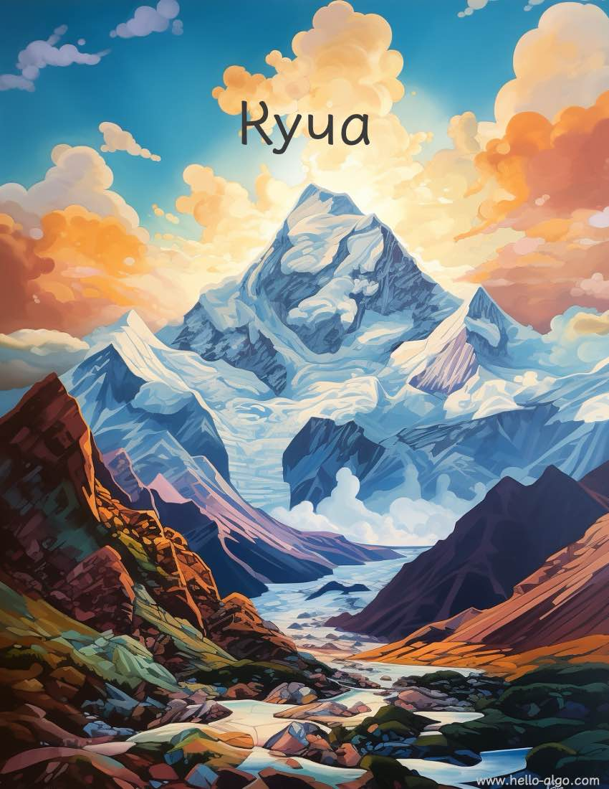

# Кучи

!!! abstract

    Кучи похожи на горные хребты, где склоны поднимаются уступами и каждая вершина имеет свои очертания.
    
    Пики высятся на разной высоте, но прежде всего взгляд находит самую высокую вершину.
