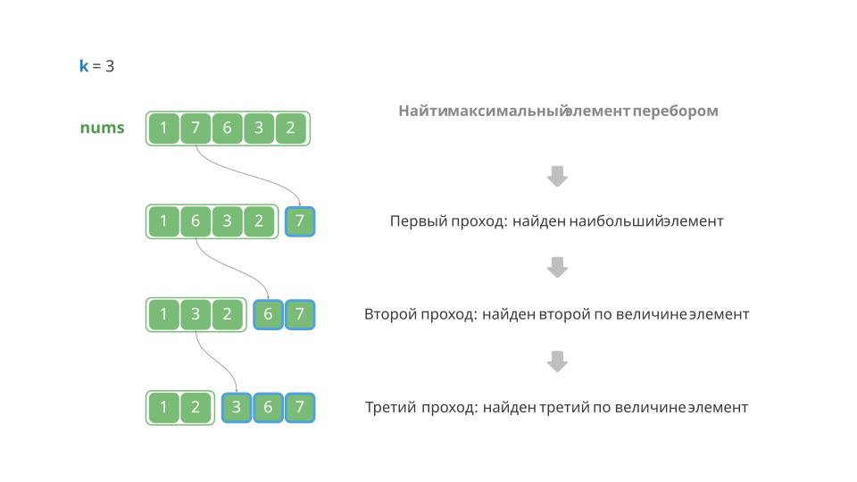
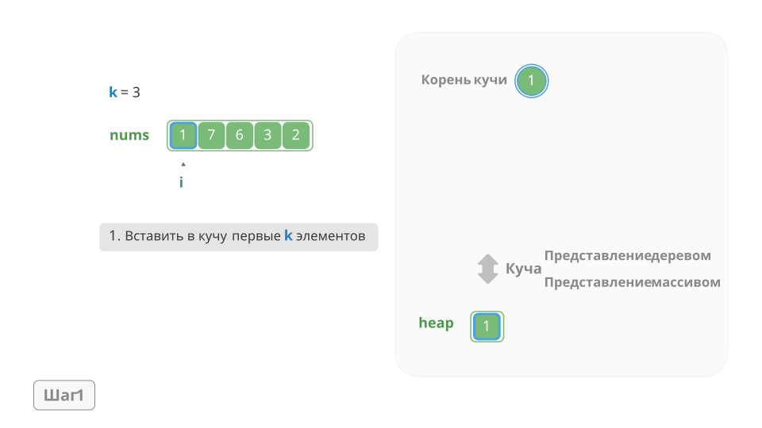
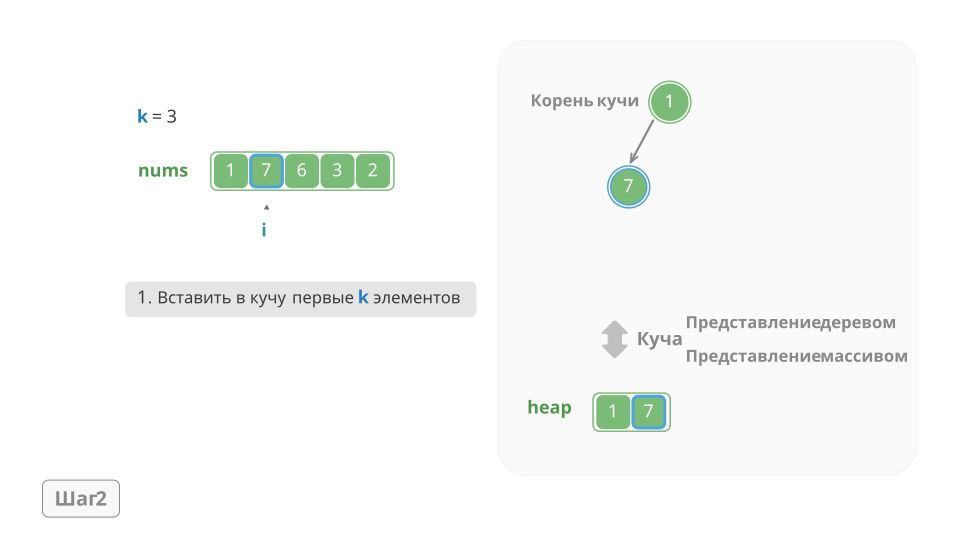
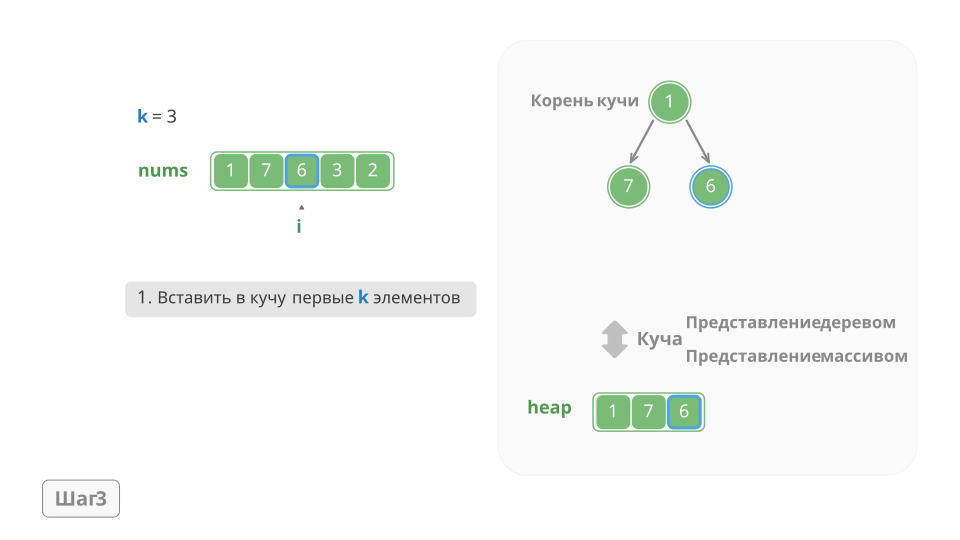
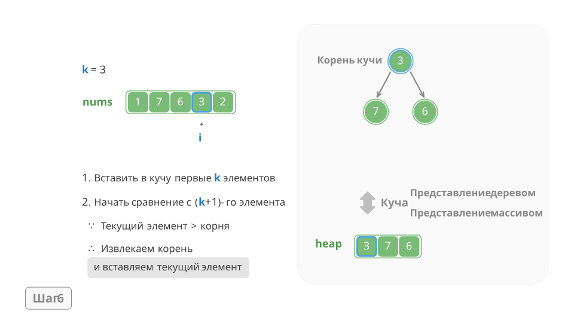
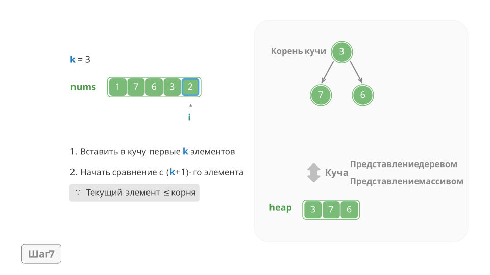

# 8.3 &nbsp; Задача о k наибольших элементах

!!! question

    Дан неупорядоченный массив `nums` длины $n$. Верните $k$ наибольших элементов массива.

Сначала рассмотрим два прямых способа решения, а затем — более эффективный алгоритм с кучей.

## 8.3.1 &nbsp; Способ 1. Последовательный отбор

Выполним $k$ проходов, как на рисунке 8-6. На каждом извлекаем очередной по величине элемент: $1$-й, $2$-й, $\dots$, $k$-й. Временная сложность равна $O(nk)$.

Этот способ подходит лишь при $k \ll n$. Когда $k$ близко к $n$, затраты времени приближаются к $O(n^2)$ и вычисления становятся очень долгими.

{ class="animation-figure" }

<p align="center"> Рисунок 8-6 &nbsp; Поиск k наибольших элементов последовательным отбором </p>

!!! tip

    При $k = n$ получается полностью упорядоченная последовательность. В этом случае алгоритм равносилен сортировке выбором.

## 8.3.2 &nbsp; Способ 2. Сортировка

Как показано ниже, можно отсортировать массив `nums` и вернуть $k$ крайних правых элементов. Временная сложность равна $O(n \log n)$.

Так мы выполняем лишнюю работу: нужны только $k$ наибольших элементов, сортировать остальные не требуется.

{ class="animation-figure" }

<p align="center"> Рисунок 8-7 &nbsp; Поиск k наибольших элементов сортировкой </p>

## 8.3.3 &nbsp; Способ 3. Куча

С помощью кучи задачу о k наибольших элементах можно решить эффективнее. Ход алгоритма показан ниже.

1. Создайте мин-кучу: в её корне находится минимальный элемент.
2. По очереди вставьте в кучу первые $k$ элементов массива.
3. Начиная с элемента с порядковым номером $k + 1$, сравнивайте текущий элемент с корнем. Если он больше, извлеките корень и вставьте текущий элемент.
4. После обхода в куче останутся $k$ наибольших элементов.

=== "<1>"
    { class="animation-figure" }

=== "<2>"
    { class="animation-figure" }

=== "<3>"
    { class="animation-figure" }

=== "<4>"
    { class="animation-figure" }

=== "<5>"
    { class="animation-figure" }

=== "<6>"
    { class="animation-figure" }

=== "<7>"
    { class="animation-figure" }

=== "<8>"
    { class="animation-figure" }

=== "<9>"
    { class="animation-figure" }

<p align="center"> Рисунок 8-8 &nbsp; Поиск k наибольших элементов с помощью кучи </p>

Пример реализации:

=== "Python"

    ```python title="top_k.py"
    def top_k_heap(nums: list[int], k: int) -> list[int]:
        """Найти k наибольших элементов массива с помощью кучи"""
        # Инициализировать мин-кучу
        heap = []
        # Добавить в кучу первые k элементов массива
        for i in range(k):
            heapq.heappush(heap, nums[i])
        # Начиная с (k+1)-го элемента, поддерживать размер кучи равным k
        for i in range(k, len(nums)):
            # Если текущий элемент больше корня, извлечь корень и вставить текущий элемент
            if nums[i] > heap[0]:
                heapq.heappop(heap)
                heapq.heappush(heap, nums[i])
        return heap
    ```

=== "C++"

    ```cpp title="top_k.cpp"
    /* Найти k наибольших элементов массива с помощью кучи */
    priority_queue<int, vector<int>, greater<int>> topKHeap(vector<int> &nums, int k) {
        // Инициализировать мин-кучу
        priority_queue<int, vector<int>, greater<int>> heap;
        // Добавить в кучу первые k элементов массива
        for (int i = 0; i < k; i++) {
            heap.push(nums[i]);
        }
        // Начиная с (k+1)-го элемента, поддерживать размер кучи равным k
        for (int i = k; i < nums.size(); i++) {
            // Если текущий элемент больше корня, извлечь корень и вставить текущий элемент
            if (nums[i] > heap.top()) {
                heap.pop();
                heap.push(nums[i]);
            }
        }
        return heap;
    }
    ```

=== "Java"

    ```java title="top_k.java"
    /* Найти k наибольших элементов массива с помощью кучи */
    Queue<Integer> topKHeap(int[] nums, int k) {
        // Инициализировать мин-кучу
        Queue<Integer> heap = new PriorityQueue<Integer>();
        // Добавить в кучу первые k элементов массива
        for (int i = 0; i < k; i++) {
            heap.offer(nums[i]);
        }
        // Начиная с (k+1)-го элемента, поддерживать размер кучи равным k
        for (int i = k; i < nums.length; i++) {
            // Если текущий элемент больше корня, извлечь корень и вставить текущий элемент
            if (nums[i] > heap.peek()) {
                heap.poll();
                heap.offer(nums[i]);
            }
        }
        return heap;
    }
    ```

=== "C#"

    ```csharp title="top_k.cs"
    /* Найти k наибольших элементов массива с помощью кучи */
    PriorityQueue<int, int> TopKHeap(int[] nums, int k) {
        // Инициализировать мин-кучу
        PriorityQueue<int, int> heap = new();
        // Добавить в кучу первые k элементов массива
        for (int i = 0; i < k; i++) {
            heap.Enqueue(nums[i], nums[i]);
        }
        // Начиная с (k+1)-го элемента, поддерживать размер кучи равным k
        for (int i = k; i < nums.Length; i++) {
            // Если текущий элемент больше корня, извлечь корень и вставить текущий элемент
            if (nums[i] > heap.Peek()) {
                heap.Dequeue();
                heap.Enqueue(nums[i], nums[i]);
            }
        }
        return heap;
    }
    ```

=== "Go"

    ```go title="top_k.go"
    /* Найти k наибольших элементов массива с помощью кучи */
    func topKHeap(nums []int, k int) *minHeap {
        // Инициализировать мин-кучу
        h := &minHeap{}
        heap.Init(h)
        // Добавить в кучу первые k элементов массива
        for i := 0; i < k; i++ {
            heap.Push(h, nums[i])
        }
        // Начиная с (k+1)-го элемента, поддерживать размер кучи равным k
        for i := k; i < len(nums); i++ {
            // Если текущий элемент больше корня, извлечь корень и вставить текущий элемент
            if nums[i] > h.Top().(int) {
                heap.Pop(h)
                heap.Push(h, nums[i])
            }
        }
        return h
    }
    ```

=== "Swift"

    ```swift title="top_k.swift"
    /* Найти k наибольших элементов массива с помощью кучи */
    func topKHeap(nums: [Int], k: Int) -> [Int] {
        // Инициализировать мин-кучу, построив её из первых k элементов
        var heap = Heap(nums.prefix(k))
        // Начиная с (k+1)-го элемента, поддерживать размер кучи равным k
        for i in nums.indices.dropFirst(k) {
            // Если текущий элемент больше корня, извлечь корень и вставить текущий элемент
            if nums[i] > heap.min()! {
                _ = heap.removeMin()
                heap.insert(nums[i])
            }
        }
        return heap.unordered
    }
    ```

=== "JS"

    ```javascript title="top_k.js"
    /* Вставить элемент в кучу */
    function pushMinHeap(maxHeap, val) {
        // Сменить знак элемента
        maxHeap.push(-val);
    }

    /* Извлечь элемент из кучи */
    function popMinHeap(maxHeap) {
        // Сменить знак элемента
        return -maxHeap.pop();
    }

    /* Посмотреть элемент в корне */
    function peekMinHeap(maxHeap) {
        // Сменить знак элемента
        return -maxHeap.peek();
    }

    /* Извлечь элементы кучи */
    function getMinHeap(maxHeap) {
        // Сменить знак элемента
        return maxHeap.getMaxHeap().map((num) => -num);
    }

    /* Найти k наибольших элементов массива с помощью кучи */
    function topKHeap(nums, k) {
        // Инициализировать мин-кучу
        // Меняем знак всех элементов, чтобы использовать макс-кучу как мин-кучу
        const maxHeap = new MaxHeap([]);
        // Добавить в кучу первые k элементов массива
        for (let i = 0; i < k; i++) {
            pushMinHeap(maxHeap, nums[i]);
        }
        // Начиная с (k+1)-го элемента, поддерживать размер кучи равным k
        for (let i = k; i < nums.length; i++) {
            // Если текущий элемент больше корня, извлечь корень и вставить текущий элемент
            if (nums[i] > peekMinHeap(maxHeap)) {
                popMinHeap(maxHeap);
                pushMinHeap(maxHeap, nums[i]);
            }
        }
        // Вернуть элементы кучи
        return getMinHeap(maxHeap);
    }
    ```

=== "TS"

    ```typescript title="top_k.ts"
    /* Вставить элемент в кучу */
    function pushMinHeap(maxHeap: MaxHeap, val: number): void {
        // Сменить знак элемента
        maxHeap.push(-val);
    }

    /* Извлечь элемент из кучи */
    function popMinHeap(maxHeap: MaxHeap): number {
        // Сменить знак элемента
        return -maxHeap.pop();
    }

    /* Посмотреть элемент в корне */
    function peekMinHeap(maxHeap: MaxHeap): number {
        // Сменить знак элемента
        return -maxHeap.peek();
    }

    /* Извлечь элементы кучи */
    function getMinHeap(maxHeap: MaxHeap): number[] {
        // Сменить знак элемента
        return maxHeap.getMaxHeap().map((num: number) => -num);
    }

    /* Найти k наибольших элементов массива с помощью кучи */
    function topKHeap(nums: number[], k: number): number[] {
        // Инициализировать мин-кучу
        // Меняем знак всех элементов, чтобы использовать макс-кучу как мин-кучу
        const maxHeap = new MaxHeap([]);
        // Добавить в кучу первые k элементов массива
        for (let i = 0; i < k; i++) {
            pushMinHeap(maxHeap, nums[i]);
        }
        // Начиная с (k+1)-го элемента, поддерживать размер кучи равным k
        for (let i = k; i < nums.length; i++) {
            // Если текущий элемент больше корня, извлечь корень и вставить текущий элемент
            if (nums[i] > peekMinHeap(maxHeap)) {
                popMinHeap(maxHeap);
                pushMinHeap(maxHeap, nums[i]);
            }
        }
        // Вернуть элементы кучи
        return getMinHeap(maxHeap);
    }
    ```

=== "Dart"

    ```dart title="top_k.dart"
    /* Найти k наибольших элементов массива с помощью кучи */
    MinHeap topKHeap(List<int> nums, int k) {
      // Инициализировать мин-кучу и добавить в неё первые k элементов массива
      MinHeap heap = MinHeap(nums.sublist(0, k));
      // Начиная с (k+1)-го элемента, поддерживать размер кучи равным k
      for (int i = k; i < nums.length; i++) {
        // Если текущий элемент больше корня, извлечь корень и вставить текущий элемент
        if (nums[i] > heap.peek()) {
          heap.pop();
          heap.push(nums[i]);
        }
      }
      return heap;
    }
    ```

=== "Rust"

    ```rust title="top_k.rs"
    /* Найти k наибольших элементов массива с помощью кучи */
    fn top_k_heap(nums: Vec<i32>, k: usize) -> BinaryHeap<Reverse<i32>> {
        // BinaryHeap — макс-куча. Обёртка Reverse меняет порядок сравнения элементов и даёт мин-кучу
        let mut heap = BinaryHeap::<Reverse<i32>>::new();
        // Добавить в кучу первые k элементов массива
        for &num in nums.iter().take(k) {
            heap.push(Reverse(num));
        }
        // Начиная с (k+1)-го элемента, поддерживать размер кучи равным k
        for &num in nums.iter().skip(k) {
            // Если текущий элемент больше корня, извлечь корень и вставить текущий элемент
            if num > heap.peek().unwrap().0 {
                heap.pop();
                heap.push(Reverse(num));
            }
        }
        heap
    }
    ```

=== "C"

    ```c title="top_k.c"
    /* Вставить элемент в кучу */
    void pushMinHeap(MaxHeap *maxHeap, int val) {
        // Сменить знак элемента
        push(maxHeap, -val);
    }

    /* Извлечь элемент из кучи */
    int popMinHeap(MaxHeap *maxHeap) {
        // Сменить знак элемента
        return -pop(maxHeap);
    }

    /* Посмотреть элемент в корне */
    int peekMinHeap(MaxHeap *maxHeap) {
        // Сменить знак элемента
        return -peek(maxHeap);
    }

    /* Извлечь элементы кучи */
    int *getMinHeap(MaxHeap *maxHeap) {
        // Сменить знак всех элементов кучи и записать их в массив res
        int *res = (int *)malloc(maxHeap->size * sizeof(int));
        for (int i = 0; i < maxHeap->size; i++) {
            res[i] = -maxHeap->data[i];
        }
        return res;
    }

    /* Функция поиска k наибольших элементов массива с помощью кучи */
    int *topKHeap(int *nums, int sizeNums, int k) {
        // Инициализировать мин-кучу
        // Меняем знак всех элементов, чтобы использовать макс-кучу как мин-кучу
        int *empty = (int *)malloc(0);
        MaxHeap *maxHeap = newMaxHeap(empty, 0);
        // Добавить в кучу первые k элементов массива
        for (int i = 0; i < k; i++) {
            pushMinHeap(maxHeap, nums[i]);
        }
        // Начиная с (k+1)-го элемента, поддерживать размер кучи равным k
        for (int i = k; i < sizeNums; i++) {
            // Если текущий элемент больше корня, извлечь корень и вставить текущий элемент
            if (nums[i] > peekMinHeap(maxHeap)) {
                popMinHeap(maxHeap);
                pushMinHeap(maxHeap, nums[i]);
            }
        }
        int *res = getMinHeap(maxHeap);
        // Освободить память
        delMaxHeap(maxHeap);
        return res;
    }
    ```

=== "Kotlin"

    ```kotlin title="top_k.kt"
    /* Найти k наибольших элементов массива с помощью кучи */
    fun topKHeap(nums: IntArray, k: Int): Queue<Int> {
        // Инициализировать мин-кучу
        val heap = PriorityQueue<Int>()
        // Добавить в кучу первые k элементов массива
        for (i in 0..<k) {
            heap.offer(nums[i])
        }
        // Начиная с (k+1)-го элемента, поддерживать размер кучи равным k
        for (i in k..<nums.size) {
            // Если текущий элемент больше корня, извлечь корень и вставить текущий элемент
            if (nums[i] > heap.peek()) {
                heap.poll()
                heap.offer(nums[i])
            }
        }
        return heap
    }
    ```

=== "Ruby"

    ```ruby title="top_k.rb"
    ### Найти k наибольших элементов массива с помощью кучи ###
    def top_k_heap(nums, k)
      # Инициализировать мин-кучу
      # Меняем знак всех элементов, чтобы использовать макс-кучу как мин-кучу
      max_heap = MaxHeap.new([])

      # Добавить в кучу первые k элементов массива
      for i in 0...k
        push_min_heap(max_heap, nums[i])
      end

      # Начиная с (k+1)-го элемента, поддерживать размер кучи равным k
      for i in k...nums.length
        # Если текущий элемент больше корня, извлечь корень и вставить текущий элемент
        if nums[i] > peek_min_heap(max_heap)
          pop_min_heap(max_heap)
          push_min_heap(max_heap, nums[i])
        end
      end

      get_min_heap(max_heap)
    end
    ```

??? pythontutor "Визуализация выполнения"

    <div style="height: 549px; width: 100%;"><iframe class="pythontutor-iframe" title="Визуализация выполнения" src="https://pythontutor.com/iframe-embed.html#code=import%20heapq%0A%0Adef%20top_k_heap%28nums%3A%20list%5Bint%5D,%20k%3A%20int%29%20-%3E%20list%5Bint%5D%3A%0A%20%20%20%20%22%22%22%D0%9D%D0%B0%D0%B9%D1%82%D0%B8%20k%20%D0%BD%D0%B0%D0%B8%D0%B1%D0%BE%D0%BB%D1%8C%D1%88%D0%B8%D1%85%20%D1%8D%D0%BB%D0%B5%D0%BC%D0%B5%D0%BD%D1%82%D0%BE%D0%B2%20%D0%BC%D0%B0%D1%81%D1%81%D0%B8%D0%B2%D0%B0%20%D1%81%20%D0%BF%D0%BE%D0%BC%D0%BE%D1%89%D1%8C%D1%8E%20%D0%BA%D1%83%D1%87%D0%B8%22%22%22%0A%20%20%20%20%23%20%D0%98%D0%BD%D0%B8%D1%86%D0%B8%D0%B0%D0%BB%D0%B8%D0%B7%D0%B8%D1%80%D0%BE%D0%B2%D0%B0%D1%82%D1%8C%20%D0%BC%D0%B8%D0%BD-%D0%BA%D1%83%D1%87%D1%83%0A%20%20%20%20heap%20%3D%20%5B%5D%0A%20%20%20%20%23%20%D0%94%D0%BE%D0%B1%D0%B0%D0%B2%D0%B8%D1%82%D1%8C%20%D0%B2%20%D0%BA%D1%83%D1%87%D1%83%20%D0%BF%D0%B5%D1%80%D0%B2%D1%8B%D0%B5%20k%20%D1%8D%D0%BB%D0%B5%D0%BC%D0%B5%D0%BD%D1%82%D0%BE%D0%B2%20%D0%BC%D0%B0%D1%81%D1%81%D0%B8%D0%B2%D0%B0%0A%20%20%20%20for%20i%20in%20range%28k%29%3A%0A%20%20%20%20%20%20%20%20heapq.heappush%28heap,%20nums%5Bi%5D%29%0A%20%20%20%20%23%20%D0%9D%D0%B0%D1%87%D0%B8%D0%BD%D0%B0%D1%8F%20%D1%81%20%28k%2B1%29-%D0%B3%D0%BE%20%D1%8D%D0%BB%D0%B5%D0%BC%D0%B5%D0%BD%D1%82%D0%B0,%20%D0%BF%D0%BE%D0%B4%D0%B4%D0%B5%D1%80%D0%B6%D0%B8%D0%B2%D0%B0%D1%82%D1%8C%20%D1%80%D0%B0%D0%B7%D0%BC%D0%B5%D1%80%20%D0%BA%D1%83%D1%87%D0%B8%20%D1%80%D0%B0%D0%B2%D0%BD%D1%8B%D0%BC%20k%0A%20%20%20%20for%20i%20in%20range%28k,%20len%28nums%29%29%3A%0A%20%20%20%20%20%20%20%20%23%20%D0%95%D1%81%D0%BB%D0%B8%20%D1%82%D0%B5%D0%BA%D1%83%D1%89%D0%B8%D0%B9%20%D1%8D%D0%BB%D0%B5%D0%BC%D0%B5%D0%BD%D1%82%20%D0%B1%D0%BE%D0%BB%D1%8C%D1%88%D0%B5%20%D0%BA%D0%BE%D1%80%D0%BD%D1%8F,%20%D0%B8%D0%B7%D0%B2%D0%BB%D0%B5%D1%87%D1%8C%20%D0%BA%D0%BE%D1%80%D0%B5%D0%BD%D1%8C%20%D0%B8%20%D0%B2%D1%81%D1%82%D0%B0%D0%B2%D0%B8%D1%82%D1%8C%20%D1%82%D0%B5%D0%BA%D1%83%D1%89%D0%B8%D0%B9%20%D1%8D%D0%BB%D0%B5%D0%BC%D0%B5%D0%BD%D1%82%0A%20%20%20%20%20%20%20%20if%20nums%5Bi%5D%20%3E%20heap%5B0%5D%3A%0A%20%20%20%20%20%20%20%20%20%20%20%20heapq.heappop%28heap%29%0A%20%20%20%20%20%20%20%20%20%20%20%20heapq.heappush%28heap,%20nums%5Bi%5D%29%0A%20%20%20%20return%20heap%0A%0A%22%22%22Driver%20Code%22%22%22%0Aif%20__name__%20%3D%3D%20%22__main__%22%3A%0A%20%20%20%20nums%20%3D%20%5B1,%207,%206,%203,%202%5D%0A%20%20%20%20k%20%3D%203%0A%0A%20%20%20%20res%20%3D%20top_k_heap%28nums,%20k%29&codeDivHeight=472&codeDivWidth=350&cumulative=false&curInstr=6&heapPrimitives=nevernest&origin=opt-frontend.js&py=311&rawInputLstJSON=%5B%5D&textReferences=false"> </iframe></div>
    <div style="margin-top: 5px;"><a href="https://pythontutor.com/iframe-embed.html#code=import%20heapq%0A%0Adef%20top_k_heap%28nums%3A%20list%5Bint%5D,%20k%3A%20int%29%20-%3E%20list%5Bint%5D%3A%0A%20%20%20%20%22%22%22%D0%9D%D0%B0%D0%B9%D1%82%D0%B8%20k%20%D0%BD%D0%B0%D0%B8%D0%B1%D0%BE%D0%BB%D1%8C%D1%88%D0%B8%D1%85%20%D1%8D%D0%BB%D0%B5%D0%BC%D0%B5%D0%BD%D1%82%D0%BE%D0%B2%20%D0%BC%D0%B0%D1%81%D1%81%D0%B8%D0%B2%D0%B0%20%D1%81%20%D0%BF%D0%BE%D0%BC%D0%BE%D1%89%D1%8C%D1%8E%20%D0%BA%D1%83%D1%87%D0%B8%22%22%22%0A%20%20%20%20%23%20%D0%98%D0%BD%D0%B8%D1%86%D0%B8%D0%B0%D0%BB%D0%B8%D0%B7%D0%B8%D1%80%D0%BE%D0%B2%D0%B0%D1%82%D1%8C%20%D0%BC%D0%B8%D0%BD-%D0%BA%D1%83%D1%87%D1%83%0A%20%20%20%20heap%20%3D%20%5B%5D%0A%20%20%20%20%23%20%D0%94%D0%BE%D0%B1%D0%B0%D0%B2%D0%B8%D1%82%D1%8C%20%D0%B2%20%D0%BA%D1%83%D1%87%D1%83%20%D0%BF%D0%B5%D1%80%D0%B2%D1%8B%D0%B5%20k%20%D1%8D%D0%BB%D0%B5%D0%BC%D0%B5%D0%BD%D1%82%D0%BE%D0%B2%20%D0%BC%D0%B0%D1%81%D1%81%D0%B8%D0%B2%D0%B0%0A%20%20%20%20for%20i%20in%20range%28k%29%3A%0A%20%20%20%20%20%20%20%20heapq.heappush%28heap,%20nums%5Bi%5D%29%0A%20%20%20%20%23%20%D0%9D%D0%B0%D1%87%D0%B8%D0%BD%D0%B0%D1%8F%20%D1%81%20%28k%2B1%29-%D0%B3%D0%BE%20%D1%8D%D0%BB%D0%B5%D0%BC%D0%B5%D0%BD%D1%82%D0%B0,%20%D0%BF%D0%BE%D0%B4%D0%B4%D0%B5%D1%80%D0%B6%D0%B8%D0%B2%D0%B0%D1%82%D1%8C%20%D1%80%D0%B0%D0%B7%D0%BC%D0%B5%D1%80%20%D0%BA%D1%83%D1%87%D0%B8%20%D1%80%D0%B0%D0%B2%D0%BD%D1%8B%D0%BC%20k%0A%20%20%20%20for%20i%20in%20range%28k,%20len%28nums%29%29%3A%0A%20%20%20%20%20%20%20%20%23%20%D0%95%D1%81%D0%BB%D0%B8%20%D1%82%D0%B5%D0%BA%D1%83%D1%89%D0%B8%D0%B9%20%D1%8D%D0%BB%D0%B5%D0%BC%D0%B5%D0%BD%D1%82%20%D0%B1%D0%BE%D0%BB%D1%8C%D1%88%D0%B5%20%D0%BA%D0%BE%D1%80%D0%BD%D1%8F,%20%D0%B8%D0%B7%D0%B2%D0%BB%D0%B5%D1%87%D1%8C%20%D0%BA%D0%BE%D1%80%D0%B5%D0%BD%D1%8C%20%D0%B8%20%D0%B2%D1%81%D1%82%D0%B0%D0%B2%D0%B8%D1%82%D1%8C%20%D1%82%D0%B5%D0%BA%D1%83%D1%89%D0%B8%D0%B9%20%D1%8D%D0%BB%D0%B5%D0%BC%D0%B5%D0%BD%D1%82%0A%20%20%20%20%20%20%20%20if%20nums%5Bi%5D%20%3E%20heap%5B0%5D%3A%0A%20%20%20%20%20%20%20%20%20%20%20%20heapq.heappop%28heap%29%0A%20%20%20%20%20%20%20%20%20%20%20%20heapq.heappush%28heap,%20nums%5Bi%5D%29%0A%20%20%20%20return%20heap%0A%0A%22%22%22Driver%20Code%22%22%22%0Aif%20__name__%20%3D%3D%20%22__main__%22%3A%0A%20%20%20%20nums%20%3D%20%5B1,%207,%206,%203,%202%5D%0A%20%20%20%20k%20%3D%203%0A%0A%20%20%20%20res%20%3D%20top_k_heap%28nums,%20k%29&codeDivHeight=800&codeDivWidth=600&cumulative=false&curInstr=6&heapPrimitives=nevernest&origin=opt-frontend.js&py=311&rawInputLstJSON=%5B%5D&textReferences=false" target="_blank" rel="noopener noreferrer">Во весь экран ></a></div>

Всего выполняется $n$ шагов с возможной вставкой и извлечением, а размер кучи не превышает $k$. Поэтому временная сложность равна $O(n \log k)$. Метод эффективен: при малом $k$ сложность приближается к $O(n)$, а даже при большом $k$ не превышает $O(n \log n)$.

Этот метод подходит и для потока данных. По мере поступления новых элементов можно обновлять содержимое кучи и тем самым поддерживать набор из $k$ наибольших элементов.
