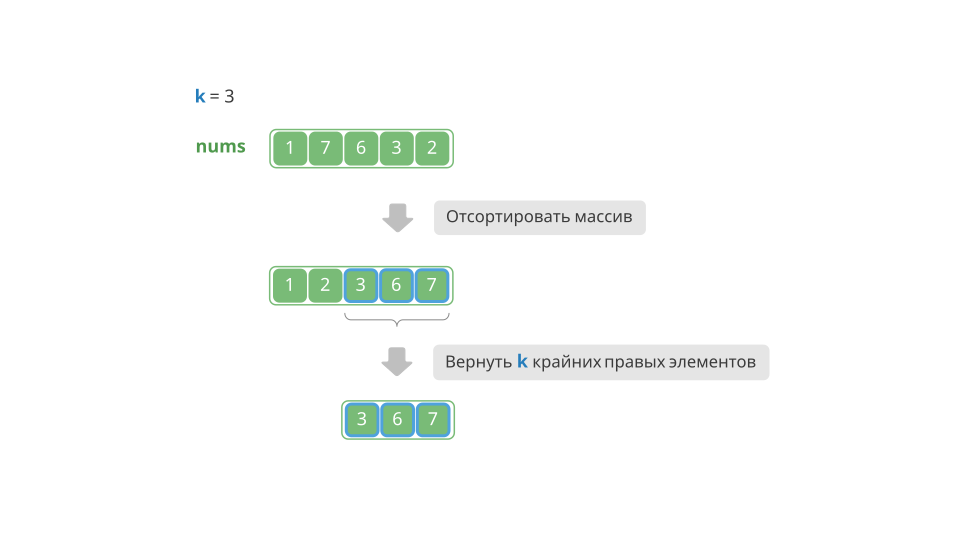
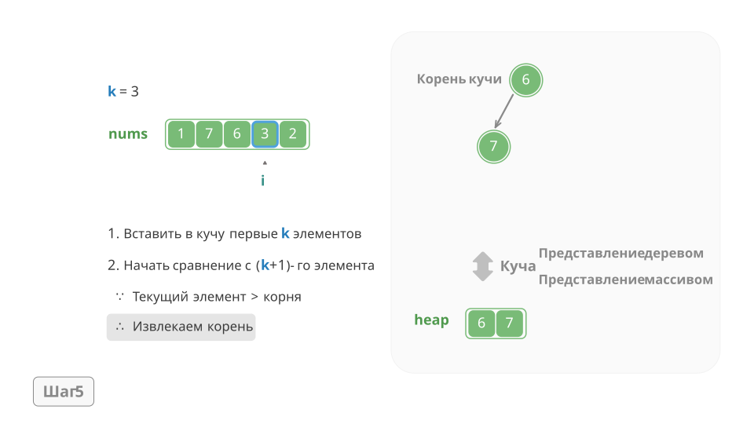
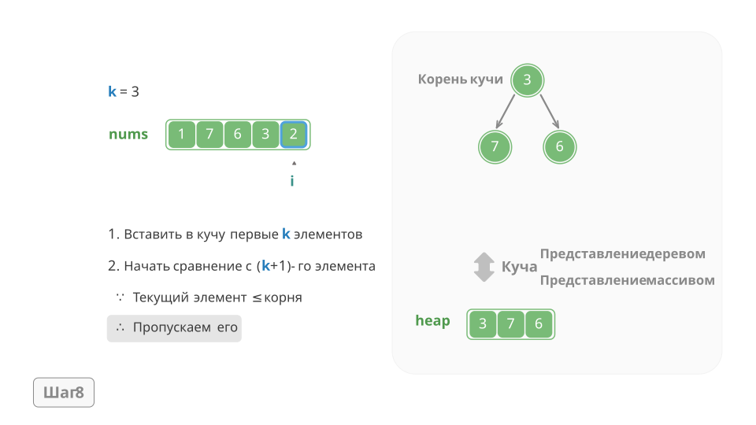
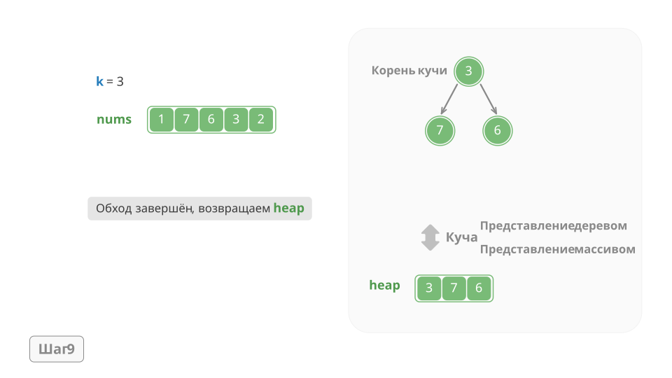

# Задача о k наибольших элементах

!!! question

    Дан неупорядоченный массив `nums` длины $n$. Верните $k$ наибольших элементов массива.

Сначала рассмотрим два прямых способа решения, а затем — более эффективный алгоритм с кучей.

## Способ 1. Последовательный отбор

Выполним $k$ проходов, как на рисунке ниже. На каждом извлекаем очередной по величине элемент: $1$-й, $2$-й, $\dots$, $k$-й. Временная сложность равна $O(nk)$.

Этот способ подходит лишь при $k \ll n$. Когда $k$ близко к $n$, затраты времени приближаются к $O(n^2)$ и вычисления становятся очень долгими.


!!! tip

    При $k = n$ получается полностью упорядоченная последовательность. В этом случае алгоритм равносилен сортировке выбором.

## Способ 2. Сортировка

Как показано ниже, можно отсортировать массив `nums` и вернуть $k$ крайних правых элементов. Временная сложность равна $O(n \log n)$.

Так мы выполняем лишнюю работу: нужны только $k$ наибольших элементов, сортировать остальные не требуется.



## Способ 3. Куча

С помощью кучи задачу о k наибольших элементах можно решить эффективнее. Ход алгоритма показан ниже.

1. Создайте мин-кучу: в её корне находится минимальный элемент.
2. По очереди вставьте в кучу первые $k$ элементов массива.
3. Начиная с элемента с порядковым номером $k + 1$, сравнивайте текущий элемент с корнем. Если он больше, извлеките корень и вставьте текущий элемент.
4. После обхода в куче останутся $k$ наибольших элементов.

=== "<1>"
    

=== "<2>"
    

=== "<3>"
    

=== "<4>"
    

=== "<5>"
    

=== "<6>"
    

=== "<7>"
    

=== "<8>"
    

=== "<9>"
    

Пример реализации:

```src
[file]{top_k}-[class]{}-[func]{top_k_heap}
```

Всего выполняется $n$ шагов с возможной вставкой и извлечением, а размер кучи не превышает $k$. Поэтому временная сложность равна $O(n \log k)$. Метод эффективен: при малом $k$ сложность приближается к $O(n)$, а даже при большом $k$ не превышает $O(n \log n)$.

Этот метод подходит и для потока данных. По мере поступления новых элементов можно обновлять содержимое кучи и тем самым поддерживать набор из $k$ наибольших элементов.
