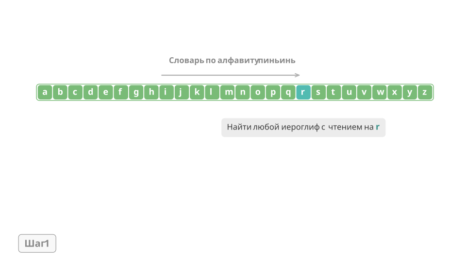
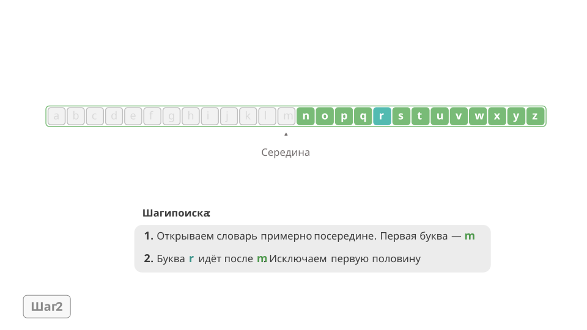
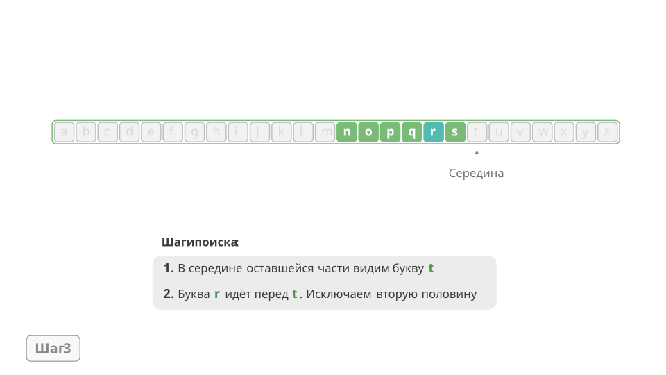
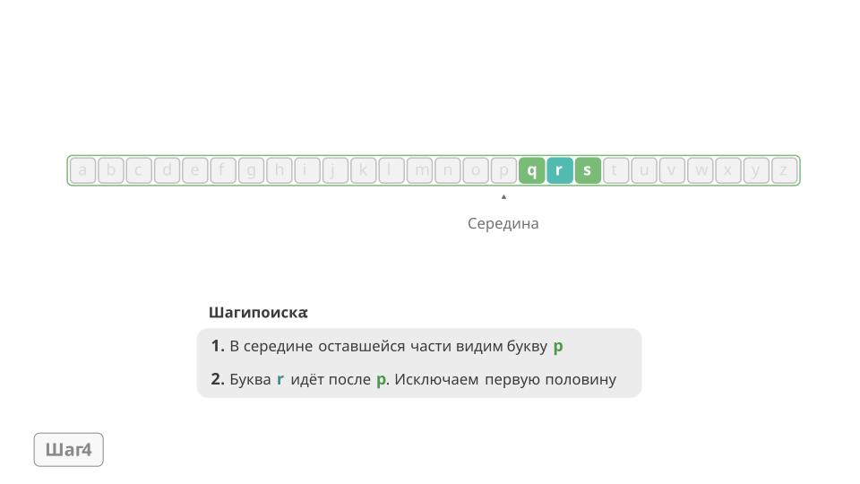
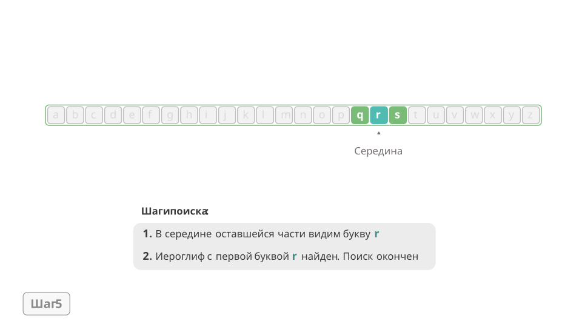
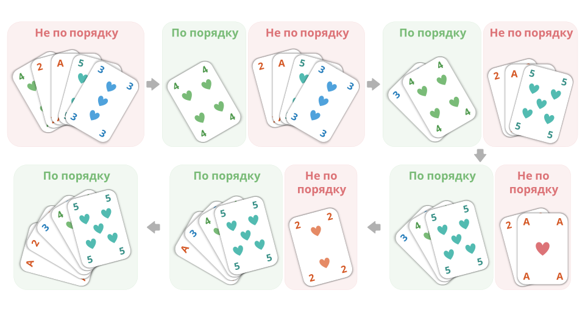
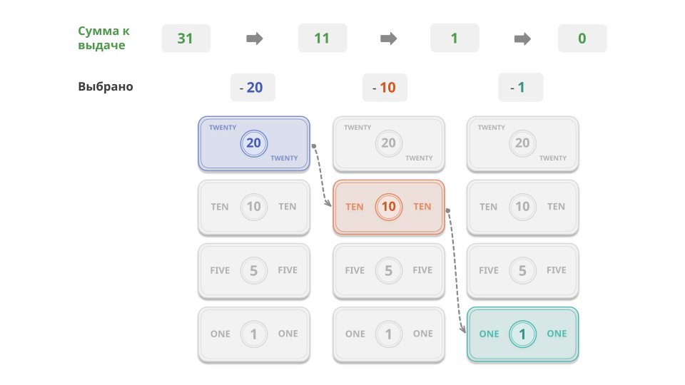

# Алгоритмы повсюду

Слово «алгоритм» естественно ассоциируется с математикой. Но многие алгоритмы обходятся без сложной математики и опираются на простую логику, с которой мы постоянно встречаемся в быту.

Прежде чем перейти к формальному обсуждению, замечу одну любопытную вещь: **вы уже освоили множество алгоритмов, сами того не заметив, и привычно применяете их в повседневной жизни**. Убедимся в этом на нескольких примерах.

**Пример 1. Поиск в словаре**. В китайском словаре для иероглифа указано чтение в записи пиньинь, а статьи идут в алфавитном порядке этой записи. Допустим, нам нужен иероглиф, чтение которого начинается с $r$. Обычно поиск идёт так, как показано на рисунке.

1. Откроем словарь примерно посередине и посмотрим на начальную букву на странице. Пусть это $m$.
2. Поскольку в алфавите пиньинь $r$ идёт после $m$, исключим первую половину словаря. Теперь область поиска ограничена второй половиной.
3. Повторяем шаги `1.` и `2.`, пока не откроем страницу с начальной буквой $r$.

=== "<1>"
    

=== "<2>"
    

=== "<3>"
    

=== "<4>"
    

=== "<5>"
    

Этому приёму нас учат ещё в начальной школе, а на деле перед нами известный алгоритм двоичного поиска. С точки зрения структур данных словарь можно представить как отсортированный массив. С точки зрения алгоритмов описанная последовательность действий — двоичный поиск.

**Пример 2. Сортировка карт**. Получив карты в начале партии, мы раскладываем их на руке по возрастанию достоинства. На рисунке показано, как это сделать.

1. Разделим карты на упорядоченную и неупорядоченную части. Вначале считаем упорядоченной одну крайнюю слева карту.
2. Возьмём карту из неупорядоченной части и вставим на нужное место в упорядоченной. Теперь две крайние слева карты стоят по порядку.
3. Повторяем шаг `2.`: каждый раз переносим одну карту из неупорядоченной части на её место в упорядоченной, пока не упорядочим все карты.

Так мы фактически применяем сортировку вставками. Она очень эффективна для небольших наборов данных, и её используют библиотечные функции сортировки во многих языках программирования.

**Пример 3. Выдача сдачи**. Пусть покупка в супермаркете стоит $69$ юаней, а мы даём кассиру $100$. Он должен вернуть $31$ юань. Ход рассуждений кассира показан на рисунке.

1. Подойдут купюры номиналом меньше $31$ юаня. В наличии есть номиналы $1$, $5$, $10$ и $20$ юаней.
2. Берём крупнейшую подходящую купюру в $20$ юаней. Остаток: $31 - 20 = 11$ юаней.
3. Из тех, что подходят теперь, берём крупнейшую купюру в $10$ юаней. Остаток: $11 - 10 = 1$ юань.
4. Теперь крупнейшая подходящая купюра — $1$ юань. Остаток: $1 - 1 = 0$ юаней.
5. Завершаем выдачу сдачи. Итого: $20 + 10 + 1 = 31$ юань.

На каждом шаге мы делали выбор, который в этот момент казался наилучшим: брали как можно более крупную купюру. В итоге получился допустимый способ выдать сдачу. На языке алгоритмов такой подход называют жадным.

Алгоритмы нужны почти для всего — от приготовления обеда до межзвёздного полёта. С появлением компьютеров стало возможно описывать структуры данных в программах, размещать их в памяти и поручать выполнение алгоритмов центральным и графическим процессорам. Так мы переносим реальные задачи в компьютер и эффективнее справляемся со сложными проблемами.

!!! tip

    Если такие понятия, как структура данных, алгоритм, массив и двоичный поиск, пока знакомы вам лишь отчасти, читайте дальше. Книга поможет вам освоиться в мире алгоритмов и структур данных.
