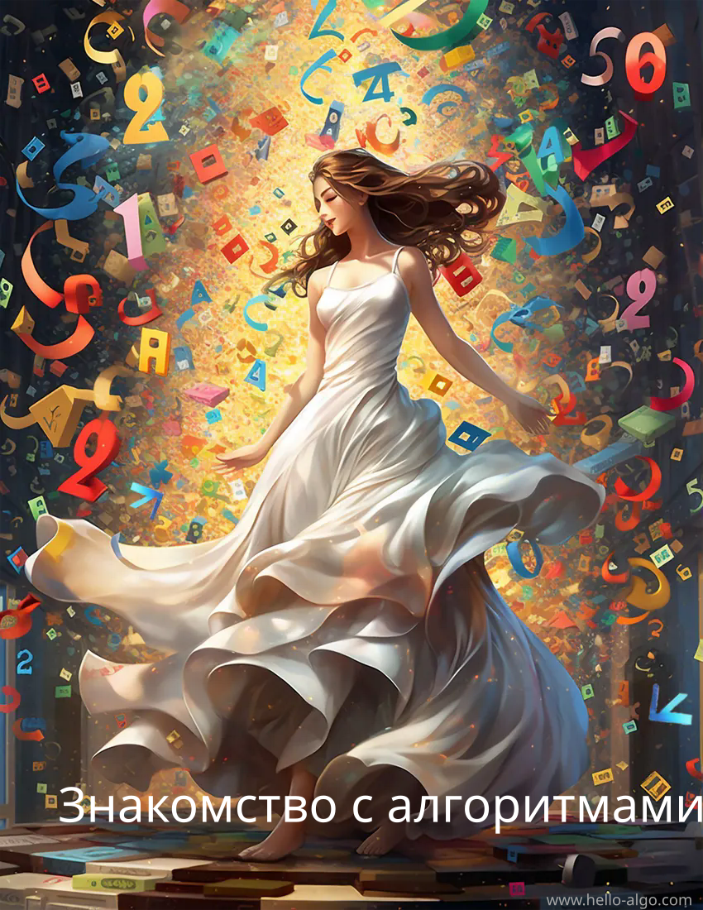

# Глава 1. &nbsp; Знакомство с алгоритмами

{ class="cover-image" }

!!! abstract

    Девушка кружится в танце среди переплетающихся данных. В складках её летящей юбки словно звучит мелодия алгоритмов.
    
    Она приглашает вас в танец. Следуйте за ней в мир алгоритмов, полный логики и красоты.

## Содержание главы

- [1.1 &nbsp; Алгоритмы повсюду](algorithms_are_everywhere.md)
- [1.2 &nbsp; Что такое алгоритм](what_is_dsa.md)
- [1.3 &nbsp; Итоги](summary.md)
