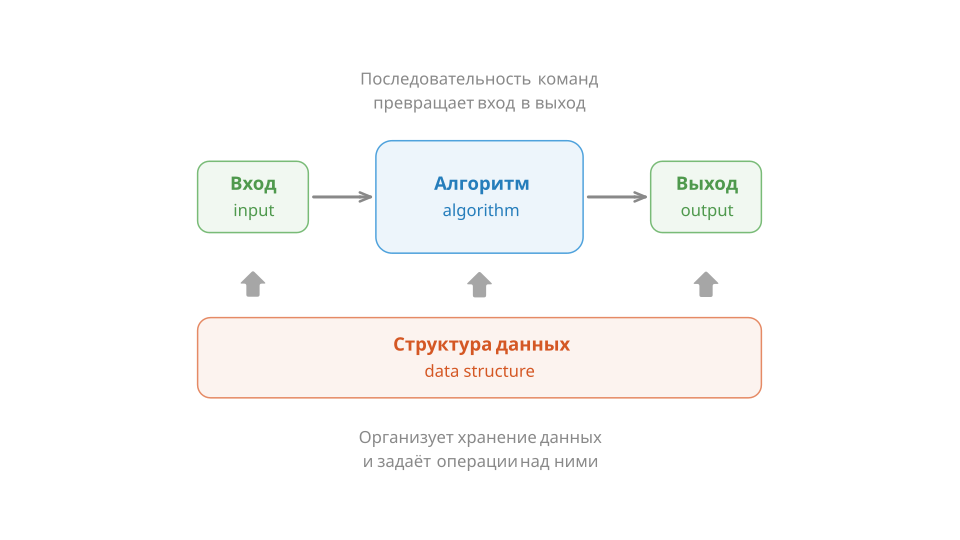

# Что такое алгоритм

## Определение алгоритма

<u>Алгоритм (algorithm)</u> — последовательность инструкций или действий, которая решает определённую задачу за конечное время. Выделим следующие свойства.

- Задача сформулирована однозначно, её вход и выход чётко определены.
- Алгоритм выполним: ему достаточно конечного числа шагов, конечного времени и конечного объёма памяти.
- Каждый шаг имеет определённый смысл. При одинаковых входных данных и условиях выполнения результат один и тот же.

## Определение структуры данных

<u>Структура данных (data structure)</u> — способ организовать и хранить данные. Она определяет их содержание, связи между ними и доступные операции. При проектировании структуры данных стремятся к следующим целям.

- Расходовать как можно меньше памяти компьютера.
- Как можно быстрее выполнять операции над данными: обращаться к ним, добавлять, удалять и обновлять элементы.
- Представлять данные и логические связи в удобной и компактной форме, чтобы алгоритмы могли работать эффективно.

**Проектирование структуры данных требует компромиссов**. Улучшая одно свойство, часто приходится уступать в другом. Рассмотрим два примера.

- В связном списке удобнее добавлять и удалять элементы, чем в массиве, но доступ по позиции медленнее.
- Граф может выразить больше логических связей, чем связный список, но для этого ему требуется больше памяти.

## Связь структур данных и алгоритмов

Структуры данных и алгоритмы тесно переплетены. На рисунке показана их связь, у которой можно выделить три стороны.

- Структуры данных образуют основу алгоритмов. Они предоставляют алгоритму данные в организованном виде и способы работы с ними.
- Алгоритмы приводят структуры данных в действие. Сама структура лишь хранит сведения. Решить конкретную задачу с её помощью позволяет алгоритм.
- Один и тот же алгоритм обычно можно реализовать на основе разных структур данных, но эффективность реализаций может сильно различаться. Поэтому так важно выбрать подходящую структуру.

Сочетание структур данных и алгоритмов напоминает сборку конструктора на следующем рисунке. Помимо множества деталей в набор входит подробная инструкция. Выполняя её шаг за шагом, мы получаем красивую модель.

Соответствия приведены в таблице.

Таблица <id> &nbsp; Структуры данных и алгоритмы на примере конструктора

| Структуры данных и алгоритмы | Сборка конструктора                                 |
| -------------- | ---------------------------------------- |
| Входные данные       | Набор отдельных деталей                             |
| Структура данных       | Организация деталей: форма, размер, способ соединения и другие свойства |
| Алгоритм           | Последовательность действий для сборки модели нужной формы       |
| Выходные данные       | Готовая модель                                 |

Структуры данных и алгоритмы не зависят от языка программирования. Именно поэтому в книге можно привести реализации на разных языках.

!!! tip "Принятое сокращение"

    В разговоре «структуры данных и алгоритмы» часто сокращают до «алгоритмы». Например, известные алгоритмические задачи на LeetCode на самом деле проверяют знание и алгоритмов, и структур данных.
