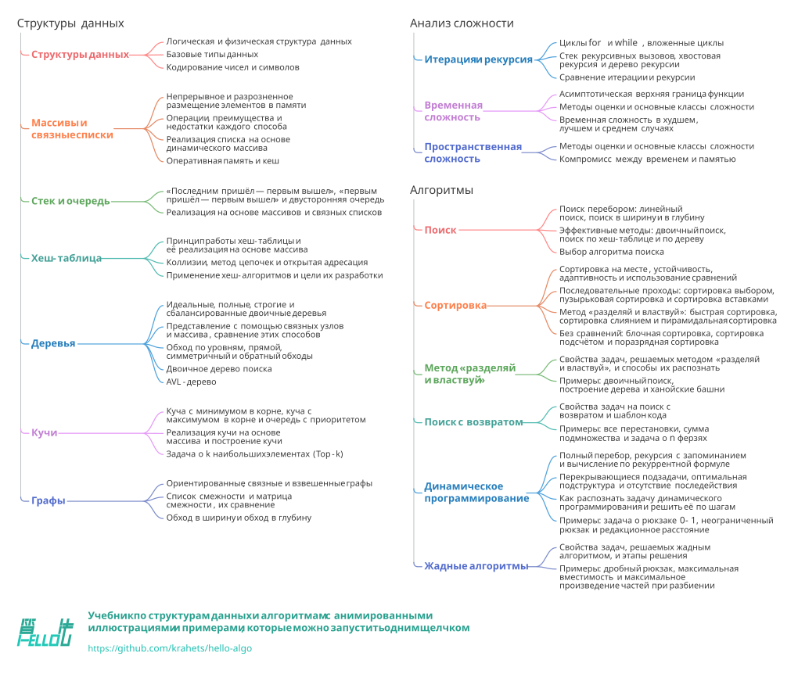

# О книге

Цель проекта — создать бесплатное открытое введение в структуры данных и алгоритмы, понятное начинающим.

- Анимированные схемы сопровождают читателя на протяжении всей книги. Наглядное изложение и постепенное усложнение материала помогают освоиться на карте структур данных и алгоритмов.
- Примеры кода запускаются одним действием. На практике вы сможете развить навыки программирования, разобраться в работе алгоритмов и увидеть внутреннее устройство структур данных.
- Мы поощряем взаимопомощь. Задавайте вопросы в комментариях, делитесь наблюдениями и учитесь друг у друга в обсуждениях.

## Для кого эта книга

Если вы только начинаете, никогда не изучали алгоритмы или уже решали задачи, но пока лишь смутно представляете себе структуры данных и всё ещё колеблетесь между «вроде понимаю» и «не получается», эта книга написана для вас!

Если вы уже решили немало задач и знакомы с большинством их типов, книга поможет повторить и систематизировать знания. Код в репозитории можно использовать как набор инструментов для решения задач или как словарь алгоритмов.

Если же в алгоритмах вы чувствуете себя как дома, мы будем рады вашим советам. Приглашаем вас и [присоединиться к работе над книгой](../chapter_appendix/contribution.md).

!!! success "Что нужно знать заранее"

    Достаточно знать основы хотя бы одного языка программирования и уметь читать и писать простой код.

## Как устроена книга

Основные темы показаны на рисунке.

- **Анализ сложности**. Критерии и методы оценки структур данных и алгоритмов. Способы оценки временной и пространственной сложности, распространённые классы и примеры.
- **Структуры данных**. Базовые типы данных и классификация структур. Определения массивов, связных списков, стеков, очередей, хеш-таблиц, деревьев, куч и графов, их достоинства и недостатки, основные операции, разновидности, типичные применения и способы реализации.
- **Алгоритмы**. Поиск, сортировка, метод «разделяй и властвуй», поиск с возвратом, динамическое программирование и жадные алгоритмы: определения, преимущества, недостатки, эффективность, области применения, этапы решения и примеры задач.

## Благодарности

Книга продолжает развиваться благодаря совместной работе множества участников открытого сообщества. Спасибо всем авторам, вложившим в неё время и силы. Вот их имена в порядке, автоматически сформированном GitHub: krahets, coderonion, Gonglja, nuomi1, Reanon, justin-tse, hpstory, danielsss, curtishd, night-cruise, S-N-O-R-L-A-X, rongyi, msk397, gvenusleo, khoaxuantu, rivertwilight, K3v123, gyt95, zhuoqinyue, yuelinxin, Zuoxun, mingXta, Phoenix0415, FangYuan33, GN-Yu, longsizhuo, pengchzn, QiLOL, Cathay-Chen, guowei-gong, xBLACKICEx, IsChristina, JoseHung, qualifier1024, hello-ikun, magentaqin, Guanngxu, thomasq0, sunshinesDL, L-Super, Transmigration-zhou, WSL0809, Slone123c, lhxsm, yuan0221, what-is-me, theNefelibatas, Shyam-Chen, sangxiaai, longranger2, codeberg-user, xiongsp, JeffersonHuang, prinpal, seven1240, Wonderdch, malone6, xiaomiusa87, gaofer, bluebean-cloud, a16su, SamJin98, hongyun-robot, nanlei, XiaChuerwu, yd-j, iron-irax, mgisr, steventimes, junminhong, heshuyue, danny900714, Nigh, Dr-XYZ, MolDuM, XC-Zero, reeswell, PXG-XPG, NI-SW, Horbin-Magician, Enlightenus, YangXuanyi, xjr7670, beatrix-chan, DullSword, qq909244296, iStig, boloboloda, hts0000, gledfish, fbigm, echo1937, jiaxianhua, wenjianmin, keshida, kilikilikid, lclc6, lwbaptx, linyejoe2, liuxjerry, szu17dmy, dshlstarr, Yucao-cy, coderlef, czruby, bongbongbakudan, beintentional, ZongYangL, ZhongYuuu, ZhongGuanbin, hezhizhen, linzeyan, ZJKung, JTCPOWI, KawaiiAsh, luluxia, xb534, ztkuaikuai, yw-1021, ElaBosak233, baagod, zhouLion, yishangzhang, yi427, yanedie, yabo083, weibk, wangwang105, th1nk3r-ing, tao363, 4yDX3906, syd168, sslmj2020, smilelsb, siqyka, selear, sdshaoda, Xi-Row, popozhu, nuquist19, noobcodemaker, XiaoK29, chadyi, lyl625760, lucaswangdev, llql1211, 0130w, shanghai-Jerry, EJackYang, Javesun99, eltociear, lipusheng, KNChiu, BlindTerran, ShiMaRing, lovelock, FreddieLi, FloranceYeh, fanchenggang, gltianwen, goerll, nedchu, curly210102, CuB3y0nd, KraHsu, CarrotDLaw, youshaoXG, bubble9um, Asashishi, Asa0oo0o0o, fanenr, eagleanurag, akshiterate, 52coder, foursevenlove, KorsChen, hopkings2008, yang-le, realwujing, Evilrabbit520, Umer-Jahangir, Turing-1024-Lee, Suremotoo, paoxiaomooo, Chieko-Seren, Senrian, Allen-Scai, 19santosh99, ymmmas, Risuntsy, Richard-Zhang1019, RafaelCaso, qingpeng9802, primexiao, Urbaner3, codetypess, nidhoggfgg, MwumLi, CreatorMetaSky, martinx, ZnYang2018, hugtyftg, logan-qiu, psychelzh, Kunchen-Luo, Keynman и KeiichiKasai.

Код книги проверяли (в алфавитном порядке) coderonion, curtishd, Gonglja, gvenusleo, hpstory, justin-tse, khoaxuantu, krahets, night-cruise, nuomi1, Reanon и rongyi. Благодарю их за время и силы: именно они помогли привести примеры на разных языках к единым правилам и стилю.

Английское издание рецензировали yuelinxin, K3v123, magentaqin, QiLOL, Phoenix0415, SamJin98, yanedie, RafaelCaso, pengchzn и thomasq0, японское — eltociear, русское — И. А. Шевкун и Yuyan Huang, издание на традиционном китайском — Shyam-Chen и Dr-XYZ. Благодаря их труду книга доступна более широкому кругу читателей. Спасибо им всем.

Инструмент для сборки электронной книги в формате ePub разработал zhongfq. Благодарю его за то, что у читателей появился ещё один удобный способ читать книгу.

В работе над книгой мне помогали многие люди.

- Спасибо моему наставнику на работе, доктору Ли Си. Во время одной из наших долгих бесед вы призвали меня «скорее взяться за дело», и я твёрдо решил написать эту книгу.
- Спасибо моей девушке Паопао, первой читательнице книги. Её ценные советы с точки зрения человека, прежде не изучавшего алгоритмы, помогли сделать материал доступнее для новичков.
- Спасибо Тэнбао, Цибао и Фэйбао за находчивое название. Оно напоминает то прекрасное чувство, когда впервые пишешь «Hello World!».
- Спасибо Сяоцюаню за профессиональную помощь в вопросах интеллектуальной собственности: она сыграла важную роль в развитии этой открытой книги.
- Спасибо Су Тун за прекрасную обложку и логотип, а также за терпение: моя тяга к совершенству не раз заставляла возвращаться к правкам.
- Спасибо @squidfunk за советы по вёрстке и за разработанную им открытую тему оформления документации [Material-for-MkDocs](https://github.com/squidfunk/mkdocs-material).

Работая над книгой, я прочитал много учебников и статей о структурах данных и алгоритмах. Они стали для меня отличными образцами и помогли обеспечить точность и качество материала. Благодарю всех учителей и предшественников за их выдающийся вклад!

Книга предлагает учиться, думая и пробуя своими руками. На это меня во многом вдохновила книга [«Погружение в глубокое обучение»](https://github.com/d2l-ai/d2l-zh). От всей души рекомендую эту замечательную работу читателям.

**От всего сердца благодарю моих родителей. Именно ваша постоянная поддержка и слова ободрения дали мне возможность заняться этим увлекательным делом**.
