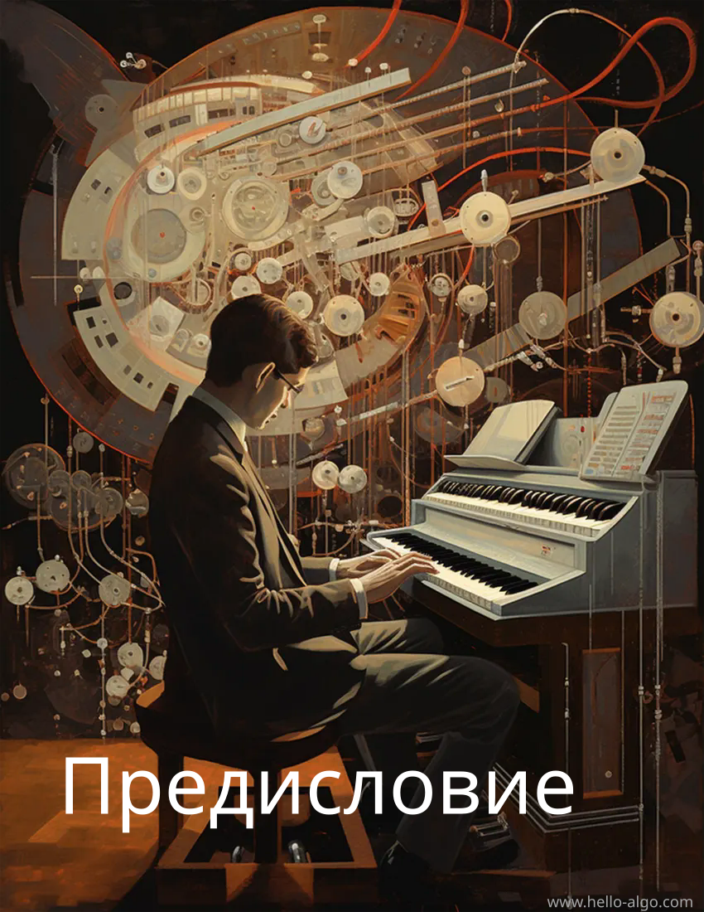

# Глава 0. &nbsp; Предисловие

{ class="cover-image" }

!!! abstract

    Алгоритмы похожи на прекрасную симфонию: у каждой строки кода свой ритм.
    
    Пусть эта книга тихо зазвучит у вас в голове и оставит в памяти свою неповторимую мелодию.

## Содержание главы

- [0.1 &nbsp; О книге](about_the_book.md)
- [0.2 &nbsp; Как пользоваться книгой](suggestions.md)
- [0.3 &nbsp; Итоги](summary.md)
