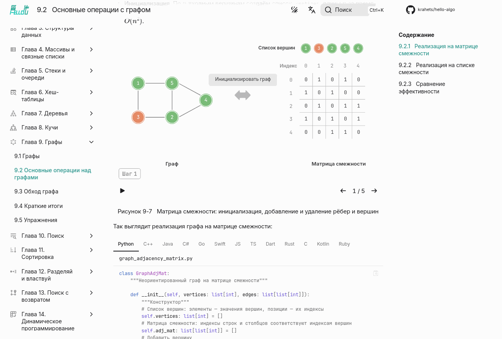
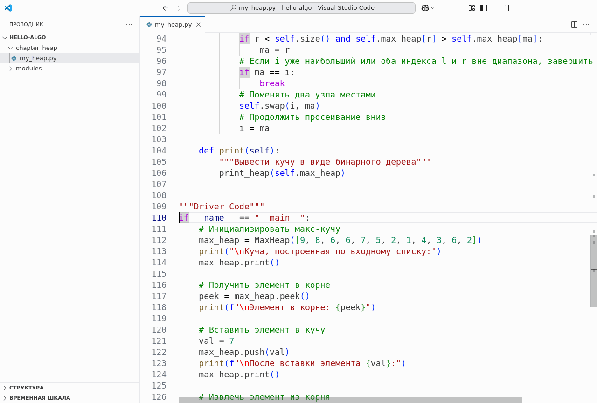
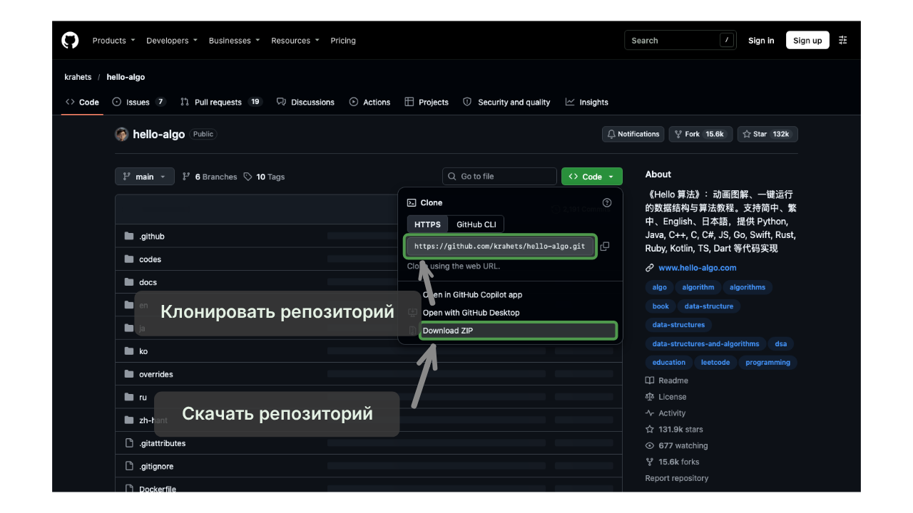
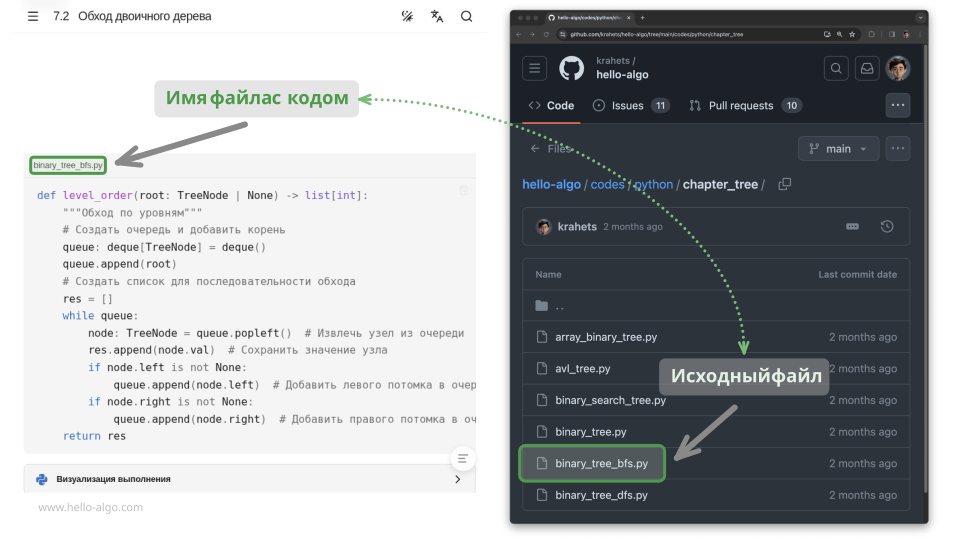
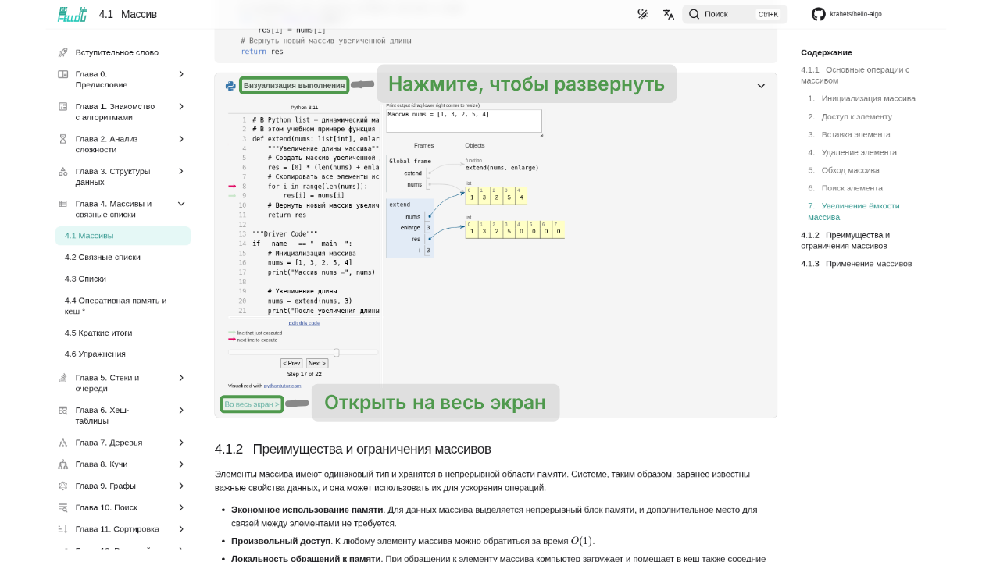
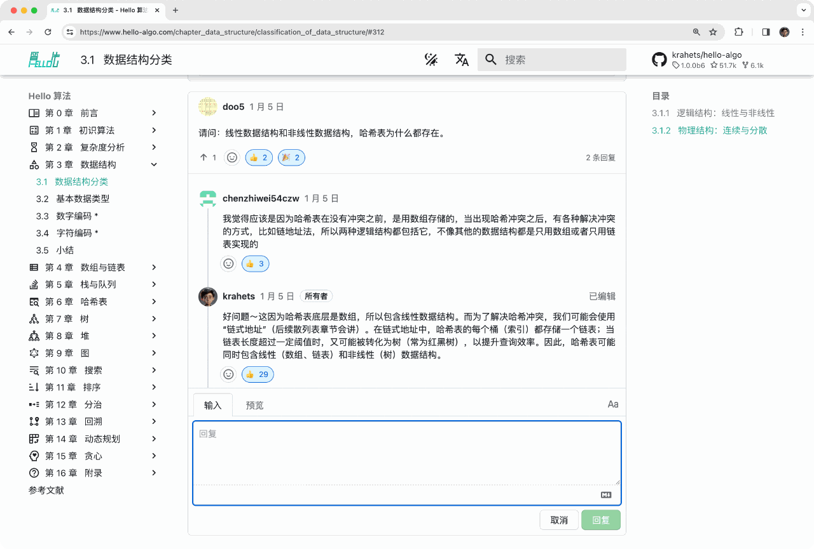
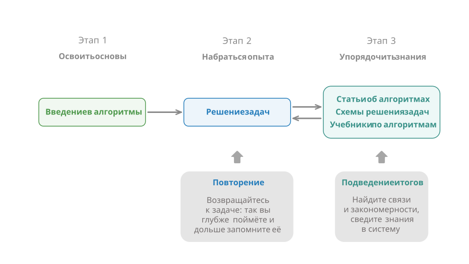

# Как пользоваться книгой

!!! tip

    Чтобы освоиться в книге и извлечь из неё больше пользы, прочтите этот раздел целиком.

## Условные обозначения

- Знак `*` после заголовка отмечает необязательные разделы повышенной сложности. Если времени мало, их можно пока пропустить.
- Специальные термины выделены полужирным в печатном и PDF-изданиях или подчёркнуты в веб-версии, например <u>массив (array)</u>. Полезно их запомнить: так будет легче читать специальную литературу.
- Ключевые мысли и обобщения выделены **полужирным**. Обратите на них особое внимание.
- Слова и выражения в особом значении заключены в кавычки, чтобы избежать неоднозначности.
- Если в языках программирования приняты разные обозначения, в тексте мы следуем Python. Например, отсутствие значения обозначается как `None`.
- Ради компактной вёрстки мы иногда отступаем от правил оформления комментариев, принятых в конкретном языке. В книге есть три основных типа комментариев: заголовочные, поясняющие и многострочные.

```snippet
comment_style
```

## Учитесь с помощью анимированных схем

Изображения и видео позволяют компактно передавать хорошо структурированную информацию, поэтому зачастую их легче понять, чем текст. В этой книге **основные и наиболее трудные идеи раскрываются прежде всего в анимированных схемах**, а текст поясняет и дополняет их.

Если раздел сопровождается анимированной схемой, как в примере ниже, **начните со схемы и используйте текст как пояснение**. Вместе они помогают разобраться в материале.



## Закрепляйте понимание на практике

Код к книге размещён в [репозитории на GitHub](https://github.com/krahets/hello-algo). Как показано ниже, **исходные файлы снабжены тестовыми примерами и запускаются одним действием**.

Если есть время, **попробуйте самостоятельно набрать код по образцу**. Если времени немного, хотя бы прочтите и запустите все примеры.

Когда вы пишете код сами, то часто замечаете больше, чем при чтении. **Чтобы действительно научиться, попробуйте сделать своими руками**.



Для запуска кода нужно сделать три шага.

**Шаг 1. Установите локальную среду программирования**. Инструкции есть в [руководстве](../chapter_appendix/installation.md) из приложения. Если среда уже установлена, пропустите этот шаг.

**Шаг 2. Клонируйте или скачайте репозиторий**. Откройте [репозиторий на GitHub](https://github.com/krahets/hello-algo). Если у вас установлен [Git](https://git-scm.com/downloads), клонируйте репозиторий следующей командой:

```shell
git clone https://github.com/krahets/hello-algo.git
```

Можно также нажать «Download ZIP» в месте, показанном на рисунке, скачать архив с кодом и распаковать его на своём компьютере.



**Шаг 3. Запустите исходный код**. Если вверху блока кода указано имя файла, как на рисунке ниже, соответствующий исходный файл можно найти в каталоге `codes` репозитория. Готовые примеры запускаются одним действием, чтобы вы могли сосредоточиться на материале и не тратили время на лишнюю отладку.



Помимо запуска на своём компьютере, **в веб-версии можно наглядно проследить выполнение кода Python** с помощью [Python Tutor](https://pythontutor.com/). Нажмите под блоком кода «Визуализация выполнения», чтобы развернуть представление и увидеть алгоритм в работе. Для более удобного просмотра можно выбрать «Во весь экран».



## Обсуждайте вопросы и учитесь вместе

При чтении не спешите пропускать то, что пока осталось непонятным. **Задавайте вопросы в комментариях**. Мы с коллегами постараемся помочь. Обычно ответ приходит в течение двух дней.

Внизу каждого раздела веб-версии есть комментарии, как показано на рисунке. Заглядывайте туда: вопросы других читателей помогут заметить собственные пробелы и глубже задуматься над темой. Будет здорово, если вы и сами ответите кому-нибудь и поделитесь наблюдениями, чтобы помочь другим продвинуться.



## Путь изучения алгоритмов

Путь изучения структур данных и алгоритмов можно условно разделить на три этапа.

1. **Первый этап. Освойте основы**. Познакомьтесь со свойствами и применением разных структур данных, разберитесь в принципах работы, шагах, назначении и эффективности алгоритмов.
2. **Второй этап. Решайте задачи**. Начните с популярных, постарайтесь решить хотя бы 100 и познакомиться с основными типами алгоритмических задач. Поначалу вы можете забывать пройденное — это нормально. Возвращайтесь к задачам, учитывая кривую забывания Эббингауза. Обычно после 3–5 повторений материал хорошо запоминается. Подборка задач и план занятий есть в этом [репозитории на GitHub](https://github.com/krahets/LeetCode-Book).
3. **Третий этап. Выстройте систему знаний**. Читайте тематические статьи, разбирайте общие схемы решения задач и учебники по алгоритмам, чтобы расширять и связывать свои знания. Пробуйте более сложные способы практики: группируйте задачи по темам, ищите разные решения одной задачи или применяйте один подход к разным задачам. Участники профильных сообществ часто делятся опытом таких занятий.

Как видно на рисунке, книга в основном посвящена первому этапу. Её цель — помочь вам увереннее и эффективнее перейти ко второму и третьему.


