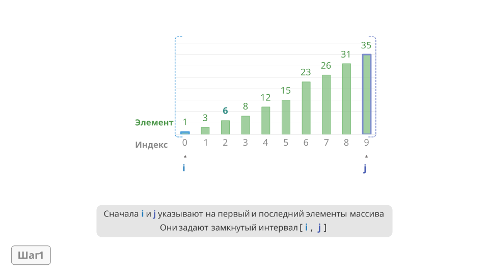
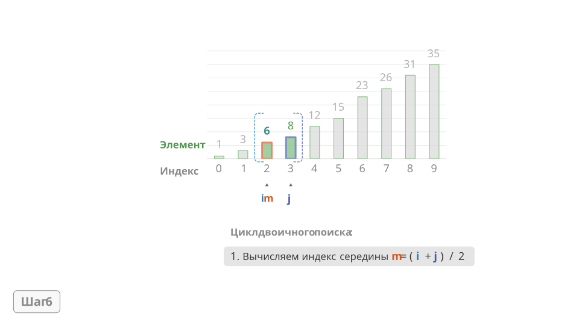
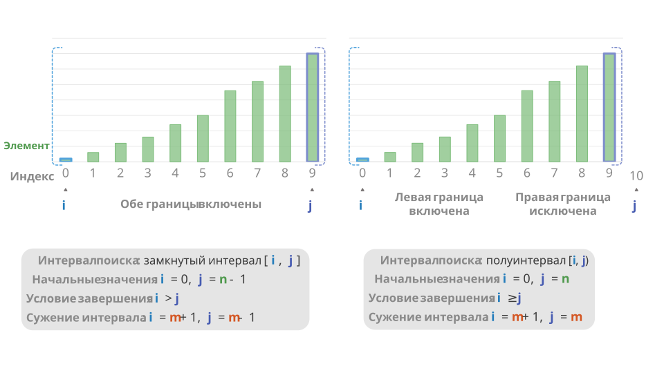

# Двоичный поиск

<u>Двоичный поиск (binary search)</u> — эффективный алгоритм поиска, основанный на стратегии «разделяй и властвуй». Поскольку данные упорядочены, на каждой итерации можно сократить область поиска вдвое. Поиск продолжается, пока искомый элемент не будет найден или интервал поиска не опустеет.

!!! question

    Дан массив `nums` длины $n$. Его элементы расположены по возрастанию и не повторяются. Найдите и верните индекс элемента `target` в этом массиве. Если такого элемента нет, верните $-1$. Пример показан на рисунке ниже.


Как показано на рисунке ниже, сначала установим указатели $i = 0$ и $j = n - 1$ на первый и последний элементы массива соответственно. Они задают интервал поиска $[0, n - 1]$. Квадратные скобки обозначают замкнутый интервал: обе границы входят в него.

Затем будем повторять два шага.

1. Вычислим индекс середины $m = \lfloor {(i + j) / 2} \rfloor$. Здесь $\lfloor \: \rfloor$ означает округление вниз.
2. Сравним `nums[m]` с `target`. Возможны три случая.
    1. Если `nums[m] < target`, то искать `target` следует в интервале $[m + 1, j]$. Поэтому положим $i = m + 1$.
    2. Если `nums[m] > target`, то искать `target` следует в интервале $[i, m - 1]$. Поэтому положим $j = m - 1$.
    3. Если `nums[m] = target`, значит, мы нашли `target`. Вернём индекс $m$.

Если искомого элемента в массиве нет, интервал поиска в конце концов опустеет. Тогда вернём $-1$.

=== "<1>"
    

=== "<2>"
    

=== "<3>"
    

=== "<4>"
    

=== "<5>"
    

=== "<6>"
    

=== "<7>"
    

Оба индекса, $i$ и $j$, имеют тип `int`, поэтому **сумма $i + j$ может выйти за пределы диапазона значений типа `int`**. Чтобы избежать переполнения, середину обычно вычисляют по формуле $m = \lfloor {i + (j - i) / 2} \rfloor$.

Запишем это в коде:

```src
[file]{binary_search}-[class]{}-[func]{binary_search}
```

**Временная сложность — $O(\log n)$**. На каждой итерации двоичного поиска интервал сокращается вдвое, поэтому число итераций равно $\log_2 n$.

**Пространственная сложность — $O(1)$**. Указатели $i$ и $j$ занимают постоянный объём памяти.

## Способы задать интервал

Помимо замкнутого интервала часто используют полуинтервал $[0, n)$, который включает левую границу и исключает правую. При такой записи интервал $[i, j)$ пуст, когда $i = j$.

На полуинтервале можно реализовать двоичный поиск с тем же результатом:

```src
[file]{binary_search}-[class]{}-[func]{binary_search_lcro}
```

Как видно на рисунке ниже, от выбора интервала зависят начальные значения указателей, условие продолжения цикла и правила сужения интервала.

У замкнутого интервала обе границы включены, поэтому правила сдвига указателей $i$ и $j$ симметричны. Так проще избежать ошибок, и **обычно рекомендуется использовать замкнутый интервал**.



## Преимущества и ограничения

Двоичный поиск эффективен как по времени, так и по памяти.

- Двоичный поиск работает быстро. При большом объёме данных логарифмическая сложность даёт заметное преимущество. Например, при размере массива $n = 2^{20}$ линейному поиску требуется $2^{20} = 1048576$ итераций, а двоичному — всего $\log_2 2^{20} = 20$.
- Двоичный поиск не требует дополнительной памяти и потому экономнее алгоритмов, которым она нужна, например поиска с помощью хеш-таблицы.

Однако двоичный поиск подходит не для всех случаев. Рассмотрим основные ограничения.

- Двоичный поиск применим только к упорядоченным данным. Сортировать неупорядоченные данные специально для одного поиска невыгодно: временная сложность сортировки обычно составляет $O(n \log n)$, что выше сложности как линейного, так и двоичного поиска. Если элементы часто добавляют, для сохранения порядка каждый из них приходится вставлять в определённую позицию. Такая вставка тоже обходится дорого: её временная сложность равна $O(n)$.
- Двоичный поиск подходит только для массивов. Алгоритм обращается к элементам скачками, а в связном списке такой доступ неэффективен. Поэтому двоичный поиск плохо подходит для связных списков и структур на их основе.
- На малых объёмах данных линейный поиск быстрее. За одну итерацию ему нужна только одна проверка. В двоичном поиске итерация включает одно сложение, одно деление, от одной до трёх проверок и ещё одно сложение или вычитание — всего от четырёх до шести элементарных операций. Поэтому при небольшом $n$ линейный поиск выигрывает у двоичного.
