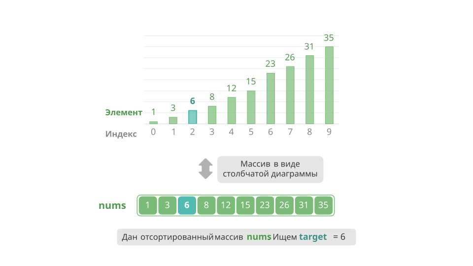
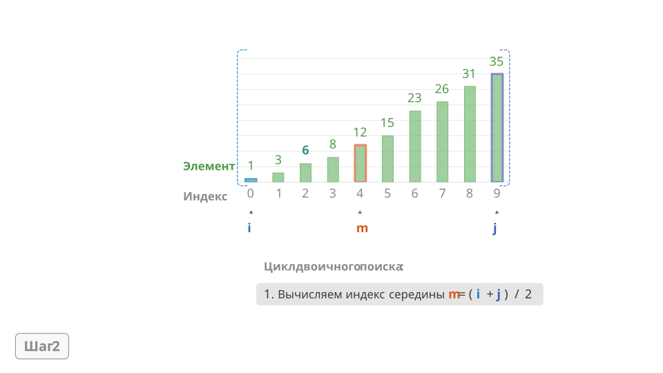
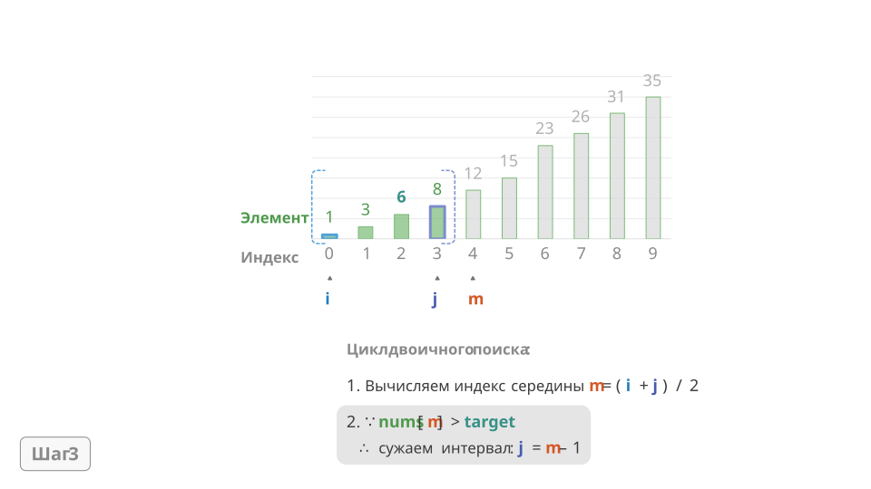
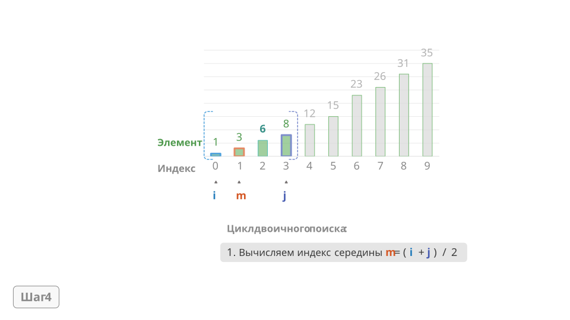
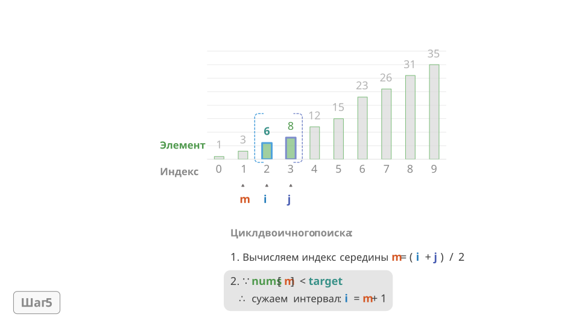
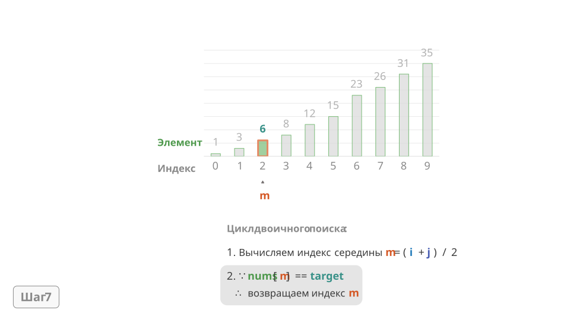

# 10.1 &nbsp; Двоичный поиск

<u>Двоичный поиск (binary search)</u> — эффективный алгоритм поиска, основанный на стратегии «разделяй и властвуй». Поскольку данные упорядочены, на каждой итерации можно сократить область поиска вдвое. Поиск продолжается, пока искомый элемент не будет найден или интервал поиска не опустеет.

!!! question

    Дан массив `nums` длины $n$. Его элементы расположены по возрастанию и не повторяются. Найдите и верните индекс элемента `target` в этом массиве. Если такого элемента нет, верните $-1$. Пример показан на рисунке 10-1.

{ class="animation-figure" }

<p align="center"> Рисунок 10-1 &nbsp; Пример данных для двоичного поиска </p>

Как показано на рисунке 10-2, сначала установим указатели $i = 0$ и $j = n - 1$ на первый и последний элементы массива соответственно. Они задают интервал поиска $[0, n - 1]$. Квадратные скобки обозначают замкнутый интервал: обе границы входят в него.

Затем будем повторять два шага.

1. Вычислим индекс середины $m = \lfloor {(i + j) / 2} \rfloor$. Здесь $\lfloor \: \rfloor$ означает округление вниз.
2. Сравним `nums[m]` с `target`. Возможны три случая.
    1. Если `nums[m] < target`, то искать `target` следует в интервале $[m + 1, j]$. Поэтому положим $i = m + 1$.
    2. Если `nums[m] > target`, то искать `target` следует в интервале $[i, m - 1]$. Поэтому положим $j = m - 1$.
    3. Если `nums[m] = target`, значит, мы нашли `target`. Вернём индекс $m$.

Если искомого элемента в массиве нет, интервал поиска в конце концов опустеет. Тогда вернём $-1$.

=== "<1>"
    { class="animation-figure" }

=== "<2>"
    { class="animation-figure" }

=== "<3>"
    { class="animation-figure" }

=== "<4>"
    { class="animation-figure" }

=== "<5>"
    { class="animation-figure" }

=== "<6>"
    { class="animation-figure" }

=== "<7>"
    { class="animation-figure" }

<p align="center"> Рисунок 10-2 &nbsp; Ход двоичного поиска </p>

Оба индекса, $i$ и $j$, имеют тип `int`, поэтому **сумма $i + j$ может выйти за пределы диапазона значений типа `int`**. Чтобы избежать переполнения, середину обычно вычисляют по формуле $m = \lfloor {i + (j - i) / 2} \rfloor$.

Запишем это в коде:

=== "Python"

    ```python title="binary_search.py"
    def binary_search(nums: list[int], target: int) -> int:
        """Двоичный поиск на замкнутом интервале"""
        # Задаём замкнутый интервал [0, n-1]: i указывает на первый элемент, j — на последний
        i, j = 0, len(nums) - 1
        # Повторяем, пока интервал поиска не опустеет (i > j)
        while i <= j:
            # Размер целых чисел в Python ограничен лишь доступной памятью, поэтому переполнения можно не опасаться
            m = (i + j) // 2  # Вычисляем индекс середины m
            if nums[m] < target:
                i = m + 1  # Искать target следует в интервале [m+1, j]
            elif nums[m] > target:
                j = m - 1  # Искать target следует в интервале [i, m-1]
            else:
                return m  # Элемент найден, возвращаем его индекс
        return -1  # Элемент не найден, возвращаем -1
    ```

=== "C++"

    ```cpp title="binary_search.cpp"
    /* Двоичный поиск на замкнутом интервале */
    int binarySearch(vector<int> &nums, int target) {
        // Задаём замкнутый интервал [0, n-1]: i указывает на первый элемент, j — на последний
        int i = 0, j = nums.size() - 1;
        // Повторяем, пока интервал поиска не опустеет (i > j)
        while (i <= j) {
            int m = i + (j - i) / 2; // Вычисляем индекс середины m
            if (nums[m] < target)    // Искать target следует в интервале [m+1, j]
                i = m + 1;
            else if (nums[m] > target) // Искать target следует в интервале [i, m-1]
                j = m - 1;
            else // Элемент найден, возвращаем его индекс
                return m;
        }
        // Элемент не найден, возвращаем -1
        return -1;
    }
    ```

=== "Java"

    ```java title="binary_search.java"
    /* Двоичный поиск на замкнутом интервале */
    int binarySearch(int[] nums, int target) {
        // Задаём замкнутый интервал [0, n-1]: i указывает на первый элемент, j — на последний
        int i = 0, j = nums.length - 1;
        // Повторяем, пока интервал поиска не опустеет (i > j)
        while (i <= j) {
            int m = i + (j - i) / 2; // Вычисляем индекс середины m
            if (nums[m] < target) // Искать target следует в интервале [m+1, j]
                i = m + 1;
            else if (nums[m] > target) // Искать target следует в интервале [i, m-1]
                j = m - 1;
            else // Элемент найден, возвращаем его индекс
                return m;
        }
        // Элемент не найден, возвращаем -1
        return -1;
    }
    ```

=== "C#"

    ```csharp title="binary_search.cs"
    /* Двоичный поиск на замкнутом интервале */
    int BinarySearch(int[] nums, int target) {
        // Задаём замкнутый интервал [0, n-1]: i указывает на первый элемент, j — на последний
        int i = 0, j = nums.Length - 1;
        // Повторяем, пока интервал поиска не опустеет (i > j)
        while (i <= j) {
            int m = i + (j - i) / 2;   // Вычисляем индекс середины m
            if (nums[m] < target)      // Искать target следует в интервале [m+1, j]
                i = m + 1;
            else if (nums[m] > target) // Искать target следует в интервале [i, m-1]
                j = m - 1;
            else                       // Элемент найден, возвращаем его индекс
                return m;
        }
        // Элемент не найден, возвращаем -1
        return -1;
    }
    ```

=== "Go"

    ```go title="binary_search.go"
    /* Двоичный поиск на замкнутом интервале */
    func binarySearch(nums []int, target int) int {
        // Задаём замкнутый интервал [0, n-1]: i указывает на первый элемент, j — на последний
        i, j := 0, len(nums)-1
        // Повторяем, пока интервал поиска не опустеет (i > j)
        for i <= j {
            m := i + (j-i)/2      // Вычисляем индекс середины m
            if nums[m] < target { // Искать target следует в интервале [m+1, j]
                i = m + 1
            } else if nums[m] > target { // Искать target следует в интервале [i, m-1]
                j = m - 1
            } else { // Элемент найден, возвращаем его индекс
                return m
            }
        }
        // Элемент не найден, возвращаем -1
        return -1
    }
    ```

=== "Swift"

    ```swift title="binary_search.swift"
    /* Двоичный поиск на замкнутом интервале */
    func binarySearch(nums: [Int], target: Int) -> Int {
        // Задаём замкнутый интервал [0, n-1]: i указывает на первый элемент, j — на последний
        var i = nums.startIndex
        var j = nums.endIndex - 1
        // Повторяем, пока интервал поиска не опустеет (i > j)
        while i <= j {
            let m = i + (j - i) / 2 // Вычисляем индекс середины m
            if nums[m] < target { // Искать target следует в интервале [m+1, j]
                i = m + 1
            } else if nums[m] > target { // Искать target следует в интервале [i, m-1]
                j = m - 1
            } else { // Элемент найден, возвращаем его индекс
                return m
            }
        }
        // Элемент не найден, возвращаем -1
        return -1
    }
    ```

=== "JS"

    ```javascript title="binary_search.js"
    /* Двоичный поиск на замкнутом интервале */
    function binarySearch(nums, target) {
        // Задаём замкнутый интервал [0, n-1]: i указывает на первый элемент, j — на последний
        let i = 0,
            j = nums.length - 1;
        // Повторяем, пока интервал поиска не опустеет (i > j)
        while (i <= j) {
            // Вычисляем индекс середины m с округлением вниз с помощью parseInt()
            const m = parseInt(i + (j - i) / 2);
            if (nums[m] < target)
                // Искать target следует в интервале [m+1, j]
                i = m + 1;
            else if (nums[m] > target)
                // Искать target следует в интервале [i, m-1]
                j = m - 1;
            else return m; // Элемент найден, возвращаем его индекс
        }
        // Элемент не найден, возвращаем -1
        return -1;
    }
    ```

=== "TS"

    ```typescript title="binary_search.ts"
    /* Двоичный поиск на замкнутом интервале */
    function binarySearch(nums: number[], target: number): number {
        // Задаём замкнутый интервал [0, n-1]: i указывает на первый элемент, j — на последний
        let i = 0,
            j = nums.length - 1;
        // Повторяем, пока интервал поиска не опустеет (i > j)
        while (i <= j) {
            // Вычисляем индекс середины m
            const m = Math.floor(i + (j - i) / 2);
            if (nums[m] < target) {
                // Искать target следует в интервале [m+1, j]
                i = m + 1;
            } else if (nums[m] > target) {
                // Искать target следует в интервале [i, m-1]
                j = m - 1;
            } else {
                // Элемент найден, возвращаем его индекс
                return m;
            }
        }
        return -1; // Элемент не найден, возвращаем -1
    }
    ```

=== "Dart"

    ```dart title="binary_search.dart"
    /* Двоичный поиск на замкнутом интервале */
    int binarySearch(List<int> nums, int target) {
      // Задаём замкнутый интервал [0, n-1]: i указывает на первый элемент, j — на последний
      int i = 0, j = nums.length - 1;
      // Повторяем, пока интервал поиска не опустеет (i > j)
      while (i <= j) {
        int m = i + (j - i) ~/ 2; // Вычисляем индекс середины m
        if (nums[m] < target) {
          // Искать target следует в интервале [m+1, j]
          i = m + 1;
        } else if (nums[m] > target) {
          // Искать target следует в интервале [i, m-1]
          j = m - 1;
        } else {
          // Элемент найден, возвращаем его индекс
          return m;
        }
      }
      // Элемент не найден, возвращаем -1
      return -1;
    }
    ```

=== "Rust"

    ```rust title="binary_search.rs"
    /* Двоичный поиск на замкнутом интервале */
    fn binary_search(nums: &[i32], target: i32) -> i32 {
        // Задаём замкнутый интервал [0, n-1]: i указывает на первый элемент, j — на последний
        let mut i = 0;
        let mut j = nums.len() as i32 - 1;
        // Повторяем, пока интервал поиска не опустеет (i > j)
        while i <= j {
            let m = i + (j - i) / 2; // Вычисляем индекс середины m
            if nums[m as usize] < target {
                // Искать target следует в интервале [m+1, j]
                i = m + 1;
            } else if nums[m as usize] > target {
                // Искать target следует в интервале [i, m-1]
                j = m - 1;
            } else {
                // Элемент найден, возвращаем его индекс
                return m;
            }
        }
        // Элемент не найден, возвращаем -1
        return -1;
    }
    ```

=== "C"

    ```c title="binary_search.c"
    /* Двоичный поиск на замкнутом интервале */
    int binarySearch(int *nums, int len, int target) {
        // Задаём замкнутый интервал [0, n-1]: i указывает на первый элемент, j — на последний
        int i = 0, j = len - 1;
        // Повторяем, пока интервал поиска не опустеет (i > j)
        while (i <= j) {
            int m = i + (j - i) / 2; // Вычисляем индекс середины m
            if (nums[m] < target)    // Искать target следует в интервале [m+1, j]
                i = m + 1;
            else if (nums[m] > target) // Искать target следует в интервале [i, m-1]
                j = m - 1;
            else // Элемент найден, возвращаем его индекс
                return m;
        }
        // Элемент не найден, возвращаем -1
        return -1;
    }
    ```

=== "Kotlin"

    ```kotlin title="binary_search.kt"
    /* Двоичный поиск на замкнутом интервале */
    fun binarySearch(nums: IntArray, target: Int): Int {
        // Задаём замкнутый интервал [0, n-1]: i указывает на первый элемент, j — на последний
        var i = 0
        var j = nums.size - 1
        // Повторяем, пока интервал поиска не опустеет (i > j)
        while (i <= j) {
            val m = i + (j - i) / 2 // Вычисляем индекс середины m
            if (nums[m] < target) // Искать target следует в интервале [m+1, j]
                i = m + 1
            else if (nums[m] > target) // Искать target следует в интервале [i, m-1]
                j = m - 1
            else  // Элемент найден, возвращаем его индекс
                return m
        }
        // Элемент не найден, возвращаем -1
        return -1
    }
    ```

=== "Ruby"

    ```ruby title="binary_search.rb"
    ### Двоичный поиск на замкнутом интервале ###
    def binary_search(nums, target)
      # Задаём замкнутый интервал [0, n-1]: i указывает на первый элемент, j — на последний
      i, j = 0, nums.length - 1

      # Повторяем, пока интервал поиска не опустеет (i > j)
      while i <= j
        # Размер целых чисел в Ruby ограничен лишь доступной памятью, поэтому переполнения можно не опасаться
        m = (i + j) / 2   # Вычисляем индекс середины m
      
        if nums[m] < target
          i = m + 1 # Искать target следует в интервале [m+1, j]
        elsif nums[m] > target
          j = m - 1 # Искать target следует в интервале [i, m-1]
        else
          return m  # Элемент найден, возвращаем его индекс
        end
      end

      -1  # Элемент не найден, возвращаем -1
    end
    ```

??? pythontutor "Визуализация выполнения"

    <div style="height: 549px; width: 100%;"><iframe class="pythontutor-iframe" title="Визуализация выполнения" src="https://pythontutor.com/iframe-embed.html#code=def%20binary_search%28nums%3A%20list%5Bint%5D,%20target%3A%20int%29%20-%3E%20int%3A%0A%20%20%20%20%22%22%22%D0%94%D0%B2%D0%BE%D0%B8%D1%87%D0%BD%D1%8B%D0%B9%20%D0%BF%D0%BE%D0%B8%D1%81%D0%BA%20%D0%BD%D0%B0%20%D0%B7%D0%B0%D0%BC%D0%BA%D0%BD%D1%83%D1%82%D0%BE%D0%BC%20%D0%B8%D0%BD%D1%82%D0%B5%D1%80%D0%B2%D0%B0%D0%BB%D0%B5%22%22%22%0A%20%20%20%20%23%20%D0%97%D0%B0%D0%B4%D0%B0%D1%91%D0%BC%20%D0%B7%D0%B0%D0%BC%D0%BA%D0%BD%D1%83%D1%82%D1%8B%D0%B9%20%D0%B8%D0%BD%D1%82%D0%B5%D1%80%D0%B2%D0%B0%D0%BB%20%5B0,%20n-1%5D%3A%20i%20%D1%83%D0%BA%D0%B0%D0%B7%D1%8B%D0%B2%D0%B0%D0%B5%D1%82%20%D0%BD%D0%B0%20%D0%BF%D0%B5%D1%80%D0%B2%D1%8B%D0%B9%20%D1%8D%D0%BB%D0%B5%D0%BC%D0%B5%D0%BD%D1%82,%20j%20%E2%80%94%20%D0%BD%D0%B0%20%D0%BF%D0%BE%D1%81%D0%BB%D0%B5%D0%B4%D0%BD%D0%B8%D0%B9%0A%20%20%20%20i,%20j%20%3D%200,%20len%28nums%29%20-%201%0A%20%20%20%20%23%20%D0%9F%D0%BE%D0%B2%D1%82%D0%BE%D1%80%D1%8F%D0%B5%D0%BC,%20%D0%BF%D0%BE%D0%BA%D0%B0%20%D0%B8%D0%BD%D1%82%D0%B5%D1%80%D0%B2%D0%B0%D0%BB%20%D0%BF%D0%BE%D0%B8%D1%81%D0%BA%D0%B0%20%D0%BD%D0%B5%20%D0%BE%D0%BF%D1%83%D1%81%D1%82%D0%B5%D0%B5%D1%82%20%28i%20%3E%20j%29%0A%20%20%20%20while%20i%20%3C%3D%20j%3A%0A%20%20%20%20%20%20%20%20%23%20%D0%A0%D0%B0%D0%B7%D0%BC%D0%B5%D1%80%20%D1%86%D0%B5%D0%BB%D1%8B%D1%85%20%D1%87%D0%B8%D1%81%D0%B5%D0%BB%20%D0%B2%20Python%20%D0%BE%D0%B3%D1%80%D0%B0%D0%BD%D0%B8%D1%87%D0%B5%D0%BD%20%D0%BB%D0%B8%D1%88%D1%8C%20%D0%B4%D0%BE%D1%81%D1%82%D1%83%D0%BF%D0%BD%D0%BE%D0%B9%20%D0%BF%D0%B0%D0%BC%D1%8F%D1%82%D1%8C%D1%8E,%20%D0%BF%D0%BE%D1%8D%D1%82%D0%BE%D0%BC%D1%83%20%D0%BF%D0%B5%D1%80%D0%B5%D0%BF%D0%BE%D0%BB%D0%BD%D0%B5%D0%BD%D0%B8%D1%8F%20%D0%BC%D0%BE%D0%B6%D0%BD%D0%BE%20%D0%BD%D0%B5%20%D0%BE%D0%BF%D0%B0%D1%81%D0%B0%D1%82%D1%8C%D1%81%D1%8F%0A%20%20%20%20%20%20%20%20m%20%3D%20%28i%20%2B%20j%29%20//%202%20%20%23%20%D0%92%D1%8B%D1%87%D0%B8%D1%81%D0%BB%D1%8F%D0%B5%D0%BC%20%D0%B8%D0%BD%D0%B4%D0%B5%D0%BA%D1%81%20%D1%81%D0%B5%D1%80%D0%B5%D0%B4%D0%B8%D0%BD%D1%8B%20m%0A%20%20%20%20%20%20%20%20if%20nums%5Bm%5D%20%3C%20target%3A%0A%20%20%20%20%20%20%20%20%20%20%20%20i%20%3D%20m%20%2B%201%20%20%23%20%D0%98%D1%81%D0%BA%D0%B0%D1%82%D1%8C%20target%20%D1%81%D0%BB%D0%B5%D0%B4%D1%83%D0%B5%D1%82%20%D0%B2%20%D0%B8%D0%BD%D1%82%D0%B5%D1%80%D0%B2%D0%B0%D0%BB%D0%B5%20%5Bm%2B1,%20j%5D%0A%20%20%20%20%20%20%20%20elif%20nums%5Bm%5D%20%3E%20target%3A%0A%20%20%20%20%20%20%20%20%20%20%20%20j%20%3D%20m%20-%201%20%20%23%20%D0%98%D1%81%D0%BA%D0%B0%D1%82%D1%8C%20target%20%D1%81%D0%BB%D0%B5%D0%B4%D1%83%D0%B5%D1%82%20%D0%B2%20%D0%B8%D0%BD%D1%82%D0%B5%D1%80%D0%B2%D0%B0%D0%BB%D0%B5%20%5Bi,%20m-1%5D%0A%20%20%20%20%20%20%20%20else%3A%0A%20%20%20%20%20%20%20%20%20%20%20%20return%20m%20%20%23%20%D0%AD%D0%BB%D0%B5%D0%BC%D0%B5%D0%BD%D1%82%20%D0%BD%D0%B0%D0%B9%D0%B4%D0%B5%D0%BD,%20%D0%B2%D0%BE%D0%B7%D0%B2%D1%80%D0%B0%D1%89%D0%B0%D0%B5%D0%BC%20%D0%B5%D0%B3%D0%BE%20%D0%B8%D0%BD%D0%B4%D0%B5%D0%BA%D1%81%0A%20%20%20%20return%20-1%20%20%23%20%D0%AD%D0%BB%D0%B5%D0%BC%D0%B5%D0%BD%D1%82%20%D0%BD%D0%B5%20%D0%BD%D0%B0%D0%B9%D0%B4%D0%B5%D0%BD,%20%D0%B2%D0%BE%D0%B7%D0%B2%D1%80%D0%B0%D1%89%D0%B0%D0%B5%D0%BC%20-1%0A%0A%0A%22%22%22Driver%20Code%22%22%22%0Aif%20__name__%20%3D%3D%20%22__main__%22%3A%0A%20%20%20%20target%20%3D%206%0A%20%20%20%20nums%20%3D%20%5B1,%203,%206,%208,%2012,%2015,%2023,%2026,%2031,%2035%5D%0A%0A%20%20%20%20%23%20%D0%94%D0%B2%D0%BE%D0%B8%D1%87%D0%BD%D1%8B%D0%B9%20%D0%BF%D0%BE%D0%B8%D1%81%D0%BA%20%D0%BD%D0%B0%20%D0%B7%D0%B0%D0%BC%D0%BA%D0%BD%D1%83%D1%82%D0%BE%D0%BC%20%D0%B8%D0%BD%D1%82%D0%B5%D1%80%D0%B2%D0%B0%D0%BB%D0%B5%0A%20%20%20%20index%20%3D%20binary_search%28nums,%20target%29%0A%20%20%20%20print%28%22%D0%98%D0%BD%D0%B4%D0%B5%D0%BA%D1%81%20%D1%8D%D0%BB%D0%B5%D0%BC%D0%B5%D0%BD%D1%82%D0%B0%206%20%3D%20%22,%20index%29&codeDivHeight=472&codeDivWidth=350&cumulative=false&curInstr=5&heapPrimitives=nevernest&origin=opt-frontend.js&py=311&rawInputLstJSON=%5B%5D&textReferences=false"> </iframe></div>
    <div style="margin-top: 5px;"><a href="https://pythontutor.com/iframe-embed.html#code=def%20binary_search%28nums%3A%20list%5Bint%5D,%20target%3A%20int%29%20-%3E%20int%3A%0A%20%20%20%20%22%22%22%D0%94%D0%B2%D0%BE%D0%B8%D1%87%D0%BD%D1%8B%D0%B9%20%D0%BF%D0%BE%D0%B8%D1%81%D0%BA%20%D0%BD%D0%B0%20%D0%B7%D0%B0%D0%BC%D0%BA%D0%BD%D1%83%D1%82%D0%BE%D0%BC%20%D0%B8%D0%BD%D1%82%D0%B5%D1%80%D0%B2%D0%B0%D0%BB%D0%B5%22%22%22%0A%20%20%20%20%23%20%D0%97%D0%B0%D0%B4%D0%B0%D1%91%D0%BC%20%D0%B7%D0%B0%D0%BC%D0%BA%D0%BD%D1%83%D1%82%D1%8B%D0%B9%20%D0%B8%D0%BD%D1%82%D0%B5%D1%80%D0%B2%D0%B0%D0%BB%20%5B0,%20n-1%5D%3A%20i%20%D1%83%D0%BA%D0%B0%D0%B7%D1%8B%D0%B2%D0%B0%D0%B5%D1%82%20%D0%BD%D0%B0%20%D0%BF%D0%B5%D1%80%D0%B2%D1%8B%D0%B9%20%D1%8D%D0%BB%D0%B5%D0%BC%D0%B5%D0%BD%D1%82,%20j%20%E2%80%94%20%D0%BD%D0%B0%20%D0%BF%D0%BE%D1%81%D0%BB%D0%B5%D0%B4%D0%BD%D0%B8%D0%B9%0A%20%20%20%20i,%20j%20%3D%200,%20len%28nums%29%20-%201%0A%20%20%20%20%23%20%D0%9F%D0%BE%D0%B2%D1%82%D0%BE%D1%80%D1%8F%D0%B5%D0%BC,%20%D0%BF%D0%BE%D0%BA%D0%B0%20%D0%B8%D0%BD%D1%82%D0%B5%D1%80%D0%B2%D0%B0%D0%BB%20%D0%BF%D0%BE%D0%B8%D1%81%D0%BA%D0%B0%20%D0%BD%D0%B5%20%D0%BE%D0%BF%D1%83%D1%81%D1%82%D0%B5%D0%B5%D1%82%20%28i%20%3E%20j%29%0A%20%20%20%20while%20i%20%3C%3D%20j%3A%0A%20%20%20%20%20%20%20%20%23%20%D0%A0%D0%B0%D0%B7%D0%BC%D0%B5%D1%80%20%D1%86%D0%B5%D0%BB%D1%8B%D1%85%20%D1%87%D0%B8%D1%81%D0%B5%D0%BB%20%D0%B2%20Python%20%D0%BE%D0%B3%D1%80%D0%B0%D0%BD%D0%B8%D1%87%D0%B5%D0%BD%20%D0%BB%D0%B8%D1%88%D1%8C%20%D0%B4%D0%BE%D1%81%D1%82%D1%83%D0%BF%D0%BD%D0%BE%D0%B9%20%D0%BF%D0%B0%D0%BC%D1%8F%D1%82%D1%8C%D1%8E,%20%D0%BF%D0%BE%D1%8D%D1%82%D0%BE%D0%BC%D1%83%20%D0%BF%D0%B5%D1%80%D0%B5%D0%BF%D0%BE%D0%BB%D0%BD%D0%B5%D0%BD%D0%B8%D1%8F%20%D0%BC%D0%BE%D0%B6%D0%BD%D0%BE%20%D0%BD%D0%B5%20%D0%BE%D0%BF%D0%B0%D1%81%D0%B0%D1%82%D1%8C%D1%81%D1%8F%0A%20%20%20%20%20%20%20%20m%20%3D%20%28i%20%2B%20j%29%20//%202%20%20%23%20%D0%92%D1%8B%D1%87%D0%B8%D1%81%D0%BB%D1%8F%D0%B5%D0%BC%20%D0%B8%D0%BD%D0%B4%D0%B5%D0%BA%D1%81%20%D1%81%D0%B5%D1%80%D0%B5%D0%B4%D0%B8%D0%BD%D1%8B%20m%0A%20%20%20%20%20%20%20%20if%20nums%5Bm%5D%20%3C%20target%3A%0A%20%20%20%20%20%20%20%20%20%20%20%20i%20%3D%20m%20%2B%201%20%20%23%20%D0%98%D1%81%D0%BA%D0%B0%D1%82%D1%8C%20target%20%D1%81%D0%BB%D0%B5%D0%B4%D1%83%D0%B5%D1%82%20%D0%B2%20%D0%B8%D0%BD%D1%82%D0%B5%D1%80%D0%B2%D0%B0%D0%BB%D0%B5%20%5Bm%2B1,%20j%5D%0A%20%20%20%20%20%20%20%20elif%20nums%5Bm%5D%20%3E%20target%3A%0A%20%20%20%20%20%20%20%20%20%20%20%20j%20%3D%20m%20-%201%20%20%23%20%D0%98%D1%81%D0%BA%D0%B0%D1%82%D1%8C%20target%20%D1%81%D0%BB%D0%B5%D0%B4%D1%83%D0%B5%D1%82%20%D0%B2%20%D0%B8%D0%BD%D1%82%D0%B5%D1%80%D0%B2%D0%B0%D0%BB%D0%B5%20%5Bi,%20m-1%5D%0A%20%20%20%20%20%20%20%20else%3A%0A%20%20%20%20%20%20%20%20%20%20%20%20return%20m%20%20%23%20%D0%AD%D0%BB%D0%B5%D0%BC%D0%B5%D0%BD%D1%82%20%D0%BD%D0%B0%D0%B9%D0%B4%D0%B5%D0%BD,%20%D0%B2%D0%BE%D0%B7%D0%B2%D1%80%D0%B0%D1%89%D0%B0%D0%B5%D0%BC%20%D0%B5%D0%B3%D0%BE%20%D0%B8%D0%BD%D0%B4%D0%B5%D0%BA%D1%81%0A%20%20%20%20return%20-1%20%20%23%20%D0%AD%D0%BB%D0%B5%D0%BC%D0%B5%D0%BD%D1%82%20%D0%BD%D0%B5%20%D0%BD%D0%B0%D0%B9%D0%B4%D0%B5%D0%BD,%20%D0%B2%D0%BE%D0%B7%D0%B2%D1%80%D0%B0%D1%89%D0%B0%D0%B5%D0%BC%20-1%0A%0A%0A%22%22%22Driver%20Code%22%22%22%0Aif%20__name__%20%3D%3D%20%22__main__%22%3A%0A%20%20%20%20target%20%3D%206%0A%20%20%20%20nums%20%3D%20%5B1,%203,%206,%208,%2012,%2015,%2023,%2026,%2031,%2035%5D%0A%0A%20%20%20%20%23%20%D0%94%D0%B2%D0%BE%D0%B8%D1%87%D0%BD%D1%8B%D0%B9%20%D0%BF%D0%BE%D0%B8%D1%81%D0%BA%20%D0%BD%D0%B0%20%D0%B7%D0%B0%D0%BC%D0%BA%D0%BD%D1%83%D1%82%D0%BE%D0%BC%20%D0%B8%D0%BD%D1%82%D0%B5%D1%80%D0%B2%D0%B0%D0%BB%D0%B5%0A%20%20%20%20index%20%3D%20binary_search%28nums,%20target%29%0A%20%20%20%20print%28%22%D0%98%D0%BD%D0%B4%D0%B5%D0%BA%D1%81%20%D1%8D%D0%BB%D0%B5%D0%BC%D0%B5%D0%BD%D1%82%D0%B0%206%20%3D%20%22,%20index%29&codeDivHeight=800&codeDivWidth=600&cumulative=false&curInstr=5&heapPrimitives=nevernest&origin=opt-frontend.js&py=311&rawInputLstJSON=%5B%5D&textReferences=false" target="_blank" rel="noopener noreferrer">Во весь экран ></a></div>

**Временная сложность — $O(\log n)$**. На каждой итерации двоичного поиска интервал сокращается вдвое, поэтому число итераций равно $\log_2 n$.

**Пространственная сложность — $O(1)$**. Указатели $i$ и $j$ занимают постоянный объём памяти.

## 10.1.1 &nbsp; Способы задать интервал

Помимо замкнутого интервала часто используют полуинтервал $[0, n)$, который включает левую границу и исключает правую. При такой записи интервал $[i, j)$ пуст, когда $i = j$.

На полуинтервале можно реализовать двоичный поиск с тем же результатом:

=== "Python"

    ```python title="binary_search.py"
    def binary_search_lcro(nums: list[int], target: int) -> int:
        """Двоичный поиск на полуинтервале с открытой правой границей"""
        # Задаём полуинтервал [0, n): i указывает на первый элемент, j — на позицию за последним
        i, j = 0, len(nums)
        # Повторяем, пока интервал поиска не опустеет (i = j)
        while i < j:
            m = (i + j) // 2  # Вычисляем индекс середины m
            if nums[m] < target:
                i = m + 1  # Искать target следует в интервале [m+1, j)
            elif nums[m] > target:
                j = m  # Искать target следует в интервале [i, m)
            else:
                return m  # Элемент найден, возвращаем его индекс
        return -1  # Элемент не найден, возвращаем -1
    ```

=== "C++"

    ```cpp title="binary_search.cpp"
    /* Двоичный поиск на полуинтервале с открытой правой границей */
    int binarySearchLCRO(vector<int> &nums, int target) {
        // Задаём полуинтервал [0, n): i указывает на первый элемент, j — на позицию за последним
        int i = 0, j = nums.size();
        // Повторяем, пока интервал поиска не опустеет (i = j)
        while (i < j) {
            int m = i + (j - i) / 2; // Вычисляем индекс середины m
            if (nums[m] < target)    // Искать target следует в интервале [m+1, j)
                i = m + 1;
            else if (nums[m] > target) // Искать target следует в интервале [i, m)
                j = m;
            else // Элемент найден, возвращаем его индекс
                return m;
        }
        // Элемент не найден, возвращаем -1
        return -1;
    }
    ```

=== "Java"

    ```java title="binary_search.java"
    /* Двоичный поиск на полуинтервале с открытой правой границей */
    int binarySearchLCRO(int[] nums, int target) {
        // Задаём полуинтервал [0, n): i указывает на первый элемент, j — на позицию за последним
        int i = 0, j = nums.length;
        // Повторяем, пока интервал поиска не опустеет (i = j)
        while (i < j) {
            int m = i + (j - i) / 2; // Вычисляем индекс середины m
            if (nums[m] < target) // Искать target следует в интервале [m+1, j)
                i = m + 1;
            else if (nums[m] > target) // Искать target следует в интервале [i, m)
                j = m;
            else // Элемент найден, возвращаем его индекс
                return m;
        }
        // Элемент не найден, возвращаем -1
        return -1;
    }
    ```

=== "C#"

    ```csharp title="binary_search.cs"
    /* Двоичный поиск на полуинтервале с открытой правой границей */
    int BinarySearchLCRO(int[] nums, int target) {
        // Задаём полуинтервал [0, n): i указывает на первый элемент, j — на позицию за последним
        int i = 0, j = nums.Length;
        // Повторяем, пока интервал поиска не опустеет (i = j)
        while (i < j) {
            int m = i + (j - i) / 2;   // Вычисляем индекс середины m
            if (nums[m] < target)      // Искать target следует в интервале [m+1, j)
                i = m + 1;
            else if (nums[m] > target) // Искать target следует в интервале [i, m)
                j = m;
            else                       // Элемент найден, возвращаем его индекс
                return m;
        }
        // Элемент не найден, возвращаем -1
        return -1;
    }
    ```

=== "Go"

    ```go title="binary_search.go"
    /* Двоичный поиск на полуинтервале с открытой правой границей */
    func binarySearchLCRO(nums []int, target int) int {
        // Задаём полуинтервал [0, n): i указывает на первый элемент, j — на позицию за последним
        i, j := 0, len(nums)
        // Повторяем, пока интервал поиска не опустеет (i = j)
        for i < j {
            m := i + (j-i)/2      // Вычисляем индекс середины m
            if nums[m] < target { // Искать target следует в интервале [m+1, j)
                i = m + 1
            } else if nums[m] > target { // Искать target следует в интервале [i, m)
                j = m
            } else { // Элемент найден, возвращаем его индекс
                return m
            }
        }
        // Элемент не найден, возвращаем -1
        return -1
    }
    ```

=== "Swift"

    ```swift title="binary_search.swift"
    /* Двоичный поиск на полуинтервале с открытой правой границей */
    func binarySearchLCRO(nums: [Int], target: Int) -> Int {
        // Задаём полуинтервал [0, n): i указывает на первый элемент, j — на позицию за последним
        var i = nums.startIndex
        var j = nums.endIndex
        // Повторяем, пока интервал поиска не опустеет (i = j)
        while i < j {
            let m = i + (j - i) / 2 // Вычисляем индекс середины m
            if nums[m] < target { // Искать target следует в интервале [m+1, j)
                i = m + 1
            } else if nums[m] > target { // Искать target следует в интервале [i, m)
                j = m
            } else { // Элемент найден, возвращаем его индекс
                return m
            }
        }
        // Элемент не найден, возвращаем -1
        return -1
    }
    ```

=== "JS"

    ```javascript title="binary_search.js"
    /* Двоичный поиск на полуинтервале с открытой правой границей */
    function binarySearchLCRO(nums, target) {
        // Задаём полуинтервал [0, n): i указывает на первый элемент, j — на позицию за последним
        let i = 0,
            j = nums.length;
        // Повторяем, пока интервал поиска не опустеет (i = j)
        while (i < j) {
            // Вычисляем индекс середины m с округлением вниз с помощью parseInt()
            const m = parseInt(i + (j - i) / 2);
            if (nums[m] < target)
                // Искать target следует в интервале [m+1, j)
                i = m + 1;
            else if (nums[m] > target)
                // Искать target следует в интервале [i, m)
                j = m;
            // Элемент найден, возвращаем его индекс
            else return m;
        }
        // Элемент не найден, возвращаем -1
        return -1;
    }
    ```

=== "TS"

    ```typescript title="binary_search.ts"
    /* Двоичный поиск на полуинтервале с открытой правой границей */
    function binarySearchLCRO(nums: number[], target: number): number {
        // Задаём полуинтервал [0, n): i указывает на первый элемент, j — на позицию за последним
        let i = 0,
            j = nums.length;
        // Повторяем, пока интервал поиска не опустеет (i = j)
        while (i < j) {
            // Вычисляем индекс середины m
            const m = Math.floor(i + (j - i) / 2);
            if (nums[m] < target) {
                // Искать target следует в интервале [m+1, j)
                i = m + 1;
            } else if (nums[m] > target) {
                // Искать target следует в интервале [i, m)
                j = m;
            } else {
                // Элемент найден, возвращаем его индекс
                return m;
            }
        }
        return -1; // Элемент не найден, возвращаем -1
    }
    ```

=== "Dart"

    ```dart title="binary_search.dart"
    /* Двоичный поиск на полуинтервале с открытой правой границей */
    int binarySearchLCRO(List<int> nums, int target) {
      // Задаём полуинтервал [0, n): i указывает на первый элемент, j — на позицию за последним
      int i = 0, j = nums.length;
      // Повторяем, пока интервал поиска не опустеет (i = j)
      while (i < j) {
        int m = i + (j - i) ~/ 2; // Вычисляем индекс середины m
        if (nums[m] < target) {
          // Искать target следует в интервале [m+1, j)
          i = m + 1;
        } else if (nums[m] > target) {
          // Искать target следует в интервале [i, m)
          j = m;
        } else {
          // Элемент найден, возвращаем его индекс
          return m;
        }
      }
      // Элемент не найден, возвращаем -1
      return -1;
    }
    ```

=== "Rust"

    ```rust title="binary_search.rs"
    /* Двоичный поиск на полуинтервале с открытой правой границей */
    fn binary_search_lcro(nums: &[i32], target: i32) -> i32 {
        // Задаём полуинтервал [0, n): i указывает на первый элемент, j — на позицию за последним
        let mut i = 0;
        let mut j = nums.len() as i32;
        // Повторяем, пока интервал поиска не опустеет (i = j)
        while i < j {
            let m = i + (j - i) / 2; // Вычисляем индекс середины m
            if nums[m as usize] < target {
                // Искать target следует в интервале [m+1, j)
                i = m + 1;
            } else if nums[m as usize] > target {
                // Искать target следует в интервале [i, m)
                j = m;
            } else {
                // Элемент найден, возвращаем его индекс
                return m;
            }
        }
        // Элемент не найден, возвращаем -1
        return -1;
    }
    ```

=== "C"

    ```c title="binary_search.c"
    /* Двоичный поиск на полуинтервале с открытой правой границей */
    int binarySearchLCRO(int *nums, int len, int target) {
        // Задаём полуинтервал [0, n): i указывает на первый элемент, j — на позицию за последним
        int i = 0, j = len;
        // Повторяем, пока интервал поиска не опустеет (i = j)
        while (i < j) {
            int m = i + (j - i) / 2; // Вычисляем индекс середины m
            if (nums[m] < target)    // Искать target следует в интервале [m+1, j)
                i = m + 1;
            else if (nums[m] > target) // Искать target следует в интервале [i, m)
                j = m;
            else // Элемент найден, возвращаем его индекс
                return m;
        }
        // Элемент не найден, возвращаем -1
        return -1;
    }
    ```

=== "Kotlin"

    ```kotlin title="binary_search.kt"
    /* Двоичный поиск на полуинтервале с открытой правой границей */
    fun binarySearchLCRO(nums: IntArray, target: Int): Int {
        // Задаём полуинтервал [0, n): i указывает на первый элемент, j — на позицию за последним
        var i = 0
        var j = nums.size
        // Повторяем, пока интервал поиска не опустеет (i = j)
        while (i < j) {
            val m = i + (j - i) / 2 // Вычисляем индекс середины m
            if (nums[m] < target) // Искать target следует в интервале [m+1, j)
                i = m + 1
            else if (nums[m] > target) // Искать target следует в интервале [i, m)
                j = m
            else  // Элемент найден, возвращаем его индекс
                return m
        }
        // Элемент не найден, возвращаем -1
        return -1
    }
    ```

=== "Ruby"

    ```ruby title="binary_search.rb"
    ### Двоичный поиск на полуинтервале с открытой правой границей ###
    def binary_search_lcro(nums, target)
      # Задаём полуинтервал [0, n): i указывает на первый элемент, j — на позицию за последним
      i, j = 0, nums.length

      # Повторяем, пока интервал поиска не опустеет (i = j)
      while i < j
        # Вычисляем индекс середины m
        m = (i + j) / 2

        if nums[m] < target
          i = m + 1 # Искать target следует в интервале [m+1, j)
        elsif nums[m] > target
          j = m # Искать target следует в интервале [i, m)
        else
          return m  # Элемент найден, возвращаем его индекс
        end
      end

      -1  # Элемент не найден, возвращаем -1
    end
    ```

??? pythontutor "Визуализация выполнения"

    <div style="height: 549px; width: 100%;"><iframe class="pythontutor-iframe" title="Визуализация выполнения" src="https://pythontutor.com/iframe-embed.html#code=def%20binary_search_lcro%28nums%3A%20list%5Bint%5D,%20target%3A%20int%29%20-%3E%20int%3A%0A%20%20%20%20%22%22%22%D0%94%D0%B2%D0%BE%D0%B8%D1%87%D0%BD%D1%8B%D0%B9%20%D0%BF%D0%BE%D0%B8%D1%81%D0%BA%20%D0%BD%D0%B0%20%D0%BF%D0%BE%D0%BB%D1%83%D0%B8%D0%BD%D1%82%D0%B5%D1%80%D0%B2%D0%B0%D0%BB%D0%B5%20%D1%81%20%D0%BE%D1%82%D0%BA%D1%80%D1%8B%D1%82%D0%BE%D0%B9%20%D0%BF%D1%80%D0%B0%D0%B2%D0%BE%D0%B9%20%D0%B3%D1%80%D0%B0%D0%BD%D0%B8%D1%86%D0%B5%D0%B9%22%22%22%0A%20%20%20%20%23%20%D0%97%D0%B0%D0%B4%D0%B0%D1%91%D0%BC%20%D0%BF%D0%BE%D0%BB%D1%83%D0%B8%D0%BD%D1%82%D0%B5%D1%80%D0%B2%D0%B0%D0%BB%20%5B0,%20n%29%3A%20i%20%D1%83%D0%BA%D0%B0%D0%B7%D1%8B%D0%B2%D0%B0%D0%B5%D1%82%20%D0%BD%D0%B0%20%D0%BF%D0%B5%D1%80%D0%B2%D1%8B%D0%B9%20%D1%8D%D0%BB%D0%B5%D0%BC%D0%B5%D0%BD%D1%82,%20j%20%E2%80%94%20%D0%BD%D0%B0%20%D0%BF%D0%BE%D0%B7%D0%B8%D1%86%D0%B8%D1%8E%20%D0%B7%D0%B0%20%D0%BF%D0%BE%D1%81%D0%BB%D0%B5%D0%B4%D0%BD%D0%B8%D0%BC%0A%20%20%20%20i,%20j%20%3D%200,%20len%28nums%29%0A%20%20%20%20%23%20%D0%9F%D0%BE%D0%B2%D1%82%D0%BE%D1%80%D1%8F%D0%B5%D0%BC,%20%D0%BF%D0%BE%D0%BA%D0%B0%20%D0%B8%D0%BD%D1%82%D0%B5%D1%80%D0%B2%D0%B0%D0%BB%20%D0%BF%D0%BE%D0%B8%D1%81%D0%BA%D0%B0%20%D0%BD%D0%B5%20%D0%BE%D0%BF%D1%83%D1%81%D1%82%D0%B5%D0%B5%D1%82%20%28i%20%3D%20j%29%0A%20%20%20%20while%20i%20%3C%20j%3A%0A%20%20%20%20%20%20%20%20m%20%3D%20%28i%20%2B%20j%29%20//%202%20%20%23%20%D0%92%D1%8B%D1%87%D0%B8%D1%81%D0%BB%D1%8F%D0%B5%D0%BC%20%D0%B8%D0%BD%D0%B4%D0%B5%D0%BA%D1%81%20%D1%81%D0%B5%D1%80%D0%B5%D0%B4%D0%B8%D0%BD%D1%8B%20m%0A%20%20%20%20%20%20%20%20if%20nums%5Bm%5D%20%3C%20target%3A%0A%20%20%20%20%20%20%20%20%20%20%20%20i%20%3D%20m%20%2B%201%20%20%23%20%D0%98%D1%81%D0%BA%D0%B0%D1%82%D1%8C%20target%20%D1%81%D0%BB%D0%B5%D0%B4%D1%83%D0%B5%D1%82%20%D0%B2%20%D0%B8%D0%BD%D1%82%D0%B5%D1%80%D0%B2%D0%B0%D0%BB%D0%B5%20%5Bm%2B1,%20j%29%0A%20%20%20%20%20%20%20%20elif%20nums%5Bm%5D%20%3E%20target%3A%0A%20%20%20%20%20%20%20%20%20%20%20%20j%20%3D%20m%20%20%23%20%D0%98%D1%81%D0%BA%D0%B0%D1%82%D1%8C%20target%20%D1%81%D0%BB%D0%B5%D0%B4%D1%83%D0%B5%D1%82%20%D0%B2%20%D0%B8%D0%BD%D1%82%D0%B5%D1%80%D0%B2%D0%B0%D0%BB%D0%B5%20%5Bi,%20m%29%0A%20%20%20%20%20%20%20%20else%3A%0A%20%20%20%20%20%20%20%20%20%20%20%20return%20m%20%20%23%20%D0%AD%D0%BB%D0%B5%D0%BC%D0%B5%D0%BD%D1%82%20%D0%BD%D0%B0%D0%B9%D0%B4%D0%B5%D0%BD,%20%D0%B2%D0%BE%D0%B7%D0%B2%D1%80%D0%B0%D1%89%D0%B0%D0%B5%D0%BC%20%D0%B5%D0%B3%D0%BE%20%D0%B8%D0%BD%D0%B4%D0%B5%D0%BA%D1%81%0A%20%20%20%20return%20-1%20%20%23%20%D0%AD%D0%BB%D0%B5%D0%BC%D0%B5%D0%BD%D1%82%20%D0%BD%D0%B5%20%D0%BD%D0%B0%D0%B9%D0%B4%D0%B5%D0%BD,%20%D0%B2%D0%BE%D0%B7%D0%B2%D1%80%D0%B0%D1%89%D0%B0%D0%B5%D0%BC%20-1%0A%0A%0A%22%22%22Driver%20Code%22%22%22%0Aif%20__name__%20%3D%3D%20%22__main__%22%3A%0A%20%20%20%20target%20%3D%206%0A%20%20%20%20nums%20%3D%20%5B1,%203,%206,%208,%2012,%2015,%2023,%2026,%2031,%2035%5D%0A%0A%20%20%20%20%23%20%D0%94%D0%B2%D0%BE%D0%B8%D1%87%D0%BD%D1%8B%D0%B9%20%D0%BF%D0%BE%D0%B8%D1%81%D0%BA%20%D0%BD%D0%B0%20%D0%BF%D0%BE%D0%BB%D1%83%D0%B8%D0%BD%D1%82%D0%B5%D1%80%D0%B2%D0%B0%D0%BB%D0%B5%20%D1%81%20%D0%BE%D1%82%D0%BA%D1%80%D1%8B%D1%82%D0%BE%D0%B9%20%D0%BF%D1%80%D0%B0%D0%B2%D0%BE%D0%B9%20%D0%B3%D1%80%D0%B0%D0%BD%D0%B8%D1%86%D0%B5%D0%B9%0A%20%20%20%20index%20%3D%20binary_search_lcro%28nums,%20target%29%0A%20%20%20%20print%28%22%D0%98%D0%BD%D0%B4%D0%B5%D0%BA%D1%81%20%D1%8D%D0%BB%D0%B5%D0%BC%D0%B5%D0%BD%D1%82%D0%B0%206%20%3D%20%22,%20index%29&codeDivHeight=472&codeDivWidth=350&cumulative=false&curInstr=5&heapPrimitives=nevernest&origin=opt-frontend.js&py=311&rawInputLstJSON=%5B%5D&textReferences=false"> </iframe></div>
    <div style="margin-top: 5px;"><a href="https://pythontutor.com/iframe-embed.html#code=def%20binary_search_lcro%28nums%3A%20list%5Bint%5D,%20target%3A%20int%29%20-%3E%20int%3A%0A%20%20%20%20%22%22%22%D0%94%D0%B2%D0%BE%D0%B8%D1%87%D0%BD%D1%8B%D0%B9%20%D0%BF%D0%BE%D0%B8%D1%81%D0%BA%20%D0%BD%D0%B0%20%D0%BF%D0%BE%D0%BB%D1%83%D0%B8%D0%BD%D1%82%D0%B5%D1%80%D0%B2%D0%B0%D0%BB%D0%B5%20%D1%81%20%D0%BE%D1%82%D0%BA%D1%80%D1%8B%D1%82%D0%BE%D0%B9%20%D0%BF%D1%80%D0%B0%D0%B2%D0%BE%D0%B9%20%D0%B3%D1%80%D0%B0%D0%BD%D0%B8%D1%86%D0%B5%D0%B9%22%22%22%0A%20%20%20%20%23%20%D0%97%D0%B0%D0%B4%D0%B0%D1%91%D0%BC%20%D0%BF%D0%BE%D0%BB%D1%83%D0%B8%D0%BD%D1%82%D0%B5%D1%80%D0%B2%D0%B0%D0%BB%20%5B0,%20n%29%3A%20i%20%D1%83%D0%BA%D0%B0%D0%B7%D1%8B%D0%B2%D0%B0%D0%B5%D1%82%20%D0%BD%D0%B0%20%D0%BF%D0%B5%D1%80%D0%B2%D1%8B%D0%B9%20%D1%8D%D0%BB%D0%B5%D0%BC%D0%B5%D0%BD%D1%82,%20j%20%E2%80%94%20%D0%BD%D0%B0%20%D0%BF%D0%BE%D0%B7%D0%B8%D1%86%D0%B8%D1%8E%20%D0%B7%D0%B0%20%D0%BF%D0%BE%D1%81%D0%BB%D0%B5%D0%B4%D0%BD%D0%B8%D0%BC%0A%20%20%20%20i,%20j%20%3D%200,%20len%28nums%29%0A%20%20%20%20%23%20%D0%9F%D0%BE%D0%B2%D1%82%D0%BE%D1%80%D1%8F%D0%B5%D0%BC,%20%D0%BF%D0%BE%D0%BA%D0%B0%20%D0%B8%D0%BD%D1%82%D0%B5%D1%80%D0%B2%D0%B0%D0%BB%20%D0%BF%D0%BE%D0%B8%D1%81%D0%BA%D0%B0%20%D0%BD%D0%B5%20%D0%BE%D0%BF%D1%83%D1%81%D1%82%D0%B5%D0%B5%D1%82%20%28i%20%3D%20j%29%0A%20%20%20%20while%20i%20%3C%20j%3A%0A%20%20%20%20%20%20%20%20m%20%3D%20%28i%20%2B%20j%29%20//%202%20%20%23%20%D0%92%D1%8B%D1%87%D0%B8%D1%81%D0%BB%D1%8F%D0%B5%D0%BC%20%D0%B8%D0%BD%D0%B4%D0%B5%D0%BA%D1%81%20%D1%81%D0%B5%D1%80%D0%B5%D0%B4%D0%B8%D0%BD%D1%8B%20m%0A%20%20%20%20%20%20%20%20if%20nums%5Bm%5D%20%3C%20target%3A%0A%20%20%20%20%20%20%20%20%20%20%20%20i%20%3D%20m%20%2B%201%20%20%23%20%D0%98%D1%81%D0%BA%D0%B0%D1%82%D1%8C%20target%20%D1%81%D0%BB%D0%B5%D0%B4%D1%83%D0%B5%D1%82%20%D0%B2%20%D0%B8%D0%BD%D1%82%D0%B5%D1%80%D0%B2%D0%B0%D0%BB%D0%B5%20%5Bm%2B1,%20j%29%0A%20%20%20%20%20%20%20%20elif%20nums%5Bm%5D%20%3E%20target%3A%0A%20%20%20%20%20%20%20%20%20%20%20%20j%20%3D%20m%20%20%23%20%D0%98%D1%81%D0%BA%D0%B0%D1%82%D1%8C%20target%20%D1%81%D0%BB%D0%B5%D0%B4%D1%83%D0%B5%D1%82%20%D0%B2%20%D0%B8%D0%BD%D1%82%D0%B5%D1%80%D0%B2%D0%B0%D0%BB%D0%B5%20%5Bi,%20m%29%0A%20%20%20%20%20%20%20%20else%3A%0A%20%20%20%20%20%20%20%20%20%20%20%20return%20m%20%20%23%20%D0%AD%D0%BB%D0%B5%D0%BC%D0%B5%D0%BD%D1%82%20%D0%BD%D0%B0%D0%B9%D0%B4%D0%B5%D0%BD,%20%D0%B2%D0%BE%D0%B7%D0%B2%D1%80%D0%B0%D1%89%D0%B0%D0%B5%D0%BC%20%D0%B5%D0%B3%D0%BE%20%D0%B8%D0%BD%D0%B4%D0%B5%D0%BA%D1%81%0A%20%20%20%20return%20-1%20%20%23%20%D0%AD%D0%BB%D0%B5%D0%BC%D0%B5%D0%BD%D1%82%20%D0%BD%D0%B5%20%D0%BD%D0%B0%D0%B9%D0%B4%D0%B5%D0%BD,%20%D0%B2%D0%BE%D0%B7%D0%B2%D1%80%D0%B0%D1%89%D0%B0%D0%B5%D0%BC%20-1%0A%0A%0A%22%22%22Driver%20Code%22%22%22%0Aif%20__name__%20%3D%3D%20%22__main__%22%3A%0A%20%20%20%20target%20%3D%206%0A%20%20%20%20nums%20%3D%20%5B1,%203,%206,%208,%2012,%2015,%2023,%2026,%2031,%2035%5D%0A%0A%20%20%20%20%23%20%D0%94%D0%B2%D0%BE%D0%B8%D1%87%D0%BD%D1%8B%D0%B9%20%D0%BF%D0%BE%D0%B8%D1%81%D0%BA%20%D0%BD%D0%B0%20%D0%BF%D0%BE%D0%BB%D1%83%D0%B8%D0%BD%D1%82%D0%B5%D1%80%D0%B2%D0%B0%D0%BB%D0%B5%20%D1%81%20%D0%BE%D1%82%D0%BA%D1%80%D1%8B%D1%82%D0%BE%D0%B9%20%D0%BF%D1%80%D0%B0%D0%B2%D0%BE%D0%B9%20%D0%B3%D1%80%D0%B0%D0%BD%D0%B8%D1%86%D0%B5%D0%B9%0A%20%20%20%20index%20%3D%20binary_search_lcro%28nums,%20target%29%0A%20%20%20%20print%28%22%D0%98%D0%BD%D0%B4%D0%B5%D0%BA%D1%81%20%D1%8D%D0%BB%D0%B5%D0%BC%D0%B5%D0%BD%D1%82%D0%B0%206%20%3D%20%22,%20index%29&codeDivHeight=800&codeDivWidth=600&cumulative=false&curInstr=5&heapPrimitives=nevernest&origin=opt-frontend.js&py=311&rawInputLstJSON=%5B%5D&textReferences=false" target="_blank" rel="noopener noreferrer">Во весь экран ></a></div>

Как видно на рисунке 10-3, от выбора интервала зависят начальные значения указателей, условие продолжения цикла и правила сужения интервала.

У замкнутого интервала обе границы включены, поэтому правила сдвига указателей $i$ и $j$ симметричны. Так проще избежать ошибок, и **обычно рекомендуется использовать замкнутый интервал**.

{ class="animation-figure" }

<p align="center"> Рисунок 10-3 &nbsp; Два способа задать интервал </p>

## 10.1.2 &nbsp; Преимущества и ограничения

Двоичный поиск эффективен как по времени, так и по памяти.

- Двоичный поиск работает быстро. При большом объёме данных логарифмическая сложность даёт заметное преимущество. Например, при размере массива $n = 2^{20}$ линейному поиску требуется $2^{20} = 1048576$ итераций, а двоичному — всего $\log_2 2^{20} = 20$.
- Двоичный поиск не требует дополнительной памяти и потому экономнее алгоритмов, которым она нужна, например поиска с помощью хеш-таблицы.

Однако двоичный поиск подходит не для всех случаев. Рассмотрим основные ограничения.

- Двоичный поиск применим только к упорядоченным данным. Сортировать неупорядоченные данные специально для одного поиска невыгодно: временная сложность сортировки обычно составляет $O(n \log n)$, что выше сложности как линейного, так и двоичного поиска. Если элементы часто добавляют, для сохранения порядка каждый из них приходится вставлять в определённую позицию. Такая вставка тоже обходится дорого: её временная сложность равна $O(n)$.
- Двоичный поиск подходит только для массивов. Алгоритм обращается к элементам скачками, а в связном списке такой доступ неэффективен. Поэтому двоичный поиск плохо подходит для связных списков и структур на их основе.
- На малых объёмах данных линейный поиск быстрее. За одну итерацию ему нужна только одна проверка. В двоичном поиске итерация включает одно сложение, одно деление, от одной до трёх проверок и ещё одно сложение или вычитание — всего от четырёх до шести элементарных операций. Поэтому при небольшом $n$ линейный поиск выигрывает у двоичного.
