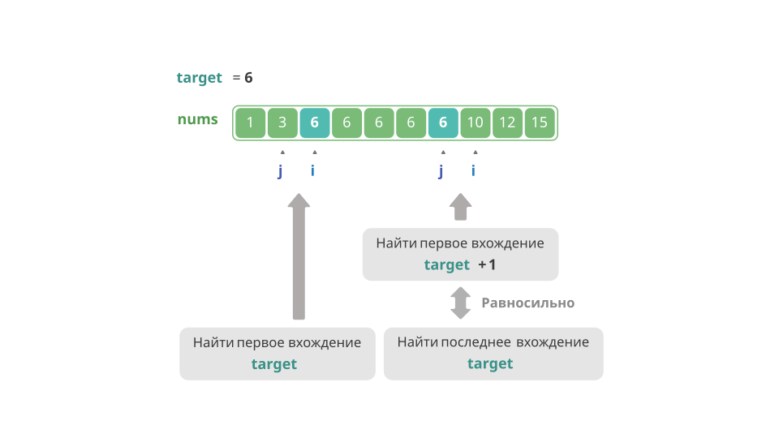

# Двоичный поиск границ

## Поиск левой границы

!!! question

    Дан отсортированный массив `nums` длины $n$, в котором возможны повторы. Верните индекс первого вхождения `target`. Если такого элемента нет, верните $-1$.

Вспомним двоичный поиск позиции вставки. Когда поиск завершён, $i$ указывает на первое вхождение `target`. **Таким образом, поиск позиции вставки по существу даёт индекс первого вхождения `target`**.

Воспользуемся функцией поиска позиции вставки, чтобы найти левую границу. Если в массиве нет `target`, возможны два исхода.

- Индекс позиции вставки $i$ выходит за границы массива.
- Элемент `nums[i]` не равен `target`.

В любом из этих случаев достаточно вернуть $-1$. Приведём реализацию:

```src
[file]{binary_search_edge}-[class]{}-[func]{binary_search_left_edge}
```

## Поиск правой границы

Как найти последнее вхождение `target`? Самый прямой способ — изменить в коде правило сдвига границы при `nums[m] == target`. Код здесь опущен. Попробуйте реализовать этот вариант самостоятельно.

Рассмотрим ещё два способа упростить задачу.

### Сведение к поиску левой границы

Функция поиска первого вхождения поможет найти и последнее: **сведём поиск последнего вхождения `target` к поиску первого вхождения `target + 1`**.

Как показано на рисунке, после поиска $i$ указывает на первое вхождение `target + 1` (если оно есть), а $j$ — на последнее вхождение `target`. **Поэтому достаточно вернуть $j$**.



Функция возвращает позицию вставки $i$. Вычтем из неё $1$, чтобы получить $j$:

```src
[file]{binary_search_edge}-[class]{}-[func]{binary_search_right_edge}
```

### Сведение к поиску элемента

Если в массиве нет `target`, то в конце поиска $i$ указывает на первый элемент, больший `target`, а $j$ — на последний элемент, меньший `target`.

Значит, для поиска границ можно подобрать значение, которого в массиве заведомо нет. Это показано на рисунке ниже.

- Чтобы найти первое вхождение `target`, поищем `target - 0.5` и вернём указатель $i$.
- Чтобы найти последнее вхождение `target`, поищем `target + 0.5` и вернём указатель $j$.


Код здесь опущен. Обратим внимание на два обстоятельства.

- В данном массиве нет дробных чисел, поэтому случай равенства обрабатывать не потребуется.
- Поскольку для поиска используются дробные числа, тип переменной `target` в функции нужно изменить на тип с плавающей точкой (в Python изменений не требуется).
