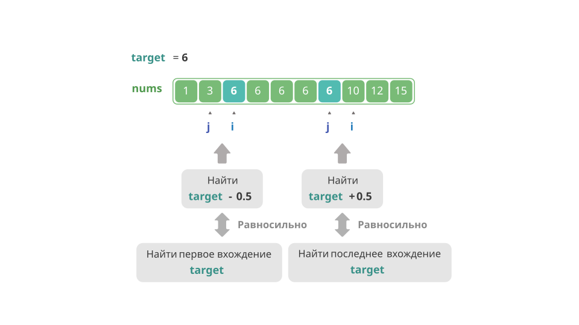

# 10.3 &nbsp; Двоичный поиск границ

## 10.3.1 &nbsp; Поиск левой границы

!!! question

    Дан отсортированный массив `nums` длины $n$, в котором возможны повторы. Верните индекс первого вхождения `target`. Если такого элемента нет, верните $-1$.

Вспомним двоичный поиск позиции вставки. Когда поиск завершён, $i$ указывает на первое вхождение `target`. **Таким образом, поиск позиции вставки по существу даёт индекс первого вхождения `target`**.

Воспользуемся функцией поиска позиции вставки, чтобы найти левую границу. Если в массиве нет `target`, возможны два исхода.

- Индекс позиции вставки $i$ выходит за границы массива.
- Элемент `nums[i]` не равен `target`.

В любом из этих случаев достаточно вернуть $-1$. Приведём реализацию:

=== "Python"

    ```python title="binary_search_edge.py"
    def binary_search_left_edge(nums: list[int], target: int) -> int:
        """Двоичный поиск первого вхождения target"""
        # Задача равносильна поиску позиции вставки target
        i = binary_search_insertion(nums, target)
        # Значение target не найдено, возвращаем -1
        if i == len(nums) or nums[i] != target:
            return -1
        # Значение target найдено, возвращаем индекс i
        return i
    ```

=== "C++"

    ```cpp title="binary_search_edge.cpp"
    /* Двоичный поиск первого вхождения target */
    int binarySearchLeftEdge(vector<int> &nums, int target) {
        // Задача равносильна поиску позиции вставки target
        int i = binarySearchInsertion(nums, target);
        // Значение target не найдено, возвращаем -1
        if (i == nums.size() || nums[i] != target) {
            return -1;
        }
        // Значение target найдено, возвращаем индекс i
        return i;
    }
    ```

=== "Java"

    ```java title="binary_search_edge.java"
    /* Двоичный поиск первого вхождения target */
    int binarySearchLeftEdge(int[] nums, int target) {
        // Задача равносильна поиску позиции вставки target
        int i = binary_search_insertion.binarySearchInsertion(nums, target);
        // Значение target не найдено, возвращаем -1
        if (i == nums.length || nums[i] != target) {
            return -1;
        }
        // Значение target найдено, возвращаем индекс i
        return i;
    }
    ```

=== "C#"

    ```csharp title="binary_search_edge.cs"
    /* Двоичный поиск первого вхождения target */
    int BinarySearchLeftEdge(int[] nums, int target) {
        // Задача равносильна поиску позиции вставки target
        int i = binary_search_insertion.BinarySearchInsertion(nums, target);
        // Значение target не найдено, возвращаем -1
        if (i == nums.Length || nums[i] != target) {
            return -1;
        }
        // Значение target найдено, возвращаем индекс i
        return i;
    }
    ```

=== "Go"

    ```go title="binary_search_edge.go"
    /* Двоичный поиск первого вхождения target */
    func binarySearchLeftEdge(nums []int, target int) int {
        // Задача равносильна поиску позиции вставки target
        i := binarySearchInsertion(nums, target)
        // Значение target не найдено, возвращаем -1
        if i == len(nums) || nums[i] != target {
            return -1
        }
        // Значение target найдено, возвращаем индекс i
        return i
    }
    ```

=== "Swift"

    ```swift title="binary_search_edge.swift"
    /* Двоичный поиск первого вхождения target */
    func binarySearchLeftEdge(nums: [Int], target: Int) -> Int {
        // Задача равносильна поиску позиции вставки target
        let i = binarySearchInsertion(nums: nums, target: target)
        // Значение target не найдено, возвращаем -1
        if i == nums.endIndex || nums[i] != target {
            return -1
        }
        // Значение target найдено, возвращаем индекс i
        return i
    }
    ```

=== "JS"

    ```javascript title="binary_search_edge.js"
    /* Двоичный поиск первого вхождения target */
    function binarySearchLeftEdge(nums, target) {
        // Задача равносильна поиску позиции вставки target
        const i = binarySearchInsertion(nums, target);
        // Значение target не найдено, возвращаем -1
        if (i === nums.length || nums[i] !== target) {
            return -1;
        }
        // Значение target найдено, возвращаем индекс i
        return i;
    }
    ```

=== "TS"

    ```typescript title="binary_search_edge.ts"
    /* Двоичный поиск первого вхождения target */
    function binarySearchLeftEdge(nums: Array<number>, target: number): number {
        // Задача равносильна поиску позиции вставки target
        const i = binarySearchInsertion(nums, target);
        // Значение target не найдено, возвращаем -1
        if (i === nums.length || nums[i] !== target) {
            return -1;
        }
        // Значение target найдено, возвращаем индекс i
        return i;
    }
    ```

=== "Dart"

    ```dart title="binary_search_edge.dart"
    /* Двоичный поиск первого вхождения target */
    int binarySearchLeftEdge(List<int> nums, int target) {
      // Задача равносильна поиску позиции вставки target
      int i = binarySearchInsertion(nums, target);
      // Значение target не найдено, возвращаем -1
      if (i == nums.length || nums[i] != target) {
        return -1;
      }
      // Значение target найдено, возвращаем индекс i
      return i;
    }
    ```

=== "Rust"

    ```rust title="binary_search_edge.rs"
    /* Двоичный поиск первого вхождения target */
    fn binary_search_left_edge(nums: &[i32], target: i32) -> i32 {
        // Задача равносильна поиску позиции вставки target
        let i = binary_search_insertion(nums, target);
        // Значение target не найдено, возвращаем -1
        if i == nums.len() as i32 || nums[i as usize] != target {
            return -1;
        }
        // Значение target найдено, возвращаем индекс i
        i
    }
    ```

=== "C"

    ```c title="binary_search_edge.c"
    /* Двоичный поиск первого вхождения target */
    int binarySearchLeftEdge(int *nums, int numSize, int target) {
        // Задача равносильна поиску позиции вставки target
        int i = binarySearchInsertion(nums, numSize, target);
        // Значение target не найдено, возвращаем -1
        if (i == numSize || nums[i] != target) {
            return -1;
        }
        // Значение target найдено, возвращаем индекс i
        return i;
    }
    ```

=== "Kotlin"

    ```kotlin title="binary_search_edge.kt"
    /* Двоичный поиск первого вхождения target */
    fun binarySearchLeftEdge(nums: IntArray, target: Int): Int {
        // Задача равносильна поиску позиции вставки target
        val i = binarySearchInsertion(nums, target)
        // Значение target не найдено, возвращаем -1
        if (i == nums.size || nums[i] != target) {
            return -1
        }
        // Значение target найдено, возвращаем индекс i
        return i
    }
    ```

=== "Ruby"

    ```ruby title="binary_search_edge.rb"
    ### Двоичный поиск первого вхождения target ###
    def binary_search_left_edge(nums, target)
      # Задача равносильна поиску позиции вставки target
      i = binary_search_insertion(nums, target)

      # Значение target не найдено, возвращаем -1
      return -1 if i == nums.length || nums[i] != target

      i # Значение target найдено, возвращаем индекс i
    end
    ```

??? pythontutor "Визуализация выполнения"

    <div style="height: 549px; width: 100%;"><iframe class="pythontutor-iframe" title="Визуализация выполнения" src="https://pythontutor.com/iframe-embed.html#code=def%20binary_search_insertion%28nums%3A%20list%5Bint%5D,%20target%3A%20int%29%20-%3E%20int%3A%0A%20%20%20%20%22%22%22%D0%94%D0%B2%D0%BE%D0%B8%D1%87%D0%BD%D1%8B%D0%B9%20%D0%BF%D0%BE%D0%B8%D1%81%D0%BA%20%D0%BF%D0%BE%D0%B7%D0%B8%D1%86%D0%B8%D0%B8%20%D0%B2%D1%81%D1%82%D0%B0%D0%B2%D0%BA%D0%B8%20%D0%BF%D1%80%D0%B8%20%D0%BD%D0%B0%D0%BB%D0%B8%D1%87%D0%B8%D0%B8%20%D0%BF%D0%BE%D0%B2%D1%82%D0%BE%D1%80%D0%BE%D0%B2%22%22%22%0A%20%20%20%20i,%20j%20%3D%200,%20len%28nums%29%20-%201%20%20%23%20%D0%97%D0%B0%D0%B4%D0%B0%D1%91%D0%BC%20%D0%B7%D0%B0%D0%BC%D0%BA%D0%BD%D1%83%D1%82%D1%8B%D0%B9%20%D0%B8%D0%BD%D1%82%D0%B5%D1%80%D0%B2%D0%B0%D0%BB%20%5B0,%20n-1%5D%0A%20%20%20%20while%20i%20%3C%3D%20j%3A%0A%20%20%20%20%20%20%20%20m%20%3D%20%28i%20%2B%20j%29%20//%202%20%20%23%20%D0%92%D1%8B%D1%87%D0%B8%D1%81%D0%BB%D1%8F%D0%B5%D0%BC%20%D0%B8%D0%BD%D0%B4%D0%B5%D0%BA%D1%81%20%D1%81%D0%B5%D1%80%D0%B5%D0%B4%D0%B8%D0%BD%D1%8B%20m%0A%20%20%20%20%20%20%20%20if%20nums%5Bm%5D%20%3C%20target%3A%0A%20%20%20%20%20%20%20%20%20%20%20%20i%20%3D%20m%20%2B%201%20%20%23%20%D0%98%D1%89%D0%B5%D0%BC%20target%20%D0%B2%20%D0%B8%D0%BD%D1%82%D0%B5%D1%80%D0%B2%D0%B0%D0%BB%D0%B5%20%5Bm%2B1,%20j%5D%0A%20%20%20%20%20%20%20%20elif%20nums%5Bm%5D%20%3E%20target%3A%0A%20%20%20%20%20%20%20%20%20%20%20%20j%20%3D%20m%20-%201%20%20%23%20%D0%98%D1%89%D0%B5%D0%BC%20target%20%D0%B2%20%D0%B8%D0%BD%D1%82%D0%B5%D1%80%D0%B2%D0%B0%D0%BB%D0%B5%20%5Bi,%20m-1%5D%0A%20%20%20%20%20%20%20%20else%3A%0A%20%20%20%20%20%20%20%20%20%20%20%20j%20%3D%20m%20-%201%20%20%23%20%D0%9F%D0%B5%D1%80%D0%B2%D1%8B%D0%B9%20%D1%8D%D0%BB%D0%B5%D0%BC%D0%B5%D0%BD%D1%82,%20%D0%BC%D0%B5%D0%BD%D1%8C%D1%88%D0%B8%D0%B9%20target,%20%D0%BD%D0%B0%D1%85%D0%BE%D0%B4%D0%B8%D1%82%D1%81%D1%8F%20%D0%B2%20%D0%B8%D0%BD%D1%82%D0%B5%D1%80%D0%B2%D0%B0%D0%BB%D0%B5%20%5Bi,%20m-1%5D%0A%20%20%20%20%23%20%D0%92%D0%BE%D0%B7%D0%B2%D1%80%D0%B0%D1%89%D0%B0%D0%B5%D0%BC%20%D0%BF%D0%BE%D0%B7%D0%B8%D1%86%D0%B8%D1%8E%20%D0%B2%D1%81%D1%82%D0%B0%D0%B2%D0%BA%D0%B8%20i%0A%20%20%20%20return%20i%0A%0Adef%20binary_search_left_edge%28nums%3A%20list%5Bint%5D,%20target%3A%20int%29%20-%3E%20int%3A%0A%20%20%20%20%22%22%22%D0%94%D0%B2%D0%BE%D0%B8%D1%87%D0%BD%D1%8B%D0%B9%20%D0%BF%D0%BE%D0%B8%D1%81%D0%BA%20%D0%BF%D0%B5%D1%80%D0%B2%D0%BE%D0%B3%D0%BE%20%D0%B2%D1%85%D0%BE%D0%B6%D0%B4%D0%B5%D0%BD%D0%B8%D1%8F%20target%22%22%22%0A%20%20%20%20%23%20%D0%97%D0%B0%D0%B4%D0%B0%D1%87%D0%B0%20%D1%80%D0%B0%D0%B2%D0%BD%D0%BE%D1%81%D0%B8%D0%BB%D1%8C%D0%BD%D0%B0%20%D0%BF%D0%BE%D0%B8%D1%81%D0%BA%D1%83%20%D0%BF%D0%BE%D0%B7%D0%B8%D1%86%D0%B8%D0%B8%20%D0%B2%D1%81%D1%82%D0%B0%D0%B2%D0%BA%D0%B8%20target%0A%20%20%20%20i%20%3D%20binary_search_insertion%28nums,%20target%29%0A%20%20%20%20%23%20%D0%97%D0%BD%D0%B0%D1%87%D0%B5%D0%BD%D0%B8%D0%B5%20target%20%D0%BD%D0%B5%20%D0%BD%D0%B0%D0%B9%D0%B4%D0%B5%D0%BD%D0%BE,%20%D0%B2%D0%BE%D0%B7%D0%B2%D1%80%D0%B0%D1%89%D0%B0%D0%B5%D0%BC%20-1%0A%20%20%20%20if%20i%20%3D%3D%20len%28nums%29%20or%20nums%5Bi%5D%20%21%3D%20target%3A%0A%20%20%20%20%20%20%20%20return%20-1%0A%20%20%20%20%23%20%D0%97%D0%BD%D0%B0%D1%87%D0%B5%D0%BD%D0%B8%D0%B5%20target%20%D0%BD%D0%B0%D0%B9%D0%B4%D0%B5%D0%BD%D0%BE,%20%D0%B2%D0%BE%D0%B7%D0%B2%D1%80%D0%B0%D1%89%D0%B0%D0%B5%D0%BC%20%D0%B8%D0%BD%D0%B4%D0%B5%D0%BA%D1%81%20i%0A%20%20%20%20return%20i%0A%0A%22%22%22Driver%20Code%22%22%22%0Aif%20__name__%20%3D%3D%20%22__main__%22%3A%0A%20%20%20%20%23%20%D0%9C%D0%B0%D1%81%D1%81%D0%B8%D0%B2%20%D1%81%20%D0%BF%D0%BE%D0%B2%D1%82%D0%BE%D1%80%D1%8F%D1%8E%D1%89%D0%B8%D0%BC%D0%B8%D1%81%D1%8F%20%D1%8D%D0%BB%D0%B5%D0%BC%D0%B5%D0%BD%D1%82%D0%B0%D0%BC%D0%B8%0A%20%20%20%20nums%20%3D%20%5B1,%203,%206,%206,%206,%206,%206,%2010,%2012,%2015%5D%0A%20%20%20%20%23%20%D0%94%D0%B2%D0%BE%D0%B8%D1%87%D0%BD%D1%8B%D0%B9%20%D0%BF%D0%BE%D0%B8%D1%81%D0%BA%20%D0%BB%D0%B5%D0%B2%D0%BE%D0%B9%20%D0%B8%20%D0%BF%D1%80%D0%B0%D0%B2%D0%BE%D0%B9%20%D0%B3%D1%80%D0%B0%D0%BD%D0%B8%D1%86%0A%20%20%20%20target%20%3D%206%0A%20%20%20%20index%20%3D%20binary_search_left_edge%28nums,%20target%29%0A%20%20%20%20print%28f%22%D0%98%D0%BD%D0%B4%D0%B5%D0%BA%D1%81%20%D0%BF%D0%B5%D1%80%D0%B2%D0%BE%D0%B3%D0%BE%20%D0%B2%D1%85%D0%BE%D0%B6%D0%B4%D0%B5%D0%BD%D0%B8%D1%8F%20%7Btarget%7D%20%3D%20%7Bindex%7D%22%29&codeDivHeight=472&codeDivWidth=350&cumulative=false&curInstr=6&heapPrimitives=nevernest&origin=opt-frontend.js&py=311&rawInputLstJSON=%5B%5D&textReferences=false"> </iframe></div>
    <div style="margin-top: 5px;"><a href="https://pythontutor.com/iframe-embed.html#code=def%20binary_search_insertion%28nums%3A%20list%5Bint%5D,%20target%3A%20int%29%20-%3E%20int%3A%0A%20%20%20%20%22%22%22%D0%94%D0%B2%D0%BE%D0%B8%D1%87%D0%BD%D1%8B%D0%B9%20%D0%BF%D0%BE%D0%B8%D1%81%D0%BA%20%D0%BF%D0%BE%D0%B7%D0%B8%D1%86%D0%B8%D0%B8%20%D0%B2%D1%81%D1%82%D0%B0%D0%B2%D0%BA%D0%B8%20%D0%BF%D1%80%D0%B8%20%D0%BD%D0%B0%D0%BB%D0%B8%D1%87%D0%B8%D0%B8%20%D0%BF%D0%BE%D0%B2%D1%82%D0%BE%D1%80%D0%BE%D0%B2%22%22%22%0A%20%20%20%20i,%20j%20%3D%200,%20len%28nums%29%20-%201%20%20%23%20%D0%97%D0%B0%D0%B4%D0%B0%D1%91%D0%BC%20%D0%B7%D0%B0%D0%BC%D0%BA%D0%BD%D1%83%D1%82%D1%8B%D0%B9%20%D0%B8%D0%BD%D1%82%D0%B5%D1%80%D0%B2%D0%B0%D0%BB%20%5B0,%20n-1%5D%0A%20%20%20%20while%20i%20%3C%3D%20j%3A%0A%20%20%20%20%20%20%20%20m%20%3D%20%28i%20%2B%20j%29%20//%202%20%20%23%20%D0%92%D1%8B%D1%87%D0%B8%D1%81%D0%BB%D1%8F%D0%B5%D0%BC%20%D0%B8%D0%BD%D0%B4%D0%B5%D0%BA%D1%81%20%D1%81%D0%B5%D1%80%D0%B5%D0%B4%D0%B8%D0%BD%D1%8B%20m%0A%20%20%20%20%20%20%20%20if%20nums%5Bm%5D%20%3C%20target%3A%0A%20%20%20%20%20%20%20%20%20%20%20%20i%20%3D%20m%20%2B%201%20%20%23%20%D0%98%D1%89%D0%B5%D0%BC%20target%20%D0%B2%20%D0%B8%D0%BD%D1%82%D0%B5%D1%80%D0%B2%D0%B0%D0%BB%D0%B5%20%5Bm%2B1,%20j%5D%0A%20%20%20%20%20%20%20%20elif%20nums%5Bm%5D%20%3E%20target%3A%0A%20%20%20%20%20%20%20%20%20%20%20%20j%20%3D%20m%20-%201%20%20%23%20%D0%98%D1%89%D0%B5%D0%BC%20target%20%D0%B2%20%D0%B8%D0%BD%D1%82%D0%B5%D1%80%D0%B2%D0%B0%D0%BB%D0%B5%20%5Bi,%20m-1%5D%0A%20%20%20%20%20%20%20%20else%3A%0A%20%20%20%20%20%20%20%20%20%20%20%20j%20%3D%20m%20-%201%20%20%23%20%D0%9F%D0%B5%D1%80%D0%B2%D1%8B%D0%B9%20%D1%8D%D0%BB%D0%B5%D0%BC%D0%B5%D0%BD%D1%82,%20%D0%BC%D0%B5%D0%BD%D1%8C%D1%88%D0%B8%D0%B9%20target,%20%D0%BD%D0%B0%D1%85%D0%BE%D0%B4%D0%B8%D1%82%D1%81%D1%8F%20%D0%B2%20%D0%B8%D0%BD%D1%82%D0%B5%D1%80%D0%B2%D0%B0%D0%BB%D0%B5%20%5Bi,%20m-1%5D%0A%20%20%20%20%23%20%D0%92%D0%BE%D0%B7%D0%B2%D1%80%D0%B0%D1%89%D0%B0%D0%B5%D0%BC%20%D0%BF%D0%BE%D0%B7%D0%B8%D1%86%D0%B8%D1%8E%20%D0%B2%D1%81%D1%82%D0%B0%D0%B2%D0%BA%D0%B8%20i%0A%20%20%20%20return%20i%0A%0Adef%20binary_search_left_edge%28nums%3A%20list%5Bint%5D,%20target%3A%20int%29%20-%3E%20int%3A%0A%20%20%20%20%22%22%22%D0%94%D0%B2%D0%BE%D0%B8%D1%87%D0%BD%D1%8B%D0%B9%20%D0%BF%D0%BE%D0%B8%D1%81%D0%BA%20%D0%BF%D0%B5%D1%80%D0%B2%D0%BE%D0%B3%D0%BE%20%D0%B2%D1%85%D0%BE%D0%B6%D0%B4%D0%B5%D0%BD%D0%B8%D1%8F%20target%22%22%22%0A%20%20%20%20%23%20%D0%97%D0%B0%D0%B4%D0%B0%D1%87%D0%B0%20%D1%80%D0%B0%D0%B2%D0%BD%D0%BE%D1%81%D0%B8%D0%BB%D1%8C%D0%BD%D0%B0%20%D0%BF%D0%BE%D0%B8%D1%81%D0%BA%D1%83%20%D0%BF%D0%BE%D0%B7%D0%B8%D1%86%D0%B8%D0%B8%20%D0%B2%D1%81%D1%82%D0%B0%D0%B2%D0%BA%D0%B8%20target%0A%20%20%20%20i%20%3D%20binary_search_insertion%28nums,%20target%29%0A%20%20%20%20%23%20%D0%97%D0%BD%D0%B0%D1%87%D0%B5%D0%BD%D0%B8%D0%B5%20target%20%D0%BD%D0%B5%20%D0%BD%D0%B0%D0%B9%D0%B4%D0%B5%D0%BD%D0%BE,%20%D0%B2%D0%BE%D0%B7%D0%B2%D1%80%D0%B0%D1%89%D0%B0%D0%B5%D0%BC%20-1%0A%20%20%20%20if%20i%20%3D%3D%20len%28nums%29%20or%20nums%5Bi%5D%20%21%3D%20target%3A%0A%20%20%20%20%20%20%20%20return%20-1%0A%20%20%20%20%23%20%D0%97%D0%BD%D0%B0%D1%87%D0%B5%D0%BD%D0%B8%D0%B5%20target%20%D0%BD%D0%B0%D0%B9%D0%B4%D0%B5%D0%BD%D0%BE,%20%D0%B2%D0%BE%D0%B7%D0%B2%D1%80%D0%B0%D1%89%D0%B0%D0%B5%D0%BC%20%D0%B8%D0%BD%D0%B4%D0%B5%D0%BA%D1%81%20i%0A%20%20%20%20return%20i%0A%0A%22%22%22Driver%20Code%22%22%22%0Aif%20__name__%20%3D%3D%20%22__main__%22%3A%0A%20%20%20%20%23%20%D0%9C%D0%B0%D1%81%D1%81%D0%B8%D0%B2%20%D1%81%20%D0%BF%D0%BE%D0%B2%D1%82%D0%BE%D1%80%D1%8F%D1%8E%D1%89%D0%B8%D0%BC%D0%B8%D1%81%D1%8F%20%D1%8D%D0%BB%D0%B5%D0%BC%D0%B5%D0%BD%D1%82%D0%B0%D0%BC%D0%B8%0A%20%20%20%20nums%20%3D%20%5B1,%203,%206,%206,%206,%206,%206,%2010,%2012,%2015%5D%0A%20%20%20%20%23%20%D0%94%D0%B2%D0%BE%D0%B8%D1%87%D0%BD%D1%8B%D0%B9%20%D0%BF%D0%BE%D0%B8%D1%81%D0%BA%20%D0%BB%D0%B5%D0%B2%D0%BE%D0%B9%20%D0%B8%20%D0%BF%D1%80%D0%B0%D0%B2%D0%BE%D0%B9%20%D0%B3%D1%80%D0%B0%D0%BD%D0%B8%D1%86%0A%20%20%20%20target%20%3D%206%0A%20%20%20%20index%20%3D%20binary_search_left_edge%28nums,%20target%29%0A%20%20%20%20print%28f%22%D0%98%D0%BD%D0%B4%D0%B5%D0%BA%D1%81%20%D0%BF%D0%B5%D1%80%D0%B2%D0%BE%D0%B3%D0%BE%20%D0%B2%D1%85%D0%BE%D0%B6%D0%B4%D0%B5%D0%BD%D0%B8%D1%8F%20%7Btarget%7D%20%3D%20%7Bindex%7D%22%29&codeDivHeight=800&codeDivWidth=600&cumulative=false&curInstr=6&heapPrimitives=nevernest&origin=opt-frontend.js&py=311&rawInputLstJSON=%5B%5D&textReferences=false" target="_blank" rel="noopener noreferrer">Во весь экран ></a></div>

## 10.3.2 &nbsp; Поиск правой границы

Как найти последнее вхождение `target`? Самый прямой способ — изменить в коде правило сдвига границы при `nums[m] == target`. Код здесь опущен. Попробуйте реализовать этот вариант самостоятельно.

Рассмотрим ещё два способа упростить задачу.

### 1. &nbsp; Сведение к поиску левой границы

Функция поиска первого вхождения поможет найти и последнее: **сведём поиск последнего вхождения `target` к поиску первого вхождения `target + 1`**.

Как показано на рисунке, после поиска $i$ указывает на первое вхождение `target + 1` (если оно есть), а $j$ — на последнее вхождение `target`. **Поэтому достаточно вернуть $j$**.

{ class="animation-figure" }

<p align="center"> Рисунок 10-7 &nbsp; Сведение поиска правой границы к поиску левой </p>

Функция возвращает позицию вставки $i$. Вычтем из неё $1$, чтобы получить $j$:

=== "Python"

    ```python title="binary_search_edge.py"
    def binary_search_right_edge(nums: list[int], target: int) -> int:
        """Двоичный поиск последнего вхождения target"""
        # Сводим задачу к поиску первого вхождения target + 1
        i = binary_search_insertion(nums, target + 1)
        # j указывает на последнее вхождение target, а i — на первый элемент, больший target
        j = i - 1
        # Значение target не найдено, возвращаем -1
        if j == -1 or nums[j] != target:
            return -1
        # Значение target найдено, возвращаем индекс j
        return j
    ```

=== "C++"

    ```cpp title="binary_search_edge.cpp"
    /* Двоичный поиск последнего вхождения target */
    int binarySearchRightEdge(vector<int> &nums, int target) {
        // Сводим задачу к поиску первого вхождения target + 1
        int i = binarySearchInsertion(nums, target + 1);
        // j указывает на последнее вхождение target, а i — на первый элемент, больший target
        int j = i - 1;
        // Значение target не найдено, возвращаем -1
        if (j == -1 || nums[j] != target) {
            return -1;
        }
        // Значение target найдено, возвращаем индекс j
        return j;
    }
    ```

=== "Java"

    ```java title="binary_search_edge.java"
    /* Двоичный поиск последнего вхождения target */
    int binarySearchRightEdge(int[] nums, int target) {
        // Сводим задачу к поиску первого вхождения target + 1
        int i = binary_search_insertion.binarySearchInsertion(nums, target + 1);
        // j указывает на последнее вхождение target, а i — на первый элемент, больший target
        int j = i - 1;
        // Значение target не найдено, возвращаем -1
        if (j == -1 || nums[j] != target) {
            return -1;
        }
        // Значение target найдено, возвращаем индекс j
        return j;
    }
    ```

=== "C#"

    ```csharp title="binary_search_edge.cs"
    /* Двоичный поиск последнего вхождения target */
    int BinarySearchRightEdge(int[] nums, int target) {
        // Сводим задачу к поиску первого вхождения target + 1
        int i = binary_search_insertion.BinarySearchInsertion(nums, target + 1);
        // j указывает на последнее вхождение target, а i — на первый элемент, больший target
        int j = i - 1;
        // Значение target не найдено, возвращаем -1
        if (j == -1 || nums[j] != target) {
            return -1;
        }
        // Значение target найдено, возвращаем индекс j
        return j;
    }
    ```

=== "Go"

    ```go title="binary_search_edge.go"
    /* Двоичный поиск последнего вхождения target */
    func binarySearchRightEdge(nums []int, target int) int {
        // Сводим задачу к поиску первого вхождения target + 1
        i := binarySearchInsertion(nums, target+1)
        // j указывает на последнее вхождение target, а i — на первый элемент, больший target
        j := i - 1
        // Значение target не найдено, возвращаем -1
        if j == -1 || nums[j] != target {
            return -1
        }
        // Значение target найдено, возвращаем индекс j
        return j
    }
    ```

=== "Swift"

    ```swift title="binary_search_edge.swift"
    /* Двоичный поиск последнего вхождения target */
    func binarySearchRightEdge(nums: [Int], target: Int) -> Int {
        // Сводим задачу к поиску первого вхождения target + 1
        let i = binarySearchInsertion(nums: nums, target: target + 1)
        // j указывает на последнее вхождение target, а i — на первый элемент, больший target
        let j = i - 1
        // Значение target не найдено, возвращаем -1
        if j == -1 || nums[j] != target {
            return -1
        }
        // Значение target найдено, возвращаем индекс j
        return j
    }
    ```

=== "JS"

    ```javascript title="binary_search_edge.js"
    /* Двоичный поиск последнего вхождения target */
    function binarySearchRightEdge(nums, target) {
        // Сводим задачу к поиску первого вхождения target + 1
        const i = binarySearchInsertion(nums, target + 1);
        // j указывает на последнее вхождение target, а i — на первый элемент, больший target
        const j = i - 1;
        // Значение target не найдено, возвращаем -1
        if (j === -1 || nums[j] !== target) {
            return -1;
        }
        // Значение target найдено, возвращаем индекс j
        return j;
    }
    ```

=== "TS"

    ```typescript title="binary_search_edge.ts"
    /* Двоичный поиск последнего вхождения target */
    function binarySearchRightEdge(nums: Array<number>, target: number): number {
        // Сводим задачу к поиску первого вхождения target + 1
        const i = binarySearchInsertion(nums, target + 1);
        // j указывает на последнее вхождение target, а i — на первый элемент, больший target
        const j = i - 1;
        // Значение target не найдено, возвращаем -1
        if (j === -1 || nums[j] !== target) {
            return -1;
        }
        // Значение target найдено, возвращаем индекс j
        return j;
    }
    ```

=== "Dart"

    ```dart title="binary_search_edge.dart"
    /* Двоичный поиск последнего вхождения target */
    int binarySearchRightEdge(List<int> nums, int target) {
      // Сводим задачу к поиску первого вхождения target + 1
      int i = binarySearchInsertion(nums, target + 1);
      // j указывает на последнее вхождение target, а i — на первый элемент, больший target
      int j = i - 1;
      // Значение target не найдено, возвращаем -1
      if (j == -1 || nums[j] != target) {
        return -1;
      }
      // Значение target найдено, возвращаем индекс j
      return j;
    }
    ```

=== "Rust"

    ```rust title="binary_search_edge.rs"
    /* Двоичный поиск последнего вхождения target */
    fn binary_search_right_edge(nums: &[i32], target: i32) -> i32 {
        // Сводим задачу к поиску первого вхождения target + 1
        let i = binary_search_insertion(nums, target + 1);
        // j указывает на последнее вхождение target, а i — на первый элемент, больший target
        let j = i - 1;
        // Значение target не найдено, возвращаем -1
        if j == -1 || nums[j as usize] != target {
            return -1;
        }
        // Значение target найдено, возвращаем индекс j
        j
    }
    ```

=== "C"

    ```c title="binary_search_edge.c"
    /* Двоичный поиск последнего вхождения target */
    int binarySearchRightEdge(int *nums, int numSize, int target) {
        // Сводим задачу к поиску первого вхождения target + 1
        int i = binarySearchInsertion(nums, numSize, target + 1);
        // j указывает на последнее вхождение target, а i — на первый элемент, больший target
        int j = i - 1;
        // Значение target не найдено, возвращаем -1
        if (j == -1 || nums[j] != target) {
            return -1;
        }
        // Значение target найдено, возвращаем индекс j
        return j;
    }
    ```

=== "Kotlin"

    ```kotlin title="binary_search_edge.kt"
    /* Двоичный поиск последнего вхождения target */
    fun binarySearchRightEdge(nums: IntArray, target: Int): Int {
        // Сводим задачу к поиску первого вхождения target + 1
        val i = binarySearchInsertion(nums, target + 1)
        // j указывает на последнее вхождение target, а i — на первый элемент, больший target
        val j = i - 1
        // Значение target не найдено, возвращаем -1
        if (j == -1 || nums[j] != target) {
            return -1
        }
        // Значение target найдено, возвращаем индекс j
        return j
    }
    ```

=== "Ruby"

    ```ruby title="binary_search_edge.rb"
    ### Двоичный поиск последнего вхождения target ###
    def binary_search_right_edge(nums, target)
      # Сводим задачу к поиску первого вхождения target + 1
      i = binary_search_insertion(nums, target + 1)

      # j указывает на последнее вхождение target, а i — на первый элемент, больший target
      j = i - 1

      # Значение target не найдено, возвращаем -1
      return -1 if j == -1 || nums[j] != target

      j # Значение target найдено, возвращаем индекс j
    end
    ```

??? pythontutor "Визуализация выполнения"

    <div style="height: 549px; width: 100%;"><iframe class="pythontutor-iframe" title="Визуализация выполнения" src="https://pythontutor.com/iframe-embed.html#code=def%20binary_search_insertion%28nums%3A%20list%5Bint%5D,%20target%3A%20int%29%20-%3E%20int%3A%0A%20%20%20%20%22%22%22%D0%94%D0%B2%D0%BE%D0%B8%D1%87%D0%BD%D1%8B%D0%B9%20%D0%BF%D0%BE%D0%B8%D1%81%D0%BA%20%D0%BF%D0%BE%D0%B7%D0%B8%D1%86%D0%B8%D0%B8%20%D0%B2%D1%81%D1%82%D0%B0%D0%B2%D0%BA%D0%B8%20%D0%BF%D1%80%D0%B8%20%D0%BD%D0%B0%D0%BB%D0%B8%D1%87%D0%B8%D0%B8%20%D0%BF%D0%BE%D0%B2%D1%82%D0%BE%D1%80%D0%BE%D0%B2%22%22%22%0A%20%20%20%20i,%20j%20%3D%200,%20len%28nums%29%20-%201%20%20%23%20%D0%97%D0%B0%D0%B4%D0%B0%D1%91%D0%BC%20%D0%B7%D0%B0%D0%BC%D0%BA%D0%BD%D1%83%D1%82%D1%8B%D0%B9%20%D0%B8%D0%BD%D1%82%D0%B5%D1%80%D0%B2%D0%B0%D0%BB%20%5B0,%20n-1%5D%0A%20%20%20%20while%20i%20%3C%3D%20j%3A%0A%20%20%20%20%20%20%20%20m%20%3D%20%28i%20%2B%20j%29%20//%202%20%20%23%20%D0%92%D1%8B%D1%87%D0%B8%D1%81%D0%BB%D1%8F%D0%B5%D0%BC%20%D0%B8%D0%BD%D0%B4%D0%B5%D0%BA%D1%81%20%D1%81%D0%B5%D1%80%D0%B5%D0%B4%D0%B8%D0%BD%D1%8B%20m%0A%20%20%20%20%20%20%20%20if%20nums%5Bm%5D%20%3C%20target%3A%0A%20%20%20%20%20%20%20%20%20%20%20%20i%20%3D%20m%20%2B%201%20%20%23%20%D0%98%D1%89%D0%B5%D0%BC%20target%20%D0%B2%20%D0%B8%D0%BD%D1%82%D0%B5%D1%80%D0%B2%D0%B0%D0%BB%D0%B5%20%5Bm%2B1,%20j%5D%0A%20%20%20%20%20%20%20%20elif%20nums%5Bm%5D%20%3E%20target%3A%0A%20%20%20%20%20%20%20%20%20%20%20%20j%20%3D%20m%20-%201%20%20%23%20%D0%98%D1%89%D0%B5%D0%BC%20target%20%D0%B2%20%D0%B8%D0%BD%D1%82%D0%B5%D1%80%D0%B2%D0%B0%D0%BB%D0%B5%20%5Bi,%20m-1%5D%0A%20%20%20%20%20%20%20%20else%3A%0A%20%20%20%20%20%20%20%20%20%20%20%20j%20%3D%20m%20-%201%20%20%23%20%D0%9F%D0%B5%D1%80%D0%B2%D1%8B%D0%B9%20%D1%8D%D0%BB%D0%B5%D0%BC%D0%B5%D0%BD%D1%82,%20%D0%BC%D0%B5%D0%BD%D1%8C%D1%88%D0%B8%D0%B9%20target,%20%D0%BD%D0%B0%D1%85%D0%BE%D0%B4%D0%B8%D1%82%D1%81%D1%8F%20%D0%B2%20%D0%B8%D0%BD%D1%82%D0%B5%D1%80%D0%B2%D0%B0%D0%BB%D0%B5%20%5Bi,%20m-1%5D%0A%20%20%20%20%23%20%D0%92%D0%BE%D0%B7%D0%B2%D1%80%D0%B0%D1%89%D0%B0%D0%B5%D0%BC%20%D0%BF%D0%BE%D0%B7%D0%B8%D1%86%D0%B8%D1%8E%20%D0%B2%D1%81%D1%82%D0%B0%D0%B2%D0%BA%D0%B8%20i%0A%20%20%20%20return%20i%0A%0Adef%20binary_search_right_edge%28nums%3A%20list%5Bint%5D,%20target%3A%20int%29%20-%3E%20int%3A%0A%20%20%20%20%22%22%22%D0%94%D0%B2%D0%BE%D0%B8%D1%87%D0%BD%D1%8B%D0%B9%20%D0%BF%D0%BE%D0%B8%D1%81%D0%BA%20%D0%BF%D0%BE%D1%81%D0%BB%D0%B5%D0%B4%D0%BD%D0%B5%D0%B3%D0%BE%20%D0%B2%D1%85%D0%BE%D0%B6%D0%B4%D0%B5%D0%BD%D0%B8%D1%8F%20target%22%22%22%0A%20%20%20%20%23%20%D0%A1%D0%B2%D0%BE%D0%B4%D0%B8%D0%BC%20%D0%B7%D0%B0%D0%B4%D0%B0%D1%87%D1%83%20%D0%BA%20%D0%BF%D0%BE%D0%B8%D1%81%D0%BA%D1%83%20%D0%BF%D0%B5%D1%80%D0%B2%D0%BE%D0%B3%D0%BE%20%D0%B2%D1%85%D0%BE%D0%B6%D0%B4%D0%B5%D0%BD%D0%B8%D1%8F%20target%20%2B%201%0A%20%20%20%20i%20%3D%20binary_search_insertion%28nums,%20target%20%2B%201%29%0A%20%20%20%20%23%20j%20%D1%83%D0%BA%D0%B0%D0%B7%D1%8B%D0%B2%D0%B0%D0%B5%D1%82%20%D0%BD%D0%B0%20%D0%BF%D0%BE%D1%81%D0%BB%D0%B5%D0%B4%D0%BD%D0%B5%D0%B5%20%D0%B2%D1%85%D0%BE%D0%B6%D0%B4%D0%B5%D0%BD%D0%B8%D0%B5%20target,%20%D0%B0%20i%20%E2%80%94%20%D0%BD%D0%B0%20%D0%BF%D0%B5%D1%80%D0%B2%D1%8B%D0%B9%20%D1%8D%D0%BB%D0%B5%D0%BC%D0%B5%D0%BD%D1%82,%20%D0%B1%D0%BE%D0%BB%D1%8C%D1%88%D0%B8%D0%B9%20target%0A%20%20%20%20j%20%3D%20i%20-%201%0A%20%20%20%20%23%20%D0%97%D0%BD%D0%B0%D1%87%D0%B5%D0%BD%D0%B8%D0%B5%20target%20%D0%BD%D0%B5%20%D0%BD%D0%B0%D0%B9%D0%B4%D0%B5%D0%BD%D0%BE,%20%D0%B2%D0%BE%D0%B7%D0%B2%D1%80%D0%B0%D1%89%D0%B0%D0%B5%D0%BC%20-1%0A%20%20%20%20if%20j%20%3D%3D%20-1%20or%20nums%5Bj%5D%20%21%3D%20target%3A%0A%20%20%20%20%20%20%20%20return%20-1%0A%20%20%20%20%23%20%D0%97%D0%BD%D0%B0%D1%87%D0%B5%D0%BD%D0%B8%D0%B5%20target%20%D0%BD%D0%B0%D0%B9%D0%B4%D0%B5%D0%BD%D0%BE,%20%D0%B2%D0%BE%D0%B7%D0%B2%D1%80%D0%B0%D1%89%D0%B0%D0%B5%D0%BC%20%D0%B8%D0%BD%D0%B4%D0%B5%D0%BA%D1%81%20j%0A%20%20%20%20return%20j%0A%0A%22%22%22Driver%20Code%22%22%22%0Aif%20__name__%20%3D%3D%20%22__main__%22%3A%0A%20%20%20%20%23%20%D0%9C%D0%B0%D1%81%D1%81%D0%B8%D0%B2%20%D1%81%20%D0%BF%D0%BE%D0%B2%D1%82%D0%BE%D1%80%D1%8F%D1%8E%D1%89%D0%B8%D0%BC%D0%B8%D1%81%D1%8F%20%D1%8D%D0%BB%D0%B5%D0%BC%D0%B5%D0%BD%D1%82%D0%B0%D0%BC%D0%B8%0A%20%20%20%20nums%20%3D%20%5B1,%203,%206,%206,%206,%206,%206,%2010,%2012,%2015%5D%0A%20%20%20%20%23%20%D0%94%D0%B2%D0%BE%D0%B8%D1%87%D0%BD%D1%8B%D0%B9%20%D0%BF%D0%BE%D0%B8%D1%81%D0%BA%20%D0%BB%D0%B5%D0%B2%D0%BE%D0%B9%20%D0%B8%20%D0%BF%D1%80%D0%B0%D0%B2%D0%BE%D0%B9%20%D0%B3%D1%80%D0%B0%D0%BD%D0%B8%D1%86%0A%20%20%20%20target%20%3D%206%0A%20%20%20%20index%20%3D%20binary_search_right_edge%28nums,%20target%29%0A%20%20%20%20print%28f%22%D0%98%D0%BD%D0%B4%D0%B5%D0%BA%D1%81%20%D0%BF%D0%BE%D1%81%D0%BB%D0%B5%D0%B4%D0%BD%D0%B5%D0%B3%D0%BE%20%D0%B2%D1%85%D0%BE%D0%B6%D0%B4%D0%B5%D0%BD%D0%B8%D1%8F%20%7Btarget%7D%20%3D%20%7Bindex%7D%22%29&codeDivHeight=472&codeDivWidth=350&cumulative=false&curInstr=6&heapPrimitives=nevernest&origin=opt-frontend.js&py=311&rawInputLstJSON=%5B%5D&textReferences=false"> </iframe></div>
    <div style="margin-top: 5px;"><a href="https://pythontutor.com/iframe-embed.html#code=def%20binary_search_insertion%28nums%3A%20list%5Bint%5D,%20target%3A%20int%29%20-%3E%20int%3A%0A%20%20%20%20%22%22%22%D0%94%D0%B2%D0%BE%D0%B8%D1%87%D0%BD%D1%8B%D0%B9%20%D0%BF%D0%BE%D0%B8%D1%81%D0%BA%20%D0%BF%D0%BE%D0%B7%D0%B8%D1%86%D0%B8%D0%B8%20%D0%B2%D1%81%D1%82%D0%B0%D0%B2%D0%BA%D0%B8%20%D0%BF%D1%80%D0%B8%20%D0%BD%D0%B0%D0%BB%D0%B8%D1%87%D0%B8%D0%B8%20%D0%BF%D0%BE%D0%B2%D1%82%D0%BE%D1%80%D0%BE%D0%B2%22%22%22%0A%20%20%20%20i,%20j%20%3D%200,%20len%28nums%29%20-%201%20%20%23%20%D0%97%D0%B0%D0%B4%D0%B0%D1%91%D0%BC%20%D0%B7%D0%B0%D0%BC%D0%BA%D0%BD%D1%83%D1%82%D1%8B%D0%B9%20%D0%B8%D0%BD%D1%82%D0%B5%D1%80%D0%B2%D0%B0%D0%BB%20%5B0,%20n-1%5D%0A%20%20%20%20while%20i%20%3C%3D%20j%3A%0A%20%20%20%20%20%20%20%20m%20%3D%20%28i%20%2B%20j%29%20//%202%20%20%23%20%D0%92%D1%8B%D1%87%D0%B8%D1%81%D0%BB%D1%8F%D0%B5%D0%BC%20%D0%B8%D0%BD%D0%B4%D0%B5%D0%BA%D1%81%20%D1%81%D0%B5%D1%80%D0%B5%D0%B4%D0%B8%D0%BD%D1%8B%20m%0A%20%20%20%20%20%20%20%20if%20nums%5Bm%5D%20%3C%20target%3A%0A%20%20%20%20%20%20%20%20%20%20%20%20i%20%3D%20m%20%2B%201%20%20%23%20%D0%98%D1%89%D0%B5%D0%BC%20target%20%D0%B2%20%D0%B8%D0%BD%D1%82%D0%B5%D1%80%D0%B2%D0%B0%D0%BB%D0%B5%20%5Bm%2B1,%20j%5D%0A%20%20%20%20%20%20%20%20elif%20nums%5Bm%5D%20%3E%20target%3A%0A%20%20%20%20%20%20%20%20%20%20%20%20j%20%3D%20m%20-%201%20%20%23%20%D0%98%D1%89%D0%B5%D0%BC%20target%20%D0%B2%20%D0%B8%D0%BD%D1%82%D0%B5%D1%80%D0%B2%D0%B0%D0%BB%D0%B5%20%5Bi,%20m-1%5D%0A%20%20%20%20%20%20%20%20else%3A%0A%20%20%20%20%20%20%20%20%20%20%20%20j%20%3D%20m%20-%201%20%20%23%20%D0%9F%D0%B5%D1%80%D0%B2%D1%8B%D0%B9%20%D1%8D%D0%BB%D0%B5%D0%BC%D0%B5%D0%BD%D1%82,%20%D0%BC%D0%B5%D0%BD%D1%8C%D1%88%D0%B8%D0%B9%20target,%20%D0%BD%D0%B0%D1%85%D0%BE%D0%B4%D0%B8%D1%82%D1%81%D1%8F%20%D0%B2%20%D0%B8%D0%BD%D1%82%D0%B5%D1%80%D0%B2%D0%B0%D0%BB%D0%B5%20%5Bi,%20m-1%5D%0A%20%20%20%20%23%20%D0%92%D0%BE%D0%B7%D0%B2%D1%80%D0%B0%D1%89%D0%B0%D0%B5%D0%BC%20%D0%BF%D0%BE%D0%B7%D0%B8%D1%86%D0%B8%D1%8E%20%D0%B2%D1%81%D1%82%D0%B0%D0%B2%D0%BA%D0%B8%20i%0A%20%20%20%20return%20i%0A%0Adef%20binary_search_right_edge%28nums%3A%20list%5Bint%5D,%20target%3A%20int%29%20-%3E%20int%3A%0A%20%20%20%20%22%22%22%D0%94%D0%B2%D0%BE%D0%B8%D1%87%D0%BD%D1%8B%D0%B9%20%D0%BF%D0%BE%D0%B8%D1%81%D0%BA%20%D0%BF%D0%BE%D1%81%D0%BB%D0%B5%D0%B4%D0%BD%D0%B5%D0%B3%D0%BE%20%D0%B2%D1%85%D0%BE%D0%B6%D0%B4%D0%B5%D0%BD%D0%B8%D1%8F%20target%22%22%22%0A%20%20%20%20%23%20%D0%A1%D0%B2%D0%BE%D0%B4%D0%B8%D0%BC%20%D0%B7%D0%B0%D0%B4%D0%B0%D1%87%D1%83%20%D0%BA%20%D0%BF%D0%BE%D0%B8%D1%81%D0%BA%D1%83%20%D0%BF%D0%B5%D1%80%D0%B2%D0%BE%D0%B3%D0%BE%20%D0%B2%D1%85%D0%BE%D0%B6%D0%B4%D0%B5%D0%BD%D0%B8%D1%8F%20target%20%2B%201%0A%20%20%20%20i%20%3D%20binary_search_insertion%28nums,%20target%20%2B%201%29%0A%20%20%20%20%23%20j%20%D1%83%D0%BA%D0%B0%D0%B7%D1%8B%D0%B2%D0%B0%D0%B5%D1%82%20%D0%BD%D0%B0%20%D0%BF%D0%BE%D1%81%D0%BB%D0%B5%D0%B4%D0%BD%D0%B5%D0%B5%20%D0%B2%D1%85%D0%BE%D0%B6%D0%B4%D0%B5%D0%BD%D0%B8%D0%B5%20target,%20%D0%B0%20i%20%E2%80%94%20%D0%BD%D0%B0%20%D0%BF%D0%B5%D1%80%D0%B2%D1%8B%D0%B9%20%D1%8D%D0%BB%D0%B5%D0%BC%D0%B5%D0%BD%D1%82,%20%D0%B1%D0%BE%D0%BB%D1%8C%D1%88%D0%B8%D0%B9%20target%0A%20%20%20%20j%20%3D%20i%20-%201%0A%20%20%20%20%23%20%D0%97%D0%BD%D0%B0%D1%87%D0%B5%D0%BD%D0%B8%D0%B5%20target%20%D0%BD%D0%B5%20%D0%BD%D0%B0%D0%B9%D0%B4%D0%B5%D0%BD%D0%BE,%20%D0%B2%D0%BE%D0%B7%D0%B2%D1%80%D0%B0%D1%89%D0%B0%D0%B5%D0%BC%20-1%0A%20%20%20%20if%20j%20%3D%3D%20-1%20or%20nums%5Bj%5D%20%21%3D%20target%3A%0A%20%20%20%20%20%20%20%20return%20-1%0A%20%20%20%20%23%20%D0%97%D0%BD%D0%B0%D1%87%D0%B5%D0%BD%D0%B8%D0%B5%20target%20%D0%BD%D0%B0%D0%B9%D0%B4%D0%B5%D0%BD%D0%BE,%20%D0%B2%D0%BE%D0%B7%D0%B2%D1%80%D0%B0%D1%89%D0%B0%D0%B5%D0%BC%20%D0%B8%D0%BD%D0%B4%D0%B5%D0%BA%D1%81%20j%0A%20%20%20%20return%20j%0A%0A%22%22%22Driver%20Code%22%22%22%0Aif%20__name__%20%3D%3D%20%22__main__%22%3A%0A%20%20%20%20%23%20%D0%9C%D0%B0%D1%81%D1%81%D0%B8%D0%B2%20%D1%81%20%D0%BF%D0%BE%D0%B2%D1%82%D0%BE%D1%80%D1%8F%D1%8E%D1%89%D0%B8%D0%BC%D0%B8%D1%81%D1%8F%20%D1%8D%D0%BB%D0%B5%D0%BC%D0%B5%D0%BD%D1%82%D0%B0%D0%BC%D0%B8%0A%20%20%20%20nums%20%3D%20%5B1,%203,%206,%206,%206,%206,%206,%2010,%2012,%2015%5D%0A%20%20%20%20%23%20%D0%94%D0%B2%D0%BE%D0%B8%D1%87%D0%BD%D1%8B%D0%B9%20%D0%BF%D0%BE%D0%B8%D1%81%D0%BA%20%D0%BB%D0%B5%D0%B2%D0%BE%D0%B9%20%D0%B8%20%D0%BF%D1%80%D0%B0%D0%B2%D0%BE%D0%B9%20%D0%B3%D1%80%D0%B0%D0%BD%D0%B8%D1%86%0A%20%20%20%20target%20%3D%206%0A%20%20%20%20index%20%3D%20binary_search_right_edge%28nums,%20target%29%0A%20%20%20%20print%28f%22%D0%98%D0%BD%D0%B4%D0%B5%D0%BA%D1%81%20%D0%BF%D0%BE%D1%81%D0%BB%D0%B5%D0%B4%D0%BD%D0%B5%D0%B3%D0%BE%20%D0%B2%D1%85%D0%BE%D0%B6%D0%B4%D0%B5%D0%BD%D0%B8%D1%8F%20%7Btarget%7D%20%3D%20%7Bindex%7D%22%29&codeDivHeight=800&codeDivWidth=600&cumulative=false&curInstr=6&heapPrimitives=nevernest&origin=opt-frontend.js&py=311&rawInputLstJSON=%5B%5D&textReferences=false" target="_blank" rel="noopener noreferrer">Во весь экран ></a></div>

### 2. &nbsp; Сведение к поиску элемента

Если в массиве нет `target`, то в конце поиска $i$ указывает на первый элемент, больший `target`, а $j$ — на последний элемент, меньший `target`.

Значит, для поиска границ можно подобрать значение, которого в массиве заведомо нет. Это показано на рисунке 10-8.

- Чтобы найти первое вхождение `target`, поищем `target - 0.5` и вернём указатель $i$.
- Чтобы найти последнее вхождение `target`, поищем `target + 0.5` и вернём указатель $j$.

{ class="animation-figure" }

<p align="center"> Рисунок 10-8 &nbsp; Сведение поиска границ к поиску элемента </p>

Код здесь опущен. Обратим внимание на два обстоятельства.

- В данном массиве нет дробных чисел, поэтому случай равенства обрабатывать не потребуется.
- Поскольку для поиска используются дробные числа, тип переменной `target` в функции нужно изменить на тип с плавающей точкой (в Python изменений не требуется).
