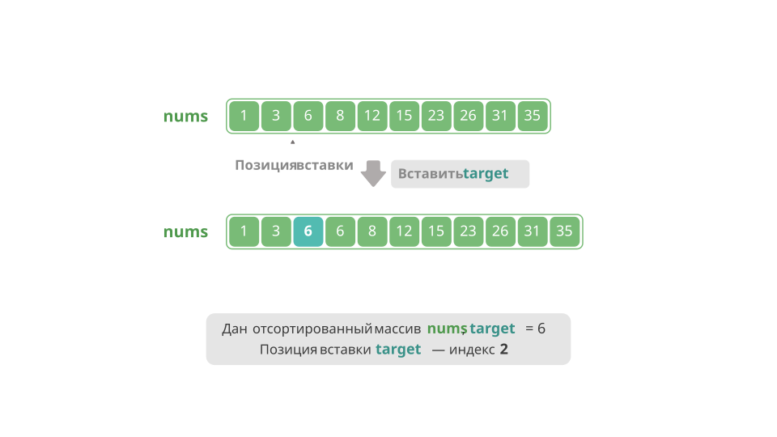
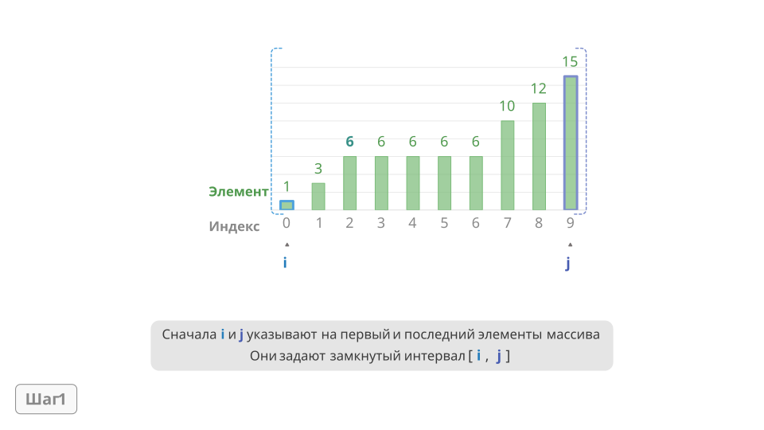
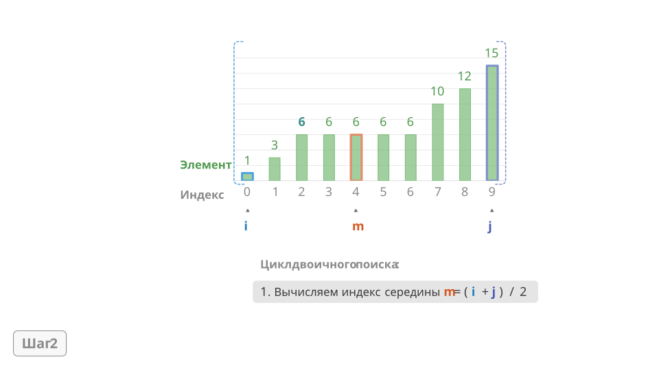
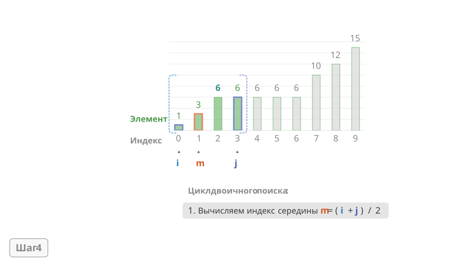
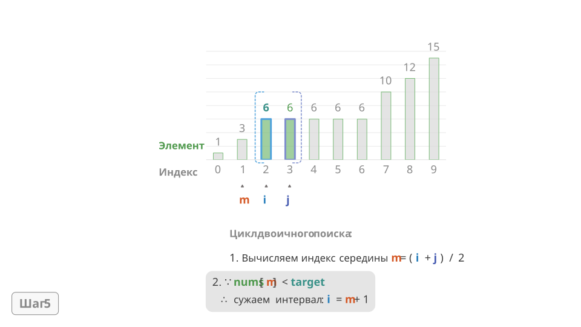
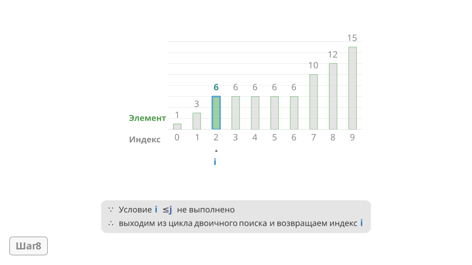

# 10.2 &nbsp; Двоичный поиск позиции вставки

Двоичный поиск позволяет не только найти элемент, но и решить многие родственные задачи, например определить позицию его вставки.

## 10.2.1 &nbsp; Массив без повторяющихся элементов

!!! question

    Даны отсортированный массив `nums` длины $n$ без повторов и элемент `target`. Вставьте `target` в массив `nums` так, чтобы сохранить порядок. Если `target` уже есть в массиве, поместите новый элемент слева от него. Верните индекс нового `target` после вставки. Пример показан ниже.

{ class="animation-figure" }

<p align="center"> Рисунок 10-4 &nbsp; Пример данных для двоичного поиска позиции вставки </p>

Чтобы воспользоваться кодом двоичного поиска из предыдущего раздела, ответим на два вопроса.

**Первый вопрос**. Если в массиве есть `target`, совпадает ли позиция вставки с индексом этого элемента?

По условию `target` нужно вставить слева от равного элемента. Значит, новый `target` займёт прежнее место `target`. Таким образом, **если массив содержит `target`, позиция вставки совпадает с индексом этого `target`**.

**Второй вопрос**. Если `target` в массиве нет, индекс какого элемента будет позицией вставки?

Присмотримся к ходу двоичного поиска. При `nums[m] < target` указатель $i$ сдвигается вправо. Значит, $i$ приближается к элементам, большим или равным `target`. Аналогично, указатель $j$ приближается к элементам, меньшим или равным `target`.

По завершении поиска $i$ указывает на первый элемент, больший `target`, а $j$ — на последний элемент, меньший `target`. **Таким образом, если в массиве нет `target`, позиция вставки равна $i$**. Запишем это в коде:

=== "Python"

    ```python title="binary_search_insertion.py"
    def binary_search_insertion_simple(nums: list[int], target: int) -> int:
        """Двоичный поиск позиции вставки без повторов"""
        i, j = 0, len(nums) - 1  # Задаём замкнутый интервал [0, n-1]
        while i <= j:
            m = (i + j) // 2  # Вычисляем индекс середины m
            if nums[m] < target:
                i = m + 1  # Ищем target в интервале [m+1, j]
            elif nums[m] > target:
                j = m - 1  # Ищем target в интервале [i, m-1]
            else:
                return m  # Значение target найдено, возвращаем позицию вставки m
        # Значение target не найдено, возвращаем позицию вставки i
        return i
    ```

=== "C++"

    ```cpp title="binary_search_insertion.cpp"
    /* Двоичный поиск позиции вставки без повторов */
    int binarySearchInsertionSimple(vector<int> &nums, int target) {
        int i = 0, j = nums.size() - 1; // Задаём замкнутый интервал [0, n-1]
        while (i <= j) {
            int m = i + (j - i) / 2; // Вычисляем индекс середины m
            if (nums[m] < target) {
                i = m + 1; // Ищем target в интервале [m+1, j]
            } else if (nums[m] > target) {
                j = m - 1; // Ищем target в интервале [i, m-1]
            } else {
                return m; // Значение target найдено, возвращаем позицию вставки m
            }
        }
        // Значение target не найдено, возвращаем позицию вставки i
        return i;
    }
    ```

=== "Java"

    ```java title="binary_search_insertion.java"
    /* Двоичный поиск позиции вставки без повторов */
    int binarySearchInsertionSimple(int[] nums, int target) {
        int i = 0, j = nums.length - 1; // Задаём замкнутый интервал [0, n-1]
        while (i <= j) {
            int m = i + (j - i) / 2; // Вычисляем индекс середины m
            if (nums[m] < target) {
                i = m + 1; // Ищем target в интервале [m+1, j]
            } else if (nums[m] > target) {
                j = m - 1; // Ищем target в интервале [i, m-1]
            } else {
                return m; // Значение target найдено, возвращаем позицию вставки m
            }
        }
        // Значение target не найдено, возвращаем позицию вставки i
        return i;
    }
    ```

=== "C#"

    ```csharp title="binary_search_insertion.cs"
    /* Двоичный поиск позиции вставки без повторов */
    int BinarySearchInsertionSimple(int[] nums, int target) {
        int i = 0, j = nums.Length - 1; // Задаём замкнутый интервал [0, n-1]
        while (i <= j) {
            int m = i + (j - i) / 2; // Вычисляем индекс середины m
            if (nums[m] < target) {
                i = m + 1; // Ищем target в интервале [m+1, j]
            } else if (nums[m] > target) {
                j = m - 1; // Ищем target в интервале [i, m-1]
            } else {
                return m; // Значение target найдено, возвращаем позицию вставки m
            }
        }
        // Значение target не найдено, возвращаем позицию вставки i
        return i;
    }
    ```

=== "Go"

    ```go title="binary_search_insertion.go"
    /* Двоичный поиск позиции вставки без повторов */
    func binarySearchInsertionSimple(nums []int, target int) int {
        // Задаём замкнутый интервал [0, n-1]
        i, j := 0, len(nums)-1
        for i <= j {
            // Вычисляем индекс середины m
            m := i + (j-i)/2
            if nums[m] < target {
                // Ищем target в интервале [m+1, j]
                i = m + 1
            } else if nums[m] > target {
                // Ищем target в интервале [i, m-1]
                j = m - 1
            } else {
                // Значение target найдено, возвращаем позицию вставки m
                return m
            }
        }
        // Значение target не найдено, возвращаем позицию вставки i
        return i
    }
    ```

=== "Swift"

    ```swift title="binary_search_insertion.swift"
    /* Двоичный поиск позиции вставки без повторов */
    func binarySearchInsertionSimple(nums: [Int], target: Int) -> Int {
        // Задаём замкнутый интервал [0, n-1]
        var i = nums.startIndex
        var j = nums.endIndex - 1
        while i <= j {
            let m = i + (j - i) / 2 // Вычисляем индекс середины m
            if nums[m] < target {
                i = m + 1 // Ищем target в интервале [m+1, j]
            } else if nums[m] > target {
                j = m - 1 // Ищем target в интервале [i, m-1]
            } else {
                return m // Значение target найдено, возвращаем позицию вставки m
            }
        }
        // Значение target не найдено, возвращаем позицию вставки i
        return i
    }
    ```

=== "JS"

    ```javascript title="binary_search_insertion.js"
    /* Двоичный поиск позиции вставки без повторов */
    function binarySearchInsertionSimple(nums, target) {
        let i = 0,
            j = nums.length - 1; // Задаём замкнутый интервал [0, n-1]
        while (i <= j) {
            const m = Math.floor(i + (j - i) / 2); // Вычисляем индекс середины m с округлением вниз с помощью Math.floor()
            if (nums[m] < target) {
                i = m + 1; // Ищем target в интервале [m+1, j]
            } else if (nums[m] > target) {
                j = m - 1; // Ищем target в интервале [i, m-1]
            } else {
                return m; // Значение target найдено, возвращаем позицию вставки m
            }
        }
        // Значение target не найдено, возвращаем позицию вставки i
        return i;
    }
    ```

=== "TS"

    ```typescript title="binary_search_insertion.ts"
    /* Двоичный поиск позиции вставки без повторов */
    function binarySearchInsertionSimple(
        nums: Array<number>,
        target: number
    ): number {
        let i = 0,
            j = nums.length - 1; // Задаём замкнутый интервал [0, n-1]
        while (i <= j) {
            const m = Math.floor(i + (j - i) / 2); // Вычисляем индекс середины m с округлением вниз с помощью Math.floor()
            if (nums[m] < target) {
                i = m + 1; // Ищем target в интервале [m+1, j]
            } else if (nums[m] > target) {
                j = m - 1; // Ищем target в интервале [i, m-1]
            } else {
                return m; // Значение target найдено, возвращаем позицию вставки m
            }
        }
        // Значение target не найдено, возвращаем позицию вставки i
        return i;
    }
    ```

=== "Dart"

    ```dart title="binary_search_insertion.dart"
    /* Двоичный поиск позиции вставки без повторов */
    int binarySearchInsertionSimple(List<int> nums, int target) {
      int i = 0, j = nums.length - 1; // Задаём замкнутый интервал [0, n-1]
      while (i <= j) {
        int m = i + (j - i) ~/ 2; // Вычисляем индекс середины m
        if (nums[m] < target) {
          i = m + 1; // Ищем target в интервале [m+1, j]
        } else if (nums[m] > target) {
          j = m - 1; // Ищем target в интервале [i, m-1]
        } else {
          return m; // Значение target найдено, возвращаем позицию вставки m
        }
      }
      // Значение target не найдено, возвращаем позицию вставки i
      return i;
    }
    ```

=== "Rust"

    ```rust title="binary_search_insertion.rs"
    /* Двоичный поиск позиции вставки без повторов */
    fn binary_search_insertion_simple(nums: &[i32], target: i32) -> i32 {
        let (mut i, mut j) = (0, nums.len() as i32 - 1); // Задаём замкнутый интервал [0, n-1]
        while i <= j {
            let m = i + (j - i) / 2; // Вычисляем индекс середины m
            if nums[m as usize] < target {
                i = m + 1; // Ищем target в интервале [m+1, j]
            } else if nums[m as usize] > target {
                j = m - 1; // Ищем target в интервале [i, m-1]
            } else {
                return m;
            }
        }
        // Значение target не найдено, возвращаем позицию вставки i
        i
    }
    ```

=== "C"

    ```c title="binary_search_insertion.c"
    /* Двоичный поиск позиции вставки без повторов */
    int binarySearchInsertionSimple(int *nums, int numSize, int target) {
        int i = 0, j = numSize - 1; // Задаём замкнутый интервал [0, n-1]
        while (i <= j) {
            int m = i + (j - i) / 2; // Вычисляем индекс середины m
            if (nums[m] < target) {
                i = m + 1; // Ищем target в интервале [m+1, j]
            } else if (nums[m] > target) {
                j = m - 1; // Ищем target в интервале [i, m-1]
            } else {
                return m; // Значение target найдено, возвращаем позицию вставки m
            }
        }
        // Значение target не найдено, возвращаем позицию вставки i
        return i;
    }
    ```

=== "Kotlin"

    ```kotlin title="binary_search_insertion.kt"
    /* Двоичный поиск позиции вставки без повторов */
    fun binarySearchInsertionSimple(nums: IntArray, target: Int): Int {
        var i = 0
        var j = nums.size - 1 // Задаём замкнутый интервал [0, n-1]
        while (i <= j) {
            val m = i + (j - i) / 2 // Вычисляем индекс середины m
            if (nums[m] < target) {
                i = m + 1 // Ищем target в интервале [m+1, j]
            } else if (nums[m] > target) {
                j = m - 1 // Ищем target в интервале [i, m-1]
            } else {
                return m // Значение target найдено, возвращаем позицию вставки m
            }
        }
        // Значение target не найдено, возвращаем позицию вставки i
        return i
    }
    ```

=== "Ruby"

    ```ruby title="binary_search_insertion.rb"
    ### Двоичный поиск позиции вставки без повторов ###
    def binary_search_insertion_simple(nums, target)
      # Задаём замкнутый интервал [0, n-1]
      i, j = 0, nums.length - 1

      while i <= j
        # Вычисляем индекс середины m
        m = (i + j) / 2

        if nums[m] < target
          i = m + 1 # Ищем target в интервале [m+1, j]
        elsif nums[m] > target
          j = m - 1 # Ищем target в интервале [i, m-1]
        else
          return m  # Значение target найдено, возвращаем позицию вставки m
        end
      end

      i # Значение target не найдено, возвращаем позицию вставки i
    end
    ```

??? pythontutor "Визуализация выполнения"

    <div style="height: 549px; width: 100%;"><iframe class="pythontutor-iframe" title="Визуализация выполнения" src="https://pythontutor.com/iframe-embed.html#code=def%20binary_search_insertion_simple%28nums%3A%20list%5Bint%5D,%20target%3A%20int%29%20-%3E%20int%3A%0A%20%20%20%20%22%22%22%D0%94%D0%B2%D0%BE%D0%B8%D1%87%D0%BD%D1%8B%D0%B9%20%D0%BF%D0%BE%D0%B8%D1%81%D0%BA%20%D0%BF%D0%BE%D0%B7%D0%B8%D1%86%D0%B8%D0%B8%20%D0%B2%D1%81%D1%82%D0%B0%D0%B2%D0%BA%D0%B8%20%D0%B1%D0%B5%D0%B7%20%D0%BF%D0%BE%D0%B2%D1%82%D0%BE%D1%80%D0%BE%D0%B2%22%22%22%0A%20%20%20%20i,%20j%20%3D%200,%20len%28nums%29%20-%201%20%20%23%20%D0%97%D0%B0%D0%B4%D0%B0%D1%91%D0%BC%20%D0%B7%D0%B0%D0%BC%D0%BA%D0%BD%D1%83%D1%82%D1%8B%D0%B9%20%D0%B8%D0%BD%D1%82%D0%B5%D1%80%D0%B2%D0%B0%D0%BB%20%5B0,%20n-1%5D%0A%20%20%20%20while%20i%20%3C%3D%20j%3A%0A%20%20%20%20%20%20%20%20m%20%3D%20%28i%20%2B%20j%29%20//%202%20%20%23%20%D0%92%D1%8B%D1%87%D0%B8%D1%81%D0%BB%D1%8F%D0%B5%D0%BC%20%D0%B8%D0%BD%D0%B4%D0%B5%D0%BA%D1%81%20%D1%81%D0%B5%D1%80%D0%B5%D0%B4%D0%B8%D0%BD%D1%8B%20m%0A%20%20%20%20%20%20%20%20if%20nums%5Bm%5D%20%3C%20target%3A%0A%20%20%20%20%20%20%20%20%20%20%20%20i%20%3D%20m%20%2B%201%20%20%23%20%D0%98%D1%89%D0%B5%D0%BC%20target%20%D0%B2%20%D0%B8%D0%BD%D1%82%D0%B5%D1%80%D0%B2%D0%B0%D0%BB%D0%B5%20%5Bm%2B1,%20j%5D%0A%20%20%20%20%20%20%20%20elif%20nums%5Bm%5D%20%3E%20target%3A%0A%20%20%20%20%20%20%20%20%20%20%20%20j%20%3D%20m%20-%201%20%20%23%20%D0%98%D1%89%D0%B5%D0%BC%20target%20%D0%B2%20%D0%B8%D0%BD%D1%82%D0%B5%D1%80%D0%B2%D0%B0%D0%BB%D0%B5%20%5Bi,%20m-1%5D%0A%20%20%20%20%20%20%20%20else%3A%0A%20%20%20%20%20%20%20%20%20%20%20%20return%20m%20%20%23%20%D0%97%D0%BD%D0%B0%D1%87%D0%B5%D0%BD%D0%B8%D0%B5%20target%20%D0%BD%D0%B0%D0%B9%D0%B4%D0%B5%D0%BD%D0%BE,%20%D0%B2%D0%BE%D0%B7%D0%B2%D1%80%D0%B0%D1%89%D0%B0%D0%B5%D0%BC%20%D0%BF%D0%BE%D0%B7%D0%B8%D1%86%D0%B8%D1%8E%20%D0%B2%D1%81%D1%82%D0%B0%D0%B2%D0%BA%D0%B8%20m%0A%20%20%20%20%23%20%D0%97%D0%BD%D0%B0%D1%87%D0%B5%D0%BD%D0%B8%D0%B5%20target%20%D0%BD%D0%B5%20%D0%BD%D0%B0%D0%B9%D0%B4%D0%B5%D0%BD%D0%BE,%20%D0%B2%D0%BE%D0%B7%D0%B2%D1%80%D0%B0%D1%89%D0%B0%D0%B5%D0%BC%20%D0%BF%D0%BE%D0%B7%D0%B8%D1%86%D0%B8%D1%8E%20%D0%B2%D1%81%D1%82%D0%B0%D0%B2%D0%BA%D0%B8%20i%0A%20%20%20%20return%20i%0A%0A%0A%22%22%22Driver%20Code%22%22%22%0Aif%20__name__%20%3D%3D%20%22__main__%22%3A%0A%20%20%20%20%23%20%D0%9C%D0%B0%D1%81%D1%81%D0%B8%D0%B2%20%D0%B1%D0%B5%D0%B7%20%D0%BF%D0%BE%D0%B2%D1%82%D0%BE%D1%80%D1%8F%D1%8E%D1%89%D0%B8%D1%85%D1%81%D1%8F%20%D1%8D%D0%BB%D0%B5%D0%BC%D0%B5%D0%BD%D1%82%D0%BE%D0%B2%0A%20%20%20%20nums%20%3D%20%5B1,%203,%206,%208,%2012,%2015,%2023,%2026,%2031,%2035%5D%0A%20%20%20%20%23%20%D0%94%D0%B2%D0%BE%D0%B8%D1%87%D0%BD%D1%8B%D0%B9%20%D0%BF%D0%BE%D0%B8%D1%81%D0%BA%20%D0%BF%D0%BE%D0%B7%D0%B8%D1%86%D0%B8%D0%B8%20%D0%B2%D1%81%D1%82%D0%B0%D0%B2%D0%BA%D0%B8%0A%20%20%20%20target%20%3D%206%0A%20%20%20%20index%20%3D%20binary_search_insertion_simple%28nums,%20target%29%0A%20%20%20%20print%28f%22%D0%9F%D0%BE%D0%B7%D0%B8%D1%86%D0%B8%D1%8F%20%D0%B2%D1%81%D1%82%D0%B0%D0%B2%D0%BA%D0%B8%20%D1%8D%D0%BB%D0%B5%D0%BC%D0%B5%D0%BD%D1%82%D0%B0%20%7Btarget%7D%20%3D%20%7Bindex%7D%22%29&codeDivHeight=472&codeDivWidth=350&cumulative=false&curInstr=5&heapPrimitives=nevernest&origin=opt-frontend.js&py=311&rawInputLstJSON=%5B%5D&textReferences=false"> </iframe></div>
    <div style="margin-top: 5px;"><a href="https://pythontutor.com/iframe-embed.html#code=def%20binary_search_insertion_simple%28nums%3A%20list%5Bint%5D,%20target%3A%20int%29%20-%3E%20int%3A%0A%20%20%20%20%22%22%22%D0%94%D0%B2%D0%BE%D0%B8%D1%87%D0%BD%D1%8B%D0%B9%20%D0%BF%D0%BE%D0%B8%D1%81%D0%BA%20%D0%BF%D0%BE%D0%B7%D0%B8%D1%86%D0%B8%D0%B8%20%D0%B2%D1%81%D1%82%D0%B0%D0%B2%D0%BA%D0%B8%20%D0%B1%D0%B5%D0%B7%20%D0%BF%D0%BE%D0%B2%D1%82%D0%BE%D1%80%D0%BE%D0%B2%22%22%22%0A%20%20%20%20i,%20j%20%3D%200,%20len%28nums%29%20-%201%20%20%23%20%D0%97%D0%B0%D0%B4%D0%B0%D1%91%D0%BC%20%D0%B7%D0%B0%D0%BC%D0%BA%D0%BD%D1%83%D1%82%D1%8B%D0%B9%20%D0%B8%D0%BD%D1%82%D0%B5%D1%80%D0%B2%D0%B0%D0%BB%20%5B0,%20n-1%5D%0A%20%20%20%20while%20i%20%3C%3D%20j%3A%0A%20%20%20%20%20%20%20%20m%20%3D%20%28i%20%2B%20j%29%20//%202%20%20%23%20%D0%92%D1%8B%D1%87%D0%B8%D1%81%D0%BB%D1%8F%D0%B5%D0%BC%20%D0%B8%D0%BD%D0%B4%D0%B5%D0%BA%D1%81%20%D1%81%D0%B5%D1%80%D0%B5%D0%B4%D0%B8%D0%BD%D1%8B%20m%0A%20%20%20%20%20%20%20%20if%20nums%5Bm%5D%20%3C%20target%3A%0A%20%20%20%20%20%20%20%20%20%20%20%20i%20%3D%20m%20%2B%201%20%20%23%20%D0%98%D1%89%D0%B5%D0%BC%20target%20%D0%B2%20%D0%B8%D0%BD%D1%82%D0%B5%D1%80%D0%B2%D0%B0%D0%BB%D0%B5%20%5Bm%2B1,%20j%5D%0A%20%20%20%20%20%20%20%20elif%20nums%5Bm%5D%20%3E%20target%3A%0A%20%20%20%20%20%20%20%20%20%20%20%20j%20%3D%20m%20-%201%20%20%23%20%D0%98%D1%89%D0%B5%D0%BC%20target%20%D0%B2%20%D0%B8%D0%BD%D1%82%D0%B5%D1%80%D0%B2%D0%B0%D0%BB%D0%B5%20%5Bi,%20m-1%5D%0A%20%20%20%20%20%20%20%20else%3A%0A%20%20%20%20%20%20%20%20%20%20%20%20return%20m%20%20%23%20%D0%97%D0%BD%D0%B0%D1%87%D0%B5%D0%BD%D0%B8%D0%B5%20target%20%D0%BD%D0%B0%D0%B9%D0%B4%D0%B5%D0%BD%D0%BE,%20%D0%B2%D0%BE%D0%B7%D0%B2%D1%80%D0%B0%D1%89%D0%B0%D0%B5%D0%BC%20%D0%BF%D0%BE%D0%B7%D0%B8%D1%86%D0%B8%D1%8E%20%D0%B2%D1%81%D1%82%D0%B0%D0%B2%D0%BA%D0%B8%20m%0A%20%20%20%20%23%20%D0%97%D0%BD%D0%B0%D1%87%D0%B5%D0%BD%D0%B8%D0%B5%20target%20%D0%BD%D0%B5%20%D0%BD%D0%B0%D0%B9%D0%B4%D0%B5%D0%BD%D0%BE,%20%D0%B2%D0%BE%D0%B7%D0%B2%D1%80%D0%B0%D1%89%D0%B0%D0%B5%D0%BC%20%D0%BF%D0%BE%D0%B7%D0%B8%D1%86%D0%B8%D1%8E%20%D0%B2%D1%81%D1%82%D0%B0%D0%B2%D0%BA%D0%B8%20i%0A%20%20%20%20return%20i%0A%0A%0A%22%22%22Driver%20Code%22%22%22%0Aif%20__name__%20%3D%3D%20%22__main__%22%3A%0A%20%20%20%20%23%20%D0%9C%D0%B0%D1%81%D1%81%D0%B8%D0%B2%20%D0%B1%D0%B5%D0%B7%20%D0%BF%D0%BE%D0%B2%D1%82%D0%BE%D1%80%D1%8F%D1%8E%D1%89%D0%B8%D1%85%D1%81%D1%8F%20%D1%8D%D0%BB%D0%B5%D0%BC%D0%B5%D0%BD%D1%82%D0%BE%D0%B2%0A%20%20%20%20nums%20%3D%20%5B1,%203,%206,%208,%2012,%2015,%2023,%2026,%2031,%2035%5D%0A%20%20%20%20%23%20%D0%94%D0%B2%D0%BE%D0%B8%D1%87%D0%BD%D1%8B%D0%B9%20%D0%BF%D0%BE%D0%B8%D1%81%D0%BA%20%D0%BF%D0%BE%D0%B7%D0%B8%D1%86%D0%B8%D0%B8%20%D0%B2%D1%81%D1%82%D0%B0%D0%B2%D0%BA%D0%B8%0A%20%20%20%20target%20%3D%206%0A%20%20%20%20index%20%3D%20binary_search_insertion_simple%28nums,%20target%29%0A%20%20%20%20print%28f%22%D0%9F%D0%BE%D0%B7%D0%B8%D1%86%D0%B8%D1%8F%20%D0%B2%D1%81%D1%82%D0%B0%D0%B2%D0%BA%D0%B8%20%D1%8D%D0%BB%D0%B5%D0%BC%D0%B5%D0%BD%D1%82%D0%B0%20%7Btarget%7D%20%3D%20%7Bindex%7D%22%29&codeDivHeight=800&codeDivWidth=600&cumulative=false&curInstr=5&heapPrimitives=nevernest&origin=opt-frontend.js&py=311&rawInputLstJSON=%5B%5D&textReferences=false" target="_blank" rel="noopener noreferrer">Во весь экран ></a></div>

## 10.2.2 &nbsp; Массив с повторяющимися элементами

!!! question

    Изменим предыдущее условие: теперь в массиве могут быть повторы. Остальные требования остаются в силе.

Если в массиве несколько вхождений `target`, обычный двоичный поиск вернёт индекс одного из вхождений `target`. **При этом неизвестно, сколько ещё элементов, равных `target`, находится слева и справа от него**.

По условию новый элемент должен встать перед всеми равными ему, **поэтому нужен индекс первого вхождения `target` в массиве**. Для начала рассмотрим способ, показанный на рисунке 10-5.

1. Двоичным поиском найдём индекс любого вхождения `target` и обозначим его через $k$.
2. Начиная с индекса $k$, будем последовательно двигаться влево. Вернём индекс первого вхождения `target`.

{ class="animation-figure" }

<p align="center"> Рисунок 10-5 &nbsp; Линейный поиск позиции вставки при повторяющихся элементах </p>

Этот способ работает, но включает линейный поиск, поэтому его временная сложность равна $O(n)$. Если в массиве много вхождений `target`, поиск малоэффективен.

Изменим сам двоичный поиск. Как видно на рисунке, общий ход поиска сохраняется: на каждой итерации вычисляем индекс середины $m$, затем сравниваем `target` и `nums[m]`. Рассмотрим возможные случаи.

- При `nums[m] < target` или `nums[m] > target` элемент `target` ещё не найден. Сужаем интервал, как при обычном двоичном поиске, **чтобы указатели $i$ и $j$ приближались к `target`**.
- При `nums[m] == target` элементы, меньшие `target`, надо искать в интервале $[i, m - 1]$. Сужаем интервал, полагая $j = m - 1$. **Так указатель $j$ приближается к элементам, меньшим `target`**.

После цикла $i$ указывает на первое вхождение `target`, а $j$ — на последний элемент, меньший `target`. **Значит, индекс $i$ и есть позиция вставки**.

=== "<1>"
    { class="animation-figure" }

=== "<2>"
    { class="animation-figure" }

=== "<3>"
    { class="animation-figure" }

=== "<4>"
    { class="animation-figure" }

=== "<5>"
    { class="animation-figure" }

=== "<6>"
    { class="animation-figure" }

=== "<7>"
    { class="animation-figure" }

=== "<8>"
    { class="animation-figure" }

<p align="center"> Рисунок 10-6 &nbsp; Шаги двоичного поиска позиции вставки при повторяющихся элементах </p>

В коде ниже ветви `nums[m] > target` и `nums[m] == target` выполняют одно и то же действие, поэтому их можно объединить.

Можно и оставить условия раздельными: так легче проследить логику алгоритма и прочитать код.

=== "Python"

    ```python title="binary_search_insertion.py"
    def binary_search_insertion(nums: list[int], target: int) -> int:
        """Двоичный поиск позиции вставки при наличии повторов"""
        i, j = 0, len(nums) - 1  # Задаём замкнутый интервал [0, n-1]
        while i <= j:
            m = (i + j) // 2  # Вычисляем индекс середины m
            if nums[m] < target:
                i = m + 1  # Ищем target в интервале [m+1, j]
            elif nums[m] > target:
                j = m - 1  # Ищем target в интервале [i, m-1]
            else:
                j = m - 1  # В интервале [i, m-1] ищем последний элемент, меньший target
        # Возвращаем позицию вставки i
        return i
    ```

=== "C++"

    ```cpp title="binary_search_insertion.cpp"
    /* Двоичный поиск позиции вставки при наличии повторов */
    int binarySearchInsertion(vector<int> &nums, int target) {
        int i = 0, j = nums.size() - 1; // Задаём замкнутый интервал [0, n-1]
        while (i <= j) {
            int m = i + (j - i) / 2; // Вычисляем индекс середины m
            if (nums[m] < target) {
                i = m + 1; // Ищем target в интервале [m+1, j]
            } else if (nums[m] > target) {
                j = m - 1; // Ищем target в интервале [i, m-1]
            } else {
                j = m - 1; // В интервале [i, m-1] ищем последний элемент, меньший target
            }
        }
        // Возвращаем позицию вставки i
        return i;
    }
    ```

=== "Java"

    ```java title="binary_search_insertion.java"
    /* Двоичный поиск позиции вставки при наличии повторов */
    int binarySearchInsertion(int[] nums, int target) {
        int i = 0, j = nums.length - 1; // Задаём замкнутый интервал [0, n-1]
        while (i <= j) {
            int m = i + (j - i) / 2; // Вычисляем индекс середины m
            if (nums[m] < target) {
                i = m + 1; // Ищем target в интервале [m+1, j]
            } else if (nums[m] > target) {
                j = m - 1; // Ищем target в интервале [i, m-1]
            } else {
                j = m - 1; // В интервале [i, m-1] ищем последний элемент, меньший target
            }
        }
        // Возвращаем позицию вставки i
        return i;
    }
    ```

=== "C#"

    ```csharp title="binary_search_insertion.cs"
    /* Двоичный поиск позиции вставки при наличии повторов */
    int BinarySearchInsertion(int[] nums, int target) {
        int i = 0, j = nums.Length - 1; // Задаём замкнутый интервал [0, n-1]
        while (i <= j) {
            int m = i + (j - i) / 2; // Вычисляем индекс середины m
            if (nums[m] < target) {
                i = m + 1; // Ищем target в интервале [m+1, j]
            } else if (nums[m] > target) {
                j = m - 1; // Ищем target в интервале [i, m-1]
            } else {
                j = m - 1; // В интервале [i, m-1] ищем последний элемент, меньший target
            }
        }
        // Возвращаем позицию вставки i
        return i;
    }
    ```

=== "Go"

    ```go title="binary_search_insertion.go"
    /* Двоичный поиск позиции вставки при наличии повторов */
    func binarySearchInsertion(nums []int, target int) int {
        // Задаём замкнутый интервал [0, n-1]
        i, j := 0, len(nums)-1
        for i <= j {
            // Вычисляем индекс середины m
            m := i + (j-i)/2
            if nums[m] < target {
                // Ищем target в интервале [m+1, j]
                i = m + 1
            } else if nums[m] > target {
                // Ищем target в интервале [i, m-1]
                j = m - 1
            } else {
                // В интервале [i, m-1] ищем последний элемент, меньший target
                j = m - 1
            }
        }
        // Возвращаем позицию вставки i
        return i
    }
    ```

=== "Swift"

    ```swift title="binary_search_insertion.swift"
    /* Двоичный поиск позиции вставки при наличии повторов */
    func binarySearchInsertion(nums: [Int], target: Int) -> Int {
        // Задаём замкнутый интервал [0, n-1]
        var i = nums.startIndex
        var j = nums.endIndex - 1
        while i <= j {
            let m = i + (j - i) / 2 // Вычисляем индекс середины m
            if nums[m] < target {
                i = m + 1 // Ищем target в интервале [m+1, j]
            } else if nums[m] > target {
                j = m - 1 // Ищем target в интервале [i, m-1]
            } else {
                j = m - 1 // В интервале [i, m-1] ищем последний элемент, меньший target
            }
        }
        // Возвращаем позицию вставки i
        return i
    }
    ```

=== "JS"

    ```javascript title="binary_search_insertion.js"
    /* Двоичный поиск позиции вставки при наличии повторов */
    function binarySearchInsertion(nums, target) {
        let i = 0,
            j = nums.length - 1; // Задаём замкнутый интервал [0, n-1]
        while (i <= j) {
            const m = Math.floor(i + (j - i) / 2); // Вычисляем индекс середины m с округлением вниз с помощью Math.floor()
            if (nums[m] < target) {
                i = m + 1; // Ищем target в интервале [m+1, j]
            } else if (nums[m] > target) {
                j = m - 1; // Ищем target в интервале [i, m-1]
            } else {
                j = m - 1; // В интервале [i, m-1] ищем последний элемент, меньший target
            }
        }
        // Возвращаем позицию вставки i
        return i;
    }
    ```

=== "TS"

    ```typescript title="binary_search_insertion.ts"
    /* Двоичный поиск позиции вставки при наличии повторов */
    function binarySearchInsertion(nums: Array<number>, target: number): number {
        let i = 0,
            j = nums.length - 1; // Задаём замкнутый интервал [0, n-1]
        while (i <= j) {
            const m = Math.floor(i + (j - i) / 2); // Вычисляем индекс середины m с округлением вниз с помощью Math.floor()
            if (nums[m] < target) {
                i = m + 1; // Ищем target в интервале [m+1, j]
            } else if (nums[m] > target) {
                j = m - 1; // Ищем target в интервале [i, m-1]
            } else {
                j = m - 1; // В интервале [i, m-1] ищем последний элемент, меньший target
            }
        }
        // Возвращаем позицию вставки i
        return i;
    }
    ```

=== "Dart"

    ```dart title="binary_search_insertion.dart"
    /* Двоичный поиск позиции вставки при наличии повторов */
    int binarySearchInsertion(List<int> nums, int target) {
      int i = 0, j = nums.length - 1; // Задаём замкнутый интервал [0, n-1]
      while (i <= j) {
        int m = i + (j - i) ~/ 2; // Вычисляем индекс середины m
        if (nums[m] < target) {
          i = m + 1; // Ищем target в интервале [m+1, j]
        } else if (nums[m] > target) {
          j = m - 1; // Ищем target в интервале [i, m-1]
        } else {
          j = m - 1; // В интервале [i, m-1] ищем последний элемент, меньший target
        }
      }
      // Возвращаем позицию вставки i
      return i;
    }
    ```

=== "Rust"

    ```rust title="binary_search_insertion.rs"
    /* Двоичный поиск позиции вставки при наличии повторов */
    pub fn binary_search_insertion(nums: &[i32], target: i32) -> i32 {
        let (mut i, mut j) = (0, nums.len() as i32 - 1); // Задаём замкнутый интервал [0, n-1]
        while i <= j {
            let m = i + (j - i) / 2; // Вычисляем индекс середины m
            if nums[m as usize] < target {
                i = m + 1; // Ищем target в интервале [m+1, j]
            } else if nums[m as usize] > target {
                j = m - 1; // Ищем target в интервале [i, m-1]
            } else {
                j = m - 1; // В интервале [i, m-1] ищем последний элемент, меньший target
            }
        }
        // Возвращаем позицию вставки i
        i
    }
    ```

=== "C"

    ```c title="binary_search_insertion.c"
    /* Двоичный поиск позиции вставки при наличии повторов */
    int binarySearchInsertion(int *nums, int numSize, int target) {
        int i = 0, j = numSize - 1; // Задаём замкнутый интервал [0, n-1]
        while (i <= j) {
            int m = i + (j - i) / 2; // Вычисляем индекс середины m
            if (nums[m] < target) {
                i = m + 1; // Ищем target в интервале [m+1, j]
            } else if (nums[m] > target) {
                j = m - 1; // Ищем target в интервале [i, m-1]
            } else {
                j = m - 1; // В интервале [i, m-1] ищем последний элемент, меньший target
            }
        }
        // Возвращаем позицию вставки i
        return i;
    }
    ```

=== "Kotlin"

    ```kotlin title="binary_search_insertion.kt"
    /* Двоичный поиск позиции вставки при наличии повторов */
    fun binarySearchInsertion(nums: IntArray, target: Int): Int {
        var i = 0
        var j = nums.size - 1 // Задаём замкнутый интервал [0, n-1]
        while (i <= j) {
            val m = i + (j - i) / 2 // Вычисляем индекс середины m
            if (nums[m] < target) {
                i = m + 1 // Ищем target в интервале [m+1, j]
            } else if (nums[m] > target) {
                j = m - 1 // Ищем target в интервале [i, m-1]
            } else {
                j = m - 1 // В интервале [i, m-1] ищем последний элемент, меньший target
            }
        }
        // Возвращаем позицию вставки i
        return i
    }
    ```

=== "Ruby"

    ```ruby title="binary_search_insertion.rb"
    ### Двоичный поиск позиции вставки при наличии повторов ###
    def binary_search_insertion(nums, target)
      # Задаём замкнутый интервал [0, n-1]
      i, j = 0, nums.length - 1

      while i <= j
        # Вычисляем индекс середины m
        m = (i + j) / 2

        if nums[m] < target
          i = m + 1 # Ищем target в интервале [m+1, j]
        elsif nums[m] > target
          j = m - 1 # Ищем target в интервале [i, m-1]
        else
          j = m - 1 # В интервале [i, m-1] ищем последний элемент, меньший target
        end
      end

      i # Возвращаем позицию вставки i
    end
    ```

??? pythontutor "Визуализация выполнения"

    <div style="height: 549px; width: 100%;"><iframe class="pythontutor-iframe" title="Визуализация выполнения" src="https://pythontutor.com/iframe-embed.html#code=def%20binary_search_insertion%28nums%3A%20list%5Bint%5D,%20target%3A%20int%29%20-%3E%20int%3A%0A%20%20%20%20%22%22%22%D0%94%D0%B2%D0%BE%D0%B8%D1%87%D0%BD%D1%8B%D0%B9%20%D0%BF%D0%BE%D0%B8%D1%81%D0%BA%20%D0%BF%D0%BE%D0%B7%D0%B8%D1%86%D0%B8%D0%B8%20%D0%B2%D1%81%D1%82%D0%B0%D0%B2%D0%BA%D0%B8%20%D0%BF%D1%80%D0%B8%20%D0%BD%D0%B0%D0%BB%D0%B8%D1%87%D0%B8%D0%B8%20%D0%BF%D0%BE%D0%B2%D1%82%D0%BE%D1%80%D0%BE%D0%B2%22%22%22%0A%20%20%20%20i,%20j%20%3D%200,%20len%28nums%29%20-%201%20%20%23%20%D0%97%D0%B0%D0%B4%D0%B0%D1%91%D0%BC%20%D0%B7%D0%B0%D0%BC%D0%BA%D0%BD%D1%83%D1%82%D1%8B%D0%B9%20%D0%B8%D0%BD%D1%82%D0%B5%D1%80%D0%B2%D0%B0%D0%BB%20%5B0,%20n-1%5D%0A%20%20%20%20while%20i%20%3C%3D%20j%3A%0A%20%20%20%20%20%20%20%20m%20%3D%20%28i%20%2B%20j%29%20//%202%20%20%23%20%D0%92%D1%8B%D1%87%D0%B8%D1%81%D0%BB%D1%8F%D0%B5%D0%BC%20%D0%B8%D0%BD%D0%B4%D0%B5%D0%BA%D1%81%20%D1%81%D0%B5%D1%80%D0%B5%D0%B4%D0%B8%D0%BD%D1%8B%20m%0A%20%20%20%20%20%20%20%20if%20nums%5Bm%5D%20%3C%20target%3A%0A%20%20%20%20%20%20%20%20%20%20%20%20i%20%3D%20m%20%2B%201%20%20%23%20%D0%98%D1%89%D0%B5%D0%BC%20target%20%D0%B2%20%D0%B8%D0%BD%D1%82%D0%B5%D1%80%D0%B2%D0%B0%D0%BB%D0%B5%20%5Bm%2B1,%20j%5D%0A%20%20%20%20%20%20%20%20elif%20nums%5Bm%5D%20%3E%20target%3A%0A%20%20%20%20%20%20%20%20%20%20%20%20j%20%3D%20m%20-%201%20%20%23%20%D0%98%D1%89%D0%B5%D0%BC%20target%20%D0%B2%20%D0%B8%D0%BD%D1%82%D0%B5%D1%80%D0%B2%D0%B0%D0%BB%D0%B5%20%5Bi,%20m-1%5D%0A%20%20%20%20%20%20%20%20else%3A%0A%20%20%20%20%20%20%20%20%20%20%20%20j%20%3D%20m%20-%201%20%20%23%20%D0%9F%D0%B5%D1%80%D0%B2%D1%8B%D0%B9%20%D1%8D%D0%BB%D0%B5%D0%BC%D0%B5%D0%BD%D1%82,%20%D0%BC%D0%B5%D0%BD%D1%8C%D1%88%D0%B8%D0%B9%20target,%20%D0%BD%D0%B0%D1%85%D0%BE%D0%B4%D0%B8%D1%82%D1%81%D1%8F%20%D0%B2%20%D0%B8%D0%BD%D1%82%D0%B5%D1%80%D0%B2%D0%B0%D0%BB%D0%B5%20%5Bi,%20m-1%5D%0A%20%20%20%20%23%20%D0%92%D0%BE%D0%B7%D0%B2%D1%80%D0%B0%D1%89%D0%B0%D0%B5%D0%BC%20%D0%BF%D0%BE%D0%B7%D0%B8%D1%86%D0%B8%D1%8E%20%D0%B2%D1%81%D1%82%D0%B0%D0%B2%D0%BA%D0%B8%20i%0A%20%20%20%20return%20i%0A%0A%0A%22%22%22Driver%20Code%22%22%22%0Aif%20__name__%20%3D%3D%20%22__main__%22%3A%0A%20%20%20%20%23%20%D0%9C%D0%B0%D1%81%D1%81%D0%B8%D0%B2%20%D1%81%20%D0%BF%D0%BE%D0%B2%D1%82%D0%BE%D1%80%D1%8F%D1%8E%D1%89%D0%B8%D0%BC%D0%B8%D1%81%D1%8F%20%D1%8D%D0%BB%D0%B5%D0%BC%D0%B5%D0%BD%D1%82%D0%B0%D0%BC%D0%B8%0A%20%20%20%20nums%20%3D%20%5B1,%203,%206,%206,%206,%206,%206,%2010,%2012,%2015%5D%0A%20%20%20%20%23%20%D0%94%D0%B2%D0%BE%D0%B8%D1%87%D0%BD%D1%8B%D0%B9%20%D0%BF%D0%BE%D0%B8%D1%81%D0%BA%20%D0%BF%D0%BE%D0%B7%D0%B8%D1%86%D0%B8%D0%B8%20%D0%B2%D1%81%D1%82%D0%B0%D0%B2%D0%BA%D0%B8%0A%20%20%20%20target%20%3D%206%0A%20%20%20%20index%20%3D%20binary_search_insertion%28nums,%20target%29%0A%20%20%20%20print%28f%22%D0%9F%D0%BE%D0%B7%D0%B8%D1%86%D0%B8%D1%8F%20%D0%B2%D1%81%D1%82%D0%B0%D0%B2%D0%BA%D0%B8%20%D1%8D%D0%BB%D0%B5%D0%BC%D0%B5%D0%BD%D1%82%D0%B0%20%7Btarget%7D%20%3D%20%7Bindex%7D%22%29&codeDivHeight=472&codeDivWidth=350&cumulative=false&curInstr=5&heapPrimitives=nevernest&origin=opt-frontend.js&py=311&rawInputLstJSON=%5B%5D&textReferences=false"> </iframe></div>
    <div style="margin-top: 5px;"><a href="https://pythontutor.com/iframe-embed.html#code=def%20binary_search_insertion%28nums%3A%20list%5Bint%5D,%20target%3A%20int%29%20-%3E%20int%3A%0A%20%20%20%20%22%22%22%D0%94%D0%B2%D0%BE%D0%B8%D1%87%D0%BD%D1%8B%D0%B9%20%D0%BF%D0%BE%D0%B8%D1%81%D0%BA%20%D0%BF%D0%BE%D0%B7%D0%B8%D1%86%D0%B8%D0%B8%20%D0%B2%D1%81%D1%82%D0%B0%D0%B2%D0%BA%D0%B8%20%D0%BF%D1%80%D0%B8%20%D0%BD%D0%B0%D0%BB%D0%B8%D1%87%D0%B8%D0%B8%20%D0%BF%D0%BE%D0%B2%D1%82%D0%BE%D1%80%D0%BE%D0%B2%22%22%22%0A%20%20%20%20i,%20j%20%3D%200,%20len%28nums%29%20-%201%20%20%23%20%D0%97%D0%B0%D0%B4%D0%B0%D1%91%D0%BC%20%D0%B7%D0%B0%D0%BC%D0%BA%D0%BD%D1%83%D1%82%D1%8B%D0%B9%20%D0%B8%D0%BD%D1%82%D0%B5%D1%80%D0%B2%D0%B0%D0%BB%20%5B0,%20n-1%5D%0A%20%20%20%20while%20i%20%3C%3D%20j%3A%0A%20%20%20%20%20%20%20%20m%20%3D%20%28i%20%2B%20j%29%20//%202%20%20%23%20%D0%92%D1%8B%D1%87%D0%B8%D1%81%D0%BB%D1%8F%D0%B5%D0%BC%20%D0%B8%D0%BD%D0%B4%D0%B5%D0%BA%D1%81%20%D1%81%D0%B5%D1%80%D0%B5%D0%B4%D0%B8%D0%BD%D1%8B%20m%0A%20%20%20%20%20%20%20%20if%20nums%5Bm%5D%20%3C%20target%3A%0A%20%20%20%20%20%20%20%20%20%20%20%20i%20%3D%20m%20%2B%201%20%20%23%20%D0%98%D1%89%D0%B5%D0%BC%20target%20%D0%B2%20%D0%B8%D0%BD%D1%82%D0%B5%D1%80%D0%B2%D0%B0%D0%BB%D0%B5%20%5Bm%2B1,%20j%5D%0A%20%20%20%20%20%20%20%20elif%20nums%5Bm%5D%20%3E%20target%3A%0A%20%20%20%20%20%20%20%20%20%20%20%20j%20%3D%20m%20-%201%20%20%23%20%D0%98%D1%89%D0%B5%D0%BC%20target%20%D0%B2%20%D0%B8%D0%BD%D1%82%D0%B5%D1%80%D0%B2%D0%B0%D0%BB%D0%B5%20%5Bi,%20m-1%5D%0A%20%20%20%20%20%20%20%20else%3A%0A%20%20%20%20%20%20%20%20%20%20%20%20j%20%3D%20m%20-%201%20%20%23%20%D0%9F%D0%B5%D1%80%D0%B2%D1%8B%D0%B9%20%D1%8D%D0%BB%D0%B5%D0%BC%D0%B5%D0%BD%D1%82,%20%D0%BC%D0%B5%D0%BD%D1%8C%D1%88%D0%B8%D0%B9%20target,%20%D0%BD%D0%B0%D1%85%D0%BE%D0%B4%D0%B8%D1%82%D1%81%D1%8F%20%D0%B2%20%D0%B8%D0%BD%D1%82%D0%B5%D1%80%D0%B2%D0%B0%D0%BB%D0%B5%20%5Bi,%20m-1%5D%0A%20%20%20%20%23%20%D0%92%D0%BE%D0%B7%D0%B2%D1%80%D0%B0%D1%89%D0%B0%D0%B5%D0%BC%20%D0%BF%D0%BE%D0%B7%D0%B8%D1%86%D0%B8%D1%8E%20%D0%B2%D1%81%D1%82%D0%B0%D0%B2%D0%BA%D0%B8%20i%0A%20%20%20%20return%20i%0A%0A%0A%22%22%22Driver%20Code%22%22%22%0Aif%20__name__%20%3D%3D%20%22__main__%22%3A%0A%20%20%20%20%23%20%D0%9C%D0%B0%D1%81%D1%81%D0%B8%D0%B2%20%D1%81%20%D0%BF%D0%BE%D0%B2%D1%82%D0%BE%D1%80%D1%8F%D1%8E%D1%89%D0%B8%D0%BC%D0%B8%D1%81%D1%8F%20%D1%8D%D0%BB%D0%B5%D0%BC%D0%B5%D0%BD%D1%82%D0%B0%D0%BC%D0%B8%0A%20%20%20%20nums%20%3D%20%5B1,%203,%206,%206,%206,%206,%206,%2010,%2012,%2015%5D%0A%20%20%20%20%23%20%D0%94%D0%B2%D0%BE%D0%B8%D1%87%D0%BD%D1%8B%D0%B9%20%D0%BF%D0%BE%D0%B8%D1%81%D0%BA%20%D0%BF%D0%BE%D0%B7%D0%B8%D1%86%D0%B8%D0%B8%20%D0%B2%D1%81%D1%82%D0%B0%D0%B2%D0%BA%D0%B8%0A%20%20%20%20target%20%3D%206%0A%20%20%20%20index%20%3D%20binary_search_insertion%28nums,%20target%29%0A%20%20%20%20print%28f%22%D0%9F%D0%BE%D0%B7%D0%B8%D1%86%D0%B8%D1%8F%20%D0%B2%D1%81%D1%82%D0%B0%D0%B2%D0%BA%D0%B8%20%D1%8D%D0%BB%D0%B5%D0%BC%D0%B5%D0%BD%D1%82%D0%B0%20%7Btarget%7D%20%3D%20%7Bindex%7D%22%29&codeDivHeight=800&codeDivWidth=600&cumulative=false&curInstr=5&heapPrimitives=nevernest&origin=opt-frontend.js&py=311&rawInputLstJSON=%5B%5D&textReferences=false" target="_blank" rel="noopener noreferrer">Во весь экран ></a></div>

!!! tip

    Во всех примерах этого раздела используется замкнутый интервал. Попробуйте самостоятельно написать версию на полуинтервале с открытой правой границей.

В общем случае при двоичном поиске мы задаём каждому из указателей $i$ и $j$ свою цель. Это может быть конкретный элемент (например, `target`) или диапазон значений (например, элементы, меньшие `target`).

При последовательном делении интервала пополам указатели $i$ и $j$ постепенно приближаются к своим целям. В конце они либо достигают цели, либо пересекают границу, после чего поиск останавливается.
