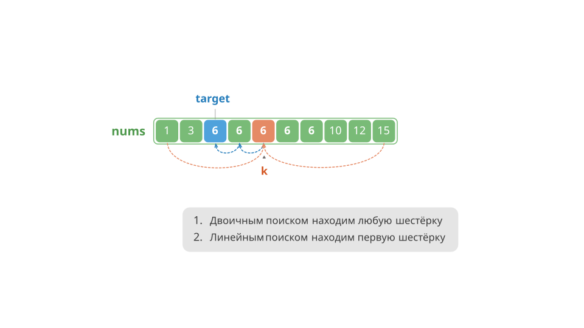
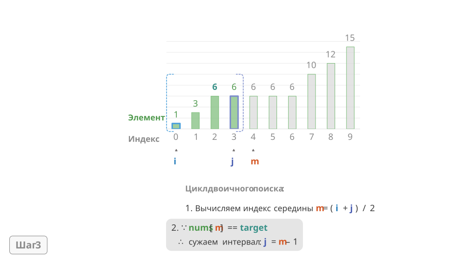
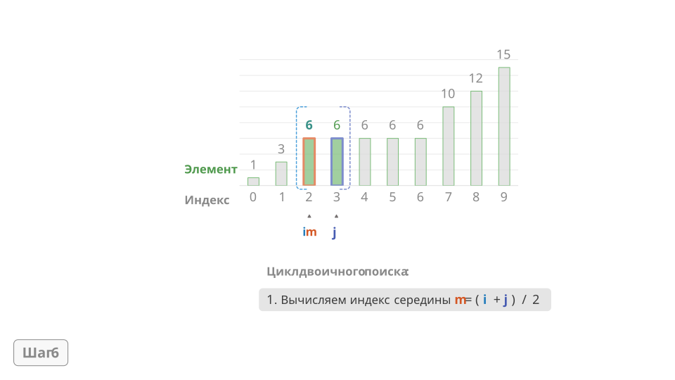
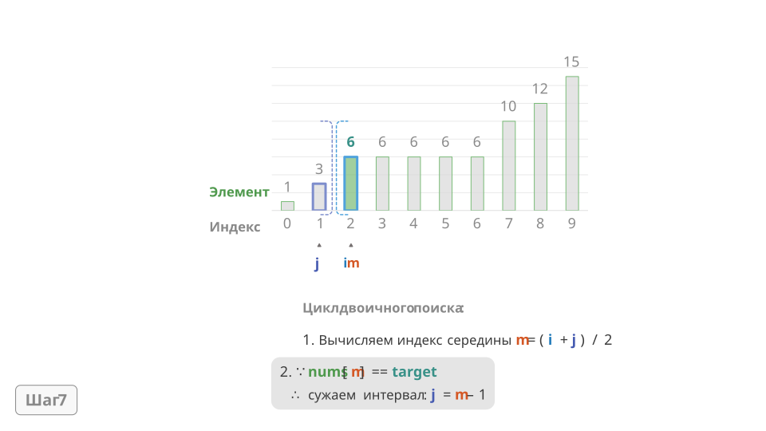

# Двоичный поиск позиции вставки

Двоичный поиск позволяет не только найти элемент, но и решить многие родственные задачи, например определить позицию его вставки.

## Массив без повторяющихся элементов

!!! question

    Даны отсортированный массив `nums` длины $n$ без повторов и элемент `target`. Вставьте `target` в массив `nums` так, чтобы сохранить порядок. Если `target` уже есть в массиве, поместите новый элемент слева от него. Верните индекс нового `target` после вставки. Пример показан ниже.


Чтобы воспользоваться кодом двоичного поиска из предыдущего раздела, ответим на два вопроса.

**Первый вопрос**. Если в массиве есть `target`, совпадает ли позиция вставки с индексом этого элемента?

По условию `target` нужно вставить слева от равного элемента. Значит, новый `target` займёт прежнее место `target`. Таким образом, **если массив содержит `target`, позиция вставки совпадает с индексом этого `target`**.

**Второй вопрос**. Если `target` в массиве нет, индекс какого элемента будет позицией вставки?

Присмотримся к ходу двоичного поиска. При `nums[m] < target` указатель $i$ сдвигается вправо. Значит, $i$ приближается к элементам, большим или равным `target`. Аналогично, указатель $j$ приближается к элементам, меньшим или равным `target`.

По завершении поиска $i$ указывает на первый элемент, больший `target`, а $j$ — на последний элемент, меньший `target`. **Таким образом, если в массиве нет `target`, позиция вставки равна $i$**. Запишем это в коде:

```src
[file]{binary_search_insertion}-[class]{}-[func]{binary_search_insertion_simple}
```

## Массив с повторяющимися элементами

!!! question

    Изменим предыдущее условие: теперь в массиве могут быть повторы. Остальные требования остаются в силе.

Если в массиве несколько вхождений `target`, обычный двоичный поиск вернёт индекс одного из вхождений `target`. **При этом неизвестно, сколько ещё элементов, равных `target`, находится слева и справа от него**.

По условию новый элемент должен встать перед всеми равными ему, **поэтому нужен индекс первого вхождения `target` в массиве**. Для начала рассмотрим способ, показанный на рисунке ниже.

1. Двоичным поиском найдём индекс любого вхождения `target` и обозначим его через $k$.
2. Начиная с индекса $k$, будем последовательно двигаться влево. Вернём индекс первого вхождения `target`.



Этот способ работает, но включает линейный поиск, поэтому его временная сложность равна $O(n)$. Если в массиве много вхождений `target`, поиск малоэффективен.

Изменим сам двоичный поиск. Как видно на рисунке, общий ход поиска сохраняется: на каждой итерации вычисляем индекс середины $m$, затем сравниваем `target` и `nums[m]`. Рассмотрим возможные случаи.

- При `nums[m] < target` или `nums[m] > target` элемент `target` ещё не найден. Сужаем интервал, как при обычном двоичном поиске, **чтобы указатели $i$ и $j$ приближались к `target`**.
- При `nums[m] == target` элементы, меньшие `target`, надо искать в интервале $[i, m - 1]$. Сужаем интервал, полагая $j = m - 1$. **Так указатель $j$ приближается к элементам, меньшим `target`**.

После цикла $i$ указывает на первое вхождение `target`, а $j$ — на последний элемент, меньший `target`. **Значит, индекс $i$ и есть позиция вставки**.

=== "<1>"
    

=== "<2>"
    

=== "<3>"
    

=== "<4>"
    

=== "<5>"
    

=== "<6>"
    

=== "<7>"
    

=== "<8>"
    

В коде ниже ветви `nums[m] > target` и `nums[m] == target` выполняют одно и то же действие, поэтому их можно объединить.

Можно и оставить условия раздельными: так легче проследить логику алгоритма и прочитать код.

```src
[file]{binary_search_insertion}-[class]{}-[func]{binary_search_insertion}
```

!!! tip

    Во всех примерах этого раздела используется замкнутый интервал. Попробуйте самостоятельно написать версию на полуинтервале с открытой правой границей.

В общем случае при двоичном поиске мы задаём каждому из указателей $i$ и $j$ свою цель. Это может быть конкретный элемент (например, `target`) или диапазон значений (например, элементы, меньшие `target`).

При последовательном делении интервала пополам указатели $i$ и $j$ постепенно приближаются к своим целям. В конце они либо достигают цели, либо пересекают границу, после чего поиск останавливается.
