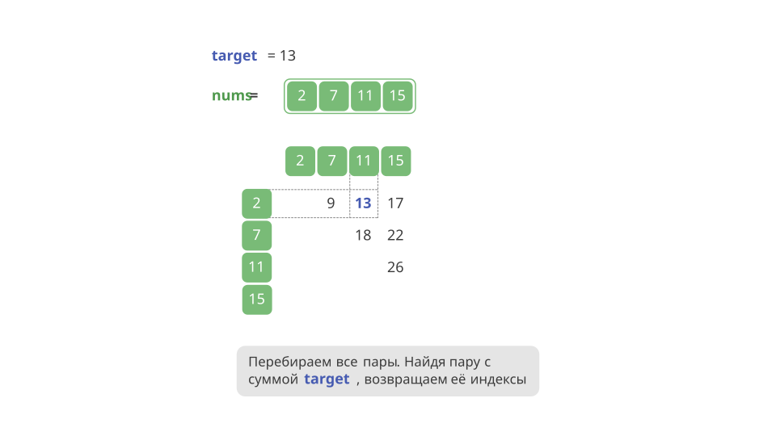
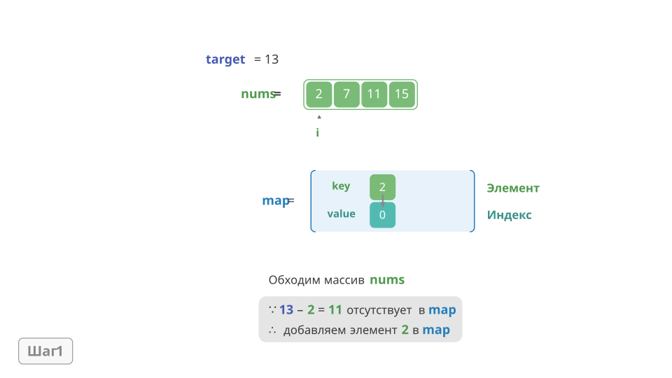
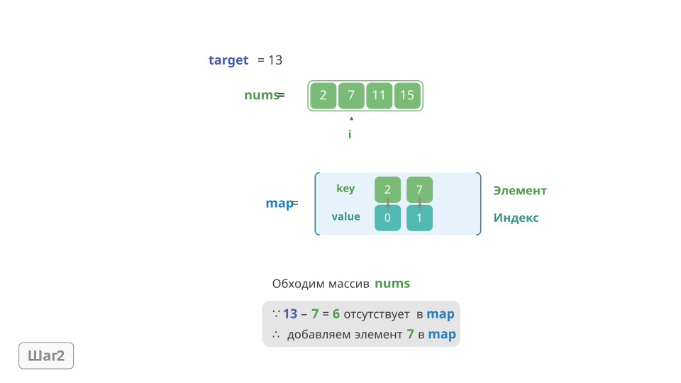
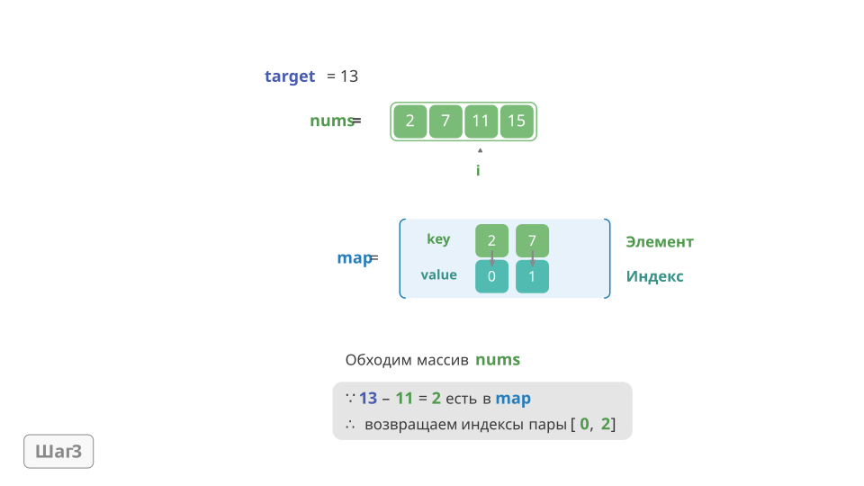

# Оптимизация поиска с помощью хеш-таблицы

При решении алгоритмических задач **часто удаётся уменьшить временную сложность, заменив линейный поиск поиском по хеш-таблице**. Разберём это на примере.

!!! question

    Даны целочисленный массив `nums` и целевое значение `target`. Найдите в массиве два элемента с суммой `target` и верните их индексы. Подойдёт любое решение.

## Линейный поиск: экономим память за счёт времени

Переберём все возможные пары. Как показано ниже, используем два вложенных цикла. Для каждой пары проверяем, равна ли сумма чисел `target`. Если равна, возвращаем их индексы.



Запишем это в коде:

```src
[file]{two_sum}-[class]{}-[func]{two_sum_brute_force}
```

Временная сложность этого способа равна $O(n^2)$, а пространственная — $O(1)$. На больших объёмах данных перебор занимает много времени.

## Поиск по хеш-таблице: экономим время за счёт памяти

Возьмём хеш-таблицу, в которой ключом служит элемент массива, а значением — его индекс. Обойдём массив в цикле, на каждой итерации выполняя шаги с рисунка.

1. Проверим, есть ли число `target - nums[i]` в хеш-таблице. Если есть, сразу вернём индексы обоих элементов.
2. Добавим в хеш-таблицу запись с ключом `nums[i]` и значением — индексом `i`.

=== "<1>"
    

=== "<2>"
    

=== "<3>"
    

Для реализации достаточно одного цикла:

```src
[file]{two_sum}-[class]{}-[func]{two_sum_hash_table}
```

Поиск по хеш-таблице снижает временную сложность с $O(n^2)$ до $O(n)$ и тем самым значительно ускоряет алгоритм.

Для вспомогательной хеш-таблицы нужна память, поэтому пространственная сложность равна $O(n)$. **Тем не менее этот способ даёт лучшее соотношение затрат времени и памяти и является оптимальным решением задачи**.
