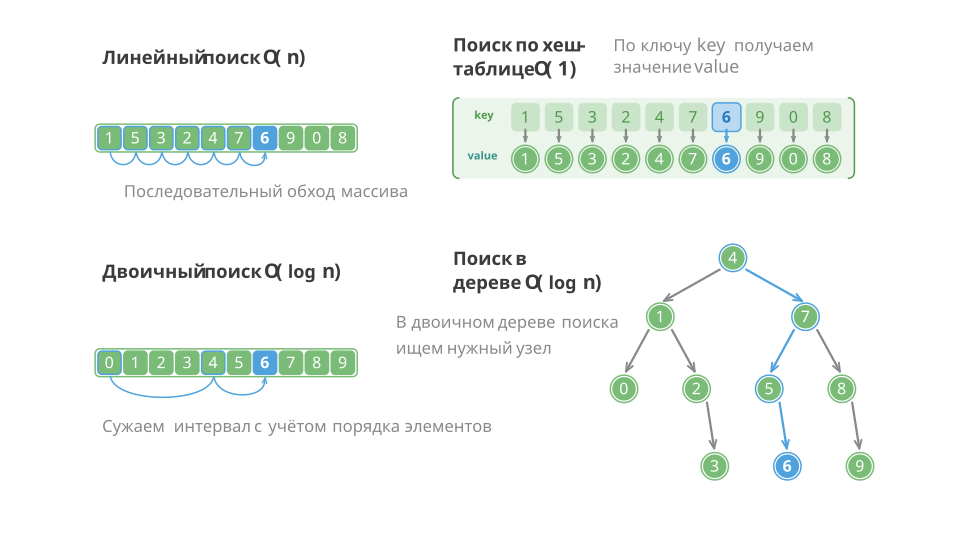

# Новый взгляд на алгоритмы поиска

<u>Алгоритм поиска (searching algorithm)</u> находит один или несколько элементов, удовлетворяющих заданному условию, в структуре данных, например в массиве, связном списке, дереве или графе.

По принципу работы алгоритмы поиска можно разделить на две категории.

- **Поиск элемента путём обхода структуры данных**. Примеры — обход массива, связного списка, дерева или графа.
- **Ускоренный поиск за счёт организации данных или заранее известных их свойств**. Примеры — двоичный поиск, поиск по хеш-таблице и поиск в двоичном дереве поиска.

Все эти приёмы мы уже встречали в предыдущих главах. Теперь рассмотрим знакомые алгоритмы поиска с общей точки зрения.

## Поиск полным перебором

При полном переборе искомый элемент находят, просматривая элементы структуры данных один за другим.

- Линейный поиск подходит для линейных структур, например массивов и связных списков. Начинаем с одного конца и проверяем элементы по очереди, пока не найдём нужный элемент или не дойдём до другого конца, так и не встретив его.
- Поиск в ширину и поиск в глубину — две стратегии обхода графов и деревьев. Поиск в ширину начинается с исходного узла и идёт слой за слоем, посещая сначала ближние узлы, затем более далёкие. Поиск в глубину идёт от исходного узла по одному пути до конца, затем возвращается и пробует другие пути, пока не обойдёт всю структуру.

Полный перебор прост и универсален. **Предварительная обработка данных и дополнительные структуры данных не требуются**.

Однако **временная сложность таких алгоритмов равна $O(n)$**, где $n$ — число элементов. Поэтому при большом объёме данных они работают медленно.

## Поиск с учётом свойств данных

Можно ускорить поиск, используя свойства данных, например их упорядоченность. Так удаётся быстрее найти нужный элемент.

- Двоичный поиск использует упорядоченность данных и подходит только для массивов.
- Поиск по хеш-таблице опирается на соответствие между ключом запроса и искомыми данными: они хранятся в виде пар «ключ — значение».
- При поиске в дереве определённого типа, например в двоичном дереве поиска, сравнение значений позволяет сразу исключать узлы из рассмотрения и быстро находить нужный элемент.

Эти алгоритмы эффективны: **временная сложность может составлять $O(\log n)$ и даже $O(1)$**.

Однако **такие алгоритмы часто требуют предварительной обработки данных**. Для двоичного поиска массив нужно заранее отсортировать. Поиск по хеш-таблице и поиск в дереве требуют дополнительных структур данных, а их поддержка — дополнительного времени и памяти.

!!! tip

    Алгоритмы, учитывающие свойства данных, часто называют алгоритмами быстрого поиска. **Их основная задача — быстро находить нужный элемент в конкретной структуре данных**.

## Выбор метода поиска

Чтобы найти элемент в наборе из $n$ элементов, можно использовать линейный или двоичный поиск, поиск в дереве или по хеш-таблице. На рисунке показано, как работает каждый способ.

Сравним затраты на операции и характерные особенности этих методов.

 Таблица <id> &nbsp; Сравнение эффективности алгоритмов поиска 

|              | Линейный поиск | Двоичный поиск           | Поиск в дереве             | Поиск по хеш-таблице        |
| ------------ | -------- | ------------------ | ------------------ | --------------- |
| Поиск элемента     | $O(n)$   | $O(\log n)$        | $O(\log n)$        | $O(1)$          |
| Вставка элемента     | $O(1)$   | $O(n)$             | $O(\log n)$        | $O(1)$          |
| Удаление элемента     | $O(n)$   | $O(n)$             | $O(\log n)$        | $O(1)$          |
| Дополнительная память     | $O(1)$   | $O(1)$             | $O(n)$             | $O(n)$          |
| Предварительная обработка   | /        | Сортировка $O(n \log n)$ | Построение дерева $O(n \log n)$ | Построение хеш-таблицы $O(n)$ |
| Порядок данных | Неупорядоченные     | Упорядоченные               | Упорядоченные               | Неупорядоченные            |

При выборе алгоритма учитывают также объём данных, требования к скорости поиска, частоту запросов и обновлений.

**Линейный поиск**

- Универсален и не требует предварительной обработки. Для единственного запроса подготовка данных любым из трёх других способов займёт больше времени, чем сам линейный поиск.
- Подходит для небольших объёмов данных, когда асимптотическая сложность мало влияет на быстродействие.
- Подходит для часто обновляемых данных, поскольку не требует дополнительных действий по поддержанию их структуры.

**Двоичный поиск**

- Подходит для больших объёмов данных и обеспечивает предсказуемую скорость: даже в худшем случае временная сложность равна $O(\log n)$.
- Объём данных всё же ограничен: для хранения массива нужен непрерывный участок памяти.
- Плохо подходит при частых вставках и удалениях, поскольку поддерживать порядок элементов массива затратно.

**Поиск по хеш-таблице**

- Подходит при высоких требованиях к скорости запросов: средняя временная сложность равна $O(1)$.
- Не подходит, если требуется сохранять порядок данных или выполнять запросы по диапазону: хеш-таблица не поддерживает упорядоченность.
- Производительность сильно зависит от хеш-функции и способа разрешения коллизий, поэтому может заметно снизиться.
- Плохо подходит для чрезмерно больших объёмов данных: хеш-таблице нужна дополнительная память, чтобы свести число коллизий к минимуму и обеспечить быстрый поиск.

**Поиск в дереве**

- Подходит для очень больших объёмов данных, поскольку узлы дерева могут располагаться в разных участках памяти.
- Подходит, если нужно сохранять порядок данных или выполнять запросы по диапазону.
- При постоянных вставках и удалениях двоичное дерево поиска может стать перекошенным. Тогда временная сложность вырастет до $O(n)$.
- В АВЛ-дереве или красно-чёрном дереве операции стабильно выполняются за $O(\log n)$, однако поддержание баланса требует дополнительных затрат.
