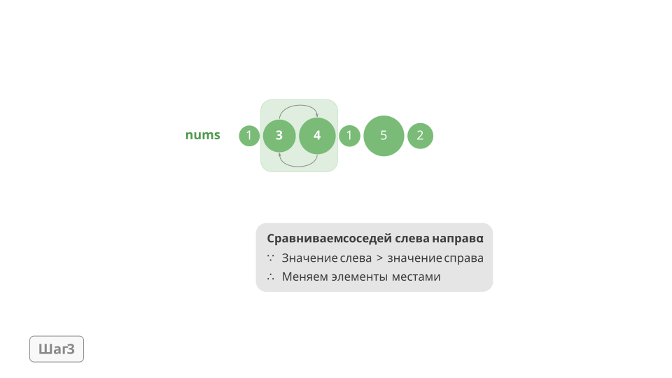
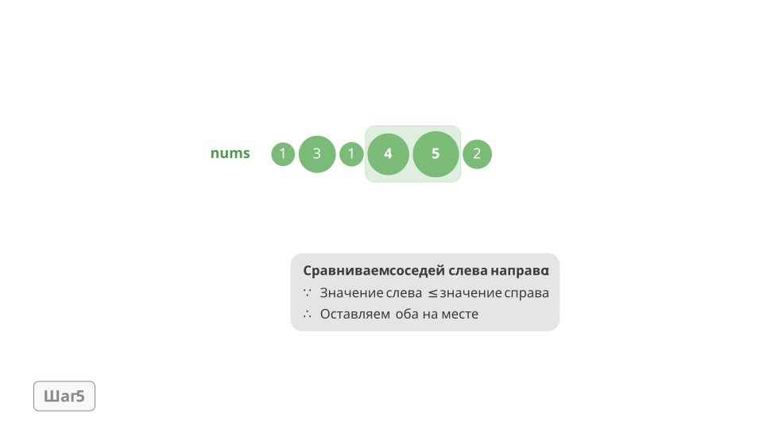
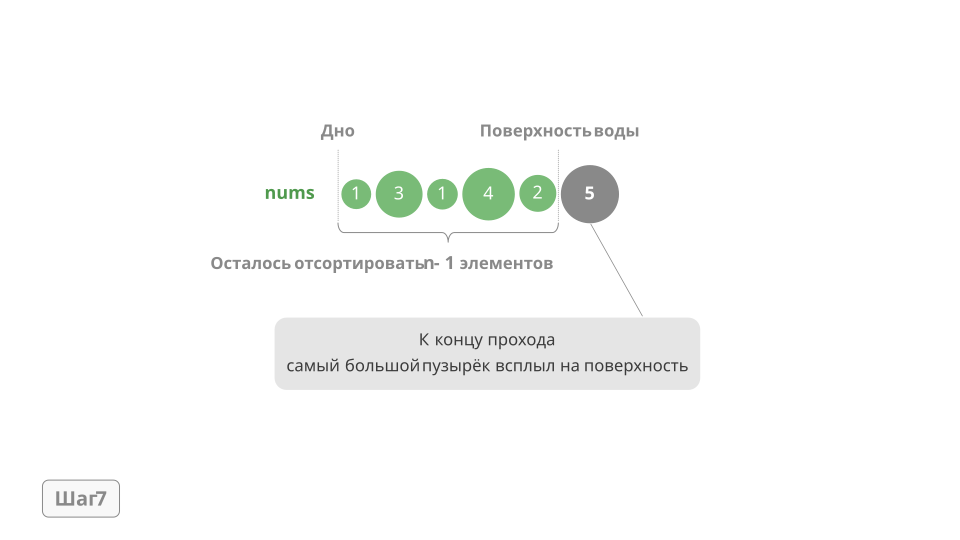
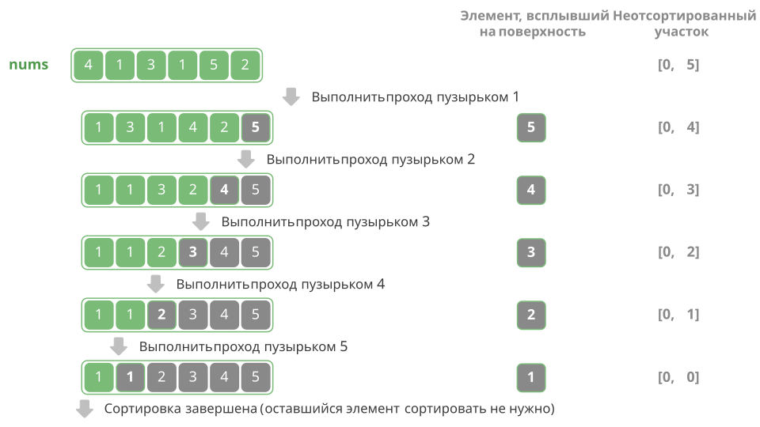

# 11.3 &nbsp; Сортировка пузырьком

<u>Сортировка пузырьком (bubble sort)</u> последовательно сравнивает соседние элементы и при необходимости меняет их местами. Название отражает сходство с пузырьком, который поднимается со дна на поверхность.

На рисунке показано, как обмены имитируют всплытие пузырька. Идём от левого края массива вправо и сравниваем соседние элементы. Если левый элемент больше правого, меняем их местами. К концу прохода наибольший элемент окажется у правого края массива.

=== "<1>"
    { class="animation-figure" }

=== "<2>"
    { class="animation-figure" }

=== "<3>"
    { class="animation-figure" }

=== "<4>"
    { class="animation-figure" }

=== "<5>"
    { class="animation-figure" }

=== "<6>"
    { class="animation-figure" }

=== "<7>"
    { class="animation-figure" }

<p align="center"> Рисунок 11-4 &nbsp; Обмены элементов имитируют всплытие пузырька </p>

## 11.3.1 &nbsp; Ход алгоритма

Пусть длина массива равна $n$. На рисунке показаны шаги сортировки пузырьком.

1. Сначала выполняем проход по $n$ элементам. **В результате обменов наибольший элемент массива занимает своё место**.
2. Затем выполняем проход по оставшимся $n - 1$ элементам. **В результате обменов второй по величине элемент занимает своё место**.
3. Продолжаем так же. После $n - 1$ проходов **первые $n - 1$ элементов по убыванию величины займут свои места**.
4. Остаётся один элемент. Он обязательно минимален, поэтому дополнительных действий не требуется. Массив отсортирован.

{ class="animation-figure" }

<p align="center"> Рисунок 11-5 &nbsp; Ход сортировки пузырьком </p>

Пример реализации:

=== "Python"

    ```python title="bubble_sort.py"
    def bubble_sort(nums: list[int]):
        """Сортировка пузырьком"""
        n = len(nums)
        # Внешний цикл: неотсортированный участок [0, i]
        for i in range(n - 1, 0, -1):
            # Внутренний цикл: обменами переместить максимум участка [0, i] на его правый конец
            for j in range(i):
                if nums[j] > nums[j + 1]:
                    # Поменять местами nums[j] и nums[j + 1]
                    nums[j], nums[j + 1] = nums[j + 1], nums[j]
    ```

=== "C++"

    ```cpp title="bubble_sort.cpp"
    /* Сортировка пузырьком */
    void bubbleSort(vector<int> &nums) {
        // Внешний цикл: неотсортированный участок [0, i]
        for (int i = nums.size() - 1; i > 0; i--) {
            // Внутренний цикл: обменами переместить максимум участка [0, i] на его правый конец
            for (int j = 0; j < i; j++) {
                if (nums[j] > nums[j + 1]) {
                    // Поменять местами nums[j] и nums[j + 1]
                    // Здесь используется функция std::swap()
                    swap(nums[j], nums[j + 1]);
                }
            }
        }
    }
    ```

=== "Java"

    ```java title="bubble_sort.java"
    /* Сортировка пузырьком */
    void bubbleSort(int[] nums) {
        // Внешний цикл: неотсортированный участок [0, i]
        for (int i = nums.length - 1; i > 0; i--) {
            // Внутренний цикл: обменами переместить максимум участка [0, i] на его правый конец
            for (int j = 0; j < i; j++) {
                if (nums[j] > nums[j + 1]) {
                    // Поменять местами nums[j] и nums[j + 1]
                    int tmp = nums[j];
                    nums[j] = nums[j + 1];
                    nums[j + 1] = tmp;
                }
            }
        }
    }
    ```

=== "C#"

    ```csharp title="bubble_sort.cs"
    /* Сортировка пузырьком */
    void BubbleSort(int[] nums) {
        // Внешний цикл: неотсортированный участок [0, i]
        for (int i = nums.Length - 1; i > 0; i--) {
            // Внутренний цикл: обменами переместить максимум участка [0, i] на его правый конец
            for (int j = 0; j < i; j++) {
                if (nums[j] > nums[j + 1]) {
                    // Поменять местами nums[j] и nums[j + 1]
                    (nums[j + 1], nums[j]) = (nums[j], nums[j + 1]);
                }
            }
        }
    }
    ```

=== "Go"

    ```go title="bubble_sort.go"
    /* Сортировка пузырьком */
    func bubbleSort(nums []int) {
        // Внешний цикл: неотсортированный участок [0, i]
        for i := len(nums) - 1; i > 0; i-- {
            // Внутренний цикл: обменами переместить максимум участка [0, i] на его правый конец
            for j := 0; j < i; j++ {
                if nums[j] > nums[j+1] {
                    // Поменять местами nums[j] и nums[j + 1]
                    nums[j], nums[j+1] = nums[j+1], nums[j]
                }
            }
        }
    }
    ```

=== "Swift"

    ```swift title="bubble_sort.swift"
    /* Сортировка пузырьком */
    func bubbleSort(nums: inout [Int]) {
        // Внешний цикл: неотсортированный участок [0, i]
        for i in nums.indices.dropFirst().reversed() {
            // Внутренний цикл: обменами переместить максимум участка [0, i] на его правый конец
            for j in 0 ..< i {
                if nums[j] > nums[j + 1] {
                    // Поменять местами nums[j] и nums[j + 1]
                    nums.swapAt(j, j + 1)
                }
            }
        }
    }
    ```

=== "JS"

    ```javascript title="bubble_sort.js"
    /* Сортировка пузырьком */
    function bubbleSort(nums) {
        // Внешний цикл: неотсортированный участок [0, i]
        for (let i = nums.length - 1; i > 0; i--) {
            // Внутренний цикл: обменами переместить максимум участка [0, i] на его правый конец
            for (let j = 0; j < i; j++) {
                if (nums[j] > nums[j + 1]) {
                    // Поменять местами nums[j] и nums[j + 1]
                    let tmp = nums[j];
                    nums[j] = nums[j + 1];
                    nums[j + 1] = tmp;
                }
            }
        }
    }
    ```

=== "TS"

    ```typescript title="bubble_sort.ts"
    /* Сортировка пузырьком */
    function bubbleSort(nums: number[]): void {
        // Внешний цикл: неотсортированный участок [0, i]
        for (let i = nums.length - 1; i > 0; i--) {
            // Внутренний цикл: обменами переместить максимум участка [0, i] на его правый конец
            for (let j = 0; j < i; j++) {
                if (nums[j] > nums[j + 1]) {
                    // Поменять местами nums[j] и nums[j + 1]
                    let tmp = nums[j];
                    nums[j] = nums[j + 1];
                    nums[j + 1] = tmp;
                }
            }
        }
    }
    ```

=== "Dart"

    ```dart title="bubble_sort.dart"
    /* Сортировка пузырьком */
    void bubbleSort(List<int> nums) {
      // Внешний цикл: неотсортированный участок [0, i]
      for (int i = nums.length - 1; i > 0; i--) {
        // Внутренний цикл: обменами переместить максимум участка [0, i] на его правый конец
        for (int j = 0; j < i; j++) {
          if (nums[j] > nums[j + 1]) {
            // Поменять местами nums[j] и nums[j + 1]
            int tmp = nums[j];
            nums[j] = nums[j + 1];
            nums[j + 1] = tmp;
          }
        }
      }
    }
    ```

=== "Rust"

    ```rust title="bubble_sort.rs"
    /* Сортировка пузырьком */
    fn bubble_sort(nums: &mut [i32]) {
        // Внешний цикл: неотсортированный участок [0, i]
        for i in (1..nums.len()).rev() {
            // Внутренний цикл: обменами переместить максимум участка [0, i] на его правый конец
            for j in 0..i {
                if nums[j] > nums[j + 1] {
                    // Поменять местами nums[j] и nums[j + 1]
                    nums.swap(j, j + 1);
                }
            }
        }
    }
    ```

=== "C"

    ```c title="bubble_sort.c"
    /* Сортировка пузырьком */
    void bubbleSort(int nums[], int size) {
        // Внешний цикл: неотсортированный участок [0, i]
        for (int i = size - 1; i > 0; i--) {
            // Внутренний цикл: обменами переместить максимум участка [0, i] на его правый конец
            for (int j = 0; j < i; j++) {
                if (nums[j] > nums[j + 1]) {
                    int temp = nums[j];
                    nums[j] = nums[j + 1];
                    nums[j + 1] = temp;
                }
            }
        }
    }
    ```

=== "Kotlin"

    ```kotlin title="bubble_sort.kt"
    /* Сортировка пузырьком */
    fun bubbleSort(nums: IntArray) {
        // Внешний цикл: неотсортированный участок [0, i]
        for (i in nums.size - 1 downTo 1) {
            // Внутренний цикл: обменами переместить максимум участка [0, i] на его правый конец
            for (j in 0..<i) {
                if (nums[j] > nums[j + 1]) {
                    // Поменять местами nums[j] и nums[j + 1]
                    val temp = nums[j]
                    nums[j] = nums[j + 1]
                    nums[j + 1] = temp
                }
            }
        }
    }
    ```

=== "Ruby"

    ```ruby title="bubble_sort.rb"
    ### Сортировка пузырьком ###
    def bubble_sort(nums)
      n = nums.length
      # Внешний цикл: неотсортированный участок [0, i]
      for i in (n - 1).downto(1)
        # Внутренний цикл: обменами переместить максимум участка [0, i] на его правый конец
        for j in 0...i
          if nums[j] > nums[j + 1]
            # Поменять местами nums[j] и nums[j + 1]
            nums[j], nums[j + 1] = nums[j + 1], nums[j]
          end
        end
      end
    end
    ```

??? pythontutor "Визуализация выполнения"

    <div style="height: 477px; width: 100%;"><iframe class="pythontutor-iframe" title="Визуализация выполнения" src="https://pythontutor.com/iframe-embed.html#code=def%20bubble_sort%28nums%3A%20list%5Bint%5D%29%3A%0A%20%20%20%20%22%22%22%D0%A1%D0%BE%D1%80%D1%82%D0%B8%D1%80%D0%BE%D0%B2%D0%BA%D0%B0%20%D0%BF%D1%83%D0%B7%D1%8B%D1%80%D1%8C%D0%BA%D0%BE%D0%BC%22%22%22%0A%20%20%20%20n%20%3D%20len%28nums%29%0A%20%20%20%20%23%20%D0%92%D0%BD%D0%B5%D1%88%D0%BD%D0%B8%D0%B9%20%D1%86%D0%B8%D0%BA%D0%BB%3A%20%D0%BD%D0%B5%D0%BE%D1%82%D1%81%D0%BE%D1%80%D1%82%D0%B8%D1%80%D0%BE%D0%B2%D0%B0%D0%BD%D0%BD%D1%8B%D0%B9%20%D1%83%D1%87%D0%B0%D1%81%D1%82%D0%BE%D0%BA%20%5B0,%20i%5D%0A%20%20%20%20for%20i%20in%20range%28n%20-%201,%200,%20-1%29%3A%0A%20%20%20%20%20%20%20%20%23%20%D0%92%D0%BD%D1%83%D1%82%D1%80%D0%B5%D0%BD%D0%BD%D0%B8%D0%B9%20%D1%86%D0%B8%D0%BA%D0%BB%3A%20%D0%BE%D0%B1%D0%BC%D0%B5%D0%BD%D0%B0%D0%BC%D0%B8%20%D0%BF%D0%B5%D1%80%D0%B5%D0%BC%D0%B5%D1%81%D1%82%D0%B8%D1%82%D1%8C%20%D0%BC%D0%B0%D0%BA%D1%81%D0%B8%D0%BC%D1%83%D0%BC%20%D1%83%D1%87%D0%B0%D1%81%D1%82%D0%BA%D0%B0%20%5B0,%20i%5D%20%D0%BD%D0%B0%20%D0%B5%D0%B3%D0%BE%20%D0%BF%D1%80%D0%B0%D0%B2%D1%8B%D0%B9%20%D0%BA%D0%BE%D0%BD%D0%B5%D1%86%0A%20%20%20%20%20%20%20%20for%20j%20in%20range%28i%29%3A%0A%20%20%20%20%20%20%20%20%20%20%20%20if%20nums%5Bj%5D%20%3E%20nums%5Bj%20%2B%201%5D%3A%0A%20%20%20%20%20%20%20%20%20%20%20%20%20%20%20%20%23%20%D0%9F%D0%BE%D0%BC%D0%B5%D0%BD%D1%8F%D1%82%D1%8C%20%D0%BC%D0%B5%D1%81%D1%82%D0%B0%D0%BC%D0%B8%20nums%5Bj%5D%20%D0%B8%20nums%5Bj%20%2B%201%5D%0A%20%20%20%20%20%20%20%20%20%20%20%20%20%20%20%20nums%5Bj%5D,%20nums%5Bj%20%2B%201%5D%20%3D%20nums%5Bj%20%2B%201%5D,%20nums%5Bj%5D%0A%0A%22%22%22Driver%20Code%22%22%22%0Aif%20__name__%20%3D%3D%20%22__main__%22%3A%0A%20%20%20%20nums%20%3D%20%5B4,%201,%203,%201,%205,%202%5D%0A%20%20%20%20bubble_sort%28nums%29%0A%20%20%20%20print%28%22%D0%9F%D0%BE%D1%81%D0%BB%D0%B5%20%D1%81%D0%BE%D1%80%D1%82%D0%B8%D1%80%D0%BE%D0%B2%D0%BA%D0%B8%20%D0%BF%D1%83%D0%B7%D1%8B%D1%80%D1%8C%D0%BA%D0%BE%D0%BC%20nums%20%3D%22,%20nums%29&codeDivHeight=472&codeDivWidth=350&cumulative=false&curInstr=4&heapPrimitives=nevernest&origin=opt-frontend.js&py=311&rawInputLstJSON=%5B%5D&textReferences=false"> </iframe></div>
    <div style="margin-top: 5px;"><a href="https://pythontutor.com/iframe-embed.html#code=def%20bubble_sort%28nums%3A%20list%5Bint%5D%29%3A%0A%20%20%20%20%22%22%22%D0%A1%D0%BE%D1%80%D1%82%D0%B8%D1%80%D0%BE%D0%B2%D0%BA%D0%B0%20%D0%BF%D1%83%D0%B7%D1%8B%D1%80%D1%8C%D0%BA%D0%BE%D0%BC%22%22%22%0A%20%20%20%20n%20%3D%20len%28nums%29%0A%20%20%20%20%23%20%D0%92%D0%BD%D0%B5%D1%88%D0%BD%D0%B8%D0%B9%20%D1%86%D0%B8%D0%BA%D0%BB%3A%20%D0%BD%D0%B5%D0%BE%D1%82%D1%81%D0%BE%D1%80%D1%82%D0%B8%D1%80%D0%BE%D0%B2%D0%B0%D0%BD%D0%BD%D1%8B%D0%B9%20%D1%83%D1%87%D0%B0%D1%81%D1%82%D0%BE%D0%BA%20%5B0,%20i%5D%0A%20%20%20%20for%20i%20in%20range%28n%20-%201,%200,%20-1%29%3A%0A%20%20%20%20%20%20%20%20%23%20%D0%92%D0%BD%D1%83%D1%82%D1%80%D0%B5%D0%BD%D0%BD%D0%B8%D0%B9%20%D1%86%D0%B8%D0%BA%D0%BB%3A%20%D0%BE%D0%B1%D0%BC%D0%B5%D0%BD%D0%B0%D0%BC%D0%B8%20%D0%BF%D0%B5%D1%80%D0%B5%D0%BC%D0%B5%D1%81%D1%82%D0%B8%D1%82%D1%8C%20%D0%BC%D0%B0%D0%BA%D1%81%D0%B8%D0%BC%D1%83%D0%BC%20%D1%83%D1%87%D0%B0%D1%81%D1%82%D0%BA%D0%B0%20%5B0,%20i%5D%20%D0%BD%D0%B0%20%D0%B5%D0%B3%D0%BE%20%D0%BF%D1%80%D0%B0%D0%B2%D1%8B%D0%B9%20%D0%BA%D0%BE%D0%BD%D0%B5%D1%86%0A%20%20%20%20%20%20%20%20for%20j%20in%20range%28i%29%3A%0A%20%20%20%20%20%20%20%20%20%20%20%20if%20nums%5Bj%5D%20%3E%20nums%5Bj%20%2B%201%5D%3A%0A%20%20%20%20%20%20%20%20%20%20%20%20%20%20%20%20%23%20%D0%9F%D0%BE%D0%BC%D0%B5%D0%BD%D1%8F%D1%82%D1%8C%20%D0%BC%D0%B5%D1%81%D1%82%D0%B0%D0%BC%D0%B8%20nums%5Bj%5D%20%D0%B8%20nums%5Bj%20%2B%201%5D%0A%20%20%20%20%20%20%20%20%20%20%20%20%20%20%20%20nums%5Bj%5D,%20nums%5Bj%20%2B%201%5D%20%3D%20nums%5Bj%20%2B%201%5D,%20nums%5Bj%5D%0A%0A%22%22%22Driver%20Code%22%22%22%0Aif%20__name__%20%3D%3D%20%22__main__%22%3A%0A%20%20%20%20nums%20%3D%20%5B4,%201,%203,%201,%205,%202%5D%0A%20%20%20%20bubble_sort%28nums%29%0A%20%20%20%20print%28%22%D0%9F%D0%BE%D1%81%D0%BB%D0%B5%20%D1%81%D0%BE%D1%80%D1%82%D0%B8%D1%80%D0%BE%D0%B2%D0%BA%D0%B8%20%D0%BF%D1%83%D0%B7%D1%8B%D1%80%D1%8C%D0%BA%D0%BE%D0%BC%20nums%20%3D%22,%20nums%29&codeDivHeight=800&codeDivWidth=600&cumulative=false&curInstr=4&heapPrimitives=nevernest&origin=opt-frontend.js&py=311&rawInputLstJSON=%5B%5D&textReferences=false" target="_blank" rel="noopener noreferrer">Во весь экран ></a></div>

## 11.3.2 &nbsp; Оптимизация

Если за проход не произошло ни одного обмена, массив уже отсортирован и результат можно сразу вернуть. Добавим флаг `flag`, чтобы распознать такой проход и сразу завершить сортировку.

После оптимизации сложность сортировки пузырьком в худшем и среднем случаях по-прежнему равна $O(n^2)$. Если входной массив уже полностью упорядочен, достигается лучшая временная сложность $O(n)$.

=== "Python"

    ```python title="bubble_sort.py"
    def bubble_sort_with_flag(nums: list[int]):
        """Сортировка пузырьком с флагом обмена"""
        n = len(nums)
        # Внешний цикл: неотсортированный участок [0, i]
        for i in range(n - 1, 0, -1):
            flag = False  # Инициализировать флаг
            # Внутренний цикл: обменами переместить максимум участка [0, i] на его правый конец
            for j in range(i):
                if nums[j] > nums[j + 1]:
                    # Поменять местами nums[j] и nums[j + 1]
                    nums[j], nums[j + 1] = nums[j + 1], nums[j]
                    flag = True  # Отметить, что произошёл обмен
            if not flag:
                break  # За этот проход обменов не было. Выйти из цикла
    ```

=== "C++"

    ```cpp title="bubble_sort.cpp"
    /* Сортировка пузырьком с флагом обмена*/
    void bubbleSortWithFlag(vector<int> &nums) {
        // Внешний цикл: неотсортированный участок [0, i]
        for (int i = nums.size() - 1; i > 0; i--) {
            bool flag = false; // Инициализировать флаг
            // Внутренний цикл: обменами переместить максимум участка [0, i] на его правый конец
            for (int j = 0; j < i; j++) {
                if (nums[j] > nums[j + 1]) {
                    // Поменять местами nums[j] и nums[j + 1]
                    // Здесь используется функция std::swap()
                    swap(nums[j], nums[j + 1]);
                    flag = true; // Отметить, что произошёл обмен
                }
            }
            if (!flag)
                break; // За этот проход обменов не было. Выйти из цикла
        }
    }
    ```

=== "Java"

    ```java title="bubble_sort.java"
    /* Сортировка пузырьком с флагом обмена */
    void bubbleSortWithFlag(int[] nums) {
        // Внешний цикл: неотсортированный участок [0, i]
        for (int i = nums.length - 1; i > 0; i--) {
            boolean flag = false; // Инициализировать флаг
            // Внутренний цикл: обменами переместить максимум участка [0, i] на его правый конец
            for (int j = 0; j < i; j++) {
                if (nums[j] > nums[j + 1]) {
                    // Поменять местами nums[j] и nums[j + 1]
                    int tmp = nums[j];
                    nums[j] = nums[j + 1];
                    nums[j + 1] = tmp;
                    flag = true; // Отметить, что произошёл обмен
                }
            }
            if (!flag)
                break; // За этот проход обменов не было. Выйти из цикла
        }
    }
    ```

=== "C#"

    ```csharp title="bubble_sort.cs"
    /* Сортировка пузырьком с флагом обмена*/
    void BubbleSortWithFlag(int[] nums) {
        // Внешний цикл: неотсортированный участок [0, i]
        for (int i = nums.Length - 1; i > 0; i--) {
            bool flag = false; // Инициализировать флаг
            // Внутренний цикл: обменами переместить максимум участка [0, i] на его правый конец
            for (int j = 0; j < i; j++) {
                if (nums[j] > nums[j + 1]) {
                    // Поменять местами nums[j] и nums[j + 1]
                    (nums[j + 1], nums[j]) = (nums[j], nums[j + 1]);
                    flag = true;  // Отметить, что произошёл обмен
                }
            }
            if (!flag) break;     // За этот проход обменов не было. Выйти из цикла
        }
    }
    ```

=== "Go"

    ```go title="bubble_sort.go"
    /* Сортировка пузырьком с флагом обмена*/
    func bubbleSortWithFlag(nums []int) {
        // Внешний цикл: неотсортированный участок [0, i]
        for i := len(nums) - 1; i > 0; i-- {
            flag := false // Инициализировать флаг
            // Внутренний цикл: обменами переместить максимум участка [0, i] на его правый конец
            for j := 0; j < i; j++ {
                if nums[j] > nums[j+1] {
                    // Поменять местами nums[j] и nums[j + 1]
                    nums[j], nums[j+1] = nums[j+1], nums[j]
                    flag = true // Отметить, что произошёл обмен
                }
            }
            if flag == false { // За этот проход обменов не было. Выйти из цикла
                break
            }
        }
    }
    ```

=== "Swift"

    ```swift title="bubble_sort.swift"
    /* Сортировка пузырьком с флагом обмена*/
    func bubbleSortWithFlag(nums: inout [Int]) {
        // Внешний цикл: неотсортированный участок [0, i]
        for i in nums.indices.dropFirst().reversed() {
            var flag = false // Инициализировать флаг
            for j in 0 ..< i {
                if nums[j] > nums[j + 1] {
                    // Поменять местами nums[j] и nums[j + 1]
                    nums.swapAt(j, j + 1)
                    flag = true // Отметить, что произошёл обмен
                }
            }
            if !flag { // За этот проход обменов не было. Выйти из цикла
                break
            }
        }
    }
    ```

=== "JS"

    ```javascript title="bubble_sort.js"
    /* Сортировка пузырьком с флагом обмена*/
    function bubbleSortWithFlag(nums) {
        // Внешний цикл: неотсортированный участок [0, i]
        for (let i = nums.length - 1; i > 0; i--) {
            let flag = false; // Инициализировать флаг
            // Внутренний цикл: обменами переместить максимум участка [0, i] на его правый конец
            for (let j = 0; j < i; j++) {
                if (nums[j] > nums[j + 1]) {
                    // Поменять местами nums[j] и nums[j + 1]
                    let tmp = nums[j];
                    nums[j] = nums[j + 1];
                    nums[j + 1] = tmp;
                    flag = true; // Отметить, что произошёл обмен
                }
            }
            if (!flag) break; // За этот проход обменов не было. Выйти из цикла
        }
    }
    ```

=== "TS"

    ```typescript title="bubble_sort.ts"
    /* Сортировка пузырьком с флагом обмена*/
    function bubbleSortWithFlag(nums: number[]): void {
        // Внешний цикл: неотсортированный участок [0, i]
        for (let i = nums.length - 1; i > 0; i--) {
            let flag = false; // Инициализировать флаг
            // Внутренний цикл: обменами переместить максимум участка [0, i] на его правый конец
            for (let j = 0; j < i; j++) {
                if (nums[j] > nums[j + 1]) {
                    // Поменять местами nums[j] и nums[j + 1]
                    let tmp = nums[j];
                    nums[j] = nums[j + 1];
                    nums[j + 1] = tmp;
                    flag = true; // Отметить, что произошёл обмен
                }
            }
            if (!flag) break; // За этот проход обменов не было. Выйти из цикла
        }
    }
    ```

=== "Dart"

    ```dart title="bubble_sort.dart"
    /* Сортировка пузырьком с флагом обмена*/
    void bubbleSortWithFlag(List<int> nums) {
      // Внешний цикл: неотсортированный участок [0, i]
      for (int i = nums.length - 1; i > 0; i--) {
        bool flag = false; // Инициализировать флаг
        // Внутренний цикл: обменами переместить максимум участка [0, i] на его правый конец
        for (int j = 0; j < i; j++) {
          if (nums[j] > nums[j + 1]) {
            // Поменять местами nums[j] и nums[j + 1]
            int tmp = nums[j];
            nums[j] = nums[j + 1];
            nums[j + 1] = tmp;
            flag = true; // Отметить, что произошёл обмен
          }
        }
        if (!flag) break; // За этот проход обменов не было. Выйти из цикла
      }
    }
    ```

=== "Rust"

    ```rust title="bubble_sort.rs"
    /* Сортировка пузырьком с флагом обмена */
    fn bubble_sort_with_flag(nums: &mut [i32]) {
        // Внешний цикл: неотсортированный участок [0, i]
        for i in (1..nums.len()).rev() {
            let mut flag = false; // Инициализировать флаг
            // Внутренний цикл: обменами переместить максимум участка [0, i] на его правый конец
            for j in 0..i {
                if nums[j] > nums[j + 1] {
                    // Поменять местами nums[j] и nums[j + 1]
                    nums.swap(j, j + 1);
                    flag = true; // Отметить, что произошёл обмен
                }
            }
            if !flag {
                break; // За этот проход обменов не было. Выйти из цикла
            };
        }
    }
    ```

=== "C"

    ```c title="bubble_sort.c"
    /* Сортировка пузырьком с флагом обмена*/
    void bubbleSortWithFlag(int nums[], int size) {
        // Внешний цикл: неотсортированный участок [0, i]
        for (int i = size - 1; i > 0; i--) {
            bool flag = false;
            // Внутренний цикл: обменами переместить максимум участка [0, i] на его правый конец
            for (int j = 0; j < i; j++) {
                if (nums[j] > nums[j + 1]) {
                    int temp = nums[j];
                    nums[j] = nums[j + 1];
                    nums[j + 1] = temp;
                    flag = true;
                }
            }
            if (!flag)
                break;
        }
    }
    ```

=== "Kotlin"

    ```kotlin title="bubble_sort.kt"
    /* Сортировка пузырьком с флагом обмена */
    fun bubbleSortWithFlag(nums: IntArray) {
        // Внешний цикл: неотсортированный участок [0, i]
        for (i in nums.size - 1 downTo 1) {
            var flag = false // Инициализировать флаг
            // Внутренний цикл: обменами переместить максимум участка [0, i] на его правый конец
            for (j in 0..<i) {
                if (nums[j] > nums[j + 1]) {
                    // Поменять местами nums[j] и nums[j + 1]
                    val temp = nums[j]
                    nums[j] = nums[j + 1]
                    nums[j + 1] = temp
                    flag = true // Отметить, что произошёл обмен
                }
            }
            if (!flag) break // За этот проход обменов не было. Выйти из цикла
        }
    }
    ```

=== "Ruby"

    ```ruby title="bubble_sort.rb"
    ### Сортировка пузырьком с флагом обмена###
    def bubble_sort_with_flag(nums)
      n = nums.length
      # Внешний цикл: неотсортированный участок [0, i]
      for i in (n - 1).downto(1)
        flag = false # Инициализировать флаг

        # Внутренний цикл: обменами переместить максимум участка [0, i] на его правый конец
        for j in 0...i
          if nums[j] > nums[j + 1]
            # Поменять местами nums[j] и nums[j + 1]
            nums[j], nums[j + 1] = nums[j + 1], nums[j]
            flag = true # Отметить, что произошёл обмен
          end
        end

        break unless flag # За этот проход обменов не было. Выйти из цикла
      end
    end
    ```

??? pythontutor "Визуализация выполнения"

    <div style="height: 549px; width: 100%;"><iframe class="pythontutor-iframe" title="Визуализация выполнения" src="https://pythontutor.com/iframe-embed.html#code=def%20bubble_sort_with_flag%28nums%3A%20list%5Bint%5D%29%3A%0A%20%20%20%20%22%22%22%D0%A1%D0%BE%D1%80%D1%82%D0%B8%D1%80%D0%BE%D0%B2%D0%BA%D0%B0%20%D0%BF%D1%83%D0%B7%D1%8B%D1%80%D1%8C%D0%BA%D0%BE%D0%BC%20%D1%81%20%D1%84%D0%BB%D0%B0%D0%B3%D0%BE%D0%BC%20%D0%BE%D0%B1%D0%BC%D0%B5%D0%BD%D0%B0%22%22%22%0A%20%20%20%20n%20%3D%20len%28nums%29%0A%20%20%20%20%23%20%D0%92%D0%BD%D0%B5%D1%88%D0%BD%D0%B8%D0%B9%20%D1%86%D0%B8%D0%BA%D0%BB%3A%20%D0%BD%D0%B5%D0%BE%D1%82%D1%81%D0%BE%D1%80%D1%82%D0%B8%D1%80%D0%BE%D0%B2%D0%B0%D0%BD%D0%BD%D1%8B%D0%B9%20%D1%83%D1%87%D0%B0%D1%81%D1%82%D0%BE%D0%BA%20%5B0,%20i%5D%0A%20%20%20%20for%20i%20in%20range%28n%20-%201,%200,%20-1%29%3A%0A%20%20%20%20%20%20%20%20flag%20%3D%20False%20%20%23%20%D0%98%D0%BD%D0%B8%D1%86%D0%B8%D0%B0%D0%BB%D0%B8%D0%B7%D0%B8%D1%80%D0%BE%D0%B2%D0%B0%D1%82%D1%8C%20%D1%84%D0%BB%D0%B0%D0%B3%0A%20%20%20%20%20%20%20%20%23%20%D0%92%D0%BD%D1%83%D1%82%D1%80%D0%B5%D0%BD%D0%BD%D0%B8%D0%B9%20%D1%86%D0%B8%D0%BA%D0%BB%3A%20%D0%BE%D0%B1%D0%BC%D0%B5%D0%BD%D0%B0%D0%BC%D0%B8%20%D0%BF%D0%B5%D1%80%D0%B5%D0%BC%D0%B5%D1%81%D1%82%D0%B8%D1%82%D1%8C%20%D0%BC%D0%B0%D0%BA%D1%81%D0%B8%D0%BC%D1%83%D0%BC%20%D1%83%D1%87%D0%B0%D1%81%D1%82%D0%BA%D0%B0%20%5B0,%20i%5D%20%D0%BD%D0%B0%20%D0%B5%D0%B3%D0%BE%20%D0%BF%D1%80%D0%B0%D0%B2%D1%8B%D0%B9%20%D0%BA%D0%BE%D0%BD%D0%B5%D1%86%0A%20%20%20%20%20%20%20%20for%20j%20in%20range%28i%29%3A%0A%20%20%20%20%20%20%20%20%20%20%20%20if%20nums%5Bj%5D%20%3E%20nums%5Bj%20%2B%201%5D%3A%0A%20%20%20%20%20%20%20%20%20%20%20%20%20%20%20%20%23%20%D0%9F%D0%BE%D0%BC%D0%B5%D0%BD%D1%8F%D1%82%D1%8C%20%D0%BC%D0%B5%D1%81%D1%82%D0%B0%D0%BC%D0%B8%20nums%5Bj%5D%20%D0%B8%20nums%5Bj%20%2B%201%5D%0A%20%20%20%20%20%20%20%20%20%20%20%20%20%20%20%20nums%5Bj%5D,%20nums%5Bj%20%2B%201%5D%20%3D%20nums%5Bj%20%2B%201%5D,%20nums%5Bj%5D%0A%20%20%20%20%20%20%20%20%20%20%20%20%20%20%20%20flag%20%3D%20True%20%20%23%20%D0%9E%D1%82%D0%BC%D0%B5%D1%82%D0%B8%D1%82%D1%8C,%20%D1%87%D1%82%D0%BE%20%D0%BF%D1%80%D0%BE%D0%B8%D0%B7%D0%BE%D1%88%D1%91%D0%BB%20%D0%BE%D0%B1%D0%BC%D0%B5%D0%BD%0A%20%20%20%20%20%20%20%20if%20not%20flag%3A%0A%20%20%20%20%20%20%20%20%20%20%20%20break%20%20%23%20%D0%97%D0%B0%20%D1%8D%D1%82%D0%BE%D1%82%20%D0%BF%D1%80%D0%BE%D1%85%D0%BE%D0%B4%20%D0%BE%D0%B1%D0%BC%D0%B5%D0%BD%D0%BE%D0%B2%20%D0%BD%D0%B5%20%D0%B1%D1%8B%D0%BB%D0%BE.%20%D0%92%D1%8B%D0%B9%D1%82%D0%B8%20%D0%B8%D0%B7%20%D1%86%D0%B8%D0%BA%D0%BB%D0%B0%0A%0A%22%22%22Driver%20Code%22%22%22%0Aif%20__name__%20%3D%3D%20%22__main__%22%3A%0A%20%20%20%20nums%20%3D%20%5B4,%201,%203,%201,%205,%202%5D%0A%20%20%20%20bubble_sort_with_flag%28nums%29%0A%20%20%20%20print%28%22%D0%9F%D0%BE%D1%81%D0%BB%D0%B5%20%D1%81%D0%BE%D1%80%D1%82%D0%B8%D1%80%D0%BE%D0%B2%D0%BA%D0%B8%20%D0%BF%D1%83%D0%B7%D1%8B%D1%80%D1%8C%D0%BA%D0%BE%D0%BC%20nums%20%3D%22,%20nums%29&codeDivHeight=472&codeDivWidth=350&cumulative=false&curInstr=4&heapPrimitives=nevernest&origin=opt-frontend.js&py=311&rawInputLstJSON=%5B%5D&textReferences=false"> </iframe></div>
    <div style="margin-top: 5px;"><a href="https://pythontutor.com/iframe-embed.html#code=def%20bubble_sort_with_flag%28nums%3A%20list%5Bint%5D%29%3A%0A%20%20%20%20%22%22%22%D0%A1%D0%BE%D1%80%D1%82%D0%B8%D1%80%D0%BE%D0%B2%D0%BA%D0%B0%20%D0%BF%D1%83%D0%B7%D1%8B%D1%80%D1%8C%D0%BA%D0%BE%D0%BC%20%D1%81%20%D1%84%D0%BB%D0%B0%D0%B3%D0%BE%D0%BC%20%D0%BE%D0%B1%D0%BC%D0%B5%D0%BD%D0%B0%22%22%22%0A%20%20%20%20n%20%3D%20len%28nums%29%0A%20%20%20%20%23%20%D0%92%D0%BD%D0%B5%D1%88%D0%BD%D0%B8%D0%B9%20%D1%86%D0%B8%D0%BA%D0%BB%3A%20%D0%BD%D0%B5%D0%BE%D1%82%D1%81%D0%BE%D1%80%D1%82%D0%B8%D1%80%D0%BE%D0%B2%D0%B0%D0%BD%D0%BD%D1%8B%D0%B9%20%D1%83%D1%87%D0%B0%D1%81%D1%82%D0%BE%D0%BA%20%5B0,%20i%5D%0A%20%20%20%20for%20i%20in%20range%28n%20-%201,%200,%20-1%29%3A%0A%20%20%20%20%20%20%20%20flag%20%3D%20False%20%20%23%20%D0%98%D0%BD%D0%B8%D1%86%D0%B8%D0%B0%D0%BB%D0%B8%D0%B7%D0%B8%D1%80%D0%BE%D0%B2%D0%B0%D1%82%D1%8C%20%D1%84%D0%BB%D0%B0%D0%B3%0A%20%20%20%20%20%20%20%20%23%20%D0%92%D0%BD%D1%83%D1%82%D1%80%D0%B5%D0%BD%D0%BD%D0%B8%D0%B9%20%D1%86%D0%B8%D0%BA%D0%BB%3A%20%D0%BE%D0%B1%D0%BC%D0%B5%D0%BD%D0%B0%D0%BC%D0%B8%20%D0%BF%D0%B5%D1%80%D0%B5%D0%BC%D0%B5%D1%81%D1%82%D0%B8%D1%82%D1%8C%20%D0%BC%D0%B0%D0%BA%D1%81%D0%B8%D0%BC%D1%83%D0%BC%20%D1%83%D1%87%D0%B0%D1%81%D1%82%D0%BA%D0%B0%20%5B0,%20i%5D%20%D0%BD%D0%B0%20%D0%B5%D0%B3%D0%BE%20%D0%BF%D1%80%D0%B0%D0%B2%D1%8B%D0%B9%20%D0%BA%D0%BE%D0%BD%D0%B5%D1%86%0A%20%20%20%20%20%20%20%20for%20j%20in%20range%28i%29%3A%0A%20%20%20%20%20%20%20%20%20%20%20%20if%20nums%5Bj%5D%20%3E%20nums%5Bj%20%2B%201%5D%3A%0A%20%20%20%20%20%20%20%20%20%20%20%20%20%20%20%20%23%20%D0%9F%D0%BE%D0%BC%D0%B5%D0%BD%D1%8F%D1%82%D1%8C%20%D0%BC%D0%B5%D1%81%D1%82%D0%B0%D0%BC%D0%B8%20nums%5Bj%5D%20%D0%B8%20nums%5Bj%20%2B%201%5D%0A%20%20%20%20%20%20%20%20%20%20%20%20%20%20%20%20nums%5Bj%5D,%20nums%5Bj%20%2B%201%5D%20%3D%20nums%5Bj%20%2B%201%5D,%20nums%5Bj%5D%0A%20%20%20%20%20%20%20%20%20%20%20%20%20%20%20%20flag%20%3D%20True%20%20%23%20%D0%9E%D1%82%D0%BC%D0%B5%D1%82%D0%B8%D1%82%D1%8C,%20%D1%87%D1%82%D0%BE%20%D0%BF%D1%80%D0%BE%D0%B8%D0%B7%D0%BE%D1%88%D1%91%D0%BB%20%D0%BE%D0%B1%D0%BC%D0%B5%D0%BD%0A%20%20%20%20%20%20%20%20if%20not%20flag%3A%0A%20%20%20%20%20%20%20%20%20%20%20%20break%20%20%23%20%D0%97%D0%B0%20%D1%8D%D1%82%D0%BE%D1%82%20%D0%BF%D1%80%D0%BE%D1%85%D0%BE%D0%B4%20%D0%BE%D0%B1%D0%BC%D0%B5%D0%BD%D0%BE%D0%B2%20%D0%BD%D0%B5%20%D0%B1%D1%8B%D0%BB%D0%BE.%20%D0%92%D1%8B%D0%B9%D1%82%D0%B8%20%D0%B8%D0%B7%20%D1%86%D0%B8%D0%BA%D0%BB%D0%B0%0A%0A%22%22%22Driver%20Code%22%22%22%0Aif%20__name__%20%3D%3D%20%22__main__%22%3A%0A%20%20%20%20nums%20%3D%20%5B4,%201,%203,%201,%205,%202%5D%0A%20%20%20%20bubble_sort_with_flag%28nums%29%0A%20%20%20%20print%28%22%D0%9F%D0%BE%D1%81%D0%BB%D0%B5%20%D1%81%D0%BE%D1%80%D1%82%D0%B8%D1%80%D0%BE%D0%B2%D0%BA%D0%B8%20%D0%BF%D1%83%D0%B7%D1%8B%D1%80%D1%8C%D0%BA%D0%BE%D0%BC%20nums%20%3D%22,%20nums%29&codeDivHeight=800&codeDivWidth=600&cumulative=false&curInstr=4&heapPrimitives=nevernest&origin=opt-frontend.js&py=311&rawInputLstJSON=%5B%5D&textReferences=false" target="_blank" rel="noopener noreferrer">Во весь экран ></a></div>

## 11.3.3 &nbsp; Свойства алгоритма

- **Временная сложность $O(n^2)$, адаптивная сортировка**. Длины просматриваемых участков по проходам равны $n - 1$, $n - 2$, $\dots$, $2$, $1$, а их сумма — $(n - 1) n / 2$. С оптимизацией по флагу `flag` сложность в лучшем случае достигает $O(n)$.
- **Пространственная сложность $O(1)$, сортировка на месте**. Указатели $i$ и $j$ занимают постоянный объём дополнительной памяти.
- **Устойчивая сортировка**. При проходе равные элементы не меняются местами.
