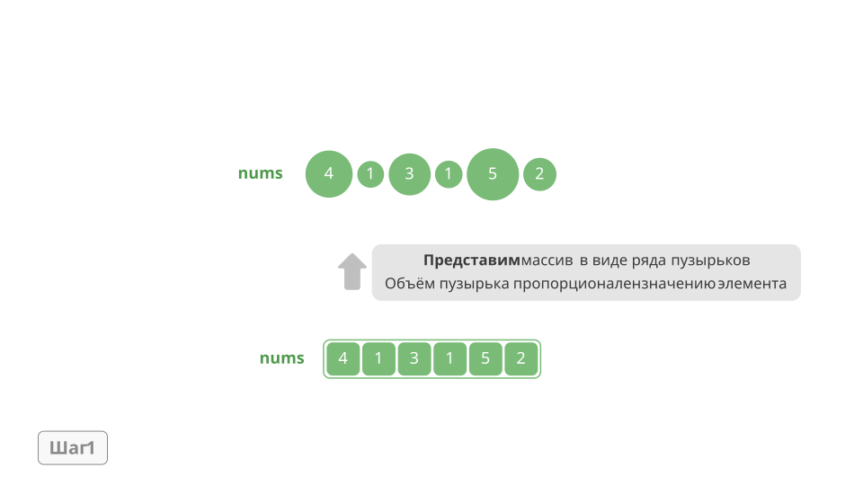
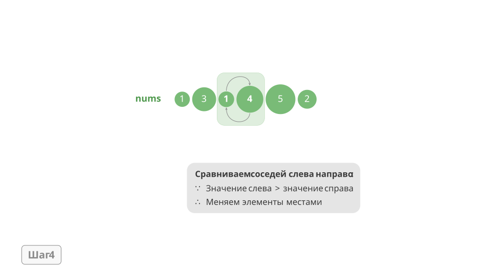
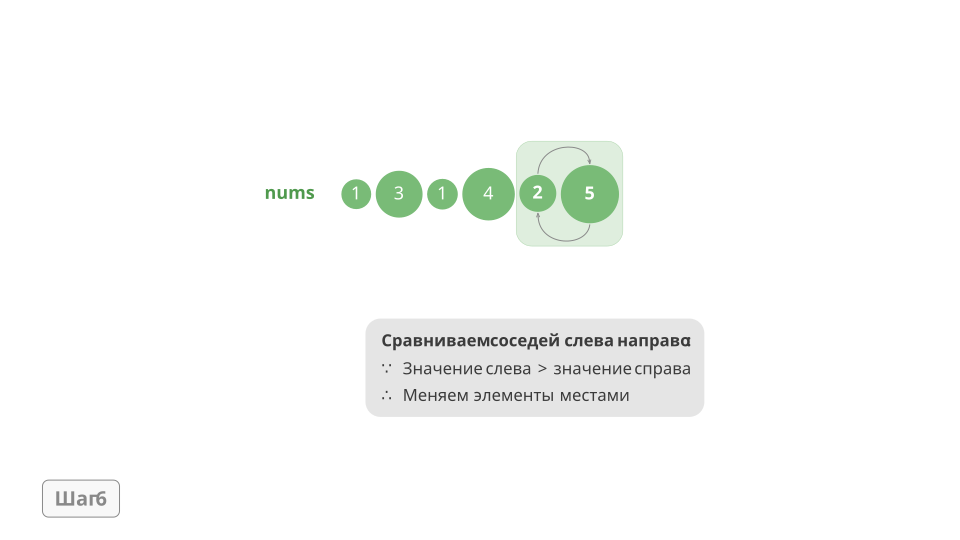

# Сортировка пузырьком

<u>Сортировка пузырьком (bubble sort)</u> последовательно сравнивает соседние элементы и при необходимости меняет их местами. Название отражает сходство с пузырьком, который поднимается со дна на поверхность.

На рисунке показано, как обмены имитируют всплытие пузырька. Идём от левого края массива вправо и сравниваем соседние элементы. Если левый элемент больше правого, меняем их местами. К концу прохода наибольший элемент окажется у правого края массива.

=== "<1>"
    

=== "<2>"
    

=== "<3>"
    

=== "<4>"
    

=== "<5>"
    

=== "<6>"
    

=== "<7>"
    

## Ход алгоритма

Пусть длина массива равна $n$. На рисунке показаны шаги сортировки пузырьком.

1. Сначала выполняем проход по $n$ элементам. **В результате обменов наибольший элемент массива занимает своё место**.
2. Затем выполняем проход по оставшимся $n - 1$ элементам. **В результате обменов второй по величине элемент занимает своё место**.
3. Продолжаем так же. После $n - 1$ проходов **первые $n - 1$ элементов по убыванию величины займут свои места**.
4. Остаётся один элемент. Он обязательно минимален, поэтому дополнительных действий не требуется. Массив отсортирован.


Пример реализации:

```src
[file]{bubble_sort}-[class]{}-[func]{bubble_sort}
```

## Оптимизация

Если за проход не произошло ни одного обмена, массив уже отсортирован и результат можно сразу вернуть. Добавим флаг `flag`, чтобы распознать такой проход и сразу завершить сортировку.

После оптимизации сложность сортировки пузырьком в худшем и среднем случаях по-прежнему равна $O(n^2)$. Если входной массив уже полностью упорядочен, достигается лучшая временная сложность $O(n)$.

```src
[file]{bubble_sort}-[class]{}-[func]{bubble_sort_with_flag}
```

## Свойства алгоритма

- **Временная сложность $O(n^2)$, адаптивная сортировка**. Длины просматриваемых участков по проходам равны $n - 1$, $n - 2$, $\dots$, $2$, $1$, а их сумма — $(n - 1) n / 2$. С оптимизацией по флагу `flag` сложность в лучшем случае достигает $O(n)$.
- **Пространственная сложность $O(1)$, сортировка на месте**. Указатели $i$ и $j$ занимают постоянный объём дополнительной памяти.
- **Устойчивая сортировка**. При проходе равные элементы не меняются местами.
