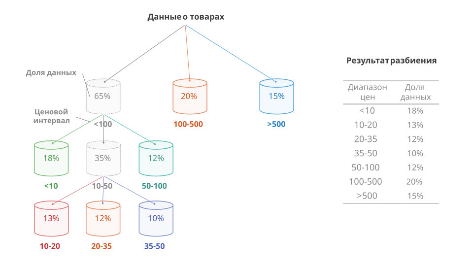

# 11.8 &nbsp; Блочная сортировка

До сих пор мы рассматривали сортировки, основанные на сравнениях: они упорядочивают элементы, сравнивая их значения. Нижняя граница временной сложности таких алгоритмов в худшем случае равна $\Omega(n \log n)$. Теперь рассмотрим сортировки без сравнений, которые могут работать за линейное время.

<u>Блочная сортировка (bucket sort)</u> — характерный пример стратегии «разделяй и властвуй». Создают ряд упорядоченных блоков (корзин), каждому из которых соответствует диапазон значений, и равномерно распределяют по ним данные. Затем каждый блок сортируют отдельно и объединяют данные в порядке блоков.

## 11.8.1 &nbsp; Ход алгоритма

Рассмотрим массив длины $n$ из чисел с плавающей точкой в диапазоне $[0, 1)$. На рисунке показан ход блочной сортировки.

1. Создаём $k$ блоков и распределяем $n$ элементов по $k$ блокам.
2. Сортируем каждый блок отдельно (здесь используется встроенная функция сортировки языка).
3. Объединяем результаты в порядке блоков, от меньших значений к большим.

{ class="animation-figure" }

<p align="center"> Рисунок 11-13 &nbsp; Ход блочной сортировки </p>

Код реализации:

=== "Python"

    ```python title="bucket_sort.py"
    def bucket_sort(nums: list[float]):
        """Блочная сортировка"""
        # Создать k = n/2 блоков в расчёте на два элемента в каждом
        k = len(nums) // 2
        buckets = [[] for _ in range(k)]
        # 1. Распределить элементы массива по блокам
        for num in nums:
            # Значения лежат в [0, 1). Умножение num * k даёт индекс в [0, k-1]
            i = int(num * k)
            # Добавить num в блок i
            buckets[i].append(num)
        # 2. Отсортировать каждый блок
        for bucket in buckets:
            # Используем встроенную сортировку. Её можно заменить другим алгоритмом
            bucket.sort()
        # 3. Обойти блоки и объединить результаты
        i = 0
        for bucket in buckets:
            for num in bucket:
                nums[i] = num
                i += 1
    ```

=== "C++"

    ```cpp title="bucket_sort.cpp"
    /* Блочная сортировка */
    void bucketSort(vector<float> &nums) {
        // Создать k = n/2 блоков в расчёте на два элемента в каждом
        int k = nums.size() / 2;
        vector<vector<float>> buckets(k);
        // 1. Распределить элементы массива по блокам
        for (float num : nums) {
            // Значения лежат в [0, 1). Умножение num * k даёт индекс в [0, k-1]
            int i = num * k;
            // Добавить num в блок bucket_idx
            buckets[i].push_back(num);
        }
        // 2. Отсортировать каждый блок
        for (vector<float> &bucket : buckets) {
            // Используем встроенную сортировку. Её можно заменить другим алгоритмом
            sort(bucket.begin(), bucket.end());
        }
        // 3. Обойти блоки и объединить результаты
        int i = 0;
        for (vector<float> &bucket : buckets) {
            for (float num : bucket) {
                nums[i++] = num;
            }
        }
    }
    ```

=== "Java"

    ```java title="bucket_sort.java"
    /* Блочная сортировка */
    void bucketSort(float[] nums) {
        // Создать k = n/2 блоков в расчёте на два элемента в каждом
        int k = nums.length / 2;
        List<List<Float>> buckets = new ArrayList<>();
        for (int i = 0; i < k; i++) {
            buckets.add(new ArrayList<>());
        }
        // 1. Распределить элементы массива по блокам
        for (float num : nums) {
            // Значения лежат в [0, 1). Умножение num * k даёт индекс в [0, k-1]
            int i = (int) (num * k);
            // Добавить num в блок i
            buckets.get(i).add(num);
        }
        // 2. Отсортировать каждый блок
        for (List<Float> bucket : buckets) {
            // Используем встроенную сортировку. Её можно заменить другим алгоритмом
            Collections.sort(bucket);
        }
        // 3. Обойти блоки и объединить результаты
        int i = 0;
        for (List<Float> bucket : buckets) {
            for (float num : bucket) {
                nums[i++] = num;
            }
        }
    }
    ```

=== "C#"

    ```csharp title="bucket_sort.cs"
    /* Блочная сортировка */
    void BucketSort(float[] nums) {
        // Создать k = n/2 блоков в расчёте на два элемента в каждом
        int k = nums.Length / 2;
        List<List<float>> buckets = [];
        for (int i = 0; i < k; i++) {
            buckets.Add([]);
        }
        // 1. Распределить элементы массива по блокам
        foreach (float num in nums) {
            // Значения лежат в [0, 1). Умножение num * k даёт индекс в [0, k-1]
            int i = (int)(num * k);
            // Добавить num в блок i
            buckets[i].Add(num);
        }
        // 2. Отсортировать каждый блок
        foreach (List<float> bucket in buckets) {
            // Используем встроенную сортировку. Её можно заменить другим алгоритмом
            bucket.Sort();
        }
        // 3. Обойти блоки и объединить результаты
        int j = 0;
        foreach (List<float> bucket in buckets) {
            foreach (float num in bucket) {
                nums[j++] = num;
            }
        }
    }
    ```

=== "Go"

    ```go title="bucket_sort.go"
    /* Блочная сортировка */
    func bucketSort(nums []float64) {
        // Создать k = n/2 блоков в расчёте на два элемента в каждом
        k := len(nums) / 2
        buckets := make([][]float64, k)
        for i := 0; i < k; i++ {
            buckets[i] = make([]float64, 0)
        }
        // 1. Распределить элементы массива по блокам
        for _, num := range nums {
            // Значения лежат в [0, 1). Умножение num * k даёт индекс в [0, k-1]
            i := int(num * float64(k))
            // Добавить num в блок i
            buckets[i] = append(buckets[i], num)
        }
        // 2. Отсортировать каждый блок
        for i := 0; i < k; i++ {
            // Используем встроенную сортировку срезов. Её можно заменить другим алгоритмом
            sort.Float64s(buckets[i])
        }
        // 3. Обойти блоки и объединить результаты
        i := 0
        for _, bucket := range buckets {
            for _, num := range bucket {
                nums[i] = num
                i++
            }
        }
    }
    ```

=== "Swift"

    ```swift title="bucket_sort.swift"
    /* Блочная сортировка */
    func bucketSort(nums: inout [Double]) {
        // Создать k = n/2 блоков в расчёте на два элемента в каждом
        let k = nums.count / 2
        var buckets = (0 ..< k).map { _ in [Double]() }
        // 1. Распределить элементы массива по блокам
        for num in nums {
            // Значения лежат в [0, 1). Умножение num * k даёт индекс в [0, k-1]
            let i = Int(num * Double(k))
            // Добавить num в блок i
            buckets[i].append(num)
        }
        // 2. Отсортировать каждый блок
        for i in buckets.indices {
            // Используем встроенную сортировку. Её можно заменить другим алгоритмом
            buckets[i].sort()
        }
        // 3. Обойти блоки и объединить результаты
        var i = nums.startIndex
        for bucket in buckets {
            for num in bucket {
                nums[i] = num
                i += 1
            }
        }
    }
    ```

=== "JS"

    ```javascript title="bucket_sort.js"
    /* Блочная сортировка */
    function bucketSort(nums) {
        // Создать k = n/2 блоков в расчёте на два элемента в каждом
        const k = nums.length / 2;
        const buckets = [];
        for (let i = 0; i < k; i++) {
            buckets.push([]);
        }
        // 1. Распределить элементы массива по блокам
        for (const num of nums) {
            // Значения лежат в [0, 1). Умножение num * k даёт индекс в [0, k-1]
            const i = Math.floor(num * k);
            // Добавить num в блок i
            buckets[i].push(num);
        }
        // 2. Отсортировать каждый блок
        for (const bucket of buckets) {
            // Используем встроенную сортировку. Её можно заменить другим алгоритмом
            bucket.sort((a, b) => a - b);
        }
        // 3. Обойти блоки и объединить результаты
        let i = 0;
        for (const bucket of buckets) {
            for (const num of bucket) {
                nums[i++] = num;
            }
        }
    }
    ```

=== "TS"

    ```typescript title="bucket_sort.ts"
    /* Блочная сортировка */
    function bucketSort(nums: number[]): void {
        // Создать k = n/2 блоков в расчёте на два элемента в каждом
        const k = nums.length / 2;
        const buckets: number[][] = [];
        for (let i = 0; i < k; i++) {
            buckets.push([]);
        }
        // 1. Распределить элементы массива по блокам
        for (const num of nums) {
            // Значения лежат в [0, 1). Умножение num * k даёт индекс в [0, k-1]
            const i = Math.floor(num * k);
            // Добавить num в блок i
            buckets[i].push(num);
        }
        // 2. Отсортировать каждый блок
        for (const bucket of buckets) {
            // Используем встроенную сортировку. Её можно заменить другим алгоритмом
            bucket.sort((a, b) => a - b);
        }
        // 3. Обойти блоки и объединить результаты
        let i = 0;
        for (const bucket of buckets) {
            for (const num of bucket) {
                nums[i++] = num;
            }
        }
    }
    ```

=== "Dart"

    ```dart title="bucket_sort.dart"
    /* Блочная сортировка */
    void bucketSort(List<double> nums) {
      // Создать k = n/2 блоков в расчёте на два элемента в каждом
      int k = nums.length ~/ 2;
      List<List<double>> buckets = List.generate(k, (index) => []);

      // 1. Распределить элементы массива по блокам
      for (double _num in nums) {
        // Значения лежат в [0, 1). Умножение _num * k даёт индекс в [0, k-1]
        int i = (_num * k).toInt();
        // Добавить _num в блок bucket_idx
        buckets[i].add(_num);
      }
      // 2. Отсортировать каждый блок
      for (List<double> bucket in buckets) {
        bucket.sort();
      }
      // 3. Обойти блоки и объединить результаты
      int i = 0;
      for (List<double> bucket in buckets) {
        for (double _num in bucket) {
          nums[i++] = _num;
        }
      }
    }
    ```

=== "Rust"

    ```rust title="bucket_sort.rs"
    /* Блочная сортировка */
    fn bucket_sort(nums: &mut [f64]) {
        // Создать k = n/2 блоков в расчёте на два элемента в каждом
        let k = nums.len() / 2;
        let mut buckets = vec![vec![]; k];
        // 1. Распределить элементы массива по блокам
        for &num in nums.iter() {
            // Значения лежат в [0, 1). Умножение num * k даёт индекс в [0, k-1]
            let i = (num * k as f64) as usize;
            // Добавить num в блок i
            buckets[i].push(num);
        }
        // 2. Отсортировать каждый блок
        for bucket in &mut buckets {
            // Используем встроенную сортировку. Её можно заменить другим алгоритмом
            bucket.sort_by(|a, b| a.partial_cmp(b).unwrap());
        }
        // 3. Обойти блоки и объединить результаты
        let mut i = 0;
        for bucket in buckets.iter() {
            for &num in bucket.iter() {
                nums[i] = num;
                i += 1;
            }
        }
    }
    ```

=== "C"

    ```c title="bucket_sort.c"
    /* Блочная сортировка */
    void bucketSort(float nums[], int n) {
        int k = n / 2;                                 // Создать k = n/2 блоков
        int *sizes = malloc(k * sizeof(int));          // Хранить размер каждого блока
        float **buckets = malloc(k * sizeof(float *)); // Массив динамических массивов (блоков)
        // Заранее выделить достаточно памяти для каждого блока
        for (int i = 0; i < k; ++i) {
            buckets[i] = (float *)malloc(n * sizeof(float));
            sizes[i] = 0;
        }
        // 1. Распределить элементы массива по блокам
        for (int i = 0; i < n; ++i) {
            int idx = (int)(nums[i] * k);
            buckets[idx][sizes[idx]++] = nums[i];
        }
        // 2. Отсортировать каждый блок
        for (int i = 0; i < k; ++i) {
            qsort(buckets[i], sizes[i], sizeof(float), compare);
        }
        // 3. Объединить отсортированные блоки
        int idx = 0;
        for (int i = 0; i < k; ++i) {
            for (int j = 0; j < sizes[i]; ++j) {
                nums[idx++] = buckets[i][j];
            }
            // Освободить память
            free(buckets[i]);
        }
    }
    ```

=== "Kotlin"

    ```kotlin title="bucket_sort.kt"
    /* Блочная сортировка */
    fun bucketSort(nums: FloatArray) {
        // Создать k = n/2 блоков в расчёте на два элемента в каждом
        val k = nums.size / 2
        val buckets = mutableListOf<MutableList<Float>>()
        for (i in 0..<k) {
            buckets.add(mutableListOf())
        }
        // 1. Распределить элементы массива по блокам
        for (num in nums) {
            // Значения лежат в [0, 1). Умножение num * k даёт индекс в [0, k-1]
            val i = (num * k).toInt()
            // Добавить num в блок i
            buckets[i].add(num)
        }
        // 2. Отсортировать каждый блок
        for (bucket in buckets) {
            // Используем встроенную сортировку. Её можно заменить другим алгоритмом
            bucket.sort()
        }
        // 3. Обойти блоки и объединить результаты
        var i = 0
        for (bucket in buckets) {
            for (num in bucket) {
                nums[i++] = num
            }
        }
    }
    ```

=== "Ruby"

    ```ruby title="bucket_sort.rb"
    ### Блочная сортировка ###
    def bucket_sort(nums)
      # Создать k = n/2 блоков в расчёте на два элемента в каждом
      k = nums.length / 2
      buckets = Array.new(k) { [] }
      
      # 1. Распределить элементы массива по блокам
      nums.each do |num|
        # Значения лежат в [0, 1). Умножение num * k даёт индекс в [0, k-1]
        i = (num * k).to_i
        # Добавить num в блок i
        buckets[i] << num
      end

      # 2. Отсортировать каждый блок
      buckets.each do |bucket|
        # Используем встроенную сортировку. Её можно заменить другим алгоритмом
        bucket.sort!
      end

      # 3. Обойти блоки и объединить результаты
      i = 0
      buckets.each do |bucket|
        bucket.each do |num|
          nums[i] = num
          i += 1
        end
      end
    end
    ```

??? pythontutor "Визуализация выполнения"

    <div style="height: 549px; width: 100%;"><iframe class="pythontutor-iframe" title="Визуализация выполнения" src="https://pythontutor.com/iframe-embed.html#code=def%20bucket_sort%28nums%3A%20list%5Bfloat%5D%29%3A%0A%20%20%20%20%22%22%22%D0%91%D0%BB%D0%BE%D1%87%D0%BD%D0%B0%D1%8F%20%D1%81%D0%BE%D1%80%D1%82%D0%B8%D1%80%D0%BE%D0%B2%D0%BA%D0%B0%22%22%22%0A%20%20%20%20%23%20%D0%A1%D0%BE%D0%B7%D0%B4%D0%B0%D1%82%D1%8C%20k%20%3D%20n/2%20%D0%B1%D0%BB%D0%BE%D0%BA%D0%BE%D0%B2%20%D0%B2%20%D1%80%D0%B0%D1%81%D1%87%D1%91%D1%82%D0%B5%20%D0%BD%D0%B0%20%D0%B4%D0%B2%D0%B0%20%D1%8D%D0%BB%D0%B5%D0%BC%D0%B5%D0%BD%D1%82%D0%B0%20%D0%B2%20%D0%BA%D0%B0%D0%B6%D0%B4%D0%BE%D0%BC%0A%20%20%20%20k%20%3D%20len%28nums%29%20//%202%0A%20%20%20%20buckets%20%3D%20%5B%5B%5D%20for%20_%20in%20range%28k%29%5D%0A%20%20%20%20%23%201.%20%D0%A0%D0%B0%D1%81%D0%BF%D1%80%D0%B5%D0%B4%D0%B5%D0%BB%D0%B8%D1%82%D1%8C%20%D1%8D%D0%BB%D0%B5%D0%BC%D0%B5%D0%BD%D1%82%D1%8B%20%D0%BC%D0%B0%D1%81%D1%81%D0%B8%D0%B2%D0%B0%20%D0%BF%D0%BE%20%D0%B1%D0%BB%D0%BE%D0%BA%D0%B0%D0%BC%0A%20%20%20%20for%20num%20in%20nums%3A%0A%20%20%20%20%20%20%20%20%23%20%D0%97%D0%BD%D0%B0%D1%87%D0%B5%D0%BD%D0%B8%D1%8F%20%D0%BB%D0%B5%D0%B6%D0%B0%D1%82%20%D0%B2%20%5B0,%201%29.%20%D0%A3%D0%BC%D0%BD%D0%BE%D0%B6%D0%B5%D0%BD%D0%B8%D0%B5%20num%20%2A%20k%20%D0%B4%D0%B0%D1%91%D1%82%20%D0%B8%D0%BD%D0%B4%D0%B5%D0%BA%D1%81%20%D0%B2%20%5B0,%20k-1%5D%0A%20%20%20%20%20%20%20%20i%20%3D%20int%28num%20%2A%20k%29%0A%20%20%20%20%20%20%20%20%23%20%D0%94%D0%BE%D0%B1%D0%B0%D0%B2%D0%B8%D1%82%D1%8C%20num%20%D0%B2%20%D0%B1%D0%BB%D0%BE%D0%BA%20i%0A%20%20%20%20%20%20%20%20buckets%5Bi%5D.append%28num%29%0A%20%20%20%20%23%202.%20%D0%9E%D1%82%D1%81%D0%BE%D1%80%D1%82%D0%B8%D1%80%D0%BE%D0%B2%D0%B0%D1%82%D1%8C%20%D0%BA%D0%B0%D0%B6%D0%B4%D1%8B%D0%B9%20%D0%B1%D0%BB%D0%BE%D0%BA%0A%20%20%20%20for%20bucket%20in%20buckets%3A%0A%20%20%20%20%20%20%20%20%23%20%D0%98%D1%81%D0%BF%D0%BE%D0%BB%D1%8C%D0%B7%D1%83%D0%B5%D0%BC%20%D0%B2%D1%81%D1%82%D1%80%D0%BE%D0%B5%D0%BD%D0%BD%D1%83%D1%8E%20%D1%81%D0%BE%D1%80%D1%82%D0%B8%D1%80%D0%BE%D0%B2%D0%BA%D1%83.%20%D0%95%D1%91%20%D0%BC%D0%BE%D0%B6%D0%BD%D0%BE%20%D0%B7%D0%B0%D0%BC%D0%B5%D0%BD%D0%B8%D1%82%D1%8C%20%D0%B4%D1%80%D1%83%D0%B3%D0%B8%D0%BC%20%D0%B0%D0%BB%D0%B3%D0%BE%D1%80%D0%B8%D1%82%D0%BC%D0%BE%D0%BC%0A%20%20%20%20%20%20%20%20bucket.sort%28%29%0A%20%20%20%20%23%203.%20%D0%9E%D0%B1%D0%BE%D0%B9%D1%82%D0%B8%20%D0%B1%D0%BB%D0%BE%D0%BA%D0%B8%20%D0%B8%20%D0%BE%D0%B1%D1%8A%D0%B5%D0%B4%D0%B8%D0%BD%D0%B8%D1%82%D1%8C%20%D1%80%D0%B5%D0%B7%D1%83%D0%BB%D1%8C%D1%82%D0%B0%D1%82%D1%8B%0A%20%20%20%20i%20%3D%200%0A%20%20%20%20for%20bucket%20in%20buckets%3A%0A%20%20%20%20%20%20%20%20for%20num%20in%20bucket%3A%0A%20%20%20%20%20%20%20%20%20%20%20%20nums%5Bi%5D%20%3D%20num%0A%20%20%20%20%20%20%20%20%20%20%20%20i%20%2B%3D%201%0A%0Aif%20__name__%20%3D%3D%20%22__main__%22%3A%0A%20%20%20%20%23%20%D0%92%D1%85%D0%BE%D0%B4%D0%BD%D1%8B%D0%B5%20%D0%B4%D0%B0%D0%BD%D0%BD%D1%8B%D0%B5%20%E2%80%94%20%D1%87%D0%B8%D1%81%D0%BB%D0%B0%20%D1%81%20%D0%BF%D0%BB%D0%B0%D0%B2%D0%B0%D1%8E%D1%89%D0%B5%D0%B9%20%D1%82%D0%BE%D1%87%D0%BA%D0%BE%D0%B9%20%D0%B8%D0%B7%20%D0%B8%D0%BD%D1%82%D0%B5%D1%80%D0%B2%D0%B0%D0%BB%D0%B0%20%5B0,%201%29%0A%20%20%20%20nums%20%3D%20%5B0.49,%200.96,%200.82,%200.09,%200.57,%200.43,%200.91,%200.75,%200.15,%200.37%5D%0A%20%20%20%20bucket_sort%28nums%29%0A%20%20%20%20print%28%22%D0%9F%D0%BE%D1%81%D0%BB%D0%B5%20%D0%B1%D0%BB%D0%BE%D1%87%D0%BD%D0%BE%D0%B9%20%D1%81%D0%BE%D1%80%D1%82%D0%B8%D1%80%D0%BE%D0%B2%D0%BA%D0%B8%20nums%20%3D%22,%20nums%29&codeDivHeight=472&codeDivWidth=350&cumulative=false&curInstr=3&heapPrimitives=nevernest&origin=opt-frontend.js&py=311&rawInputLstJSON=%5B%5D&textReferences=false"> </iframe></div>
    <div style="margin-top: 5px;"><a href="https://pythontutor.com/iframe-embed.html#code=def%20bucket_sort%28nums%3A%20list%5Bfloat%5D%29%3A%0A%20%20%20%20%22%22%22%D0%91%D0%BB%D0%BE%D1%87%D0%BD%D0%B0%D1%8F%20%D1%81%D0%BE%D1%80%D1%82%D0%B8%D1%80%D0%BE%D0%B2%D0%BA%D0%B0%22%22%22%0A%20%20%20%20%23%20%D0%A1%D0%BE%D0%B7%D0%B4%D0%B0%D1%82%D1%8C%20k%20%3D%20n/2%20%D0%B1%D0%BB%D0%BE%D0%BA%D0%BE%D0%B2%20%D0%B2%20%D1%80%D0%B0%D1%81%D1%87%D1%91%D1%82%D0%B5%20%D0%BD%D0%B0%20%D0%B4%D0%B2%D0%B0%20%D1%8D%D0%BB%D0%B5%D0%BC%D0%B5%D0%BD%D1%82%D0%B0%20%D0%B2%20%D0%BA%D0%B0%D0%B6%D0%B4%D0%BE%D0%BC%0A%20%20%20%20k%20%3D%20len%28nums%29%20//%202%0A%20%20%20%20buckets%20%3D%20%5B%5B%5D%20for%20_%20in%20range%28k%29%5D%0A%20%20%20%20%23%201.%20%D0%A0%D0%B0%D1%81%D0%BF%D1%80%D0%B5%D0%B4%D0%B5%D0%BB%D0%B8%D1%82%D1%8C%20%D1%8D%D0%BB%D0%B5%D0%BC%D0%B5%D0%BD%D1%82%D1%8B%20%D0%BC%D0%B0%D1%81%D1%81%D0%B8%D0%B2%D0%B0%20%D0%BF%D0%BE%20%D0%B1%D0%BB%D0%BE%D0%BA%D0%B0%D0%BC%0A%20%20%20%20for%20num%20in%20nums%3A%0A%20%20%20%20%20%20%20%20%23%20%D0%97%D0%BD%D0%B0%D1%87%D0%B5%D0%BD%D0%B8%D1%8F%20%D0%BB%D0%B5%D0%B6%D0%B0%D1%82%20%D0%B2%20%5B0,%201%29.%20%D0%A3%D0%BC%D0%BD%D0%BE%D0%B6%D0%B5%D0%BD%D0%B8%D0%B5%20num%20%2A%20k%20%D0%B4%D0%B0%D1%91%D1%82%20%D0%B8%D0%BD%D0%B4%D0%B5%D0%BA%D1%81%20%D0%B2%20%5B0,%20k-1%5D%0A%20%20%20%20%20%20%20%20i%20%3D%20int%28num%20%2A%20k%29%0A%20%20%20%20%20%20%20%20%23%20%D0%94%D0%BE%D0%B1%D0%B0%D0%B2%D0%B8%D1%82%D1%8C%20num%20%D0%B2%20%D0%B1%D0%BB%D0%BE%D0%BA%20i%0A%20%20%20%20%20%20%20%20buckets%5Bi%5D.append%28num%29%0A%20%20%20%20%23%202.%20%D0%9E%D1%82%D1%81%D0%BE%D1%80%D1%82%D0%B8%D1%80%D0%BE%D0%B2%D0%B0%D1%82%D1%8C%20%D0%BA%D0%B0%D0%B6%D0%B4%D1%8B%D0%B9%20%D0%B1%D0%BB%D0%BE%D0%BA%0A%20%20%20%20for%20bucket%20in%20buckets%3A%0A%20%20%20%20%20%20%20%20%23%20%D0%98%D1%81%D0%BF%D0%BE%D0%BB%D1%8C%D0%B7%D1%83%D0%B5%D0%BC%20%D0%B2%D1%81%D1%82%D1%80%D0%BE%D0%B5%D0%BD%D0%BD%D1%83%D1%8E%20%D1%81%D0%BE%D1%80%D1%82%D0%B8%D1%80%D0%BE%D0%B2%D0%BA%D1%83.%20%D0%95%D1%91%20%D0%BC%D0%BE%D0%B6%D0%BD%D0%BE%20%D0%B7%D0%B0%D0%BC%D0%B5%D0%BD%D0%B8%D1%82%D1%8C%20%D0%B4%D1%80%D1%83%D0%B3%D0%B8%D0%BC%20%D0%B0%D0%BB%D0%B3%D0%BE%D1%80%D0%B8%D1%82%D0%BC%D0%BE%D0%BC%0A%20%20%20%20%20%20%20%20bucket.sort%28%29%0A%20%20%20%20%23%203.%20%D0%9E%D0%B1%D0%BE%D0%B9%D1%82%D0%B8%20%D0%B1%D0%BB%D0%BE%D0%BA%D0%B8%20%D0%B8%20%D0%BE%D0%B1%D1%8A%D0%B5%D0%B4%D0%B8%D0%BD%D0%B8%D1%82%D1%8C%20%D1%80%D0%B5%D0%B7%D1%83%D0%BB%D1%8C%D1%82%D0%B0%D1%82%D1%8B%0A%20%20%20%20i%20%3D%200%0A%20%20%20%20for%20bucket%20in%20buckets%3A%0A%20%20%20%20%20%20%20%20for%20num%20in%20bucket%3A%0A%20%20%20%20%20%20%20%20%20%20%20%20nums%5Bi%5D%20%3D%20num%0A%20%20%20%20%20%20%20%20%20%20%20%20i%20%2B%3D%201%0A%0Aif%20__name__%20%3D%3D%20%22__main__%22%3A%0A%20%20%20%20%23%20%D0%92%D1%85%D0%BE%D0%B4%D0%BD%D1%8B%D0%B5%20%D0%B4%D0%B0%D0%BD%D0%BD%D1%8B%D0%B5%20%E2%80%94%20%D1%87%D0%B8%D1%81%D0%BB%D0%B0%20%D1%81%20%D0%BF%D0%BB%D0%B0%D0%B2%D0%B0%D1%8E%D1%89%D0%B5%D0%B9%20%D1%82%D0%BE%D1%87%D0%BA%D0%BE%D0%B9%20%D0%B8%D0%B7%20%D0%B8%D0%BD%D1%82%D0%B5%D1%80%D0%B2%D0%B0%D0%BB%D0%B0%20%5B0,%201%29%0A%20%20%20%20nums%20%3D%20%5B0.49,%200.96,%200.82,%200.09,%200.57,%200.43,%200.91,%200.75,%200.15,%200.37%5D%0A%20%20%20%20bucket_sort%28nums%29%0A%20%20%20%20print%28%22%D0%9F%D0%BE%D1%81%D0%BB%D0%B5%20%D0%B1%D0%BB%D0%BE%D1%87%D0%BD%D0%BE%D0%B9%20%D1%81%D0%BE%D1%80%D1%82%D0%B8%D1%80%D0%BE%D0%B2%D0%BA%D0%B8%20nums%20%3D%22,%20nums%29&codeDivHeight=800&codeDivWidth=600&cumulative=false&curInstr=3&heapPrimitives=nevernest&origin=opt-frontend.js&py=311&rawInputLstJSON=%5B%5D&textReferences=false" target="_blank" rel="noopener noreferrer">Во весь экран ></a></div>

## 11.8.2 &nbsp; Свойства алгоритма

Блочная сортировка подходит для больших объёмов данных. Например, пусть вход содержит миллион элементов и оперативной памяти недостаточно для одновременной загрузки всех данных. Тогда можно распределить данные по 1000 блокам, отсортировать каждый отдельно и объединить результаты.

- **Временная сложность $O(n + k)$**. При равномерном распределении каждый блок содержит $\frac{n}{k}$ элементов. Если сортировка одного блока занимает $O(\frac{n}{k} \log\frac{n}{k})$ времени, то на все блоки потребуется $O(n \log\frac{n}{k})$. **При достаточно большом числе блоков $k$ временная сложность приближается к $O(n)$**. Для объединения нужно обойти все блоки и элементы, что занимает $O(n + k)$ времени. В худшем случае все данные попадают в один блок и его сортировка занимает $O(n^2)$ времени.
- **Пространственная сложность $O(n + k)$, сортировка с дополнительной памятью**. Требуется память для $k$ блоков и в общей сложности $n$ элементов в них.
- Устойчивость блочной сортировки зависит от устойчивости алгоритма, который сортирует элементы внутри блока.

## 11.8.3 &nbsp; Как равномерно распределить данные

Теоретически блочная сортировка может работать за $O(n)$. **Для этого нужно равномерно распределить элементы по блокам**, а реальные данные часто распределены неравномерно. Например, мы хотим распределить все товары Taobao по цене поровну между 10 блоками. Но товаров дешевле 100 юаней очень много, а дороже 1000 юаней — очень мало. Если разделить шкалу цен на 10 равных интервалов, число товаров в блоках будет сильно различаться.

Для начала можно наметить границы и грубо разделить данные на три блока. **Затем каждый блок, в котором слишком много товаров, снова делим на три и продолжаем до тех пор, пока число элементов во всех блоках не станет примерно одинаковым**.

Как видно на рисунке, так мы фактически строим дерево рекурсии, стараясь сделать значения в листьях как можно ближе друг к другу. Делить данные именно на три блока каждый раз необязательно: способ разбиения можно выбирать с учётом особенностей данных.

{ class="animation-figure" }

<p align="center"> Рисунок 11-14 &nbsp; Рекурсивное разбиение блоков </p>

Если распределение цен известно заранее, **границы ценовых диапазонов можно выбрать по вероятностному распределению данных**. Для этого необязательно специально собирать статистику: иногда распределение можно приблизить вероятностной моделью с учётом свойств данных.

Например, на рисунке мы предполагаем, что цены имеют нормальное распределение. Это позволяет подобрать ценовые интервалы так, чтобы товары распределились по блокам равномерно.

{ class="animation-figure" }

<p align="center"> Рисунок 11-15 &nbsp; Выбор границ блоков по вероятностному распределению </p>
