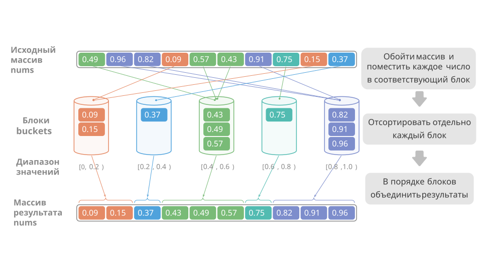
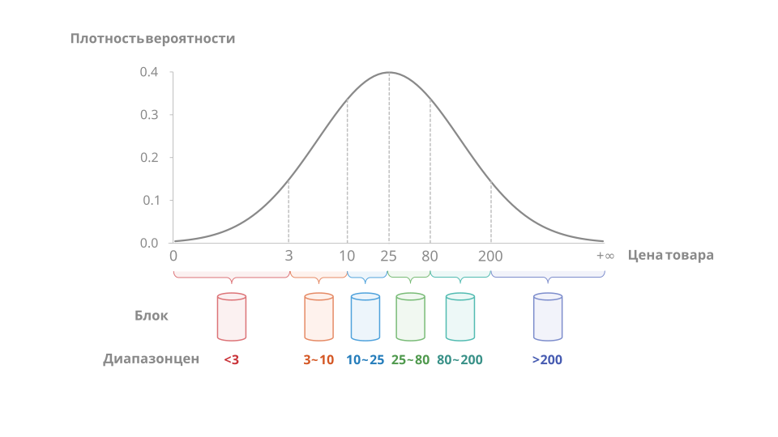

# Блочная сортировка

До сих пор мы рассматривали сортировки, основанные на сравнениях: они упорядочивают элементы, сравнивая их значения. Нижняя граница временной сложности таких алгоритмов в худшем случае равна $\Omega(n \log n)$. Теперь рассмотрим сортировки без сравнений, которые могут работать за линейное время.

<u>Блочная сортировка (bucket sort)</u> — характерный пример стратегии «разделяй и властвуй». Создают ряд упорядоченных блоков (корзин), каждому из которых соответствует диапазон значений, и равномерно распределяют по ним данные. Затем каждый блок сортируют отдельно и объединяют данные в порядке блоков.

## Ход алгоритма

Рассмотрим массив длины $n$ из чисел с плавающей точкой в диапазоне $[0, 1)$. На рисунке показан ход блочной сортировки.

1. Создаём $k$ блоков и распределяем $n$ элементов по $k$ блокам.
2. Сортируем каждый блок отдельно (здесь используется встроенная функция сортировки языка).
3. Объединяем результаты в порядке блоков, от меньших значений к большим.



Код реализации:

```src
[file]{bucket_sort}-[class]{}-[func]{bucket_sort}
```

## Свойства алгоритма

Блочная сортировка подходит для больших объёмов данных. Например, пусть вход содержит миллион элементов и оперативной памяти недостаточно для одновременной загрузки всех данных. Тогда можно распределить данные по 1000 блокам, отсортировать каждый отдельно и объединить результаты.

- **Временная сложность $O(n + k)$**. При равномерном распределении каждый блок содержит $\frac{n}{k}$ элементов. Если сортировка одного блока занимает $O(\frac{n}{k} \log\frac{n}{k})$ времени, то на все блоки потребуется $O(n \log\frac{n}{k})$. **При достаточно большом числе блоков $k$ временная сложность приближается к $O(n)$**. Для объединения нужно обойти все блоки и элементы, что занимает $O(n + k)$ времени. В худшем случае все данные попадают в один блок и его сортировка занимает $O(n^2)$ времени.
- **Пространственная сложность $O(n + k)$, сортировка с дополнительной памятью**. Требуется память для $k$ блоков и в общей сложности $n$ элементов в них.
- Устойчивость блочной сортировки зависит от устойчивости алгоритма, который сортирует элементы внутри блока.

## Как равномерно распределить данные

Теоретически блочная сортировка может работать за $O(n)$. **Для этого нужно равномерно распределить элементы по блокам**, а реальные данные часто распределены неравномерно. Например, мы хотим распределить все товары Taobao по цене поровну между 10 блоками. Но товаров дешевле 100 юаней очень много, а дороже 1000 юаней — очень мало. Если разделить шкалу цен на 10 равных интервалов, число товаров в блоках будет сильно различаться.

Для начала можно наметить границы и грубо разделить данные на три блока. **Затем каждый блок, в котором слишком много товаров, снова делим на три и продолжаем до тех пор, пока число элементов во всех блоках не станет примерно одинаковым**.

Как видно на рисунке, так мы фактически строим дерево рекурсии, стараясь сделать значения в листьях как можно ближе друг к другу. Делить данные именно на три блока каждый раз необязательно: способ разбиения можно выбирать с учётом особенностей данных.


Если распределение цен известно заранее, **границы ценовых диапазонов можно выбрать по вероятностному распределению данных**. Для этого необязательно специально собирать статистику: иногда распределение можно приблизить вероятностной моделью с учётом свойств данных.

Например, на рисунке мы предполагаем, что цены имеют нормальное распределение. Это позволяет подобрать ценовые интервалы так, чтобы товары распределились по блокам равномерно.


