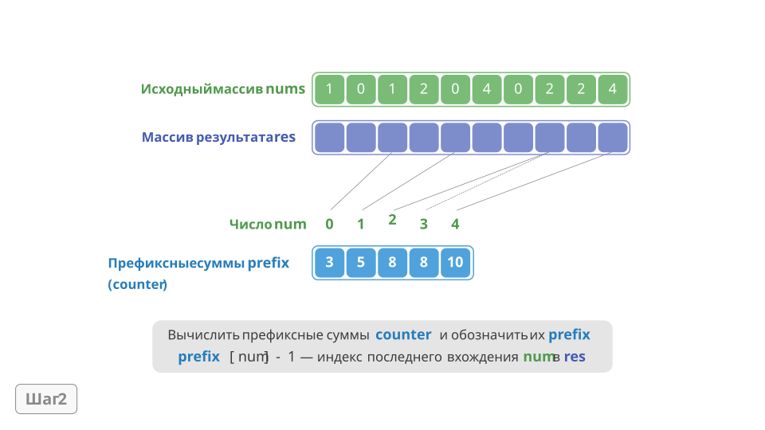
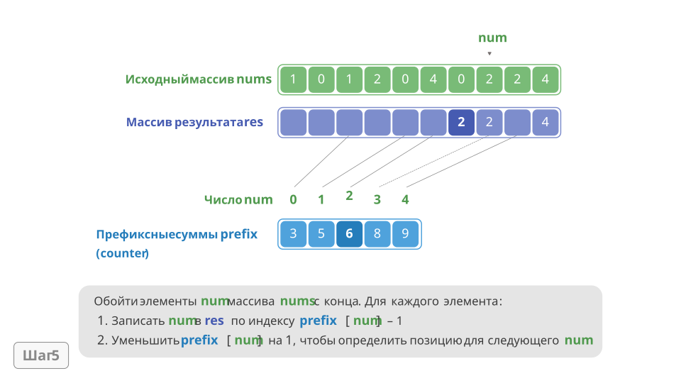
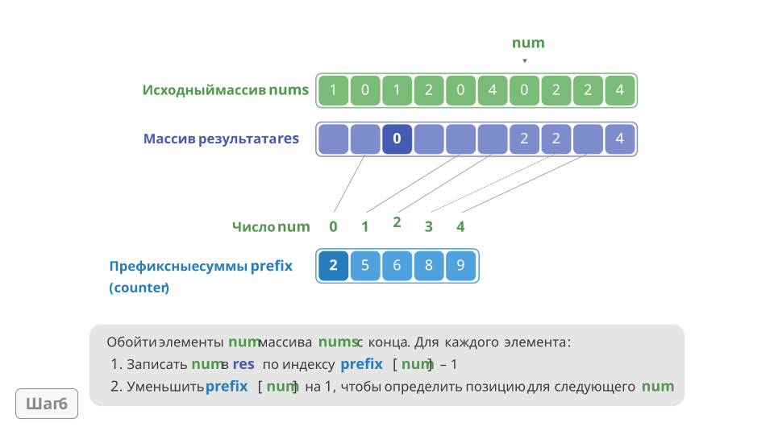

# Сортировка подсчётом

<u>Сортировка подсчётом (counting sort)</u> упорядочивает элементы, подсчитывая их количество. Обычно её применяют к массивам целых чисел.

## Простая реализация

Начнём с простого примера. Дан массив `nums` длины $n$, состоящий из неотрицательных целых чисел. На рисунке показан общий ход сортировки подсчётом.

1. Обойдём массив и найдём наибольшее число $m$. Затем создадим вспомогательный массив `counter` длины $m + 1$.
2. **С помощью `counter` подсчитаем число вхождений каждого значения из `nums`**. В `counter[num]` хранится число вхождений `num`. Для подсчёта достаточно пройти по `nums` и для каждого текущего числа `num` увеличить `counter[num]` на $1$.
3. **Индексы `counter` упорядочены по определению, так что числа уже расположены в нужном порядке**. Остаётся пройти по `counter` и записать числа по возрастанию в `nums`, повторяя каждое согласно его частоте.


Код реализации:

```src
[file]{counting_sort}-[class]{}-[func]{counting_sort_naive}
```

!!! note "Связь сортировки подсчётом с блочной сортировкой"

    С точки зрения блочной сортировки каждому индексу массива счётчиков `counter` соответствует свой блок, а подсчёт вхождений равносилен распределению элементов по блокам. По сути, сортировка подсчётом — частный случай блочной сортировки для целых чисел.

## Полная реализация

Внимательный читатель мог заметить, что **для входных данных в виде объектов шаг `3.` уже не работает**. Пусть объекты — товары и мы хотим упорядочить их по цене, которая хранится в поле класса. Описанный алгоритм выдаст только отсортированные цены.

Как получить отсортированные исходные объекты? Сначала вычислим префиксные суммы массива `counter`. Как следует из названия, префиксная сумма `prefix[i]` по индексу `i` равна сумме первых `i` элементов массива:

$$
\text{prefix}[i] = \sum_{j=0}^i \text{counter[j]}
$$

**Префиксная сумма имеет конкретный смысл: `prefix[num] - 1` — индекс последнего вхождения элемента `num` в массив результата `res`**. Так мы узнаём, куда поместить каждый элемент. Теперь обойдём исходный массив `nums` в обратном порядке, для каждого элемента `num` выполняя два шага.

1. Записать `num` в массив `res` по индексу `prefix[num] - 1`.
2. Уменьшить префиксную сумму `prefix[num]` на $1$, чтобы определить индекс следующего вхождения `num`.

После обхода в массиве `res` будет отсортированный результат. Остаётся скопировать `res` поверх исходного массива `nums`. На рисунке показан полный ход сортировки подсчётом.

=== "<1>"
    

=== "<2>"
    

=== "<3>"
    

=== "<4>"
    

=== "<5>"
    

=== "<6>"
    

=== "<7>"
    

=== "<8>"
    

Реализация сортировки подсчётом:

```src
[file]{counting_sort}-[class]{}-[func]{counting_sort}
```

## Свойства алгоритма

- **Временная сложность $O(n + m)$, неадаптивная сортировка**. Обходы `nums` и `counter` занимают линейное время каждый. Обычно $n \gg m$, и сложность приближается к $O(n)$.
- **Пространственная сложность $O(n + m)$, сортировка с дополнительной памятью**. Используются массивы `res` и `counter` длины $n$ и $m$ соответственно.
- **Устойчивая сортировка**. Поскольку позиции в `res` заполняются справа налево, обратный обход `nums` сохраняет взаимный порядок равных элементов. Прямой обход `nums` тоже даст верно отсортированные значения, но сортировка потеряет устойчивость.

## Ограничения

На первый взгляд идея очень привлекательна: для эффективной сортировки достаточно лишь подсчитать вхождения. Однако условия применения сортировки подсчётом довольно строги.

**Сортировка подсчётом применима только к неотрицательным целым числам**. Другие данные нужно преобразовать в такие числа с сохранением отношений порядка между значениями. Например, если среди целых чисел есть отрицательные, можно прибавить ко всем одну константу, чтобы все стали положительными, а после сортировки вычесть её.

**Сортировка подсчётом подходит для больших объёмов данных с небольшим диапазоном значений**. Например, в нашем случае слишком большое $m$ потребует чрезмерного объёма памяти. А при $n \ll m$ сортировка подсчётом займёт $O(m)$ времени и может оказаться медленнее алгоритма со сложностью $O(n \log n)$.
