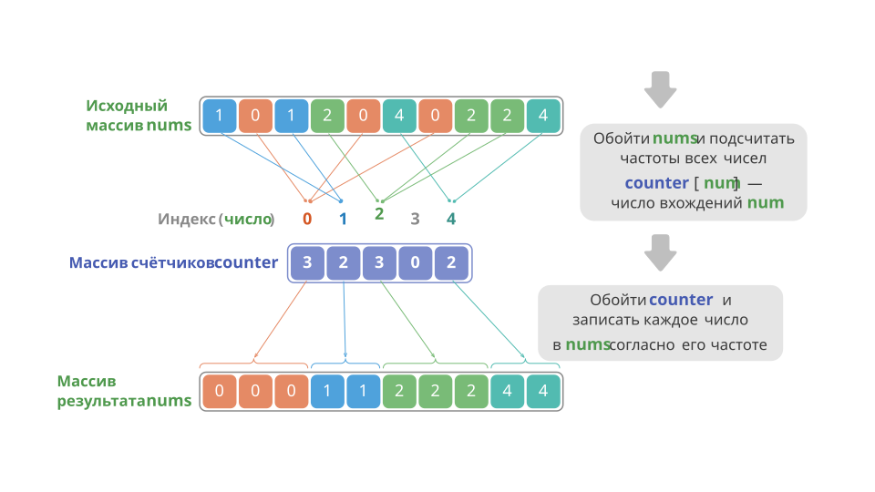
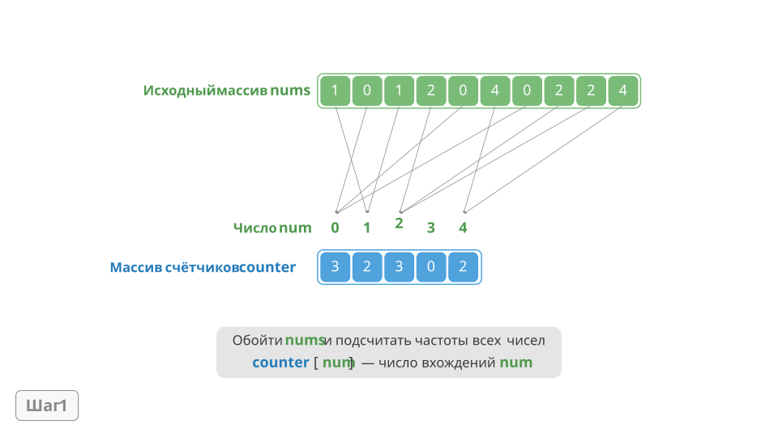
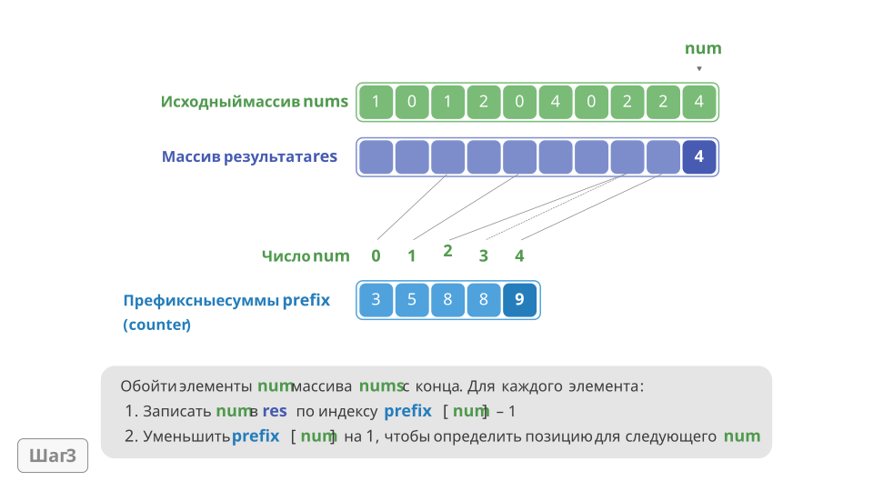
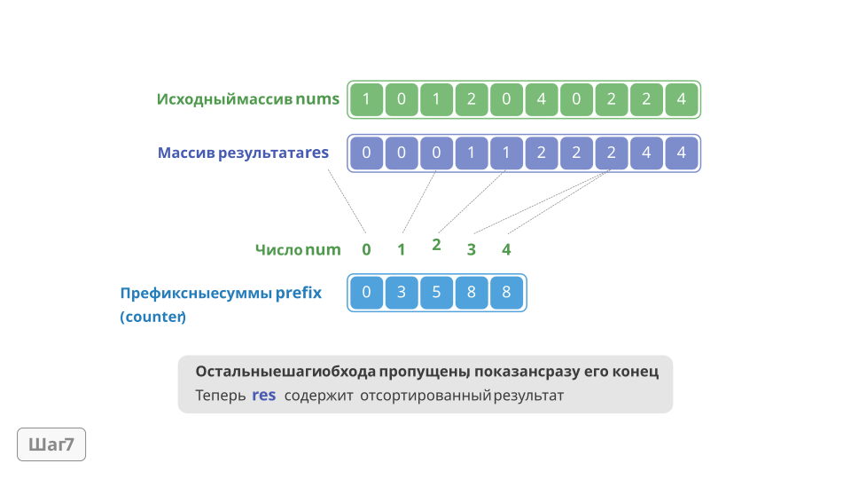
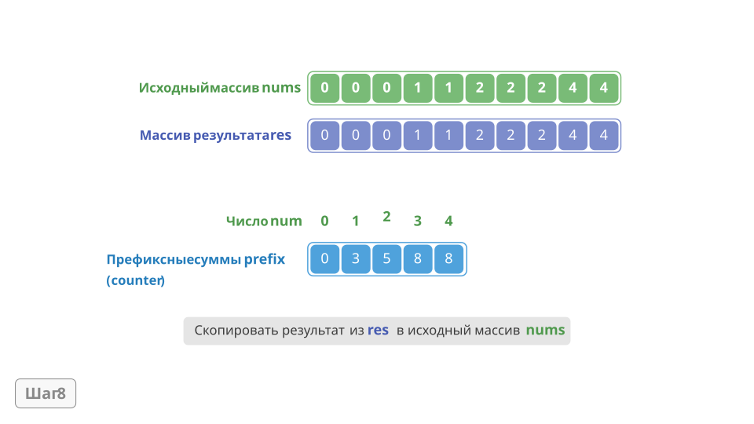

# 11.9 &nbsp; Сортировка подсчётом

<u>Сортировка подсчётом (counting sort)</u> упорядочивает элементы, подсчитывая их количество. Обычно её применяют к массивам целых чисел.

## 11.9.1 &nbsp; Простая реализация

Начнём с простого примера. Дан массив `nums` длины $n$, состоящий из неотрицательных целых чисел. На рисунке показан общий ход сортировки подсчётом.

1. Обойдём массив и найдём наибольшее число $m$. Затем создадим вспомогательный массив `counter` длины $m + 1$.
2. **С помощью `counter` подсчитаем число вхождений каждого значения из `nums`**. В `counter[num]` хранится число вхождений `num`. Для подсчёта достаточно пройти по `nums` и для каждого текущего числа `num` увеличить `counter[num]` на $1$.
3. **Индексы `counter` упорядочены по определению, так что числа уже расположены в нужном порядке**. Остаётся пройти по `counter` и записать числа по возрастанию в `nums`, повторяя каждое согласно его частоте.

{ class="animation-figure" }

<p align="center"> Рисунок 11-16 &nbsp; Ход сортировки подсчётом </p>

Код реализации:

=== "Python"

    ```python title="counting_sort.py"
    def counting_sort_naive(nums: list[int]):
        """Сортировка подсчётом"""
        # Простая реализация, непригодная для сортировки объектов
        # 1. Найти максимальный элемент m в массиве
        m = max(nums)
        # 2. Подсчитать число вхождений каждого значения
        # counter[num] — число вхождений num
        counter = [0] * (m + 1)
        for num in nums:
            counter[num] += 1
        # 3. Пройти по counter и записать элементы в исходный массив nums
        i = 0
        for num in range(m + 1):
            for _ in range(counter[num]):
                nums[i] = num
                i += 1
    ```

=== "C++"

    ```cpp title="counting_sort.cpp"
    /* Сортировка подсчётом */
    // Простая реализация, непригодная для сортировки объектов
    void countingSortNaive(vector<int> &nums) {
        // 1. Найти максимальный элемент m в массиве
        int m = 0;
        for (int num : nums) {
            m = max(m, num);
        }
        // 2. Подсчитать число вхождений каждого значения
        // counter[num] — число вхождений num
        vector<int> counter(m + 1, 0);
        for (int num : nums) {
            counter[num]++;
        }
        // 3. Пройти по counter и записать элементы в исходный массив nums
        int i = 0;
        for (int num = 0; num < m + 1; num++) {
            for (int j = 0; j < counter[num]; j++, i++) {
                nums[i] = num;
            }
        }
    }
    ```

=== "Java"

    ```java title="counting_sort.java"
    /* Сортировка подсчётом */
    // Простая реализация, непригодная для сортировки объектов
    void countingSortNaive(int[] nums) {
        // 1. Найти максимальный элемент m в массиве
        int m = 0;
        for (int num : nums) {
            m = Math.max(m, num);
        }
        // 2. Подсчитать число вхождений каждого значения
        // counter[num] — число вхождений num
        int[] counter = new int[m + 1];
        for (int num : nums) {
            counter[num]++;
        }
        // 3. Пройти по counter и записать элементы в исходный массив nums
        int i = 0;
        for (int num = 0; num < m + 1; num++) {
            for (int j = 0; j < counter[num]; j++, i++) {
                nums[i] = num;
            }
        }
    }
    ```

=== "C#"

    ```csharp title="counting_sort.cs"
    /* Сортировка подсчётом */
    // Простая реализация, непригодная для сортировки объектов
    void CountingSortNaive(int[] nums) {
        // 1. Найти максимальный элемент m в массиве
        int m = 0;
        foreach (int num in nums) {
            m = Math.Max(m, num);
        }
        // 2. Подсчитать число вхождений каждого значения
        // counter[num] — число вхождений num
        int[] counter = new int[m + 1];
        foreach (int num in nums) {
            counter[num]++;
        }
        // 3. Пройти по counter и записать элементы в исходный массив nums
        int i = 0;
        for (int num = 0; num < m + 1; num++) {
            for (int j = 0; j < counter[num]; j++, i++) {
                nums[i] = num;
            }
        }
    }
    ```

=== "Go"

    ```go title="counting_sort.go"
    /* Сортировка подсчётом */
    // Простая реализация, непригодная для сортировки объектов
    func countingSortNaive(nums []int) {
        // 1. Найти максимальный элемент m в массиве
        m := 0
        for _, num := range nums {
            if num > m {
                m = num
            }
        }
        // 2. Подсчитать число вхождений каждого значения
        // counter[num] — число вхождений num
        counter := make([]int, m+1)
        for _, num := range nums {
            counter[num]++
        }
        // 3. Пройти по counter и записать элементы в исходный массив nums
        for i, num := 0, 0; num < m+1; num++ {
            for j := 0; j < counter[num]; j++ {
                nums[i] = num
                i++
            }
        }
    }
    ```

=== "Swift"

    ```swift title="counting_sort.swift"
    /* Сортировка подсчётом */
    // Простая реализация, непригодная для сортировки объектов
    func countingSortNaive(nums: inout [Int]) {
        // 1. Найти максимальный элемент m в массиве
        let m = nums.max()!
        // 2. Подсчитать число вхождений каждого значения
        // counter[num] — число вхождений num
        var counter = Array(repeating: 0, count: m + 1)
        for num in nums {
            counter[num] += 1
        }
        // 3. Пройти по counter и записать элементы в исходный массив nums
        var i = 0
        for num in 0 ..< m + 1 {
            for _ in 0 ..< counter[num] {
                nums[i] = num
                i += 1
            }
        }
    }
    ```

=== "JS"

    ```javascript title="counting_sort.js"
    /* Сортировка подсчётом */
    // Простая реализация, непригодная для сортировки объектов
    function countingSortNaive(nums) {
        // 1. Найти максимальный элемент m в массиве
        let m = Math.max(...nums);
        // 2. Подсчитать число вхождений каждого значения
        // counter[num] — число вхождений num
        const counter = new Array(m + 1).fill(0);
        for (const num of nums) {
            counter[num]++;
        }
        // 3. Пройти по counter и записать элементы в исходный массив nums
        let i = 0;
        for (let num = 0; num < m + 1; num++) {
            for (let j = 0; j < counter[num]; j++, i++) {
                nums[i] = num;
            }
        }
    }
    ```

=== "TS"

    ```typescript title="counting_sort.ts"
    /* Сортировка подсчётом */
    // Простая реализация, непригодная для сортировки объектов
    function countingSortNaive(nums: number[]): void {
        // 1. Найти максимальный элемент m в массиве
        let m: number = Math.max(...nums);
        // 2. Подсчитать число вхождений каждого значения
        // counter[num] — число вхождений num
        const counter: number[] = new Array<number>(m + 1).fill(0);
        for (const num of nums) {
            counter[num]++;
        }
        // 3. Пройти по counter и записать элементы в исходный массив nums
        let i = 0;
        for (let num = 0; num < m + 1; num++) {
            for (let j = 0; j < counter[num]; j++, i++) {
                nums[i] = num;
            }
        }
    }
    ```

=== "Dart"

    ```dart title="counting_sort.dart"
    /* Сортировка подсчётом */
    // Простая реализация, непригодная для сортировки объектов
    void countingSortNaive(List<int> nums) {
      // 1. Найти максимальный элемент m в массиве
      int m = 0;
      for (int _num in nums) {
        m = max(m, _num);
      }
      // 2. Подсчитать число вхождений каждого значения
      // counter[_num] — число вхождений _num
      List<int> counter = List.filled(m + 1, 0);
      for (int _num in nums) {
        counter[_num]++;
      }
      // 3. Пройти по counter и записать элементы в исходный массив nums
      int i = 0;
      for (int _num = 0; _num < m + 1; _num++) {
        for (int j = 0; j < counter[_num]; j++, i++) {
          nums[i] = _num;
        }
      }
    }
    ```

=== "Rust"

    ```rust title="counting_sort.rs"
    /* Сортировка подсчётом */
    // Простая реализация, непригодная для сортировки объектов
    fn counting_sort_naive(nums: &mut [i32]) {
        // 1. Найти максимальный элемент m в массиве
        let m = *nums.iter().max().unwrap();
        // 2. Подсчитать число вхождений каждого значения
        // counter[num] — число вхождений num
        let mut counter = vec![0; m as usize + 1];
        for &num in nums.iter() {
            counter[num as usize] += 1;
        }
        // 3. Пройти по counter и записать элементы в исходный массив nums
        let mut i = 0;
        for num in 0..m + 1 {
            for _ in 0..counter[num as usize] {
                nums[i] = num;
                i += 1;
            }
        }
    }
    ```

=== "C"

    ```c title="counting_sort.c"
    /* Сортировка подсчётом */
    // Простая реализация, непригодная для сортировки объектов
    void countingSortNaive(int nums[], int size) {
        // 1. Найти максимальный элемент m в массиве
        int m = 0;
        for (int i = 0; i < size; i++) {
            if (nums[i] > m) {
                m = nums[i];
            }
        }
        // 2. Подсчитать число вхождений каждого значения
        // counter[num] — число вхождений num
        int *counter = calloc(m + 1, sizeof(int));
        for (int i = 0; i < size; i++) {
            counter[nums[i]]++;
        }
        // 3. Пройти по counter и записать элементы в исходный массив nums
        int i = 0;
        for (int num = 0; num < m + 1; num++) {
            for (int j = 0; j < counter[num]; j++, i++) {
                nums[i] = num;
            }
        }
        // 4. Освободить память
        free(counter);
    }
    ```

=== "Kotlin"

    ```kotlin title="counting_sort.kt"
    /* Сортировка подсчётом */
    // Простая реализация, непригодная для сортировки объектов
    fun countingSortNaive(nums: IntArray) {
        // 1. Найти максимальный элемент m в массиве
        var m = 0
        for (num in nums) {
            m = max(m, num)
        }
        // 2. Подсчитать число вхождений каждого значения
        // counter[num] — число вхождений num
        val counter = IntArray(m + 1)
        for (num in nums) {
            counter[num]++
        }
        // 3. Пройти по counter и записать элементы в исходный массив nums
        var i = 0
        for (num in 0..<m + 1) {
            var j = 0
            while (j < counter[num]) {
                nums[i] = num
                j++
                i++
            }
        }
    }
    ```

=== "Ruby"

    ```ruby title="counting_sort.rb"
    ### Сортировка подсчётом ###
    def counting_sort_naive(nums)
      # Простая реализация, непригодная для сортировки объектов
      # 1. Найти максимальный элемент m в массиве
      m = 0
      nums.each { |num| m = [m, num].max }
      # 2. Подсчитать число вхождений каждого значения
      # counter[num] — число вхождений num
      counter = Array.new(m + 1, 0)
      nums.each { |num| counter[num] += 1 }
      # 3. Пройти по counter и записать элементы в исходный массив nums
      i = 0
      for num in 0...(m + 1)
        (0...counter[num]).each do
          nums[i] = num
          i += 1
        end
      end
    end
    ```

??? pythontutor "Визуализация выполнения"

    <div style="height: 549px; width: 100%;"><iframe class="pythontutor-iframe" title="Визуализация выполнения" src="https://pythontutor.com/iframe-embed.html#code=def%20counting_sort_naive%28nums%3A%20list%5Bint%5D%29%3A%0A%20%20%20%20%22%22%22%D0%A1%D0%BE%D1%80%D1%82%D0%B8%D1%80%D0%BE%D0%B2%D0%BA%D0%B0%20%D0%BF%D0%BE%D0%B4%D1%81%D1%87%D1%91%D1%82%D0%BE%D0%BC%22%22%22%0A%20%20%20%20%23%20%D0%9F%D1%80%D0%BE%D1%81%D1%82%D0%B0%D1%8F%20%D1%80%D0%B5%D0%B0%D0%BB%D0%B8%D0%B7%D0%B0%D1%86%D0%B8%D1%8F,%20%D0%BD%D0%B5%D0%BF%D1%80%D0%B8%D0%B3%D0%BE%D0%B4%D0%BD%D0%B0%D1%8F%20%D0%B4%D0%BB%D1%8F%20%D1%81%D0%BE%D1%80%D1%82%D0%B8%D1%80%D0%BE%D0%B2%D0%BA%D0%B8%20%D0%BE%D0%B1%D1%8A%D0%B5%D0%BA%D1%82%D0%BE%D0%B2%0A%20%20%20%20%23%201.%20%D0%9D%D0%B0%D0%B9%D1%82%D0%B8%20%D0%BC%D0%B0%D0%BA%D1%81%D0%B8%D0%BC%D0%B0%D0%BB%D1%8C%D0%BD%D1%8B%D0%B9%20%D1%8D%D0%BB%D0%B5%D0%BC%D0%B5%D0%BD%D1%82%20m%20%D0%B2%20%D0%BC%D0%B0%D1%81%D1%81%D0%B8%D0%B2%D0%B5%0A%20%20%20%20m%20%3D%200%0A%20%20%20%20for%20num%20in%20nums%3A%0A%20%20%20%20%20%20%20%20m%20%3D%20max%28m,%20num%29%0A%20%20%20%20%23%202.%20%D0%9F%D0%BE%D0%B4%D1%81%D1%87%D0%B8%D1%82%D0%B0%D1%82%D1%8C%20%D1%87%D0%B8%D1%81%D0%BB%D0%BE%20%D0%B2%D1%85%D0%BE%D0%B6%D0%B4%D0%B5%D0%BD%D0%B8%D0%B9%20%D0%BA%D0%B0%D0%B6%D0%B4%D0%BE%D0%B3%D0%BE%20%D0%B7%D0%BD%D0%B0%D1%87%D0%B5%D0%BD%D0%B8%D1%8F%0A%20%20%20%20%23%20counter%5Bnum%5D%20%E2%80%94%20%D1%87%D0%B8%D1%81%D0%BB%D0%BE%20%D0%B2%D1%85%D0%BE%D0%B6%D0%B4%D0%B5%D0%BD%D0%B8%D0%B9%20num%0A%20%20%20%20counter%20%3D%20%5B0%5D%20%2A%20%28m%20%2B%201%29%0A%20%20%20%20for%20num%20in%20nums%3A%0A%20%20%20%20%20%20%20%20counter%5Bnum%5D%20%2B%3D%201%0A%20%20%20%20%23%203.%20%D0%9F%D1%80%D0%BE%D0%B9%D1%82%D0%B8%20%D0%BF%D0%BE%20counter%20%D0%B8%20%D0%B7%D0%B0%D0%BF%D0%B8%D1%81%D0%B0%D1%82%D1%8C%20%D1%8D%D0%BB%D0%B5%D0%BC%D0%B5%D0%BD%D1%82%D1%8B%20%D0%B2%20%D0%B8%D1%81%D1%85%D0%BE%D0%B4%D0%BD%D1%8B%D0%B9%20%D0%BC%D0%B0%D1%81%D1%81%D0%B8%D0%B2%20nums%0A%20%20%20%20i%20%3D%200%0A%20%20%20%20for%20num%20in%20range%28m%20%2B%201%29%3A%0A%20%20%20%20%20%20%20%20for%20_%20in%20range%28counter%5Bnum%5D%29%3A%0A%20%20%20%20%20%20%20%20%20%20%20%20nums%5Bi%5D%20%3D%20num%0A%20%20%20%20%20%20%20%20%20%20%20%20i%20%2B%3D%201%0A%0A%22%22%22Driver%20Code%22%22%22%0Aif%20__name__%20%3D%3D%20%22__main__%22%3A%0A%20%20%20%20nums%20%3D%20%5B1,%200,%201,%202,%200,%204,%200,%202,%202,%204%5D%0A%20%20%20%20counting_sort_naive%28nums%29%0A%20%20%20%20print%28f%22%D0%9F%D0%BE%D1%81%D0%BB%D0%B5%20%D1%81%D0%BE%D1%80%D1%82%D0%B8%D1%80%D0%BE%D0%B2%D0%BA%D0%B8%20%D0%BF%D0%BE%D0%B4%D1%81%D1%87%D1%91%D1%82%D0%BE%D0%BC%20%28%D0%B1%D0%B5%D0%B7%20%D0%BF%D0%BE%D0%B4%D0%B4%D0%B5%D1%80%D0%B6%D0%BA%D0%B8%20%D0%BE%D0%B1%D1%8A%D0%B5%D0%BA%D1%82%D0%BE%D0%B2%29%20nums%20%3D%20%7Bnums%7D%22%29&codeDivHeight=472&codeDivWidth=350&cumulative=false&curInstr=4&heapPrimitives=nevernest&origin=opt-frontend.js&py=311&rawInputLstJSON=%5B%5D&textReferences=false"> </iframe></div>
    <div style="margin-top: 5px;"><a href="https://pythontutor.com/iframe-embed.html#code=def%20counting_sort_naive%28nums%3A%20list%5Bint%5D%29%3A%0A%20%20%20%20%22%22%22%D0%A1%D0%BE%D1%80%D1%82%D0%B8%D1%80%D0%BE%D0%B2%D0%BA%D0%B0%20%D0%BF%D0%BE%D0%B4%D1%81%D1%87%D1%91%D1%82%D0%BE%D0%BC%22%22%22%0A%20%20%20%20%23%20%D0%9F%D1%80%D0%BE%D1%81%D1%82%D0%B0%D1%8F%20%D1%80%D0%B5%D0%B0%D0%BB%D0%B8%D0%B7%D0%B0%D1%86%D0%B8%D1%8F,%20%D0%BD%D0%B5%D0%BF%D1%80%D0%B8%D0%B3%D0%BE%D0%B4%D0%BD%D0%B0%D1%8F%20%D0%B4%D0%BB%D1%8F%20%D1%81%D0%BE%D1%80%D1%82%D0%B8%D1%80%D0%BE%D0%B2%D0%BA%D0%B8%20%D0%BE%D0%B1%D1%8A%D0%B5%D0%BA%D1%82%D0%BE%D0%B2%0A%20%20%20%20%23%201.%20%D0%9D%D0%B0%D0%B9%D1%82%D0%B8%20%D0%BC%D0%B0%D0%BA%D1%81%D0%B8%D0%BC%D0%B0%D0%BB%D1%8C%D0%BD%D1%8B%D0%B9%20%D1%8D%D0%BB%D0%B5%D0%BC%D0%B5%D0%BD%D1%82%20m%20%D0%B2%20%D0%BC%D0%B0%D1%81%D1%81%D0%B8%D0%B2%D0%B5%0A%20%20%20%20m%20%3D%200%0A%20%20%20%20for%20num%20in%20nums%3A%0A%20%20%20%20%20%20%20%20m%20%3D%20max%28m,%20num%29%0A%20%20%20%20%23%202.%20%D0%9F%D0%BE%D0%B4%D1%81%D1%87%D0%B8%D1%82%D0%B0%D1%82%D1%8C%20%D1%87%D0%B8%D1%81%D0%BB%D0%BE%20%D0%B2%D1%85%D0%BE%D0%B6%D0%B4%D0%B5%D0%BD%D0%B8%D0%B9%20%D0%BA%D0%B0%D0%B6%D0%B4%D0%BE%D0%B3%D0%BE%20%D0%B7%D0%BD%D0%B0%D1%87%D0%B5%D0%BD%D0%B8%D1%8F%0A%20%20%20%20%23%20counter%5Bnum%5D%20%E2%80%94%20%D1%87%D0%B8%D1%81%D0%BB%D0%BE%20%D0%B2%D1%85%D0%BE%D0%B6%D0%B4%D0%B5%D0%BD%D0%B8%D0%B9%20num%0A%20%20%20%20counter%20%3D%20%5B0%5D%20%2A%20%28m%20%2B%201%29%0A%20%20%20%20for%20num%20in%20nums%3A%0A%20%20%20%20%20%20%20%20counter%5Bnum%5D%20%2B%3D%201%0A%20%20%20%20%23%203.%20%D0%9F%D1%80%D0%BE%D0%B9%D1%82%D0%B8%20%D0%BF%D0%BE%20counter%20%D0%B8%20%D0%B7%D0%B0%D0%BF%D0%B8%D1%81%D0%B0%D1%82%D1%8C%20%D1%8D%D0%BB%D0%B5%D0%BC%D0%B5%D0%BD%D1%82%D1%8B%20%D0%B2%20%D0%B8%D1%81%D1%85%D0%BE%D0%B4%D0%BD%D1%8B%D0%B9%20%D0%BC%D0%B0%D1%81%D1%81%D0%B8%D0%B2%20nums%0A%20%20%20%20i%20%3D%200%0A%20%20%20%20for%20num%20in%20range%28m%20%2B%201%29%3A%0A%20%20%20%20%20%20%20%20for%20_%20in%20range%28counter%5Bnum%5D%29%3A%0A%20%20%20%20%20%20%20%20%20%20%20%20nums%5Bi%5D%20%3D%20num%0A%20%20%20%20%20%20%20%20%20%20%20%20i%20%2B%3D%201%0A%0A%22%22%22Driver%20Code%22%22%22%0Aif%20__name__%20%3D%3D%20%22__main__%22%3A%0A%20%20%20%20nums%20%3D%20%5B1,%200,%201,%202,%200,%204,%200,%202,%202,%204%5D%0A%20%20%20%20counting_sort_naive%28nums%29%0A%20%20%20%20print%28f%22%D0%9F%D0%BE%D1%81%D0%BB%D0%B5%20%D1%81%D0%BE%D1%80%D1%82%D0%B8%D1%80%D0%BE%D0%B2%D0%BA%D0%B8%20%D0%BF%D0%BE%D0%B4%D1%81%D1%87%D1%91%D1%82%D0%BE%D0%BC%20%28%D0%B1%D0%B5%D0%B7%20%D0%BF%D0%BE%D0%B4%D0%B4%D0%B5%D1%80%D0%B6%D0%BA%D0%B8%20%D0%BE%D0%B1%D1%8A%D0%B5%D0%BA%D1%82%D0%BE%D0%B2%29%20nums%20%3D%20%7Bnums%7D%22%29&codeDivHeight=800&codeDivWidth=600&cumulative=false&curInstr=4&heapPrimitives=nevernest&origin=opt-frontend.js&py=311&rawInputLstJSON=%5B%5D&textReferences=false" target="_blank" rel="noopener noreferrer">Во весь экран ></a></div>

!!! note "Связь сортировки подсчётом с блочной сортировкой"

    С точки зрения блочной сортировки каждому индексу массива счётчиков `counter` соответствует свой блок, а подсчёт вхождений равносилен распределению элементов по блокам. По сути, сортировка подсчётом — частный случай блочной сортировки для целых чисел.

## 11.9.2 &nbsp; Полная реализация

Внимательный читатель мог заметить, что **для входных данных в виде объектов шаг `3.` уже не работает**. Пусть объекты — товары и мы хотим упорядочить их по цене, которая хранится в поле класса. Описанный алгоритм выдаст только отсортированные цены.

Как получить отсортированные исходные объекты? Сначала вычислим префиксные суммы массива `counter`. Как следует из названия, префиксная сумма `prefix[i]` по индексу `i` равна сумме первых `i + 1` элементов массива:

$$
\text{prefix}[i] = \sum_{j=0}^i \text{counter[j]}
$$

**Префиксная сумма имеет конкретный смысл: `prefix[num] - 1` — индекс последнего вхождения элемента `num` в массив результата `res`**. Так мы узнаём, куда поместить каждый элемент. Теперь обойдём исходный массив `nums` в обратном порядке, для каждого элемента `num` выполняя два шага.

1. Записать `num` в массив `res` по индексу `prefix[num] - 1`.
2. Уменьшить префиксную сумму `prefix[num]` на $1$, чтобы определить индекс следующего вхождения `num`.

После обхода в массиве `res` будет отсортированный результат. Остаётся скопировать `res` поверх исходного массива `nums`. На рисунке показан полный ход сортировки подсчётом.

=== "<1>"
    { class="animation-figure" }

=== "<2>"
    { class="animation-figure" }

=== "<3>"
    { class="animation-figure" }

=== "<4>"
    { class="animation-figure" }

=== "<5>"
    { class="animation-figure" }

=== "<6>"
    { class="animation-figure" }

=== "<7>"
    { class="animation-figure" }

=== "<8>"
    { class="animation-figure" }

<p align="center"> Рисунок 11-17 &nbsp; Шаги сортировки подсчётом </p>

Реализация сортировки подсчётом:

=== "Python"

    ```python title="counting_sort.py"
    def counting_sort(nums: list[int]):
        """Сортировка подсчётом"""
        # Полная реализация: устойчивая сортировка с поддержкой объектов
        # 1. Найти максимальный элемент m в массиве
        m = max(nums)
        # 2. Подсчитать число вхождений каждого значения
        # counter[num] — число вхождений num
        counter = [0] * (m + 1)
        for num in nums:
            counter[num] += 1
        # 3. Вычислить префиксные суммы в counter, чтобы по частотам найти конечные позиции
        # То есть counter[num]-1 — индекс последнего вхождения num в res
        for i in range(m):
            counter[i + 1] += counter[i]
        # 4. Пройти по nums в обратном порядке и записать элементы в массив результата res
        # Создать массив res для результата
        n = len(nums)
        res = [0] * n
        for i in range(n - 1, -1, -1):
            num = nums[i]
            res[counter[num] - 1] = num  # Поместить num по соответствующему индексу
            counter[num] -= 1  # Уменьшить префиксную сумму на 1, чтобы определить позицию следующего вхождения num
        # Скопировать результат из res в исходный массив nums
        for i in range(n):
            nums[i] = res[i]
    ```

=== "C++"

    ```cpp title="counting_sort.cpp"
    /* Сортировка подсчётом */
    // Полная реализация: устойчивая сортировка с поддержкой объектов
    void countingSort(vector<int> &nums) {
        // 1. Найти максимальный элемент m в массиве
        int m = 0;
        for (int num : nums) {
            m = max(m, num);
        }
        // 2. Подсчитать число вхождений каждого значения
        // counter[num] — число вхождений num
        vector<int> counter(m + 1, 0);
        for (int num : nums) {
            counter[num]++;
        }
        // 3. Вычислить префиксные суммы в counter, чтобы по частотам найти конечные позиции
        // То есть counter[num]-1 — индекс последнего вхождения num в res
        for (int i = 0; i < m; i++) {
            counter[i + 1] += counter[i];
        }
        // 4. Пройти по nums в обратном порядке и записать элементы в массив результата res
        // Создать массив res для результата
        int n = nums.size();
        vector<int> res(n);
        for (int i = n - 1; i >= 0; i--) {
            int num = nums[i];
            res[counter[num] - 1] = num; // Поместить num по соответствующему индексу
            counter[num]--;              // Уменьшить префиксную сумму на 1, чтобы определить позицию следующего вхождения num
        }
        // Скопировать результат из res в исходный массив nums
        nums = res;
    }
    ```

=== "Java"

    ```java title="counting_sort.java"
    /* Сортировка подсчётом */
    // Полная реализация: устойчивая сортировка с поддержкой объектов
    void countingSort(int[] nums) {
        // 1. Найти максимальный элемент m в массиве
        int m = 0;
        for (int num : nums) {
            m = Math.max(m, num);
        }
        // 2. Подсчитать число вхождений каждого значения
        // counter[num] — число вхождений num
        int[] counter = new int[m + 1];
        for (int num : nums) {
            counter[num]++;
        }
        // 3. Вычислить префиксные суммы в counter, чтобы по частотам найти конечные позиции
        // То есть counter[num]-1 — индекс последнего вхождения num в res
        for (int i = 0; i < m; i++) {
            counter[i + 1] += counter[i];
        }
        // 4. Пройти по nums в обратном порядке и записать элементы в массив результата res
        // Создать массив res для результата
        int n = nums.length;
        int[] res = new int[n];
        for (int i = n - 1; i >= 0; i--) {
            int num = nums[i];
            res[counter[num] - 1] = num; // Поместить num по соответствующему индексу
            counter[num]--; // Уменьшить префиксную сумму на 1, чтобы определить позицию следующего вхождения num
        }
        // Скопировать результат из res в исходный массив nums
        for (int i = 0; i < n; i++) {
            nums[i] = res[i];
        }
    }
    ```

=== "C#"

    ```csharp title="counting_sort.cs"
    /* Сортировка подсчётом */
    // Полная реализация: устойчивая сортировка с поддержкой объектов
    void CountingSort(int[] nums) {
        // 1. Найти максимальный элемент m в массиве
        int m = 0;
        foreach (int num in nums) {
            m = Math.Max(m, num);
        }
        // 2. Подсчитать число вхождений каждого значения
        // counter[num] — число вхождений num
        int[] counter = new int[m + 1];
        foreach (int num in nums) {
            counter[num]++;
        }
        // 3. Вычислить префиксные суммы в counter, чтобы по частотам найти конечные позиции
        // То есть counter[num]-1 — индекс последнего вхождения num в res
        for (int i = 0; i < m; i++) {
            counter[i + 1] += counter[i];
        }
        // 4. Пройти по nums в обратном порядке и записать элементы в массив результата res
        // Создать массив res для результата
        int n = nums.Length;
        int[] res = new int[n];
        for (int i = n - 1; i >= 0; i--) {
            int num = nums[i];
            res[counter[num] - 1] = num; // Поместить num по соответствующему индексу
            counter[num]--; // Уменьшить префиксную сумму на 1, чтобы определить позицию следующего вхождения num
        }
        // Скопировать результат из res в исходный массив nums
        for (int i = 0; i < n; i++) {
            nums[i] = res[i];
        }
    }
    ```

=== "Go"

    ```go title="counting_sort.go"
    /* Сортировка подсчётом */
    // Полная реализация: устойчивая сортировка с поддержкой объектов
    func countingSort(nums []int) {
        // 1. Найти максимальный элемент m в массиве
        m := 0
        for _, num := range nums {
            if num > m {
                m = num
            }
        }
        // 2. Подсчитать число вхождений каждого значения
        // counter[num] — число вхождений num
        counter := make([]int, m+1)
        for _, num := range nums {
            counter[num]++
        }
        // 3. Вычислить префиксные суммы в counter, чтобы по частотам найти конечные позиции
        // То есть counter[num]-1 — индекс последнего вхождения num в res
        for i := 0; i < m; i++ {
            counter[i+1] += counter[i]
        }
        // 4. Пройти по nums в обратном порядке и записать элементы в массив результата res
        // Создать массив res для результата
        n := len(nums)
        res := make([]int, n)
        for i := n - 1; i >= 0; i-- {
            num := nums[i]
            // Поместить num по соответствующему индексу
            res[counter[num]-1] = num
            // Уменьшить префиксную сумму на 1, чтобы определить позицию следующего вхождения num
            counter[num]--
        }
        // Скопировать результат из res в исходный массив nums
        copy(nums, res)
    }
    ```

=== "Swift"

    ```swift title="counting_sort.swift"
    /* Сортировка подсчётом */
    // Полная реализация: устойчивая сортировка с поддержкой объектов
    func countingSort(nums: inout [Int]) {
        // 1. Найти максимальный элемент m в массиве
        let m = nums.max()!
        // 2. Подсчитать число вхождений каждого значения
        // counter[num] — число вхождений num
        var counter = Array(repeating: 0, count: m + 1)
        for num in nums {
            counter[num] += 1
        }
        // 3. Вычислить префиксные суммы в counter, чтобы по частотам найти конечные позиции
        // То есть counter[num]-1 — индекс последнего вхождения num в res
        for i in 0 ..< m {
            counter[i + 1] += counter[i]
        }
        // 4. Пройти по nums в обратном порядке и записать элементы в массив результата res
        // Создать массив res для результата
        var res = Array(repeating: 0, count: nums.count)
        for i in nums.indices.reversed() {
            let num = nums[i]
            res[counter[num] - 1] = num // Поместить num по соответствующему индексу
            counter[num] -= 1 // Уменьшить префиксную сумму на 1, чтобы определить позицию следующего вхождения num
        }
        // Скопировать результат из res в исходный массив nums
        for i in nums.indices {
            nums[i] = res[i]
        }
    }
    ```

=== "JS"

    ```javascript title="counting_sort.js"
    /* Сортировка подсчётом */
    // Полная реализация: устойчивая сортировка с поддержкой объектов
    function countingSort(nums) {
        // 1. Найти максимальный элемент m в массиве
        let m = Math.max(...nums);
        // 2. Подсчитать число вхождений каждого значения
        // counter[num] — число вхождений num
        const counter = new Array(m + 1).fill(0);
        for (const num of nums) {
            counter[num]++;
        }
        // 3. Вычислить префиксные суммы в counter, чтобы по частотам найти конечные позиции
        // То есть counter[num]-1 — индекс последнего вхождения num в res
        for (let i = 0; i < m; i++) {
            counter[i + 1] += counter[i];
        }
        // 4. Пройти по nums в обратном порядке и записать элементы в массив результата res
        // Создать массив res для результата
        const n = nums.length;
        const res = new Array(n);
        for (let i = n - 1; i >= 0; i--) {
            const num = nums[i];
            res[counter[num] - 1] = num; // Поместить num по соответствующему индексу
            counter[num]--; // Уменьшить префиксную сумму на 1, чтобы определить позицию следующего вхождения num
        }
        // Скопировать результат из res в исходный массив nums
        for (let i = 0; i < n; i++) {
            nums[i] = res[i];
        }
    }
    ```

=== "TS"

    ```typescript title="counting_sort.ts"
    /* Сортировка подсчётом */
    // Полная реализация: устойчивая сортировка с поддержкой объектов
    function countingSort(nums: number[]): void {
        // 1. Найти максимальный элемент m в массиве
        let m: number = Math.max(...nums);
        // 2. Подсчитать число вхождений каждого значения
        // counter[num] — число вхождений num
        const counter: number[] = new Array<number>(m + 1).fill(0);
        for (const num of nums) {
            counter[num]++;
        }
        // 3. Вычислить префиксные суммы в counter, чтобы по частотам найти конечные позиции
        // То есть counter[num]-1 — индекс последнего вхождения num в res
        for (let i = 0; i < m; i++) {
            counter[i + 1] += counter[i];
        }
        // 4. Пройти по nums в обратном порядке и записать элементы в массив результата res
        // Создать массив res для результата
        const n = nums.length;
        const res: number[] = new Array<number>(n);
        for (let i = n - 1; i >= 0; i--) {
            const num = nums[i];
            res[counter[num] - 1] = num; // Поместить num по соответствующему индексу
            counter[num]--; // Уменьшить префиксную сумму на 1, чтобы определить позицию следующего вхождения num
        }
        // Скопировать результат из res в исходный массив nums
        for (let i = 0; i < n; i++) {
            nums[i] = res[i];
        }
    }
    ```

=== "Dart"

    ```dart title="counting_sort.dart"
    /* Сортировка подсчётом */
    // Полная реализация: устойчивая сортировка с поддержкой объектов
    void countingSort(List<int> nums) {
      // 1. Найти максимальный элемент m в массиве
      int m = 0;
      for (int _num in nums) {
        m = max(m, _num);
      }
      // 2. Подсчитать число вхождений каждого значения
      // counter[_num] — число вхождений _num
      List<int> counter = List.filled(m + 1, 0);
      for (int _num in nums) {
        counter[_num]++;
      }
      // 3. Вычислить префиксные суммы в counter, чтобы по частотам найти конечные позиции
      // То есть counter[_num]-1 — индекс последнего вхождения _num в res
      for (int i = 0; i < m; i++) {
        counter[i + 1] += counter[i];
      }
      // 4. Пройти по nums в обратном порядке и записать элементы в массив результата res
      // Создать массив res для результата
      int n = nums.length;
      List<int> res = List.filled(n, 0);
      for (int i = n - 1; i >= 0; i--) {
        int _num = nums[i];
        res[counter[_num] - 1] = _num; // Поместить _num по соответствующему индексу
        counter[_num]--; // Уменьшить префиксную сумму на 1, чтобы определить позицию для следующего _num
      }
      // Скопировать результат из res в исходный массив nums
      nums.setAll(0, res);
    }
    ```

=== "Rust"

    ```rust title="counting_sort.rs"
    /* Сортировка подсчётом */
    // Полная реализация: устойчивая сортировка с поддержкой объектов
    fn counting_sort(nums: &mut [i32]) {
        // 1. Найти максимальный элемент m в массиве
        let m = *nums.iter().max().unwrap() as usize;
        // 2. Подсчитать число вхождений каждого значения
        // counter[num] — число вхождений num
        let mut counter = vec![0; m + 1];
        for &num in nums.iter() {
            counter[num as usize] += 1;
        }
        // 3. Вычислить префиксные суммы в counter, чтобы по частотам найти конечные позиции
        // То есть counter[num]-1 — индекс последнего вхождения num в res
        for i in 0..m {
            counter[i + 1] += counter[i];
        }
        // 4. Пройти по nums в обратном порядке и записать элементы в массив результата res
        // Создать массив res для результата
        let n = nums.len();
        let mut res = vec![0; n];
        for i in (0..n).rev() {
            let num = nums[i];
            res[counter[num as usize] - 1] = num; // Поместить num по соответствующему индексу
            counter[num as usize] -= 1; // Уменьшить префиксную сумму на 1, чтобы определить позицию следующего вхождения num
        }
        // Скопировать результат из res в исходный массив nums
        nums.copy_from_slice(&res)
    }
    ```

=== "C"

    ```c title="counting_sort.c"
    /* Сортировка подсчётом */
    // Полная реализация: устойчивая сортировка с поддержкой объектов
    void countingSort(int nums[], int size) {
        // 1. Найти максимальный элемент m в массиве
        int m = 0;
        for (int i = 0; i < size; i++) {
            if (nums[i] > m) {
                m = nums[i];
            }
        }
        // 2. Подсчитать число вхождений каждого значения
        // counter[num] — число вхождений num
        int *counter = calloc(m + 1, sizeof(int));
        for (int i = 0; i < size; i++) {
            counter[nums[i]]++;
        }
        // 3. Вычислить префиксные суммы в counter, чтобы по частотам найти конечные позиции
        // То есть counter[num]-1 — индекс последнего вхождения num в res
        for (int i = 0; i < m; i++) {
            counter[i + 1] += counter[i];
        }
        // 4. Пройти по nums в обратном порядке и записать элементы в массив результата res
        // Создать массив res для результата
        int *res = malloc(sizeof(int) * size);
        for (int i = size - 1; i >= 0; i--) {
            int num = nums[i];
            res[counter[num] - 1] = num; // Поместить num по соответствующему индексу
            counter[num]--;              // Уменьшить префиксную сумму на 1, чтобы определить позицию следующего вхождения num
        }
        // Скопировать результат из res в исходный массив nums
        memcpy(nums, res, size * sizeof(int));
        // 5. Освободить память
        free(res);
        free(counter);
    }
    ```

=== "Kotlin"

    ```kotlin title="counting_sort.kt"
    /* Сортировка подсчётом */
    // Полная реализация: устойчивая сортировка с поддержкой объектов
    fun countingSort(nums: IntArray) {
        // 1. Найти максимальный элемент m в массиве
        var m = 0
        for (num in nums) {
            m = max(m, num)
        }
        // 2. Подсчитать число вхождений каждого значения
        // counter[num] — число вхождений num
        val counter = IntArray(m + 1)
        for (num in nums) {
            counter[num]++
        }
        // 3. Вычислить префиксные суммы в counter, чтобы по частотам найти конечные позиции
        // То есть counter[num]-1 — индекс последнего вхождения num в res
        for (i in 0..<m) {
            counter[i + 1] += counter[i]
        }
        // 4. Пройти по nums в обратном порядке и записать элементы в массив результата res
        // Создать массив res для результата
        val n = nums.size
        val res = IntArray(n)
        for (i in n - 1 downTo 0) {
            val num = nums[i]
            res[counter[num] - 1] = num // Поместить num по соответствующему индексу
            counter[num]-- // Уменьшить префиксную сумму на 1, чтобы определить позицию следующего вхождения num
        }
        // Скопировать результат из res в исходный массив nums
        for (i in 0..<n) {
            nums[i] = res[i]
        }
    }
    ```

=== "Ruby"

    ```ruby title="counting_sort.rb"
    ### Сортировка подсчётом ###
    def counting_sort(nums)
      # Полная реализация: устойчивая сортировка с поддержкой объектов
      # 1. Найти максимальный элемент m в массиве
      m = nums.max
      # 2. Подсчитать число вхождений каждого значения
      # counter[num] — число вхождений num
      counter = Array.new(m + 1, 0)
      nums.each { |num| counter[num] += 1 }
      # 3. Вычислить префиксные суммы в counter, чтобы по частотам найти конечные позиции
      # То есть counter[num]-1 — индекс последнего вхождения num в res
      (0...m).each { |i| counter[i + 1] += counter[i] }
      # 4. Пройти по nums в обратном порядке и записать элементы в массив результата res
      # Создать массив res для результата
      n = nums.length
      res = Array.new(n, 0)
      (n - 1).downto(0).each do |i|
        num = nums[i]
        res[counter[num] - 1] = num # Поместить num по соответствующему индексу
        counter[num] -= 1 # Уменьшить префиксную сумму на 1, чтобы определить позицию следующего вхождения num
      end
      # Скопировать результат из res в исходный массив nums
      (0...n).each { |i| nums[i] = res[i] }
    end
    ```

??? pythontutor "Визуализация выполнения"

    <div style="height: 549px; width: 100%;"><iframe class="pythontutor-iframe" title="Визуализация выполнения" src="https://pythontutor.com/iframe-embed.html#code=def%20counting_sort%28nums%3A%20list%5Bint%5D%29%3A%0A%20%20%20%20%22%22%22%D0%A1%D0%BE%D1%80%D1%82%D0%B8%D1%80%D0%BE%D0%B2%D0%BA%D0%B0%20%D0%BF%D0%BE%D0%B4%D1%81%D1%87%D1%91%D1%82%D0%BE%D0%BC%22%22%22%0A%20%20%20%20%23%20%D0%9F%D0%BE%D0%BB%D0%BD%D0%B0%D1%8F%20%D1%80%D0%B5%D0%B0%D0%BB%D0%B8%D0%B7%D0%B0%D1%86%D0%B8%D1%8F%3A%20%D1%83%D1%81%D1%82%D0%BE%D0%B9%D1%87%D0%B8%D0%B2%D0%B0%D1%8F%20%D1%81%D0%BE%D1%80%D1%82%D0%B8%D1%80%D0%BE%D0%B2%D0%BA%D0%B0%20%D1%81%20%D0%BF%D0%BE%D0%B4%D0%B4%D0%B5%D1%80%D0%B6%D0%BA%D0%BE%D0%B9%20%D0%BE%D0%B1%D1%8A%D0%B5%D0%BA%D1%82%D0%BE%D0%B2%0A%20%20%20%20%23%201.%20%D0%9D%D0%B0%D0%B9%D1%82%D0%B8%20%D0%BC%D0%B0%D0%BA%D1%81%D0%B8%D0%BC%D0%B0%D0%BB%D1%8C%D0%BD%D1%8B%D0%B9%20%D1%8D%D0%BB%D0%B5%D0%BC%D0%B5%D0%BD%D1%82%20m%20%D0%B2%20%D0%BC%D0%B0%D1%81%D1%81%D0%B8%D0%B2%D0%B5%0A%20%20%20%20m%20%3D%20max%28nums%29%0A%20%20%20%20%23%202.%20%D0%9F%D0%BE%D0%B4%D1%81%D1%87%D0%B8%D1%82%D0%B0%D1%82%D1%8C%20%D1%87%D0%B8%D1%81%D0%BB%D0%BE%20%D0%B2%D1%85%D0%BE%D0%B6%D0%B4%D0%B5%D0%BD%D0%B8%D0%B9%20%D0%BA%D0%B0%D0%B6%D0%B4%D0%BE%D0%B3%D0%BE%20%D0%B7%D0%BD%D0%B0%D1%87%D0%B5%D0%BD%D0%B8%D1%8F%0A%20%20%20%20%23%20counter%5Bnum%5D%20%E2%80%94%20%D1%87%D0%B8%D1%81%D0%BB%D0%BE%20%D0%B2%D1%85%D0%BE%D0%B6%D0%B4%D0%B5%D0%BD%D0%B8%D0%B9%20num%0A%20%20%20%20counter%20%3D%20%5B0%5D%20%2A%20%28m%20%2B%201%29%0A%20%20%20%20for%20num%20in%20nums%3A%0A%20%20%20%20%20%20%20%20counter%5Bnum%5D%20%2B%3D%201%0A%20%20%20%20%23%203.%20%D0%92%D1%8B%D1%87%D0%B8%D1%81%D0%BB%D0%B8%D1%82%D1%8C%20%D0%BF%D1%80%D0%B5%D1%84%D0%B8%D0%BA%D1%81%D0%BD%D1%8B%D0%B5%20%D1%81%D1%83%D0%BC%D0%BC%D1%8B%20%D0%B2%20counter,%20%D1%87%D1%82%D0%BE%D0%B1%D1%8B%20%D0%BF%D0%BE%20%D1%87%D0%B0%D1%81%D1%82%D0%BE%D1%82%D0%B0%D0%BC%20%D0%BD%D0%B0%D0%B9%D1%82%D0%B8%20%D0%BA%D0%BE%D0%BD%D0%B5%D1%87%D0%BD%D1%8B%D0%B5%20%D0%BF%D0%BE%D0%B7%D0%B8%D1%86%D0%B8%D0%B8%0A%20%20%20%20%23%20%D0%A2%D0%BE%20%D0%B5%D1%81%D1%82%D1%8C%20counter%5Bnum%5D-1%20%E2%80%94%20%D0%B8%D0%BD%D0%B4%D0%B5%D0%BA%D1%81%20%D0%BF%D0%BE%D1%81%D0%BB%D0%B5%D0%B4%D0%BD%D0%B5%D0%B3%D0%BE%20%D0%B2%D1%85%D0%BE%D0%B6%D0%B4%D0%B5%D0%BD%D0%B8%D1%8F%20num%20%D0%B2%20res%0A%20%20%20%20for%20i%20in%20range%28m%29%3A%0A%20%20%20%20%20%20%20%20counter%5Bi%20%2B%201%5D%20%2B%3D%20counter%5Bi%5D%0A%20%20%20%20%23%204.%20%D0%9F%D1%80%D0%BE%D0%B9%D1%82%D0%B8%20%D0%BF%D0%BE%20nums%20%D0%B2%20%D0%BE%D0%B1%D1%80%D0%B0%D1%82%D0%BD%D0%BE%D0%BC%20%D0%BF%D0%BE%D1%80%D1%8F%D0%B4%D0%BA%D0%B5%20%D0%B8%20%D0%B7%D0%B0%D0%BF%D0%B8%D1%81%D0%B0%D1%82%D1%8C%20%D1%8D%D0%BB%D0%B5%D0%BC%D0%B5%D0%BD%D1%82%D1%8B%20%D0%B2%20%D0%BC%D0%B0%D1%81%D1%81%D0%B8%D0%B2%20%D1%80%D0%B5%D0%B7%D1%83%D0%BB%D1%8C%D1%82%D0%B0%D1%82%D0%B0%20res%0A%20%20%20%20%23%20%D0%A1%D0%BE%D0%B7%D0%B4%D0%B0%D1%82%D1%8C%20%D0%BC%D0%B0%D1%81%D1%81%D0%B8%D0%B2%20res%20%D0%B4%D0%BB%D1%8F%20%D1%80%D0%B5%D0%B7%D1%83%D0%BB%D1%8C%D1%82%D0%B0%D1%82%D0%B0%0A%20%20%20%20n%20%3D%20len%28nums%29%0A%20%20%20%20res%20%3D%20%5B0%5D%20%2A%20n%0A%20%20%20%20for%20i%20in%20range%28n%20-%201,%20-1,%20-1%29%3A%0A%20%20%20%20%20%20%20%20num%20%3D%20nums%5Bi%5D%0A%20%20%20%20%20%20%20%20res%5Bcounter%5Bnum%5D%20-%201%5D%20%3D%20num%20%20%23%20%D0%9F%D0%BE%D0%BC%D0%B5%D1%81%D1%82%D0%B8%D1%82%D1%8C%20num%20%D0%BF%D0%BE%20%D1%81%D0%BE%D0%BE%D1%82%D0%B2%D0%B5%D1%82%D1%81%D1%82%D0%B2%D1%83%D1%8E%D1%89%D0%B5%D0%BC%D1%83%20%D0%B8%D0%BD%D0%B4%D0%B5%D0%BA%D1%81%D1%83%0A%20%20%20%20%20%20%20%20counter%5Bnum%5D%20-%3D%201%20%20%23%20%D0%A3%D0%BC%D0%B5%D0%BD%D1%8C%D1%88%D0%B8%D1%82%D1%8C%20%D0%BF%D1%80%D0%B5%D1%84%D0%B8%D0%BA%D1%81%D0%BD%D1%83%D1%8E%20%D1%81%D1%83%D0%BC%D0%BC%D1%83%20%D0%BD%D0%B0%201,%20%D1%87%D1%82%D0%BE%D0%B1%D1%8B%20%D0%BE%D0%BF%D1%80%D0%B5%D0%B4%D0%B5%D0%BB%D0%B8%D1%82%D1%8C%20%D0%BF%D0%BE%D0%B7%D0%B8%D1%86%D0%B8%D1%8E%20%D1%81%D0%BB%D0%B5%D0%B4%D1%83%D1%8E%D1%89%D0%B5%D0%B3%D0%BE%20%D0%B2%D1%85%D0%BE%D0%B6%D0%B4%D0%B5%D0%BD%D0%B8%D1%8F%20num%0A%20%20%20%20%23%20%D0%A1%D0%BA%D0%BE%D0%BF%D0%B8%D1%80%D0%BE%D0%B2%D0%B0%D1%82%D1%8C%20%D1%80%D0%B5%D0%B7%D1%83%D0%BB%D1%8C%D1%82%D0%B0%D1%82%20%D0%B8%D0%B7%20res%20%D0%B2%20%D0%B8%D1%81%D1%85%D0%BE%D0%B4%D0%BD%D1%8B%D0%B9%20%D0%BC%D0%B0%D1%81%D1%81%D0%B8%D0%B2%20nums%0A%20%20%20%20for%20i%20in%20range%28n%29%3A%0A%20%20%20%20%20%20%20%20nums%5Bi%5D%20%3D%20res%5Bi%5D%0A%0A%22%22%22Driver%20Code%22%22%22%0Aif%20__name__%20%3D%3D%20%22__main__%22%3A%0A%20%20%20%20nums%20%3D%20%5B1,%200,%201,%202,%200,%204,%200,%202,%202,%204%5D%0A%20%20%20%20counting_sort%28nums%29%0A%20%20%20%20print%28f%22%D0%9F%D0%BE%D1%81%D0%BB%D0%B5%20%D1%81%D0%BE%D1%80%D1%82%D0%B8%D1%80%D0%BE%D0%B2%D0%BA%D0%B8%20%D0%BF%D0%BE%D0%B4%D1%81%D1%87%D1%91%D1%82%D0%BE%D0%BC%20nums%20%3D%20%7Bnums%7D%22%29&codeDivHeight=472&codeDivWidth=350&cumulative=false&curInstr=4&heapPrimitives=nevernest&origin=opt-frontend.js&py=311&rawInputLstJSON=%5B%5D&textReferences=false"> </iframe></div>
    <div style="margin-top: 5px;"><a href="https://pythontutor.com/iframe-embed.html#code=def%20counting_sort%28nums%3A%20list%5Bint%5D%29%3A%0A%20%20%20%20%22%22%22%D0%A1%D0%BE%D1%80%D1%82%D0%B8%D1%80%D0%BE%D0%B2%D0%BA%D0%B0%20%D0%BF%D0%BE%D0%B4%D1%81%D1%87%D1%91%D1%82%D0%BE%D0%BC%22%22%22%0A%20%20%20%20%23%20%D0%9F%D0%BE%D0%BB%D0%BD%D0%B0%D1%8F%20%D1%80%D0%B5%D0%B0%D0%BB%D0%B8%D0%B7%D0%B0%D1%86%D0%B8%D1%8F%3A%20%D1%83%D1%81%D1%82%D0%BE%D0%B9%D1%87%D0%B8%D0%B2%D0%B0%D1%8F%20%D1%81%D0%BE%D1%80%D1%82%D0%B8%D1%80%D0%BE%D0%B2%D0%BA%D0%B0%20%D1%81%20%D0%BF%D0%BE%D0%B4%D0%B4%D0%B5%D1%80%D0%B6%D0%BA%D0%BE%D0%B9%20%D0%BE%D0%B1%D1%8A%D0%B5%D0%BA%D1%82%D0%BE%D0%B2%0A%20%20%20%20%23%201.%20%D0%9D%D0%B0%D0%B9%D1%82%D0%B8%20%D0%BC%D0%B0%D0%BA%D1%81%D0%B8%D0%BC%D0%B0%D0%BB%D1%8C%D0%BD%D1%8B%D0%B9%20%D1%8D%D0%BB%D0%B5%D0%BC%D0%B5%D0%BD%D1%82%20m%20%D0%B2%20%D0%BC%D0%B0%D1%81%D1%81%D0%B8%D0%B2%D0%B5%0A%20%20%20%20m%20%3D%20max%28nums%29%0A%20%20%20%20%23%202.%20%D0%9F%D0%BE%D0%B4%D1%81%D1%87%D0%B8%D1%82%D0%B0%D1%82%D1%8C%20%D1%87%D0%B8%D1%81%D0%BB%D0%BE%20%D0%B2%D1%85%D0%BE%D0%B6%D0%B4%D0%B5%D0%BD%D0%B8%D0%B9%20%D0%BA%D0%B0%D0%B6%D0%B4%D0%BE%D0%B3%D0%BE%20%D0%B7%D0%BD%D0%B0%D1%87%D0%B5%D0%BD%D0%B8%D1%8F%0A%20%20%20%20%23%20counter%5Bnum%5D%20%E2%80%94%20%D1%87%D0%B8%D1%81%D0%BB%D0%BE%20%D0%B2%D1%85%D0%BE%D0%B6%D0%B4%D0%B5%D0%BD%D0%B8%D0%B9%20num%0A%20%20%20%20counter%20%3D%20%5B0%5D%20%2A%20%28m%20%2B%201%29%0A%20%20%20%20for%20num%20in%20nums%3A%0A%20%20%20%20%20%20%20%20counter%5Bnum%5D%20%2B%3D%201%0A%20%20%20%20%23%203.%20%D0%92%D1%8B%D1%87%D0%B8%D1%81%D0%BB%D0%B8%D1%82%D1%8C%20%D0%BF%D1%80%D0%B5%D1%84%D0%B8%D0%BA%D1%81%D0%BD%D1%8B%D0%B5%20%D1%81%D1%83%D0%BC%D0%BC%D1%8B%20%D0%B2%20counter,%20%D1%87%D1%82%D0%BE%D0%B1%D1%8B%20%D0%BF%D0%BE%20%D1%87%D0%B0%D1%81%D1%82%D0%BE%D1%82%D0%B0%D0%BC%20%D0%BD%D0%B0%D0%B9%D1%82%D0%B8%20%D0%BA%D0%BE%D0%BD%D0%B5%D1%87%D0%BD%D1%8B%D0%B5%20%D0%BF%D0%BE%D0%B7%D0%B8%D1%86%D0%B8%D0%B8%0A%20%20%20%20%23%20%D0%A2%D0%BE%20%D0%B5%D1%81%D1%82%D1%8C%20counter%5Bnum%5D-1%20%E2%80%94%20%D0%B8%D0%BD%D0%B4%D0%B5%D0%BA%D1%81%20%D0%BF%D0%BE%D1%81%D0%BB%D0%B5%D0%B4%D0%BD%D0%B5%D0%B3%D0%BE%20%D0%B2%D1%85%D0%BE%D0%B6%D0%B4%D0%B5%D0%BD%D0%B8%D1%8F%20num%20%D0%B2%20res%0A%20%20%20%20for%20i%20in%20range%28m%29%3A%0A%20%20%20%20%20%20%20%20counter%5Bi%20%2B%201%5D%20%2B%3D%20counter%5Bi%5D%0A%20%20%20%20%23%204.%20%D0%9F%D1%80%D0%BE%D0%B9%D1%82%D0%B8%20%D0%BF%D0%BE%20nums%20%D0%B2%20%D0%BE%D0%B1%D1%80%D0%B0%D1%82%D0%BD%D0%BE%D0%BC%20%D0%BF%D0%BE%D1%80%D1%8F%D0%B4%D0%BA%D0%B5%20%D0%B8%20%D0%B7%D0%B0%D0%BF%D0%B8%D1%81%D0%B0%D1%82%D1%8C%20%D1%8D%D0%BB%D0%B5%D0%BC%D0%B5%D0%BD%D1%82%D1%8B%20%D0%B2%20%D0%BC%D0%B0%D1%81%D1%81%D0%B8%D0%B2%20%D1%80%D0%B5%D0%B7%D1%83%D0%BB%D1%8C%D1%82%D0%B0%D1%82%D0%B0%20res%0A%20%20%20%20%23%20%D0%A1%D0%BE%D0%B7%D0%B4%D0%B0%D1%82%D1%8C%20%D0%BC%D0%B0%D1%81%D1%81%D0%B8%D0%B2%20res%20%D0%B4%D0%BB%D1%8F%20%D1%80%D0%B5%D0%B7%D1%83%D0%BB%D1%8C%D1%82%D0%B0%D1%82%D0%B0%0A%20%20%20%20n%20%3D%20len%28nums%29%0A%20%20%20%20res%20%3D%20%5B0%5D%20%2A%20n%0A%20%20%20%20for%20i%20in%20range%28n%20-%201,%20-1,%20-1%29%3A%0A%20%20%20%20%20%20%20%20num%20%3D%20nums%5Bi%5D%0A%20%20%20%20%20%20%20%20res%5Bcounter%5Bnum%5D%20-%201%5D%20%3D%20num%20%20%23%20%D0%9F%D0%BE%D0%BC%D0%B5%D1%81%D1%82%D0%B8%D1%82%D1%8C%20num%20%D0%BF%D0%BE%20%D1%81%D0%BE%D0%BE%D1%82%D0%B2%D0%B5%D1%82%D1%81%D1%82%D0%B2%D1%83%D1%8E%D1%89%D0%B5%D0%BC%D1%83%20%D0%B8%D0%BD%D0%B4%D0%B5%D0%BA%D1%81%D1%83%0A%20%20%20%20%20%20%20%20counter%5Bnum%5D%20-%3D%201%20%20%23%20%D0%A3%D0%BC%D0%B5%D0%BD%D1%8C%D1%88%D0%B8%D1%82%D1%8C%20%D0%BF%D1%80%D0%B5%D1%84%D0%B8%D0%BA%D1%81%D0%BD%D1%83%D1%8E%20%D1%81%D1%83%D0%BC%D0%BC%D1%83%20%D0%BD%D0%B0%201,%20%D1%87%D1%82%D0%BE%D0%B1%D1%8B%20%D0%BE%D0%BF%D1%80%D0%B5%D0%B4%D0%B5%D0%BB%D0%B8%D1%82%D1%8C%20%D0%BF%D0%BE%D0%B7%D0%B8%D1%86%D0%B8%D1%8E%20%D1%81%D0%BB%D0%B5%D0%B4%D1%83%D1%8E%D1%89%D0%B5%D0%B3%D0%BE%20%D0%B2%D1%85%D0%BE%D0%B6%D0%B4%D0%B5%D0%BD%D0%B8%D1%8F%20num%0A%20%20%20%20%23%20%D0%A1%D0%BA%D0%BE%D0%BF%D0%B8%D1%80%D0%BE%D0%B2%D0%B0%D1%82%D1%8C%20%D1%80%D0%B5%D0%B7%D1%83%D0%BB%D1%8C%D1%82%D0%B0%D1%82%20%D0%B8%D0%B7%20res%20%D0%B2%20%D0%B8%D1%81%D1%85%D0%BE%D0%B4%D0%BD%D1%8B%D0%B9%20%D0%BC%D0%B0%D1%81%D1%81%D0%B8%D0%B2%20nums%0A%20%20%20%20for%20i%20in%20range%28n%29%3A%0A%20%20%20%20%20%20%20%20nums%5Bi%5D%20%3D%20res%5Bi%5D%0A%0A%22%22%22Driver%20Code%22%22%22%0Aif%20__name__%20%3D%3D%20%22__main__%22%3A%0A%20%20%20%20nums%20%3D%20%5B1,%200,%201,%202,%200,%204,%200,%202,%202,%204%5D%0A%20%20%20%20counting_sort%28nums%29%0A%20%20%20%20print%28f%22%D0%9F%D0%BE%D1%81%D0%BB%D0%B5%20%D1%81%D0%BE%D1%80%D1%82%D0%B8%D1%80%D0%BE%D0%B2%D0%BA%D0%B8%20%D0%BF%D0%BE%D0%B4%D1%81%D1%87%D1%91%D1%82%D0%BE%D0%BC%20nums%20%3D%20%7Bnums%7D%22%29&codeDivHeight=800&codeDivWidth=600&cumulative=false&curInstr=4&heapPrimitives=nevernest&origin=opt-frontend.js&py=311&rawInputLstJSON=%5B%5D&textReferences=false" target="_blank" rel="noopener noreferrer">Во весь экран ></a></div>

## 11.9.3 &nbsp; Свойства алгоритма

- **Временная сложность $O(n + m)$, неадаптивная сортировка**. Обходы `nums` и `counter` занимают линейное время каждый. Обычно $n \gg m$, и сложность приближается к $O(n)$.
- **Пространственная сложность $O(n + m)$, сортировка с дополнительной памятью**. Используются массивы `res` и `counter` длины $n$ и $m$ соответственно.
- **Устойчивая сортировка**. Поскольку позиции в `res` заполняются справа налево, обратный обход `nums` сохраняет взаимный порядок равных элементов. Прямой обход `nums` тоже даст верно отсортированные значения, но сортировка потеряет устойчивость.

## 11.9.4 &nbsp; Ограничения

На первый взгляд идея очень привлекательна: для эффективной сортировки достаточно лишь подсчитать вхождения. Однако условия применения сортировки подсчётом довольно строги.

**Сортировка подсчётом применима только к неотрицательным целым числам**. Другие данные нужно преобразовать в такие числа с сохранением отношений порядка между значениями. Например, если среди целых чисел есть отрицательные, можно прибавить ко всем одну константу, чтобы все стали положительными, а после сортировки вычесть её.

**Сортировка подсчётом подходит для больших объёмов данных с небольшим диапазоном значений**. Например, в нашем случае слишком большое $m$ потребует чрезмерного объёма памяти. А при $n \ll m$ сортировка подсчётом займёт $O(m)$ времени и может оказаться медленнее алгоритма со сложностью $O(n \log n)$.
