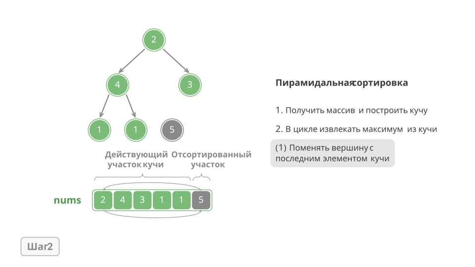
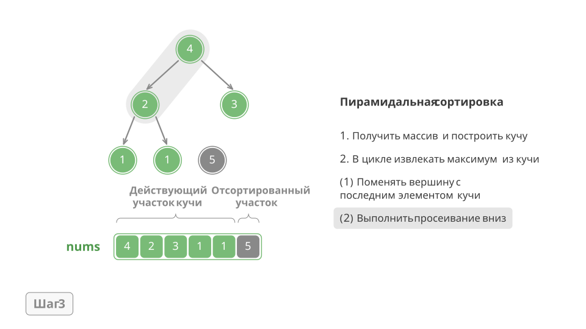
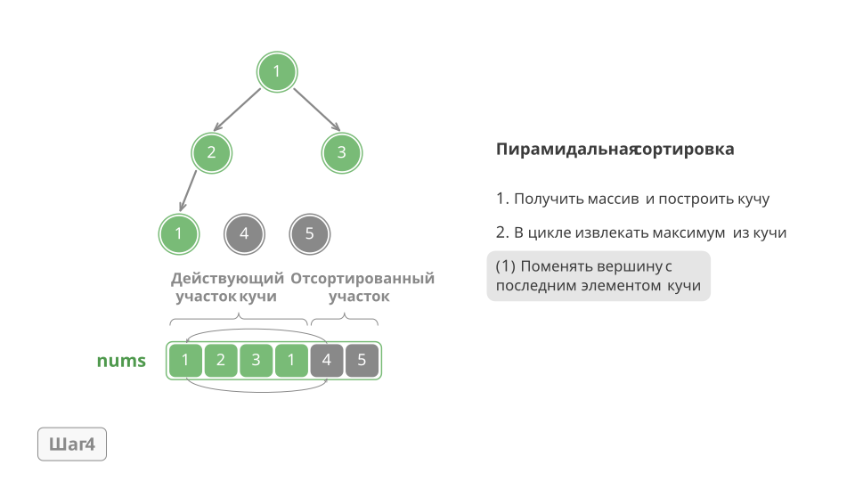
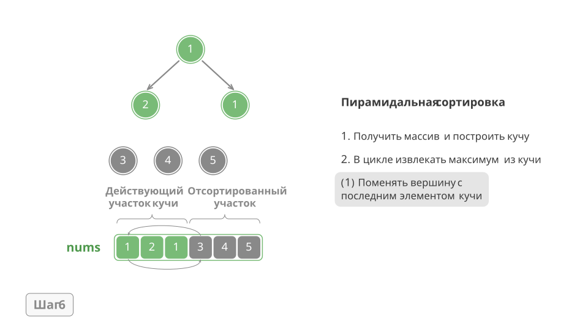
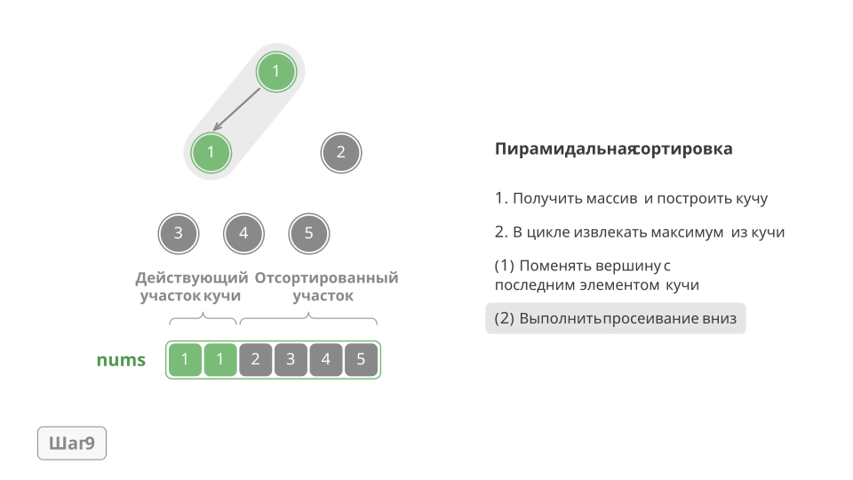
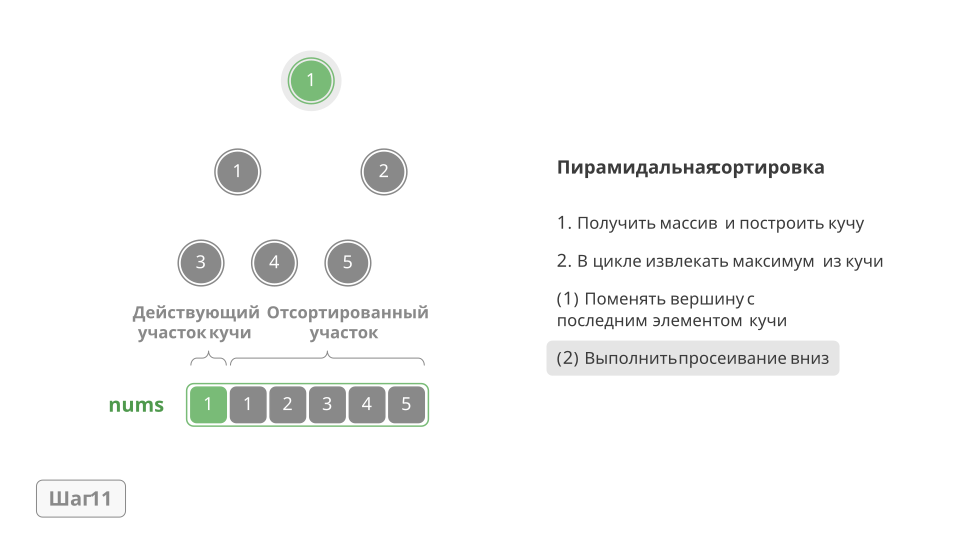
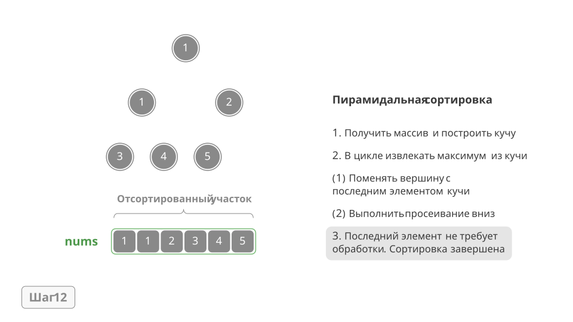

# 11.7 &nbsp; Пирамидальная сортировка

!!! tip

    Перед чтением этого раздела изучите главу «Куча».

<u>Пирамидальная сортировка (heap sort)</u> — эффективный алгоритм, основанный на структуре данных «куча». Его можно реализовать с помощью уже знакомых операций построения кучи и извлечения её вершины.

1. Построим из входного массива минимальную кучу. На её вершине окажется наименьший элемент.
2. Будем извлекать вершину и записывать извлечённые элементы по порядку. Получим последовательность от меньшего к большему.

Этот способ работает, но для хранения извлечённых элементов нужен отдельный массив, что увеличивает расход памяти. На практике обычно применяют более изящный способ.

## 11.7.1 &nbsp; Ход алгоритма

Пусть длина массива равна $n$. На рисунке показан ход пирамидальной сортировки.

1. Построим из входного массива максимальную кучу. На вершине окажется наибольший элемент.
2. Поменяем местами вершину (первый элемент) и конец кучи (последний элемент). После обмена длина кучи уменьшается на $1$, а число отсортированных элементов увеличивается на $1$.
3. Начиная с вершины, выполним просеивание вниз (sift down). После него свойство кучи восстановится.
4. Повторяем шаги `2.` и `3.`. После $n - 1$ проходов массив будет отсортирован.

!!! tip

    Шаги `2.` и `3.` входят и в операцию извлечения вершины. В ней дополнительно удаляют извлечённый элемент.

=== "<1>"
    { class="animation-figure" }

=== "<2>"
    { class="animation-figure" }

=== "<3>"
    { class="animation-figure" }

=== "<4>"
    { class="animation-figure" }

=== "<5>"
    { class="animation-figure" }

=== "<6>"
    { class="animation-figure" }

=== "<7>"
    { class="animation-figure" }

=== "<8>"
    { class="animation-figure" }

=== "<9>"
    { class="animation-figure" }

=== "<10>"
    { class="animation-figure" }

=== "<11>"
    { class="animation-figure" }

=== "<12>"
    { class="animation-figure" }

<p align="center"> Рисунок 11-12 &nbsp; Шаги пирамидальной сортировки </p>

В реализации используется та же функция просеивания вниз `sift_down()`, что и в главе «Куча». Поскольку каждое извлечение максимума сокращает кучу, добавим в `sift_down()` параметр $n$, задающий её текущую действующую длину. Пример кода:

=== "Python"

    ```python title="heap_sort.py"
    def sift_down(nums: list[int], n: int, i: int):
        """Размер кучи равен n. Выполнить просеивание вниз от узла i"""
        while True:
            # Найти среди i, l, r узел с наибольшим значением и обозначить его ma
            l = 2 * i + 1
            r = 2 * i + 2
            ma = i
            if l < n and nums[l] > nums[ma]:
                ma = l
            if r < n and nums[r] > nums[ma]:
                ma = r
            # Если максимум уже в i или индексы l и r вне кучи, завершить просеивание
            if ma == i:
                break
            # Поменять два узла местами
            nums[i], nums[ma] = nums[ma], nums[i]
            # Продолжить просеивание вниз
            i = ma

    def heap_sort(nums: list[int]):
        """Пирамидальная сортировка"""
        # Построить кучу: выполнить просеивание для всех узлов, кроме листьев
        for i in range(len(nums) // 2 - 1, -1, -1):
            sift_down(nums, len(nums), i)
        # Извлечь максимум из кучи n-1 раз
        for i in range(len(nums) - 1, 0, -1):
            # Обменять корень с крайним правым листом (первый элемент с последним)
            nums[0], nums[i] = nums[i], nums[0]
            # Выполнить просеивание вниз от корня
            sift_down(nums, i, 0)
    ```

=== "C++"

    ```cpp title="heap_sort.cpp"
    /* Размер кучи равен n. Выполнить просеивание вниз от узла i */
    void siftDown(vector<int> &nums, int n, int i) {
        while (true) {
            // Найти среди i, l, r узел с наибольшим значением и обозначить его ma
            int l = 2 * i + 1;
            int r = 2 * i + 2;
            int ma = i;
            if (l < n && nums[l] > nums[ma])
                ma = l;
            if (r < n && nums[r] > nums[ma])
                ma = r;
            // Если максимум уже в i или индексы l и r вне кучи, завершить просеивание
            if (ma == i) {
                break;
            }
            // Поменять два узла местами
            swap(nums[i], nums[ma]);
            // Продолжить просеивание вниз
            i = ma;
        }
    }

    /* Пирамидальная сортировка */
    void heapSort(vector<int> &nums) {
        // Построить кучу: выполнить просеивание для всех узлов, кроме листьев
        for (int i = nums.size() / 2 - 1; i >= 0; --i) {
            siftDown(nums, nums.size(), i);
        }
        // Извлечь максимум из кучи n-1 раз
        for (int i = nums.size() - 1; i > 0; --i) {
            // Обменять корень с крайним правым листом (первый элемент с последним)
            swap(nums[0], nums[i]);
            // Выполнить просеивание вниз от корня
            siftDown(nums, i, 0);
        }
    }
    ```

=== "Java"

    ```java title="heap_sort.java"
    /* Размер кучи равен n. Выполнить просеивание вниз от узла i */
    void siftDown(int[] nums, int n, int i) {
        while (true) {
            // Найти среди i, l, r узел с наибольшим значением и обозначить его ma
            int l = 2 * i + 1;
            int r = 2 * i + 2;
            int ma = i;
            if (l < n && nums[l] > nums[ma])
                ma = l;
            if (r < n && nums[r] > nums[ma])
                ma = r;
            // Если максимум уже в i или индексы l и r вне кучи, завершить просеивание
            if (ma == i)
                break;
            // Поменять два узла местами
            int temp = nums[i];
            nums[i] = nums[ma];
            nums[ma] = temp;
            // Продолжить просеивание вниз
            i = ma;
        }
    }

    /* Пирамидальная сортировка */
    void heapSort(int[] nums) {
        // Построить кучу: выполнить просеивание для всех узлов, кроме листьев
        for (int i = nums.length / 2 - 1; i >= 0; i--) {
            siftDown(nums, nums.length, i);
        }
        // Извлечь максимум из кучи n-1 раз
        for (int i = nums.length - 1; i > 0; i--) {
            // Обменять корень с крайним правым листом (первый элемент с последним)
            int tmp = nums[0];
            nums[0] = nums[i];
            nums[i] = tmp;
            // Выполнить просеивание вниз от корня
            siftDown(nums, i, 0);
        }
    }
    ```

=== "C#"

    ```csharp title="heap_sort.cs"
    /* Размер кучи равен n. Выполнить просеивание вниз от узла i */
    void SiftDown(int[] nums, int n, int i) {
        while (true) {
            // Найти среди i, l, r узел с наибольшим значением и обозначить его ma
            int l = 2 * i + 1;
            int r = 2 * i + 2;
            int ma = i;
            if (l < n && nums[l] > nums[ma])
                ma = l;
            if (r < n && nums[r] > nums[ma])
                ma = r;
            // Если максимум уже в i или индексы l и r вне кучи, завершить просеивание
            if (ma == i)
                break;
            // Поменять два узла местами
            (nums[ma], nums[i]) = (nums[i], nums[ma]);
            // Продолжить просеивание вниз
            i = ma;
        }
    }

    /* Пирамидальная сортировка */
    void HeapSort(int[] nums) {
        // Построить кучу: выполнить просеивание для всех узлов, кроме листьев
        for (int i = nums.Length / 2 - 1; i >= 0; i--) {
            SiftDown(nums, nums.Length, i);
        }
        // Извлечь максимум из кучи n-1 раз
        for (int i = nums.Length - 1; i > 0; i--) {
            // Обменять корень с крайним правым листом (первый элемент с последним)
            (nums[i], nums[0]) = (nums[0], nums[i]);
            // Выполнить просеивание вниз от корня
            SiftDown(nums, i, 0);
        }
    }
    ```

=== "Go"

    ```go title="heap_sort.go"
    /* Размер кучи равен n. Выполнить просеивание вниз от узла i */
    func siftDown(nums *[]int, n, i int) {
        for true {
            // Найти среди i, l, r узел с наибольшим значением и обозначить его ma
            l := 2*i + 1
            r := 2*i + 2
            ma := i
            if l < n && (*nums)[l] > (*nums)[ma] {
                ma = l
            }
            if r < n && (*nums)[r] > (*nums)[ma] {
                ma = r
            }
            // Если максимум уже в i или индексы l и r вне кучи, завершить просеивание
            if ma == i {
                break
            }
            // Поменять два узла местами
            (*nums)[i], (*nums)[ma] = (*nums)[ma], (*nums)[i]
            // Продолжить просеивание вниз
            i = ma
        }
    }

    /* Пирамидальная сортировка */
    func heapSort(nums *[]int) {
        // Построить кучу: выполнить просеивание для всех узлов, кроме листьев
        for i := len(*nums)/2 - 1; i >= 0; i-- {
            siftDown(nums, len(*nums), i)
        }
        // Извлечь максимум из кучи n-1 раз
        for i := len(*nums) - 1; i > 0; i-- {
            // Обменять корень с крайним правым листом (первый элемент с последним)
            (*nums)[0], (*nums)[i] = (*nums)[i], (*nums)[0]
            // Выполнить просеивание вниз от корня
            siftDown(nums, i, 0)
        }
    }
    ```

=== "Swift"

    ```swift title="heap_sort.swift"
    /* Размер кучи равен n. Выполнить просеивание вниз от узла i */
    func siftDown(nums: inout [Int], n: Int, i: Int) {
        var i = i
        while true {
            // Найти среди i, l, r узел с наибольшим значением и обозначить его ma
            let l = 2 * i + 1
            let r = 2 * i + 2
            var ma = i
            if l < n, nums[l] > nums[ma] {
                ma = l
            }
            if r < n, nums[r] > nums[ma] {
                ma = r
            }
            // Если максимум уже в i или индексы l и r вне кучи, завершить просеивание
            if ma == i {
                break
            }
            // Поменять два узла местами
            nums.swapAt(i, ma)
            // Продолжить просеивание вниз
            i = ma
        }
    }

    /* Пирамидальная сортировка */
    func heapSort(nums: inout [Int]) {
        // Построить кучу: выполнить просеивание для всех узлов, кроме листьев
        for i in stride(from: nums.count / 2 - 1, through: 0, by: -1) {
            siftDown(nums: &nums, n: nums.count, i: i)
        }
        // Извлечь максимум из кучи n-1 раз
        for i in nums.indices.dropFirst().reversed() {
            // Обменять корень с крайним правым листом (первый элемент с последним)
            nums.swapAt(0, i)
            // Выполнить просеивание вниз от корня
            siftDown(nums: &nums, n: i, i: 0)
        }
    }
    ```

=== "JS"

    ```javascript title="heap_sort.js"
    /* Размер кучи равен n. Выполнить просеивание вниз от узла i */
    function siftDown(nums, n, i) {
        while (true) {
            // Найти среди i, l, r узел с наибольшим значением и обозначить его ma
            let l = 2 * i + 1;
            let r = 2 * i + 2;
            let ma = i;
            if (l < n && nums[l] > nums[ma]) {
                ma = l;
            }
            if (r < n && nums[r] > nums[ma]) {
                ma = r;
            }
            // Если максимум уже в i или индексы l и r вне кучи, завершить просеивание
            if (ma === i) {
                break;
            }
            // Поменять два узла местами
            [nums[i], nums[ma]] = [nums[ma], nums[i]];
            // Продолжить просеивание вниз
            i = ma;
        }
    }

    /* Пирамидальная сортировка */
    function heapSort(nums) {
        // Построить кучу: выполнить просеивание для всех узлов, кроме листьев
        for (let i = Math.floor(nums.length / 2) - 1; i >= 0; i--) {
            siftDown(nums, nums.length, i);
        }
        // Извлечь максимум из кучи n-1 раз
        for (let i = nums.length - 1; i > 0; i--) {
            // Обменять корень с крайним правым листом (первый элемент с последним)
            [nums[0], nums[i]] = [nums[i], nums[0]];
            // Выполнить просеивание вниз от корня
            siftDown(nums, i, 0);
        }
    }
    ```

=== "TS"

    ```typescript title="heap_sort.ts"
    /* Размер кучи равен n. Выполнить просеивание вниз от узла i */
    function siftDown(nums: number[], n: number, i: number): void {
        while (true) {
            // Найти среди i, l, r узел с наибольшим значением и обозначить его ma
            let l = 2 * i + 1;
            let r = 2 * i + 2;
            let ma = i;
            if (l < n && nums[l] > nums[ma]) {
                ma = l;
            }
            if (r < n && nums[r] > nums[ma]) {
                ma = r;
            }
            // Если максимум уже в i или индексы l и r вне кучи, завершить просеивание
            if (ma === i) {
                break;
            }
            // Поменять два узла местами
            [nums[i], nums[ma]] = [nums[ma], nums[i]];
            // Продолжить просеивание вниз
            i = ma;
        }
    }

    /* Пирамидальная сортировка */
    function heapSort(nums: number[]): void {
        // Построить кучу: выполнить просеивание для всех узлов, кроме листьев
        for (let i = Math.floor(nums.length / 2) - 1; i >= 0; i--) {
            siftDown(nums, nums.length, i);
        }
        // Извлечь максимум из кучи n-1 раз
        for (let i = nums.length - 1; i > 0; i--) {
            // Обменять корень с крайним правым листом (первый элемент с последним)
            [nums[0], nums[i]] = [nums[i], nums[0]];
            // Выполнить просеивание вниз от корня
            siftDown(nums, i, 0);
        }
    }
    ```

=== "Dart"

    ```dart title="heap_sort.dart"
    /* Размер кучи равен n. Выполнить просеивание вниз от узла i */
    void siftDown(List<int> nums, int n, int i) {
      while (true) {
        // Найти среди i, l, r узел с наибольшим значением и обозначить его ma
        int l = 2 * i + 1;
        int r = 2 * i + 2;
        int ma = i;
        if (l < n && nums[l] > nums[ma]) ma = l;
        if (r < n && nums[r] > nums[ma]) ma = r;
        // Если максимум уже в i или индексы l и r вне кучи, завершить просеивание
        if (ma == i) break;
        // Поменять два узла местами
        int temp = nums[i];
        nums[i] = nums[ma];
        nums[ma] = temp;
        // Продолжить просеивание вниз
        i = ma;
      }
    }

    /* Пирамидальная сортировка */
    void heapSort(List<int> nums) {
      // Построить кучу: выполнить просеивание для всех узлов, кроме листьев
      for (int i = nums.length ~/ 2 - 1; i >= 0; i--) {
        siftDown(nums, nums.length, i);
      }
      // Извлечь максимум из кучи n-1 раз
      for (int i = nums.length - 1; i > 0; i--) {
        // Обменять корень с крайним правым листом (первый элемент с последним)
        int tmp = nums[0];
        nums[0] = nums[i];
        nums[i] = tmp;
        // Выполнить просеивание вниз от корня
        siftDown(nums, i, 0);
      }
    }
    ```

=== "Rust"

    ```rust title="heap_sort.rs"
    /* Размер кучи равен n. Выполнить просеивание вниз от узла i */
    fn sift_down(nums: &mut [i32], n: usize, mut i: usize) {
        loop {
            // Найти среди i, l, r узел с наибольшим значением и обозначить его ma
            let l = 2 * i + 1;
            let r = 2 * i + 2;
            let mut ma = i;
            if l < n && nums[l] > nums[ma] {
                ma = l;
            }
            if r < n && nums[r] > nums[ma] {
                ma = r;
            }
            // Если максимум уже в i или индексы l и r вне кучи, завершить просеивание
            if ma == i {
                break;
            }
            // Поменять два узла местами
            nums.swap(i, ma);
            // Продолжить просеивание вниз
            i = ma;
        }
    }

    /* Пирамидальная сортировка */
    fn heap_sort(nums: &mut [i32]) {
        // Построить кучу: выполнить просеивание для всех узлов, кроме листьев
        for i in (0..nums.len() / 2).rev() {
            sift_down(nums, nums.len(), i);
        }
        // Извлечь максимум из кучи n-1 раз
        for i in (1..nums.len()).rev() {
            // Обменять корень с крайним правым листом (первый элемент с последним)
            nums.swap(0, i);
            // Выполнить просеивание вниз от корня
            sift_down(nums, i, 0);
        }
    }
    ```

=== "C"

    ```c title="heap_sort.c"
    /* Размер кучи равен n. Выполнить просеивание вниз от узла i */
    void siftDown(int nums[], int n, int i) {
        while (1) {
            // Найти среди i, l, r узел с наибольшим значением и обозначить его ma
            int l = 2 * i + 1;
            int r = 2 * i + 2;
            int ma = i;
            if (l < n && nums[l] > nums[ma])
                ma = l;
            if (r < n && nums[r] > nums[ma])
                ma = r;
            // Если максимум уже в i или индексы l и r вне кучи, завершить просеивание
            if (ma == i) {
                break;
            }
            // Поменять два узла местами
            int temp = nums[i];
            nums[i] = nums[ma];
            nums[ma] = temp;
            // Продолжить просеивание вниз
            i = ma;
        }
    }

    /* Пирамидальная сортировка */
    void heapSort(int nums[], int n) {
        // Построить кучу: выполнить просеивание для всех узлов, кроме листьев
        for (int i = n / 2 - 1; i >= 0; --i) {
            siftDown(nums, n, i);
        }
        // Извлечь максимум из кучи n-1 раз
        for (int i = n - 1; i > 0; --i) {
            // Обменять корень с крайним правым листом (первый элемент с последним)
            int tmp = nums[0];
            nums[0] = nums[i];
            nums[i] = tmp;
            // Выполнить просеивание вниз от корня
            siftDown(nums, i, 0);
        }
    }
    ```

=== "Kotlin"

    ```kotlin title="heap_sort.kt"
    /* Размер кучи равен n. Выполнить просеивание вниз от узла i */
    fun siftDown(nums: IntArray, n: Int, li: Int) {
        var i = li
        while (true) {
            // Найти среди i, l, r узел с наибольшим значением и обозначить его ma
            val l = 2 * i + 1
            val r = 2 * i + 2
            var ma = i
            if (l < n && nums[l] > nums[ma]) 
                ma = l
            if (r < n && nums[r] > nums[ma]) 
                ma = r
            // Если максимум уже в i или индексы l и r вне кучи, завершить просеивание
            if (ma == i) 
                break
            // Поменять два узла местами
            val temp = nums[i]
            nums[i] = nums[ma]
            nums[ma] = temp
            // Продолжить просеивание вниз
            i = ma
        }
    }

    /* Пирамидальная сортировка */
    fun heapSort(nums: IntArray) {
        // Построить кучу: выполнить просеивание для всех узлов, кроме листьев
        for (i in nums.size / 2 - 1 downTo 0) {
            siftDown(nums, nums.size, i)
        }
        // Извлечь максимум из кучи n-1 раз
        for (i in nums.size - 1 downTo 1) {
            // Обменять корень с крайним правым листом (первый элемент с последним)
            val temp = nums[0]
            nums[0] = nums[i]
            nums[i] = temp
            // Выполнить просеивание вниз от корня
            siftDown(nums, i, 0)
        }
    }
    ```

=== "Ruby"

    ```ruby title="heap_sort.rb"
    ### Размер кучи равен n. Выполнить просеивание вниз от узла i ###
    def sift_down(nums, n, i)
      while true
        # Найти среди i, l, r узел с наибольшим значением и обозначить его ma
        l = 2 * i + 1
        r = 2 * i + 2
        ma = i
        ma = l if l < n && nums[l] > nums[ma]
        ma = r if r < n && nums[r] > nums[ma]
        # Если максимум уже в i или индексы l и r вне кучи, завершить просеивание
        break if ma == i
        # Поменять два узла местами
        nums[i], nums[ma] = nums[ma], nums[i]
        # Продолжить просеивание вниз
        i = ma
      end
    end

    ### Пирамидальная сортировка ###
    def heap_sort(nums)
      # Построить кучу: выполнить просеивание для всех узлов, кроме листьев
      (nums.length / 2 - 1).downto(0) do |i|
        sift_down(nums, nums.length, i)
      end
      # Извлечь максимум из кучи n-1 раз
      (nums.length - 1).downto(1) do |i|
        # Обменять корень с крайним правым листом (первый элемент с последним)
        nums[0], nums[i] = nums[i], nums[0]
        # Выполнить просеивание вниз от корня
        sift_down(nums, i, 0)
      end
    end
    ```

??? pythontutor "Визуализация выполнения"

    <div style="height: 549px; width: 100%;"><iframe class="pythontutor-iframe" title="Визуализация выполнения" src="https://pythontutor.com/iframe-embed.html#code=def%20sift_down%28nums%3A%20list%5Bint%5D,%20n%3A%20int,%20i%3A%20int%29%3A%0A%20%20%20%20%22%22%22%D0%A0%D0%B0%D0%B7%D0%BC%D0%B5%D1%80%20%D0%BA%D1%83%D1%87%D0%B8%20%D1%80%D0%B0%D0%B2%D0%B5%D0%BD%20n.%20%D0%92%D1%8B%D0%BF%D0%BE%D0%BB%D0%BD%D0%B8%D1%82%D1%8C%20%D0%BF%D1%80%D0%BE%D1%81%D0%B5%D0%B8%D0%B2%D0%B0%D0%BD%D0%B8%D0%B5%20%D0%B2%D0%BD%D0%B8%D0%B7%20%D0%BE%D1%82%20%D1%83%D0%B7%D0%BB%D0%B0%20i%22%22%22%0A%20%20%20%20while%20True%3A%0A%20%20%20%20%20%20%20%20%23%20%D0%9D%D0%B0%D0%B9%D1%82%D0%B8%20%D1%81%D1%80%D0%B5%D0%B4%D0%B8%20i,%20l,%20r%20%D1%83%D0%B7%D0%B5%D0%BB%20%D1%81%20%D0%BD%D0%B0%D0%B8%D0%B1%D0%BE%D0%BB%D1%8C%D1%88%D0%B8%D0%BC%20%D0%B7%D0%BD%D0%B0%D1%87%D0%B5%D0%BD%D0%B8%D0%B5%D0%BC%20%D0%B8%20%D0%BE%D0%B1%D0%BE%D0%B7%D0%BD%D0%B0%D1%87%D0%B8%D1%82%D1%8C%20%D0%B5%D0%B3%D0%BE%20ma%0A%20%20%20%20%20%20%20%20l%20%3D%202%20%2A%20i%20%2B%201%0A%20%20%20%20%20%20%20%20r%20%3D%202%20%2A%20i%20%2B%202%0A%20%20%20%20%20%20%20%20ma%20%3D%20i%0A%20%20%20%20%20%20%20%20if%20l%20%3C%20n%20and%20nums%5Bl%5D%20%3E%20nums%5Bma%5D%3A%0A%20%20%20%20%20%20%20%20%20%20%20%20ma%20%3D%20l%0A%20%20%20%20%20%20%20%20if%20r%20%3C%20n%20and%20nums%5Br%5D%20%3E%20nums%5Bma%5D%3A%0A%20%20%20%20%20%20%20%20%20%20%20%20ma%20%3D%20r%0A%20%20%20%20%20%20%20%20%23%20%D0%95%D1%81%D0%BB%D0%B8%20%D0%BC%D0%B0%D0%BA%D1%81%D0%B8%D0%BC%D1%83%D0%BC%20%D1%83%D0%B6%D0%B5%20%D0%B2%20i%20%D0%B8%D0%BB%D0%B8%20%D0%B8%D0%BD%D0%B4%D0%B5%D0%BA%D1%81%D1%8B%20l%20%D0%B8%20r%20%D0%B2%D0%BD%D0%B5%20%D0%BA%D1%83%D1%87%D0%B8,%20%D0%B7%D0%B0%D0%B2%D0%B5%D1%80%D1%88%D0%B8%D1%82%D1%8C%20%D0%BF%D1%80%D0%BE%D1%81%D0%B5%D0%B8%D0%B2%D0%B0%D0%BD%D0%B8%D0%B5%0A%20%20%20%20%20%20%20%20if%20ma%20%3D%3D%20i%3A%0A%20%20%20%20%20%20%20%20%20%20%20%20break%0A%20%20%20%20%20%20%20%20%23%20%D0%9F%D0%BE%D0%BC%D0%B5%D0%BD%D1%8F%D1%82%D1%8C%20%D0%B4%D0%B2%D0%B0%20%D1%83%D0%B7%D0%BB%D0%B0%20%D0%BC%D0%B5%D1%81%D1%82%D0%B0%D0%BC%D0%B8%0A%20%20%20%20%20%20%20%20nums%5Bi%5D,%20nums%5Bma%5D%20%3D%20nums%5Bma%5D,%20nums%5Bi%5D%0A%20%20%20%20%20%20%20%20%23%20%D0%9F%D1%80%D0%BE%D0%B4%D0%BE%D0%BB%D0%B6%D0%B8%D1%82%D1%8C%20%D0%BF%D1%80%D0%BE%D1%81%D0%B5%D0%B8%D0%B2%D0%B0%D0%BD%D0%B8%D0%B5%20%D0%B2%D0%BD%D0%B8%D0%B7%0A%20%20%20%20%20%20%20%20i%20%3D%20ma%0A%0Adef%20heap_sort%28nums%3A%20list%5Bint%5D%29%3A%0A%20%20%20%20%22%22%22%D0%9F%D0%B8%D1%80%D0%B0%D0%BC%D0%B8%D0%B4%D0%B0%D0%BB%D1%8C%D0%BD%D0%B0%D1%8F%20%D1%81%D0%BE%D1%80%D1%82%D0%B8%D1%80%D0%BE%D0%B2%D0%BA%D0%B0%22%22%22%0A%20%20%20%20%23%20%D0%9F%D0%BE%D1%81%D1%82%D1%80%D0%BE%D0%B8%D1%82%D1%8C%20%D0%BA%D1%83%D1%87%D1%83%3A%20%D0%B2%D1%8B%D0%BF%D0%BE%D0%BB%D0%BD%D0%B8%D1%82%D1%8C%20%D0%BF%D1%80%D0%BE%D1%81%D0%B5%D0%B8%D0%B2%D0%B0%D0%BD%D0%B8%D0%B5%20%D0%B4%D0%BB%D1%8F%20%D0%B2%D1%81%D0%B5%D1%85%20%D1%83%D0%B7%D0%BB%D0%BE%D0%B2,%20%D0%BA%D1%80%D0%BE%D0%BC%D0%B5%20%D0%BB%D0%B8%D1%81%D1%82%D1%8C%D0%B5%D0%B2%0A%20%20%20%20for%20i%20in%20range%28len%28nums%29%20//%202%20-%201,%20-1,%20-1%29%3A%0A%20%20%20%20%20%20%20%20sift_down%28nums,%20len%28nums%29,%20i%29%0A%20%20%20%20%23%20%D0%98%D0%B7%D0%B2%D0%BB%D0%B5%D1%87%D1%8C%20%D0%BC%D0%B0%D0%BA%D1%81%D0%B8%D0%BC%D1%83%D0%BC%20%D0%B8%D0%B7%20%D0%BA%D1%83%D1%87%D0%B8%20n-1%20%D1%80%D0%B0%D0%B7%0A%20%20%20%20for%20i%20in%20range%28len%28nums%29%20-%201,%200,%20-1%29%3A%0A%20%20%20%20%20%20%20%20%23%20%D0%9E%D0%B1%D0%BC%D0%B5%D0%BD%D1%8F%D1%82%D1%8C%20%D0%BA%D0%BE%D1%80%D0%B5%D0%BD%D1%8C%20%D1%81%20%D0%BA%D1%80%D0%B0%D0%B9%D0%BD%D0%B8%D0%BC%20%D0%BF%D1%80%D0%B0%D0%B2%D1%8B%D0%BC%20%D0%BB%D0%B8%D1%81%D1%82%D0%BE%D0%BC%20%28%D0%BF%D0%B5%D1%80%D0%B2%D1%8B%D0%B9%20%D1%8D%D0%BB%D0%B5%D0%BC%D0%B5%D0%BD%D1%82%20%D1%81%20%D0%BF%D0%BE%D1%81%D0%BB%D0%B5%D0%B4%D0%BD%D0%B8%D0%BC%29%0A%20%20%20%20%20%20%20%20nums%5B0%5D,%20nums%5Bi%5D%20%3D%20nums%5Bi%5D,%20nums%5B0%5D%0A%20%20%20%20%20%20%20%20%23%20%D0%92%D1%8B%D0%BF%D0%BE%D0%BB%D0%BD%D0%B8%D1%82%D1%8C%20%D0%BF%D1%80%D0%BE%D1%81%D0%B5%D0%B8%D0%B2%D0%B0%D0%BD%D0%B8%D0%B5%20%D0%B2%D0%BD%D0%B8%D0%B7%20%D0%BE%D1%82%20%D0%BA%D0%BE%D1%80%D0%BD%D1%8F%0A%20%20%20%20%20%20%20%20sift_down%28nums,%20i,%200%29%0A%0A%22%22%22Driver%20Code%22%22%22%0Aif%20__name__%20%3D%3D%20%22__main__%22%3A%0A%20%20%20%20nums%20%3D%20%5B4,%201,%203,%201,%205,%202%5D%0A%20%20%20%20heap_sort%28nums%29%0A%20%20%20%20print%28%22%D0%9F%D0%BE%D1%81%D0%BB%D0%B5%20%D0%BF%D0%B8%D1%80%D0%B0%D0%BC%D0%B8%D0%B4%D0%B0%D0%BB%D1%8C%D0%BD%D0%BE%D0%B9%20%D1%81%D0%BE%D1%80%D1%82%D0%B8%D1%80%D0%BE%D0%B2%D0%BA%D0%B8%20nums%20%3D%22,%20nums%29&codeDivHeight=472&codeDivWidth=350&cumulative=false&curInstr=5&heapPrimitives=nevernest&origin=opt-frontend.js&py=311&rawInputLstJSON=%5B%5D&textReferences=false"> </iframe></div>
    <div style="margin-top: 5px;"><a href="https://pythontutor.com/iframe-embed.html#code=def%20sift_down%28nums%3A%20list%5Bint%5D,%20n%3A%20int,%20i%3A%20int%29%3A%0A%20%20%20%20%22%22%22%D0%A0%D0%B0%D0%B7%D0%BC%D0%B5%D1%80%20%D0%BA%D1%83%D1%87%D0%B8%20%D1%80%D0%B0%D0%B2%D0%B5%D0%BD%20n.%20%D0%92%D1%8B%D0%BF%D0%BE%D0%BB%D0%BD%D0%B8%D1%82%D1%8C%20%D0%BF%D1%80%D0%BE%D1%81%D0%B5%D0%B8%D0%B2%D0%B0%D0%BD%D0%B8%D0%B5%20%D0%B2%D0%BD%D0%B8%D0%B7%20%D0%BE%D1%82%20%D1%83%D0%B7%D0%BB%D0%B0%20i%22%22%22%0A%20%20%20%20while%20True%3A%0A%20%20%20%20%20%20%20%20%23%20%D0%9D%D0%B0%D0%B9%D1%82%D0%B8%20%D1%81%D1%80%D0%B5%D0%B4%D0%B8%20i,%20l,%20r%20%D1%83%D0%B7%D0%B5%D0%BB%20%D1%81%20%D0%BD%D0%B0%D0%B8%D0%B1%D0%BE%D0%BB%D1%8C%D1%88%D0%B8%D0%BC%20%D0%B7%D0%BD%D0%B0%D1%87%D0%B5%D0%BD%D0%B8%D0%B5%D0%BC%20%D0%B8%20%D0%BE%D0%B1%D0%BE%D0%B7%D0%BD%D0%B0%D1%87%D0%B8%D1%82%D1%8C%20%D0%B5%D0%B3%D0%BE%20ma%0A%20%20%20%20%20%20%20%20l%20%3D%202%20%2A%20i%20%2B%201%0A%20%20%20%20%20%20%20%20r%20%3D%202%20%2A%20i%20%2B%202%0A%20%20%20%20%20%20%20%20ma%20%3D%20i%0A%20%20%20%20%20%20%20%20if%20l%20%3C%20n%20and%20nums%5Bl%5D%20%3E%20nums%5Bma%5D%3A%0A%20%20%20%20%20%20%20%20%20%20%20%20ma%20%3D%20l%0A%20%20%20%20%20%20%20%20if%20r%20%3C%20n%20and%20nums%5Br%5D%20%3E%20nums%5Bma%5D%3A%0A%20%20%20%20%20%20%20%20%20%20%20%20ma%20%3D%20r%0A%20%20%20%20%20%20%20%20%23%20%D0%95%D1%81%D0%BB%D0%B8%20%D0%BC%D0%B0%D0%BA%D1%81%D0%B8%D0%BC%D1%83%D0%BC%20%D1%83%D0%B6%D0%B5%20%D0%B2%20i%20%D0%B8%D0%BB%D0%B8%20%D0%B8%D0%BD%D0%B4%D0%B5%D0%BA%D1%81%D1%8B%20l%20%D0%B8%20r%20%D0%B2%D0%BD%D0%B5%20%D0%BA%D1%83%D1%87%D0%B8,%20%D0%B7%D0%B0%D0%B2%D0%B5%D1%80%D1%88%D0%B8%D1%82%D1%8C%20%D0%BF%D1%80%D0%BE%D1%81%D0%B5%D0%B8%D0%B2%D0%B0%D0%BD%D0%B8%D0%B5%0A%20%20%20%20%20%20%20%20if%20ma%20%3D%3D%20i%3A%0A%20%20%20%20%20%20%20%20%20%20%20%20break%0A%20%20%20%20%20%20%20%20%23%20%D0%9F%D0%BE%D0%BC%D0%B5%D0%BD%D1%8F%D1%82%D1%8C%20%D0%B4%D0%B2%D0%B0%20%D1%83%D0%B7%D0%BB%D0%B0%20%D0%BC%D0%B5%D1%81%D1%82%D0%B0%D0%BC%D0%B8%0A%20%20%20%20%20%20%20%20nums%5Bi%5D,%20nums%5Bma%5D%20%3D%20nums%5Bma%5D,%20nums%5Bi%5D%0A%20%20%20%20%20%20%20%20%23%20%D0%9F%D1%80%D0%BE%D0%B4%D0%BE%D0%BB%D0%B6%D0%B8%D1%82%D1%8C%20%D0%BF%D1%80%D0%BE%D1%81%D0%B5%D0%B8%D0%B2%D0%B0%D0%BD%D0%B8%D0%B5%20%D0%B2%D0%BD%D0%B8%D0%B7%0A%20%20%20%20%20%20%20%20i%20%3D%20ma%0A%0Adef%20heap_sort%28nums%3A%20list%5Bint%5D%29%3A%0A%20%20%20%20%22%22%22%D0%9F%D0%B8%D1%80%D0%B0%D0%BC%D0%B8%D0%B4%D0%B0%D0%BB%D1%8C%D0%BD%D0%B0%D1%8F%20%D1%81%D0%BE%D1%80%D1%82%D0%B8%D1%80%D0%BE%D0%B2%D0%BA%D0%B0%22%22%22%0A%20%20%20%20%23%20%D0%9F%D0%BE%D1%81%D1%82%D1%80%D0%BE%D0%B8%D1%82%D1%8C%20%D0%BA%D1%83%D1%87%D1%83%3A%20%D0%B2%D1%8B%D0%BF%D0%BE%D0%BB%D0%BD%D0%B8%D1%82%D1%8C%20%D0%BF%D1%80%D0%BE%D1%81%D0%B5%D0%B8%D0%B2%D0%B0%D0%BD%D0%B8%D0%B5%20%D0%B4%D0%BB%D1%8F%20%D0%B2%D1%81%D0%B5%D1%85%20%D1%83%D0%B7%D0%BB%D0%BE%D0%B2,%20%D0%BA%D1%80%D0%BE%D0%BC%D0%B5%20%D0%BB%D0%B8%D1%81%D1%82%D1%8C%D0%B5%D0%B2%0A%20%20%20%20for%20i%20in%20range%28len%28nums%29%20//%202%20-%201,%20-1,%20-1%29%3A%0A%20%20%20%20%20%20%20%20sift_down%28nums,%20len%28nums%29,%20i%29%0A%20%20%20%20%23%20%D0%98%D0%B7%D0%B2%D0%BB%D0%B5%D1%87%D1%8C%20%D0%BC%D0%B0%D0%BA%D1%81%D0%B8%D0%BC%D1%83%D0%BC%20%D0%B8%D0%B7%20%D0%BA%D1%83%D1%87%D0%B8%20n-1%20%D1%80%D0%B0%D0%B7%0A%20%20%20%20for%20i%20in%20range%28len%28nums%29%20-%201,%200,%20-1%29%3A%0A%20%20%20%20%20%20%20%20%23%20%D0%9E%D0%B1%D0%BC%D0%B5%D0%BD%D1%8F%D1%82%D1%8C%20%D0%BA%D0%BE%D1%80%D0%B5%D0%BD%D1%8C%20%D1%81%20%D0%BA%D1%80%D0%B0%D0%B9%D0%BD%D0%B8%D0%BC%20%D0%BF%D1%80%D0%B0%D0%B2%D1%8B%D0%BC%20%D0%BB%D0%B8%D1%81%D1%82%D0%BE%D0%BC%20%28%D0%BF%D0%B5%D1%80%D0%B2%D1%8B%D0%B9%20%D1%8D%D0%BB%D0%B5%D0%BC%D0%B5%D0%BD%D1%82%20%D1%81%20%D0%BF%D0%BE%D1%81%D0%BB%D0%B5%D0%B4%D0%BD%D0%B8%D0%BC%29%0A%20%20%20%20%20%20%20%20nums%5B0%5D,%20nums%5Bi%5D%20%3D%20nums%5Bi%5D,%20nums%5B0%5D%0A%20%20%20%20%20%20%20%20%23%20%D0%92%D1%8B%D0%BF%D0%BE%D0%BB%D0%BD%D0%B8%D1%82%D1%8C%20%D0%BF%D1%80%D0%BE%D1%81%D0%B5%D0%B8%D0%B2%D0%B0%D0%BD%D0%B8%D0%B5%20%D0%B2%D0%BD%D0%B8%D0%B7%20%D0%BE%D1%82%20%D0%BA%D0%BE%D1%80%D0%BD%D1%8F%0A%20%20%20%20%20%20%20%20sift_down%28nums,%20i,%200%29%0A%0A%22%22%22Driver%20Code%22%22%22%0Aif%20__name__%20%3D%3D%20%22__main__%22%3A%0A%20%20%20%20nums%20%3D%20%5B4,%201,%203,%201,%205,%202%5D%0A%20%20%20%20heap_sort%28nums%29%0A%20%20%20%20print%28%22%D0%9F%D0%BE%D1%81%D0%BB%D0%B5%20%D0%BF%D0%B8%D1%80%D0%B0%D0%BC%D0%B8%D0%B4%D0%B0%D0%BB%D1%8C%D0%BD%D0%BE%D0%B9%20%D1%81%D0%BE%D1%80%D1%82%D0%B8%D1%80%D0%BE%D0%B2%D0%BA%D0%B8%20nums%20%3D%22,%20nums%29&codeDivHeight=800&codeDivWidth=600&cumulative=false&curInstr=5&heapPrimitives=nevernest&origin=opt-frontend.js&py=311&rawInputLstJSON=%5B%5D&textReferences=false" target="_blank" rel="noopener noreferrer">Во весь экран ></a></div>

## 11.7.2 &nbsp; Свойства алгоритма

- **Временная сложность $O(n \log n)$, неадаптивная сортировка**. Построение кучи занимает $O(n)$ времени. Извлечение максимума имеет сложность $O(\log n)$ и повторяется $n - 1$ раз.
- **Пространственная сложность $O(1)$, сортировка на месте**. Несколько переменных-указателей занимают $O(1)$ памяти. И обмены, и просеивание выполняются в исходном массиве.
- **Неустойчивая сортировка**. При обмене вершины с последним элементом кучи взаимный порядок равных элементов может измениться.
