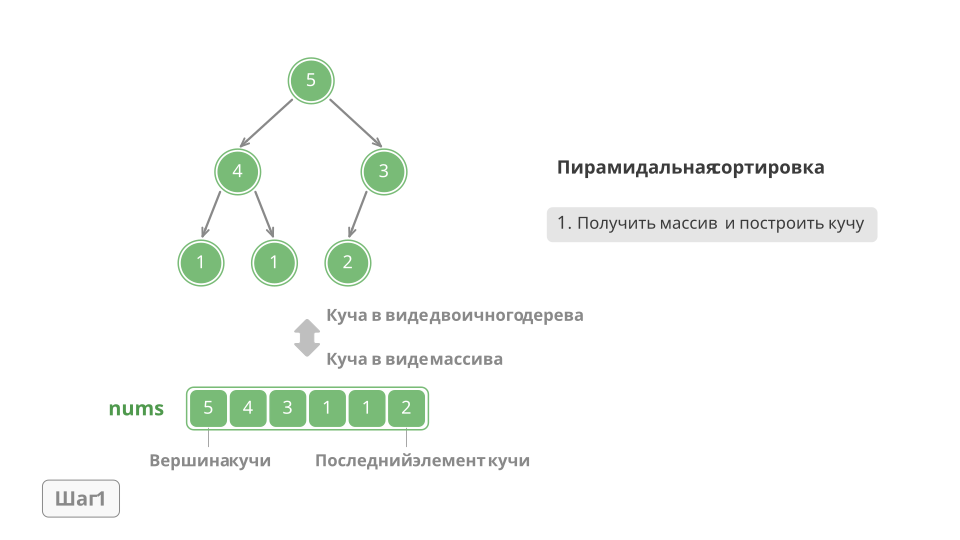
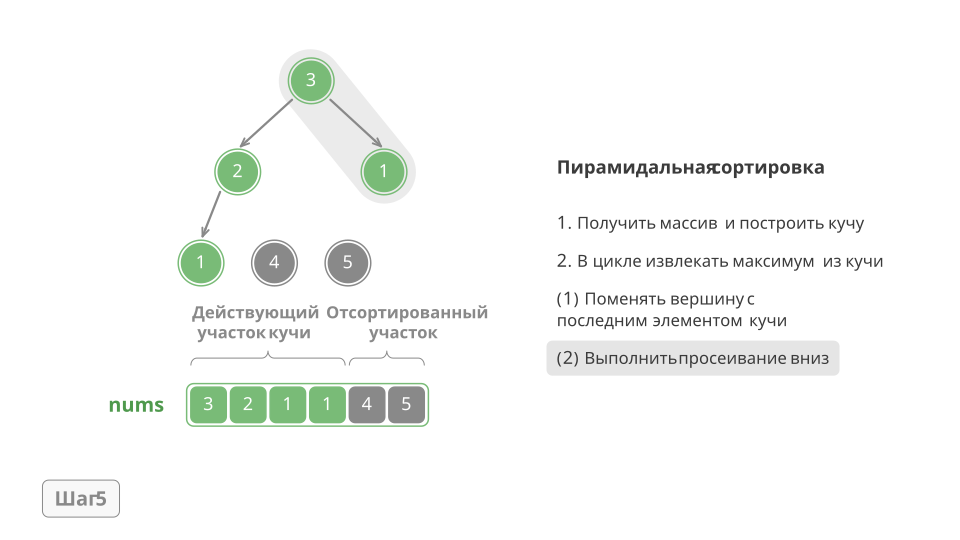
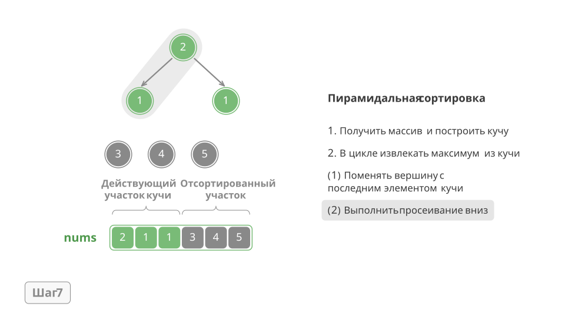
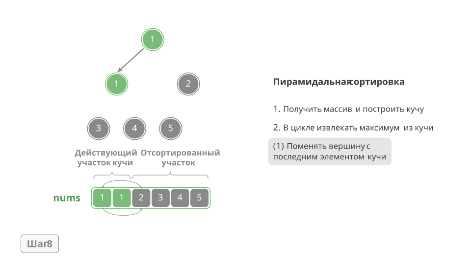
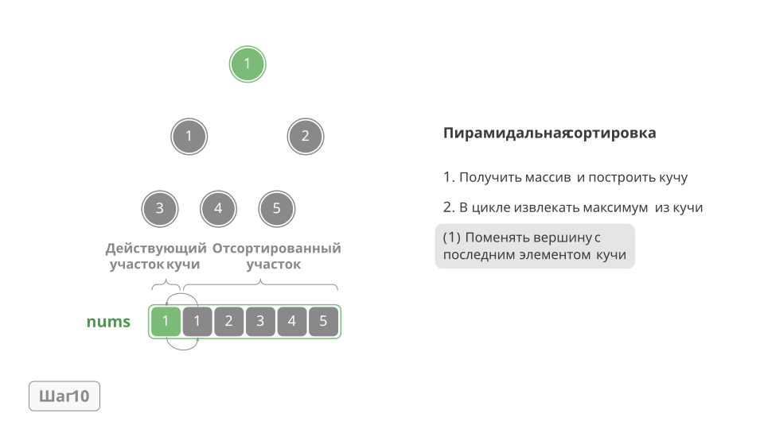

# Пирамидальная сортировка

!!! tip

    Перед чтением этого раздела изучите главу «Куча».

<u>Пирамидальная сортировка (heap sort)</u> — эффективный алгоритм, основанный на структуре данных «куча». Его можно реализовать с помощью уже знакомых операций построения кучи и извлечения её вершины.

1. Построим из входного массива минимальную кучу. На её вершине окажется наименьший элемент.
2. Будем извлекать вершину и записывать извлечённые элементы по порядку. Получим последовательность от меньшего к большему.

Этот способ работает, но для хранения извлечённых элементов нужен отдельный массив, что увеличивает расход памяти. На практике обычно применяют более изящный способ.

## Ход алгоритма

Пусть длина массива равна $n$. На рисунке показан ход пирамидальной сортировки.

1. Построим из входного массива максимальную кучу. На вершине окажется наибольший элемент.
2. Поменяем местами вершину (первый элемент) и конец кучи (последний элемент). После обмена длина кучи уменьшается на $1$, а число отсортированных элементов увеличивается на $1$.
3. Начиная с вершины, выполним просеивание вниз (sift down). После него свойство кучи восстановится.
4. Повторяем шаги `2.` и `3.`. После $n - 1$ проходов массив будет отсортирован.

!!! tip

    Шаги `2.` и `3.` входят и в операцию извлечения вершины. В ней дополнительно удаляют извлечённый элемент.

=== "<1>"
    

=== "<2>"
    

=== "<3>"
    

=== "<4>"
    

=== "<5>"
    

=== "<6>"
    

=== "<7>"
    

=== "<8>"
    

=== "<9>"
    

=== "<10>"
    

=== "<11>"
    

=== "<12>"
    

В реализации используется та же функция просеивания вниз `sift_down()`, что и в главе «Куча». Поскольку каждое извлечение максимума сокращает кучу, добавим в `sift_down()` параметр $n$, задающий её текущую действующую длину. Пример кода:

```src
[file]{heap_sort}-[class]{}-[func]{heap_sort}
```

## Свойства алгоритма

- **Временная сложность $O(n \log n)$, неадаптивная сортировка**. Построение кучи занимает $O(n)$ времени. Извлечение максимума имеет сложность $O(\log n)$ и повторяется $n - 1$ раз.
- **Пространственная сложность $O(1)$, сортировка на месте**. Несколько переменных-указателей занимают $O(1)$ памяти. И обмены, и просеивание выполняются в исходном массиве.
- **Неустойчивая сортировка**. При обмене вершины с последним элементом кучи взаимный порядок равных элементов может измениться.
