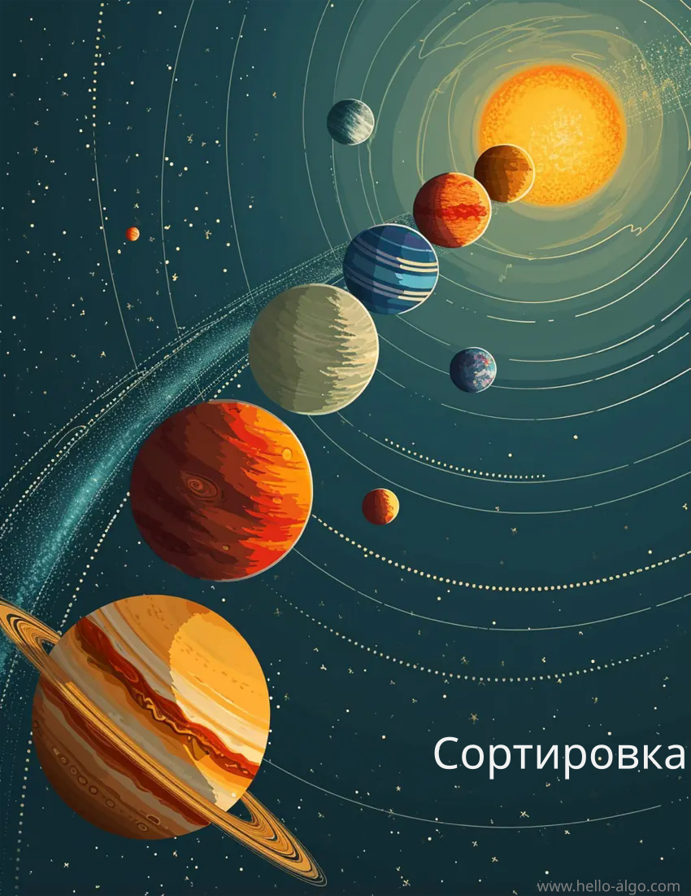

# Глава 11. &nbsp; Сортировка

{ class="cover-image" }

!!! abstract

    Сортировка словно волшебный ключ превращает беспорядок в порядок и помогает нам лучше понимать и эффективнее обрабатывать данные.

    И в простом упорядочении по возрастанию, и в сложной группировке по категориям сортировка раскрывает гармонию данных.

## Содержание главы

- [11.1 &nbsp; Алгоритмы сортировки](sorting_algorithm.md)
- [11.2 &nbsp; Сортировка выбором](selection_sort.md)
- [11.3 &nbsp; Сортировка пузырьком](bubble_sort.md)
- [11.4 &nbsp; Сортировка вставками](insertion_sort.md)
- [11.5 &nbsp; Быстрая сортировка](quick_sort.md)
- [11.6 &nbsp; Сортировка слиянием](merge_sort.md)
- [11.7 &nbsp; Пирамидальная сортировка](heap_sort.md)
- [11.8 &nbsp; Блочная сортировка](bucket_sort.md)
- [11.9 &nbsp; Сортировка подсчётом](counting_sort.md)
- [11.10 &nbsp; Поразрядная сортировка](radix_sort.md)
- [11.11 &nbsp; Итоги](summary.md)
- [11.12 &nbsp; Упражнения](exercises.md)
