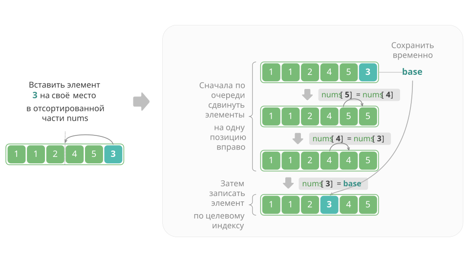

# 11.4 &nbsp; Сортировка вставками

<u>Сортировка вставками (insertion sort)</u> — простой алгоритм, который во многом напоминает упорядочение игральных карт в руке.

Берём элемент из неотсортированной части, по очереди сравниваем его с элементами отсортированного участка слева и вставляем на подходящее место.

На рисунке показана одна вставка в массив. Пусть вставляемый элемент — `base`. Сдвинем на одну позицию вправо все элементы от целевого индекса до позиции `base`, освобождая место, и запишем `base` по целевому индексу.

{ class="animation-figure" }

<p align="center"> Рисунок 11-6 &nbsp; Одна операция вставки </p>

## 11.4.1 &nbsp; Ход алгоритма

На рисунке показан общий ход сортировки вставками.

1. Вначале первый элемент массива сам по себе уже отсортирован.
2. Берём второй элемент массива в качестве `base` и вставляем на нужное место. Теперь **первые два элемента массива отсортированы**.
3. Берём третий элемент в качестве `base` и вставляем на нужное место. Теперь **первые три элемента массива отсортированы**.
4. Продолжаем так же. На последнем проходе берём последний элемент в качестве `base` и вставляем на нужное место. Теперь **все элементы отсортированы**.

{ class="animation-figure" }

<p align="center"> Рисунок 11-7 &nbsp; Ход сортировки вставками </p>

Пример реализации:

=== "Python"

    ```python title="insertion_sort.py"
    def insertion_sort(nums: list[int]):
        """Сортировка вставками"""
        # Внешний цикл: отсортированный участок [0, i-1]
        for i in range(1, len(nums)):
            base = nums[i]
            j = i - 1
            # Внутренний цикл: вставить base на своё место в участке [0, i-1]
            while j >= 0 and nums[j] > base:
                nums[j + 1] = nums[j]  # Сдвинуть nums[j] на одну позицию вправо
                j -= 1
            nums[j + 1] = base  # Записать base на нужную позицию
    ```

=== "C++"

    ```cpp title="insertion_sort.cpp"
    /* Сортировка вставками */
    void insertionSort(vector<int> &nums) {
        // Внешний цикл: отсортированный участок [0, i-1]
        for (int i = 1; i < nums.size(); i++) {
            int base = nums[i], j = i - 1;
            // Внутренний цикл: вставить base на своё место в участке [0, i-1]
            while (j >= 0 && nums[j] > base) {
                nums[j + 1] = nums[j]; // Сдвинуть nums[j] на одну позицию вправо
                j--;
            }
            nums[j + 1] = base; // Записать base на нужную позицию
        }
    }
    ```

=== "Java"

    ```java title="insertion_sort.java"
    /* Сортировка вставками */
    void insertionSort(int[] nums) {
        // Внешний цикл: отсортированный участок [0, i-1]
        for (int i = 1; i < nums.length; i++) {
            int base = nums[i], j = i - 1;
            // Внутренний цикл: вставить base на своё место в участке [0, i-1]
            while (j >= 0 && nums[j] > base) {
                nums[j + 1] = nums[j]; // Сдвинуть nums[j] на одну позицию вправо
                j--;
            }
            nums[j + 1] = base;        // Записать base на нужную позицию
        }
    }
    ```

=== "C#"

    ```csharp title="insertion_sort.cs"
    /* Сортировка вставками */
    void InsertionSort(int[] nums) {
        // Внешний цикл: отсортированный участок [0, i-1]
        for (int i = 1; i < nums.Length; i++) {
            int bas = nums[i], j = i - 1;
            // Внутренний цикл: вставить base на своё место в участке [0, i-1]
            while (j >= 0 && nums[j] > bas) {
                nums[j + 1] = nums[j]; // Сдвинуть nums[j] на одну позицию вправо
                j--;
            }
            nums[j + 1] = bas;         // Записать base на нужную позицию
        }
    }
    ```

=== "Go"

    ```go title="insertion_sort.go"
    /* Сортировка вставками */
    func insertionSort(nums []int) {
        // Внешний цикл: отсортированный участок [0, i-1]
        for i := 1; i < len(nums); i++ {
            base := nums[i]
            j := i - 1
            // Внутренний цикл: вставить base на своё место в участке [0, i-1]
            for j >= 0 && nums[j] > base {
                nums[j+1] = nums[j] // Сдвинуть nums[j] на одну позицию вправо
                j--
            }
            nums[j+1] = base // Записать base на нужную позицию
        }
    }
    ```

=== "Swift"

    ```swift title="insertion_sort.swift"
    /* Сортировка вставками */
    func insertionSort(nums: inout [Int]) {
        // Внешний цикл: отсортированный участок [0, i-1]
        for i in nums.indices.dropFirst() {
            let base = nums[i]
            var j = i - 1
            // Внутренний цикл: вставить base на своё место в участке [0, i-1]
            while j >= 0, nums[j] > base {
                nums[j + 1] = nums[j] // Сдвинуть nums[j] на одну позицию вправо
                j -= 1
            }
            nums[j + 1] = base // Записать base на нужную позицию
        }
    }
    ```

=== "JS"

    ```javascript title="insertion_sort.js"
    /* Сортировка вставками */
    function insertionSort(nums) {
        // Внешний цикл: отсортированный участок [0, i-1]
        for (let i = 1; i < nums.length; i++) {
            let base = nums[i],
                j = i - 1;
            // Внутренний цикл: вставить base на своё место в участке [0, i-1]
            while (j >= 0 && nums[j] > base) {
                nums[j + 1] = nums[j]; // Сдвинуть nums[j] на одну позицию вправо
                j--;
            }
            nums[j + 1] = base; // Записать base на нужную позицию
        }
    }
    ```

=== "TS"

    ```typescript title="insertion_sort.ts"
    /* Сортировка вставками */
    function insertionSort(nums: number[]): void {
        // Внешний цикл: отсортированный участок [0, i-1]
        for (let i = 1; i < nums.length; i++) {
            const base = nums[i];
            let j = i - 1;
            // Внутренний цикл: вставить base на своё место в участке [0, i-1]
            while (j >= 0 && nums[j] > base) {
                nums[j + 1] = nums[j]; // Сдвинуть nums[j] на одну позицию вправо
                j--;
            }
            nums[j + 1] = base; // Записать base на нужную позицию
        }
    }
    ```

=== "Dart"

    ```dart title="insertion_sort.dart"
    /* Сортировка вставками */
    void insertionSort(List<int> nums) {
      // Внешний цикл: отсортированный участок [0, i-1]
      for (int i = 1; i < nums.length; i++) {
        int base = nums[i], j = i - 1;
        // Внутренний цикл: вставить base на своё место в участке [0, i-1]
        while (j >= 0 && nums[j] > base) {
          nums[j + 1] = nums[j]; // Сдвинуть nums[j] на одну позицию вправо
          j--;
        }
        nums[j + 1] = base; // Записать base на нужную позицию
      }
    }
    ```

=== "Rust"

    ```rust title="insertion_sort.rs"
    /* Сортировка вставками */
    fn insertion_sort(nums: &mut [i32]) {
        // Внешний цикл: отсортированный участок [0, i-1]
        for i in 1..nums.len() {
            let (base, mut j) = (nums[i], (i - 1) as i32);
            // Внутренний цикл: вставить base на своё место в участке [0, i-1]
            while j >= 0 && nums[j as usize] > base {
                nums[(j + 1) as usize] = nums[j as usize]; // Сдвинуть nums[j] на одну позицию вправо
                j -= 1;
            }
            nums[(j + 1) as usize] = base; // Записать base на нужную позицию
        }
    }
    ```

=== "C"

    ```c title="insertion_sort.c"
    /* Сортировка вставками */
    void insertionSort(int nums[], int size) {
        // Внешний цикл: отсортированный участок [0, i-1]
        for (int i = 1; i < size; i++) {
            int base = nums[i], j = i - 1;
            // Внутренний цикл: вставить base на своё место в участке [0, i-1]
            while (j >= 0 && nums[j] > base) {
                // Сдвинуть nums[j] на одну позицию вправо
                nums[j + 1] = nums[j];
                j--;
            }
            // Записать base на нужную позицию
            nums[j + 1] = base;
        }
    }
    ```

=== "Kotlin"

    ```kotlin title="insertion_sort.kt"
    /* Сортировка вставками */
    fun insertionSort(nums: IntArray) {
        //Внешний цикл: отсортированные элементы — 1, 2, ..., n
        for (i in nums.indices) {
            val base = nums[i]
            var j = i - 1
            // Внутренний цикл: вставить base на своё место в участке [0, i-1]
            while (j >= 0 && nums[j] > base) {
                nums[j + 1] = nums[j] // Сдвинуть nums[j] на одну позицию вправо
                j--
            }
            nums[j + 1] = base        // Записать base на нужную позицию
        }
    }
    ```

=== "Ruby"

    ```ruby title="insertion_sort.rb"
    ### Сортировка вставками ###
    def insertion_sort(nums)
      n = nums.length
      # Внешний цикл: отсортированный участок [0, i-1]
      for i in 1...n
        base = nums[i]
        j = i - 1
        # Внутренний цикл: вставить base на своё место в участке [0, i-1]
        while j >= 0 && nums[j] > base
          nums[j + 1] = nums[j] # Сдвинуть nums[j] на одну позицию вправо
          j -= 1
        end
        nums[j + 1] = base # Записать base на нужную позицию
      end
    end
    ```

??? pythontutor "Визуализация выполнения"

    <div style="height: 513px; width: 100%;"><iframe class="pythontutor-iframe" title="Визуализация выполнения" src="https://pythontutor.com/iframe-embed.html#code=def%20insertion_sort%28nums%3A%20list%5Bint%5D%29%3A%0A%20%20%20%20%22%22%22%D0%A1%D0%BE%D1%80%D1%82%D0%B8%D1%80%D0%BE%D0%B2%D0%BA%D0%B0%20%D0%B2%D1%81%D1%82%D0%B0%D0%B2%D0%BA%D0%B0%D0%BC%D0%B8%22%22%22%0A%20%20%20%20%23%20%D0%92%D0%BD%D0%B5%D1%88%D0%BD%D0%B8%D0%B9%20%D1%86%D0%B8%D0%BA%D0%BB%3A%20%D0%BE%D1%82%D1%81%D0%BE%D1%80%D1%82%D0%B8%D1%80%D0%BE%D0%B2%D0%B0%D0%BD%D0%BD%D1%8B%D0%B9%20%D1%83%D1%87%D0%B0%D1%81%D1%82%D0%BE%D0%BA%20%5B0,%20i-1%5D%0A%20%20%20%20for%20i%20in%20range%281,%20len%28nums%29%29%3A%0A%20%20%20%20%20%20%20%20base%20%3D%20nums%5Bi%5D%0A%20%20%20%20%20%20%20%20j%20%3D%20i%20-%201%0A%20%20%20%20%20%20%20%20%23%20%D0%92%D0%BD%D1%83%D1%82%D1%80%D0%B5%D0%BD%D0%BD%D0%B8%D0%B9%20%D1%86%D0%B8%D0%BA%D0%BB%3A%20%D0%B2%D1%81%D1%82%D0%B0%D0%B2%D0%B8%D1%82%D1%8C%20base%20%D0%BD%D0%B0%20%D1%81%D0%B2%D0%BE%D1%91%20%D0%BC%D0%B5%D1%81%D1%82%D0%BE%20%D0%B2%20%D1%83%D1%87%D0%B0%D1%81%D1%82%D0%BA%D0%B5%20%5B0,%20i-1%5D%0A%20%20%20%20%20%20%20%20while%20j%20%3E%3D%200%20and%20nums%5Bj%5D%20%3E%20base%3A%0A%20%20%20%20%20%20%20%20%20%20%20%20nums%5Bj%20%2B%201%5D%20%3D%20nums%5Bj%5D%20%20%23%20%D0%A1%D0%B4%D0%B2%D0%B8%D0%BD%D1%83%D1%82%D1%8C%20nums%5Bj%5D%20%D0%BD%D0%B0%20%D0%BE%D0%B4%D0%BD%D1%83%20%D0%BF%D0%BE%D0%B7%D0%B8%D1%86%D0%B8%D1%8E%20%D0%B2%D0%BF%D1%80%D0%B0%D0%B2%D0%BE%0A%20%20%20%20%20%20%20%20%20%20%20%20j%20-%3D%201%0A%20%20%20%20%20%20%20%20nums%5Bj%20%2B%201%5D%20%3D%20base%20%20%23%20%D0%97%D0%B0%D0%BF%D0%B8%D1%81%D0%B0%D1%82%D1%8C%20base%20%D0%BD%D0%B0%20%D0%BD%D1%83%D0%B6%D0%BD%D1%83%D1%8E%20%D0%BF%D0%BE%D0%B7%D0%B8%D1%86%D0%B8%D1%8E%0A%0A%0A%22%22%22Driver%20Code%22%22%22%0Aif%20__name__%20%3D%3D%20%22__main__%22%3A%0A%20%20%20%20nums%20%3D%20%5B4,%201,%203,%201,%205,%202%5D%0A%20%20%20%20insertion_sort%28nums%29%0A%20%20%20%20print%28%22%D0%9F%D0%BE%D1%81%D0%BB%D0%B5%20%D1%81%D0%BE%D1%80%D1%82%D0%B8%D1%80%D0%BE%D0%B2%D0%BA%D0%B8%20%D0%B2%D1%81%D1%82%D0%B0%D0%B2%D0%BA%D0%B0%D0%BC%D0%B8%20nums%20%3D%22,%20nums%29&codeDivHeight=472&codeDivWidth=350&cumulative=false&curInstr=4&heapPrimitives=nevernest&origin=opt-frontend.js&py=311&rawInputLstJSON=%5B%5D&textReferences=false"> </iframe></div>
    <div style="margin-top: 5px;"><a href="https://pythontutor.com/iframe-embed.html#code=def%20insertion_sort%28nums%3A%20list%5Bint%5D%29%3A%0A%20%20%20%20%22%22%22%D0%A1%D0%BE%D1%80%D1%82%D0%B8%D1%80%D0%BE%D0%B2%D0%BA%D0%B0%20%D0%B2%D1%81%D1%82%D0%B0%D0%B2%D0%BA%D0%B0%D0%BC%D0%B8%22%22%22%0A%20%20%20%20%23%20%D0%92%D0%BD%D0%B5%D1%88%D0%BD%D0%B8%D0%B9%20%D1%86%D0%B8%D0%BA%D0%BB%3A%20%D0%BE%D1%82%D1%81%D0%BE%D1%80%D1%82%D0%B8%D1%80%D0%BE%D0%B2%D0%B0%D0%BD%D0%BD%D1%8B%D0%B9%20%D1%83%D1%87%D0%B0%D1%81%D1%82%D0%BE%D0%BA%20%5B0,%20i-1%5D%0A%20%20%20%20for%20i%20in%20range%281,%20len%28nums%29%29%3A%0A%20%20%20%20%20%20%20%20base%20%3D%20nums%5Bi%5D%0A%20%20%20%20%20%20%20%20j%20%3D%20i%20-%201%0A%20%20%20%20%20%20%20%20%23%20%D0%92%D0%BD%D1%83%D1%82%D1%80%D0%B5%D0%BD%D0%BD%D0%B8%D0%B9%20%D1%86%D0%B8%D0%BA%D0%BB%3A%20%D0%B2%D1%81%D1%82%D0%B0%D0%B2%D0%B8%D1%82%D1%8C%20base%20%D0%BD%D0%B0%20%D1%81%D0%B2%D0%BE%D1%91%20%D0%BC%D0%B5%D1%81%D1%82%D0%BE%20%D0%B2%20%D1%83%D1%87%D0%B0%D1%81%D1%82%D0%BA%D0%B5%20%5B0,%20i-1%5D%0A%20%20%20%20%20%20%20%20while%20j%20%3E%3D%200%20and%20nums%5Bj%5D%20%3E%20base%3A%0A%20%20%20%20%20%20%20%20%20%20%20%20nums%5Bj%20%2B%201%5D%20%3D%20nums%5Bj%5D%20%20%23%20%D0%A1%D0%B4%D0%B2%D0%B8%D0%BD%D1%83%D1%82%D1%8C%20nums%5Bj%5D%20%D0%BD%D0%B0%20%D0%BE%D0%B4%D0%BD%D1%83%20%D0%BF%D0%BE%D0%B7%D0%B8%D1%86%D0%B8%D1%8E%20%D0%B2%D0%BF%D1%80%D0%B0%D0%B2%D0%BE%0A%20%20%20%20%20%20%20%20%20%20%20%20j%20-%3D%201%0A%20%20%20%20%20%20%20%20nums%5Bj%20%2B%201%5D%20%3D%20base%20%20%23%20%D0%97%D0%B0%D0%BF%D0%B8%D1%81%D0%B0%D1%82%D1%8C%20base%20%D0%BD%D0%B0%20%D0%BD%D1%83%D0%B6%D0%BD%D1%83%D1%8E%20%D0%BF%D0%BE%D0%B7%D0%B8%D1%86%D0%B8%D1%8E%0A%0A%0A%22%22%22Driver%20Code%22%22%22%0Aif%20__name__%20%3D%3D%20%22__main__%22%3A%0A%20%20%20%20nums%20%3D%20%5B4,%201,%203,%201,%205,%202%5D%0A%20%20%20%20insertion_sort%28nums%29%0A%20%20%20%20print%28%22%D0%9F%D0%BE%D1%81%D0%BB%D0%B5%20%D1%81%D0%BE%D1%80%D1%82%D0%B8%D1%80%D0%BE%D0%B2%D0%BA%D0%B8%20%D0%B2%D1%81%D1%82%D0%B0%D0%B2%D0%BA%D0%B0%D0%BC%D0%B8%20nums%20%3D%22,%20nums%29&codeDivHeight=800&codeDivWidth=600&cumulative=false&curInstr=4&heapPrimitives=nevernest&origin=opt-frontend.js&py=311&rawInputLstJSON=%5B%5D&textReferences=false" target="_blank" rel="noopener noreferrer">Во весь экран ></a></div>

## 11.4.2 &nbsp; Свойства алгоритма

- **Временная сложность $O(n^2)$, адаптивная сортировка**. В худшем случае для последовательных вставок требуется $n - 1$, $n-2$, $\dots$, $2$, $1$ итераций соответственно. Их сумма равна $(n - 1) n / 2$, поэтому временная сложность — $O(n^2)$. На упорядоченных данных поиск места вставки прекращается раньше. Если весь входной массив уже упорядочен, достигается лучшая временная сложность $O(n)$.
- **Пространственная сложность $O(1)$, сортировка на месте**. Указатели $i$ и $j$ занимают постоянный объём дополнительной памяти.
- **Устойчивая сортировка**. Новый элемент вставляется справа от равных ему элементов и сохраняет их порядок.

## 11.4.3 &nbsp; Преимущества сортировки вставками

Временная сложность сортировки вставками равна $O(n^2)$, а у быстрой сортировки, которую мы вскоре изучим, — $O(n \log n)$. Несмотря на более высокую сложность, **на малых объёмах данных сортировка вставками обычно быстрее**.

Вывод похож на тот, что мы сделали при сравнении линейного и двоичного поиска. Алгоритмы со сложностью $O(n \log n)$, такие как быстрая сортировка, используют стратегию «разделяй и властвуй» и часто требуют больше элементарных операций за проход. При малом объёме данных значения $n^2$ и $n \log n$ близки, поэтому определяющей становится стоимость отдельного прохода.

Встроенные функции сортировки многих языков, например Java, используют сортировку вставками. Общий принцип таков: длинные массивы обрабатывает алгоритм типа «разделяй и властвуй», например быстрая сортировка, а короткие сразу сортируются вставками.

Хотя сортировки пузырьком, выбором и вставками имеют одну и ту же временную сложность $O(n^2)$, на практике **сортировку вставками применяют заметно чаще двух других**. Вот основные причины.

- При сортировке пузырьком обмен двух элементов требует временной переменной и трёх элементарных операций. При сортировке вставками для сдвига достаточно одного присваивания. Поэтому **вычислительные затраты сортировки пузырьком обычно выше, чем у сортировки вставками**.
- У сортировки выбором временная сложность при любых данных равна $O(n^2)$. **На частично упорядоченных данных сортировка вставками обычно эффективнее сортировки выбором**.
- Сортировка выбором неустойчива, поэтому не подходит для многоуровневой сортировки.
