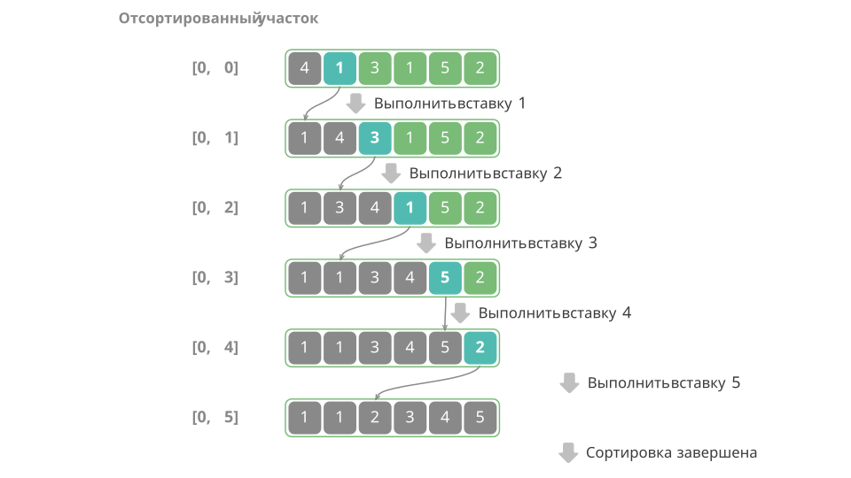

# Сортировка вставками

<u>Сортировка вставками (insertion sort)</u> — простой алгоритм, который во многом напоминает упорядочение игральных карт в руке.

Берём элемент из неотсортированной части, по очереди сравниваем его с элементами отсортированного участка слева и вставляем на подходящее место.

На рисунке показана одна вставка в массив. Пусть вставляемый элемент — `base`. Сдвинем на одну позицию вправо все элементы от целевого индекса до позиции `base`, освобождая место, и запишем `base` по целевому индексу.


## Ход алгоритма

На рисунке показан общий ход сортировки вставками.

1. Вначале первый элемент массива сам по себе уже отсортирован.
2. Берём второй элемент массива в качестве `base` и вставляем на нужное место. Теперь **первые два элемента массива отсортированы**.
3. Берём третий элемент в качестве `base` и вставляем на нужное место. Теперь **первые три элемента массива отсортированы**.
4. Продолжаем так же. На последнем проходе берём последний элемент в качестве `base` и вставляем на нужное место. Теперь **все элементы отсортированы**.



Пример реализации:

```src
[file]{insertion_sort}-[class]{}-[func]{insertion_sort}
```

## Свойства алгоритма

- **Временная сложность $O(n^2)$, адаптивная сортировка**. В худшем случае для последовательных вставок требуется $n - 1$, $n-2$, $\dots$, $2$, $1$ итераций соответственно. Их сумма равна $(n - 1) n / 2$, поэтому временная сложность — $O(n^2)$. На упорядоченных данных поиск места вставки прекращается раньше. Если весь входной массив уже упорядочен, достигается лучшая временная сложность $O(n)$.
- **Пространственная сложность $O(1)$, сортировка на месте**. Указатели $i$ и $j$ занимают постоянный объём дополнительной памяти.
- **Устойчивая сортировка**. Новый элемент вставляется справа от равных ему элементов и сохраняет их порядок.

## Преимущества сортировки вставками

Временная сложность сортировки вставками равна $O(n^2)$, а у быстрой сортировки, которую мы вскоре изучим, — $O(n \log n)$. Несмотря на более высокую сложность, **на малых объёмах данных сортировка вставками обычно быстрее**.

Вывод похож на тот, что мы сделали при сравнении линейного и двоичного поиска. Алгоритмы со сложностью $O(n \log n)$, такие как быстрая сортировка, используют стратегию «разделяй и властвуй» и часто требуют больше элементарных операций за проход. При малом объёме данных значения $n^2$ и $n \log n$ близки, поэтому определяющей становится стоимость отдельного прохода.

Встроенные функции сортировки многих языков, например Java, используют сортировку вставками. Общий принцип таков: длинные массивы обрабатывает алгоритм типа «разделяй и властвуй», например быстрая сортировка, а короткие сразу сортируются вставками.

Хотя сортировки пузырьком, выбором и вставками имеют одну и ту же временную сложность $O(n^2)$, на практике **сортировку вставками применяют заметно чаще двух других**. Вот основные причины.

- При сортировке пузырьком обмен двух элементов требует временной переменной и трёх элементарных операций. При сортировке вставками для сдвига достаточно одного присваивания. Поэтому **вычислительные затраты сортировки пузырьком обычно выше, чем у сортировки вставками**.
- У сортировки выбором временная сложность при любых данных равна $O(n^2)$. **На частично упорядоченных данных сортировка вставками обычно эффективнее сортировки выбором**.
- Сортировка выбором неустойчива, поэтому не подходит для многоуровневой сортировки.
