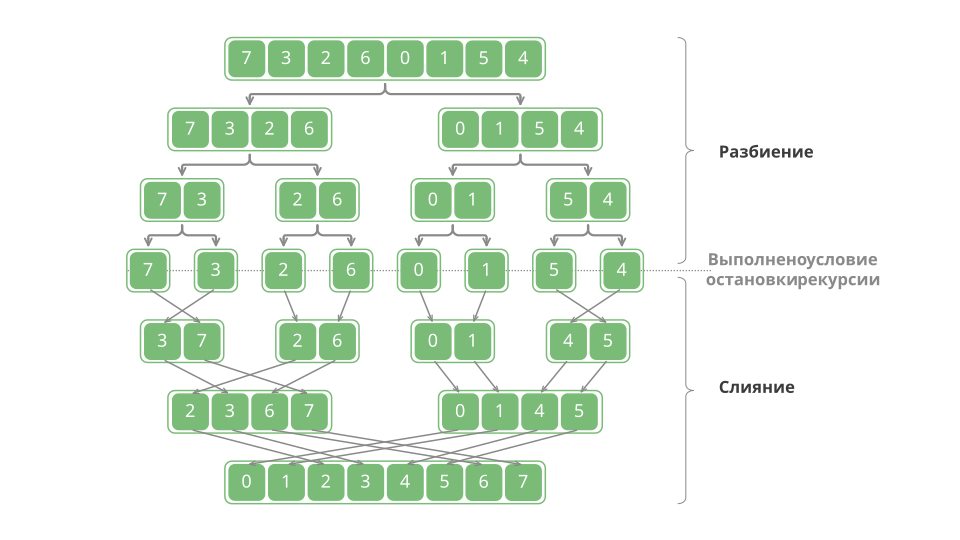
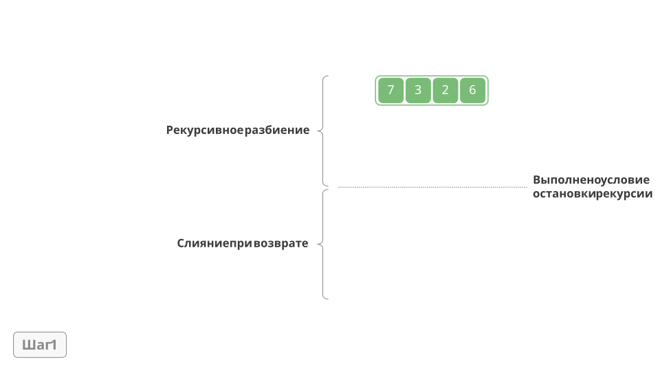
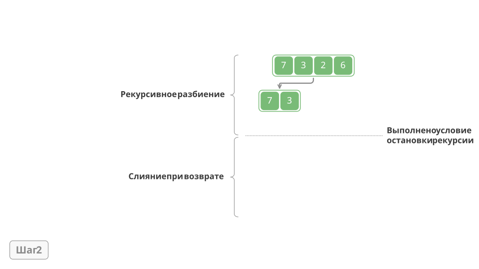
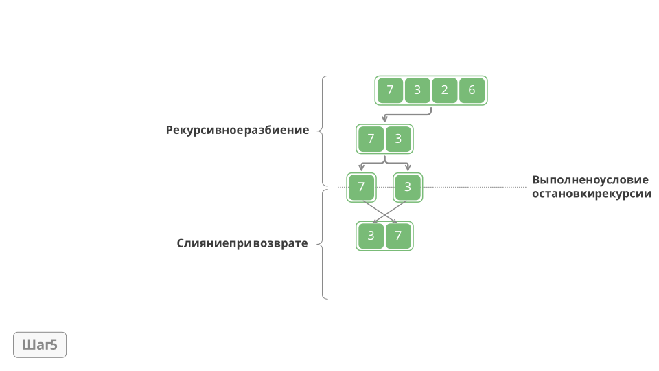
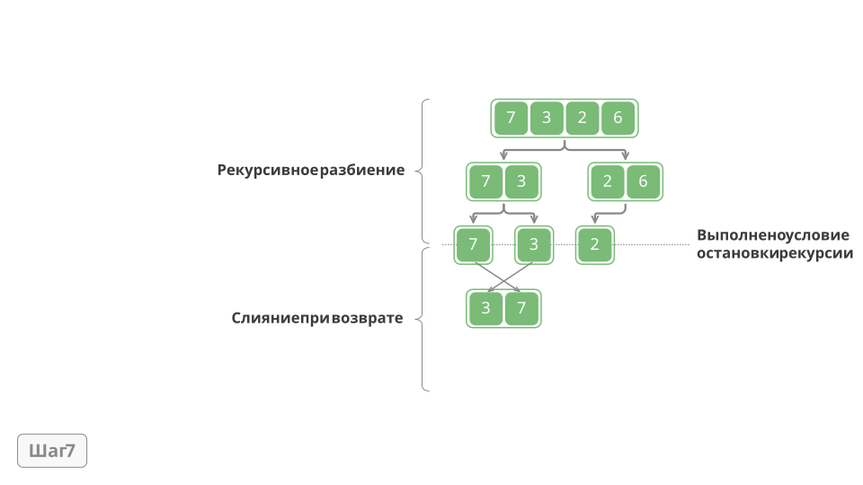
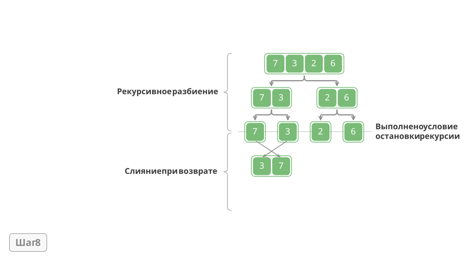
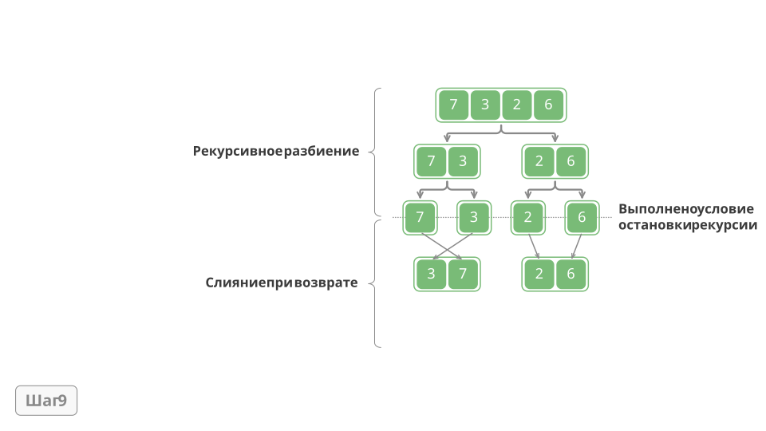
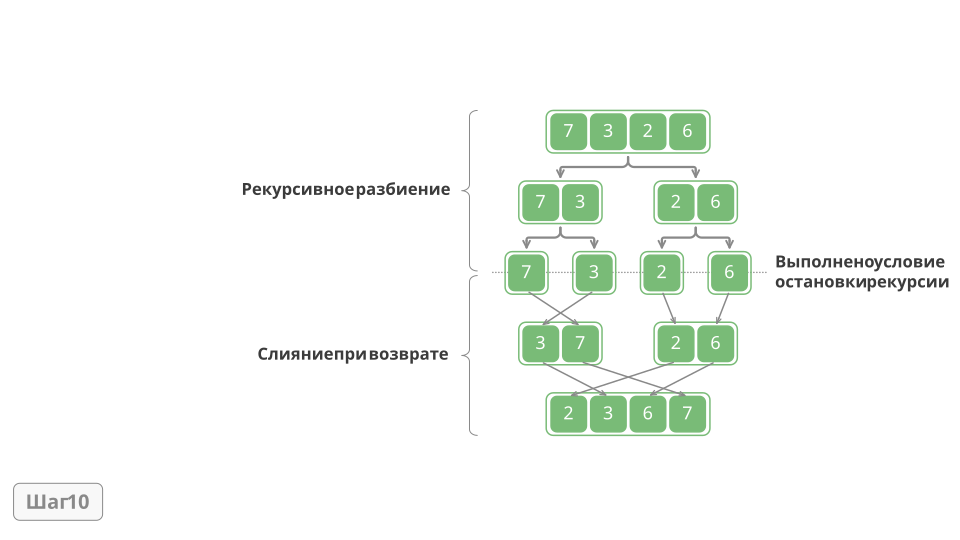

# 11.6 &nbsp; Сортировка слиянием

<u>Сортировка слиянием (merge sort)</u> основана на стратегии «разделяй и властвуй». На рисунке показаны два её этапа: разбиение и слияние.

1. **Разбиение**. Рекурсивно делим массив посередине, сводя сортировку длинного массива к сортировке коротких подмассивов.
2. **Слияние**. При длине подмассива 1 разбиение заканчивается и начинается слияние. Последовательно сливаем два коротких отсортированных подмассива, левый и правый, в один более длинный отсортированный массив, пока не получим окончательный результат.

{ class="animation-figure" }

<p align="center"> Рисунок 11-10 &nbsp; Этапы разбиения и слияния при сортировке слиянием </p>

## 11.6.1 &nbsp; Ход алгоритма

Как видно на рисунке, на этапе разбиения рекурсия идёт сверху вниз: каждый массив делится посередине на два подмассива.

1. Вычисляем середину массива `mid` и рекурсивно делим левый подмассив (участок `[left, mid]`) и правый (участок `[mid + 1, right]`).
2. Рекурсивно повторяем шаг `1.` до тех пор, пока длина участка не станет равной 1.

На этапе слияния идём снизу вверх и объединяем левый и правый подмассивы в один отсортированный массив. Начинаем с одноэлементных подмассивов, поэтому каждый подмассив, поступающий на слияние, уже отсортирован.

=== "<1>"
    { class="animation-figure" }

=== "<2>"
    { class="animation-figure" }

=== "<3>"
    { class="animation-figure" }

=== "<4>"
    { class="animation-figure" }

=== "<5>"
    { class="animation-figure" }

=== "<6>"
    { class="animation-figure" }

=== "<7>"
    { class="animation-figure" }

=== "<8>"
    { class="animation-figure" }

=== "<9>"
    { class="animation-figure" }

=== "<10>"
    { class="animation-figure" }

<p align="center"> Рисунок 11-11 &nbsp; Шаги сортировки слиянием </p>

Порядок рекурсивных вызовов при сортировке слиянием совпадает с обратным обходом двоичного дерева.

- **Обратный обход**: рекурсивно обрабатываем левое поддерево, затем правое и в конце корень.
- **Сортировка слиянием**: рекурсивно обрабатываем левый подмассив, затем правый и в конце выполняем слияние.

Реализация сортировки слиянием приведена ниже. Обратите внимание: в `nums` слияние охватывает участок `[left, right]`, а соответствующий ему участок в `tmp` — это `[0, right - left]`.

=== "Python"

    ```python title="merge_sort.py"
    def merge(nums: list[int], left: int, mid: int, right: int):
        """Слить левый и правый подмассивы"""
        # Левый подмассив занимает [left, mid], правый — [mid+1, right]
        # Создать временный массив tmp для результата слияния
        tmp = [0] * (right - left + 1)
        # Установить индексы на начало левого и правого подмассивов
        i, j, k = left, mid + 1, 0
        # Пока в обоих подмассивах есть элементы, сравнивать их и копировать меньший во временный массив
        while i <= mid and j <= right:
            if nums[i] <= nums[j]:
                tmp[k] = nums[i]
                i += 1
            else:
                tmp[k] = nums[j]
                j += 1
            k += 1
        # Скопировать оставшиеся элементы подмассивов во временный массив
        while i <= mid:
            tmp[k] = nums[i]
            i += 1
            k += 1
        while j <= right:
            tmp[k] = nums[j]
            j += 1
            k += 1
        # Скопировать элементы tmp обратно на соответствующий участок nums
        for k in range(0, len(tmp)):
            nums[left + k] = tmp[k]

    def merge_sort(nums: list[int], left: int, right: int):
        """Сортировка слиянием"""
        # Условие остановки
        if left >= right:
            return  # Завершить рекурсию, когда длина подмассива равна 1
        # Разбиение
        mid = (left + right) // 2 # Вычислить середину
        merge_sort(nums, left, mid)  # Рекурсивно отсортировать левый подмассив
        merge_sort(nums, mid + 1, right)  # Рекурсивно отсортировать правый подмассив
        # Слияние
        merge(nums, left, mid, right)
    ```

=== "C++"

    ```cpp title="merge_sort.cpp"
    /* Слить левый и правый подмассивы */
    void merge(vector<int> &nums, int left, int mid, int right) {
        // Левый подмассив занимает [left, mid], правый — [mid+1, right]
        // Создать временный массив tmp для результата слияния
        vector<int> tmp(right - left + 1);
        // Установить индексы на начало левого и правого подмассивов
        int i = left, j = mid + 1, k = 0;
        // Пока в обоих подмассивах есть элементы, сравнивать их и копировать меньший во временный массив
        while (i <= mid && j <= right) {
            if (nums[i] <= nums[j])
                tmp[k++] = nums[i++];
            else
                tmp[k++] = nums[j++];
        }
        // Скопировать оставшиеся элементы подмассивов во временный массив
        while (i <= mid) {
            tmp[k++] = nums[i++];
        }
        while (j <= right) {
            tmp[k++] = nums[j++];
        }
        // Скопировать элементы tmp обратно на соответствующий участок nums
        for (k = 0; k < tmp.size(); k++) {
            nums[left + k] = tmp[k];
        }
    }

    /* Сортировка слиянием */
    void mergeSort(vector<int> &nums, int left, int right) {
        // Условие остановки
        if (left >= right)
            return; // Завершить рекурсию, когда длина подмассива равна 1
        // Разбиение
        int mid = left + (right - left) / 2;    // Вычислить середину
        mergeSort(nums, left, mid);      // Рекурсивно отсортировать левый подмассив
        mergeSort(nums, mid + 1, right); // Рекурсивно отсортировать правый подмассив
        // Слияние
        merge(nums, left, mid, right);
    }
    ```

=== "Java"

    ```java title="merge_sort.java"
    /* Слить левый и правый подмассивы */
    void merge(int[] nums, int left, int mid, int right) {
        // Левый подмассив занимает [left, mid], правый — [mid+1, right]
        // Создать временный массив tmp для результата слияния
        int[] tmp = new int[right - left + 1];
        // Установить индексы на начало левого и правого подмассивов
        int i = left, j = mid + 1, k = 0;
        // Пока в обоих подмассивах есть элементы, сравнивать их и копировать меньший во временный массив
        while (i <= mid && j <= right) {
            if (nums[i] <= nums[j])
                tmp[k++] = nums[i++];
            else
                tmp[k++] = nums[j++];
        }
        // Скопировать оставшиеся элементы подмассивов во временный массив
        while (i <= mid) {
            tmp[k++] = nums[i++];
        }
        while (j <= right) {
            tmp[k++] = nums[j++];
        }
        // Скопировать элементы tmp обратно на соответствующий участок nums
        for (k = 0; k < tmp.length; k++) {
            nums[left + k] = tmp[k];
        }
    }

    /* Сортировка слиянием */
    void mergeSort(int[] nums, int left, int right) {
        // Условие остановки
        if (left >= right)
            return; // Завершить рекурсию, когда длина подмассива равна 1
        // Разбиение
        int mid = left + (right - left) / 2; // Вычислить середину
        mergeSort(nums, left, mid); // Рекурсивно отсортировать левый подмассив
        mergeSort(nums, mid + 1, right); // Рекурсивно отсортировать правый подмассив
        // Слияние
        merge(nums, left, mid, right);
    }
    ```

=== "C#"

    ```csharp title="merge_sort.cs"
    /* Слить левый и правый подмассивы */
    void Merge(int[] nums, int left, int mid, int right) {
        // Левый подмассив занимает [left, mid], правый — [mid+1, right]
        // Создать временный массив tmp для результата слияния
        int[] tmp = new int[right - left + 1];
        // Установить индексы на начало левого и правого подмассивов
        int i = left, j = mid + 1, k = 0;
        // Пока в обоих подмассивах есть элементы, сравнивать их и копировать меньший во временный массив
        while (i <= mid && j <= right) {
            if (nums[i] <= nums[j])
                tmp[k++] = nums[i++];
            else
                tmp[k++] = nums[j++];
        }
        // Скопировать оставшиеся элементы подмассивов во временный массив
        while (i <= mid) {
            tmp[k++] = nums[i++];
        }
        while (j <= right) {
            tmp[k++] = nums[j++];
        }
        // Скопировать элементы tmp обратно на соответствующий участок nums
        for (k = 0; k < tmp.Length; ++k) {
            nums[left + k] = tmp[k];
        }
    }

    /* Сортировка слиянием */
    void MergeSort(int[] nums, int left, int right) {
        // Условие остановки
        if (left >= right) return;       // Завершить рекурсию, когда длина подмассива равна 1
        // Разбиение
        int mid = left + (right - left) / 2;    // Вычислить середину
        MergeSort(nums, left, mid);      // Рекурсивно отсортировать левый подмассив
        MergeSort(nums, mid + 1, right); // Рекурсивно отсортировать правый подмассив
        // Слияние
        Merge(nums, left, mid, right);
    }
    ```

=== "Go"

    ```go title="merge_sort.go"
    /* Слить левый и правый подмассивы */
    func merge(nums []int, left, mid, right int) {
        // Левый подмассив занимает [left, mid], правый — [mid+1, right]
        // Создать временный массив tmp для результата слияния
        tmp := make([]int, right-left+1)
        // Установить индексы на начало левого и правого подмассивов
        i, j, k := left, mid+1, 0
        // Пока в обоих подмассивах есть элементы, сравнивать их и копировать меньший во временный массив
        for i <= mid && j <= right {
            if nums[i] <= nums[j] {
                tmp[k] = nums[i]
                i++
            } else {
                tmp[k] = nums[j]
                j++
            }
            k++
        }
        // Скопировать оставшиеся элементы подмассивов во временный массив
        for i <= mid {
            tmp[k] = nums[i]
            i++
            k++
        }
        for j <= right {
            tmp[k] = nums[j]
            j++
            k++
        }
        // Скопировать элементы tmp обратно на соответствующий участок nums
        for k := 0; k < len(tmp); k++ {
            nums[left+k] = tmp[k]
        }
    }

    /* Сортировка слиянием */
    func mergeSort(nums []int, left, right int) {
        // Условие остановки
        if left >= right {
            return
        }
        // Разбиение
        mid := left + (right - left) / 2
        mergeSort(nums, left, mid)
        mergeSort(nums, mid+1, right)
        // Слияние
        merge(nums, left, mid, right)
    }
    ```

=== "Swift"

    ```swift title="merge_sort.swift"
    /* Слить левый и правый подмассивы */
    func merge(nums: inout [Int], left: Int, mid: Int, right: Int) {
        // Левый подмассив занимает [left, mid], правый — [mid+1, right]
        // Создать временный массив tmp для результата слияния
        var tmp = Array(repeating: 0, count: right - left + 1)
        // Установить индексы на начало левого и правого подмассивов
        var i = left, j = mid + 1, k = 0
        // Пока в обоих подмассивах есть элементы, сравнивать их и копировать меньший во временный массив
        while i <= mid, j <= right {
            if nums[i] <= nums[j] {
                tmp[k] = nums[i]
                i += 1
            } else {
                tmp[k] = nums[j]
                j += 1
            }
            k += 1
        }
        // Скопировать оставшиеся элементы подмассивов во временный массив
        while i <= mid {
            tmp[k] = nums[i]
            i += 1
            k += 1
        }
        while j <= right {
            tmp[k] = nums[j]
            j += 1
            k += 1
        }
        // Скопировать элементы tmp обратно на соответствующий участок nums
        for k in tmp.indices {
            nums[left + k] = tmp[k]
        }
    }

    /* Сортировка слиянием */
    func mergeSort(nums: inout [Int], left: Int, right: Int) {
        // Условие остановки
        if left >= right { // Завершить рекурсию, когда длина подмассива равна 1
            return
        }
        // Разбиение
        let mid = left + (right - left) / 2 // Вычислить середину
        mergeSort(nums: &nums, left: left, right: mid) // Рекурсивно отсортировать левый подмассив
        mergeSort(nums: &nums, left: mid + 1, right: right) // Рекурсивно отсортировать правый подмассив
        // Слияние
        merge(nums: &nums, left: left, mid: mid, right: right)
    }
    ```

=== "JS"

    ```javascript title="merge_sort.js"
    /* Слить левый и правый подмассивы */
    function merge(nums, left, mid, right) {
        // Левый подмассив занимает [left, mid], правый — [mid+1, right]
        // Создать временный массив tmp для результата слияния
        const tmp = new Array(right - left + 1);
        // Установить индексы на начало левого и правого подмассивов
        let i = left,
            j = mid + 1,
            k = 0;
        // Пока в обоих подмассивах есть элементы, сравнивать их и копировать меньший во временный массив
        while (i <= mid && j <= right) {
            if (nums[i] <= nums[j]) {
                tmp[k++] = nums[i++];
            } else {
                tmp[k++] = nums[j++];
            }
        }
        // Скопировать оставшиеся элементы подмассивов во временный массив
        while (i <= mid) {
            tmp[k++] = nums[i++];
        }
        while (j <= right) {
            tmp[k++] = nums[j++];
        }
        // Скопировать элементы tmp обратно на соответствующий участок nums
        for (k = 0; k < tmp.length; k++) {
            nums[left + k] = tmp[k];
        }
    }

    /* Сортировка слиянием */
    function mergeSort(nums, left, right) {
        // Условие остановки
        if (left >= right) return; // Завершить рекурсию, когда длина подмассива равна 1
        // Разбиение
        let mid = Math.floor(left + (right - left) / 2); // Вычислить середину
        mergeSort(nums, left, mid); // Рекурсивно отсортировать левый подмассив
        mergeSort(nums, mid + 1, right); // Рекурсивно отсортировать правый подмассив
        // Слияние
        merge(nums, left, mid, right);
    }
    ```

=== "TS"

    ```typescript title="merge_sort.ts"
    /* Слить левый и правый подмассивы */
    function merge(nums: number[], left: number, mid: number, right: number): void {
        // Левый подмассив занимает [left, mid], правый — [mid+1, right]
        // Создать временный массив tmp для результата слияния
        const tmp = new Array(right - left + 1);
        // Установить индексы на начало левого и правого подмассивов
        let i = left,
            j = mid + 1,
            k = 0;
        // Пока в обоих подмассивах есть элементы, сравнивать их и копировать меньший во временный массив
        while (i <= mid && j <= right) {
            if (nums[i] <= nums[j]) {
                tmp[k++] = nums[i++];
            } else {
                tmp[k++] = nums[j++];
            }
        }
        // Скопировать оставшиеся элементы подмассивов во временный массив
        while (i <= mid) {
            tmp[k++] = nums[i++];
        }
        while (j <= right) {
            tmp[k++] = nums[j++];
        }
        // Скопировать элементы tmp обратно на соответствующий участок nums
        for (k = 0; k < tmp.length; k++) {
            nums[left + k] = tmp[k];
        }
    }

    /* Сортировка слиянием */
    function mergeSort(nums: number[], left: number, right: number): void {
        // Условие остановки
        if (left >= right) return; // Завершить рекурсию, когда длина подмассива равна 1
        // Разбиение
        let mid = Math.floor(left + (right - left) / 2); // Вычислить середину
        mergeSort(nums, left, mid); // Рекурсивно отсортировать левый подмассив
        mergeSort(nums, mid + 1, right); // Рекурсивно отсортировать правый подмассив
        // Слияние
        merge(nums, left, mid, right);
    }
    ```

=== "Dart"

    ```dart title="merge_sort.dart"
    /* Слить левый и правый подмассивы */
    void merge(List<int> nums, int left, int mid, int right) {
      // Левый подмассив занимает [left, mid], правый — [mid+1, right]
      // Создать временный массив tmp для результата слияния
      List<int> tmp = List.filled(right - left + 1, 0);
      // Установить индексы на начало левого и правого подмассивов
      int i = left, j = mid + 1, k = 0;
      // Пока в обоих подмассивах есть элементы, сравнивать их и копировать меньший во временный массив
      while (i <= mid && j <= right) {
        if (nums[i] <= nums[j])
          tmp[k++] = nums[i++];
        else
          tmp[k++] = nums[j++];
      }
      // Скопировать оставшиеся элементы подмассивов во временный массив
      while (i <= mid) {
        tmp[k++] = nums[i++];
      }
      while (j <= right) {
        tmp[k++] = nums[j++];
      }
      // Скопировать элементы tmp обратно на соответствующий участок nums
      for (k = 0; k < tmp.length; k++) {
        nums[left + k] = tmp[k];
      }
    }

    /* Сортировка слиянием */
    void mergeSort(List<int> nums, int left, int right) {
      // Условие остановки
      if (left >= right) return; // Завершить рекурсию, когда длина подмассива равна 1
      // Разбиение
      int mid = left + (right - left) ~/ 2; // Вычислить середину
      mergeSort(nums, left, mid); // Рекурсивно отсортировать левый подмассив
      mergeSort(nums, mid + 1, right); // Рекурсивно отсортировать правый подмассив
      // Слияние
      merge(nums, left, mid, right);
    }
    ```

=== "Rust"

    ```rust title="merge_sort.rs"
    /* Слить левый и правый подмассивы */
    fn merge(nums: &mut [i32], left: usize, mid: usize, right: usize) {
        // Левый подмассив занимает [left, mid], правый — [mid+1, right]
        // Создать временный массив tmp для результата слияния
        let tmp_size = right - left + 1;
        let mut tmp = vec![0; tmp_size];
        // Установить индексы на начало левого и правого подмассивов
        let (mut i, mut j, mut k) = (left, mid + 1, 0);
        // Пока в обоих подмассивах есть элементы, сравнивать их и копировать меньший во временный массив
        while i <= mid && j <= right {
            if nums[i] <= nums[j] {
                tmp[k] = nums[i];
                i += 1;
            } else {
                tmp[k] = nums[j];
                j += 1;
            }
            k += 1;
        }
        // Скопировать оставшиеся элементы подмассивов во временный массив
        while i <= mid {
            tmp[k] = nums[i];
            k += 1;
            i += 1;
        }
        while j <= right {
            tmp[k] = nums[j];
            k += 1;
            j += 1;
        }
        // Скопировать элементы tmp обратно на соответствующий участок nums
        for k in 0..tmp_size {
            nums[left + k] = tmp[k];
        }
    }

    /* Сортировка слиянием */
    fn merge_sort(nums: &mut [i32], left: usize, right: usize) {
        // Условие остановки
        if left >= right {
            return; // Завершить рекурсию, когда длина подмассива равна 1
        }

        // Разбиение
        let mid = left + (right - left) / 2; // Вычислить середину
        merge_sort(nums, left, mid); // Рекурсивно отсортировать левый подмассив
        merge_sort(nums, mid + 1, right); // Рекурсивно отсортировать правый подмассив

        // Слияние
        merge(nums, left, mid, right);
    }
    ```

=== "C"

    ```c title="merge_sort.c"
    /* Слить левый и правый подмассивы */
    void merge(int *nums, int left, int mid, int right) {
        // Левый подмассив занимает [left, mid], правый — [mid+1, right]
        // Создать временный массив tmp для результата слияния
        int tmpSize = right - left + 1;
        int *tmp = (int *)malloc(tmpSize * sizeof(int));
        // Установить индексы на начало левого и правого подмассивов
        int i = left, j = mid + 1, k = 0;
        // Пока в обоих подмассивах есть элементы, сравнивать их и копировать меньший во временный массив
        while (i <= mid && j <= right) {
            if (nums[i] <= nums[j]) {
                tmp[k++] = nums[i++];
            } else {
                tmp[k++] = nums[j++];
            }
        }
        // Скопировать оставшиеся элементы подмассивов во временный массив
        while (i <= mid) {
            tmp[k++] = nums[i++];
        }
        while (j <= right) {
            tmp[k++] = nums[j++];
        }
        // Скопировать элементы tmp обратно на соответствующий участок nums
        for (k = 0; k < tmpSize; ++k) {
            nums[left + k] = tmp[k];
        }
        // Освободить память
        free(tmp);
    }

    /* Сортировка слиянием */
    void mergeSort(int *nums, int left, int right) {
        // Условие остановки
        if (left >= right)
            return; // Завершить рекурсию, когда длина подмассива равна 1
        // Разбиение
        int mid = left + (right - left) / 2;    // Вычислить середину
        mergeSort(nums, left, mid);      // Рекурсивно отсортировать левый подмассив
        mergeSort(nums, mid + 1, right); // Рекурсивно отсортировать правый подмассив
        // Слияние
        merge(nums, left, mid, right);
    }
    ```

=== "Kotlin"

    ```kotlin title="merge_sort.kt"
    /* Слить левый и правый подмассивы */
    fun merge(nums: IntArray, left: Int, mid: Int, right: Int) {
        // Левый подмассив занимает [left, mid], правый — [mid+1, right]
        // Создать временный массив tmp для результата слияния
        val tmp = IntArray(right - left + 1)
        // Установить индексы на начало левого и правого подмассивов
        var i = left
        var j = mid + 1
        var k = 0
        // Пока в обоих подмассивах есть элементы, сравнивать их и копировать меньший во временный массив
        while (i <= mid && j <= right) {
            if (nums[i] <= nums[j])
                tmp[k++] = nums[i++]
            else
                tmp[k++] = nums[j++]
        }
        // Скопировать оставшиеся элементы подмассивов во временный массив
        while (i <= mid) {
            tmp[k++] = nums[i++]
        }
        while (j <= right) {
            tmp[k++] = nums[j++]
        }
        // Скопировать элементы tmp обратно на соответствующий участок nums
        for (l in tmp.indices) {
            nums[left + l] = tmp[l]
        }
    }

    /* Сортировка слиянием */
    fun mergeSort(nums: IntArray, left: Int, right: Int) {
        // Условие остановки
        if (left >= right) return  // Завершить рекурсию, когда длина подмассива равна 1
        // Разбиение
        val mid = left + (right - left) / 2 // Вычислить середину
        mergeSort(nums, left, mid) // Рекурсивно отсортировать левый подмассив
        mergeSort(nums, mid + 1, right) // Рекурсивно отсортировать правый подмассив
        // Слияние
        merge(nums, left, mid, right)
    }
    ```

=== "Ruby"

    ```ruby title="merge_sort.rb"
    ### Слить левый и правый подмассивы ###
    def merge(nums, left, mid, right)
      # Левый подмассив занимает [left, mid], правый — [mid+1, right]
      # Создать временный массив tmp для результата слияния
      tmp = Array.new(right - left + 1, 0)
      # Установить индексы на начало левого и правого подмассивов
      i, j, k = left, mid + 1, 0
      # Пока в обоих подмассивах есть элементы, сравнивать их и копировать меньший во временный массив
      while i <= mid && j <= right
        if nums[i] <= nums[j]
          tmp[k] = nums[i]
          i += 1
        else
          tmp[k] = nums[j]
          j += 1
        end
        k += 1
      end
      # Скопировать оставшиеся элементы подмассивов во временный массив
      while i <= mid
        tmp[k] = nums[i]
        i += 1
        k += 1
      end
      while j <= right
        tmp[k] = nums[j]
        j += 1
        k += 1
      end
      # Скопировать элементы tmp обратно на соответствующий участок nums
      (0...tmp.length).each do |k|
        nums[left + k] = tmp[k]
      end
    end

    ### Сортировка слиянием ###
    def merge_sort(nums, left, right)
      # Условие остановки
      # Завершить рекурсию, когда длина подмассива равна 1
      return if left >= right
      # Разбиение
      mid = left + (right - left) / 2 # Вычислить середину
      merge_sort(nums, left, mid) # Рекурсивно отсортировать левый подмассив
      merge_sort(nums, mid + 1, right) # Рекурсивно отсортировать правый подмассив
      # Слияние
      merge(nums, left, mid, right)
    end
    ```

??? pythontutor "Визуализация выполнения"

    <div style="height: 549px; width: 100%;"><iframe class="pythontutor-iframe" title="Визуализация выполнения" src="https://pythontutor.com/iframe-embed.html#code=def%20merge%28nums%3A%20list%5Bint%5D,%20left%3A%20int,%20mid%3A%20int,%20right%3A%20int%29%3A%0A%20%22%22%22%D0%A1%D0%BB%D0%B8%D1%82%D1%8C%20%D0%BB%D0%B5%D0%B2%D1%8B%D0%B9%20%D0%B8%20%D0%BF%D1%80%D0%B0%D0%B2%D1%8B%D0%B9%20%D0%BF%D0%BE%D0%B4%D0%BC%D0%B0%D1%81%D1%81%D0%B8%D0%B2%D1%8B%22%22%22%0A%20%23%20%D0%9B%D0%B5%D0%B2%D1%8B%D0%B9%20%D0%BF%D0%BE%D0%B4%D0%BC%D0%B0%D1%81%D1%81%D0%B8%D0%B2%20%D0%B7%D0%B0%D0%BD%D0%B8%D0%BC%D0%B0%D0%B5%D1%82%20%5Bleft,%20mid%5D,%20%D0%BF%D1%80%D0%B0%D0%B2%D1%8B%D0%B9%20%E2%80%94%20%5Bmid%2B1,%20right%5D%0A%20%23%20%D0%A1%D0%BE%D0%B7%D0%B4%D0%B0%D1%82%D1%8C%20%D0%B2%D1%80%D0%B5%D0%BC%D0%B5%D0%BD%D0%BD%D1%8B%D0%B9%20%D0%BC%D0%B0%D1%81%D1%81%D0%B8%D0%B2%20tmp%20%D0%B4%D0%BB%D1%8F%20%D1%80%D0%B5%D0%B7%D1%83%D0%BB%D1%8C%D1%82%D0%B0%D1%82%D0%B0%20%D1%81%D0%BB%D0%B8%D1%8F%D0%BD%D0%B8%D1%8F%0A%20tmp%20%3D%20%5B0%5D%20%2A%20%28right%20-%20left%20%2B%201%29%0A%20%23%20%D0%A3%D1%81%D1%82%D0%B0%D0%BD%D0%BE%D0%B2%D0%B8%D1%82%D1%8C%20%D0%B8%D0%BD%D0%B4%D0%B5%D0%BA%D1%81%D1%8B%20%D0%BD%D0%B0%20%D0%BD%D0%B0%D1%87%D0%B0%D0%BB%D0%BE%20%D0%BB%D0%B5%D0%B2%D0%BE%D0%B3%D0%BE%20%D0%B8%20%D0%BF%D1%80%D0%B0%D0%B2%D0%BE%D0%B3%D0%BE%20%D0%BF%D0%BE%D0%B4%D0%BC%D0%B0%D1%81%D1%81%D0%B8%D0%B2%D0%BE%D0%B2%0A%20i,%20j,%20k%20%3D%20left,%20mid%20%2B%201,%200%0A%20%23%20%D0%9F%D0%BE%D0%BA%D0%B0%20%D0%B2%20%D0%BE%D0%B1%D0%BE%D0%B8%D1%85%20%D0%BF%D0%BE%D0%B4%D0%BC%D0%B0%D1%81%D1%81%D0%B8%D0%B2%D0%B0%D1%85%20%D0%B5%D1%81%D1%82%D1%8C%20%D1%8D%D0%BB%D0%B5%D0%BC%D0%B5%D0%BD%D1%82%D1%8B,%20%D1%81%D1%80%D0%B0%D0%B2%D0%BD%D0%B8%D0%B2%D0%B0%D1%82%D1%8C%20%D0%B8%D1%85%20%D0%B8%20%D0%BA%D0%BE%D0%BF%D0%B8%D1%80%D0%BE%D0%B2%D0%B0%D1%82%D1%8C%20%D0%BC%D0%B5%D0%BD%D1%8C%D1%88%D0%B8%D0%B9%20%D0%B2%D0%BE%20%D0%B2%D1%80%D0%B5%D0%BC%D0%B5%D0%BD%D0%BD%D1%8B%D0%B9%20%D0%BC%D0%B0%D1%81%D1%81%D0%B8%D0%B2%0A%20while%20i%20%3C%3D%20mid%20and%20j%20%3C%3D%20right%3A%0A%20%20if%20nums%5Bi%5D%20%3C%3D%20nums%5Bj%5D%3A%0A%20%20%20tmp%5Bk%5D%20%3D%20nums%5Bi%5D%0A%20%20%20i%20%2B%3D%201%0A%20%20else%3A%0A%20%20%20tmp%5Bk%5D%20%3D%20nums%5Bj%5D%0A%20%20%20j%20%2B%3D%201%0A%20%20k%20%2B%3D%201%0A%20%23%20%D0%A1%D0%BA%D0%BE%D0%BF%D0%B8%D1%80%D0%BE%D0%B2%D0%B0%D1%82%D1%8C%20%D0%BE%D1%81%D1%82%D0%B0%D0%B2%D1%88%D0%B8%D0%B5%D1%81%D1%8F%20%D1%8D%D0%BB%D0%B5%D0%BC%D0%B5%D0%BD%D1%82%D1%8B%20%D0%BF%D0%BE%D0%B4%D0%BC%D0%B0%D1%81%D1%81%D0%B8%D0%B2%D0%BE%D0%B2%20%D0%B2%D0%BE%20%D0%B2%D1%80%D0%B5%D0%BC%D0%B5%D0%BD%D0%BD%D1%8B%D0%B9%20%D0%BC%D0%B0%D1%81%D1%81%D0%B8%D0%B2%0A%20while%20i%20%3C%3D%20mid%3A%0A%20%20tmp%5Bk%5D%20%3D%20nums%5Bi%5D%0A%20%20i%20%2B%3D%201%0A%20%20k%20%2B%3D%201%0A%20while%20j%20%3C%3D%20right%3A%0A%20%20tmp%5Bk%5D%20%3D%20nums%5Bj%5D%0A%20%20j%20%2B%3D%201%0A%20%20k%20%2B%3D%201%0A%20%23%20%D0%A1%D0%BA%D0%BE%D0%BF%D0%B8%D1%80%D0%BE%D0%B2%D0%B0%D1%82%D1%8C%20%D1%8D%D0%BB%D0%B5%D0%BC%D0%B5%D0%BD%D1%82%D1%8B%20tmp%20%D0%BE%D0%B1%D1%80%D0%B0%D1%82%D0%BD%D0%BE%20%D0%BD%D0%B0%20%D1%81%D0%BE%D0%BE%D1%82%D0%B2%D0%B5%D1%82%D1%81%D1%82%D0%B2%D1%83%D1%8E%D1%89%D0%B8%D0%B9%20%D1%83%D1%87%D0%B0%D1%81%D1%82%D0%BE%D0%BA%20nums%0A%20for%20k%20in%20range%280,%20len%28tmp%29%29%3A%0A%20%20nums%5Bleft%20%2B%20k%5D%20%3D%20tmp%5Bk%5D%0A%0A%0Adef%20merge_sort%28nums%3A%20list%5Bint%5D,%20left%3A%20int,%20right%3A%20int%29%3A%0A%20%22%22%22%D0%A1%D0%BE%D1%80%D1%82%D0%B8%D1%80%D0%BE%D0%B2%D0%BA%D0%B0%20%D1%81%D0%BB%D0%B8%D1%8F%D0%BD%D0%B8%D0%B5%D0%BC%22%22%22%0A%20%23%20%D0%A3%D1%81%D0%BB%D0%BE%D0%B2%D0%B8%D0%B5%20%D0%BE%D1%81%D1%82%D0%B0%D0%BD%D0%BE%D0%B2%D0%BA%D0%B8%0A%20if%20left%20%3E%3D%20right%3A%0A%20%20return%20%20%23%20%D0%97%D0%B0%D0%B2%D0%B5%D1%80%D1%88%D0%B8%D1%82%D1%8C%20%D1%80%D0%B5%D0%BA%D1%83%D1%80%D1%81%D0%B8%D1%8E,%20%D0%BA%D0%BE%D0%B3%D0%B4%D0%B0%20%D0%B4%D0%BB%D0%B8%D0%BD%D0%B0%20%D0%BF%D0%BE%D0%B4%D0%BC%D0%B0%D1%81%D1%81%D0%B8%D0%B2%D0%B0%20%D1%80%D0%B0%D0%B2%D0%BD%D0%B0%201%0A%20%23%20%D0%A0%D0%B0%D0%B7%D0%B1%D0%B8%D0%B5%D0%BD%D0%B8%D0%B5%0A%20mid%20%3D%20%28left%20%2B%20right%29%20//%202%20%20%23%20%D0%92%D1%8B%D1%87%D0%B8%D1%81%D0%BB%D0%B8%D1%82%D1%8C%20%D1%81%D0%B5%D1%80%D0%B5%D0%B4%D0%B8%D0%BD%D1%83%0A%20merge_sort%28nums,%20left,%20mid%29%20%20%23%20%D0%A0%D0%B5%D0%BA%D1%83%D1%80%D1%81%D0%B8%D0%B2%D0%BD%D0%BE%20%D0%BE%D1%82%D1%81%D0%BE%D1%80%D1%82%D0%B8%D1%80%D0%BE%D0%B2%D0%B0%D1%82%D1%8C%20%D0%BB%D0%B5%D0%B2%D1%8B%D0%B9%20%D0%BF%D0%BE%D0%B4%D0%BC%D0%B0%D1%81%D1%81%D0%B8%D0%B2%0A%20merge_sort%28nums,%20mid%20%2B%201,%20right%29%20%20%23%20%D0%A0%D0%B5%D0%BA%D1%83%D1%80%D1%81%D0%B8%D0%B2%D0%BD%D0%BE%20%D0%BE%D1%82%D1%81%D0%BE%D1%80%D1%82%D0%B8%D1%80%D0%BE%D0%B2%D0%B0%D1%82%D1%8C%20%D0%BF%D1%80%D0%B0%D0%B2%D1%8B%D0%B9%20%D0%BF%D0%BE%D0%B4%D0%BC%D0%B0%D1%81%D1%81%D0%B8%D0%B2%0A%20%23%20%D0%A1%D0%BB%D0%B8%D1%8F%D0%BD%D0%B8%D0%B5%0A%20merge%28nums,%20left,%20mid,%20right%29%0A%0A%0A%22%22%22Driver%20Code%22%22%22%0Aif%20__name__%20%3D%3D%20%22__main__%22%3A%0A%20nums%20%3D%20%5B7,%203,%202,%206,%200,%201,%205,%204%5D%0A%20merge_sort%28nums,%200,%20len%28nums%29%20-%201%29%0A%20print%28%22%D0%9F%D0%BE%D1%81%D0%BB%D0%B5%20%D1%81%D0%BE%D1%80%D1%82%D0%B8%D1%80%D0%BE%D0%B2%D0%BA%D0%B8%20%D1%81%D0%BB%D0%B8%D1%8F%D0%BD%D0%B8%D0%B5%D0%BC%20nums%20%3D%22,%20nums%29&codeDivHeight=472&codeDivWidth=350&cumulative=false&curInstr=5&heapPrimitives=nevernest&origin=opt-frontend.js&py=311&rawInputLstJSON=%5B%5D&textReferences=false"> </iframe></div>
    <div style="margin-top: 5px;"><a href="https://pythontutor.com/iframe-embed.html#code=def%20merge%28nums%3A%20list%5Bint%5D,%20left%3A%20int,%20mid%3A%20int,%20right%3A%20int%29%3A%0A%20%22%22%22%D0%A1%D0%BB%D0%B8%D1%82%D1%8C%20%D0%BB%D0%B5%D0%B2%D1%8B%D0%B9%20%D0%B8%20%D0%BF%D1%80%D0%B0%D0%B2%D1%8B%D0%B9%20%D0%BF%D0%BE%D0%B4%D0%BC%D0%B0%D1%81%D1%81%D0%B8%D0%B2%D1%8B%22%22%22%0A%20%23%20%D0%9B%D0%B5%D0%B2%D1%8B%D0%B9%20%D0%BF%D0%BE%D0%B4%D0%BC%D0%B0%D1%81%D1%81%D0%B8%D0%B2%20%D0%B7%D0%B0%D0%BD%D0%B8%D0%BC%D0%B0%D0%B5%D1%82%20%5Bleft,%20mid%5D,%20%D0%BF%D1%80%D0%B0%D0%B2%D1%8B%D0%B9%20%E2%80%94%20%5Bmid%2B1,%20right%5D%0A%20%23%20%D0%A1%D0%BE%D0%B7%D0%B4%D0%B0%D1%82%D1%8C%20%D0%B2%D1%80%D0%B5%D0%BC%D0%B5%D0%BD%D0%BD%D1%8B%D0%B9%20%D0%BC%D0%B0%D1%81%D1%81%D0%B8%D0%B2%20tmp%20%D0%B4%D0%BB%D1%8F%20%D1%80%D0%B5%D0%B7%D1%83%D0%BB%D1%8C%D1%82%D0%B0%D1%82%D0%B0%20%D1%81%D0%BB%D0%B8%D1%8F%D0%BD%D0%B8%D1%8F%0A%20tmp%20%3D%20%5B0%5D%20%2A%20%28right%20-%20left%20%2B%201%29%0A%20%23%20%D0%A3%D1%81%D1%82%D0%B0%D0%BD%D0%BE%D0%B2%D0%B8%D1%82%D1%8C%20%D0%B8%D0%BD%D0%B4%D0%B5%D0%BA%D1%81%D1%8B%20%D0%BD%D0%B0%20%D0%BD%D0%B0%D1%87%D0%B0%D0%BB%D0%BE%20%D0%BB%D0%B5%D0%B2%D0%BE%D0%B3%D0%BE%20%D0%B8%20%D0%BF%D1%80%D0%B0%D0%B2%D0%BE%D0%B3%D0%BE%20%D0%BF%D0%BE%D0%B4%D0%BC%D0%B0%D1%81%D1%81%D0%B8%D0%B2%D0%BE%D0%B2%0A%20i,%20j,%20k%20%3D%20left,%20mid%20%2B%201,%200%0A%20%23%20%D0%9F%D0%BE%D0%BA%D0%B0%20%D0%B2%20%D0%BE%D0%B1%D0%BE%D0%B8%D1%85%20%D0%BF%D0%BE%D0%B4%D0%BC%D0%B0%D1%81%D1%81%D0%B8%D0%B2%D0%B0%D1%85%20%D0%B5%D1%81%D1%82%D1%8C%20%D1%8D%D0%BB%D0%B5%D0%BC%D0%B5%D0%BD%D1%82%D1%8B,%20%D1%81%D1%80%D0%B0%D0%B2%D0%BD%D0%B8%D0%B2%D0%B0%D1%82%D1%8C%20%D0%B8%D1%85%20%D0%B8%20%D0%BA%D0%BE%D0%BF%D0%B8%D1%80%D0%BE%D0%B2%D0%B0%D1%82%D1%8C%20%D0%BC%D0%B5%D0%BD%D1%8C%D1%88%D0%B8%D0%B9%20%D0%B2%D0%BE%20%D0%B2%D1%80%D0%B5%D0%BC%D0%B5%D0%BD%D0%BD%D1%8B%D0%B9%20%D0%BC%D0%B0%D1%81%D1%81%D0%B8%D0%B2%0A%20while%20i%20%3C%3D%20mid%20and%20j%20%3C%3D%20right%3A%0A%20%20if%20nums%5Bi%5D%20%3C%3D%20nums%5Bj%5D%3A%0A%20%20%20tmp%5Bk%5D%20%3D%20nums%5Bi%5D%0A%20%20%20i%20%2B%3D%201%0A%20%20else%3A%0A%20%20%20tmp%5Bk%5D%20%3D%20nums%5Bj%5D%0A%20%20%20j%20%2B%3D%201%0A%20%20k%20%2B%3D%201%0A%20%23%20%D0%A1%D0%BA%D0%BE%D0%BF%D0%B8%D1%80%D0%BE%D0%B2%D0%B0%D1%82%D1%8C%20%D0%BE%D1%81%D1%82%D0%B0%D0%B2%D1%88%D0%B8%D0%B5%D1%81%D1%8F%20%D1%8D%D0%BB%D0%B5%D0%BC%D0%B5%D0%BD%D1%82%D1%8B%20%D0%BF%D0%BE%D0%B4%D0%BC%D0%B0%D1%81%D1%81%D0%B8%D0%B2%D0%BE%D0%B2%20%D0%B2%D0%BE%20%D0%B2%D1%80%D0%B5%D0%BC%D0%B5%D0%BD%D0%BD%D1%8B%D0%B9%20%D0%BC%D0%B0%D1%81%D1%81%D0%B8%D0%B2%0A%20while%20i%20%3C%3D%20mid%3A%0A%20%20tmp%5Bk%5D%20%3D%20nums%5Bi%5D%0A%20%20i%20%2B%3D%201%0A%20%20k%20%2B%3D%201%0A%20while%20j%20%3C%3D%20right%3A%0A%20%20tmp%5Bk%5D%20%3D%20nums%5Bj%5D%0A%20%20j%20%2B%3D%201%0A%20%20k%20%2B%3D%201%0A%20%23%20%D0%A1%D0%BA%D0%BE%D0%BF%D0%B8%D1%80%D0%BE%D0%B2%D0%B0%D1%82%D1%8C%20%D1%8D%D0%BB%D0%B5%D0%BC%D0%B5%D0%BD%D1%82%D1%8B%20tmp%20%D0%BE%D0%B1%D1%80%D0%B0%D1%82%D0%BD%D0%BE%20%D0%BD%D0%B0%20%D1%81%D0%BE%D0%BE%D1%82%D0%B2%D0%B5%D1%82%D1%81%D1%82%D0%B2%D1%83%D1%8E%D1%89%D0%B8%D0%B9%20%D1%83%D1%87%D0%B0%D1%81%D1%82%D0%BE%D0%BA%20nums%0A%20for%20k%20in%20range%280,%20len%28tmp%29%29%3A%0A%20%20nums%5Bleft%20%2B%20k%5D%20%3D%20tmp%5Bk%5D%0A%0A%0Adef%20merge_sort%28nums%3A%20list%5Bint%5D,%20left%3A%20int,%20right%3A%20int%29%3A%0A%20%22%22%22%D0%A1%D0%BE%D1%80%D1%82%D0%B8%D1%80%D0%BE%D0%B2%D0%BA%D0%B0%20%D1%81%D0%BB%D0%B8%D1%8F%D0%BD%D0%B8%D0%B5%D0%BC%22%22%22%0A%20%23%20%D0%A3%D1%81%D0%BB%D0%BE%D0%B2%D0%B8%D0%B5%20%D0%BE%D1%81%D1%82%D0%B0%D0%BD%D0%BE%D0%B2%D0%BA%D0%B8%0A%20if%20left%20%3E%3D%20right%3A%0A%20%20return%20%20%23%20%D0%97%D0%B0%D0%B2%D0%B5%D1%80%D1%88%D0%B8%D1%82%D1%8C%20%D1%80%D0%B5%D0%BA%D1%83%D1%80%D1%81%D0%B8%D1%8E,%20%D0%BA%D0%BE%D0%B3%D0%B4%D0%B0%20%D0%B4%D0%BB%D0%B8%D0%BD%D0%B0%20%D0%BF%D0%BE%D0%B4%D0%BC%D0%B0%D1%81%D1%81%D0%B8%D0%B2%D0%B0%20%D1%80%D0%B0%D0%B2%D0%BD%D0%B0%201%0A%20%23%20%D0%A0%D0%B0%D0%B7%D0%B1%D0%B8%D0%B5%D0%BD%D0%B8%D0%B5%0A%20mid%20%3D%20%28left%20%2B%20right%29%20//%202%20%20%23%20%D0%92%D1%8B%D1%87%D0%B8%D1%81%D0%BB%D0%B8%D1%82%D1%8C%20%D1%81%D0%B5%D1%80%D0%B5%D0%B4%D0%B8%D0%BD%D1%83%0A%20merge_sort%28nums,%20left,%20mid%29%20%20%23%20%D0%A0%D0%B5%D0%BA%D1%83%D1%80%D1%81%D0%B8%D0%B2%D0%BD%D0%BE%20%D0%BE%D1%82%D1%81%D0%BE%D1%80%D1%82%D0%B8%D1%80%D0%BE%D0%B2%D0%B0%D1%82%D1%8C%20%D0%BB%D0%B5%D0%B2%D1%8B%D0%B9%20%D0%BF%D0%BE%D0%B4%D0%BC%D0%B0%D1%81%D1%81%D0%B8%D0%B2%0A%20merge_sort%28nums,%20mid%20%2B%201,%20right%29%20%20%23%20%D0%A0%D0%B5%D0%BA%D1%83%D1%80%D1%81%D0%B8%D0%B2%D0%BD%D0%BE%20%D0%BE%D1%82%D1%81%D0%BE%D1%80%D1%82%D0%B8%D1%80%D0%BE%D0%B2%D0%B0%D1%82%D1%8C%20%D0%BF%D1%80%D0%B0%D0%B2%D1%8B%D0%B9%20%D0%BF%D0%BE%D0%B4%D0%BC%D0%B0%D1%81%D1%81%D0%B8%D0%B2%0A%20%23%20%D0%A1%D0%BB%D0%B8%D1%8F%D0%BD%D0%B8%D0%B5%0A%20merge%28nums,%20left,%20mid,%20right%29%0A%0A%0A%22%22%22Driver%20Code%22%22%22%0Aif%20__name__%20%3D%3D%20%22__main__%22%3A%0A%20nums%20%3D%20%5B7,%203,%202,%206,%200,%201,%205,%204%5D%0A%20merge_sort%28nums,%200,%20len%28nums%29%20-%201%29%0A%20print%28%22%D0%9F%D0%BE%D1%81%D0%BB%D0%B5%20%D1%81%D0%BE%D1%80%D1%82%D0%B8%D1%80%D0%BE%D0%B2%D0%BA%D0%B8%20%D1%81%D0%BB%D0%B8%D1%8F%D0%BD%D0%B8%D0%B5%D0%BC%20nums%20%3D%22,%20nums%29&codeDivHeight=800&codeDivWidth=600&cumulative=false&curInstr=5&heapPrimitives=nevernest&origin=opt-frontend.js&py=311&rawInputLstJSON=%5B%5D&textReferences=false" target="_blank" rel="noopener noreferrer">Во весь экран ></a></div>

## 11.6.2 &nbsp; Свойства алгоритма

- **Временная сложность $O(n \log n)$, неадаптивная сортировка**. Разбиение порождает дерево рекурсии высоты $\log n$. На каждом уровне суммарное число операций слияния равно $n$, поэтому общая временная сложность равна $O(n \log n)$.
- **Пространственная сложность $O(n)$, сортировка с дополнительной памятью**. Глубина рекурсии равна $\log n$, а кадры стека занимают $O(\log n)$ памяти. Для слияния нужен вспомогательный массив, который занимает ещё $O(n)$ памяти.
- **Устойчивая сортировка**. При слиянии сохраняется порядок равных элементов.

## 11.6.3 &nbsp; Сортировка связного списка

При работе со связными списками у сортировки слиянием есть важное преимущество перед другими алгоритмами: **пространственную сложность сортировки списка можно снизить до $O(1)$**.

- **Разбиение**. Список можно делить итеративно вместо рекурсивных вызовов, обходясь без памяти для кадров стека рекурсии.
- **Слияние**. Для вставки или удаления узлов связного списка достаточно изменить ссылки (указатели). Поэтому при слиянии двух коротких отсортированных списков в один длинный создавать дополнительный список не требуется.

Детали реализации довольно сложны. Заинтересованный читатель может изучить их по дополнительным материалам.
