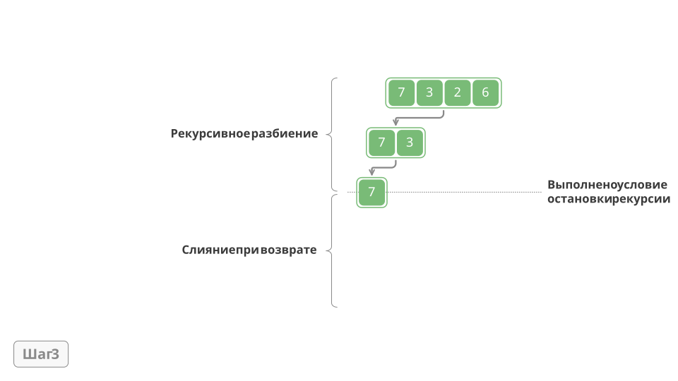
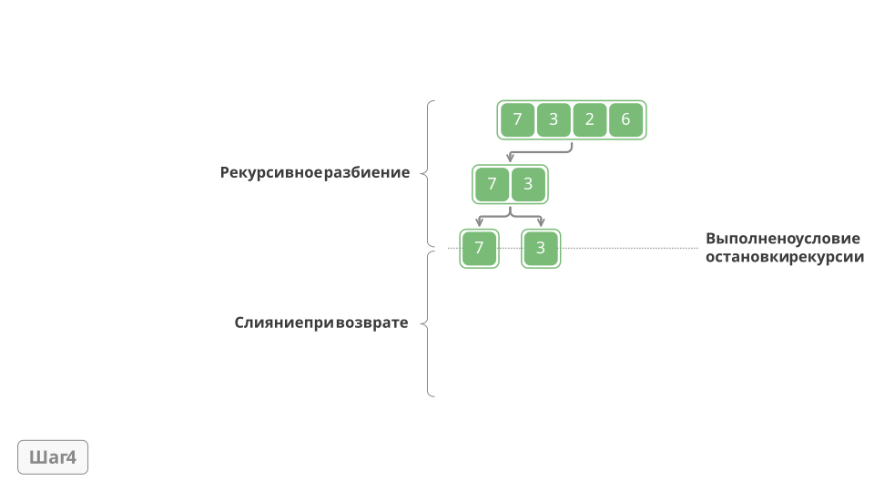
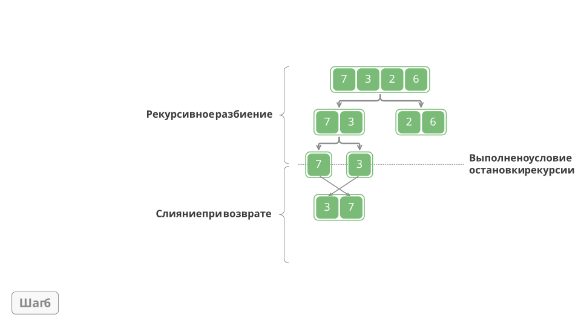

# Сортировка слиянием

<u>Сортировка слиянием (merge sort)</u> основана на стратегии «разделяй и властвуй». На рисунке показаны два её этапа: разбиение и слияние.

1. **Разбиение**. Рекурсивно делим массив посередине, сводя сортировку длинного массива к сортировке коротких подмассивов.
2. **Слияние**. При длине подмассива 1 разбиение заканчивается и начинается слияние. Последовательно сливаем два коротких отсортированных подмассива, левый и правый, в один более длинный отсортированный массив, пока не получим окончательный результат.


## Ход алгоритма

Как видно на рисунке, на этапе разбиения рекурсия идёт сверху вниз: каждый массив делится посередине на два подмассива.

1. Вычисляем середину массива `mid` и рекурсивно делим левый подмассив (участок `[left, mid]`) и правый (участок `[mid + 1, right]`).
2. Рекурсивно повторяем шаг `1.` до тех пор, пока длина участка не станет равной 1.

На этапе слияния идём снизу вверх и объединяем левый и правый подмассивы в один отсортированный массив. Начинаем с одноэлементных подмассивов, поэтому каждый подмассив, поступающий на слияние, уже отсортирован.

=== "<1>"
    

=== "<2>"
    

=== "<3>"
    

=== "<4>"
    

=== "<5>"
    

=== "<6>"
    

=== "<7>"
    

=== "<8>"
    

=== "<9>"
    

=== "<10>"
    

Порядок рекурсивных вызовов при сортировке слиянием совпадает с обратным обходом двоичного дерева.

- **Обратный обход**: рекурсивно обрабатываем левое поддерево, затем правое и в конце корень.
- **Сортировка слиянием**: рекурсивно обрабатываем левый подмассив, затем правый и в конце выполняем слияние.

Реализация сортировки слиянием приведена ниже. Обратите внимание: в `nums` слияние охватывает участок `[left, right]`, а соответствующий ему участок в `tmp` — это `[0, right - left]`.

```src
[file]{merge_sort}-[class]{}-[func]{merge_sort}
```

## Свойства алгоритма

- **Временная сложность $O(n \log n)$, неадаптивная сортировка**. Разбиение порождает дерево рекурсии высоты $\log n$. На каждом уровне суммарное число операций слияния равно $n$, поэтому общая временная сложность равна $O(n \log n)$.
- **Пространственная сложность $O(n)$, сортировка с дополнительной памятью**. Глубина рекурсии равна $\log n$, а кадры стека занимают $O(\log n)$ памяти. Для слияния нужен вспомогательный массив, который занимает ещё $O(n)$ памяти.
- **Устойчивая сортировка**. При слиянии сохраняется порядок равных элементов.

## Сортировка связного списка

При работе со связными списками у сортировки слиянием есть важное преимущество перед другими алгоритмами: **пространственную сложность сортировки списка можно снизить до $O(1)$**.

- **Разбиение**. Список можно делить итеративно вместо рекурсивных вызовов, обходясь без памяти для кадров стека рекурсии.
- **Слияние**. Для вставки или удаления узлов связного списка достаточно изменить ссылки (указатели). Поэтому при слиянии двух коротких отсортированных списков в один длинный создавать дополнительный список не требуется.

Детали реализации довольно сложны. Заинтересованный читатель может изучить их по дополнительным материалам.
