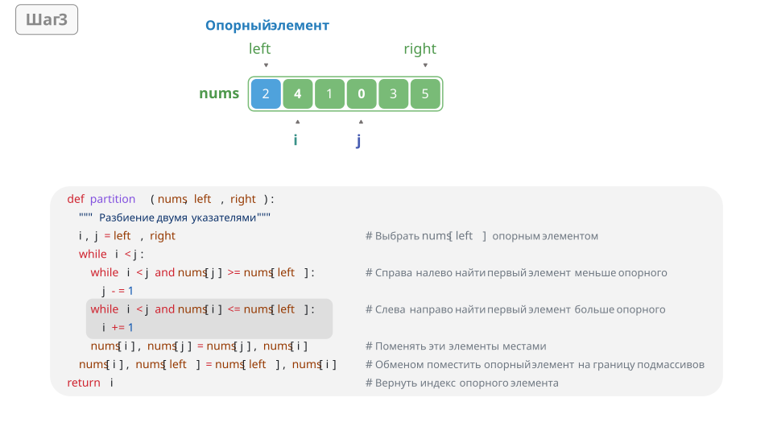

# Быстрая сортировка

<u>Быстрая сортировка (quick sort)</u> — эффективный и широко используемый алгоритм на основе стратегии «разделяй и властвуй».

Основная операция быстрой сортировки — разбиение двумя указателями. Выбираем элемент массива в качестве опорного и перемещаем все элементы меньше него влево, а все элементы больше него вправо. На рисунке показаны шаги разбиения.

1. Выбираем опорным крайний левый элемент массива. Указатели `i` и `j` устанавливаем на левый и правый края соответственно.
2. На каждой итерации с помощью `i` ищем первый элемент больше опорного, а с помощью `j` — первый элемент меньше опорного. Затем меняем найденные элементы местами.
3. Повторяем шаг `2.`, пока `i` и `j` не встретятся. В конце обменом ставим опорный элемент на границу двух подмассивов.

=== "<1>"
    

=== "<2>"
    

=== "<3>"
    

=== "<4>"
    

=== "<5>"
    

=== "<6>"
    

=== "<7>"
    

=== "<8>"
    

=== "<9>"
    

После разбиения в исходном массиве три части: левый подмассив, опорный элемент и правый подмассив. При этом любой элемент слева $\leq$ опорное значение $\leq$ любой элемент справа. Остаётся отсортировать оба подмассива.

!!! note "Стратегия «разделяй и властвуй» в быстрой сортировке"

    Разбиение двумя указателями сводит задачу сортировки длинного массива к сортировке двух более коротких массивов.

```src
[file]{quick_sort}-[class]{quick_sort}-[func]{partition}
```

## Ход алгоритма

Общий ход быстрой сортировки показан на рисунке.

1. Сначала выполняем разбиение исходного массива двумя указателями и получаем левый и правый подмассивы, пока не отсортированные.
2. Затем рекурсивно выполняем разбиение двумя указателями для левого и правого подмассивов.
3. Продолжаем рекурсию до подмассивов длины 1. На этом сортировка всего массива завершается.


```src
[file]{quick_sort}-[class]{quick_sort}-[func]{quick_sort}
```

## Свойства алгоритма

- **Временная сложность $O(n \log n)$, неадаптивная сортировка**. В среднем рекурсивное разбиение даёт $\log n$ уровней, на каждом из которых суммарно выполняется $n$ итераций. Общее время равно $O(n \log n)$. В худшем случае каждое разбиение массива длины $n$ даёт подмассивы длины $0$ и $n - 1$. Число уровней достигает $n$, на каждом выполняется $n$ итераций, а общее время составляет $O(n^2)$.
- **Пространственная сложность $O(n)$, сортировка на месте**. На массиве в полностью обратном порядке глубина рекурсии достигает наихудшего значения $n$, а кадры стека занимают $O(n)$ памяти. Сортировка выполняется в исходном массиве без вспомогательного массива.
- **Неустойчивая сортировка**. На последнем шаге разбиения опорный элемент может переместиться вправо от равного ему элемента.

## Почему быстрая сортировка быстра

Как подсказывает название, быстрая сортировка имеет преимущества в скорости. По средней временной сложности она совпадает с сортировкой слиянием и пирамидальной сортировкой, но обычно работает быстрее по нескольким причинам.

- **Худший случай маловероятен**. Хотя в худшем случае сложность равна $O(n^2)$ и время работы менее предсказуемо, чем у сортировки слиянием, в подавляющем большинстве случаев быстрая сортировка работает за $O(n \log n)$.
- **Эффективное использование кеша**. При разбиении система может загрузить в кеш весь подмассив, что ускоряет доступ к элементам. У алгоритмов со скачкообразным доступом к элементам, таких как пирамидальная сортировка, этого преимущества нет.
- **Малый постоянный множитель**. Из трёх названных алгоритмов быстрая сортировка выполняет меньше всего сравнений, присваиваний и обменов в сумме. По сходной причине сортировка вставками быстрее сортировки пузырьком.

## Улучшение выбора опорного элемента

**На некоторых входных данных быстрая сортировка может замедлиться**. Например, пусть массив упорядочен строго в обратном порядке. Мы выбираем опорным крайний левый элемент, поэтому при первом разбиении он переместится на правый край. Длины левого и правого подмассивов составят $n - 1$ и $0$. Если продолжить рекурсию, после каждого разбиения один из подмассивов будет иметь длину $0$. Стратегия «разделяй и властвуй» теряет эффективность, и быстрая сортировка по характеру работы приближается к сортировке пузырьком.

Чтобы по возможности избежать этого, **улучшим выбор опорного элемента при разбиении**. Например, можно выбирать его случайно. Однако если раз за разом будут попадаться неудачные опорные элементы, эффективность всё равно окажется невысокой.

Языки программирования обычно генерируют псевдослучайные числа. Если построить тест под конкретную псевдослучайную последовательность, быстрая сортировка по-прежнему может замедлиться.

Ещё один способ — выбрать три кандидата (обычно первый, последний и средний по позиции элементы массива) и **взять в качестве опорного медиану этих трёх значений**. Вероятность получить не слишком маленькое и не слишком большое значение заметно возрастает. Для большей надёжности можно взять и больше кандидатов. С таким выбором вероятность ухудшения временной сложности до $O(n^2)$ существенно снижается.

Пример реализации:

```src
[file]{quick_sort}-[class]{quick_sort_median}-[func]{partition}
```

## Уменьшение глубины рекурсии

**На некоторых входных данных быстрой сортировке может понадобиться много памяти**. Рассмотрим полностью упорядоченный массив. Если длина текущего подмассива равна $m$, то после разбиения длина левого подмассива будет $0$, а правого — $m - 1$. Задача на очередном уровне уменьшается всего на один элемент. Высота дерева рекурсии достигает $n - 1$, и для кадров стека требуется $O(n)$ памяти.

Чтобы ограничить рост стека, после каждого разбиения сравним длины подмассивов и **рекурсивно обработаем только более короткий**. Его длина не превосходит $n / 2$, поэтому глубина рекурсии не превысит $\log n$, а пространственная сложность в худшем случае уменьшится до $O(\log n)$. Пример кода:

```src
[file]{quick_sort}-[class]{quick_sort_tail_call}-[func]{quick_sort}
```
