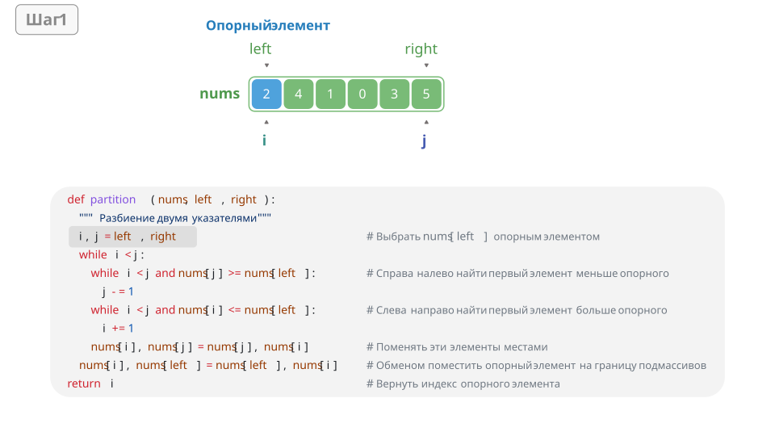
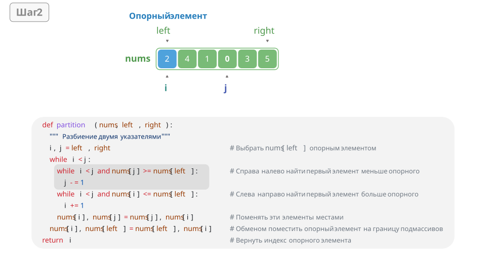
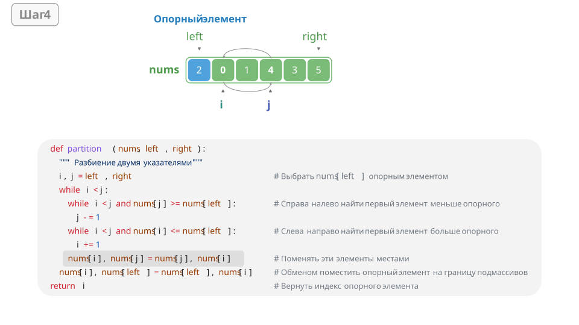
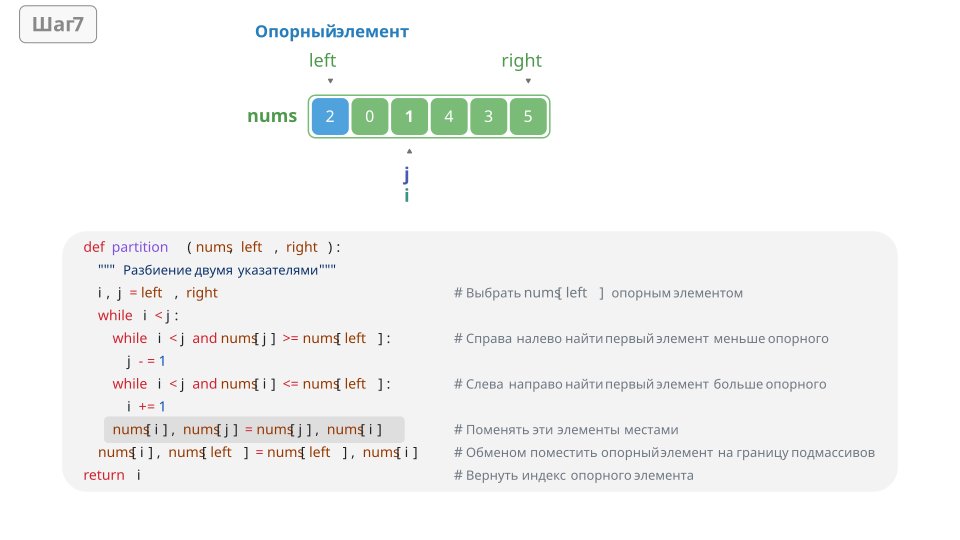
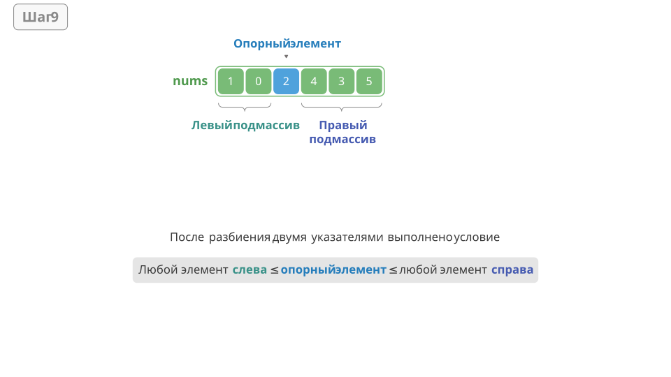
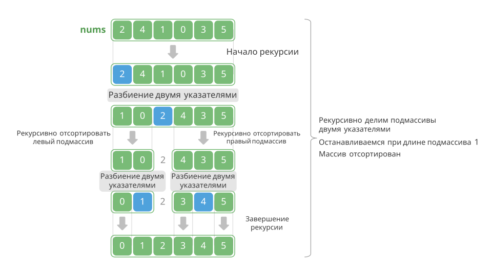

# 11.5 &nbsp; Быстрая сортировка

<u>Быстрая сортировка (quick sort)</u> — эффективный и широко используемый алгоритм на основе стратегии «разделяй и властвуй».

Основная операция быстрой сортировки — разбиение двумя указателями. Выбираем элемент массива в качестве опорного и перемещаем все элементы меньше него влево, а все элементы больше него вправо. На рисунке показаны шаги разбиения.

1. Выбираем опорным крайний левый элемент массива. Указатели `i` и `j` устанавливаем на левый и правый края соответственно.
2. На каждой итерации с помощью `i` ищем первый элемент больше опорного, а с помощью `j` — первый элемент меньше опорного. Затем меняем найденные элементы местами.
3. Повторяем шаг `2.`, пока `i` и `j` не встретятся. В конце обменом ставим опорный элемент на границу двух подмассивов.

=== "<1>"
    { class="animation-figure" }

=== "<2>"
    { class="animation-figure" }

=== "<3>"
    { class="animation-figure" }

=== "<4>"
    { class="animation-figure" }

=== "<5>"
    { class="animation-figure" }

=== "<6>"
    { class="animation-figure" }

=== "<7>"
    { class="animation-figure" }

=== "<8>"
    { class="animation-figure" }

=== "<9>"
    { class="animation-figure" }

<p align="center"> Рисунок 11-8 &nbsp; Шаги разбиения двумя указателями </p>

После разбиения в исходном массиве три части: левый подмассив, опорный элемент и правый подмассив. При этом любой элемент слева $\leq$ опорное значение $\leq$ любой элемент справа. Остаётся отсортировать оба подмассива.

!!! note "Стратегия «разделяй и властвуй» в быстрой сортировке"

    Разбиение двумя указателями сводит задачу сортировки длинного массива к сортировке двух более коротких массивов.

=== "Python"

    ```python title="quick_sort.py"
    def partition(self, nums: list[int], left: int, right: int) -> int:
        """Разбиение двумя указателями"""
        # Выбрать nums[left] опорным элементом
        i, j = left, right
        while i < j:
            while i < j and nums[j] >= nums[left]:
                j -= 1  # Справа налево найти первый элемент меньше опорного
            while i < j and nums[i] <= nums[left]:
                i += 1  # Слева направо найти первый элемент больше опорного
            # Обмен элементов
            nums[i], nums[j] = nums[j], nums[i]
        # Обменом поместить опорный элемент на границу подмассивов
        nums[i], nums[left] = nums[left], nums[i]
        return i  # Вернуть индекс опорного элемента
    ```

=== "C++"

    ```cpp title="quick_sort.cpp"
    /* Разбиение двумя указателями */
    int partition(vector<int> &nums, int left, int right) {
        // Выбрать nums[left] опорным элементом
        int i = left, j = right;
        while (i < j) {
            while (i < j && nums[j] >= nums[left])
                j--;                // Справа налево найти первый элемент меньше опорного
            while (i < j && nums[i] <= nums[left])
                i++;                // Слева направо найти первый элемент больше опорного
            swap(nums[i], nums[j]); // Поменять эти элементы местами
        }
        swap(nums[i], nums[left]);  // Обменом поместить опорный элемент на границу подмассивов
        return i;                   // Вернуть индекс опорного элемента
    }
    ```

=== "Java"

    ```java title="quick_sort.java"
    /* Обмен элементов */
    void swap(int[] nums, int i, int j) {
        int tmp = nums[i];
        nums[i] = nums[j];
        nums[j] = tmp;
    }

    /* Разбиение двумя указателями */
    int partition(int[] nums, int left, int right) {
        // Выбрать nums[left] опорным элементом
        int i = left, j = right;
        while (i < j) {
            while (i < j && nums[j] >= nums[left])
                j--;          // Справа налево найти первый элемент меньше опорного
            while (i < j && nums[i] <= nums[left])
                i++;          // Слева направо найти первый элемент больше опорного
            swap(nums, i, j); // Поменять эти элементы местами
        }
        swap(nums, i, left);  // Обменом поместить опорный элемент на границу подмассивов
        return i;             // Вернуть индекс опорного элемента
    }
    ```

=== "C#"

    ```csharp title="quick_sort.cs"
    /* Обмен элементов */
    void Swap(int[] nums, int i, int j) {
        (nums[j], nums[i]) = (nums[i], nums[j]);
    }

    /* Разбиение двумя указателями */
    int Partition(int[] nums, int left, int right) {
        // Выбрать nums[left] опорным элементом
        int i = left, j = right;
        while (i < j) {
            while (i < j && nums[j] >= nums[left])
                j--;          // Справа налево найти первый элемент меньше опорного
            while (i < j && nums[i] <= nums[left])
                i++;          // Слева направо найти первый элемент больше опорного
            Swap(nums, i, j); // Поменять эти элементы местами
        }
        Swap(nums, i, left);  // Обменом поместить опорный элемент на границу подмассивов
        return i;             // Вернуть индекс опорного элемента
    }
    ```

=== "Go"

    ```go title="quick_sort.go"
    /* Разбиение двумя указателями */
    func (q *quickSort) partition(nums []int, left, right int) int {
        // Выбрать nums[left] опорным элементом
        i, j := left, right
        for i < j {
            for i < j && nums[j] >= nums[left] {
                j-- // Справа налево найти первый элемент меньше опорного
            }
            for i < j && nums[i] <= nums[left] {
                i++ // Слева направо найти первый элемент больше опорного
            }
            // Обмен элементов
            nums[i], nums[j] = nums[j], nums[i]
        }
        // Обменом поместить опорный элемент на границу подмассивов
        nums[i], nums[left] = nums[left], nums[i]
        return i // Вернуть индекс опорного элемента
    }
    ```

=== "Swift"

    ```swift title="quick_sort.swift"
    /* Разбиение двумя указателями */
    func partition(nums: inout [Int], left: Int, right: Int) -> Int {
        // Выбрать nums[left] опорным элементом
        var i = left
        var j = right
        while i < j {
            while i < j, nums[j] >= nums[left] {
                j -= 1 // Справа налево найти первый элемент меньше опорного
            }
            while i < j, nums[i] <= nums[left] {
                i += 1 // Слева направо найти первый элемент больше опорного
            }
            nums.swapAt(i, j) // Поменять эти элементы местами
        }
        nums.swapAt(i, left) // Обменом поместить опорный элемент на границу подмассивов
        return i // Вернуть индекс опорного элемента
    }
    ```

=== "JS"

    ```javascript title="quick_sort.js"
    /* Обмен элементов */
    swap(nums, i, j) {
        let tmp = nums[i];
        nums[i] = nums[j];
        nums[j] = tmp;
    }

    /* Разбиение двумя указателями */
    partition(nums, left, right) {
        // Выбрать nums[left] опорным элементом
        let i = left,
            j = right;
        while (i < j) {
            while (i < j && nums[j] >= nums[left]) {
                j -= 1; // Справа налево найти первый элемент меньше опорного
            }
            while (i < j && nums[i] <= nums[left]) {
                i += 1; // Слева направо найти первый элемент больше опорного
            }
            // Обмен элементов
            this.swap(nums, i, j); // Поменять эти элементы местами
        }
        this.swap(nums, i, left); // Обменом поместить опорный элемент на границу подмассивов
        return i; // Вернуть индекс опорного элемента
    }
    ```

=== "TS"

    ```typescript title="quick_sort.ts"
    /* Обмен элементов */
    swap(nums: number[], i: number, j: number): void {
        let tmp = nums[i];
        nums[i] = nums[j];
        nums[j] = tmp;
    }

    /* Разбиение двумя указателями */
    partition(nums: number[], left: number, right: number): number {
        // Выбрать nums[left] опорным элементом
        let i = left,
            j = right;
        while (i < j) {
            while (i < j && nums[j] >= nums[left]) {
                j -= 1; // Справа налево найти первый элемент меньше опорного
            }
            while (i < j && nums[i] <= nums[left]) {
                i += 1; // Слева направо найти первый элемент больше опорного
            }
            // Обмен элементов
            this.swap(nums, i, j); // Поменять эти элементы местами
        }
        this.swap(nums, i, left); // Обменом поместить опорный элемент на границу подмассивов
        return i; // Вернуть индекс опорного элемента
    }
    ```

=== "Dart"

    ```dart title="quick_sort.dart"
    /* Обмен элементов */
    void _swap(List<int> nums, int i, int j) {
      int tmp = nums[i];
      nums[i] = nums[j];
      nums[j] = tmp;
    }

    /* Разбиение двумя указателями */
    int _partition(List<int> nums, int left, int right) {
      // Выбрать nums[left] опорным элементом
      int i = left, j = right;
      while (i < j) {
        while (i < j && nums[j] >= nums[left]) j--; // Справа налево найти первый элемент меньше опорного
        while (i < j && nums[i] <= nums[left]) i++; // Слева направо найти первый элемент больше опорного
        _swap(nums, i, j); // Поменять эти элементы местами
      }
      _swap(nums, i, left); // Обменом поместить опорный элемент на границу подмассивов
      return i; // Вернуть индекс опорного элемента
    }
    ```

=== "Rust"

    ```rust title="quick_sort.rs"
    /* Разбиение двумя указателями */
    fn partition(nums: &mut [i32], left: usize, right: usize) -> usize {
        // Выбрать nums[left] опорным элементом
        let (mut i, mut j) = (left, right);
        while i < j {
            while i < j && nums[j] >= nums[left] {
                j -= 1; // Справа налево найти первый элемент меньше опорного
            }
            while i < j && nums[i] <= nums[left] {
                i += 1; // Слева направо найти первый элемент больше опорного
            }
            nums.swap(i, j); // Поменять эти элементы местами
        }
        nums.swap(i, left); // Обменом поместить опорный элемент на границу подмассивов
        i // Вернуть индекс опорного элемента
    }
    ```

=== "C"

    ```c title="quick_sort.c"
    /* Обмен элементов */
    void swap(int nums[], int i, int j) {
        int tmp = nums[i];
        nums[i] = nums[j];
        nums[j] = tmp;
    }

    /* Разбиение двумя указателями */
    int partition(int nums[], int left, int right) {
        // Выбрать nums[left] опорным элементом
        int i = left, j = right;
        while (i < j) {
            while (i < j && nums[j] >= nums[left]) {
                j--; // Справа налево найти первый элемент меньше опорного
            }
            while (i < j && nums[i] <= nums[left]) {
                i++; // Слева направо найти первый элемент больше опорного
            }
            // Поменять эти элементы местами
            swap(nums, i, j);
        }
        // Обменом поместить опорный элемент на границу подмассивов
        swap(nums, i, left);
        // Вернуть индекс опорного элемента
        return i;
    }
    ```

=== "Kotlin"

    ```kotlin title="quick_sort.kt"
    /* Обмен элементов */
    fun swap(nums: IntArray, i: Int, j: Int) {
        val temp = nums[i]
        nums[i] = nums[j]
        nums[j] = temp
    }

    /* Разбиение двумя указателями */
    fun partition(nums: IntArray, left: Int, right: Int): Int {
        // Выбрать nums[left] опорным элементом
        var i = left
        var j = right
        while (i < j) {
            while (i < j && nums[j] >= nums[left])
                j--           // Справа налево найти первый элемент меньше опорного
            while (i < j && nums[i] <= nums[left])
                i++           // Слева направо найти первый элемент больше опорного
            swap(nums, i, j)  // Поменять эти элементы местами
        }
        swap(nums, i, left)   // Обменом поместить опорный элемент на границу подмассивов
        return i              // Вернуть индекс опорного элемента
    }
    ```

=== "Ruby"

    ```ruby title="quick_sort.rb"
    ### Разбиение двумя указателями ###
    def partition(nums, left, right)
      # Выбрать nums[left] опорным элементом
      i, j = left, right
      while i < j
        while i < j && nums[j] >= nums[left]
          j -= 1 # Справа налево найти первый элемент меньше опорного
        end
        while i < j && nums[i] <= nums[left]
          i += 1 # Слева направо найти первый элемент больше опорного
        end
        # Обмен элементов
        nums[i], nums[j] = nums[j], nums[i]
      end
      # Обменом поместить опорный элемент на границу подмассивов
      nums[i], nums[left] = nums[left], nums[i]
      i # Вернуть индекс опорного элемента
    end
    ```

??? pythontutor "Визуализация выполнения"

    <div style="height: 549px; width: 100%;"><iframe class="pythontutor-iframe" title="Визуализация выполнения" src="https://pythontutor.com/iframe-embed.html#code=def%20partition%28nums%3A%20list%5Bint%5D,%20left%3A%20int,%20right%3A%20int%29%20-%3E%20int%3A%0A%20%20%20%20%22%22%22%D0%A0%D0%B0%D0%B7%D0%B1%D0%B8%D0%B5%D0%BD%D0%B8%D0%B5%20%D0%B4%D0%B2%D1%83%D0%BC%D1%8F%20%D1%83%D0%BA%D0%B0%D0%B7%D0%B0%D1%82%D0%B5%D0%BB%D1%8F%D0%BC%D0%B8%22%22%22%0A%20%20%20%20%23%20%D0%9E%D0%BF%D0%BE%D1%80%D0%B0%20%E2%80%94%20nums%5Bleft%5D%0A%20%20%20%20i,%20j%20%3D%20left,%20right%0A%20%20%20%20while%20i%20%3C%20j%3A%0A%20%20%20%20%20%20%20%20while%20i%20%3C%20j%20and%20nums%5Bj%5D%20%3E%3D%20nums%5Bleft%5D%3A%0A%20%20%20%20%20%20%20%20%20%20%20%20j%20-%3D%201%20%20%23%20%D0%A1%D0%BF%D1%80%D0%B0%D0%B2%D0%B0%20%D0%BD%D0%B0%D0%B9%D1%82%D0%B8%20%D0%BF%D0%B5%D1%80%D0%B2%D1%8B%D0%B9%20%D1%8D%D0%BB%D0%B5%D0%BC%D0%B5%D0%BD%D1%82%20%3C%20%D0%BE%D0%BF%D0%BE%D1%80%D1%8B%0A%20%20%20%20%20%20%20%20while%20i%20%3C%20j%20and%20nums%5Bi%5D%20%3C%3D%20nums%5Bleft%5D%3A%0A%20%20%20%20%20%20%20%20%20%20%20%20i%20%2B%3D%201%20%20%23%20%D0%A1%D0%BB%D0%B5%D0%B2%D0%B0%20%D0%BD%D0%B0%D0%B9%D1%82%D0%B8%20%D0%BF%D0%B5%D1%80%D0%B2%D1%8B%D0%B9%20%D1%8D%D0%BB%D0%B5%D0%BC%D0%B5%D0%BD%D1%82%20%3E%20%D0%BE%D0%BF%D0%BE%D1%80%D1%8B%0A%20%20%20%20%20%20%20%20%23%20%D0%9E%D0%B1%D0%BC%D0%B5%D0%BD%0A%20%20%20%20%20%20%20%20nums%5Bi%5D,%20nums%5Bj%5D%20%3D%20nums%5Bj%5D,%20nums%5Bi%5D%0A%20%20%20%20%23%20%D0%9E%D0%B1%D0%BC%D0%B5%D0%BD%D0%BE%D0%BC%20%D0%BF%D0%BE%D1%81%D1%82%D0%B0%D0%B2%D0%B8%D1%82%D1%8C%20%D0%BE%D0%BF%D0%BE%D1%80%D1%83%20%D0%BD%D0%B0%20%D0%B3%D1%80%D0%B0%D0%BD%D0%B8%D1%86%D1%83%20%D1%87%D0%B0%D1%81%D1%82%D0%B5%D0%B9%0A%20%20%20%20nums%5Bi%5D,%20nums%5Bleft%5D%20%3D%20nums%5Bleft%5D,%20nums%5Bi%5D%0A%20%20%20%20return%20i%20%20%23%20%D0%92%D0%B5%D1%80%D0%BD%D1%83%D1%82%D1%8C%20%D0%B8%D0%BD%D0%B4%D0%B5%D0%BA%D1%81%20%D0%BE%D0%BF%D0%BE%D1%80%D1%8B%0A%0A%0A%22%22%22Driver%20Code%22%22%22%0Aif%20__name__%20%3D%3D%20%22__main__%22%3A%0A%20%20%20%20nums%20%3D%20%5B2,%204,%201,%200,%203,%205%5D%0A%20%20%20%20partition%28nums,%200,%20len%28nums%29%20-%201%29%0A%20%20%20%20print%28%22%D0%9F%D0%BE%D1%81%D0%BB%D0%B5%20%D1%80%D0%B0%D0%B7%D0%B1%D0%B8%D0%B5%D0%BD%D0%B8%D1%8F%20%D0%B4%D0%B2%D1%83%D0%BC%D1%8F%20%D1%83%D0%BA%D0%B0%D0%B7%D0%B0%D1%82%D0%B5%D0%BB%D1%8F%D0%BC%D0%B8%20nums%20%3D%22,%20nums%29&codeDivHeight=472&codeDivWidth=350&cumulative=false&curInstr=4&heapPrimitives=nevernest&origin=opt-frontend.js&py=311&rawInputLstJSON=%5B%5D&textReferences=false"> </iframe></div>
    <div style="margin-top: 5px;"><a href="https://pythontutor.com/iframe-embed.html#code=def%20partition%28nums%3A%20list%5Bint%5D,%20left%3A%20int,%20right%3A%20int%29%20-%3E%20int%3A%0A%20%20%20%20%22%22%22%D0%A0%D0%B0%D0%B7%D0%B1%D0%B8%D0%B5%D0%BD%D0%B8%D0%B5%20%D0%B4%D0%B2%D1%83%D0%BC%D1%8F%20%D1%83%D0%BA%D0%B0%D0%B7%D0%B0%D1%82%D0%B5%D0%BB%D1%8F%D0%BC%D0%B8%22%22%22%0A%20%20%20%20%23%20%D0%9E%D0%BF%D0%BE%D1%80%D0%B0%20%E2%80%94%20nums%5Bleft%5D%0A%20%20%20%20i,%20j%20%3D%20left,%20right%0A%20%20%20%20while%20i%20%3C%20j%3A%0A%20%20%20%20%20%20%20%20while%20i%20%3C%20j%20and%20nums%5Bj%5D%20%3E%3D%20nums%5Bleft%5D%3A%0A%20%20%20%20%20%20%20%20%20%20%20%20j%20-%3D%201%20%20%23%20%D0%A1%D0%BF%D1%80%D0%B0%D0%B2%D0%B0%20%D0%BD%D0%B0%D0%B9%D1%82%D0%B8%20%D0%BF%D0%B5%D1%80%D0%B2%D1%8B%D0%B9%20%D1%8D%D0%BB%D0%B5%D0%BC%D0%B5%D0%BD%D1%82%20%3C%20%D0%BE%D0%BF%D0%BE%D1%80%D1%8B%0A%20%20%20%20%20%20%20%20while%20i%20%3C%20j%20and%20nums%5Bi%5D%20%3C%3D%20nums%5Bleft%5D%3A%0A%20%20%20%20%20%20%20%20%20%20%20%20i%20%2B%3D%201%20%20%23%20%D0%A1%D0%BB%D0%B5%D0%B2%D0%B0%20%D0%BD%D0%B0%D0%B9%D1%82%D0%B8%20%D0%BF%D0%B5%D1%80%D0%B2%D1%8B%D0%B9%20%D1%8D%D0%BB%D0%B5%D0%BC%D0%B5%D0%BD%D1%82%20%3E%20%D0%BE%D0%BF%D0%BE%D1%80%D1%8B%0A%20%20%20%20%20%20%20%20%23%20%D0%9E%D0%B1%D0%BC%D0%B5%D0%BD%0A%20%20%20%20%20%20%20%20nums%5Bi%5D,%20nums%5Bj%5D%20%3D%20nums%5Bj%5D,%20nums%5Bi%5D%0A%20%20%20%20%23%20%D0%9E%D0%B1%D0%BC%D0%B5%D0%BD%D0%BE%D0%BC%20%D0%BF%D0%BE%D1%81%D1%82%D0%B0%D0%B2%D0%B8%D1%82%D1%8C%20%D0%BE%D0%BF%D0%BE%D1%80%D1%83%20%D0%BD%D0%B0%20%D0%B3%D1%80%D0%B0%D0%BD%D0%B8%D1%86%D1%83%20%D1%87%D0%B0%D1%81%D1%82%D0%B5%D0%B9%0A%20%20%20%20nums%5Bi%5D,%20nums%5Bleft%5D%20%3D%20nums%5Bleft%5D,%20nums%5Bi%5D%0A%20%20%20%20return%20i%20%20%23%20%D0%92%D0%B5%D1%80%D0%BD%D1%83%D1%82%D1%8C%20%D0%B8%D0%BD%D0%B4%D0%B5%D0%BA%D1%81%20%D0%BE%D0%BF%D0%BE%D1%80%D1%8B%0A%0A%0A%22%22%22Driver%20Code%22%22%22%0Aif%20__name__%20%3D%3D%20%22__main__%22%3A%0A%20%20%20%20nums%20%3D%20%5B2,%204,%201,%200,%203,%205%5D%0A%20%20%20%20partition%28nums,%200,%20len%28nums%29%20-%201%29%0A%20%20%20%20print%28%22%D0%9F%D0%BE%D1%81%D0%BB%D0%B5%20%D1%80%D0%B0%D0%B7%D0%B1%D0%B8%D0%B5%D0%BD%D0%B8%D1%8F%20%D0%B4%D0%B2%D1%83%D0%BC%D1%8F%20%D1%83%D0%BA%D0%B0%D0%B7%D0%B0%D1%82%D0%B5%D0%BB%D1%8F%D0%BC%D0%B8%20nums%20%3D%22,%20nums%29&codeDivHeight=800&codeDivWidth=600&cumulative=false&curInstr=4&heapPrimitives=nevernest&origin=opt-frontend.js&py=311&rawInputLstJSON=%5B%5D&textReferences=false" target="_blank" rel="noopener noreferrer">Во весь экран ></a></div>

## 11.5.1 &nbsp; Ход алгоритма

Общий ход быстрой сортировки показан на рисунке.

1. Сначала выполняем разбиение исходного массива двумя указателями и получаем левый и правый подмассивы, пока не отсортированные.
2. Затем рекурсивно выполняем разбиение двумя указателями для левого и правого подмассивов.
3. Продолжаем рекурсию до подмассивов длины 1. На этом сортировка всего массива завершается.

{ class="animation-figure" }

<p align="center"> Рисунок 11-9 &nbsp; Ход быстрой сортировки </p>

=== "Python"

    ```python title="quick_sort.py"
    def quick_sort(self, nums: list[int], left: int, right: int):
        """Быстрая сортировка"""
        # Завершить рекурсию при длине подмассива 1
        if left >= right:
            return
        # Разбиение двумя указателями
        pivot = self.partition(nums, left, right)
        # Рекурсивно отсортировать левый и правый подмассивы
        self.quick_sort(nums, left, pivot - 1)
        self.quick_sort(nums, pivot + 1, right)
    ```

=== "C++"

    ```cpp title="quick_sort.cpp"
    /* Быстрая сортировка */
    void quickSort(vector<int> &nums, int left, int right) {
        // Завершить рекурсию при длине подмассива 1
        if (left >= right)
            return;
        // Разбиение двумя указателями
        int pivot = partition(nums, left, right);
        // Рекурсивно отсортировать левый и правый подмассивы
        quickSort(nums, left, pivot - 1);
        quickSort(nums, pivot + 1, right);
    }
    ```

=== "Java"

    ```java title="quick_sort.java"
    /* Быстрая сортировка */
    void quickSort(int[] nums, int left, int right) {
        // Завершить рекурсию при длине подмассива 1
        if (left >= right)
            return;
        // Разбиение двумя указателями
        int pivot = partition(nums, left, right);
        // Рекурсивно отсортировать левый и правый подмассивы
        quickSort(nums, left, pivot - 1);
        quickSort(nums, pivot + 1, right);
    }
    ```

=== "C#"

    ```csharp title="quick_sort.cs"
    /* Быстрая сортировка */
    void QuickSort(int[] nums, int left, int right) {
        // Завершить рекурсию при длине подмассива 1
        if (left >= right)
            return;
        // Разбиение двумя указателями
        int pivot = Partition(nums, left, right);
        // Рекурсивно отсортировать левый и правый подмассивы
        QuickSort(nums, left, pivot - 1);
        QuickSort(nums, pivot + 1, right);
    }
    ```

=== "Go"

    ```go title="quick_sort.go"
    /* Быстрая сортировка */
    func (q *quickSort) quickSort(nums []int, left, right int) {
        // Завершить рекурсию при длине подмассива 1
        if left >= right {
            return
        }
        // Разбиение двумя указателями
        pivot := q.partition(nums, left, right)
        // Рекурсивно отсортировать левый и правый подмассивы
        q.quickSort(nums, left, pivot-1)
        q.quickSort(nums, pivot+1, right)
    }
    ```

=== "Swift"

    ```swift title="quick_sort.swift"
    /* Быстрая сортировка */
    func quickSort(nums: inout [Int], left: Int, right: Int) {
        // Завершить рекурсию при длине подмассива 1
        if left >= right {
            return
        }
        // Разбиение двумя указателями
        let pivot = partition(nums: &nums, left: left, right: right)
        // Рекурсивно отсортировать левый и правый подмассивы
        quickSort(nums: &nums, left: left, right: pivot - 1)
        quickSort(nums: &nums, left: pivot + 1, right: right)
    }
    ```

=== "JS"

    ```javascript title="quick_sort.js"
    /* Быстрая сортировка */
    quickSort(nums, left, right) {
        // Завершить рекурсию при длине подмассива 1
        if (left >= right) return;
        // Разбиение двумя указателями
        const pivot = this.partition(nums, left, right);
        // Рекурсивно отсортировать левый и правый подмассивы
        this.quickSort(nums, left, pivot - 1);
        this.quickSort(nums, pivot + 1, right);
    }
    ```

=== "TS"

    ```typescript title="quick_sort.ts"
    /* Быстрая сортировка */
    quickSort(nums: number[], left: number, right: number): void {
        // Завершить рекурсию при длине подмассива 1
        if (left >= right) {
            return;
        }
        // Разбиение двумя указателями
        const pivot = this.partition(nums, left, right);
        // Рекурсивно отсортировать левый и правый подмассивы
        this.quickSort(nums, left, pivot - 1);
        this.quickSort(nums, pivot + 1, right);
    }
    ```

=== "Dart"

    ```dart title="quick_sort.dart"
    /* Быстрая сортировка */
    void quickSort(List<int> nums, int left, int right) {
      // Завершить рекурсию при длине подмассива 1
      if (left >= right) return;
      // Разбиение двумя указателями
      int pivot = _partition(nums, left, right);
      // Рекурсивно отсортировать левый и правый подмассивы
      quickSort(nums, left, pivot - 1);
      quickSort(nums, pivot + 1, right);
    }
    ```

=== "Rust"

    ```rust title="quick_sort.rs"
    /* Быстрая сортировка */
    pub fn quick_sort(left: i32, right: i32, nums: &mut [i32]) {
        // Завершить рекурсию при длине подмассива 1
        if left >= right {
            return;
        }
        // Разбиение двумя указателями
        let pivot = Self::partition(nums, left as usize, right as usize) as i32;
        // Рекурсивно отсортировать левый и правый подмассивы
        Self::quick_sort(left, pivot - 1, nums);
        Self::quick_sort(pivot + 1, right, nums);
    }
    ```

=== "C"

    ```c title="quick_sort.c"
    /* Быстрая сортировка */
    void quickSort(int nums[], int left, int right) {
        // Завершить рекурсию при длине подмассива 1
        if (left >= right) {
            return;
        }
        // Разбиение двумя указателями
        int pivot = partition(nums, left, right);
        // Рекурсивно отсортировать левый и правый подмассивы
        quickSort(nums, left, pivot - 1);
        quickSort(nums, pivot + 1, right);
    }
    ```

=== "Kotlin"

    ```kotlin title="quick_sort.kt"
    /* Быстрая сортировка */
    fun quickSort(nums: IntArray, left: Int, right: Int) {
        // Завершить рекурсию при длине подмассива 1
        if (left >= right) return
        // Разбиение двумя указателями
        val pivot = partition(nums, left, right)
        // Рекурсивно отсортировать левый и правый подмассивы
        quickSort(nums, left, pivot - 1)
        quickSort(nums, pivot + 1, right)
    }
    ```

=== "Ruby"

    ```ruby title="quick_sort.rb"
    ### Класс быстрой сортировки ###
    def quick_sort(nums, left, right)
      # Рекурсивный вызов при длине подмассива, отличной от 1
      if left < right
        # Разбиение двумя указателями
        pivot = partition(nums, left, right)
        # Рекурсивно отсортировать левый и правый подмассивы
        quick_sort(nums, left, pivot - 1)
        quick_sort(nums, pivot + 1, right)
      end
      nums
    end
    ```

??? pythontutor "Визуализация выполнения"

    <div style="height: 549px; width: 100%;"><iframe class="pythontutor-iframe" title="Визуализация выполнения" src="https://pythontutor.com/iframe-embed.html#code=def%20partition%28nums%3A%20list%5Bint%5D,%20left%3A%20int,%20right%3A%20int%29%20-%3E%20int%3A%0A%20%20%20%20%22%22%22%D0%A0%D0%B0%D0%B7%D0%B1%D0%B8%D0%B5%D0%BD%D0%B8%D0%B5%20%D0%B4%D0%B2%D1%83%D0%BC%D1%8F%20%D1%83%D0%BA%D0%B0%D0%B7%D0%B0%D1%82%D0%B5%D0%BB%D1%8F%D0%BC%D0%B8%22%22%22%0A%20%20%20%20%23%20%D0%9E%D0%BF%D0%BE%D1%80%D0%B0%20%E2%80%94%20nums%5Bleft%5D%0A%20%20%20%20i,%20j%20%3D%20left,%20right%0A%20%20%20%20while%20i%20%3C%20j%3A%0A%20%20%20%20%20%20%20%20while%20i%20%3C%20j%20and%20nums%5Bj%5D%20%3E%3D%20nums%5Bleft%5D%3A%0A%20%20%20%20%20%20%20%20%20%20%20%20j%20-%3D%201%20%20%23%20%D0%A1%D0%BF%D1%80%D0%B0%D0%B2%D0%B0%20%D0%BD%D0%B0%D0%B9%D1%82%D0%B8%20%D0%BF%D0%B5%D1%80%D0%B2%D1%8B%D0%B9%20%D1%8D%D0%BB%D0%B5%D0%BC%D0%B5%D0%BD%D1%82%20%3C%20%D0%BE%D0%BF%D0%BE%D1%80%D1%8B%0A%20%20%20%20%20%20%20%20while%20i%20%3C%20j%20and%20nums%5Bi%5D%20%3C%3D%20nums%5Bleft%5D%3A%0A%20%20%20%20%20%20%20%20%20%20%20%20i%20%2B%3D%201%20%20%23%20%D0%A1%D0%BB%D0%B5%D0%B2%D0%B0%20%D0%BD%D0%B0%D0%B9%D1%82%D0%B8%20%D0%BF%D0%B5%D1%80%D0%B2%D1%8B%D0%B9%20%D1%8D%D0%BB%D0%B5%D0%BC%D0%B5%D0%BD%D1%82%20%3E%20%D0%BE%D0%BF%D0%BE%D1%80%D1%8B%0A%20%20%20%20%20%20%20%20%23%20%D0%9E%D0%B1%D0%BC%D0%B5%D0%BD%0A%20%20%20%20%20%20%20%20nums%5Bi%5D,%20nums%5Bj%5D%20%3D%20nums%5Bj%5D,%20nums%5Bi%5D%0A%20%20%20%20%23%20%D0%9E%D0%B1%D0%BC%D0%B5%D0%BD%D0%BE%D0%BC%20%D0%BF%D0%BE%D1%81%D1%82%D0%B0%D0%B2%D0%B8%D1%82%D1%8C%20%D0%BE%D0%BF%D0%BE%D1%80%D1%83%20%D0%BD%D0%B0%20%D0%B3%D1%80%D0%B0%D0%BD%D0%B8%D1%86%D1%83%20%D1%87%D0%B0%D1%81%D1%82%D0%B5%D0%B9%0A%20%20%20%20nums%5Bi%5D,%20nums%5Bleft%5D%20%3D%20nums%5Bleft%5D,%20nums%5Bi%5D%0A%20%20%20%20return%20i%20%20%23%20%D0%92%D0%B5%D1%80%D0%BD%D1%83%D1%82%D1%8C%20%D0%B8%D0%BD%D0%B4%D0%B5%D0%BA%D1%81%20%D0%BE%D0%BF%D0%BE%D1%80%D1%8B%0A%0Adef%20quick_sort%28nums%3A%20list%5Bint%5D,%20left%3A%20int,%20right%3A%20int%29%3A%0A%20%20%20%20%22%22%22%D0%91%D1%8B%D1%81%D1%82%D1%80%D0%B0%D1%8F%20%D1%81%D0%BE%D1%80%D1%82%D0%B8%D1%80%D0%BE%D0%B2%D0%BA%D0%B0%22%22%22%0A%20%20%20%20%23%20%D0%97%D0%B0%D0%B2%D0%B5%D1%80%D1%88%D0%B8%D1%82%D1%8C%20%D1%80%D0%B5%D0%BA%D1%83%D1%80%D1%81%D0%B8%D1%8E%20%D0%BF%D1%80%D0%B8%20%D0%B4%D0%BB%D0%B8%D0%BD%D0%B5%20%D0%BF%D0%BE%D0%B4%D0%BC%D0%B0%D1%81%D1%81%D0%B8%D0%B2%D0%B0%201%0A%20%20%20%20if%20left%20%3E%3D%20right%3A%0A%20%20%20%20%20%20%20%20return%0A%20%20%20%20%23%20%D0%A0%D0%B0%D0%B7%D0%B1%D0%B8%D0%B5%D0%BD%D0%B8%D0%B5%20%D0%B4%D0%B2%D1%83%D0%BC%D1%8F%20%D1%83%D0%BA%D0%B0%D0%B7%D0%B0%D1%82%D0%B5%D0%BB%D1%8F%D0%BC%D0%B8%0A%20%20%20%20pivot%20%3D%20partition%28nums,%20left,%20right%29%0A%20%20%20%20%23%20%D0%A0%D0%B5%D0%BA%D1%83%D1%80%D1%81%D0%B8%D0%B2%D0%BD%D0%BE%20%D0%BE%D1%82%D1%81%D0%BE%D1%80%D1%82%D0%B8%D1%80%D0%BE%D0%B2%D0%B0%D1%82%D1%8C%20%D0%BB%D0%B5%D0%B2%D1%8B%D0%B9%20%D0%B8%20%D0%BF%D1%80%D0%B0%D0%B2%D1%8B%D0%B9%20%D0%BF%D0%BE%D0%B4%D0%BC%D0%B0%D1%81%D1%81%D0%B8%D0%B2%D1%8B%0A%20%20%20%20quick_sort%28nums,%20left,%20pivot%20-%201%29%0A%20%20%20%20quick_sort%28nums,%20pivot%20%2B%201,%20right%29%0A%0A%0A%22%22%22Driver%20Code%22%22%22%0Aif%20__name__%20%3D%3D%20%22__main__%22%3A%0A%20%20%20%20%23%20%D0%91%D1%8B%D1%81%D1%82%D1%80%D0%B0%D1%8F%20%D1%81%D0%BE%D1%80%D1%82%D0%B8%D1%80%D0%BE%D0%B2%D0%BA%D0%B0%0A%20%20%20%20nums%20%3D%20%5B2,%204,%201,%200,%203,%205%5D%0A%20%20%20%20quick_sort%28nums,%200,%20len%28nums%29%20-%201%29%0A%20%20%20%20print%28%22%D0%9F%D0%BE%D1%81%D0%BB%D0%B5%20%D0%B1%D1%8B%D1%81%D1%82%D1%80%D0%BE%D0%B9%20%D1%81%D0%BE%D1%80%D1%82%D0%B8%D1%80%D0%BE%D0%B2%D0%BA%D0%B8%20nums%20%3D%22,%20nums%29&codeDivHeight=472&codeDivWidth=350&cumulative=false&curInstr=5&heapPrimitives=nevernest&origin=opt-frontend.js&py=311&rawInputLstJSON=%5B%5D&textReferences=false"> </iframe></div>
    <div style="margin-top: 5px;"><a href="https://pythontutor.com/iframe-embed.html#code=def%20partition%28nums%3A%20list%5Bint%5D,%20left%3A%20int,%20right%3A%20int%29%20-%3E%20int%3A%0A%20%20%20%20%22%22%22%D0%A0%D0%B0%D0%B7%D0%B1%D0%B8%D0%B5%D0%BD%D0%B8%D0%B5%20%D0%B4%D0%B2%D1%83%D0%BC%D1%8F%20%D1%83%D0%BA%D0%B0%D0%B7%D0%B0%D1%82%D0%B5%D0%BB%D1%8F%D0%BC%D0%B8%22%22%22%0A%20%20%20%20%23%20%D0%9E%D0%BF%D0%BE%D1%80%D0%B0%20%E2%80%94%20nums%5Bleft%5D%0A%20%20%20%20i,%20j%20%3D%20left,%20right%0A%20%20%20%20while%20i%20%3C%20j%3A%0A%20%20%20%20%20%20%20%20while%20i%20%3C%20j%20and%20nums%5Bj%5D%20%3E%3D%20nums%5Bleft%5D%3A%0A%20%20%20%20%20%20%20%20%20%20%20%20j%20-%3D%201%20%20%23%20%D0%A1%D0%BF%D1%80%D0%B0%D0%B2%D0%B0%20%D0%BD%D0%B0%D0%B9%D1%82%D0%B8%20%D0%BF%D0%B5%D1%80%D0%B2%D1%8B%D0%B9%20%D1%8D%D0%BB%D0%B5%D0%BC%D0%B5%D0%BD%D1%82%20%3C%20%D0%BE%D0%BF%D0%BE%D1%80%D1%8B%0A%20%20%20%20%20%20%20%20while%20i%20%3C%20j%20and%20nums%5Bi%5D%20%3C%3D%20nums%5Bleft%5D%3A%0A%20%20%20%20%20%20%20%20%20%20%20%20i%20%2B%3D%201%20%20%23%20%D0%A1%D0%BB%D0%B5%D0%B2%D0%B0%20%D0%BD%D0%B0%D0%B9%D1%82%D0%B8%20%D0%BF%D0%B5%D1%80%D0%B2%D1%8B%D0%B9%20%D1%8D%D0%BB%D0%B5%D0%BC%D0%B5%D0%BD%D1%82%20%3E%20%D0%BE%D0%BF%D0%BE%D1%80%D1%8B%0A%20%20%20%20%20%20%20%20%23%20%D0%9E%D0%B1%D0%BC%D0%B5%D0%BD%0A%20%20%20%20%20%20%20%20nums%5Bi%5D,%20nums%5Bj%5D%20%3D%20nums%5Bj%5D,%20nums%5Bi%5D%0A%20%20%20%20%23%20%D0%9E%D0%B1%D0%BC%D0%B5%D0%BD%D0%BE%D0%BC%20%D0%BF%D0%BE%D1%81%D1%82%D0%B0%D0%B2%D0%B8%D1%82%D1%8C%20%D0%BE%D0%BF%D0%BE%D1%80%D1%83%20%D0%BD%D0%B0%20%D0%B3%D1%80%D0%B0%D0%BD%D0%B8%D1%86%D1%83%20%D1%87%D0%B0%D1%81%D1%82%D0%B5%D0%B9%0A%20%20%20%20nums%5Bi%5D,%20nums%5Bleft%5D%20%3D%20nums%5Bleft%5D,%20nums%5Bi%5D%0A%20%20%20%20return%20i%20%20%23%20%D0%92%D0%B5%D1%80%D0%BD%D1%83%D1%82%D1%8C%20%D0%B8%D0%BD%D0%B4%D0%B5%D0%BA%D1%81%20%D0%BE%D0%BF%D0%BE%D1%80%D1%8B%0A%0Adef%20quick_sort%28nums%3A%20list%5Bint%5D,%20left%3A%20int,%20right%3A%20int%29%3A%0A%20%20%20%20%22%22%22%D0%91%D1%8B%D1%81%D1%82%D1%80%D0%B0%D1%8F%20%D1%81%D0%BE%D1%80%D1%82%D0%B8%D1%80%D0%BE%D0%B2%D0%BA%D0%B0%22%22%22%0A%20%20%20%20%23%20%D0%97%D0%B0%D0%B2%D0%B5%D1%80%D1%88%D0%B8%D1%82%D1%8C%20%D1%80%D0%B5%D0%BA%D1%83%D1%80%D1%81%D0%B8%D1%8E%20%D0%BF%D1%80%D0%B8%20%D0%B4%D0%BB%D0%B8%D0%BD%D0%B5%20%D0%BF%D0%BE%D0%B4%D0%BC%D0%B0%D1%81%D1%81%D0%B8%D0%B2%D0%B0%201%0A%20%20%20%20if%20left%20%3E%3D%20right%3A%0A%20%20%20%20%20%20%20%20return%0A%20%20%20%20%23%20%D0%A0%D0%B0%D0%B7%D0%B1%D0%B8%D0%B5%D0%BD%D0%B8%D0%B5%20%D0%B4%D0%B2%D1%83%D0%BC%D1%8F%20%D1%83%D0%BA%D0%B0%D0%B7%D0%B0%D1%82%D0%B5%D0%BB%D1%8F%D0%BC%D0%B8%0A%20%20%20%20pivot%20%3D%20partition%28nums,%20left,%20right%29%0A%20%20%20%20%23%20%D0%A0%D0%B5%D0%BA%D1%83%D1%80%D1%81%D0%B8%D0%B2%D0%BD%D0%BE%20%D0%BE%D1%82%D1%81%D0%BE%D1%80%D1%82%D0%B8%D1%80%D0%BE%D0%B2%D0%B0%D1%82%D1%8C%20%D0%BB%D0%B5%D0%B2%D1%8B%D0%B9%20%D0%B8%20%D0%BF%D1%80%D0%B0%D0%B2%D1%8B%D0%B9%20%D0%BF%D0%BE%D0%B4%D0%BC%D0%B0%D1%81%D1%81%D0%B8%D0%B2%D1%8B%0A%20%20%20%20quick_sort%28nums,%20left,%20pivot%20-%201%29%0A%20%20%20%20quick_sort%28nums,%20pivot%20%2B%201,%20right%29%0A%0A%0A%22%22%22Driver%20Code%22%22%22%0Aif%20__name__%20%3D%3D%20%22__main__%22%3A%0A%20%20%20%20%23%20%D0%91%D1%8B%D1%81%D1%82%D1%80%D0%B0%D1%8F%20%D1%81%D0%BE%D1%80%D1%82%D0%B8%D1%80%D0%BE%D0%B2%D0%BA%D0%B0%0A%20%20%20%20nums%20%3D%20%5B2,%204,%201,%200,%203,%205%5D%0A%20%20%20%20quick_sort%28nums,%200,%20len%28nums%29%20-%201%29%0A%20%20%20%20print%28%22%D0%9F%D0%BE%D1%81%D0%BB%D0%B5%20%D0%B1%D1%8B%D1%81%D1%82%D1%80%D0%BE%D0%B9%20%D1%81%D0%BE%D1%80%D1%82%D0%B8%D1%80%D0%BE%D0%B2%D0%BA%D0%B8%20nums%20%3D%22,%20nums%29&codeDivHeight=800&codeDivWidth=600&cumulative=false&curInstr=5&heapPrimitives=nevernest&origin=opt-frontend.js&py=311&rawInputLstJSON=%5B%5D&textReferences=false" target="_blank" rel="noopener noreferrer">Во весь экран ></a></div>

## 11.5.2 &nbsp; Свойства алгоритма

- **Временная сложность $O(n \log n)$, неадаптивная сортировка**. В среднем рекурсивное разбиение даёт $\log n$ уровней, на каждом из которых суммарно выполняется $n$ итераций. Общее время равно $O(n \log n)$. В худшем случае каждое разбиение массива длины $n$ даёт подмассивы длины $0$ и $n - 1$. Число уровней достигает $n$, на каждом выполняется $n$ итераций, а общее время составляет $O(n^2)$.
- **Пространственная сложность $O(n)$, сортировка на месте**. На массиве в полностью обратном порядке глубина рекурсии достигает наихудшего значения $n$, а кадры стека занимают $O(n)$ памяти. Сортировка выполняется в исходном массиве без вспомогательного массива.
- **Неустойчивая сортировка**. На последнем шаге разбиения опорный элемент может переместиться вправо от равного ему элемента.

## 11.5.3 &nbsp; Почему быстрая сортировка быстра

Как подсказывает название, быстрая сортировка имеет преимущества в скорости. По средней временной сложности она совпадает с сортировкой слиянием и пирамидальной сортировкой, но обычно работает быстрее по нескольким причинам.

- **Худший случай маловероятен**. Хотя в худшем случае сложность равна $O(n^2)$ и время работы менее предсказуемо, чем у сортировки слиянием, в подавляющем большинстве случаев быстрая сортировка работает за $O(n \log n)$.
- **Эффективное использование кеша**. При разбиении система может загрузить в кеш весь подмассив, что ускоряет доступ к элементам. У алгоритмов со скачкообразным доступом к элементам, таких как пирамидальная сортировка, этого преимущества нет.
- **Малый постоянный множитель**. Из трёх названных алгоритмов быстрая сортировка выполняет меньше всего сравнений, присваиваний и обменов в сумме. По сходной причине сортировка вставками быстрее сортировки пузырьком.

## 11.5.4 &nbsp; Улучшение выбора опорного элемента

**На некоторых входных данных быстрая сортировка может замедлиться**. Например, пусть массив упорядочен строго в обратном порядке. Мы выбираем опорным крайний левый элемент, поэтому при первом разбиении он переместится на правый край. Длины левого и правого подмассивов составят $n - 1$ и $0$. Если продолжить рекурсию, после каждого разбиения один из подмассивов будет иметь длину $0$. Стратегия «разделяй и властвуй» теряет эффективность, и быстрая сортировка по характеру работы приближается к сортировке пузырьком.

Чтобы по возможности избежать этого, **улучшим выбор опорного элемента при разбиении**. Например, можно выбирать его случайно. Однако если раз за разом будут попадаться неудачные опорные элементы, эффективность всё равно окажется невысокой.

Языки программирования обычно генерируют псевдослучайные числа. Если построить тест под конкретную псевдослучайную последовательность, быстрая сортировка по-прежнему может замедлиться.

Ещё один способ — выбрать три кандидата (обычно первый, последний и средний по позиции элементы массива) и **взять в качестве опорного медиану этих трёх значений**. Вероятность получить не слишком маленькое и не слишком большое значение заметно возрастает. Для большей надёжности можно взять и больше кандидатов. С таким выбором вероятность ухудшения временной сложности до $O(n^2)$ существенно снижается.

Пример реализации:

=== "Python"

    ```python title="quick_sort.py"
    def median_three(self, nums: list[int], left: int, mid: int, right: int) -> int:
        """Выбрать медиану трёх кандидатов"""
        l, m, r = nums[left], nums[mid], nums[right]
        if (l <= m <= r) or (r <= m <= l):
            return mid  # m лежит между l и r
        if (m <= l <= r) or (r <= l <= m):
            return left  # l лежит между m и r
        return right

    def partition(self, nums: list[int], left: int, right: int) -> int:
        """Разбиение двумя указателями с выбором медианы трёх"""
        # Выбрать nums[left] опорным элементом
        med = self.median_three(nums, left, (left + right) // 2, right)
        # Обменом поместить медиану в начало массива
        nums[left], nums[med] = nums[med], nums[left]
        # Выбрать nums[left] опорным элементом
        i, j = left, right
        while i < j:
            while i < j and nums[j] >= nums[left]:
                j -= 1  # Справа налево найти первый элемент меньше опорного
            while i < j and nums[i] <= nums[left]:
                i += 1  # Слева направо найти первый элемент больше опорного
            # Обмен элементов
            nums[i], nums[j] = nums[j], nums[i]
        # Обменом поместить опорный элемент на границу подмассивов
        nums[i], nums[left] = nums[left], nums[i]
        return i  # Вернуть индекс опорного элемента
    ```

=== "C++"

    ```cpp title="quick_sort.cpp"
    /* Выбрать медиану трёх кандидатов */
    int medianThree(vector<int> &nums, int left, int mid, int right) {
        int l = nums[left], m = nums[mid], r = nums[right];
        if ((l <= m && m <= r) || (r <= m && m <= l))
            return mid; // m лежит между l и r
        if ((m <= l && l <= r) || (r <= l && l <= m))
            return left; // l лежит между m и r
        return right;
    }

    /* Разбиение двумя указателями с выбором медианы трёх */
    int partition(vector<int> &nums, int left, int right) {
        // Выбрать медиану трёх кандидатов
        int med = medianThree(nums, left, (left + right) / 2, right);
        // Обменом поместить медиану в начало массива
        swap(nums[left], nums[med]);
        // Выбрать nums[left] опорным элементом
        int i = left, j = right;
        while (i < j) {
            while (i < j && nums[j] >= nums[left])
                j--;                // Справа налево найти первый элемент меньше опорного
            while (i < j && nums[i] <= nums[left])
                i++;                // Слева направо найти первый элемент больше опорного
            swap(nums[i], nums[j]); // Поменять эти элементы местами
        }
        swap(nums[i], nums[left]);  // Обменом поместить опорный элемент на границу подмассивов
        return i;                   // Вернуть индекс опорного элемента
    }
    ```

=== "Java"

    ```java title="quick_sort.java"
    /* Выбрать медиану трёх кандидатов */
    int medianThree(int[] nums, int left, int mid, int right) {
        int l = nums[left], m = nums[mid], r = nums[right];
        if ((l <= m && m <= r) || (r <= m && m <= l))
            return mid; // m лежит между l и r
        if ((m <= l && l <= r) || (r <= l && l <= m))
            return left; // l лежит между m и r
        return right;
    }

    /* Разбиение двумя указателями с выбором медианы трёх */
    int partition(int[] nums, int left, int right) {
        // Выбрать медиану трёх кандидатов
        int med = medianThree(nums, left, (left + right) / 2, right);
        // Обменом поместить медиану в начало массива
        swap(nums, left, med);
        // Выбрать nums[left] опорным элементом
        int i = left, j = right;
        while (i < j) {
            while (i < j && nums[j] >= nums[left])
                j--;          // Справа налево найти первый элемент меньше опорного
            while (i < j && nums[i] <= nums[left])
                i++;          // Слева направо найти первый элемент больше опорного
            swap(nums, i, j); // Поменять эти элементы местами
        }
        swap(nums, i, left);  // Обменом поместить опорный элемент на границу подмассивов
        return i;             // Вернуть индекс опорного элемента
    }
    ```

=== "C#"

    ```csharp title="quick_sort.cs"
    /* Выбрать медиану трёх кандидатов */
    int MedianThree(int[] nums, int left, int mid, int right) {
        int l = nums[left], m = nums[mid], r = nums[right];
        if ((l <= m && m <= r) || (r <= m && m <= l))
            return mid; // m лежит между l и r
        if ((m <= l && l <= r) || (r <= l && l <= m))
            return left; // l лежит между m и r
        return right;
    }

    /* Разбиение двумя указателями с выбором медианы трёх */
    int Partition(int[] nums, int left, int right) {
        // Выбрать медиану трёх кандидатов
        int med = MedianThree(nums, left, (left + right) / 2, right);
        // Обменом поместить медиану в начало массива
        Swap(nums, left, med);
        // Выбрать nums[left] опорным элементом
        int i = left, j = right;
        while (i < j) {
            while (i < j && nums[j] >= nums[left])
                j--;          // Справа налево найти первый элемент меньше опорного
            while (i < j && nums[i] <= nums[left])
                i++;          // Слева направо найти первый элемент больше опорного
            Swap(nums, i, j); // Поменять эти элементы местами
        }
        Swap(nums, i, left);  // Обменом поместить опорный элемент на границу подмассивов
        return i;             // Вернуть индекс опорного элемента
    }
    ```

=== "Go"

    ```go title="quick_sort.go"
    /* Выбрать медиану трёх кандидатов */
    func (q *quickSortMedian) medianThree(nums []int, left, mid, right int) int {
        l, m, r := nums[left], nums[mid], nums[right]
        if (l <= m && m <= r) || (r <= m && m <= l) {
            return mid // m лежит между l и r
        }
        if (m <= l && l <= r) || (r <= l && l <= m) {
            return left // l лежит между m и r
        }
        return right
    }

    /* Разбиение двумя указателями с выбором медианы трёх*/
    func (q *quickSortMedian) partition(nums []int, left, right int) int {
        // Выбрать nums[left] опорным элементом
        med := q.medianThree(nums, left, (left+right)/2, right)
        // Обменом поместить медиану в начало массива
        nums[left], nums[med] = nums[med], nums[left]
        // Выбрать nums[left] опорным элементом
        i, j := left, right
        for i < j {
            for i < j && nums[j] >= nums[left] {
                j-- //Справа налево найти первый элемент меньше опорного
            }
            for i < j && nums[i] <= nums[left] {
                i++ //Слева направо найти первый элемент больше опорного
            }
            //Обмен элементов
            nums[i], nums[j] = nums[j], nums[i]
        }
        //Обменом поместить опорный элемент на границу подмассивов
        nums[i], nums[left] = nums[left], nums[i]
        return i //Вернуть индекс опорного элемента
    }
    ```

=== "Swift"

    ```swift title="quick_sort.swift"
    /* Выбрать медиану трёх кандидатов */
    func medianThree(nums: [Int], left: Int, mid: Int, right: Int) -> Int {
        let l = nums[left]
        let m = nums[mid]
        let r = nums[right]
        if (l <= m && m <= r) || (r <= m && m <= l) {
            return mid // m лежит между l и r
        }
        if (m <= l && l <= r) || (r <= l && l <= m) {
            return left // l лежит между m и r
        }
        return right
    }

    /* Разбиение двумя указателями с выбором медианы трёх */
    func partitionMedian(nums: inout [Int], left: Int, right: Int) -> Int {
        // Выбрать медиану трёх кандидатов
        let med = medianThree(nums: nums, left: left, mid: left + (right - left) / 2, right: right)
        // Обменом поместить медиану в начало массива
        nums.swapAt(left, med)
        return partition(nums: &nums, left: left, right: right)
    }
    ```

=== "JS"

    ```javascript title="quick_sort.js"
    /* Выбрать медиану трёх кандидатов */
    medianThree(nums, left, mid, right) {
        let l = nums[left],
            m = nums[mid],
            r = nums[right];
        // m лежит между l и r
        if ((l <= m && m <= r) || (r <= m && m <= l)) return mid;
        // l лежит между m и r
        if ((m <= l && l <= r) || (r <= l && l <= m)) return left;
        return right;
    }

    /* Разбиение двумя указателями с выбором медианы трёх */
    partition(nums, left, right) {
        // Выбрать медиану трёх кандидатов
        let med = this.medianThree(
            nums,
            left,
            Math.floor((left + right) / 2),
            right
        );
        // Обменом поместить медиану в начало массива
        this.swap(nums, left, med);
        // Выбрать nums[left] опорным элементом
        let i = left,
            j = right;
        while (i < j) {
            while (i < j && nums[j] >= nums[left]) j--; // Справа налево найти первый элемент меньше опорного
            while (i < j && nums[i] <= nums[left]) i++; // Слева направо найти первый элемент больше опорного
            this.swap(nums, i, j); // Поменять эти элементы местами
        }
        this.swap(nums, i, left); // Обменом поместить опорный элемент на границу подмассивов
        return i; // Вернуть индекс опорного элемента
    }
    ```

=== "TS"

    ```typescript title="quick_sort.ts"
    /* Выбрать медиану трёх кандидатов */
    medianThree(
        nums: number[],
        left: number,
        mid: number,
        right: number
    ): number {
        let l = nums[left],
            m = nums[mid],
            r = nums[right];
        // m лежит между l и r
        if ((l <= m && m <= r) || (r <= m && m <= l)) return mid;
        // l лежит между m и r
        if ((m <= l && l <= r) || (r <= l && l <= m)) return left;
        return right;
    }

    /* Разбиение двумя указателями с выбором медианы трёх */
    partition(nums: number[], left: number, right: number): number {
        // Выбрать медиану трёх кандидатов
        let med = this.medianThree(
            nums,
            left,
            Math.floor((left + right) / 2),
            right
        );
        // Обменом поместить медиану в начало массива
        this.swap(nums, left, med);
        // Выбрать nums[left] опорным элементом
        let i = left,
            j = right;
        while (i < j) {
            while (i < j && nums[j] >= nums[left]) {
                j--; // Справа налево найти первый элемент меньше опорного
            }
            while (i < j && nums[i] <= nums[left]) {
                i++; // Слева направо найти первый элемент больше опорного
            }
            this.swap(nums, i, j); // Поменять эти элементы местами
        }
        this.swap(nums, i, left); // Обменом поместить опорный элемент на границу подмассивов
        return i; // Вернуть индекс опорного элемента
    }
    ```

=== "Dart"

    ```dart title="quick_sort.dart"
    /* Выбрать медиану трёх кандидатов */
    int _medianThree(List<int> nums, int left, int mid, int right) {
      int l = nums[left], m = nums[mid], r = nums[right];
      if ((l <= m && m <= r) || (r <= m && m <= l))
        return mid; // m лежит между l и r
      if ((m <= l && l <= r) || (r <= l && l <= m))
        return left; // l лежит между m и r
      return right;
    }

    /* Разбиение двумя указателями с выбором медианы трёх */
    int _partition(List<int> nums, int left, int right) {
      // Выбрать медиану трёх кандидатов
      int med = _medianThree(nums, left, (left + right) ~/ 2, right);
      // Обменом поместить медиану в начало массива
      _swap(nums, left, med);
      // Выбрать nums[left] опорным элементом
      int i = left, j = right;
      while (i < j) {
        while (i < j && nums[j] >= nums[left]) j--; // Справа налево найти первый элемент меньше опорного
        while (i < j && nums[i] <= nums[left]) i++; // Слева направо найти первый элемент больше опорного
        _swap(nums, i, j); // Поменять эти элементы местами
      }
      _swap(nums, i, left); // Обменом поместить опорный элемент на границу подмассивов
      return i; // Вернуть индекс опорного элемента
    }
    ```

=== "Rust"

    ```rust title="quick_sort.rs"
    /* Выбрать медиану трёх кандидатов */
    fn median_three(nums: &mut [i32], left: usize, mid: usize, right: usize) -> usize {
        let (l, m, r) = (nums[left], nums[mid], nums[right]);
        if (l <= m && m <= r) || (r <= m && m <= l) {
            return mid; // m лежит между l и r
        }
        if (m <= l && l <= r) || (r <= l && l <= m) {
            return left; // l лежит между m и r
        }
        right
    }

    /* Разбиение двумя указателями с выбором медианы трёх */
    fn partition(nums: &mut [i32], left: usize, right: usize) -> usize {
        // Выбрать медиану трёх кандидатов
        let med = Self::median_three(nums, left, (left + right) / 2, right);
        // Обменом поместить медиану в начало массива
        nums.swap(left, med);
        // Выбрать nums[left] опорным элементом
        let (mut i, mut j) = (left, right);
        while i < j {
            while i < j && nums[j] >= nums[left] {
                j -= 1; // Справа налево найти первый элемент меньше опорного
            }
            while i < j && nums[i] <= nums[left] {
                i += 1; // Слева направо найти первый элемент больше опорного
            }
            nums.swap(i, j); // Поменять эти элементы местами
        }
        nums.swap(i, left); // Обменом поместить опорный элемент на границу подмассивов
        i // Вернуть индекс опорного элемента
    }
    ```

=== "C"

    ```c title="quick_sort.c"
    /* Выбрать медиану трёх кандидатов */
    int medianThree(int nums[], int left, int mid, int right) {
        int l = nums[left], m = nums[mid], r = nums[right];
        if ((l <= m && m <= r) || (r <= m && m <= l))
            return mid; // m лежит между l и r
        if ((m <= l && l <= r) || (r <= l && l <= m))
            return left; // l лежит между m и r
        return right;
    }

    /* Разбиение двумя указателями с выбором медианы трёх */
    int partitionMedian(int nums[], int left, int right) {
        // Выбрать медиану трёх кандидатов
        int med = medianThree(nums, left, (left + right) / 2, right);
        // Обменом поместить медиану в начало массива
        swap(nums, left, med);
        // Выбрать nums[left] опорным элементом
        int i = left, j = right;
        while (i < j) {
            while (i < j && nums[j] >= nums[left])
                j--; // Справа налево найти первый элемент меньше опорного
            while (i < j && nums[i] <= nums[left])
                i++;          // Слева направо найти первый элемент больше опорного
            swap(nums, i, j); // Поменять эти элементы местами
        }
        swap(nums, i, left); // Обменом поместить опорный элемент на границу подмассивов
        return i;            // Вернуть индекс опорного элемента
    }
    ```

=== "Kotlin"

    ```kotlin title="quick_sort.kt"
    /* Выбрать медиану трёх кандидатов */
    fun medianThree(nums: IntArray, left: Int, mid: Int, right: Int): Int {
        val l = nums[left]
        val m = nums[mid]
        val r = nums[right]
        if ((m in l..r) || (m in r..l))
            return mid  // m лежит между l и r
        if ((l in m..r) || (l in r..m))
            return left // l лежит между m и r
        return right
    }

    /* Разбиение двумя указателями с выбором медианы трёх */
    fun partitionMedian(nums: IntArray, left: Int, right: Int): Int {
        // Выбрать медиану трёх кандидатов
        val med = medianThree(nums, left, (left + right) / 2, right)
        // Обменом поместить медиану в начало массива
        swap(nums, left, med)
        // Выбрать nums[left] опорным элементом
        var i = left
        var j = right
        while (i < j) {
            while (i < j && nums[j] >= nums[left])
                j--                      // Справа налево найти первый элемент меньше опорного
            while (i < j && nums[i] <= nums[left])
                i++                      // Слева направо найти первый элемент больше опорного
            swap(nums, i, j)             // Поменять эти элементы местами
        }
        swap(nums, i, left)              // Обменом поместить опорный элемент на границу подмассивов
        return i                         // Вернуть индекс опорного элемента
    }
    ```

=== "Ruby"

    ```ruby title="quick_sort.rb"
    ### Выбрать медиану трёх кандидатов ###
    def median_three(nums, left, mid, right)
      # Выбрать медиану трёх кандидатов
      _l, _m, _r = nums[left], nums[mid], nums[right]
      # m лежит между l и r
      return mid if (_l <= _m && _m <= _r) || (_r <= _m && _m <= _l)
      # l лежит между m и r
      return left if (_m <= _l && _l <= _r) || (_r <= _l && _l <= _m)
      return right
    end

    ### Разбиение двумя указателями с выбором медианы трёх###
    def partition(nums, left, right)
      ### Выбрать nums[left] опорным элементом
      med = median_three(nums, left, (left + right) / 2, right)
      # Обменом поместить медиану в начало массива
      nums[left], nums[med] = nums[med], nums[left]
      i, j = left, right
      while i < j
        while i < j && nums[j] >= nums[left]
          j -= 1 # Справа налево найти первый элемент меньше опорного
        end
        while i < j && nums[i] <= nums[left]
          i += 1 # Слева направо найти первый элемент больше опорного
        end
        # Обмен элементов
        nums[i], nums[j] = nums[j], nums[i]
      end
      # Обменом поместить опорный элемент на границу подмассивов
      nums[i], nums[left] = nums[left], nums[i]
      i # Вернуть индекс опорного элемента
    end
    ```

??? pythontutor "Визуализация выполнения"

    <div style="height: 549px; width: 100%;"><iframe class="pythontutor-iframe" title="Визуализация выполнения" src="https://pythontutor.com/iframe-embed.html#code=def%20median_three%28nums%3A%20list%5Bint%5D,%20left%3A%20int,%20mid%3A%20int,%20right%3A%20int%29%20-%3E%20int%3A%0A%20%20%20%20%22%22%22%D0%92%D1%8B%D0%B1%D1%80%D0%B0%D1%82%D1%8C%20%D0%BC%D0%B5%D0%B4%D0%B8%D0%B0%D0%BD%D1%83%20%D1%82%D1%80%D1%91%D1%85%20%D0%BA%D0%B0%D0%BD%D0%B4%D0%B8%D0%B4%D0%B0%D1%82%D0%BE%D0%B2%22%22%22%0A%20%20%20%20l,%20m,%20r%20%3D%20nums%5Bleft%5D,%20nums%5Bmid%5D,%20nums%5Bright%5D%0A%20%20%20%20if%20%28l%20%3C%3D%20m%20%3C%3D%20r%29%20or%20%28r%20%3C%3D%20m%20%3C%3D%20l%29%3A%0A%20%20%20%20%20%20%20%20return%20mid%20%20%23%20m%20%D0%BB%D0%B5%D0%B6%D0%B8%D1%82%20%D0%BC%D0%B5%D0%B6%D0%B4%D1%83%20l%20%D0%B8%20r%0A%20%20%20%20if%20%28m%20%3C%3D%20l%20%3C%3D%20r%29%20or%20%28r%20%3C%3D%20l%20%3C%3D%20m%29%3A%0A%20%20%20%20%20%20%20%20return%20left%20%20%23%20l%20%D0%BB%D0%B5%D0%B6%D0%B8%D1%82%20%D0%BC%D0%B5%D0%B6%D0%B4%D1%83%20m%20%D0%B8%20r%0A%20%20%20%20return%20right%0A%0Adef%20partition%28nums%3A%20list%5Bint%5D,%20left%3A%20int,%20right%3A%20int%29%20-%3E%20int%3A%0A%20%20%20%20%22%22%22%D0%A0%D0%B0%D0%B7%D0%B1%D0%B8%D0%B5%D0%BD%D0%B8%D0%B5%20%D0%B4%D0%B2%D1%83%D0%BC%D1%8F%20%D1%83%D0%BA%D0%B0%D0%B7%D0%B0%D1%82%D0%B5%D0%BB%D1%8F%D0%BC%D0%B8%20%D1%81%20%D0%B2%D1%8B%D0%B1%D0%BE%D1%80%D0%BE%D0%BC%20%D0%BC%D0%B5%D0%B4%D0%B8%D0%B0%D0%BD%D1%8B%20%D1%82%D1%80%D1%91%D1%85%22%22%22%0A%20%20%20%20%23%20%D0%9E%D0%BF%D0%BE%D1%80%D0%B0%20%E2%80%94%20nums%5Bleft%5D%0A%20%20%20%20med%20%3D%20median_three%28nums,%20left,%20%28left%20%2B%20right%29%20//%202,%20right%29%0A%20%20%20%20%23%20%D0%9E%D0%B1%D0%BC%D0%B5%D0%BD%D0%BE%D0%BC%20%D0%BF%D0%BE%D0%BC%D0%B5%D1%81%D1%82%D0%B8%D1%82%D1%8C%20%D0%BC%D0%B5%D0%B4%D0%B8%D0%B0%D0%BD%D1%83%20%D0%B2%20%D0%BD%D0%B0%D1%87%D0%B0%D0%BB%D0%BE%20%D0%BC%D0%B0%D1%81%D1%81%D0%B8%D0%B2%D0%B0%0A%20%20%20%20nums%5Bleft%5D,%20nums%5Bmed%5D%20%3D%20nums%5Bmed%5D,%20nums%5Bleft%5D%0A%20%20%20%20%23%20%D0%9E%D0%BF%D0%BE%D1%80%D0%B0%20%E2%80%94%20nums%5Bleft%5D%0A%20%20%20%20i,%20j%20%3D%20left,%20right%0A%20%20%20%20while%20i%20%3C%20j%3A%0A%20%20%20%20%20%20%20%20while%20i%20%3C%20j%20and%20nums%5Bj%5D%20%3E%3D%20nums%5Bleft%5D%3A%0A%20%20%20%20%20%20%20%20%20%20%20%20j%20-%3D%201%20%20%23%20%D0%A1%D0%BF%D1%80%D0%B0%D0%B2%D0%B0%20%D0%BD%D0%B0%D0%B9%D1%82%D0%B8%20%D0%BF%D0%B5%D1%80%D0%B2%D1%8B%D0%B9%20%D1%8D%D0%BB%D0%B5%D0%BC%D0%B5%D0%BD%D1%82%20%3C%20%D0%BE%D0%BF%D0%BE%D1%80%D1%8B%0A%20%20%20%20%20%20%20%20while%20i%20%3C%20j%20and%20nums%5Bi%5D%20%3C%3D%20nums%5Bleft%5D%3A%0A%20%20%20%20%20%20%20%20%20%20%20%20i%20%2B%3D%201%20%20%23%20%D0%A1%D0%BB%D0%B5%D0%B2%D0%B0%20%D0%BD%D0%B0%D0%B9%D1%82%D0%B8%20%D0%BF%D0%B5%D1%80%D0%B2%D1%8B%D0%B9%20%D1%8D%D0%BB%D0%B5%D0%BC%D0%B5%D0%BD%D1%82%20%3E%20%D0%BE%D0%BF%D0%BE%D1%80%D1%8B%0A%20%20%20%20%20%20%20%20%23%20%D0%9E%D0%B1%D0%BC%D0%B5%D0%BD%0A%20%20%20%20%20%20%20%20nums%5Bi%5D,%20nums%5Bj%5D%20%3D%20nums%5Bj%5D,%20nums%5Bi%5D%0A%20%20%20%20%23%20%D0%9E%D0%B1%D0%BC%D0%B5%D0%BD%D0%BE%D0%BC%20%D0%BF%D0%BE%D1%81%D1%82%D0%B0%D0%B2%D0%B8%D1%82%D1%8C%20%D0%BE%D0%BF%D0%BE%D1%80%D1%83%20%D0%BD%D0%B0%20%D0%B3%D1%80%D0%B0%D0%BD%D0%B8%D1%86%D1%83%20%D1%87%D0%B0%D1%81%D1%82%D0%B5%D0%B9%0A%20%20%20%20nums%5Bi%5D,%20nums%5Bleft%5D%20%3D%20nums%5Bleft%5D,%20nums%5Bi%5D%0A%20%20%20%20return%20i%20%20%23%20%D0%92%D0%B5%D1%80%D0%BD%D1%83%D1%82%D1%8C%20%D0%B8%D0%BD%D0%B4%D0%B5%D0%BA%D1%81%20%D0%BE%D0%BF%D0%BE%D1%80%D1%8B%0A%0A%0A%22%22%22Driver%20Code%22%22%22%0Aif%20__name__%20%3D%3D%20%22__main__%22%3A%0A%20%20%20%20%23%20%D0%92%D1%8B%D0%B1%D0%BE%D1%80%20%D0%BC%D0%B5%D0%B4%D0%B8%D0%B0%D0%BD%D1%8B%20%D0%B2%20%D0%BA%D0%B0%D1%87%D0%B5%D1%81%D1%82%D0%B2%D0%B5%20%D0%BE%D0%BF%D0%BE%D1%80%D0%BD%D0%BE%D0%B3%D0%BE%20%D1%8D%D0%BB%D0%B5%D0%BC%D0%B5%D0%BD%D1%82%D0%B0%0A%20%20%20%20nums%20%3D%20%5B2,%204,%201,%200,%203,%205%5D%0A%20%20%20%20partition%28nums,%200,%20len%28nums%29%20-%201%29%0A%20%20%20%20print%28%22%D0%9F%D0%BE%D1%81%D0%BB%D0%B5%20%D1%80%D0%B0%D0%B7%D0%B1%D0%B8%D0%B5%D0%BD%D0%B8%D1%8F%20%D1%81%20%D0%B2%D1%8B%D0%B1%D0%BE%D1%80%D0%BE%D0%BC%20%D0%BC%D0%B5%D0%B4%D0%B8%D0%B0%D0%BD%D1%8B%20nums%20%3D%22,%20nums%29&codeDivHeight=472&codeDivWidth=350&cumulative=false&curInstr=5&heapPrimitives=nevernest&origin=opt-frontend.js&py=311&rawInputLstJSON=%5B%5D&textReferences=false"> </iframe></div>
    <div style="margin-top: 5px;"><a href="https://pythontutor.com/iframe-embed.html#code=def%20median_three%28nums%3A%20list%5Bint%5D,%20left%3A%20int,%20mid%3A%20int,%20right%3A%20int%29%20-%3E%20int%3A%0A%20%20%20%20%22%22%22%D0%92%D1%8B%D0%B1%D1%80%D0%B0%D1%82%D1%8C%20%D0%BC%D0%B5%D0%B4%D0%B8%D0%B0%D0%BD%D1%83%20%D1%82%D1%80%D1%91%D1%85%20%D0%BA%D0%B0%D0%BD%D0%B4%D0%B8%D0%B4%D0%B0%D1%82%D0%BE%D0%B2%22%22%22%0A%20%20%20%20l,%20m,%20r%20%3D%20nums%5Bleft%5D,%20nums%5Bmid%5D,%20nums%5Bright%5D%0A%20%20%20%20if%20%28l%20%3C%3D%20m%20%3C%3D%20r%29%20or%20%28r%20%3C%3D%20m%20%3C%3D%20l%29%3A%0A%20%20%20%20%20%20%20%20return%20mid%20%20%23%20m%20%D0%BB%D0%B5%D0%B6%D0%B8%D1%82%20%D0%BC%D0%B5%D0%B6%D0%B4%D1%83%20l%20%D0%B8%20r%0A%20%20%20%20if%20%28m%20%3C%3D%20l%20%3C%3D%20r%29%20or%20%28r%20%3C%3D%20l%20%3C%3D%20m%29%3A%0A%20%20%20%20%20%20%20%20return%20left%20%20%23%20l%20%D0%BB%D0%B5%D0%B6%D0%B8%D1%82%20%D0%BC%D0%B5%D0%B6%D0%B4%D1%83%20m%20%D0%B8%20r%0A%20%20%20%20return%20right%0A%0Adef%20partition%28nums%3A%20list%5Bint%5D,%20left%3A%20int,%20right%3A%20int%29%20-%3E%20int%3A%0A%20%20%20%20%22%22%22%D0%A0%D0%B0%D0%B7%D0%B1%D0%B8%D0%B5%D0%BD%D0%B8%D0%B5%20%D0%B4%D0%B2%D1%83%D0%BC%D1%8F%20%D1%83%D0%BA%D0%B0%D0%B7%D0%B0%D1%82%D0%B5%D0%BB%D1%8F%D0%BC%D0%B8%20%D1%81%20%D0%B2%D1%8B%D0%B1%D0%BE%D1%80%D0%BE%D0%BC%20%D0%BC%D0%B5%D0%B4%D0%B8%D0%B0%D0%BD%D1%8B%20%D1%82%D1%80%D1%91%D1%85%22%22%22%0A%20%20%20%20%23%20%D0%9E%D0%BF%D0%BE%D1%80%D0%B0%20%E2%80%94%20nums%5Bleft%5D%0A%20%20%20%20med%20%3D%20median_three%28nums,%20left,%20%28left%20%2B%20right%29%20//%202,%20right%29%0A%20%20%20%20%23%20%D0%9E%D0%B1%D0%BC%D0%B5%D0%BD%D0%BE%D0%BC%20%D0%BF%D0%BE%D0%BC%D0%B5%D1%81%D1%82%D0%B8%D1%82%D1%8C%20%D0%BC%D0%B5%D0%B4%D0%B8%D0%B0%D0%BD%D1%83%20%D0%B2%20%D0%BD%D0%B0%D1%87%D0%B0%D0%BB%D0%BE%20%D0%BC%D0%B0%D1%81%D1%81%D0%B8%D0%B2%D0%B0%0A%20%20%20%20nums%5Bleft%5D,%20nums%5Bmed%5D%20%3D%20nums%5Bmed%5D,%20nums%5Bleft%5D%0A%20%20%20%20%23%20%D0%9E%D0%BF%D0%BE%D1%80%D0%B0%20%E2%80%94%20nums%5Bleft%5D%0A%20%20%20%20i,%20j%20%3D%20left,%20right%0A%20%20%20%20while%20i%20%3C%20j%3A%0A%20%20%20%20%20%20%20%20while%20i%20%3C%20j%20and%20nums%5Bj%5D%20%3E%3D%20nums%5Bleft%5D%3A%0A%20%20%20%20%20%20%20%20%20%20%20%20j%20-%3D%201%20%20%23%20%D0%A1%D0%BF%D1%80%D0%B0%D0%B2%D0%B0%20%D0%BD%D0%B0%D0%B9%D1%82%D0%B8%20%D0%BF%D0%B5%D1%80%D0%B2%D1%8B%D0%B9%20%D1%8D%D0%BB%D0%B5%D0%BC%D0%B5%D0%BD%D1%82%20%3C%20%D0%BE%D0%BF%D0%BE%D1%80%D1%8B%0A%20%20%20%20%20%20%20%20while%20i%20%3C%20j%20and%20nums%5Bi%5D%20%3C%3D%20nums%5Bleft%5D%3A%0A%20%20%20%20%20%20%20%20%20%20%20%20i%20%2B%3D%201%20%20%23%20%D0%A1%D0%BB%D0%B5%D0%B2%D0%B0%20%D0%BD%D0%B0%D0%B9%D1%82%D0%B8%20%D0%BF%D0%B5%D1%80%D0%B2%D1%8B%D0%B9%20%D1%8D%D0%BB%D0%B5%D0%BC%D0%B5%D0%BD%D1%82%20%3E%20%D0%BE%D0%BF%D0%BE%D1%80%D1%8B%0A%20%20%20%20%20%20%20%20%23%20%D0%9E%D0%B1%D0%BC%D0%B5%D0%BD%0A%20%20%20%20%20%20%20%20nums%5Bi%5D,%20nums%5Bj%5D%20%3D%20nums%5Bj%5D,%20nums%5Bi%5D%0A%20%20%20%20%23%20%D0%9E%D0%B1%D0%BC%D0%B5%D0%BD%D0%BE%D0%BC%20%D0%BF%D0%BE%D1%81%D1%82%D0%B0%D0%B2%D0%B8%D1%82%D1%8C%20%D0%BE%D0%BF%D0%BE%D1%80%D1%83%20%D0%BD%D0%B0%20%D0%B3%D1%80%D0%B0%D0%BD%D0%B8%D1%86%D1%83%20%D1%87%D0%B0%D1%81%D1%82%D0%B5%D0%B9%0A%20%20%20%20nums%5Bi%5D,%20nums%5Bleft%5D%20%3D%20nums%5Bleft%5D,%20nums%5Bi%5D%0A%20%20%20%20return%20i%20%20%23%20%D0%92%D0%B5%D1%80%D0%BD%D1%83%D1%82%D1%8C%20%D0%B8%D0%BD%D0%B4%D0%B5%D0%BA%D1%81%20%D0%BE%D0%BF%D0%BE%D1%80%D1%8B%0A%0A%0A%22%22%22Driver%20Code%22%22%22%0Aif%20__name__%20%3D%3D%20%22__main__%22%3A%0A%20%20%20%20%23%20%D0%92%D1%8B%D0%B1%D0%BE%D1%80%20%D0%BC%D0%B5%D0%B4%D0%B8%D0%B0%D0%BD%D1%8B%20%D0%B2%20%D0%BA%D0%B0%D1%87%D0%B5%D1%81%D1%82%D0%B2%D0%B5%20%D0%BE%D0%BF%D0%BE%D1%80%D0%BD%D0%BE%D0%B3%D0%BE%20%D1%8D%D0%BB%D0%B5%D0%BC%D0%B5%D0%BD%D1%82%D0%B0%0A%20%20%20%20nums%20%3D%20%5B2,%204,%201,%200,%203,%205%5D%0A%20%20%20%20partition%28nums,%200,%20len%28nums%29%20-%201%29%0A%20%20%20%20print%28%22%D0%9F%D0%BE%D1%81%D0%BB%D0%B5%20%D1%80%D0%B0%D0%B7%D0%B1%D0%B8%D0%B5%D0%BD%D0%B8%D1%8F%20%D1%81%20%D0%B2%D1%8B%D0%B1%D0%BE%D1%80%D0%BE%D0%BC%20%D0%BC%D0%B5%D0%B4%D0%B8%D0%B0%D0%BD%D1%8B%20nums%20%3D%22,%20nums%29&codeDivHeight=800&codeDivWidth=600&cumulative=false&curInstr=5&heapPrimitives=nevernest&origin=opt-frontend.js&py=311&rawInputLstJSON=%5B%5D&textReferences=false" target="_blank" rel="noopener noreferrer">Во весь экран ></a></div>

## 11.5.5 &nbsp; Уменьшение глубины рекурсии

**На некоторых входных данных быстрой сортировке может понадобиться много памяти**. Рассмотрим полностью упорядоченный массив. Если длина текущего подмассива равна $m$, то после разбиения длина левого подмассива будет $0$, а правого — $m - 1$. Задача на очередном уровне уменьшается всего на один элемент. Высота дерева рекурсии достигает $n - 1$, и для кадров стека требуется $O(n)$ памяти.

Чтобы ограничить рост стека, после каждого разбиения сравним длины подмассивов и **рекурсивно обработаем только более короткий**. Его длина не превосходит $n / 2$, поэтому глубина рекурсии не превысит $\log n$, а пространственная сложность в худшем случае уменьшится до $O(\log n)$. Пример кода:

=== "Python"

    ```python title="quick_sort.py"
    def quick_sort(self, nums: list[int], left: int, right: int):
        """Быстрая сортировка с уменьшенной глубиной рекурсии"""
        # Завершить обработку при длине подмассива 1
        while left < right:
            # Выполнить разбиение двумя указателями
            pivot = self.partition(nums, left, right)
            # Применить быструю сортировку к более короткому подмассиву
            if pivot - left < right - pivot:
                self.quick_sort(nums, left, pivot - 1)  # Рекурсивно отсортировать левый подмассив
                left = pivot + 1  # Оставшийся неотсортированный участок: [pivot + 1, right]
            else:
                self.quick_sort(nums, pivot + 1, right)  # Рекурсивно отсортировать правый подмассив
                right = pivot - 1  # Оставшийся неотсортированный участок: [left, pivot - 1]
    ```

=== "C++"

    ```cpp title="quick_sort.cpp"
    /* Быстрая сортировка с уменьшенной глубиной рекурсии */
    void quickSort(vector<int> &nums, int left, int right) {
        // Завершить обработку при длине подмассива 1
        while (left < right) {
            // Выполнить разбиение двумя указателями
            int pivot = partition(nums, left, right);
            // Применить быструю сортировку к более короткому подмассиву
            if (pivot - left < right - pivot) {
                quickSort(nums, left, pivot - 1); // Рекурсивно отсортировать левый подмассив
                left = pivot + 1;                 // Оставшийся неотсортированный участок: [pivot + 1, right]
            } else {
                quickSort(nums, pivot + 1, right); // Рекурсивно отсортировать правый подмассив
                right = pivot - 1;                 // Оставшийся неотсортированный участок: [left, pivot - 1]
            }
        }
    }
    ```

=== "Java"

    ```java title="quick_sort.java"
    /* Быстрая сортировка с уменьшенной глубиной рекурсии */
    void quickSort(int[] nums, int left, int right) {
        // Завершить обработку при длине подмассива 1
        while (left < right) {
            // Выполнить разбиение двумя указателями
            int pivot = partition(nums, left, right);
            // Применить быструю сортировку к более короткому подмассиву
            if (pivot - left < right - pivot) {
                quickSort(nums, left, pivot - 1); // Рекурсивно отсортировать левый подмассив
                left = pivot + 1; // Оставшийся неотсортированный участок: [pivot + 1, right]
            } else {
                quickSort(nums, pivot + 1, right); // Рекурсивно отсортировать правый подмассив
                right = pivot - 1; // Оставшийся неотсортированный участок: [left, pivot - 1]
            }
        }
    }
    ```

=== "C#"

    ```csharp title="quick_sort.cs"
    /* Быстрая сортировка с уменьшенной глубиной рекурсии */
    void QuickSort(int[] nums, int left, int right) {
        // Завершить обработку при длине подмассива 1
        while (left < right) {
            // Выполнить разбиение двумя указателями
            int pivot = Partition(nums, left, right);
            // Применить быструю сортировку к более короткому подмассиву
            if (pivot - left < right - pivot) {
                QuickSort(nums, left, pivot - 1);  // Рекурсивно отсортировать левый подмассив
                left = pivot + 1;  // Оставшийся неотсортированный участок: [pivot + 1, right]
            } else {
                QuickSort(nums, pivot + 1, right); // Рекурсивно отсортировать правый подмассив
                right = pivot - 1; // Оставшийся неотсортированный участок: [left, pivot - 1]
            }
        }
    }
    ```

=== "Go"

    ```go title="quick_sort.go"
    /* Быстрая сортировка с уменьшенной глубиной рекурсии*/
    func (q *quickSortTailCall) quickSort(nums []int, left, right int) {
        // Завершить обработку при длине подмассива 1
        for left < right {
            // Выполнить разбиение двумя указателями
            pivot := q.partition(nums, left, right)
            // Применить быструю сортировку к более короткому подмассиву
            if pivot-left < right-pivot {
                q.quickSort(nums, left, pivot-1) // Рекурсивно отсортировать левый подмассив
                left = pivot + 1                 // Оставшийся неотсортированный участок: [pivot + 1, right]
            } else {
                q.quickSort(nums, pivot+1, right) // Рекурсивно отсортировать правый подмассив
                right = pivot - 1                 // Оставшийся неотсортированный участок: [left, pivot - 1]
            }
        }
    }
    ```

=== "Swift"

    ```swift title="quick_sort.swift"
    /* Быстрая сортировка с уменьшенной глубиной рекурсии */
    func quickSortTailCall(nums: inout [Int], left: Int, right: Int) {
        var left = left
        var right = right
        // Завершить обработку при длине подмассива 1
        while left < right {
            // Выполнить разбиение двумя указателями
            let pivot = partition(nums: &nums, left: left, right: right)
            // Применить быструю сортировку к более короткому подмассиву
            if (pivot - left) < (right - pivot) {
                quickSortTailCall(nums: &nums, left: left, right: pivot - 1) // Рекурсивно отсортировать левый подмассив
                left = pivot + 1 // Оставшийся неотсортированный участок: [pivot + 1, right]
            } else {
                quickSortTailCall(nums: &nums, left: pivot + 1, right: right) // Рекурсивно отсортировать правый подмассив
                right = pivot - 1 // Оставшийся неотсортированный участок: [left, pivot - 1]
            }
        }
    }
    ```

=== "JS"

    ```javascript title="quick_sort.js"
    /* Быстрая сортировка с уменьшенной глубиной рекурсии */
    quickSort(nums, left, right) {
        // Завершить обработку при длине подмассива 1
        while (left < right) {
            // Выполнить разбиение двумя указателями
            let pivot = this.partition(nums, left, right);
            // Применить быструю сортировку к более короткому подмассиву
            if (pivot - left < right - pivot) {
                this.quickSort(nums, left, pivot - 1); // Рекурсивно отсортировать левый подмассив
                left = pivot + 1; // Оставшийся неотсортированный участок: [pivot + 1, right]
            } else {
                this.quickSort(nums, pivot + 1, right); // Рекурсивно отсортировать правый подмассив
                right = pivot - 1; // Оставшийся неотсортированный участок: [left, pivot - 1]
            }
        }
    }
    ```

=== "TS"

    ```typescript title="quick_sort.ts"
    /* Быстрая сортировка с уменьшенной глубиной рекурсии */
    quickSort(nums: number[], left: number, right: number): void {
        // Завершить обработку при длине подмассива 1
        while (left < right) {
            // Выполнить разбиение двумя указателями
            let pivot = this.partition(nums, left, right);
            // Применить быструю сортировку к более короткому подмассиву
            if (pivot - left < right - pivot) {
                this.quickSort(nums, left, pivot - 1); // Рекурсивно отсортировать левый подмассив
                left = pivot + 1; // Оставшийся неотсортированный участок: [pivot + 1, right]
            } else {
                this.quickSort(nums, pivot + 1, right); // Рекурсивно отсортировать правый подмассив
                right = pivot - 1; // Оставшийся неотсортированный участок: [left, pivot - 1]
            }
        }
    }
    ```

=== "Dart"

    ```dart title="quick_sort.dart"
    /* Быстрая сортировка с уменьшенной глубиной рекурсии */
    void quickSort(List<int> nums, int left, int right) {
      // Завершить обработку при длине подмассива 1
      while (left < right) {
        // Выполнить разбиение двумя указателями
        int pivot = _partition(nums, left, right);
        // Применить быструю сортировку к более короткому подмассиву
        if (pivot - left < right - pivot) {
          quickSort(nums, left, pivot - 1); // Рекурсивно отсортировать левый подмассив
          left = pivot + 1; // Оставшийся неотсортированный участок: [pivot + 1, right]
        } else {
          quickSort(nums, pivot + 1, right); // Рекурсивно отсортировать правый подмассив
          right = pivot - 1; // Оставшийся неотсортированный участок: [left, pivot - 1]
        }
      }
    }
    ```

=== "Rust"

    ```rust title="quick_sort.rs"
    /* Быстрая сортировка с уменьшенной глубиной рекурсии */
    pub fn quick_sort(mut left: i32, mut right: i32, nums: &mut [i32]) {
        // Завершить обработку при длине подмассива 1
        while left < right {
            // Выполнить разбиение двумя указателями
            let pivot = Self::partition(nums, left as usize, right as usize) as i32;
            // Применить быструю сортировку к более короткому подмассиву
            if pivot - left < right - pivot {
                Self::quick_sort(left, pivot - 1, nums); // Рекурсивно отсортировать левый подмассив
                left = pivot + 1; // Оставшийся неотсортированный участок: [pivot + 1, right]
            } else {
                Self::quick_sort(pivot + 1, right, nums); // Рекурсивно отсортировать правый подмассив
                right = pivot - 1; // Оставшийся неотсортированный участок: [left, pivot - 1]
            }
        }
    }
    ```

=== "C"

    ```c title="quick_sort.c"
    /* Быстрая сортировка с уменьшенной глубиной рекурсии */
    void quickSortTailCall(int nums[], int left, int right) {
        // Завершить обработку при длине подмассива 1
        while (left < right) {
            // Выполнить разбиение двумя указателями
            int pivot = partition(nums, left, right);
            // Применить быструю сортировку к более короткому подмассиву
            if (pivot - left < right - pivot) {
                // Рекурсивно отсортировать левый подмассив
                quickSortTailCall(nums, left, pivot - 1);
                // Оставшийся неотсортированный участок: [pivot + 1, right]
                left = pivot + 1;
            } else {
                // Рекурсивно отсортировать правый подмассив
                quickSortTailCall(nums, pivot + 1, right);
                // Оставшийся неотсортированный участок: [left, pivot - 1]
                right = pivot - 1;
            }
        }
    }
    ```

=== "Kotlin"

    ```kotlin title="quick_sort.kt"
    /* Быстрая сортировка с уменьшенной глубиной рекурсии */
    fun quickSortTailCall(nums: IntArray, left: Int, right: Int) {
        // Завершить обработку при длине подмассива 1
        var l = left
        var r = right
        while (l < r) {
            // Выполнить разбиение двумя указателями
            val pivot = partition(nums, l, r)
            // Применить быструю сортировку к более короткому подмассиву
            if (pivot - l < r - pivot) {
                quickSort(nums, l, pivot - 1) // Рекурсивно отсортировать левый подмассив
                l = pivot + 1 // Оставшийся неотсортированный участок: [pivot + 1, right]
            } else {
                quickSort(nums, pivot + 1, r) // Рекурсивно отсортировать правый подмассив
                r = pivot - 1 // Оставшийся неотсортированный участок: [left, pivot - 1]
            }
        }
    }
    ```

=== "Ruby"

    ```ruby title="quick_sort.rb"
    ### Быстрая сортировка с уменьшенной глубиной рекурсии###
    def quick_sort(nums, left, right)
      # Рекурсивный вызов при длине подмассива, отличной от 1
      while left < right
        # Разбиение двумя указателями
        pivot = partition(nums, left, right)
        # Применить быструю сортировку к более короткому подмассиву
        if pivot - left < right - pivot
          quick_sort(nums, left, pivot - 1)
          left = pivot + 1 # Оставшийся неотсортированный участок: [pivot + 1, right]
        else
          quick_sort(nums, pivot + 1, right)
          right = pivot - 1 # Оставшийся неотсортированный участок: [left, pivot - 1]
        end
      end
    end
    ```

??? pythontutor "Визуализация выполнения"

    <div style="height: 549px; width: 100%;"><iframe class="pythontutor-iframe" title="Визуализация выполнения" src="https://pythontutor.com/iframe-embed.html#code=def%20partition%28nums%3A%20list%5Bint%5D,%20left%3A%20int,%20right%3A%20int%29%20-%3E%20int%3A%0A%20%20%20%20%22%22%22%D0%A0%D0%B0%D0%B7%D0%B1%D0%B8%D0%B5%D0%BD%D0%B8%D0%B5%20%D0%B4%D0%B2%D1%83%D0%BC%D1%8F%20%D1%83%D0%BA%D0%B0%D0%B7%D0%B0%D1%82%D0%B5%D0%BB%D1%8F%D0%BC%D0%B8%22%22%22%0A%20%20%20%20%23%20%D0%9E%D0%BF%D0%BE%D1%80%D0%B0%20%E2%80%94%20nums%5Bleft%5D%0A%20%20%20%20i,%20j%20%3D%20left,%20right%0A%20%20%20%20while%20i%20%3C%20j%3A%0A%20%20%20%20%20%20%20%20while%20i%20%3C%20j%20and%20nums%5Bj%5D%20%3E%3D%20nums%5Bleft%5D%3A%0A%20%20%20%20%20%20%20%20%20%20%20%20j%20-%3D%201%20%20%23%20%D0%A1%D0%BF%D1%80%D0%B0%D0%B2%D0%B0%20%D0%BD%D0%B0%D0%B9%D1%82%D0%B8%20%D0%BF%D0%B5%D1%80%D0%B2%D1%8B%D0%B9%20%D1%8D%D0%BB%D0%B5%D0%BC%D0%B5%D0%BD%D1%82%20%3C%20%D0%BE%D0%BF%D0%BE%D1%80%D1%8B%0A%20%20%20%20%20%20%20%20while%20i%20%3C%20j%20and%20nums%5Bi%5D%20%3C%3D%20nums%5Bleft%5D%3A%0A%20%20%20%20%20%20%20%20%20%20%20%20i%20%2B%3D%201%20%20%23%20%D0%A1%D0%BB%D0%B5%D0%B2%D0%B0%20%D0%BD%D0%B0%D0%B9%D1%82%D0%B8%20%D0%BF%D0%B5%D1%80%D0%B2%D1%8B%D0%B9%20%D1%8D%D0%BB%D0%B5%D0%BC%D0%B5%D0%BD%D1%82%20%3E%20%D0%BE%D0%BF%D0%BE%D1%80%D1%8B%0A%20%20%20%20%20%20%20%20%23%20%D0%9E%D0%B1%D0%BC%D0%B5%D0%BD%0A%20%20%20%20%20%20%20%20nums%5Bi%5D,%20nums%5Bj%5D%20%3D%20nums%5Bj%5D,%20nums%5Bi%5D%0A%20%20%20%20%23%20%D0%9E%D0%B1%D0%BC%D0%B5%D0%BD%D0%BE%D0%BC%20%D0%BF%D0%BE%D1%81%D1%82%D0%B0%D0%B2%D0%B8%D1%82%D1%8C%20%D0%BE%D0%BF%D0%BE%D1%80%D1%83%20%D0%BD%D0%B0%20%D0%B3%D1%80%D0%B0%D0%BD%D0%B8%D1%86%D1%83%20%D1%87%D0%B0%D1%81%D1%82%D0%B5%D0%B9%0A%20%20%20%20nums%5Bi%5D,%20nums%5Bleft%5D%20%3D%20nums%5Bleft%5D,%20nums%5Bi%5D%0A%20%20%20%20return%20i%20%20%23%20%D0%92%D0%B5%D1%80%D0%BD%D1%83%D1%82%D1%8C%20%D0%B8%D0%BD%D0%B4%D0%B5%D0%BA%D1%81%20%D0%BE%D0%BF%D0%BE%D1%80%D1%8B%0A%0Adef%20quick_sort%28nums%3A%20list%5Bint%5D,%20left%3A%20int,%20right%3A%20int%29%3A%0A%20%20%20%20%22%22%22%D0%91%D1%8B%D1%81%D1%82%D1%80%D0%B0%D1%8F%20%D1%81%D0%BE%D1%80%D1%82%D0%B8%D1%80%D0%BE%D0%B2%D0%BA%D0%B0%20%D1%81%20%D0%BE%D0%BF%D1%82%D0%B8%D0%BC%D0%B8%D0%B7%D0%B0%D1%86%D0%B8%D0%B5%D0%B9%20%D1%85%D0%B2%D0%BE%D1%81%D1%82%D0%BE%D0%B2%D0%BE%D0%B9%20%D1%80%D0%B5%D0%BA%D1%83%D1%80%D1%81%D0%B8%D0%B8%22%22%22%0A%20%20%20%20%23%20%D0%A1%D1%82%D0%BE%D0%BF%20%D0%BF%D1%80%D0%B8%20%D0%B4%D0%BB%D0%B8%D0%BD%D0%B5%201%0A%20%20%20%20while%20left%20%3C%20right%3A%0A%20%20%20%20%20%20%20%20%23%20%D0%A0%D0%B0%D0%B7%D0%B1%D0%B8%D0%B5%D0%BD%D0%B8%D0%B5%0A%20%20%20%20%20%20%20%20pivot%20%3D%20partition%28nums,%20left,%20right%29%0A%20%20%20%20%20%20%20%20%23%20%D0%A0%D0%B5%D0%BA%D1%83%D1%80%D1%81%D0%B8%D0%B2%D0%BD%D0%BE%20%D1%81%D0%BE%D1%80%D1%82%D0%B8%D1%80%D0%BE%D0%B2%D0%B0%D1%82%D1%8C%20%D0%BC%D0%B5%D0%BD%D1%8C%D1%88%D1%83%D1%8E%20%D1%87%D0%B0%D1%81%D1%82%D1%8C%0A%20%20%20%20%20%20%20%20if%20pivot%20-%20left%20%3C%20right%20-%20pivot%3A%0A%20%20%20%20%20%20%20%20%20%20%20%20quick_sort%28nums,%20left,%20pivot%20-%201%29%20%20%23%20%D0%A0%D0%B5%D0%BA%D1%83%D1%80%D1%81%D0%B8%D1%8F%20%D1%81%D0%BB%D0%B5%D0%B2%D0%B0%0A%20%20%20%20%20%20%20%20%20%20%20%20left%20%3D%20pivot%20%2B%201%20%20%23%20%D0%9E%D1%81%D1%82%D0%B0%D0%BB%D0%BE%D1%81%D1%8C%20%5Bpivot%20%2B%201,%20right%5D%0A%20%20%20%20%20%20%20%20else%3A%0A%20%20%20%20%20%20%20%20%20%20%20%20quick_sort%28nums,%20pivot%20%2B%201,%20right%29%20%20%23%20%D0%A0%D0%B5%D0%BA%D1%83%D1%80%D1%81%D0%B8%D1%8F%20%D1%81%D0%BF%D1%80%D0%B0%D0%B2%D0%B0%0A%20%20%20%20%20%20%20%20%20%20%20%20right%20%3D%20pivot%20-%201%20%20%23%20%D0%9E%D1%81%D1%82%D0%B0%D0%BB%D0%BE%D1%81%D1%8C%20%5Bleft,%20pivot%20-%201%5D%0A%0A%22%22%22Driver%20Code%22%22%22%0Aif%20__name__%20%3D%3D%20%22__main__%22%3A%0A%20%20%20%20%23%20%D0%91%D1%8B%D1%81%D1%82%D1%80%D0%B0%D1%8F%20%D1%81%D0%BE%D1%80%D1%82%D0%B8%D1%80%D0%BE%D0%B2%D0%BA%D0%B0%20%D1%81%20%D0%BE%D0%BF%D1%82%D0%B8%D0%BC%D0%B8%D0%B7%D0%B0%D1%86%D0%B8%D0%B5%D0%B9%20%D1%85%D0%B2%D0%BE%D1%81%D1%82%D0%BE%D0%B2%D0%BE%D0%B9%20%D1%80%D0%B5%D0%BA%D1%83%D1%80%D1%81%D0%B8%D0%B8%0A%20%20%20%20nums%20%3D%20%5B2,%204,%201,%200,%203,%205%5D%0A%20%20%20%20quick_sort%28nums,%200,%20len%28nums%29%20-%201%29%0A%20%20%20%20print%28%22%D0%9F%D0%BE%D1%81%D0%BB%D0%B5%20%D0%B1%D1%8B%D1%81%D1%82%D1%80%D0%BE%D0%B9%20%D1%81%D0%BE%D1%80%D1%82%D0%B8%D1%80%D0%BE%D0%B2%D0%BA%D0%B8%20%D1%81%20%D0%BE%D0%BF%D1%82%D0%B8%D0%BC%D0%B8%D0%B7%D0%B0%D1%86%D0%B8%D0%B5%D0%B9%20%D1%85%D0%B2%D0%BE%D1%81%D1%82%D0%BE%D0%B2%D0%BE%D0%B9%20%D1%80%D0%B5%D0%BA%D1%83%D1%80%D1%81%D0%B8%D0%B8%20nums%20%3D%22,%20nums%29&codeDivHeight=472&codeDivWidth=350&cumulative=false&curInstr=5&heapPrimitives=nevernest&origin=opt-frontend.js&py=311&rawInputLstJSON=%5B%5D&textReferences=false"> </iframe></div>
    <div style="margin-top: 5px;"><a href="https://pythontutor.com/iframe-embed.html#code=def%20partition%28nums%3A%20list%5Bint%5D,%20left%3A%20int,%20right%3A%20int%29%20-%3E%20int%3A%0A%20%20%20%20%22%22%22%D0%A0%D0%B0%D0%B7%D0%B1%D0%B8%D0%B5%D0%BD%D0%B8%D0%B5%20%D0%B4%D0%B2%D1%83%D0%BC%D1%8F%20%D1%83%D0%BA%D0%B0%D0%B7%D0%B0%D1%82%D0%B5%D0%BB%D1%8F%D0%BC%D0%B8%22%22%22%0A%20%20%20%20%23%20%D0%9E%D0%BF%D0%BE%D1%80%D0%B0%20%E2%80%94%20nums%5Bleft%5D%0A%20%20%20%20i,%20j%20%3D%20left,%20right%0A%20%20%20%20while%20i%20%3C%20j%3A%0A%20%20%20%20%20%20%20%20while%20i%20%3C%20j%20and%20nums%5Bj%5D%20%3E%3D%20nums%5Bleft%5D%3A%0A%20%20%20%20%20%20%20%20%20%20%20%20j%20-%3D%201%20%20%23%20%D0%A1%D0%BF%D1%80%D0%B0%D0%B2%D0%B0%20%D0%BD%D0%B0%D0%B9%D1%82%D0%B8%20%D0%BF%D0%B5%D1%80%D0%B2%D1%8B%D0%B9%20%D1%8D%D0%BB%D0%B5%D0%BC%D0%B5%D0%BD%D1%82%20%3C%20%D0%BE%D0%BF%D0%BE%D1%80%D1%8B%0A%20%20%20%20%20%20%20%20while%20i%20%3C%20j%20and%20nums%5Bi%5D%20%3C%3D%20nums%5Bleft%5D%3A%0A%20%20%20%20%20%20%20%20%20%20%20%20i%20%2B%3D%201%20%20%23%20%D0%A1%D0%BB%D0%B5%D0%B2%D0%B0%20%D0%BD%D0%B0%D0%B9%D1%82%D0%B8%20%D0%BF%D0%B5%D1%80%D0%B2%D1%8B%D0%B9%20%D1%8D%D0%BB%D0%B5%D0%BC%D0%B5%D0%BD%D1%82%20%3E%20%D0%BE%D0%BF%D0%BE%D1%80%D1%8B%0A%20%20%20%20%20%20%20%20%23%20%D0%9E%D0%B1%D0%BC%D0%B5%D0%BD%0A%20%20%20%20%20%20%20%20nums%5Bi%5D,%20nums%5Bj%5D%20%3D%20nums%5Bj%5D,%20nums%5Bi%5D%0A%20%20%20%20%23%20%D0%9E%D0%B1%D0%BC%D0%B5%D0%BD%D0%BE%D0%BC%20%D0%BF%D0%BE%D1%81%D1%82%D0%B0%D0%B2%D0%B8%D1%82%D1%8C%20%D0%BE%D0%BF%D0%BE%D1%80%D1%83%20%D0%BD%D0%B0%20%D0%B3%D1%80%D0%B0%D0%BD%D0%B8%D1%86%D1%83%20%D1%87%D0%B0%D1%81%D1%82%D0%B5%D0%B9%0A%20%20%20%20nums%5Bi%5D,%20nums%5Bleft%5D%20%3D%20nums%5Bleft%5D,%20nums%5Bi%5D%0A%20%20%20%20return%20i%20%20%23%20%D0%92%D0%B5%D1%80%D0%BD%D1%83%D1%82%D1%8C%20%D0%B8%D0%BD%D0%B4%D0%B5%D0%BA%D1%81%20%D0%BE%D0%BF%D0%BE%D1%80%D1%8B%0A%0Adef%20quick_sort%28nums%3A%20list%5Bint%5D,%20left%3A%20int,%20right%3A%20int%29%3A%0A%20%20%20%20%22%22%22%D0%91%D1%8B%D1%81%D1%82%D1%80%D0%B0%D1%8F%20%D1%81%D0%BE%D1%80%D1%82%D0%B8%D1%80%D0%BE%D0%B2%D0%BA%D0%B0%20%D1%81%20%D0%BE%D0%BF%D1%82%D0%B8%D0%BC%D0%B8%D0%B7%D0%B0%D1%86%D0%B8%D0%B5%D0%B9%20%D1%85%D0%B2%D0%BE%D1%81%D1%82%D0%BE%D0%B2%D0%BE%D0%B9%20%D1%80%D0%B5%D0%BA%D1%83%D1%80%D1%81%D0%B8%D0%B8%22%22%22%0A%20%20%20%20%23%20%D0%A1%D1%82%D0%BE%D0%BF%20%D0%BF%D1%80%D0%B8%20%D0%B4%D0%BB%D0%B8%D0%BD%D0%B5%201%0A%20%20%20%20while%20left%20%3C%20right%3A%0A%20%20%20%20%20%20%20%20%23%20%D0%A0%D0%B0%D0%B7%D0%B1%D0%B8%D0%B5%D0%BD%D0%B8%D0%B5%0A%20%20%20%20%20%20%20%20pivot%20%3D%20partition%28nums,%20left,%20right%29%0A%20%20%20%20%20%20%20%20%23%20%D0%A0%D0%B5%D0%BA%D1%83%D1%80%D1%81%D0%B8%D0%B2%D0%BD%D0%BE%20%D1%81%D0%BE%D1%80%D1%82%D0%B8%D1%80%D0%BE%D0%B2%D0%B0%D1%82%D1%8C%20%D0%BC%D0%B5%D0%BD%D1%8C%D1%88%D1%83%D1%8E%20%D1%87%D0%B0%D1%81%D1%82%D1%8C%0A%20%20%20%20%20%20%20%20if%20pivot%20-%20left%20%3C%20right%20-%20pivot%3A%0A%20%20%20%20%20%20%20%20%20%20%20%20quick_sort%28nums,%20left,%20pivot%20-%201%29%20%20%23%20%D0%A0%D0%B5%D0%BA%D1%83%D1%80%D1%81%D0%B8%D1%8F%20%D1%81%D0%BB%D0%B5%D0%B2%D0%B0%0A%20%20%20%20%20%20%20%20%20%20%20%20left%20%3D%20pivot%20%2B%201%20%20%23%20%D0%9E%D1%81%D1%82%D0%B0%D0%BB%D0%BE%D1%81%D1%8C%20%5Bpivot%20%2B%201,%20right%5D%0A%20%20%20%20%20%20%20%20else%3A%0A%20%20%20%20%20%20%20%20%20%20%20%20quick_sort%28nums,%20pivot%20%2B%201,%20right%29%20%20%23%20%D0%A0%D0%B5%D0%BA%D1%83%D1%80%D1%81%D0%B8%D1%8F%20%D1%81%D0%BF%D1%80%D0%B0%D0%B2%D0%B0%0A%20%20%20%20%20%20%20%20%20%20%20%20right%20%3D%20pivot%20-%201%20%20%23%20%D0%9E%D1%81%D1%82%D0%B0%D0%BB%D0%BE%D1%81%D1%8C%20%5Bleft,%20pivot%20-%201%5D%0A%0A%22%22%22Driver%20Code%22%22%22%0Aif%20__name__%20%3D%3D%20%22__main__%22%3A%0A%20%20%20%20%23%20%D0%91%D1%8B%D1%81%D1%82%D1%80%D0%B0%D1%8F%20%D1%81%D0%BE%D1%80%D1%82%D0%B8%D1%80%D0%BE%D0%B2%D0%BA%D0%B0%20%D1%81%20%D0%BE%D0%BF%D1%82%D0%B8%D0%BC%D0%B8%D0%B7%D0%B0%D1%86%D0%B8%D0%B5%D0%B9%20%D1%85%D0%B2%D0%BE%D1%81%D1%82%D0%BE%D0%B2%D0%BE%D0%B9%20%D1%80%D0%B5%D0%BA%D1%83%D1%80%D1%81%D0%B8%D0%B8%0A%20%20%20%20nums%20%3D%20%5B2,%204,%201,%200,%203,%205%5D%0A%20%20%20%20quick_sort%28nums,%200,%20len%28nums%29%20-%201%29%0A%20%20%20%20print%28%22%D0%9F%D0%BE%D1%81%D0%BB%D0%B5%20%D0%B1%D1%8B%D1%81%D1%82%D1%80%D0%BE%D0%B9%20%D1%81%D0%BE%D1%80%D1%82%D0%B8%D1%80%D0%BE%D0%B2%D0%BA%D0%B8%20%D1%81%20%D0%BE%D0%BF%D1%82%D0%B8%D0%BC%D0%B8%D0%B7%D0%B0%D1%86%D0%B8%D0%B5%D0%B9%20%D1%85%D0%B2%D0%BE%D1%81%D1%82%D0%BE%D0%B2%D0%BE%D0%B9%20%D1%80%D0%B5%D0%BA%D1%83%D1%80%D1%81%D0%B8%D0%B8%20nums%20%3D%22,%20nums%29&codeDivHeight=800&codeDivWidth=600&cumulative=false&curInstr=5&heapPrimitives=nevernest&origin=opt-frontend.js&py=311&rawInputLstJSON=%5B%5D&textReferences=false" target="_blank" rel="noopener noreferrer">Во весь экран ></a></div>
