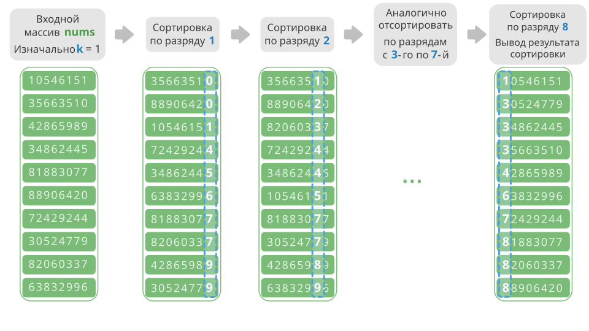

# 11.10 &nbsp; Поразрядная сортировка

В предыдущем разделе мы рассмотрели сортировку подсчётом. Она удобна, когда объём данных $n$ велик, а диапазон значений $m$ мал. Пусть нужно упорядочить $n = 10^6$ номеров учащихся, каждый длиной в $8$ цифр. Диапазон значений $m = 10^8$ тогда очень велик, и для сортировки подсчётом понадобится много памяти. Поразрядная сортировка позволяет этого избежать.

<u>Поразрядная сортировка (radix sort)</u>, как и сортировка подсчётом, упорядочивает данные с помощью подсчёта вхождений. При этом она учитывает старшинство разрядов: последовательно сортирует числа по каждой цифре и в итоге получает нужный порядок.

## 11.10.1 &nbsp; Ход алгоритма

Рассмотрим номера учащихся. Пусть младший разряд имеет номер $1$, а старший — $8$. На рисунке показан ход поразрядной сортировки.

1. Задаём начальный номер разряда $k = 1$.
2. Сортируем номера учащихся подсчётом по разряду $k$. После этого данные упорядочены по возрастанию цифры в разряде $k$.
3. Увеличиваем $k$ на $1$ и возвращаемся к шагу `2.`. Продолжаем, пока не обработаем все разряды.

{ class="animation-figure" }

<p align="center"> Рисунок 11-18 &nbsp; Ход поразрядной сортировки </p>

Разберём реализацию. Пусть число $x$ записано в системе счисления с основанием $d$. Его цифру $x_k$ в разряде $k$ можно получить по формуле:

$$
x_k = \lfloor\frac{x}{d^{k-1}}\rfloor \bmod d
$$

Здесь $\lfloor a \rfloor$ означает округление числа с плавающей точкой $a$ вниз, а $\bmod \: d$ — взятие остатка по модулю $d$. Для номеров учащихся $d = 10$ и $k \in [1, 8]$.

Немного изменим код сортировки подсчётом, чтобы он сортировал числа по разряду $k$:

=== "Python"

    ```python title="radix_sort.py"
    def digit(num: int, exp: int) -> int:
        """Получить k-ю цифру числа num, где exp = 10^(k-1)"""
        # Передаём exp вместо k, чтобы не повторять дорогое возведение в степень
        return (num // exp) % 10

    def counting_sort_digit(nums: list[int], exp: int):
        """Сортировка подсчётом по k-й цифре элементов nums"""
        # Десятичные цифры лежат в пределах 0–9, поэтому в массиве блоков 10 ячеек
        counter = [0] * 10
        n = len(nums)
        # Подсчитать вхождения каждой цифры от 0 до 9
        for i in range(n):
            d = digit(nums[i], exp)  # Получить k-ю цифру nums[i] и обозначить её d
            counter[d] += 1  # Подсчитать вхождения цифры d
        # Вычислить префиксные суммы, чтобы по частотам найти индексы в массиве
        for i in range(1, 10):
            counter[i] += counter[i - 1]
        # Пройти массив с конца и заполнить res по данным счётчиков
        res = [0] * n
        for i in range(n - 1, -1, -1):
            d = digit(nums[i], exp)
            j = counter[d] - 1  # Найти индекс j в массиве для цифры d
            res[j] = nums[i]  # Записать текущий элемент по индексу j
            counter[d] -= 1  # Уменьшить счётчик d на 1
        # Скопировать результат в исходный массив nums
        for i in range(n):
            nums[i] = res[i]

    def radix_sort(nums: list[int]):
        """Поразрядная сортировка"""
        # Найти максимум массива, чтобы определить наибольшее число разрядов
        m = max(nums)
        # Перебирать разряды от младшего к старшему
        exp = 1
        while exp <= m:
            # Отсортировать элементы подсчётом по k-й цифре
            # k = 1 -> exp = 1
            # k = 2 -> exp = 10
            # То есть exp = 10^(k-1)
            counting_sort_digit(nums, exp)
            exp *= 10
    ```

=== "C++"

    ```cpp title="radix_sort.cpp"
    /* Получить k-ю цифру числа num, где exp = 10^(k-1) */
    int digit(int num, int exp) {
        // Передаём exp вместо k, чтобы не повторять дорогое возведение в степень
        return (num / exp) % 10;
    }

    /* Сортировка подсчётом по k-й цифре элементов nums */
    void countingSortDigit(vector<int> &nums, int exp) {
        // Десятичные цифры лежат в пределах 0–9, поэтому в массиве блоков 10 ячеек
        vector<int> counter(10, 0);
        int n = nums.size();
        // Подсчитать вхождения каждой цифры от 0 до 9
        for (int i = 0; i < n; i++) {
            int d = digit(nums[i], exp); // Получить k-ю цифру nums[i] и обозначить её d
            counter[d]++;                // Подсчитать вхождения цифры d
        }
        // Вычислить префиксные суммы, чтобы по частотам найти индексы в массиве
        for (int i = 1; i < 10; i++) {
            counter[i] += counter[i - 1];
        }
        // Пройти массив с конца и заполнить res по данным счётчиков
        vector<int> res(n, 0);
        for (int i = n - 1; i >= 0; i--) {
            int d = digit(nums[i], exp);
            int j = counter[d] - 1; // Найти индекс j в массиве для цифры d
            res[j] = nums[i];       // Записать текущий элемент по индексу j
            counter[d]--;           // Уменьшить счётчик d на 1
        }
        // Скопировать результат в исходный массив nums
        for (int i = 0; i < n; i++)
            nums[i] = res[i];
    }

    /* Поразрядная сортировка */
    void radixSort(vector<int> &nums) {
        // Найти максимум массива, чтобы определить наибольшее число разрядов
        int m = *max_element(nums.begin(), nums.end());
        // Перебирать разряды от младшего к старшему
        for (int exp = 1; exp <= m; exp *= 10)
            // Отсортировать элементы подсчётом по k-й цифре
            // k = 1 -> exp = 1
            // k = 2 -> exp = 10
            // То есть exp = 10^(k-1)
            countingSortDigit(nums, exp);
    }
    ```

=== "Java"

    ```java title="radix_sort.java"
    /* Получить k-ю цифру числа num, где exp = 10^(k-1) */
    int digit(int num, int exp) {
        // Передаём exp вместо k, чтобы не повторять дорогое возведение в степень
        return (num / exp) % 10;
    }

    /* Сортировка подсчётом по k-й цифре элементов nums */
    void countingSortDigit(int[] nums, int exp) {
        // Десятичные цифры лежат в пределах 0–9, поэтому в массиве блоков 10 ячеек
        int[] counter = new int[10];
        int n = nums.length;
        // Подсчитать вхождения каждой цифры от 0 до 9
        for (int i = 0; i < n; i++) {
            int d = digit(nums[i], exp); // Получить k-ю цифру nums[i] и обозначить её d
            counter[d]++;                // Подсчитать вхождения цифры d
        }
        // Вычислить префиксные суммы, чтобы по частотам найти индексы в массиве
        for (int i = 1; i < 10; i++) {
            counter[i] += counter[i - 1];
        }
        // Пройти массив с конца и заполнить res по данным счётчиков
        int[] res = new int[n];
        for (int i = n - 1; i >= 0; i--) {
            int d = digit(nums[i], exp);
            int j = counter[d] - 1; // Найти индекс j в массиве для цифры d
            res[j] = nums[i];       // Записать текущий элемент по индексу j
            counter[d]--;           // Уменьшить счётчик d на 1
        }
        // Скопировать результат в исходный массив nums
        for (int i = 0; i < n; i++)
            nums[i] = res[i];
    }

    /* Поразрядная сортировка */
    void radixSort(int[] nums) {
        // Найти максимум массива, чтобы определить наибольшее число разрядов
        int m = Integer.MIN_VALUE;
        for (int num : nums)
            if (num > m)
                m = num;
        // Перебирать разряды от младшего к старшему
        for (int exp = 1; exp <= m; exp *= 10) {
            // Отсортировать элементы подсчётом по k-й цифре
            // k = 1 -> exp = 1
            // k = 2 -> exp = 10
            // То есть exp = 10^(k-1)
            countingSortDigit(nums, exp);
        }
    }
    ```

=== "C#"

    ```csharp title="radix_sort.cs"
    /* Получить k-ю цифру числа num, где exp = 10^(k-1) */
    int Digit(int num, int exp) {
        // Передаём exp вместо k, чтобы не повторять дорогое возведение в степень
        return (num / exp) % 10;
    }

    /* Сортировка подсчётом по k-й цифре элементов nums */
    void CountingSortDigit(int[] nums, int exp) {
        // Десятичные цифры лежат в пределах 0–9, поэтому в массиве блоков 10 ячеек
        int[] counter = new int[10];
        int n = nums.Length;
        // Подсчитать вхождения каждой цифры от 0 до 9
        for (int i = 0; i < n; i++) {
            int d = Digit(nums[i], exp); // Получить k-ю цифру nums[i] и обозначить её d
            counter[d]++;                // Подсчитать вхождения цифры d
        }
        // Вычислить префиксные суммы, чтобы по частотам найти индексы в массиве
        for (int i = 1; i < 10; i++) {
            counter[i] += counter[i - 1];
        }
        // Пройти массив с конца и заполнить res по данным счётчиков
        int[] res = new int[n];
        for (int i = n - 1; i >= 0; i--) {
            int d = Digit(nums[i], exp);
            int j = counter[d] - 1; // Найти индекс j в массиве для цифры d
            res[j] = nums[i];       // Записать текущий элемент по индексу j
            counter[d]--;           // Уменьшить счётчик d на 1
        }
        // Скопировать результат в исходный массив nums
        for (int i = 0; i < n; i++) {
            nums[i] = res[i];
        }
    }

    /* Поразрядная сортировка */
    void RadixSort(int[] nums) {
        // Найти максимум массива, чтобы определить наибольшее число разрядов
        int m = int.MinValue;
        foreach (int num in nums) {
            if (num > m) m = num;
        }
        // Перебирать разряды от младшего к старшему
        for (int exp = 1; exp <= m; exp *= 10) {
            // Отсортировать элементы подсчётом по k-й цифре
            // k = 1 -> exp = 1
            // k = 2 -> exp = 10
            // То есть exp = 10^(k-1)
            CountingSortDigit(nums, exp);
        }
    }
    ```

=== "Go"

    ```go title="radix_sort.go"
    /* Получить k-ю цифру числа num, где exp = 10^(k-1) */
    func digit(num, exp int) int {
        // Передаём exp вместо k, чтобы не повторять дорогое возведение в степень
        return (num / exp) % 10
    }

    /* Сортировка подсчётом по k-й цифре элементов nums */
    func countingSortDigit(nums []int, exp int) {
        // Десятичные цифры лежат в пределах 0–9, поэтому в массиве блоков 10 ячеек
        counter := make([]int, 10)
        n := len(nums)
        // Подсчитать вхождения каждой цифры от 0 до 9
        for i := 0; i < n; i++ {
            d := digit(nums[i], exp) // Получить k-ю цифру nums[i] и обозначить её d
            counter[d]++             // Подсчитать вхождения цифры d
        }
        // Вычислить префиксные суммы, чтобы по частотам найти индексы в массиве
        for i := 1; i < 10; i++ {
            counter[i] += counter[i-1]
        }
        // Пройти массив с конца и заполнить res по данным счётчиков
        res := make([]int, n)
        for i := n - 1; i >= 0; i-- {
            d := digit(nums[i], exp)
            j := counter[d] - 1 // Найти индекс j в массиве для цифры d
            res[j] = nums[i]    // Записать текущий элемент по индексу j
            counter[d]--        // Уменьшить счётчик d на 1
        }
        // Скопировать результат в исходный массив nums
        for i := 0; i < n; i++ {
            nums[i] = res[i]
        }
    }

    /* Поразрядная сортировка */
    func radixSort(nums []int) {
        // Найти максимум массива, чтобы определить наибольшее число разрядов
        max := math.MinInt
        for _, num := range nums {
            if num > max {
                max = num
            }
        }
        // Перебирать разряды от младшего к старшему
        for exp := 1; max >= exp; exp *= 10 {
            // Отсортировать элементы подсчётом по k-й цифре
            // k = 1 -> exp = 1
            // k = 2 -> exp = 10
            // То есть exp = 10^(k-1)
            countingSortDigit(nums, exp)
        }
    }
    ```

=== "Swift"

    ```swift title="radix_sort.swift"
    /* Получить k-ю цифру числа num, где exp = 10^(k-1) */
    func digit(num: Int, exp: Int) -> Int {
        // Передаём exp вместо k, чтобы не повторять дорогое возведение в степень
        (num / exp) % 10
    }

    /* Сортировка подсчётом по k-й цифре элементов nums */
    func countingSortDigit(nums: inout [Int], exp: Int) {
        // Десятичные цифры лежат в пределах 0–9, поэтому в массиве блоков 10 ячеек
        var counter = Array(repeating: 0, count: 10)
        // Подсчитать вхождения каждой цифры от 0 до 9
        for i in nums.indices {
            let d = digit(num: nums[i], exp: exp) // Получить k-ю цифру nums[i] и обозначить её d
            counter[d] += 1 // Подсчитать вхождения цифры d
        }
        // Вычислить префиксные суммы, чтобы по частотам найти индексы в массиве
        for i in 1 ..< 10 {
            counter[i] += counter[i - 1]
        }
        // Пройти массив с конца и заполнить res по данным счётчиков
        var res = Array(repeating: 0, count: nums.count)
        for i in nums.indices.reversed() {
            let d = digit(num: nums[i], exp: exp)
            let j = counter[d] - 1 // Найти индекс j в массиве для цифры d
            res[j] = nums[i] // Записать текущий элемент по индексу j
            counter[d] -= 1 // Уменьшить счётчик d на 1
        }
        // Скопировать результат в исходный массив nums
        for i in nums.indices {
            nums[i] = res[i]
        }
    }

    /* Поразрядная сортировка */
    func radixSort(nums: inout [Int]) {
        // Найти максимум массива, чтобы определить наибольшее число разрядов
        var m = Int.min
        for num in nums {
            if num > m {
                m = num
            }
        }
        // Перебирать разряды от младшего к старшему
        for exp in sequence(first: 1, next: { m >= ($0 * 10) ? $0 * 10 : nil }) {
            // Отсортировать элементы подсчётом по k-й цифре
            // k = 1 -> exp = 1
            // k = 2 -> exp = 10
            // То есть exp = 10^(k-1)
            countingSortDigit(nums: &nums, exp: exp)
        }
    }
    ```

=== "JS"

    ```javascript title="radix_sort.js"
    /* Получить k-ю цифру числа num, где exp = 10^(k-1) */
    function digit(num, exp) {
        // Передаём exp вместо k, чтобы не повторять дорогое возведение в степень
        return Math.floor(num / exp) % 10;
    }

    /* Сортировка подсчётом по k-й цифре элементов nums */
    function countingSortDigit(nums, exp) {
        // Десятичные цифры лежат в пределах 0–9, поэтому в массиве блоков 10 ячеек
        const counter = new Array(10).fill(0);
        const n = nums.length;
        // Подсчитать вхождения каждой цифры от 0 до 9
        for (let i = 0; i < n; i++) {
            const d = digit(nums[i], exp); // Получить k-ю цифру nums[i] и обозначить её d
            counter[d]++; // Подсчитать вхождения цифры d
        }
        // Вычислить префиксные суммы, чтобы по частотам найти индексы в массиве
        for (let i = 1; i < 10; i++) {
            counter[i] += counter[i - 1];
        }
        // Пройти массив с конца и заполнить res по данным счётчиков
        const res = new Array(n).fill(0);
        for (let i = n - 1; i >= 0; i--) {
            const d = digit(nums[i], exp);
            const j = counter[d] - 1; // Найти индекс j в массиве для цифры d
            res[j] = nums[i]; // Записать текущий элемент по индексу j
            counter[d]--; // Уменьшить счётчик d на 1
        }
        // Скопировать результат в исходный массив nums
        for (let i = 0; i < n; i++) {
            nums[i] = res[i];
        }
    }

    /* Поразрядная сортировка */
    function radixSort(nums) {
        // Найти максимум массива, чтобы определить наибольшее число разрядов
        let m = Math.max(... nums);
        // Перебирать разряды от младшего к старшему
        for (let exp = 1; exp <= m; exp *= 10) {
            // Отсортировать элементы подсчётом по k-й цифре
            // k = 1 -> exp = 1
            // k = 2 -> exp = 10
            // То есть exp = 10^(k-1)
            countingSortDigit(nums, exp);
        }
    }
    ```

=== "TS"

    ```typescript title="radix_sort.ts"
    /* Получить k-ю цифру числа num, где exp = 10^(k-1) */
    function digit(num: number, exp: number): number {
        // Передаём exp вместо k, чтобы не повторять дорогое возведение в степень
        return Math.floor(num / exp) % 10;
    }

    /* Сортировка подсчётом по k-й цифре элементов nums */
    function countingSortDigit(nums: number[], exp: number): void {
        // Десятичные цифры лежат в пределах 0–9, поэтому в массиве блоков 10 ячеек
        const counter = new Array(10).fill(0);
        const n = nums.length;
        // Подсчитать вхождения каждой цифры от 0 до 9
        for (let i = 0; i < n; i++) {
            const d = digit(nums[i], exp); // Получить k-ю цифру nums[i] и обозначить её d
            counter[d]++; // Подсчитать вхождения цифры d
        }
        // Вычислить префиксные суммы, чтобы по частотам найти индексы в массиве
        for (let i = 1; i < 10; i++) {
            counter[i] += counter[i - 1];
        }
        // Пройти массив с конца и заполнить res по данным счётчиков
        const res = new Array(n).fill(0);
        for (let i = n - 1; i >= 0; i--) {
            const d = digit(nums[i], exp);
            const j = counter[d] - 1; // Найти индекс j в массиве для цифры d
            res[j] = nums[i]; // Записать текущий элемент по индексу j
            counter[d]--; // Уменьшить счётчик d на 1
        }
        // Скопировать результат в исходный массив nums
        for (let i = 0; i < n; i++) {
            nums[i] = res[i];
        }
    }

    /* Поразрядная сортировка */
    function radixSort(nums: number[]): void {
        // Найти максимум массива, чтобы определить наибольшее число разрядов
        let m: number = Math.max(... nums);
        // Перебирать разряды от младшего к старшему
        for (let exp = 1; exp <= m; exp *= 10) {
            // Отсортировать элементы подсчётом по k-й цифре
            // k = 1 -> exp = 1
            // k = 2 -> exp = 10
            // То есть exp = 10^(k-1)
            countingSortDigit(nums, exp);
        }
    }
    ```

=== "Dart"

    ```dart title="radix_sort.dart"
    /* Получить k-ю цифру числа _num, где exp = 10^(k-1) */
    int digit(int _num, int exp) {
      // Передаём exp вместо k, чтобы не повторять дорогое возведение в степень
      return (_num ~/ exp) % 10;
    }

    /* Сортировка подсчётом по k-й цифре элементов nums */
    void countingSortDigit(List<int> nums, int exp) {
      // Десятичные цифры лежат в пределах 0–9, поэтому в массиве блоков 10 ячеек
      List<int> counter = List<int>.filled(10, 0);
      int n = nums.length;
      // Подсчитать вхождения каждой цифры от 0 до 9
      for (int i = 0; i < n; i++) {
        int d = digit(nums[i], exp); // Получить k-ю цифру nums[i] и обозначить её d
        counter[d]++; // Подсчитать вхождения цифры d
      }
      // Вычислить префиксные суммы, чтобы по частотам найти индексы в массиве
      for (int i = 1; i < 10; i++) {
        counter[i] += counter[i - 1];
      }
      // Пройти массив с конца и заполнить res по данным счётчиков
      List<int> res = List<int>.filled(n, 0);
      for (int i = n - 1; i >= 0; i--) {
        int d = digit(nums[i], exp);
        int j = counter[d] - 1; // Найти индекс j в массиве для цифры d
        res[j] = nums[i]; // Записать текущий элемент по индексу j
        counter[d]--; // Уменьшить счётчик d на 1
      }
      // Скопировать результат в исходный массив nums
      for (int i = 0; i < n; i++) nums[i] = res[i];
    }

    /* Поразрядная сортировка */
    void radixSort(List<int> nums) {
      // Найти максимум массива, чтобы определить наибольшее число разрядов
      // В Dart тип int имеет длину 64 бита
      int m = -1 << 63;
      for (int _num in nums) if (_num > m) m = _num;
      // Перебирать разряды от младшего к старшему
      for (int exp = 1; exp <= m; exp *= 10)
        // Отсортировать элементы подсчётом по k-й цифре
        // k = 1 -> exp = 1
        // k = 2 -> exp = 10
        // То есть exp = 10^(k-1)
        countingSortDigit(nums, exp);
    }
    ```

=== "Rust"

    ```rust title="radix_sort.rs"
    /* Получить k-ю цифру числа num, где exp = 10^(k-1) */
    fn digit(num: i32, exp: i32) -> usize {
        // Передаём exp вместо k, чтобы не повторять дорогое возведение в степень
        return ((num / exp) % 10) as usize;
    }

    /* Сортировка подсчётом по k-й цифре элементов nums */
    fn counting_sort_digit(nums: &mut [i32], exp: i32) {
        // Десятичные цифры лежат в пределах 0–9, поэтому в массиве блоков 10 ячеек
        let mut counter = [0; 10];
        let n = nums.len();
        // Подсчитать вхождения каждой цифры от 0 до 9
        for i in 0..n {
            let d = digit(nums[i], exp); // Получить k-ю цифру nums[i] и обозначить её d
            counter[d] += 1; // Подсчитать вхождения цифры d
        }
        // Вычислить префиксные суммы, чтобы по частотам найти индексы в массиве
        for i in 1..10 {
            counter[i] += counter[i - 1];
        }
        // Пройти массив с конца и заполнить res по данным счётчиков
        let mut res = vec![0; n];
        for i in (0..n).rev() {
            let d = digit(nums[i], exp);
            let j = counter[d] - 1; // Найти индекс j в массиве для цифры d
            res[j] = nums[i]; // Записать текущий элемент по индексу j
            counter[d] -= 1; // Уменьшить счётчик d на 1
        }
        // Скопировать результат в исходный массив nums
        nums.copy_from_slice(&res);
    }

    /* Поразрядная сортировка */
    fn radix_sort(nums: &mut [i32]) {
        // Найти максимум массива, чтобы определить наибольшее число разрядов
        let m = *nums.into_iter().max().unwrap();
        // Перебирать разряды от младшего к старшему
        let mut exp = 1;
        while exp <= m {
            counting_sort_digit(nums, exp);
            exp *= 10;
        }
    }
    ```

=== "C"

    ```c title="radix_sort.c"
    /* Получить k-ю цифру числа num, где exp = 10^(k-1) */
    int digit(int num, int exp) {
        // Передаём exp вместо k, чтобы не повторять дорогое возведение в степень
        return (num / exp) % 10;
    }

    /* Сортировка подсчётом по k-й цифре элементов nums */
    void countingSortDigit(int nums[], int size, int exp) {
        // Десятичные цифры лежат в пределах 0–9, поэтому в массиве блоков 10 ячеек
        int *counter = (int *)malloc((sizeof(int) * 10));
        memset(counter, 0, sizeof(int) * 10); // Инициализировать нулями для последующего освобождения памяти
        // Подсчитать вхождения каждой цифры от 0 до 9
        for (int i = 0; i < size; i++) {
            // Получить k-ю цифру nums[i] и обозначить её d
            int d = digit(nums[i], exp);
            // Подсчитать вхождения цифры d
            counter[d]++;
        }
        // Вычислить префиксные суммы, чтобы по частотам найти индексы в массиве
        for (int i = 1; i < 10; i++) {
            counter[i] += counter[i - 1];
        }
        // Пройти массив с конца и заполнить res по данным счётчиков
        int *res = (int *)malloc(sizeof(int) * size);
        for (int i = size - 1; i >= 0; i--) {
            int d = digit(nums[i], exp);
            int j = counter[d] - 1; // Найти индекс j в массиве для цифры d
            res[j] = nums[i];       // Записать текущий элемент по индексу j
            counter[d]--;           // Уменьшить счётчик d на 1
        }
        // Скопировать результат в исходный массив nums
        for (int i = 0; i < size; i++) {
            nums[i] = res[i];
        }
        // Освободить память
        free(res);
        free(counter);
    }

    /* Поразрядная сортировка */
    void radixSort(int nums[], int size) {
        // Найти максимум массива, чтобы определить наибольшее число разрядов
        int max = INT32_MIN;
        for (int i = 0; i < size; i++) {
            if (nums[i] > max) {
                max = nums[i];
            }
        }
        // Перебирать разряды от младшего к старшему
        for (int exp = 1; max >= exp; exp *= 10)
            // Отсортировать элементы подсчётом по k-й цифре
            // k = 1 -> exp = 1
            // k = 2 -> exp = 10
            // То есть exp = 10^(k-1)
            countingSortDigit(nums, size, exp);
    }
    ```

=== "Kotlin"

    ```kotlin title="radix_sort.kt"
    /* Получить k-ю цифру числа num, где exp = 10^(k-1) */
    fun digit(num: Int, exp: Int): Int {
        // Передаём exp вместо k, чтобы не повторять дорогое возведение в степень
        return (num / exp) % 10
    }

    /* Сортировка подсчётом по k-й цифре элементов nums */
    fun countingSortDigit(nums: IntArray, exp: Int) {
        // Десятичные цифры лежат в пределах 0–9, поэтому в массиве блоков 10 ячеек
        val counter = IntArray(10)
        val n = nums.size
        // Подсчитать вхождения каждой цифры от 0 до 9
        for (i in 0..<n) {
            val d = digit(nums[i], exp) // Получить k-ю цифру nums[i] и обозначить её d
            counter[d]++                // Подсчитать вхождения цифры d
        }
        // Вычислить префиксные суммы, чтобы по частотам найти индексы в массиве
        for (i in 1..9) {
            counter[i] += counter[i - 1]
        }
        // Пройти массив с конца и заполнить res по данным счётчиков
        val res = IntArray(n)
        for (i in n - 1 downTo 0) {
            val d = digit(nums[i], exp)
            val j = counter[d] - 1 // Найти индекс j в массиве для цифры d
            res[j] = nums[i]       // Записать текущий элемент по индексу j
            counter[d]--           // Уменьшить счётчик d на 1
        }
        // Скопировать результат в исходный массив nums
        for (i in 0..<n)
            nums[i] = res[i]
    }

    /* Поразрядная сортировка */
    fun radixSort(nums: IntArray) {
        // Найти максимум массива, чтобы определить наибольшее число разрядов
        var m = Int.MIN_VALUE
        for (num in nums) if (num > m) m = num
        var exp = 1
        // Перебирать разряды от младшего к старшему
        while (exp <= m) {
            // Отсортировать элементы подсчётом по k-й цифре
            // k = 1 -> exp = 1
            // k = 2 -> exp = 10
            // То есть exp = 10^(k-1)
            countingSortDigit(nums, exp)
            exp *= 10
        }
    }
    ```

=== "Ruby"

    ```ruby title="radix_sort.rb"
    ### Получить k-ю цифру числа num, где exp = 10^(k-1) ###
    def digit(num, exp)
      # Передаём exp вместо k, чтобы не повторять дорогое возведение в степень
      (num / exp) % 10
    end

    ### Сортировка подсчётом по k-й цифре элементов nums###
    def counting_sort_digit(nums, exp)
      # Десятичные цифры лежат в пределах 0–9, поэтому в массиве блоков 10 ячеек
      counter = Array.new(10, 0)
      n = nums.length
      # Подсчитать вхождения каждой цифры от 0 до 9
      for i in 0...n
        d = digit(nums[i], exp) # Получить k-ю цифру nums[i] и обозначить её d
        counter[d] += 1 # Подсчитать вхождения цифры d
      end
      # Вычислить префиксные суммы, чтобы по частотам найти индексы в массиве
      (1...10).each { |i| counter[i] += counter[i - 1] }
      # Пройти массив с конца и заполнить res по данным счётчиков
      res = Array.new(n, 0)
      for i in (n - 1).downto(0)
        d = digit(nums[i], exp)
        j = counter[d] - 1 # Найти индекс j в массиве для цифры d
        res[j] = nums[i] # Записать текущий элемент по индексу j
        counter[d] -= 1 # Уменьшить счётчик d на 1
      end
      # Скопировать результат в исходный массив nums
      (0...n).each { |i| nums[i] = res[i] }
    end

    ### Поразрядная сортировка ###
    def radix_sort(nums)
      # Найти максимум массива, чтобы определить наибольшее число разрядов
      m = nums.max
      # Перебирать разряды от младшего к старшему
      exp = 1
      while exp <= m
        # Отсортировать элементы подсчётом по k-й цифре
        # k = 1 -> exp = 1
        # k = 2 -> exp = 10
        # То есть exp = 10^(k-1)
        counting_sort_digit(nums, exp)
        exp *= 10
      end
    end
    ```

??? pythontutor "Визуализация выполнения"

    <div style="height: 549px; width: 100%;"><iframe class="pythontutor-iframe" title="Визуализация выполнения" src="https://pythontutor.com/iframe-embed.html#code=def%20digit%28num%3A%20int,%20exp%3A%20int%29%20-%3E%20int%3A%0A%20%20%20%20%22%22%22k-%D1%8F%20%D1%86%D0%B8%D1%84%D1%80%D0%B0%20num,%20exp%20%3D%2010%5E%28k-1%29%22%22%22%0A%20%20%20%20%23%20%D0%9F%D0%B5%D1%80%D0%B5%D0%B4%D0%B0%D1%91%D0%BC%20exp,%20%D1%87%D1%82%D0%BE%D0%B1%D1%8B%20%D0%BD%D0%B5%20%D0%B2%D1%8B%D1%87%D0%B8%D1%81%D0%BB%D1%8F%D1%82%D1%8C%20%D1%81%D1%82%D0%B5%D0%BF%D0%B5%D0%BD%D1%8C%20%D0%B7%D0%B0%D0%BD%D0%BE%D0%B2%D0%BE%0A%20%20%20%20return%20%28num%20//%20exp%29%20%25%2010%0A%0Adef%20counting_sort_digit%28nums%3A%20list%5Bint%5D,%20exp%3A%20int%29%3A%0A%20%20%20%20%22%22%22%D0%A1%D0%BE%D1%80%D1%82%D0%B8%D1%80%D0%BE%D0%B2%D0%BA%D0%B0%20nums%20%D0%BF%D0%BE%D0%B4%D1%81%D1%87%D1%91%D1%82%D0%BE%D0%BC%20%D0%BF%D0%BE%20k-%D0%B9%20%D1%86%D0%B8%D1%84%D1%80%D0%B5%22%22%22%0A%20%20%20%20%23%20%D0%94%D0%BB%D1%8F%20%D1%86%D0%B8%D1%84%D1%80%200%E2%80%939%20%D0%BD%D1%83%D0%B6%D0%BD%D1%8B%2010%20%D0%B1%D0%BB%D0%BE%D0%BA%D0%BE%D0%B2%0A%20%20%20%20counter%20%3D%20%5B0%5D%20%2A%2010%0A%20%20%20%20n%20%3D%20len%28nums%29%0A%20%20%20%20%23%20%D0%9F%D0%BE%D0%B4%D1%81%D1%87%D0%B8%D1%82%D0%B0%D1%82%D1%8C%20%D1%87%D0%B0%D1%81%D1%82%D0%BE%D1%82%D1%8B%20%D1%86%D0%B8%D1%84%D1%80%200%E2%80%939%0A%20%20%20%20for%20i%20in%20range%28n%29%3A%0A%20%20%20%20%20%20%20%20d%20%3D%20digit%28nums%5Bi%5D,%20exp%29%20%20%23%20d%20%E2%80%94%20k-%D1%8F%20%D1%86%D0%B8%D1%84%D1%80%D0%B0%20nums%5Bi%5D%0A%20%20%20%20%20%20%20%20counter%5Bd%5D%20%2B%3D%201%20%20%23%20%D0%A3%D1%87%D0%B5%D1%81%D1%82%D1%8C%20%D1%86%D0%B8%D1%84%D1%80%D1%83%20d%0A%20%20%20%20%23%20%D0%9F%D1%80%D0%B5%D1%84%D0%B8%D0%BA%D1%81%D0%BD%D1%8B%D0%B5%20%D1%81%D1%83%D0%BC%D0%BC%D1%8B%20%D0%B4%D0%B0%D1%8E%D1%82%20%D0%B8%D0%BD%D0%B4%D0%B5%D0%BA%D1%81%D1%8B%20%D0%BF%D0%BE%20%D1%87%D0%B0%D1%81%D1%82%D0%BE%D1%82%D0%B0%D0%BC%0A%20%20%20%20for%20i%20in%20range%281,%2010%29%3A%0A%20%20%20%20%20%20%20%20counter%5Bi%5D%20%2B%3D%20counter%5Bi%20-%201%5D%0A%20%20%20%20%23%20%D0%97%D0%B0%D0%BF%D0%BE%D0%BB%D0%BD%D1%8F%D1%82%D1%8C%20res%20%D0%BF%D0%BE%20%D1%81%D1%87%D1%91%D1%82%D1%87%D0%B8%D0%BA%D0%B0%D0%BC,%20%D0%BE%D0%B1%D1%85%D0%BE%D0%B4%D1%8F%20nums%20%D1%81%D0%BF%D1%80%D0%B0%D0%B2%D0%B0%0A%20%20%20%20res%20%3D%20%5B0%5D%20%2A%20n%0A%20%20%20%20for%20i%20in%20range%28n%20-%201,%20-1,%20-1%29%3A%0A%20%20%20%20%20%20%20%20d%20%3D%20digit%28nums%5Bi%5D,%20exp%29%0A%20%20%20%20%20%20%20%20j%20%3D%20counter%5Bd%5D%20-%201%20%20%23%20%D0%9D%D0%B0%D0%B9%D1%82%D0%B8%20%D0%BF%D0%BE%D0%B7%D0%B8%D1%86%D0%B8%D1%8E%20j%20%D0%B4%D0%BB%D1%8F%20d%0A%20%20%20%20%20%20%20%20res%5Bj%5D%20%3D%20nums%5Bi%5D%20%20%23%20%D0%97%D0%B0%D0%BF%D0%B8%D1%81%D0%B0%D1%82%D1%8C%20%D1%8D%D0%BB%D0%B5%D0%BC%D0%B5%D0%BD%D1%82%20%D0%B2%20%D0%BF%D0%BE%D0%B7%D0%B8%D1%86%D0%B8%D1%8E%20j%0A%20%20%20%20%20%20%20%20counter%5Bd%5D%20-%3D%201%20%20%23%20%D0%A3%D0%BC%D0%B5%D0%BD%D1%8C%D1%88%D0%B8%D1%82%D1%8C%20%D1%81%D1%87%D1%91%D1%82%D1%87%D0%B8%D0%BA%20d%20%D0%BD%D0%B0%201%0A%20%20%20%20%23%20%D0%97%D0%B0%D0%BF%D0%B8%D1%81%D0%B0%D1%82%D1%8C%20%D1%80%D0%B5%D0%B7%D1%83%D0%BB%D1%8C%D1%82%D0%B0%D1%82%20%D0%B2%20nums%0A%20%20%20%20for%20i%20in%20range%28n%29%3A%0A%20%20%20%20%20%20%20%20nums%5Bi%5D%20%3D%20res%5Bi%5D%0A%0Adef%20radix_sort%28nums%3A%20list%5Bint%5D%29%3A%0A%20%20%20%20%22%22%22%D0%9F%D0%BE%D1%80%D0%B0%D0%B7%D1%80%D1%8F%D0%B4%D0%BD%D0%B0%D1%8F%20%D1%81%D0%BE%D1%80%D1%82%D0%B8%D1%80%D0%BE%D0%B2%D0%BA%D0%B0%22%22%22%0A%20%20%20%20%23%20%D0%9F%D0%BE%20%D0%BC%D0%B0%D0%BA%D1%81%D0%B8%D0%BC%D1%83%D0%BC%D1%83%20%D0%BD%D0%B0%D0%B9%D1%82%D0%B8%20%D1%87%D0%B8%D1%81%D0%BB%D0%BE%20%D1%80%D0%B0%D0%B7%D1%80%D1%8F%D0%B4%D0%BE%D0%B2%0A%20%20%20%20m%20%3D%20max%28nums%29%0A%20%20%20%20%23%20%D0%9E%D1%82%20%D0%BC%D0%BB%D0%B0%D0%B4%D1%88%D0%B8%D1%85%20%D1%80%D0%B0%D0%B7%D1%80%D1%8F%D0%B4%D0%BE%D0%B2%20%D0%BA%20%D1%81%D1%82%D0%B0%D1%80%D1%88%D0%B8%D0%BC%0A%20%20%20%20exp%20%3D%201%0A%20%20%20%20while%20exp%20%3C%3D%20m%3A%0A%20%20%20%20%20%20%20%20%23%20%D0%A1%D0%BE%D1%80%D1%82%D0%B8%D1%80%D0%BE%D0%B2%D0%B0%D1%82%D1%8C%20%D0%BF%D0%BE%D0%B4%D1%81%D1%87%D1%91%D1%82%D0%BE%D0%BC%20%D0%BF%D0%BE%20k-%D0%B9%20%D1%86%D0%B8%D1%84%D1%80%D0%B5%0A%20%20%20%20%20%20%20%20%23%20k%20%3D%201%20-%3E%20exp%20%3D%201%0A%20%20%20%20%20%20%20%20%23%20k%20%3D%202%20-%3E%20exp%20%3D%2010%0A%20%20%20%20%20%20%20%20%23%20%D0%A2%D0%BE%20%D0%B5%D1%81%D1%82%D1%8C%20exp%20%3D%2010%5E%28k-1%29%0A%20%20%20%20%20%20%20%20counting_sort_digit%28nums,%20exp%29%0A%20%20%20%20%20%20%20%20exp%20%2A%3D%2010%0A%0A%22%22%22Driver%20Code%22%22%22%0Aif%20__name__%20%3D%3D%20%22__main__%22%3A%0A%20%20%20%20%23%20%D0%9F%D0%BE%D1%80%D0%B0%D0%B7%D1%80%D1%8F%D0%B4%D0%BD%D0%B0%D1%8F%20%D1%81%D0%BE%D1%80%D1%82%D0%B8%D1%80%D0%BE%D0%B2%D0%BA%D0%B0%0A%20%20%20%20nums%20%3D%20%5B%0A%20%20%20%20%20%20%20%20105,%0A%20%20%20%20%20%20%20%20356,%0A%20%20%20%20%20%20%20%20428,%0A%20%20%20%20%20%20%20%20348,%0A%20%20%20%20%20%20%20%20818,%0A%20%20%20%20%5D%0A%20%20%20%20radix_sort%28nums%29%0A%20%20%20%20print%28%22%D0%9F%D0%BE%D1%81%D0%BB%D0%B5%20%D0%BF%D0%BE%D1%80%D0%B0%D0%B7%D1%80%D1%8F%D0%B4%D0%BD%D0%BE%D0%B9%20%D1%81%D0%BE%D1%80%D1%82%D0%B8%D1%80%D0%BE%D0%B2%D0%BA%D0%B8%20nums%20%3D%22,%20nums%29&codeDivHeight=472&codeDivWidth=350&cumulative=false&curInstr=6&heapPrimitives=nevernest&origin=opt-frontend.js&py=311&rawInputLstJSON=%5B%5D&textReferences=false"> </iframe></div>
    <div style="margin-top: 5px;"><a href="https://pythontutor.com/iframe-embed.html#code=def%20digit%28num%3A%20int,%20exp%3A%20int%29%20-%3E%20int%3A%0A%20%20%20%20%22%22%22k-%D1%8F%20%D1%86%D0%B8%D1%84%D1%80%D0%B0%20num,%20exp%20%3D%2010%5E%28k-1%29%22%22%22%0A%20%20%20%20%23%20%D0%9F%D0%B5%D1%80%D0%B5%D0%B4%D0%B0%D1%91%D0%BC%20exp,%20%D1%87%D1%82%D0%BE%D0%B1%D1%8B%20%D0%BD%D0%B5%20%D0%B2%D1%8B%D1%87%D0%B8%D1%81%D0%BB%D1%8F%D1%82%D1%8C%20%D1%81%D1%82%D0%B5%D0%BF%D0%B5%D0%BD%D1%8C%20%D0%B7%D0%B0%D0%BD%D0%BE%D0%B2%D0%BE%0A%20%20%20%20return%20%28num%20//%20exp%29%20%25%2010%0A%0Adef%20counting_sort_digit%28nums%3A%20list%5Bint%5D,%20exp%3A%20int%29%3A%0A%20%20%20%20%22%22%22%D0%A1%D0%BE%D1%80%D1%82%D0%B8%D1%80%D0%BE%D0%B2%D0%BA%D0%B0%20nums%20%D0%BF%D0%BE%D0%B4%D1%81%D1%87%D1%91%D1%82%D0%BE%D0%BC%20%D0%BF%D0%BE%20k-%D0%B9%20%D1%86%D0%B8%D1%84%D1%80%D0%B5%22%22%22%0A%20%20%20%20%23%20%D0%94%D0%BB%D1%8F%20%D1%86%D0%B8%D1%84%D1%80%200%E2%80%939%20%D0%BD%D1%83%D0%B6%D0%BD%D1%8B%2010%20%D0%B1%D0%BB%D0%BE%D0%BA%D0%BE%D0%B2%0A%20%20%20%20counter%20%3D%20%5B0%5D%20%2A%2010%0A%20%20%20%20n%20%3D%20len%28nums%29%0A%20%20%20%20%23%20%D0%9F%D0%BE%D0%B4%D1%81%D1%87%D0%B8%D1%82%D0%B0%D1%82%D1%8C%20%D1%87%D0%B0%D1%81%D1%82%D0%BE%D1%82%D1%8B%20%D1%86%D0%B8%D1%84%D1%80%200%E2%80%939%0A%20%20%20%20for%20i%20in%20range%28n%29%3A%0A%20%20%20%20%20%20%20%20d%20%3D%20digit%28nums%5Bi%5D,%20exp%29%20%20%23%20d%20%E2%80%94%20k-%D1%8F%20%D1%86%D0%B8%D1%84%D1%80%D0%B0%20nums%5Bi%5D%0A%20%20%20%20%20%20%20%20counter%5Bd%5D%20%2B%3D%201%20%20%23%20%D0%A3%D1%87%D0%B5%D1%81%D1%82%D1%8C%20%D1%86%D0%B8%D1%84%D1%80%D1%83%20d%0A%20%20%20%20%23%20%D0%9F%D1%80%D0%B5%D1%84%D0%B8%D0%BA%D1%81%D0%BD%D1%8B%D0%B5%20%D1%81%D1%83%D0%BC%D0%BC%D1%8B%20%D0%B4%D0%B0%D1%8E%D1%82%20%D0%B8%D0%BD%D0%B4%D0%B5%D0%BA%D1%81%D1%8B%20%D0%BF%D0%BE%20%D1%87%D0%B0%D1%81%D1%82%D0%BE%D1%82%D0%B0%D0%BC%0A%20%20%20%20for%20i%20in%20range%281,%2010%29%3A%0A%20%20%20%20%20%20%20%20counter%5Bi%5D%20%2B%3D%20counter%5Bi%20-%201%5D%0A%20%20%20%20%23%20%D0%97%D0%B0%D0%BF%D0%BE%D0%BB%D0%BD%D1%8F%D1%82%D1%8C%20res%20%D0%BF%D0%BE%20%D1%81%D1%87%D1%91%D1%82%D1%87%D0%B8%D0%BA%D0%B0%D0%BC,%20%D0%BE%D0%B1%D1%85%D0%BE%D0%B4%D1%8F%20nums%20%D1%81%D0%BF%D1%80%D0%B0%D0%B2%D0%B0%0A%20%20%20%20res%20%3D%20%5B0%5D%20%2A%20n%0A%20%20%20%20for%20i%20in%20range%28n%20-%201,%20-1,%20-1%29%3A%0A%20%20%20%20%20%20%20%20d%20%3D%20digit%28nums%5Bi%5D,%20exp%29%0A%20%20%20%20%20%20%20%20j%20%3D%20counter%5Bd%5D%20-%201%20%20%23%20%D0%9D%D0%B0%D0%B9%D1%82%D0%B8%20%D0%BF%D0%BE%D0%B7%D0%B8%D1%86%D0%B8%D1%8E%20j%20%D0%B4%D0%BB%D1%8F%20d%0A%20%20%20%20%20%20%20%20res%5Bj%5D%20%3D%20nums%5Bi%5D%20%20%23%20%D0%97%D0%B0%D0%BF%D0%B8%D1%81%D0%B0%D1%82%D1%8C%20%D1%8D%D0%BB%D0%B5%D0%BC%D0%B5%D0%BD%D1%82%20%D0%B2%20%D0%BF%D0%BE%D0%B7%D0%B8%D1%86%D0%B8%D1%8E%20j%0A%20%20%20%20%20%20%20%20counter%5Bd%5D%20-%3D%201%20%20%23%20%D0%A3%D0%BC%D0%B5%D0%BD%D1%8C%D1%88%D0%B8%D1%82%D1%8C%20%D1%81%D1%87%D1%91%D1%82%D1%87%D0%B8%D0%BA%20d%20%D0%BD%D0%B0%201%0A%20%20%20%20%23%20%D0%97%D0%B0%D0%BF%D0%B8%D1%81%D0%B0%D1%82%D1%8C%20%D1%80%D0%B5%D0%B7%D1%83%D0%BB%D1%8C%D1%82%D0%B0%D1%82%20%D0%B2%20nums%0A%20%20%20%20for%20i%20in%20range%28n%29%3A%0A%20%20%20%20%20%20%20%20nums%5Bi%5D%20%3D%20res%5Bi%5D%0A%0Adef%20radix_sort%28nums%3A%20list%5Bint%5D%29%3A%0A%20%20%20%20%22%22%22%D0%9F%D0%BE%D1%80%D0%B0%D0%B7%D1%80%D1%8F%D0%B4%D0%BD%D0%B0%D1%8F%20%D1%81%D0%BE%D1%80%D1%82%D0%B8%D1%80%D0%BE%D0%B2%D0%BA%D0%B0%22%22%22%0A%20%20%20%20%23%20%D0%9F%D0%BE%20%D0%BC%D0%B0%D0%BA%D1%81%D0%B8%D0%BC%D1%83%D0%BC%D1%83%20%D0%BD%D0%B0%D0%B9%D1%82%D0%B8%20%D1%87%D0%B8%D1%81%D0%BB%D0%BE%20%D1%80%D0%B0%D0%B7%D1%80%D1%8F%D0%B4%D0%BE%D0%B2%0A%20%20%20%20m%20%3D%20max%28nums%29%0A%20%20%20%20%23%20%D0%9E%D1%82%20%D0%BC%D0%BB%D0%B0%D0%B4%D1%88%D0%B8%D1%85%20%D1%80%D0%B0%D0%B7%D1%80%D1%8F%D0%B4%D0%BE%D0%B2%20%D0%BA%20%D1%81%D1%82%D0%B0%D1%80%D1%88%D0%B8%D0%BC%0A%20%20%20%20exp%20%3D%201%0A%20%20%20%20while%20exp%20%3C%3D%20m%3A%0A%20%20%20%20%20%20%20%20%23%20%D0%A1%D0%BE%D1%80%D1%82%D0%B8%D1%80%D0%BE%D0%B2%D0%B0%D1%82%D1%8C%20%D0%BF%D0%BE%D0%B4%D1%81%D1%87%D1%91%D1%82%D0%BE%D0%BC%20%D0%BF%D0%BE%20k-%D0%B9%20%D1%86%D0%B8%D1%84%D1%80%D0%B5%0A%20%20%20%20%20%20%20%20%23%20k%20%3D%201%20-%3E%20exp%20%3D%201%0A%20%20%20%20%20%20%20%20%23%20k%20%3D%202%20-%3E%20exp%20%3D%2010%0A%20%20%20%20%20%20%20%20%23%20%D0%A2%D0%BE%20%D0%B5%D1%81%D1%82%D1%8C%20exp%20%3D%2010%5E%28k-1%29%0A%20%20%20%20%20%20%20%20counting_sort_digit%28nums,%20exp%29%0A%20%20%20%20%20%20%20%20exp%20%2A%3D%2010%0A%0A%22%22%22Driver%20Code%22%22%22%0Aif%20__name__%20%3D%3D%20%22__main__%22%3A%0A%20%20%20%20%23%20%D0%9F%D0%BE%D1%80%D0%B0%D0%B7%D1%80%D1%8F%D0%B4%D0%BD%D0%B0%D1%8F%20%D1%81%D0%BE%D1%80%D1%82%D0%B8%D1%80%D0%BE%D0%B2%D0%BA%D0%B0%0A%20%20%20%20nums%20%3D%20%5B%0A%20%20%20%20%20%20%20%20105,%0A%20%20%20%20%20%20%20%20356,%0A%20%20%20%20%20%20%20%20428,%0A%20%20%20%20%20%20%20%20348,%0A%20%20%20%20%20%20%20%20818,%0A%20%20%20%20%5D%0A%20%20%20%20radix_sort%28nums%29%0A%20%20%20%20print%28%22%D0%9F%D0%BE%D1%81%D0%BB%D0%B5%20%D0%BF%D0%BE%D1%80%D0%B0%D0%B7%D1%80%D1%8F%D0%B4%D0%BD%D0%BE%D0%B9%20%D1%81%D0%BE%D1%80%D1%82%D0%B8%D1%80%D0%BE%D0%B2%D0%BA%D0%B8%20nums%20%3D%22,%20nums%29&codeDivHeight=800&codeDivWidth=600&cumulative=false&curInstr=6&heapPrimitives=nevernest&origin=opt-frontend.js&py=311&rawInputLstJSON=%5B%5D&textReferences=false" target="_blank" rel="noopener noreferrer">Во весь экран ></a></div>

!!! question "Почему сортировку начинают с младшего разряда?"

    При последовательных проходах порядок, установленный на следующем проходе, имеет приоритет над предыдущим. Например, если первый проход дал $a < b$, а второй — $a > b$, то результат второго заменяет результат первого. Поскольку старшие разряды важнее младших, сначала нужно сортировать по младшим, а затем по старшим.

## 11.10.2 &nbsp; Свойства алгоритма

В отличие от обычной сортировки подсчётом, поразрядная сортировка подходит для широкого диапазона значений. **При этом данные должны допускать запись с фиксированным, не слишком большим числом разрядов**. Например, числа с плавающей точкой подходят плохо: число разрядов $k$ слишком велико и может привести к временной сложности $O(nk) \gg O(n^2)$.

- **Временная сложность $O(nk)$, неадаптивная сортировка**. Пусть объём данных равен $n$, основание системы счисления — $d$, а максимальное число разрядов — $k$. Сортировка подсчётом по одному разряду занимает $O(n + d)$ времени, а по всем $k$ разрядам — $O((n + d)k)$. Обычно $d$ и $k$ относительно малы, и сложность приближается к $O(n)$.
- **Пространственная сложность $O(n + d)$, сортировка с дополнительной памятью**. Как и при сортировке подсчётом, нужны массивы `res` и `counter` длины $n$ и $d$ соответственно.
- **Устойчивая сортировка**. Если сортировка подсчётом устойчива, то и поразрядная сортировка устойчива. При неустойчивой сортировке подсчётом правильность результата поразрядной сортировки не гарантируется.
