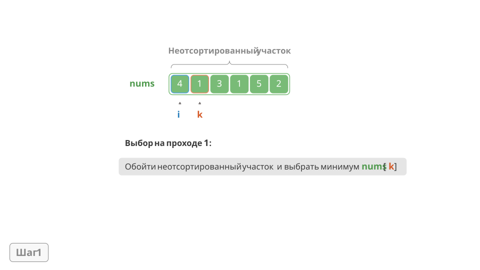
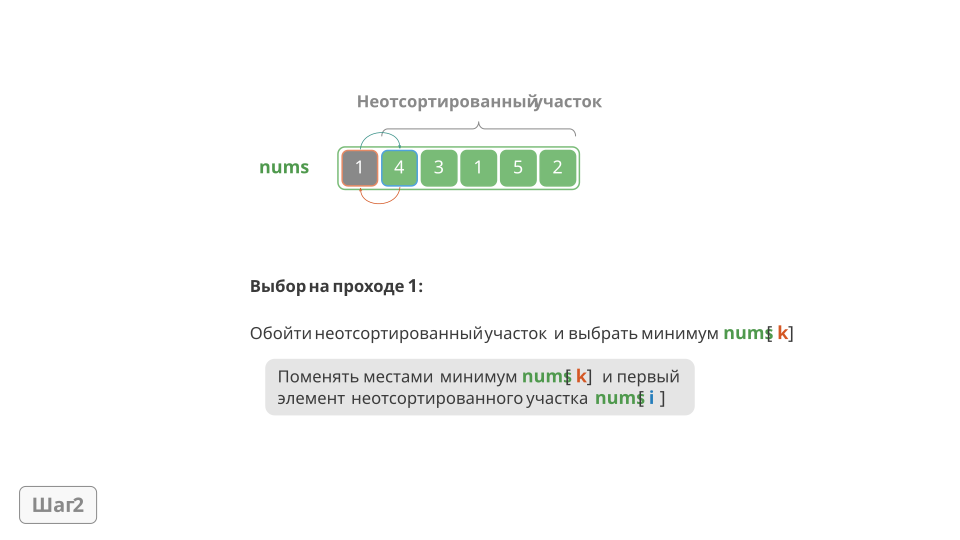
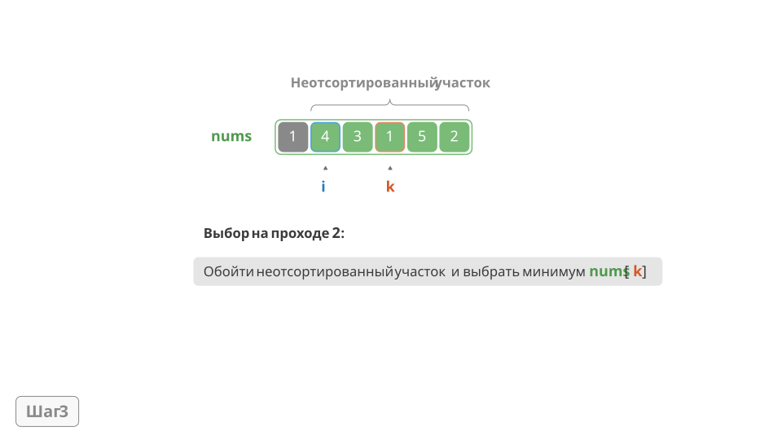
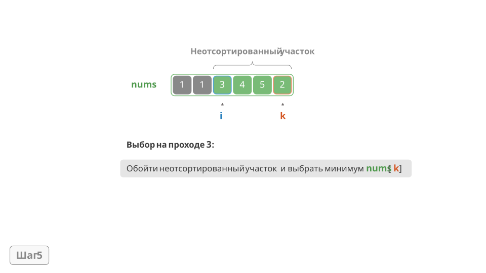
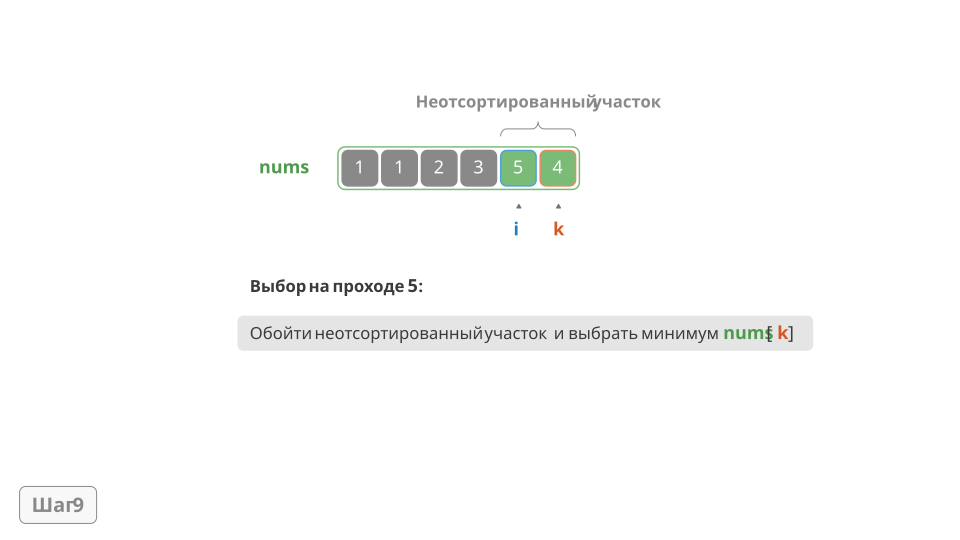
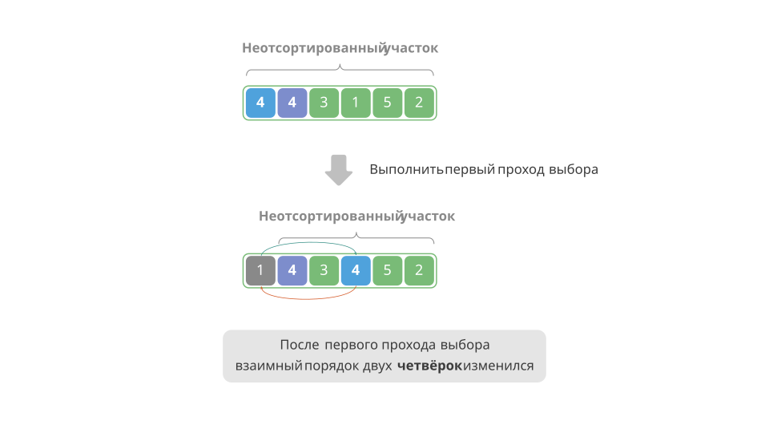

# Сортировка выбором

<u>Сортировка выбором (selection sort)</u> работает просто: на каждом проходе находим наименьший элемент неотсортированного участка и добавляем его в конец отсортированной части.

Пусть длина массива равна $n$. На рисунке показан ход сортировки выбором.

1. Вначале ни один элемент не отсортирован, поэтому неотсортированный участок охватывает индексы $[0, n-1]$.
2. Выбираем минимум участка $[0, n-1]$ и меняем его местами с элементом по индексу $0$. Теперь первый элемент массива отсортирован.
3. Выбираем минимум участка $[1, n-1]$ и меняем его местами с элементом по индексу $1$. Теперь первые два элемента массива отсортированы.
4. Продолжаем так же. После $n - 1$ проходов выбора и обмена первые $n - 1$ элементов массива отсортированы.
5. Остаётся один элемент. Он обязательно максимален и уже на своём месте, поэтому сортировка массива завершена.

=== "<1>"
    

=== "<2>"
    

=== "<3>"
    

=== "<4>"
    

=== "<5>"
    

=== "<6>"
    

=== "<7>"
    

=== "<8>"
    

=== "<9>"
    

=== "<10>"
    

=== "<11>"
    

В коде для отслеживания наименьшего элемента неотсортированного участка используем $k$:

```src
[file]{selection_sort}-[class]{}-[func]{selection_sort}
```

## Свойства алгоритма

- **Временная сложность $O(n^2)$, неадаптивная сортировка**. Внешний цикл выполняет $n - 1$ проходов. На первом проходе внутренний цикл выполняется $n - 1$ раз, на последнем — $1$ раз. Числа итераций по проходам равны $n - 1$, $n - 2$, $\dots$, $2$, $1$, а их сумма равна $\frac{n(n - 1)}{2}$.
- **Пространственная сложность $O(1)$, сортировка на месте**. Указатели $i$ и $j$ занимают постоянный объём дополнительной памяти.
- **Неустойчивая сортировка**. Как видно на рисунке, при обмене элемент `nums[i]` может оказаться справа от равного ему элемента, и их взаимный порядок изменится.


