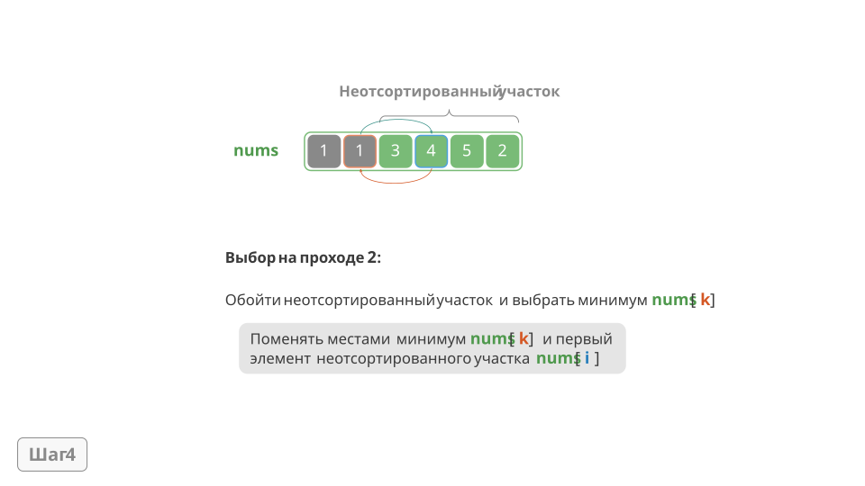
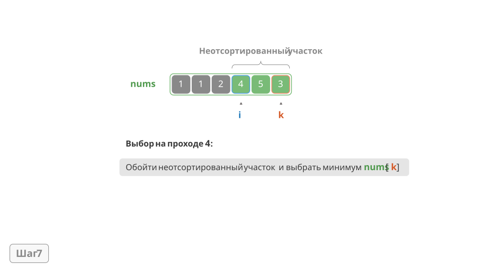
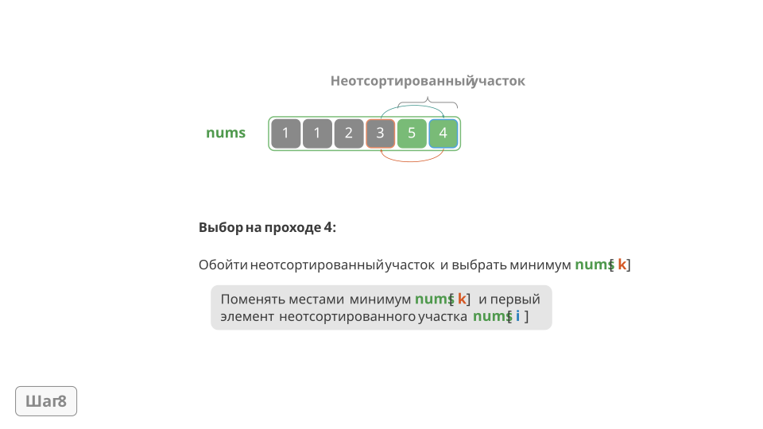
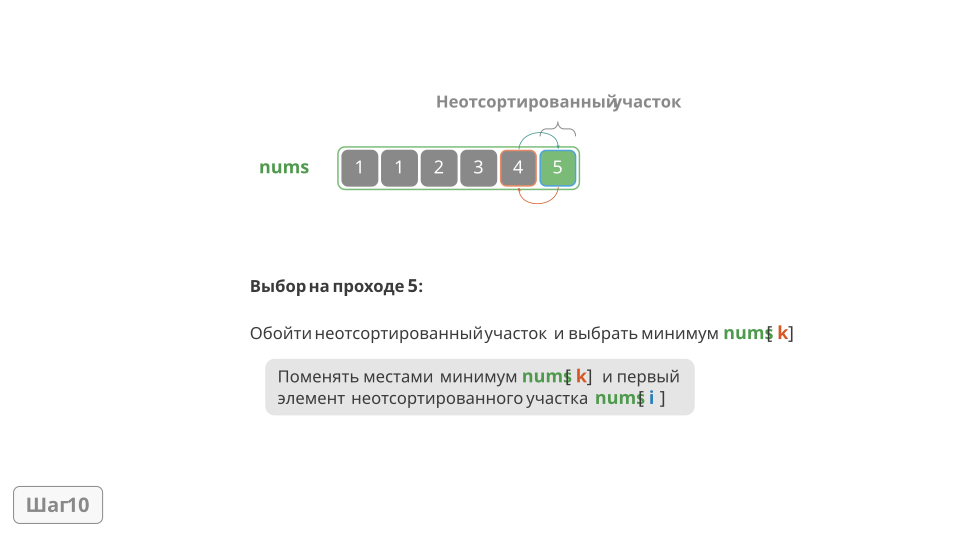
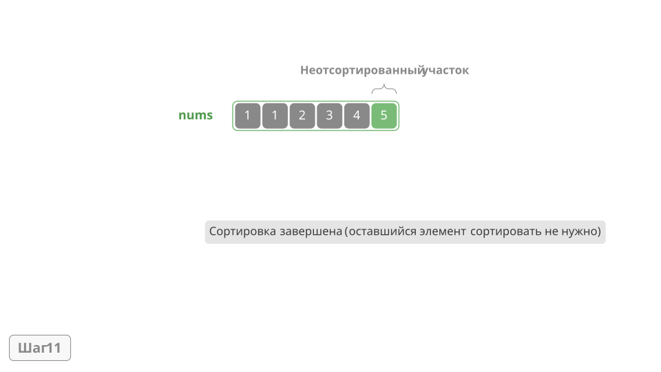

# 11.2 &nbsp; Сортировка выбором

<u>Сортировка выбором (selection sort)</u> работает просто: на каждом проходе находим наименьший элемент неотсортированного участка и добавляем его в конец отсортированной части.

Пусть длина массива равна $n$. На рисунке показан ход сортировки выбором.

1. Вначале ни один элемент не отсортирован, поэтому неотсортированный участок охватывает индексы $[0, n-1]$.
2. Выбираем минимум участка $[0, n-1]$ и меняем его местами с элементом по индексу $0$. Теперь первый элемент массива отсортирован.
3. Выбираем минимум участка $[1, n-1]$ и меняем его местами с элементом по индексу $1$. Теперь первые два элемента массива отсортированы.
4. Продолжаем так же. После $n - 1$ проходов выбора и обмена первые $n - 1$ элементов массива отсортированы.
5. Остаётся один элемент. Он обязательно максимален и уже на своём месте, поэтому сортировка массива завершена.

=== "<1>"
    { class="animation-figure" }

=== "<2>"
    { class="animation-figure" }

=== "<3>"
    { class="animation-figure" }

=== "<4>"
    { class="animation-figure" }

=== "<5>"
    { class="animation-figure" }

=== "<6>"
    { class="animation-figure" }

=== "<7>"
    { class="animation-figure" }

=== "<8>"
    { class="animation-figure" }

=== "<9>"
    { class="animation-figure" }

=== "<10>"
    { class="animation-figure" }

=== "<11>"
    { class="animation-figure" }

<p align="center"> Рисунок 11-2 &nbsp; Шаги сортировки выбором </p>

В коде для отслеживания наименьшего элемента неотсортированного участка используем $k$:

=== "Python"

    ```python title="selection_sort.py"
    def selection_sort(nums: list[int]):
        """Сортировка выбором"""
        n = len(nums)
        # Внешний цикл: неотсортированный участок [i, n-1]
        for i in range(n - 1):
            # Внутренний цикл: найти минимум неотсортированного участка
            k = i
            for j in range(i + 1, n):
                if nums[j] < nums[k]:
                    k = j  # Запомнить индекс минимума
            # Поменять минимум местами с первым элементом неотсортированного участка
            nums[i], nums[k] = nums[k], nums[i]
    ```

=== "C++"

    ```cpp title="selection_sort.cpp"
    /* Сортировка выбором */
    void selectionSort(vector<int> &nums) {
        int n = nums.size();
        // Внешний цикл: неотсортированный участок [i, n-1]
        for (int i = 0; i < n - 1; i++) {
            // Внутренний цикл: найти минимум неотсортированного участка
            int k = i;
            for (int j = i + 1; j < n; j++) {
                if (nums[j] < nums[k])
                    k = j; // Запомнить индекс минимума
            }
            // Поменять минимум местами с первым элементом неотсортированного участка
            swap(nums[i], nums[k]);
        }
    }
    ```

=== "Java"

    ```java title="selection_sort.java"
    /* Сортировка выбором */
    void selectionSort(int[] nums) {
        int n = nums.length;
        // Внешний цикл: неотсортированный участок [i, n-1]
        for (int i = 0; i < n - 1; i++) {
            // Внутренний цикл: найти минимум неотсортированного участка
            int k = i;
            for (int j = i + 1; j < n; j++) {
                if (nums[j] < nums[k])
                    k = j; // Запомнить индекс минимума
            }
            // Поменять минимум местами с первым элементом неотсортированного участка
            int temp = nums[i];
            nums[i] = nums[k];
            nums[k] = temp;
        }
    }
    ```

=== "C#"

    ```csharp title="selection_sort.cs"
    /* Сортировка выбором */
    void SelectionSort(int[] nums) {
        int n = nums.Length;
        // Внешний цикл: неотсортированный участок [i, n-1]
        for (int i = 0; i < n - 1; i++) {
            // Внутренний цикл: найти минимум неотсортированного участка
            int k = i;
            for (int j = i + 1; j < n; j++) {
                if (nums[j] < nums[k])
                    k = j; // Запомнить индекс минимума
            }
            // Поменять минимум местами с первым элементом неотсортированного участка
            (nums[k], nums[i]) = (nums[i], nums[k]);
        }
    }
    ```

=== "Go"

    ```go title="selection_sort.go"
    /* Сортировка выбором */
    func selectionSort(nums []int) {
        n := len(nums)
        // Внешний цикл: неотсортированный участок [i, n-1]
        for i := 0; i < n-1; i++ {
            // Внутренний цикл: найти минимум неотсортированного участка
            k := i
            for j := i + 1; j < n; j++ {
                if nums[j] < nums[k] {
                    // Запомнить индекс минимума
                    k = j
                }
            }
            // Поменять минимум местами с первым элементом неотсортированного участка
            nums[i], nums[k] = nums[k], nums[i]

        }
    }
    ```

=== "Swift"

    ```swift title="selection_sort.swift"
    /* Сортировка выбором */
    func selectionSort(nums: inout [Int]) {
        // Внешний цикл: неотсортированный участок [i, n-1]
        for i in nums.indices.dropLast() {
            // Внутренний цикл: найти минимум неотсортированного участка
            var k = i
            for j in nums.indices.dropFirst(i + 1) {
                if nums[j] < nums[k] {
                    k = j // Запомнить индекс минимума
                }
            }
            // Поменять минимум местами с первым элементом неотсортированного участка
            nums.swapAt(i, k)
        }
    }
    ```

=== "JS"

    ```javascript title="selection_sort.js"
    /* Сортировка выбором */
    function selectionSort(nums) {
        let n = nums.length;
        // Внешний цикл: неотсортированный участок [i, n-1]
        for (let i = 0; i < n - 1; i++) {
            // Внутренний цикл: найти минимум неотсортированного участка
            let k = i;
            for (let j = i + 1; j < n; j++) {
                if (nums[j] < nums[k]) {
                    k = j; // Запомнить индекс минимума
                }
            }
            // Поменять минимум местами с первым элементом неотсортированного участка
            [nums[i], nums[k]] = [nums[k], nums[i]];
        }
    }
    ```

=== "TS"

    ```typescript title="selection_sort.ts"
    /* Сортировка выбором */
    function selectionSort(nums: number[]): void {
        let n = nums.length;
        // Внешний цикл: неотсортированный участок [i, n-1]
        for (let i = 0; i < n - 1; i++) {
            // Внутренний цикл: найти минимум неотсортированного участка
            let k = i;
            for (let j = i + 1; j < n; j++) {
                if (nums[j] < nums[k]) {
                    k = j; // Запомнить индекс минимума
                }
            }
            // Поменять минимум местами с первым элементом неотсортированного участка
            [nums[i], nums[k]] = [nums[k], nums[i]];
        }
    }
    ```

=== "Dart"

    ```dart title="selection_sort.dart"
    /* Сортировка выбором */
    void selectionSort(List<int> nums) {
      int n = nums.length;
      // Внешний цикл: неотсортированный участок [i, n-1]
      for (int i = 0; i < n - 1; i++) {
        // Внутренний цикл: найти минимум неотсортированного участка
        int k = i;
        for (int j = i + 1; j < n; j++) {
          if (nums[j] < nums[k]) k = j; // Запомнить индекс минимума
        }
        // Поменять минимум местами с первым элементом неотсортированного участка
        int temp = nums[i];
        nums[i] = nums[k];
        nums[k] = temp;
      }
    }
    ```

=== "Rust"

    ```rust title="selection_sort.rs"
    /* Сортировка выбором */
    fn selection_sort(nums: &mut [i32]) {
        if nums.is_empty() {
            return;
        }
        let n = nums.len();
        // Внешний цикл: неотсортированный участок [i, n-1]
        for i in 0..n - 1 {
            // Внутренний цикл: найти минимум неотсортированного участка
            let mut k = i;
            for j in i + 1..n {
                if nums[j] < nums[k] {
                    k = j; // Запомнить индекс минимума
                }
            }
            // Поменять минимум местами с первым элементом неотсортированного участка
            nums.swap(i, k);
        }
    }
    ```

=== "C"

    ```c title="selection_sort.c"
    /* Сортировка выбором */
    void selectionSort(int nums[], int n) {
        // Внешний цикл: неотсортированный участок [i, n-1]
        for (int i = 0; i < n - 1; i++) {
            // Внутренний цикл: найти минимум неотсортированного участка
            int k = i;
            for (int j = i + 1; j < n; j++) {
                if (nums[j] < nums[k])
                    k = j; // Запомнить индекс минимума
            }
            // Поменять минимум местами с первым элементом неотсортированного участка
            int temp = nums[i];
            nums[i] = nums[k];
            nums[k] = temp;
        }
    }
    ```

=== "Kotlin"

    ```kotlin title="selection_sort.kt"
    /* Сортировка выбором */
    fun selectionSort(nums: IntArray) {
        val n = nums.size
        // Внешний цикл: неотсортированный участок [i, n-1]
        for (i in 0..<n - 1) {
            var k = i
            // Внутренний цикл: найти минимум неотсортированного участка
            for (j in i + 1..<n) {
                if (nums[j] < nums[k])
                    k = j // Запомнить индекс минимума
            }
            // Поменять минимум местами с первым элементом неотсортированного участка
            val temp = nums[i]
            nums[i] = nums[k]
            nums[k] = temp
        }
    }
    ```

=== "Ruby"

    ```ruby title="selection_sort.rb"
    ### Сортировка выбором ###
    def selection_sort(nums)
      n = nums.length
      # Внешний цикл: неотсортированный участок [i, n-1]
      for i in 0...(n - 1)
        # Внутренний цикл: найти минимум неотсортированного участка
        k = i
        for j in (i + 1)...n
          if nums[j] < nums[k]
            k = j # Запомнить индекс минимума
          end
        end
        # Поменять минимум местами с первым элементом неотсортированного участка
        nums[i], nums[k] = nums[k], nums[i]
      end
    end
    ```

??? pythontutor "Визуализация выполнения"

    <div style="height: 531px; width: 100%;"><iframe class="pythontutor-iframe" title="Визуализация выполнения" src="https://pythontutor.com/iframe-embed.html#code=def%20selection_sort%28nums%3A%20list%5Bint%5D%29%3A%0A%20%20%20%20%22%22%22%D0%A1%D0%BE%D1%80%D1%82%D0%B8%D1%80%D0%BE%D0%B2%D0%BA%D0%B0%20%D0%B2%D1%8B%D0%B1%D0%BE%D1%80%D0%BE%D0%BC%22%22%22%0A%20%20%20%20n%20%3D%20len%28nums%29%0A%20%20%20%20%23%20%D0%92%D0%BD%D0%B5%D1%88%D0%BD%D0%B8%D0%B9%20%D1%86%D0%B8%D0%BA%D0%BB%3A%20%D0%BD%D0%B5%D0%BE%D1%82%D1%81%D0%BE%D1%80%D1%82%D0%B8%D1%80%D0%BE%D0%B2%D0%B0%D0%BD%D0%BD%D1%8B%D0%B9%20%D1%83%D1%87%D0%B0%D1%81%D1%82%D0%BE%D0%BA%20%5Bi,%20n-1%5D%0A%20%20%20%20for%20i%20in%20range%28n%20-%201%29%3A%0A%20%20%20%20%20%20%20%20%23%20%D0%92%D0%BD%D1%83%D1%82%D1%80%D0%B5%D0%BD%D0%BD%D0%B8%D0%B9%20%D1%86%D0%B8%D0%BA%D0%BB%3A%20%D0%BD%D0%B0%D0%B9%D1%82%D0%B8%20%D0%BC%D0%B8%D0%BD%D0%B8%D0%BC%D1%83%D0%BC%20%D0%BD%D0%B5%D0%BE%D1%82%D1%81%D0%BE%D1%80%D1%82%D0%B8%D1%80%D0%BE%D0%B2%D0%B0%D0%BD%D0%BD%D0%BE%D0%B3%D0%BE%20%D1%83%D1%87%D0%B0%D1%81%D1%82%D0%BA%D0%B0%0A%20%20%20%20%20%20%20%20k%20%3D%20i%0A%20%20%20%20%20%20%20%20for%20j%20in%20range%28i%20%2B%201,%20n%29%3A%0A%20%20%20%20%20%20%20%20%20%20%20%20if%20nums%5Bj%5D%20%3C%20nums%5Bk%5D%3A%0A%20%20%20%20%20%20%20%20%20%20%20%20%20%20%20%20k%20%3D%20j%20%20%23%20%D0%97%D0%B0%D0%BF%D0%BE%D0%BC%D0%BD%D0%B8%D1%82%D1%8C%20%D0%B8%D0%BD%D0%B4%D0%B5%D0%BA%D1%81%20%D0%BC%D0%B8%D0%BD%D0%B8%D0%BC%D1%83%D0%BC%D0%B0%0A%20%20%20%20%20%20%20%20%23%20%D0%9F%D0%BE%D0%BC%D0%B5%D0%BD%D1%8F%D1%82%D1%8C%20%D0%BC%D0%B8%D0%BD%D0%B8%D0%BC%D1%83%D0%BC%20%D0%BC%D0%B5%D1%81%D1%82%D0%B0%D0%BC%D0%B8%20%D1%81%20%D0%BF%D0%B5%D1%80%D0%B2%D1%8B%D0%BC%20%D1%8D%D0%BB%D0%B5%D0%BC%D0%B5%D0%BD%D1%82%D0%BE%D0%BC%20%D0%BD%D0%B5%D0%BE%D1%82%D1%81%D0%BE%D1%80%D1%82%D0%B8%D1%80%D0%BE%D0%B2%D0%B0%D0%BD%D0%BD%D0%BE%D0%B3%D0%BE%20%D1%83%D1%87%D0%B0%D1%81%D1%82%D0%BA%D0%B0%0A%20%20%20%20%20%20%20%20nums%5Bi%5D,%20nums%5Bk%5D%20%3D%20nums%5Bk%5D,%20nums%5Bi%5D%0A%0A%0A%22%22%22Driver%20Code%22%22%22%0Aif%20__name__%20%3D%3D%20%22__main__%22%3A%0A%20%20%20%20nums%20%3D%20%5B4,%201,%203,%201,%205,%202%5D%0A%20%20%20%20selection_sort%28nums%29%0A%20%20%20%20print%28%22%D0%9F%D0%BE%D1%81%D0%BB%D0%B5%20%D1%81%D0%BE%D1%80%D1%82%D0%B8%D1%80%D0%BE%D0%B2%D0%BA%D0%B8%20%D0%B2%D1%8B%D0%B1%D0%BE%D1%80%D0%BE%D0%BC%20nums%20%3D%22,%20nums%29&codeDivHeight=472&codeDivWidth=350&cumulative=false&curInstr=4&heapPrimitives=nevernest&origin=opt-frontend.js&py=311&rawInputLstJSON=%5B%5D&textReferences=false"> </iframe></div>
    <div style="margin-top: 5px;"><a href="https://pythontutor.com/iframe-embed.html#code=def%20selection_sort%28nums%3A%20list%5Bint%5D%29%3A%0A%20%20%20%20%22%22%22%D0%A1%D0%BE%D1%80%D1%82%D0%B8%D1%80%D0%BE%D0%B2%D0%BA%D0%B0%20%D0%B2%D1%8B%D0%B1%D0%BE%D1%80%D0%BE%D0%BC%22%22%22%0A%20%20%20%20n%20%3D%20len%28nums%29%0A%20%20%20%20%23%20%D0%92%D0%BD%D0%B5%D1%88%D0%BD%D0%B8%D0%B9%20%D1%86%D0%B8%D0%BA%D0%BB%3A%20%D0%BD%D0%B5%D0%BE%D1%82%D1%81%D0%BE%D1%80%D1%82%D0%B8%D1%80%D0%BE%D0%B2%D0%B0%D0%BD%D0%BD%D1%8B%D0%B9%20%D1%83%D1%87%D0%B0%D1%81%D1%82%D0%BE%D0%BA%20%5Bi,%20n-1%5D%0A%20%20%20%20for%20i%20in%20range%28n%20-%201%29%3A%0A%20%20%20%20%20%20%20%20%23%20%D0%92%D0%BD%D1%83%D1%82%D1%80%D0%B5%D0%BD%D0%BD%D0%B8%D0%B9%20%D1%86%D0%B8%D0%BA%D0%BB%3A%20%D0%BD%D0%B0%D0%B9%D1%82%D0%B8%20%D0%BC%D0%B8%D0%BD%D0%B8%D0%BC%D1%83%D0%BC%20%D0%BD%D0%B5%D0%BE%D1%82%D1%81%D0%BE%D1%80%D1%82%D0%B8%D1%80%D0%BE%D0%B2%D0%B0%D0%BD%D0%BD%D0%BE%D0%B3%D0%BE%20%D1%83%D1%87%D0%B0%D1%81%D1%82%D0%BA%D0%B0%0A%20%20%20%20%20%20%20%20k%20%3D%20i%0A%20%20%20%20%20%20%20%20for%20j%20in%20range%28i%20%2B%201,%20n%29%3A%0A%20%20%20%20%20%20%20%20%20%20%20%20if%20nums%5Bj%5D%20%3C%20nums%5Bk%5D%3A%0A%20%20%20%20%20%20%20%20%20%20%20%20%20%20%20%20k%20%3D%20j%20%20%23%20%D0%97%D0%B0%D0%BF%D0%BE%D0%BC%D0%BD%D0%B8%D1%82%D1%8C%20%D0%B8%D0%BD%D0%B4%D0%B5%D0%BA%D1%81%20%D0%BC%D0%B8%D0%BD%D0%B8%D0%BC%D1%83%D0%BC%D0%B0%0A%20%20%20%20%20%20%20%20%23%20%D0%9F%D0%BE%D0%BC%D0%B5%D0%BD%D1%8F%D1%82%D1%8C%20%D0%BC%D0%B8%D0%BD%D0%B8%D0%BC%D1%83%D0%BC%20%D0%BC%D0%B5%D1%81%D1%82%D0%B0%D0%BC%D0%B8%20%D1%81%20%D0%BF%D0%B5%D1%80%D0%B2%D1%8B%D0%BC%20%D1%8D%D0%BB%D0%B5%D0%BC%D0%B5%D0%BD%D1%82%D0%BE%D0%BC%20%D0%BD%D0%B5%D0%BE%D1%82%D1%81%D0%BE%D1%80%D1%82%D0%B8%D1%80%D0%BE%D0%B2%D0%B0%D0%BD%D0%BD%D0%BE%D0%B3%D0%BE%20%D1%83%D1%87%D0%B0%D1%81%D1%82%D0%BA%D0%B0%0A%20%20%20%20%20%20%20%20nums%5Bi%5D,%20nums%5Bk%5D%20%3D%20nums%5Bk%5D,%20nums%5Bi%5D%0A%0A%0A%22%22%22Driver%20Code%22%22%22%0Aif%20__name__%20%3D%3D%20%22__main__%22%3A%0A%20%20%20%20nums%20%3D%20%5B4,%201,%203,%201,%205,%202%5D%0A%20%20%20%20selection_sort%28nums%29%0A%20%20%20%20print%28%22%D0%9F%D0%BE%D1%81%D0%BB%D0%B5%20%D1%81%D0%BE%D1%80%D1%82%D0%B8%D1%80%D0%BE%D0%B2%D0%BA%D0%B8%20%D0%B2%D1%8B%D0%B1%D0%BE%D1%80%D0%BE%D0%BC%20nums%20%3D%22,%20nums%29&codeDivHeight=800&codeDivWidth=600&cumulative=false&curInstr=4&heapPrimitives=nevernest&origin=opt-frontend.js&py=311&rawInputLstJSON=%5B%5D&textReferences=false" target="_blank" rel="noopener noreferrer">Во весь экран ></a></div>

## 11.2.1 &nbsp; Свойства алгоритма

- **Временная сложность $O(n^2)$, неадаптивная сортировка**. Внешний цикл выполняет $n - 1$ проходов. На первом проходе внутренний цикл выполняется $n - 1$ раз, на последнем — $1$ раз. Числа итераций по проходам равны $n - 1$, $n - 2$, $\dots$, $2$, $1$, а их сумма равна $\frac{n(n - 1)}{2}$.
- **Пространственная сложность $O(1)$, сортировка на месте**. Указатели $i$ и $j$ занимают постоянный объём дополнительной памяти.
- **Неустойчивая сортировка**. Как видно на рисунке, при обмене элемент `nums[i]` может оказаться справа от равного ему элемента, и их взаимный порядок изменится.

{ class="animation-figure" }

<p align="center"> Рисунок 11-3 &nbsp; Пример неустойчивости сортировки выбором </p>
