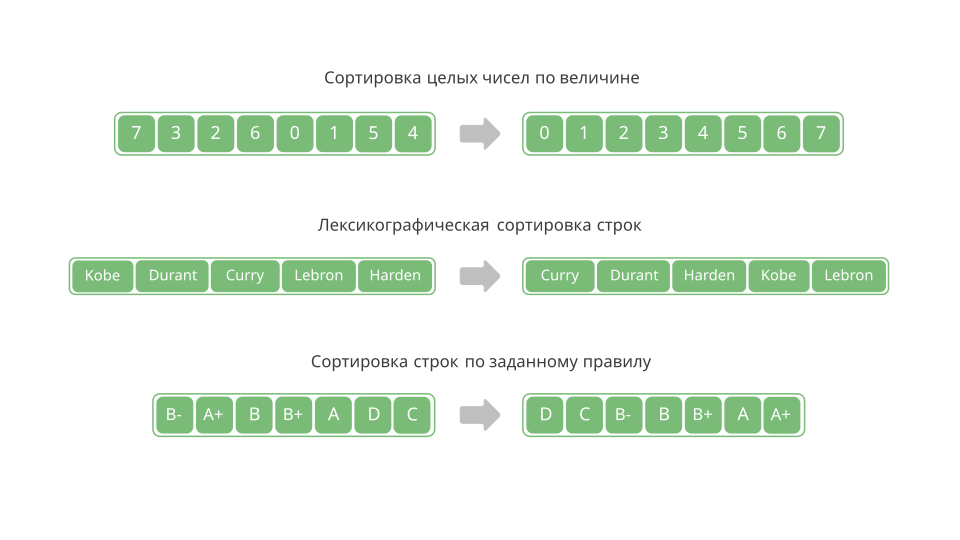

# 11.1 &nbsp; Алгоритмы сортировки

<u>Алгоритм сортировки (sorting algorithm)</u> располагает данные в заданном порядке. Такие алгоритмы широко применяются, поскольку упорядоченные данные обычно легче искать, анализировать и обрабатывать.

Как показано на рисунке, сортировать можно целые числа, числа с плавающей точкой, символы, строки и другие типы данных. Правило выбирают по задаче: например, сравнивают числа по величине, символы по кодам ASCII или задают собственный порядок.

{ class="animation-figure" }

<p align="center"> Рисунок 11-1 &nbsp; Примеры типов данных и правил сравнения </p>

## 11.1.1 &nbsp; Критерии оценки

**Скорость работы**. Желательно, чтобы временная сложность была как можно ниже, а общее число операций — небольшим (это уменьшает постоянный множитель в оценке сложности). Скорость особенно важна при больших объёмах данных.

**Работа на месте**. <u>Сортировка на месте</u> переставляет элементы непосредственно в исходном массиве и экономит память, поскольку ей не нужен вспомогательный массив. Обычно при этом приходится меньше перемещать данные, что ускоряет работу.

**Устойчивость**. При <u>устойчивой сортировке</u> равные элементы сохраняют в отсортированном массиве исходный взаимный порядок.

Устойчивость необходима при многоуровневой сортировке. Пусть в таблице сведений об учащихся первый столбец содержит имена, а второй — возраст. В этом случае <u>неустойчивая сортировка</u> может нарушить уже установленный порядок:

```shell
# Входные данные упорядочены по имени
# (name, age)
  ('A', 19)
  ('B', 18)
  ('C', 21)
  ('D', 19)
  ('E', 23)

# Допустим, список сортируется по возрасту неустойчивым алгоритмом.
# В результате ('D', 19) и ('A', 19) меняют свой взаимный порядок,
# и прежний порядок по имени теряется
  ('B', 18)
  ('D', 19)
  ('A', 19)
  ('C', 21)
  ('E', 23)
```

**Адаптивность**. <u>Адаптивная сортировка</u> использует уже имеющийся порядок входных данных, сокращая число вычислений и время работы. Временная сложность адаптивных алгоритмов в лучшем случае обычно ниже, чем в среднем.

**Использование сравнений**. <u>Сортировка сравнениями</u> определяет взаимный порядок элементов с помощью операторов сравнения ($<$, $=$, $>$) и на этой основе упорядочивает весь массив. Нижняя граница её временной сложности в худшем случае равна $\Omega(n \log n)$. <u>Сортировка без сравнений</u> обходится без этих операторов и может работать за $O(n)$, но имеет более узкую область применения.

## 11.1.2 &nbsp; Идеальный алгоритм сортировки

**Быстрый, устойчивый, адаптивный, универсальный и работающий на месте**. Алгоритм сортировки, сочетающий все эти свойства, пока не найден. Поэтому при выборе нужно учитывать особенности данных и требования задачи.

Далее мы изучим разные алгоритмы сортировки и разберём их достоинства и недостатки по этим критериям.
