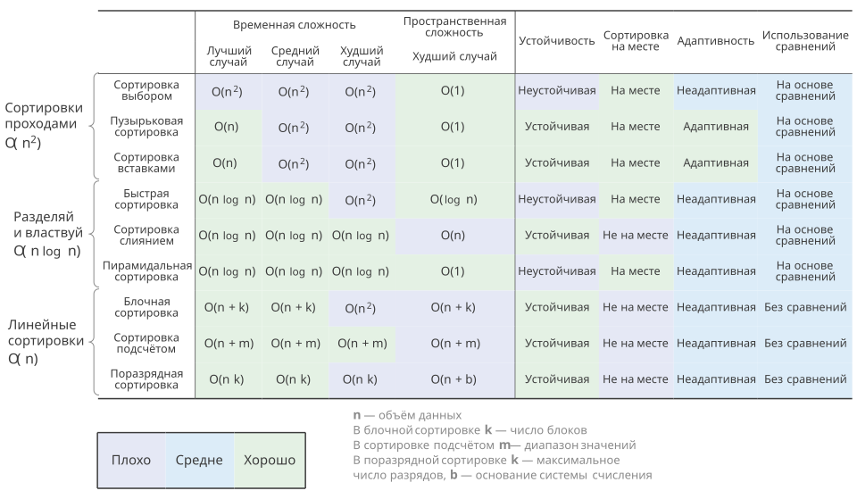

# 11.11 &nbsp; Итоги

### 1. &nbsp; Основные выводы

- Сортировка пузырьком упорядочивает массив обменами соседних элементов. Флаг, позволяющий завершить работу досрочно, снижает временную сложность в лучшем случае до $O(n)$.
- Сортировка вставками на каждом проходе берёт элемент из неотсортированной части и вставляет на нужное место в отсортированной. Её временная сложность равна $O(n^2)$, но число элементарных операций сравнительно мало, поэтому она популярна при сортировке небольших объёмов данных.
- Быстрая сортировка основана на разбиении двумя указателями. Если каждый раз выбирать наихудший опорный элемент, временная сложность ухудшится до $O(n^2)$. Выбор медианы или случайного элемента в качестве опорного снижает эту вероятность. Рекурсивная обработка меньшего участка позволяет ограничить глубину рекурсии и снизить пространственную сложность до $O(\log n)$.
- Сортировка слиянием состоит из разбиения и слияния и служит классическим примером стратегии «разделяй и властвуй». При работе с массивом нужен вспомогательный массив, поэтому пространственная сложность равна $O(n)$. При сортировке связного списка её можно снизить до $O(1)$.
- Блочная сортировка состоит из трёх шагов: распределения данных по блокам, сортировки внутри блоков и объединения результатов. Это ещё один пример стратегии «разделяй и властвуй», подходящий для больших объёмов данных. Важно распределить данные по блокам равномерно.
- Сортировка подсчётом — частный случай блочной сортировки. Она упорядочивает данные, подсчитывая вхождения значений. Алгоритм подходит для больших объёмов данных с ограниченным диапазоном значений и требует, чтобы данные можно было преобразовать в положительные целые числа.
- Поразрядная сортировка упорядочивает данные, последовательно сортируя их по каждому разряду. Данные должны допускать запись числами с фиксированным количеством разрядов.
- Хотелось бы найти быструю, устойчивую и адаптивную сортировку, которая работает на месте. Но, как и с другими структурами данных и алгоритмами, ни одна сортировка не удовлетворяет всем этим требованиям сразу. В практических задачах алгоритм выбирают с учётом свойств данных.
- На рисунке сопоставлены скорость, устойчивость, работа на месте, адаптивность и другие свойства распространённых алгоритмов сортировки.

{ class="animation-figure" }

 Рисунок 11-19 &nbsp; Сравнение алгоритмов сортировки 

### 2. &nbsp; Q & A

**Вопрос**: когда устойчивость алгоритма сортировки необходима?

На практике объекты нередко сортируют по одному из их свойств. Например, у учащегося есть имя и рост. Пусть нам нужна многоуровневая сортировка. Сначала сортируем по имени и получаем `(A, 180) (B, 185) (C, 170) (D, 170)`. Затем сортируем по росту. Если алгоритм неустойчив, результатом может оказаться `(D, 170) (C, 170) (A, 180) (B, 185)`.

Учащиеся D и C поменялись местами, и порядок по имени нарушился, хотя мы хотели его сохранить.

**Вопрос**: можно ли поменять местами поиск справа налево и поиск слева направо при разбиении двумя указателями?

Нет. Если опорным выбран крайний левый элемент, нужно сначала искать справа налево, а затем слева направо. Это может показаться неожиданным. Разберёмся почему.

Последний шаг разбиения `partition()` — обмен `nums[left]` и `nums[i]`. После него для каждого элемента слева должно выполняться неравенство «элемент `<=` опорное значение». **Значит, перед последним обменом необходимо условие `nums[left] >= nums[i]`**. Допустим, мы сначала ищем слева направо. Если элемент больше опорного не найден, **цикл закончится при `i == j`, а в этот момент возможно `nums[j] == nums[i] > nums[left]`**. Тогда последний обмен перенесёт на крайнее левое место элемент больше опорного и разбиение окажется неверным.

Например, пусть дан массив `[0, 0, 0, 0, 1]`. Если начать поиск слева направо, после разбиения получится `[1, 0, 0, 0, 0]`, что неверно.

Если же выбрать опорным `nums[right]`, ситуация будет обратной: первым нужно выполнять поиск слева направо.

**Вопрос**: почему при оптимизации быстрой сортировки рекурсия по меньшему подмассиву гарантирует глубину не более $\log n$?

Глубина рекурсии — число рекурсивных вызовов, которые сейчас ещё не вернулись. Каждое разбиение делит текущий массив на два подмассива. При оптимизации глубины длина подмассива для следующего рекурсивного вызова составляет не более половины текущей. Если в худшем случае она каждый раз равна половине, итоговая глубина рекурсии составит $\log n$.

В первоначальной быстрой сортировке рекурсивные вызовы могли последовательно идти по большим подмассивам. В худшем случае их длины равны $n$, $n - 1$, $\dots$, $2$, $1$, а глубина рекурсии — $n$. Оптимизация глубины исключает такую ситуацию.

**Вопрос**: равна ли временная сложность быстрой сортировки $O(n^2)$, когда все элементы массива равны? Как справиться с таким вырождением?

Да. Можно изменить разбиение, выделив три части: элементы меньше опорного, равные ему и больше него. Рекурсивно обрабатываются только первая и третья части. Массив из одинаковых элементов при таком подходе будет отсортирован за одно разбиение.

**Вопрос**: почему временная сложность блочной сортировки в худшем случае равна $O(n^2)$?

В худшем случае все элементы попадают в один блок. Если для их сортировки используется алгоритм со сложностью $O(n^2)$, временная сложность составит $O(n^2)$.
