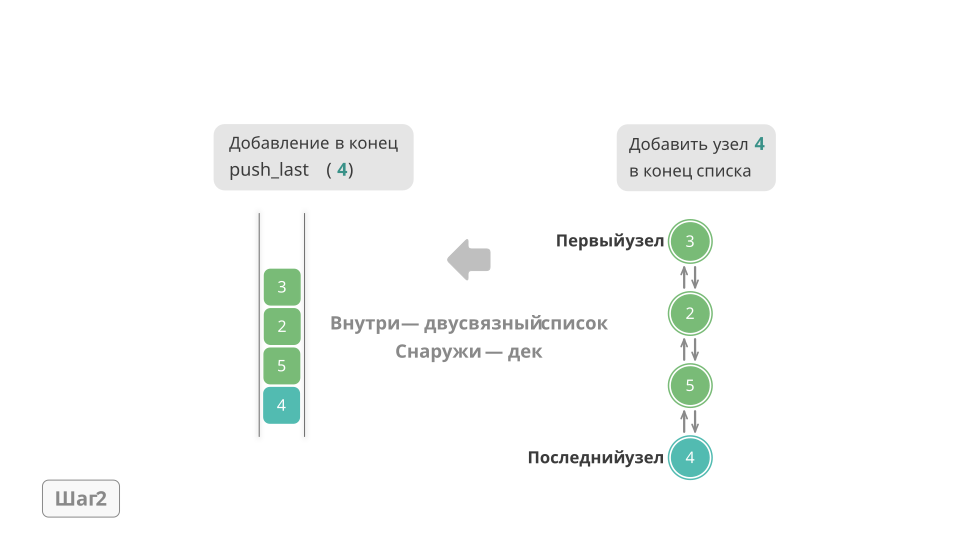
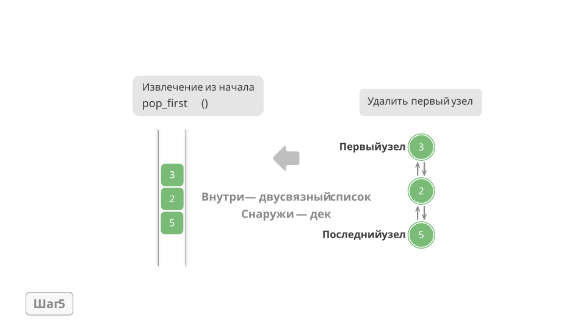
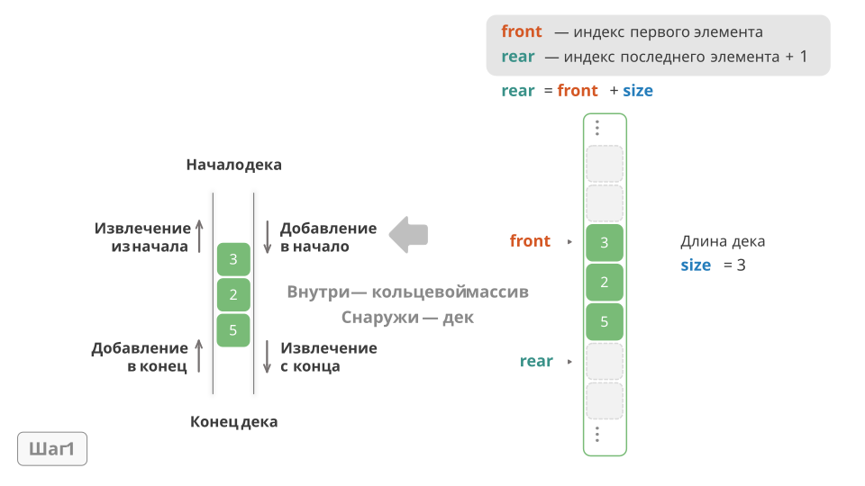

# Двусторонняя очередь

В обычной очереди мы можем удалять элементы только из головы и добавлять их только в хвост. Как показано на рисунке ниже, <u>двусторонняя очередь (double-ended queue)</u> обеспечивает большую гибкость и позволяет выполнять добавление и удаление элементов как с головы, так и с хвоста.


## Основные операции с двусторонней очередью

Распространенные операции двусторонней очереди приведены в таблице ниже. Конкретные названия методов зависят от используемого языка программирования.

<p align="center"> Таблица <id> &nbsp; Эффективность операций двусторонней очереди </p>

| Имя метода   | Описание                         | Временная сложность |
| ------------ | -------------------------------- | ------------------- |
| `push_first()` | Добавить элемент в голову очереди | $O(1)$     |
| `push_last()`  | Добавить элемент в хвост очереди  | $O(1)$     |
| `pop_first()`  | Удалить элемент из головы очереди | $O(1)$     |
| `pop_last()`   | Удалить элемент из хвоста очереди | $O(1)$     |
| `peek_first()` | Просмотреть элемент в голове очереди | $O(1)$  |
| `peek_last()`  | Просмотреть элемент в хвосте очереди | $O(1)$  |

Точно так же мы можем напрямую использовать уже реализованные в языках программирования классы двусторонней очереди:

```snippet
deque_operations
```

??? pythontutor "Визуализация выполнения"

    @tutor deque_operations_tutor

## Реализация двусторонней очереди *

Реализация двусторонней очереди похожа на реализацию обычной очереди: в качестве базовой структуры данных можно выбрать связный список или массив.

### Реализация на основе двусвязного списка

Вспомним предыдущий раздел: там мы использовали обычный односвязный список для реализации очереди, потому что он позволяет удобно удалять головной узел, что соответствует операции `dequeue` , и добавлять новый узел после хвостового узла, что соответствует операции `enqueue` .

Для двусторонней очереди и голова, и хвост допускают операции добавления и удаления элементов. Иначе говоря, двусторонняя очередь требует реализации еще одного симметричного направления операций. Поэтому в качестве базовой структуры данных двусторонней очереди удобно использовать двусвязный список.

Как показано на рисунке ниже, мы рассматриваем головной и хвостовой узлы двусвязного списка как голову и хвост двусторонней очереди и одновременно реализуем функции добавления и удаления узлов с обеих сторон.

=== "<1>"
    

=== "<2>"
    

=== "<3>"
    

=== "<4>"
    

=== "<5>"
    

Код реализации приведен ниже:

```src
[file]{linkedlist_deque}-[class]{linked_list_deque}-[func]{}
```

### Реализация на основе массива

Как показано на рисунке ниже, аналогично реализации обычной очереди на массиве мы также можем использовать кольцевой массив для реализации двусторонней очереди.

=== "<1>"
    

=== "<2>"
    

=== "<3>"
    

=== "<4>"
    

=== "<5>"
    

На основе реализации обычной очереди нужно лишь добавить методы добавления в голову очереди и удаления из хвоста:

```src
[file]{array_deque}-[class]{array_deque}-[func]{}
```

## Применение двусторонней очереди

Двусторонняя очередь сочетает в себе логику стека и очереди, **поэтому она может покрыть все сценарии применения обеих структур и при этом предоставляет более высокую степень свободы**.

Мы знаем, что функция «undo» в программном обеспечении обычно реализуется с помощью стека: система помещает каждое изменение в стек с помощью `push` , а затем использует `pop` для отмены. Однако, учитывая ограниченность системных ресурсов, программы обычно ограничивают число шагов отмены, например разрешают хранить только $50$ шагов. Когда длина стека превышает этот предел, программе нужно удалить элемент с дна стека, то есть с головы очереди. **Но стек не может реализовать такую операцию, и в этом случае его приходится заменять двусторонней очередью**. Обратите внимание: основная логика «undo» по-прежнему следует стековому правилу LIFO, просто двусторонняя очередь позволяет более гибко реализовать некоторые дополнительные механизмы.
