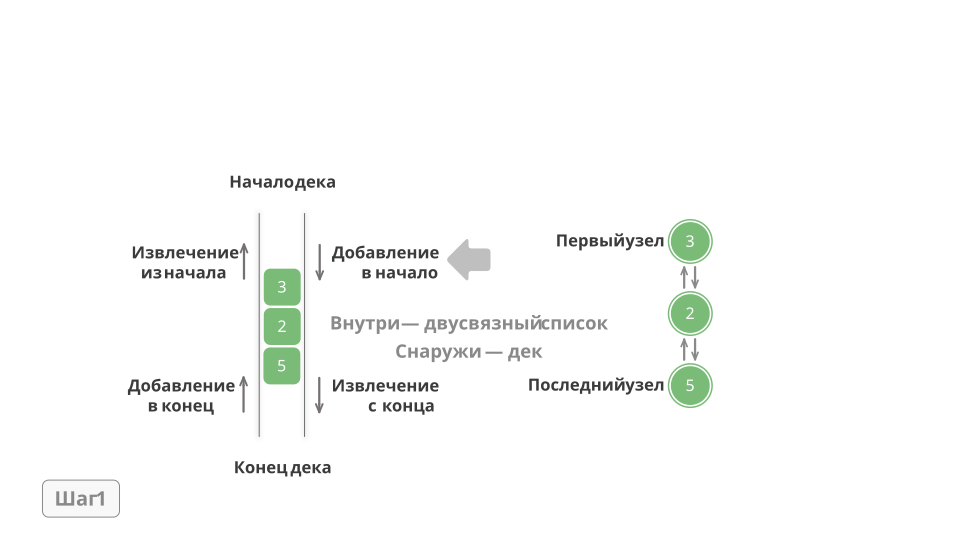
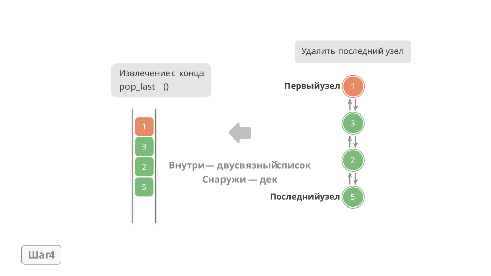
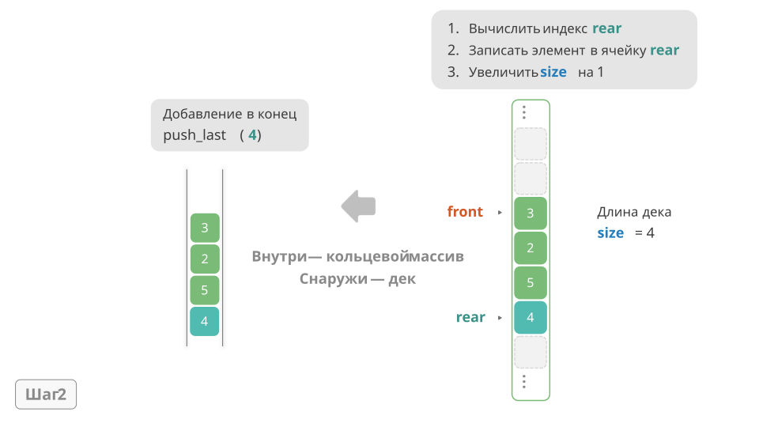
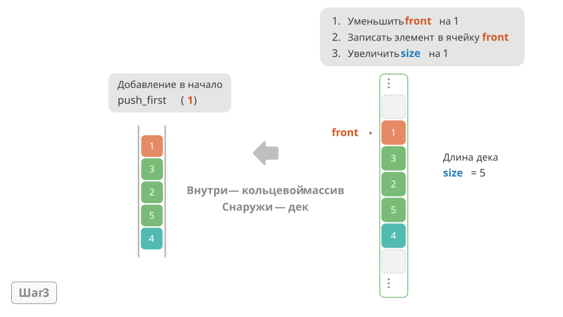

# Двусторонняя очередь

В обычной очереди удалять элементы можно только из начала, а добавлять — только в конец. Как показано на рисунке ниже, <u>двусторонняя очередь (дек, double-ended queue)</u> устроена гибче: на каждом из двух концов элементы можно и добавлять, и удалять.


## Основные операции с деком

В таблице ниже приведены основные операции с деком. Имена методов зависят от языка программирования.

<p align="center">Таблица <id>&nbsp; Временная сложность операций с деком</p>

| Имя метода         | Описание             | Временная сложность |
| -------------- | ---------------- | ---------- |
| `push_first()` | Добавить элемент в начало дека | $O(1)$     |
| `push_last()`  | Добавить элемент в конец дека | $O(1)$     |
| `pop_first()`  | Удалить первый элемент дека     | $O(1)$     |
| `pop_last()`   | Удалить последний элемент дека     | $O(1)$     |
| `peek_first()` | Посмотреть первый элемент дека     | $O(1)$     |
| `peek_last()`  | Посмотреть последний элемент дека     | $O(1)$     |

Как и в случае с обычной очередью, можно воспользоваться готовым классом двусторонней очереди в выбранном языке программирования.

```snippet
deque_operations
```

??? pythontutor "Визуализация выполнения"

    @tutor deque_operations_tutor

## Реализация дека *

Как и обычную очередь, дек можно построить на основе связного списка или массива.

### Реализация на основе двусвязного списка

В предыдущем разделе мы реализовали очередь с помощью обычного односвязного списка. В нём удобно удалять первый узел (извлекать элемент из очереди) и вставлять новый узел после последнего (добавлять элемент в очередь).

У дека и добавление, и извлечение возможны с каждого конца. Значит, для каждой операции обычной очереди понадобится симметричная операция на противоположном конце. Поэтому в качестве основы для дека возьмём двусвязный список.

Как показано на рисунке ниже, первый и последний узлы двусвязного списка соответствуют началу и концу дека. Реализуем добавление и удаление узлов с обоих концов.

=== "<1>"
    

=== "<2>"
    

=== "<3>"
    

=== "<4>"
    

=== "<5>"
    

Код реализации приведён ниже.

```src
[file]{linkedlist_deque}-[class]{linked_list_deque}-[func]{}
```

### Реализация на основе массива

Как показано на рисунке ниже, для реализации дека можно использовать кольцевой массив, как и для обычной очереди.

=== "<1>"
    

=== "<2>"
    

=== "<3>"
    

=== "<4>"
    

=== "<5>"
    

К реализации обычной очереди достаточно добавить два метода: для добавления в начало и для извлечения с конца.

```src
[file]{array_deque}-[class]{array_deque}-[func]{}
```

## Применение дека

Дек поддерживает операции и стека, и очереди, **поэтому он подходит для всех задач, в которых используются эти структуры, и даёт больше свободы**.

Для отмены действий в программах обычно используют стек. Каждое изменение помещают в стек операцией `push`, а при отмене извлекают операцией `pop`. Однако ресурсы системы ограничены, поэтому программы обычно ограничивают число доступных шагов отмены, например хранят лишь $50$ последних действий. Когда длина стека превышает $50$, нужно удалить самый старый элемент со дна стека (из начала дека). **Стек не поддерживает такую операцию, поэтому вместо него используют дек**. Сама отмена по-прежнему работает по принципу стека: первым отменяется действие, добавленное последним. Дек позволяет удобно выполнять и дополнительные операции.
