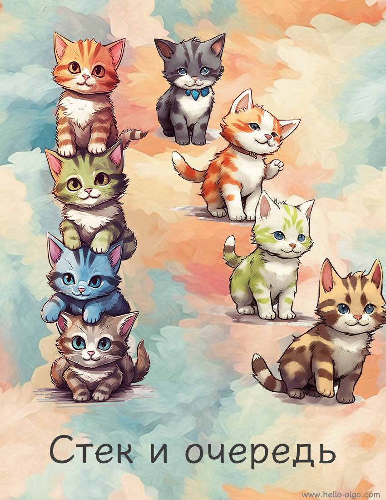

# Стеки и очереди

!!! abstract

    Стек похож на котиков, устроившихся друг на друге, а очередь — на котиков, выстроившихся друг за другом.
    
    В стеке действует правило «первым пришёл — последним ушёл», а в очереди — «первым пришёл — первым ушёл».
