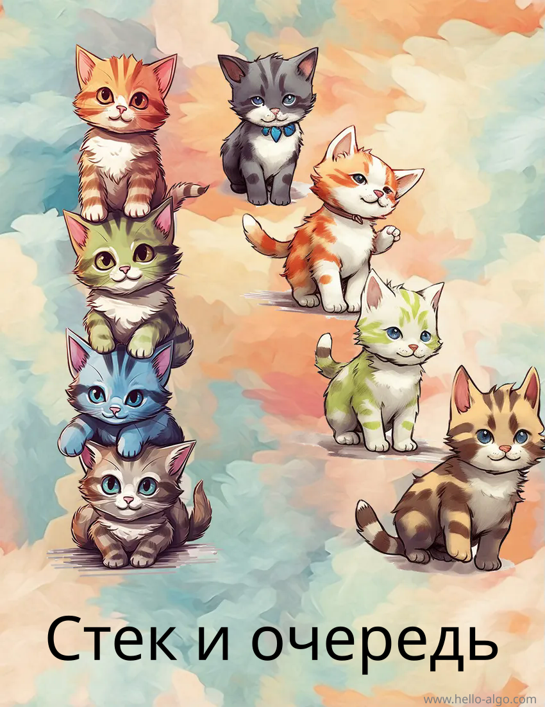

# Глава 5. &nbsp; Стеки и очереди

{ class="cover-image" }

!!! abstract

    Стек похож на котиков, устроившихся друг на друге, а очередь — на котиков, выстроившихся друг за другом.
    
    В стеке действует правило «первым пришёл — последним ушёл», а в очереди — «первым пришёл — первым ушёл».

## Содержание главы

- [5.1 &nbsp; Стек](stack.md)
- [5.2 &nbsp; Очередь](queue.md)
- [5.3 &nbsp; Двусторонняя очередь](deque.md)
- [5.4 &nbsp; Итоги](summary.md)
- [5.5 &nbsp; Упражнения](exercises.md)
