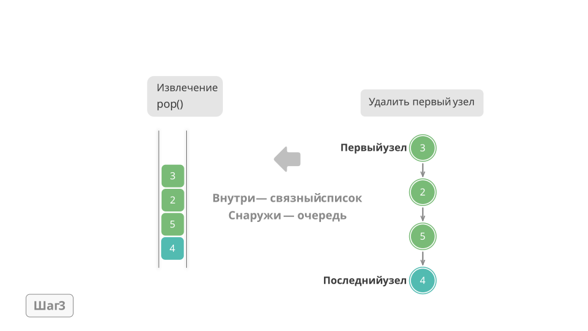
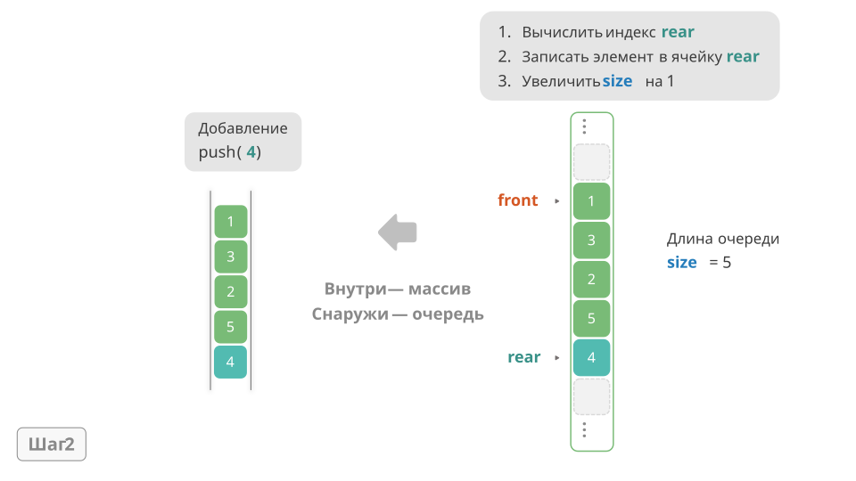

# Очередь

<u>Очередь (queue)</u> - это линейная структура данных, подчиняющаяся правилу «первым пришел - первым вышел». Как видно из названия, очередь моделирует обычную ситуацию ожидания: новые люди непрерывно присоединяются к хвосту очереди, а стоящие в начале по одному уходят.

Как показано на рисунке ниже, начало очереди называется головой очереди, а конец - хвостом очереди. Операцию добавления элемента в хвост называют `enqueue`, а операцию удаления элемента из головы - `dequeue`.


## Основные операции с очередью

Распространенные операции с очередью показаны в таблице ниже. Следует учитывать, что названия методов в разных языках могут различаться. Здесь мы используем те же названия, что и для стека.

<p align="center"> Таблица <id> &nbsp; Эффективность операций с очередью </p>

| Имя метода | Описание                                  | Временная сложность |
| ---------- | ----------------------------------------- | ------------------- |
| `push()`   | Поместить элемент в очередь, то есть добавить его в хвост | $O(1)$ |
| `pop()`    | Извлечь элемент из головы очереди         | $O(1)$              |
| `peek()`   | Просмотреть элемент в голове очереди      | $O(1)$              |

Обычно достаточно использовать готовые классы очереди, предоставляемые языками программирования:

```snippet
queue_operations
```

??? pythontutor "Визуализация выполнения"

    @tutor queue_operations_tutor

## Реализация очереди

Чтобы реализовать очередь, нам нужна такая структура данных, которая позволяет добавлять элементы с одного конца и удалять их с другого. И связный список, и массив этим требованиям удовлетворяют.

### Реализация на основе связного списка

Как показано на рисунке ниже, мы можем рассматривать головной узел и хвостовой узел связного списка как голову очереди и хвост очереди соответственно, договорившись, что добавлять узлы можно только в хвост, а удалять - только из головы.

=== "<1>"
    

=== "<2>"
    

=== "<3>"
    

Ниже приведен код реализации очереди на связном списке:

```src
[file]{linkedlist_queue}-[class]{linked_list_queue}-[func]{}
```

### Реализация на основе массива

Удаление первого элемента из массива имеет временную сложность $O(n)$ , из-за чего операция `dequeue` оказывается неэффективной. Однако этого можно избежать с помощью следующего приема.

Мы можем использовать переменную `front` , указывающую на индекс элемента в голове очереди, и поддерживать переменную `size` , которая хранит длину очереди. Определим `rear = front + size`. Эта формула дает позицию `rear`, указывающую на ячейку сразу после хвоста очереди.

Исходя из этого, **эффективный диапазон элементов массива равен `[front, rear - 1]`**, а различные операции реализуются, как показано на рисунке ниже.

- Операция `enqueue`: записать входной элемент по индексу `rear` и увеличить `size` на 1.
- Операция `dequeue`: просто увеличить `front` на 1 и уменьшить `size` на 1.

Можно увидеть, что и `enqueue` , и `dequeue` требуют всего одной операции, а значит обе имеют временную сложность $O(1)$ .

=== "<1>"
    

=== "<2>"
    

=== "<3>"
    

Ты можешь заметить еще одну проблему: при непрерывных операциях `enqueue` и `dequeue` значения `front` и `rear` оба движутся вправо, и **когда они доходят до конца массива, дальше сдвигаться уже нельзя**. Чтобы решить эту проблему, можно рассматривать массив как кольцевой массив, у которого начало и конец соединены.

Для кольцевого массива нужно сделать так, чтобы `front` или `rear`, перешагнув конец массива, сразу возвращались к его началу и продолжали движение. Такую периодичность удобно реализовать с помощью операции взятия остатка, как показано в коде ниже:

```src
[file]{array_queue}-[class]{array_queue}-[func]{}
```

Даже такая реализация очереди остается ограниченной: ее длина неизменяема. Однако это несложно исправить, заменив массив на динамический массив и тем самым введя механизм расширения. Заинтересованные читатели могут попробовать реализовать это самостоятельно.

Выводы сравнения двух реализаций в целом такие же, как и для стека, поэтому здесь мы не будем повторяться.

## Типичные применения очереди

- **Очереди заказов**. После оформления заказа покупателем заказ попадает в очередь, а затем система обрабатывает заказы по порядку. Во время крупных распродаж за короткое время возникает огромный поток заказов, и высокая конкурентная нагрузка становится ключевой инженерной проблемой.
- **Различные отложенные задачи**. Любой сценарий, где нужно реализовать принцип «кто раньше пришел, тот раньше обслуживается», например очередь заданий принтера или очередь блюд на кухне ресторана, хорошо моделируется очередью, которая эффективно поддерживает нужный порядок обработки.
