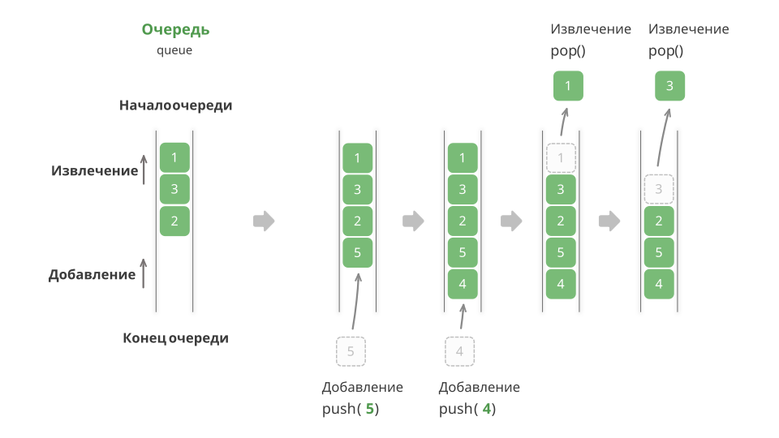
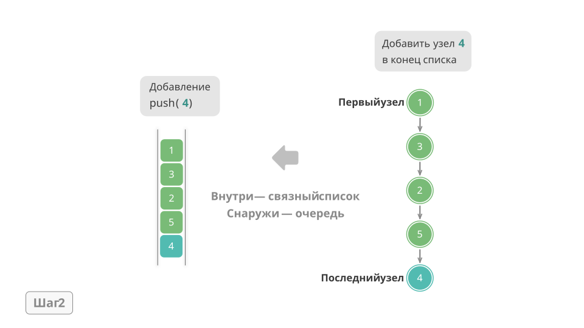
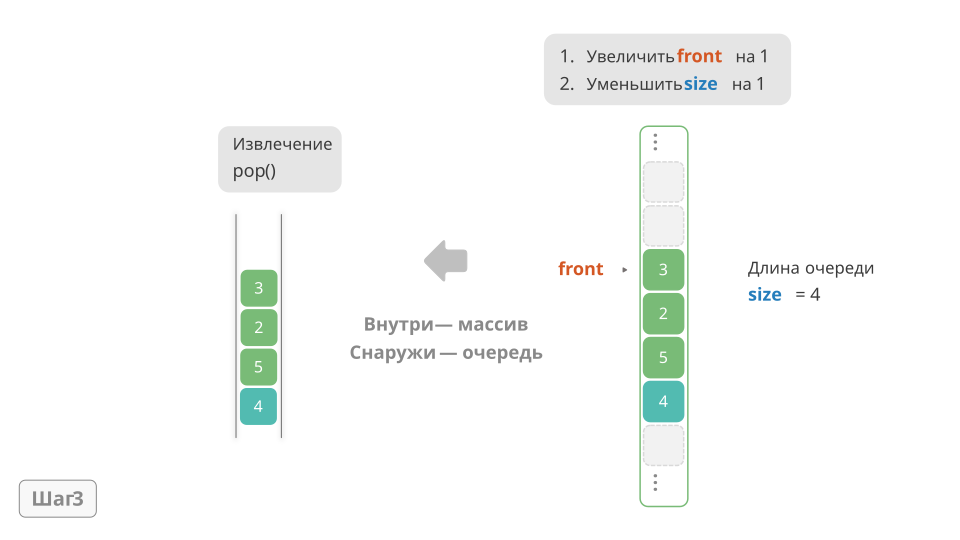

# Очередь

<u>Очередь (queue)</u> — линейная структура данных, в которой первым извлекают элемент, добавленный первым. Она устроена как обычная очередь людей: вновь пришедшие встают в конец, а из начала люди уходят один за другим.

На рисунке ниже показаны начало и конец очереди. Поместить элемент в конец — значит добавить его в очередь, а удалить элемент из начала — извлечь его из очереди.



## Основные операции с очередью

В таблице ниже перечислены основные операции с очередью. Имена методов могут различаться в зависимости от языка программирования. Здесь мы используем те же имена, что и для стека.

<p align="center">Таблица <id>&nbsp; Временная сложность операций с очередью</p>

| Имя метода   | Описание                         | Временная сложность |
| -------- | ---------------------------- | ---------- |
| `push()` | Добавить элемент в конец очереди | $O(1)$     |
| `pop()`  | Извлечь первый элемент очереди                 | $O(1)$     |
| `peek()` | Посмотреть первый элемент очереди                 | $O(1)$     |

Можно воспользоваться готовым классом очереди в выбранном языке программирования.

```snippet
queue_operations
```

??? pythontutor "Визуализация выполнения"

    @tutor queue_operations_tutor

## Реализация очереди

Для реализации очереди нужна структура данных, которая позволяет добавлять элементы с одного конца и удалять с другого. Этому требованию отвечают и связный список, и массив.

### Реализация на основе связного списка

Как показано на рисунке ниже, первый узел списка можно считать началом очереди, а последний — её концом. В конец разрешим только добавлять узлы, а из начала — только удалять.

=== "<1>"
    

=== "<2>"
    

=== "<3>"
    

Так выглядит реализация очереди на основе связного списка.

```src
[file]{linkedlist_queue}-[class]{linked_list_queue}-[func]{}
```

### Реализация на основе массива

Удаление первого элемента массива занимает $O(n)$ времени, поэтому извлекать элементы из такой очереди было бы неэффективно. Обойти эту трудность можно следующим образом.

Сохраним в переменной `front` индекс первого элемента очереди, а в переменной `size` — длину очереди. Положим `rear = front + size`. Вычисленный по этой формуле индекс `rear` указывает на позицию сразу за последним элементом очереди.

При таком устройстве **элементы очереди занимают в массиве диапазон индексов `[front, rear - 1]`**. На рисунке ниже показано, как выполнять операции с очередью.

- Добавление: записать новый элемент по индексу `rear` и увеличить `size` на 1.
- Извлечение: достаточно увеличить `front` на 1 и уменьшить `size` на 1.

Как видно, и добавление, и извлечение выполняются за один шаг, поэтому временная сложность обеих операций составляет $O(1)$.

=== "<1>"
    

=== "<2>"
    

=== "<3>"
    

При последовательных добавлениях и извлечениях возникает трудность: `front` и `rear` смещаются вправо, и **на конце массива им будет некуда двигаться дальше**. Решим эту задачу, мысленно соединив конец массива с началом. Такой массив называют кольцевым.

В кольцевом массиве индекс `front` или `rear`, перешагнув через конец, должен вернуться к началу и продолжить движение оттуда. Такое циклическое изменение индексов можно реализовать с помощью остатка от деления, как в следующем примере.

```src
[file]{array_queue}-[class]{array_queue}-[func]{}
```

У этой реализации очереди остаётся ограничение: её длина фиксирована. Его легко снять, если заменить массив динамическим массивом, который может расширяться. Попробуйте реализовать такую очередь самостоятельно.

Сравнение двух реализаций приводит к тем же выводам, что и для стека.

## Примеры применения очереди

- **Заказы на Taobao**. Когда покупатель оформляет заказ, он попадает в очередь. Затем система обрабатывает заказы по порядку. Во время распродажи 11 ноября за короткое время поступает огромное число заказов. Одна из главных задач инженеров — справиться с таким количеством одновременных запросов.
- **Задачи, ожидающие выполнения**. Очередь помогает сохранять порядок обработки везде, где заявки должны обслуживаться в порядке поступления. Например, в очередь ставят задания на печать или заказы на выдачу блюд в ресторане.
