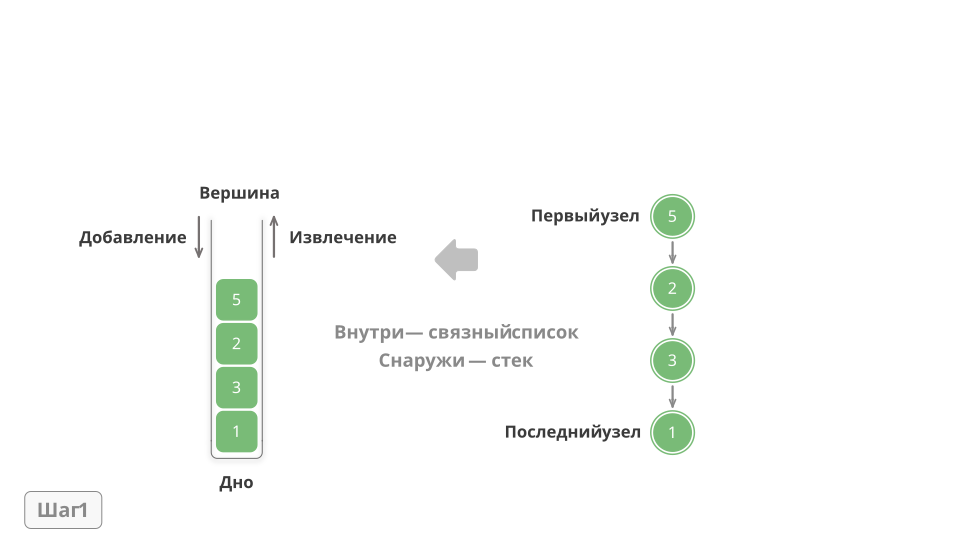

# 5.1 &nbsp; Стек

<u>Стек (stack)</u> — линейная структура данных, в которой первым извлекают элемент, добавленный последним.

Представьте стопку тарелок на столе. Если за раз можно взять только одну тарелку, то, чтобы добраться до нижней, придётся сначала по очереди снять все тарелки над ней. Заменим тарелки элементами произвольного типа, например целыми числами, символами или объектами, и получим структуру данных «стек».

Как видно на рисунке 5-1, верх стопки элементов называют вершиной стека, а низ — дном. Положить элемент на вершину — значит добавить его в стек, а снять с вершины — извлечь из стека.

{ class="animation-figure" }

<p align="center"> Рисунок 5-1 &nbsp; Принцип стека: первым пришёл — последним ушёл </p>

## 5.1.1 &nbsp; Основные операции со стеком

В таблице ниже приведены основные операции со стеком. Имена методов зависят от языка программирования. Для примера возьмём распространённые имена `push()`, `pop()` и `peek()`.

<p align="center">Таблица <id>&nbsp; Временная сложность операций со стеком</p>

<div class="center-table" markdown>

| Метод     | Описание                   | Временная сложность |
| -------- | ---------------------- | ---------- |
| `push()` | Добавить элемент в стек (положить на вершину) | $O(1)$     |
| `pop()`  | Снять элемент с вершины стека           | $O(1)$     |
| `peek()` | Посмотреть элемент на вершине стека           | $O(1)$     |

</div>

Обычно можно воспользоваться встроенным классом стека. Если в языке нет отдельного класса для стека, в его роли может выступать массив или связный список. Достаточно не использовать в программе операции, которые не относятся к стеку.

=== "Python"

    ```python title="stack.py"
    # Инициализировать стек
    # В Python нет встроенного класса стека, поэтому в качестве стека можно использовать list
    stack: list[int] = []

    # Поместить элементы в стек
    stack.append(1)
    stack.append(3)
    stack.append(2)
    stack.append(5)
    stack.append(4)

    # Посмотреть элемент на вершине стека
    peek: int = stack[-1]

    # Снять элемент со стека
    pop: int = stack.pop()

    # Получить размер стека
    size: int = len(stack)

    # Проверить, пуст ли стек
    is_empty: bool = len(stack) == 0
    ```

=== "C++"

    ```cpp title="stack.cpp"
    /* Инициализировать стек */
    stack<int> stack;

    /* Поместить элементы в стек */
    stack.push(1);
    stack.push(3);
    stack.push(2);
    stack.push(5);
    stack.push(4);

    /* Посмотреть элемент на вершине стека */
    int top = stack.top();

    /* Снять элемент со стека */
    stack.pop(); // Метод не возвращает значения

    /* Получить размер стека */
    int size = stack.size();

    /* Проверить, пуст ли стек */
    bool empty = stack.empty();
    ```

=== "Java"

    ```java title="stack.java"
    /* Инициализировать стек */
    Stack<Integer> stack = new Stack<>();

    /* Поместить элементы в стек */
    stack.push(1);
    stack.push(3);
    stack.push(2);
    stack.push(5);
    stack.push(4);

    /* Посмотреть элемент на вершине стека */
    int peek = stack.peek();

    /* Снять элемент со стека */
    int pop = stack.pop();

    /* Получить размер стека */
    int size = stack.size();

    /* Проверить, пуст ли стек */
    boolean isEmpty = stack.isEmpty();
    ```

=== "C#"

    ```csharp title="stack.cs"
    /* Инициализировать стек */
    Stack<int> stack = new();

    /* Поместить элементы в стек */
    stack.Push(1);
    stack.Push(3);
    stack.Push(2);
    stack.Push(5);
    stack.Push(4);

    /* Посмотреть элемент на вершине стека */
    int peek = stack.Peek();

    /* Снять элемент со стека */
    int pop = stack.Pop();

    /* Получить размер стека */
    int size = stack.Count;

    /* Проверить, пуст ли стек */
    bool isEmpty = stack.Count == 0;
    ```

=== "Go"

    ```go title="stack_test.go"
    /* Инициализировать стек */
    // В Go для реализации стека рекомендуется использовать срез
    var stack []int

    /* Поместить элементы в стек */
    stack = append(stack, 1)
    stack = append(stack, 3)
    stack = append(stack, 2)
    stack = append(stack, 5)
    stack = append(stack, 4)

    /* Посмотреть элемент на вершине стека */
    peek := stack[len(stack)-1]

    /* Снять элемент со стека */
    pop := stack[len(stack)-1]
    stack = stack[:len(stack)-1]

    /* Получить размер стека */
    size := len(stack)

    /* Проверить, пуст ли стек */
    isEmpty := len(stack) == 0
    ```

=== "Swift"

    ```swift title="stack.swift"
    /* Инициализировать стек */
    // В Swift нет встроенного класса стека, поэтому в качестве стека можно использовать Array
    var stack: [Int] = []

    /* Поместить элементы в стек */
    stack.append(1)
    stack.append(3)
    stack.append(2)
    stack.append(5)
    stack.append(4)

    /* Посмотреть элемент на вершине стека */
    let peek = stack.last!

    /* Снять элемент со стека */
    let pop = stack.removeLast()

    /* Получить размер стека */
    let size = stack.count

    /* Проверить, пуст ли стек */
    let isEmpty = stack.isEmpty
    ```

=== "JS"

    ```javascript title="stack.js"
    /* Инициализировать стек */
    // В JavaScript нет встроенного класса стека, поэтому в качестве стека можно использовать Array
    const stack = [];

    /* Поместить элементы в стек */
    stack.push(1);
    stack.push(3);
    stack.push(2);
    stack.push(5);
    stack.push(4);

    /* Посмотреть элемент на вершине стека */
    const peek = stack[stack.length - 1];

    /* Снять элемент со стека */
    const pop = stack.pop();

    /* Получить размер стека */
    const size = stack.length;

    /* Проверить, пуст ли стек */
    const isEmpty = stack.length === 0;
    ```

=== "TS"

    ```typescript title="stack.ts"
    /* Инициализировать стек */
    // В TypeScript нет встроенного класса стека, поэтому в качестве стека можно использовать Array
    const stack: number[] = [];

    /* Поместить элементы в стек */
    stack.push(1);
    stack.push(3);
    stack.push(2);
    stack.push(5);
    stack.push(4);

    /* Посмотреть элемент на вершине стека */
    const peek = stack[stack.length - 1];

    /* Снять элемент со стека */
    const pop = stack.pop();

    /* Получить размер стека */
    const size = stack.length;

    /* Проверить, пуст ли стек */
    const isEmpty = stack.length === 0;
    ```

=== "Dart"

    ```dart title="stack.dart"
    /* Инициализировать стек */
    // В Dart нет встроенного класса стека, поэтому в качестве стека можно использовать List
    final List<int> stack = [];

    /* Поместить элементы в стек */
    stack.add(1);
    stack.add(3);
    stack.add(2);
    stack.add(5);
    stack.add(4);

    /* Посмотреть элемент на вершине стека */
    final int peek = stack.last;

    /* Снять элемент со стека */
    final int pop = stack.removeLast();

    /* Получить размер стека */
    final int size = stack.length;

    /* Проверить, пуст ли стек */
    final bool isEmpty = stack.isEmpty;
    ```

=== "Rust"

    ```rust title="stack.rs"
    // Инициализировать стек
    // В Rust для реализации стека рекомендуется использовать Vec
    let mut stack: Vec<i32> = Vec::new();

    // Поместить элементы в стек
    stack.push(1);
    stack.push(3);
    stack.push(2);
    stack.push(5);
    stack.push(4);

    // Посмотреть элемент на вершине стека
    let peek = stack.last().unwrap();

    // Снять элемент со стека
    let pop = stack.pop().unwrap();

    // Получить размер стека
    let size = stack.len();

    // Проверить, пуст ли стек
    let is_empty = stack.is_empty();
    ```

=== "C"

    ```c title="stack.c"
    // В C нет встроенного стека
    ```

=== "Kotlin"

    ```kotlin title="stack.kt"
    /* Инициализировать стек */
    val stack = Stack<Int>()

    /* Поместить элементы в стек */
    stack.push(1)
    stack.push(3)
    stack.push(2)
    stack.push(5)
    stack.push(4)

    /* Посмотреть элемент на вершине стека */
    val peek = stack.peek()

    /* Снять элемент со стека */
    val pop = stack.pop()

    /* Получить размер стека */
    val size = stack.size

    /* Проверить, пуст ли стек */
    val isEmpty = stack.isEmpty()
    ```

=== "Ruby"

    ```ruby title="stack.rb"
    # Инициализировать стек
    # В Ruby нет встроенного класса стека, поэтому в качестве стека можно использовать Array
    stack = []

    # Поместить элементы в стек
    stack << 1
    stack << 3
    stack << 2
    stack << 5
    stack << 4

    # Посмотреть элемент на вершине стека
    peek = stack.last

    # Снять элемент со стека
    pop = stack.pop

    # Получить размер стека
    size = stack.length

    # Проверить, пуст ли стек
    is_empty = stack.empty?
    ```

??? pythontutor "Визуализация выполнения"

    <div style="height: 549px; width: 100%;"><iframe class="pythontutor-iframe" title="Визуализация выполнения" src="https://pythontutor.com/iframe-embed.html#code=%22%22%22Driver%20Code%22%22%22%0Aif%20__name__%20%3D%3D%20%22__main__%22%3A%0A%20%20%20%20%23%20%D0%A1%D0%BE%D0%B7%D0%B4%D0%B0%D1%91%D0%BC%20%D1%81%D1%82%D0%B5%D0%BA%0A%20%20%20%20%23%20%D0%92%20Python%20%D0%BD%D0%B5%D1%82%20%D0%B2%D1%81%D1%82%D1%80%D0%BE%D0%B5%D0%BD%D0%BD%D0%BE%D0%B3%D0%BE%20%D0%BA%D0%BB%D0%B0%D1%81%D1%81%D0%B0%20%D1%81%D1%82%D0%B5%D0%BA%D0%B0,%20%D0%BD%D0%BE%20%D0%B2%20%D0%BA%D0%B0%D1%87%D0%B5%D1%81%D1%82%D0%B2%D0%B5%20%D1%81%D1%82%D0%B5%D0%BA%D0%B0%20%D0%BC%D0%BE%D0%B6%D0%BD%D0%BE%20%D0%B8%D1%81%D0%BF%D0%BE%D0%BB%D1%8C%D0%B7%D0%BE%D0%B2%D0%B0%D1%82%D1%8C%20%D1%81%D0%BF%D0%B8%D1%81%D0%BE%D0%BA%20list%0A%20%20%20%20stack%20%3D%20%5B%5D%0A%0A%20%20%20%20%23%20%D0%94%D0%BE%D0%B1%D0%B0%D0%B2%D0%BB%D1%8F%D0%B5%D0%BC%20%D1%8D%D0%BB%D0%B5%D0%BC%D0%B5%D0%BD%D1%82%D1%8B%20%D0%B2%20%D1%81%D1%82%D0%B5%D0%BA%0A%20%20%20%20stack.append%281%29%0A%20%20%20%20stack.append%283%29%0A%20%20%20%20stack.append%282%29%0A%20%20%20%20stack.append%285%29%0A%20%20%20%20stack.append%284%29%0A%20%20%20%20print%28%22%D0%A1%D1%82%D0%B5%D0%BA%20stack%20%3D%22,%20stack%29%0A%0A%20%20%20%20%23%20%D0%A7%D0%B8%D1%82%D0%B0%D0%B5%D0%BC%20%D1%8D%D0%BB%D0%B5%D0%BC%D0%B5%D0%BD%D1%82%20%D0%BD%D0%B0%20%D0%B2%D0%B5%D1%80%D1%88%D0%B8%D0%BD%D0%B5%20%D1%81%D1%82%D0%B5%D0%BA%D0%B0%0A%20%20%20%20peek%20%3D%20stack%5B-1%5D%0A%20%20%20%20print%28%22%D0%AD%D0%BB%D0%B5%D0%BC%D0%B5%D0%BD%D1%82%20%D0%BD%D0%B0%20%D0%B2%D0%B5%D1%80%D1%88%D0%B8%D0%BD%D0%B5%20peek%20%3D%22,%20peek%29%0A%0A%20%20%20%20%23%20%D0%A1%D0%BD%D0%B8%D0%BC%D0%B0%D0%B5%D0%BC%20%D1%8D%D0%BB%D0%B5%D0%BC%D0%B5%D0%BD%D1%82%20%D1%81%D0%BE%20%D1%81%D1%82%D0%B5%D0%BA%D0%B0%0A%20%20%20%20pop%20%3D%20stack.pop%28%29%0A%20%20%20%20print%28%22%D0%A1%D0%BD%D1%8F%D1%82%D1%8B%D0%B9%20%D1%8D%D0%BB%D0%B5%D0%BC%D0%B5%D0%BD%D1%82%20pop%20%3D%22,%20pop%29%0A%20%20%20%20print%28%22%D0%9F%D0%BE%D1%81%D0%BB%D0%B5%20%D1%81%D0%BD%D1%8F%D1%82%D0%B8%D1%8F%20%D1%8D%D0%BB%D0%B5%D0%BC%D0%B5%D0%BD%D1%82%D0%B0%20stack%20%3D%22,%20stack%29%0A%0A%20%20%20%20%23%20%D0%A3%D0%B7%D0%BD%D0%B0%D1%91%D0%BC%20%D1%80%D0%B0%D0%B7%D0%BC%D0%B5%D1%80%20%D1%81%D1%82%D0%B5%D0%BA%D0%B0%0A%20%20%20%20size%20%3D%20len%28stack%29%0A%20%20%20%20print%28%22%D0%A0%D0%B0%D0%B7%D0%BC%D0%B5%D1%80%20%D1%81%D1%82%D0%B5%D0%BA%D0%B0%20size%20%3D%22,%20size%29%0A%0A%20%20%20%20%23%20%D0%9F%D1%80%D0%BE%D0%B2%D0%B5%D1%80%D1%8F%D0%B5%D0%BC,%20%D0%BF%D1%83%D1%81%D1%82%20%D0%BB%D0%B8%20%D1%81%D1%82%D0%B5%D0%BA%0A%20%20%20%20is_empty%20%3D%20len%28stack%29%20%3D%3D%200%0A%20%20%20%20print%28%22%D0%A1%D1%82%D0%B5%D0%BA%20%D0%BF%D1%83%D1%81%D1%82%20%3D%22,%20is_empty%29&codeDivHeight=472&codeDivWidth=350&cumulative=false&curInstr=2&heapPrimitives=nevernest&origin=opt-frontend.js&py=311&rawInputLstJSON=%5B%5D&textReferences=false"> </iframe></div>
    <div style="margin-top: 5px;"><a href="https://pythontutor.com/iframe-embed.html#code=%22%22%22Driver%20Code%22%22%22%0Aif%20__name__%20%3D%3D%20%22__main__%22%3A%0A%20%20%20%20%23%20%D0%A1%D0%BE%D0%B7%D0%B4%D0%B0%D1%91%D0%BC%20%D1%81%D1%82%D0%B5%D0%BA%0A%20%20%20%20%23%20%D0%92%20Python%20%D0%BD%D0%B5%D1%82%20%D0%B2%D1%81%D1%82%D1%80%D0%BE%D0%B5%D0%BD%D0%BD%D0%BE%D0%B3%D0%BE%20%D0%BA%D0%BB%D0%B0%D1%81%D1%81%D0%B0%20%D1%81%D1%82%D0%B5%D0%BA%D0%B0,%20%D0%BD%D0%BE%20%D0%B2%20%D0%BA%D0%B0%D1%87%D0%B5%D1%81%D1%82%D0%B2%D0%B5%20%D1%81%D1%82%D0%B5%D0%BA%D0%B0%20%D0%BC%D0%BE%D0%B6%D0%BD%D0%BE%20%D0%B8%D1%81%D0%BF%D0%BE%D0%BB%D1%8C%D0%B7%D0%BE%D0%B2%D0%B0%D1%82%D1%8C%20%D1%81%D0%BF%D0%B8%D1%81%D0%BE%D0%BA%20list%0A%20%20%20%20stack%20%3D%20%5B%5D%0A%0A%20%20%20%20%23%20%D0%94%D0%BE%D0%B1%D0%B0%D0%B2%D0%BB%D1%8F%D0%B5%D0%BC%20%D1%8D%D0%BB%D0%B5%D0%BC%D0%B5%D0%BD%D1%82%D1%8B%20%D0%B2%20%D1%81%D1%82%D0%B5%D0%BA%0A%20%20%20%20stack.append%281%29%0A%20%20%20%20stack.append%283%29%0A%20%20%20%20stack.append%282%29%0A%20%20%20%20stack.append%285%29%0A%20%20%20%20stack.append%284%29%0A%20%20%20%20print%28%22%D0%A1%D1%82%D0%B5%D0%BA%20stack%20%3D%22,%20stack%29%0A%0A%20%20%20%20%23%20%D0%A7%D0%B8%D1%82%D0%B0%D0%B5%D0%BC%20%D1%8D%D0%BB%D0%B5%D0%BC%D0%B5%D0%BD%D1%82%20%D0%BD%D0%B0%20%D0%B2%D0%B5%D1%80%D1%88%D0%B8%D0%BD%D0%B5%20%D1%81%D1%82%D0%B5%D0%BA%D0%B0%0A%20%20%20%20peek%20%3D%20stack%5B-1%5D%0A%20%20%20%20print%28%22%D0%AD%D0%BB%D0%B5%D0%BC%D0%B5%D0%BD%D1%82%20%D0%BD%D0%B0%20%D0%B2%D0%B5%D1%80%D1%88%D0%B8%D0%BD%D0%B5%20peek%20%3D%22,%20peek%29%0A%0A%20%20%20%20%23%20%D0%A1%D0%BD%D0%B8%D0%BC%D0%B0%D0%B5%D0%BC%20%D1%8D%D0%BB%D0%B5%D0%BC%D0%B5%D0%BD%D1%82%20%D1%81%D0%BE%20%D1%81%D1%82%D0%B5%D0%BA%D0%B0%0A%20%20%20%20pop%20%3D%20stack.pop%28%29%0A%20%20%20%20print%28%22%D0%A1%D0%BD%D1%8F%D1%82%D1%8B%D0%B9%20%D1%8D%D0%BB%D0%B5%D0%BC%D0%B5%D0%BD%D1%82%20pop%20%3D%22,%20pop%29%0A%20%20%20%20print%28%22%D0%9F%D0%BE%D1%81%D0%BB%D0%B5%20%D1%81%D0%BD%D1%8F%D1%82%D0%B8%D1%8F%20%D1%8D%D0%BB%D0%B5%D0%BC%D0%B5%D0%BD%D1%82%D0%B0%20stack%20%3D%22,%20stack%29%0A%0A%20%20%20%20%23%20%D0%A3%D0%B7%D0%BD%D0%B0%D1%91%D0%BC%20%D1%80%D0%B0%D0%B7%D0%BC%D0%B5%D1%80%20%D1%81%D1%82%D0%B5%D0%BA%D0%B0%0A%20%20%20%20size%20%3D%20len%28stack%29%0A%20%20%20%20print%28%22%D0%A0%D0%B0%D0%B7%D0%BC%D0%B5%D1%80%20%D1%81%D1%82%D0%B5%D0%BA%D0%B0%20size%20%3D%22,%20size%29%0A%0A%20%20%20%20%23%20%D0%9F%D1%80%D0%BE%D0%B2%D0%B5%D1%80%D1%8F%D0%B5%D0%BC,%20%D0%BF%D1%83%D1%81%D1%82%20%D0%BB%D0%B8%20%D1%81%D1%82%D0%B5%D0%BA%0A%20%20%20%20is_empty%20%3D%20len%28stack%29%20%3D%3D%200%0A%20%20%20%20print%28%22%D0%A1%D1%82%D0%B5%D0%BA%20%D0%BF%D1%83%D1%81%D1%82%20%3D%22,%20is_empty%29&codeDivHeight=800&codeDivWidth=600&cumulative=false&curInstr=2&heapPrimitives=nevernest&origin=opt-frontend.js&py=311&rawInputLstJSON=%5B%5D&textReferences=false" target="_blank" rel="noopener noreferrer">Во весь экран ></a></div>

## 5.1.2 &nbsp; Реализация стека

Чтобы разобраться в устройстве стека, попробуем самостоятельно реализовать его класс.

В стеке последний добавленный элемент извлекают первым, поэтому добавлять и удалять элементы можно только на вершине. В массиве и связном списке элементы можно добавлять и удалять в любой позиции. **Поэтому стек можно представить как массив или связный список с ограниченным набором операций**. Достаточно скрыть лишние операции, чтобы снаружи такая структура вела себя как стек.

### 1. &nbsp; Реализация на основе связного списка

При реализации стека на основе связного списка за вершину можно принять первый узел, а за дно — последний.

Как видно на рисунке 5-2, чтобы положить элемент в стек, достаточно вставить его в начало списка. Такой способ добавления узла называют вставкой в начало. Чтобы снять элемент с вершины, достаточно удалить первый узел списка.

=== "<1>"
    { class="animation-figure" }

=== "<2>"
    { class="animation-figure" }

=== "<3>"
    { class="animation-figure" }

<p align="center"> Рисунок 5-2 &nbsp; Добавление и извлечение элементов в стеке на основе связного списка </p>

Ниже приведён пример реализации стека на основе связного списка.

=== "Python"

    ```python title="linkedlist_stack.py"
    class LinkedListStack:
        """Стек на основе связного списка"""

        def __init__(self):
            """Конструктор"""
            self._peek: ListNode | None = None
            self._size: int = 0

        def size(self) -> int:
            """Получить размер стека"""
            return self._size

        def is_empty(self) -> bool:
            """Проверить, пуст ли стек"""
            return self._size == 0

        def push(self, val: int):
            """Поместить элемент в стек"""
            node = ListNode(val)
            node.next = self._peek
            self._peek = node
            self._size += 1

        def pop(self) -> int:
            """Снять элемент со стека"""
            num = self.peek()
            self._peek = self._peek.next
            self._size -= 1
            return num

        def peek(self) -> int:
            """Посмотреть элемент на вершине стека"""
            if self.is_empty():
                raise IndexError("Стек пуст")
            return self._peek.val

        def to_list(self) -> list[int]:
            """Преобразовать в список для вывода"""
            arr = []
            node = self._peek
            while node:
                arr.append(node.val)
                node = node.next
            arr.reverse()
            return arr
    ```

=== "C++"

    ```cpp title="linkedlist_stack.cpp"
    /* Стек на основе связного списка */
    class LinkedListStack {
      private:
        ListNode *stackTop; // Первый узел списка служит вершиной стека
        int stkSize;        // Размер стека

      public:
        LinkedListStack() {
            stackTop = nullptr;
            stkSize = 0;
        }

        ~LinkedListStack() {
            // Пройти по связному списку и удалить узлы, освободив память
            freeMemoryLinkedList(stackTop);
        }

        /* Получить размер стека */
        int size() {
            return stkSize;
        }

        /* Проверить, пуст ли стек */
        bool isEmpty() {
            return size() == 0;
        }

        /* Поместить элемент в стек */
        void push(int num) {
            ListNode *node = new ListNode(num);
            node->next = stackTop;
            stackTop = node;
            stkSize++;
        }

        /* Снять элемент со стека */
        int pop() {
            int num = top();
            ListNode *tmp = stackTop;
            stackTop = stackTop->next;
            // Освободить память
            delete tmp;
            stkSize--;
            return num;
        }

        /* Посмотреть элемент на вершине стека */
        int top() {
            if (isEmpty())
                throw out_of_range("Стек пуст");
            return stackTop->val;
        }

        /* Преобразовать связный список в динамический массив и вернуть его */
        vector<int> toVector() {
            ListNode *node = stackTop;
            vector<int> res(size());
            for (int i = res.size() - 1; i >= 0; i--) {
                res[i] = node->val;
                node = node->next;
            }
            return res;
        }
    };
    ```

=== "Java"

    ```java title="linkedlist_stack.java"
    /* Стек на основе связного списка */
    class LinkedListStack {
        private ListNode stackPeek; // Первый узел списка служит вершиной стека
        private int stkSize = 0; // Размер стека

        public LinkedListStack() {
            stackPeek = null;
        }

        /* Получить размер стека */
        public int size() {
            return stkSize;
        }

        /* Проверить, пуст ли стек */
        public boolean isEmpty() {
            return size() == 0;
        }

        /* Поместить элемент в стек */
        public void push(int num) {
            ListNode node = new ListNode(num);
            node.next = stackPeek;
            stackPeek = node;
            stkSize++;
        }

        /* Снять элемент со стека */
        public int pop() {
            int num = peek();
            stackPeek = stackPeek.next;
            stkSize--;
            return num;
        }

        /* Посмотреть элемент на вершине стека */
        public int peek() {
            if (isEmpty())
                throw new IndexOutOfBoundsException();
            return stackPeek.val;
        }

        /* Преобразовать связный список в массив и вернуть его */
        public int[] toArray() {
            ListNode node = stackPeek;
            int[] res = new int[size()];
            for (int i = res.length - 1; i >= 0; i--) {
                res[i] = node.val;
                node = node.next;
            }
            return res;
        }
    }
    ```

=== "C#"

    ```csharp title="linkedlist_stack.cs"
    /* Стек на основе связного списка */
    class LinkedListStack {
        ListNode? stackPeek;  // Первый узел списка служит вершиной стека
        int stkSize = 0;   // Размер стека

        public LinkedListStack() {
            stackPeek = null;
        }

        /* Получить размер стека */
        public int Size() {
            return stkSize;
        }

        /* Проверить, пуст ли стек */
        public bool IsEmpty() {
            return Size() == 0;
        }

        /* Поместить элемент в стек */
        public void Push(int num) {
            ListNode node = new(num) {
                next = stackPeek
            };
            stackPeek = node;
            stkSize++;
        }

        /* Снять элемент со стека */
        public int Pop() {
            int num = Peek();
            stackPeek = stackPeek!.next;
            stkSize--;
            return num;
        }

        /* Посмотреть элемент на вершине стека */
        public int Peek() {
            if (IsEmpty())
                throw new Exception();
            return stackPeek!.val;
        }

        /* Преобразовать связный список в массив и вернуть его */
        public int[] ToArray() {
            if (stackPeek == null)
                return [];

            ListNode? node = stackPeek;
            int[] res = new int[Size()];
            for (int i = res.Length - 1; i >= 0; i--) {
                res[i] = node!.val;
                node = node.next;
            }
            return res;
        }
    }
    ```

=== "Go"

    ```go title="linkedlist_stack.go"
    /* Стек на основе связного списка */
    type linkedListStack struct {
        // Реализовать стек с помощью стандартного пакета list
        data *list.List
    }

    /* Инициализировать стек */
    func newLinkedListStack() *linkedListStack {
        return &linkedListStack{
            data: list.New(),
        }
    }

    /* Поместить элемент в стек */
    func (s *linkedListStack) push(value int) {
        s.data.PushBack(value)
    }

    /* Снять элемент со стека */
    func (s *linkedListStack) pop() any {
        if s.isEmpty() {
            return nil
        }
        e := s.data.Back()
        s.data.Remove(e)
        return e.Value
    }

    /* Посмотреть элемент на вершине стека */
    func (s *linkedListStack) peek() any {
        if s.isEmpty() {
            return nil
        }
        e := s.data.Back()
        return e.Value
    }

    /* Получить размер стека */
    func (s *linkedListStack) size() int {
        return s.data.Len()
    }

    /* Проверить, пуст ли стек */
    func (s *linkedListStack) isEmpty() bool {
        return s.data.Len() == 0
    }

    /* Получить список для вывода */
    func (s *linkedListStack) toList() *list.List {
        return s.data
    }
    ```

=== "Swift"

    ```swift title="linkedlist_stack.swift"
    /* Стек на основе связного списка */
    class LinkedListStack {
        private var _peek: ListNode? // Первый узел списка служит вершиной стека
        private var _size: Int // Размер стека

        init() {
            _size = 0
        }

        /* Получить размер стека */
        func size() -> Int {
            _size
        }

        /* Проверить, пуст ли стек */
        func isEmpty() -> Bool {
            size() == 0
        }

        /* Поместить элемент в стек */
        func push(num: Int) {
            let node = ListNode(x: num)
            node.next = _peek
            _peek = node
            _size += 1
        }

        /* Снять элемент со стека */
        @discardableResult
        func pop() -> Int {
            let num = peek()
            _peek = _peek?.next
            _size -= 1
            return num
        }

        /* Посмотреть элемент на вершине стека */
        func peek() -> Int {
            if isEmpty() {
                fatalError("Стек пуст")
            }
            return _peek!.val
        }

        /* Преобразовать связный список в массив и вернуть его */
        func toArray() -> [Int] {
            var node = _peek
            var res = Array(repeating: 0, count: size())
            for i in res.indices.reversed() {
                res[i] = node!.val
                node = node?.next
            }
            return res
        }
    }
    ```

=== "JS"

    ```javascript title="linkedlist_stack.js"
    /* Стек на основе связного списка */
    class LinkedListStack {
        #stackPeek; // Первый узел списка служит вершиной стека
        #stkSize = 0; // Размер стека

        constructor() {
            this.#stackPeek = null;
        }

        /* Получить размер стека */
        get size() {
            return this.#stkSize;
        }

        /* Проверить, пуст ли стек */
        isEmpty() {
            return this.size === 0;
        }

        /* Поместить элемент в стек */
        push(num) {
            const node = new ListNode(num);
            node.next = this.#stackPeek;
            this.#stackPeek = node;
            this.#stkSize++;
        }

        /* Снять элемент со стека */
        pop() {
            const num = this.peek();
            this.#stackPeek = this.#stackPeek.next;
            this.#stkSize--;
            return num;
        }

        /* Посмотреть элемент на вершине стека */
        peek() {
            if (!this.#stackPeek) throw new Error('Стек пуст');
            return this.#stackPeek.val;
        }

        /* Преобразовать связный список в массив и вернуть его */
        toArray() {
            let node = this.#stackPeek;
            const res = new Array(this.size);
            for (let i = res.length - 1; i >= 0; i--) {
                res[i] = node.val;
                node = node.next;
            }
            return res;
        }
    }
    ```

=== "TS"

    ```typescript title="linkedlist_stack.ts"
    /* Стек на основе связного списка */
    class LinkedListStack {
        private stackPeek: ListNode | null; // Первый узел списка служит вершиной стека
        private stkSize: number = 0; // Размер стека

        constructor() {
            this.stackPeek = null;
        }

        /* Получить размер стека */
        get size(): number {
            return this.stkSize;
        }

        /* Проверить, пуст ли стек */
        isEmpty(): boolean {
            return this.size === 0;
        }

        /* Поместить элемент в стек */
        push(num: number): void {
            const node = new ListNode(num);
            node.next = this.stackPeek;
            this.stackPeek = node;
            this.stkSize++;
        }

        /* Снять элемент со стека */
        pop(): number {
            const num = this.peek();
            if (!this.stackPeek) throw new Error('Стек пуст');
            this.stackPeek = this.stackPeek.next;
            this.stkSize--;
            return num;
        }

        /* Посмотреть элемент на вершине стека */
        peek(): number {
            if (!this.stackPeek) throw new Error('Стек пуст');
            return this.stackPeek.val;
        }

        /* Преобразовать связный список в массив и вернуть его */
        toArray(): number[] {
            let node = this.stackPeek;
            const res = new Array<number>(this.size);
            for (let i = res.length - 1; i >= 0; i--) {
                res[i] = node!.val;
                node = node!.next;
            }
            return res;
        }
    }
    ```

=== "Dart"

    ```dart title="linkedlist_stack.dart"
    /* Стек на основе класса связного списка */
    class LinkedListStack {
      ListNode? _stackPeek; // Первый узел списка служит вершиной стека
      int _stkSize = 0; // Размер стека

      LinkedListStack() {
        _stackPeek = null;
      }

      /* Получить размер стека */
      int size() {
        return _stkSize;
      }

      /* Проверить, пуст ли стек */
      bool isEmpty() {
        return _stkSize == 0;
      }

      /* Поместить элемент в стек */
      void push(int _num) {
        final ListNode node = ListNode(_num);
        node.next = _stackPeek;
        _stackPeek = node;
        _stkSize++;
      }

      /* Снять элемент со стека */
      int pop() {
        final int _num = peek();
        _stackPeek = _stackPeek!.next;
        _stkSize--;
        return _num;
      }

      /* Посмотреть элемент на вершине стека */
      int peek() {
        if (_stackPeek == null) {
          throw Exception("Стек пуст");
        }
        return _stackPeek!.val;
      }

      /* Преобразовать связный список в List и вернуть результат */
      List<int> toList() {
        ListNode? node = _stackPeek;
        List<int> list = [];
        while (node != null) {
          list.add(node.val);
          node = node.next;
        }
        list = list.reversed.toList();
        return list;
      }
    }
    ```

=== "Rust"

    ```rust title="linkedlist_stack.rs"
    /* Стек на основе связного списка */
    #[allow(dead_code)]
    pub struct LinkedListStack<T> {
        stack_peek: Option<Rc<RefCell<ListNode<T>>>>, // Первый узел списка служит вершиной стека
        stk_size: usize,                              // Размер стека
    }

    impl<T: Copy> LinkedListStack<T> {
        pub fn new() -> Self {
            Self {
                stack_peek: None,
                stk_size: 0,
            }
        }

        /* Получить размер стека */
        pub fn size(&self) -> usize {
            return self.stk_size;
        }

        /* Проверить, пуст ли стек */
        pub fn is_empty(&self) -> bool {
            return self.size() == 0;
        }

        /* Поместить элемент в стек */
        pub fn push(&mut self, num: T) {
            let node = ListNode::new(num);
            node.borrow_mut().next = self.stack_peek.take();
            self.stack_peek = Some(node);
            self.stk_size += 1;
        }

        /* Снять элемент со стека */
        pub fn pop(&mut self) -> Option<T> {
            self.stack_peek.take().map(|old_head| {
                self.stack_peek = old_head.borrow_mut().next.take();
                self.stk_size -= 1;

                old_head.borrow().val
            })
        }

        /* Посмотреть элемент на вершине стека */
        pub fn peek(&self) -> Option<&Rc<RefCell<ListNode<T>>>> {
            self.stack_peek.as_ref()
        }

        /* Преобразовать связный список в динамический массив и вернуть его */
        pub fn to_array(&self) -> Vec<T> {
            fn _to_array<T: Sized + Copy>(head: Option<&Rc<RefCell<ListNode<T>>>>) -> Vec<T> {
                if let Some(node) = head {
                    let mut nums = _to_array(node.borrow().next.as_ref());
                    nums.push(node.borrow().val);
                    return nums;
                }
                return Vec::new();
            }

            _to_array(self.peek())
        }
    }
    ```

=== "C"

    ```c title="linkedlist_stack.c"
    /* Стек на основе связного списка */
    typedef struct {
        ListNode *top; // Первый узел списка служит вершиной стека
        int size;      // Размер стека
    } LinkedListStack;

    /* Конструктор */
    LinkedListStack *newLinkedListStack() {
        LinkedListStack *s = malloc(sizeof(LinkedListStack));
        s->top = NULL;
        s->size = 0;
        return s;
    }

    /* Деструктор */
    void delLinkedListStack(LinkedListStack *s) {
        while (s->top) {
            ListNode *n = s->top->next;
            free(s->top);
            s->top = n;
        }
        free(s);
    }

    /* Получить размер стека */
    int size(LinkedListStack *s) {
        return s->size;
    }

    /* Проверить, пуст ли стек */
    bool isEmpty(LinkedListStack *s) {
        return size(s) == 0;
    }

    /* Поместить элемент в стек */
    void push(LinkedListStack *s, int num) {
        ListNode *node = (ListNode *)malloc(sizeof(ListNode));
        node->next = s->top; // Записать в новый узел указатель на прежнюю вершину стека
        node->val = num;     // Записать значение в поле данных нового узла
        s->top = node;       // Обновить вершину стека
        s->size++;           // Обновить размер стека
    }

    /* Посмотреть элемент на вершине стека */
    int peek(LinkedListStack *s) {
        if (s->size == 0) {
            printf("Стек пуст\n");
            return INT_MAX;
        }
        return s->top->val;
    }

    /* Снять элемент со стека */
    int pop(LinkedListStack *s) {
        int val = peek(s);
        ListNode *tmp = s->top;
        s->top = s->top->next;
        // Освободить память
        free(tmp);
        s->size--;
        return val;
    }
    ```

=== "Kotlin"

    ```kotlin title="linkedlist_stack.kt"
    /* Стек на основе связного списка */
    class LinkedListStack(
        private var stackPeek: ListNode? = null, // Первый узел списка служит вершиной стека
        private var stkSize: Int = 0 // Размер стека
    ) {

        /* Получить размер стека */
        fun size(): Int {
            return stkSize
        }

        /* Проверить, пуст ли стек */
        fun isEmpty(): Boolean {
            return size() == 0
        }

        /* Поместить элемент в стек */
        fun push(num: Int) {
            val node = ListNode(num)
            node.next = stackPeek
            stackPeek = node
            stkSize++
        }

        /* Снять элемент со стека */
        fun pop(): Int? {
            val num = peek()
            stackPeek = stackPeek?.next
            stkSize--
            return num
        }

        /* Посмотреть элемент на вершине стека */
        fun peek(): Int? {
            if (isEmpty()) throw IndexOutOfBoundsException()
            return stackPeek?._val
        }

        /* Преобразовать связный список в массив и вернуть его */
        fun toArray(): IntArray {
            var node = stackPeek
            val res = IntArray(size())
            for (i in res.size - 1 downTo 0) {
                res[i] = node?._val!!
                node = node.next
            }
            return res
        }
    }
    ```

=== "Ruby"

    ```ruby title="linkedlist_stack.rb"
    ### Стек на основе связного списка ###
    class LinkedListStack
      attr_reader :size

      ### Конструктор ###
      def initialize
        @size = 0
      end

      ### Проверить, пуст ли стек ###
      def is_empty?
        @peek.nil?
      end

      ### Поместить элемент в стек ###
      def push(val)
        node = ListNode.new(val)
        node.next = @peek
        @peek = node
        @size += 1
      end

      ### Снять элемент со стека ###
      def pop
        num = peek
        @peek = @peek.next
        @size -= 1
        num
      end

      ### Посмотреть элемент на вершине стека ###
      def peek
        raise IndexError, 'Стек пуст' if is_empty?

        @peek.val
      end

      ### Преобразовать связный список в массив и вернуть его ###
      def to_array
        arr = []
        node = @peek
        while node
          arr << node.val
          node = node.next
        end
        arr.reverse
      end
    end
    ```

??? pythontutor "Визуализация выполнения"

    <div style="height: 549px; width: 100%;"><iframe class="pythontutor-iframe" title="Визуализация выполнения" src="https://pythontutor.com/iframe-embed.html#code=class%20ListNode%3A%0A%20%22%22%22%D0%9A%D0%BB%D0%B0%D1%81%D1%81%20%D1%83%D0%B7%D0%BB%D0%B0%20%D1%81%D0%B2%D1%8F%D0%B7%D0%BD%D0%BE%D0%B3%D0%BE%20%D1%81%D0%BF%D0%B8%D1%81%D0%BA%D0%B0%22%22%22%0A%20def%20__init__%28self,%20val%3A%20int%29%3A%0A%20%20self.val%3A%20int%20%3D%20val%20%20%23%20%D0%97%D0%BD%D0%B0%D1%87%D0%B5%D0%BD%D0%B8%D0%B5%20%D1%83%D0%B7%D0%BB%D0%B0%0A%20%20self.next%3A%20ListNode%20%7C%20None%20%3D%20None%20%20%23%20%D0%A1%D1%81%D1%8B%D0%BB%D0%BA%D0%B0%20%D0%BD%D0%B0%20%D1%81%D0%BB%D0%B5%D0%B4%D1%83%D1%8E%D1%89%D0%B8%D0%B9%20%D1%83%D0%B7%D0%B5%D0%BB%0A%0A%0Aclass%20LinkedListStack%3A%0A%20%22%22%22%D0%A1%D1%82%D0%B5%D0%BA%20%D0%BD%D0%B0%20%D0%BE%D1%81%D0%BD%D0%BE%D0%B2%D0%B5%20%D1%81%D0%B2%D1%8F%D0%B7%D0%BD%D0%BE%D0%B3%D0%BE%20%D1%81%D0%BF%D0%B8%D1%81%D0%BA%D0%B0%22%22%22%0A%0A%20def%20__init__%28self%29%3A%0A%20%20%22%22%22%D0%9A%D0%BE%D0%BD%D1%81%D1%82%D1%80%D1%83%D0%BA%D1%82%D0%BE%D1%80%22%22%22%0A%20%20self._peek%3A%20ListNode%20%7C%20None%20%3D%20None%0A%20%20self._size%3A%20int%20%3D%200%0A%0A%20def%20size%28self%29%20-%3E%20int%3A%0A%20%20%22%22%22%D0%9F%D0%BE%D0%BB%D1%83%D1%87%D0%B8%D1%82%D1%8C%20%D1%80%D0%B0%D0%B7%D0%BC%D0%B5%D1%80%20%D1%81%D1%82%D0%B5%D0%BA%D0%B0%22%22%22%0A%20%20return%20self._size%0A%0A%20def%20is_empty%28self%29%20-%3E%20bool%3A%0A%20%20%22%22%22%D0%9F%D1%80%D0%BE%D0%B2%D0%B5%D1%80%D0%B8%D1%82%D1%8C,%20%D0%BF%D1%83%D1%81%D1%82%20%D0%BB%D0%B8%20%D1%81%D1%82%D0%B5%D0%BA%22%22%22%0A%20%20return%20not%20self._peek%0A%0A%20def%20push%28self,%20val%3A%20int%29%3A%0A%20%20%22%22%22%D0%9F%D0%BE%D0%BC%D0%B5%D1%81%D1%82%D0%B8%D1%82%D1%8C%20%D1%8D%D0%BB%D0%B5%D0%BC%D0%B5%D0%BD%D1%82%20%D0%B2%20%D1%81%D1%82%D0%B5%D0%BA%22%22%22%0A%20%20node%20%3D%20ListNode%28val%29%0A%20%20node.next%20%3D%20self._peek%0A%20%20self._peek%20%3D%20node%0A%20%20self._size%20%2B%3D%201%0A%0A%20def%20pop%28self%29%20-%3E%20int%3A%0A%20%20%22%22%22%D0%A1%D0%BD%D1%8F%D1%82%D1%8C%20%D1%8D%D0%BB%D0%B5%D0%BC%D0%B5%D0%BD%D1%82%20%D1%81%D0%BE%20%D1%81%D1%82%D0%B5%D0%BA%D0%B0%22%22%22%0A%20%20num%20%3D%20self.peek%28%29%0A%20%20self._peek%20%3D%20self._peek.next%0A%20%20self._size%20-%3D%201%0A%20%20return%20num%0A%0A%20def%20peek%28self%29%20-%3E%20int%3A%0A%20%20%22%22%22%D0%9F%D0%BE%D1%81%D0%BC%D0%BE%D1%82%D1%80%D0%B5%D1%82%D1%8C%20%D1%8D%D0%BB%D0%B5%D0%BC%D0%B5%D0%BD%D1%82%20%D0%BD%D0%B0%20%D0%B2%D0%B5%D1%80%D1%88%D0%B8%D0%BD%D0%B5%20%D1%81%D1%82%D0%B5%D0%BA%D0%B0%22%22%22%0A%20%20if%20self.is_empty%28%29%3A%0A%20%20%20raise%20IndexError%28%22%D0%A1%D1%82%D0%B5%D0%BA%20%D0%BF%D1%83%D1%81%D1%82%22%29%0A%20%20return%20self._peek.val%0A%0A%20def%20to_list%28self%29%20-%3E%20list%5Bint%5D%3A%0A%20%20%22%22%22%D0%9F%D1%80%D0%B5%D0%BE%D0%B1%D1%80%D0%B0%D0%B7%D0%BE%D0%B2%D0%B0%D1%82%D1%8C%20%D0%B2%20%D1%81%D0%BF%D0%B8%D1%81%D0%BE%D0%BA%20%D0%B4%D0%BB%D1%8F%20%D0%B2%D1%8B%D0%B2%D0%BE%D0%B4%D0%B0%22%22%22%0A%20%20arr%20%3D%20%5B%5D%0A%20%20node%20%3D%20self._peek%0A%20%20while%20node%3A%0A%20%20%20arr.append%28node.val%29%0A%20%20%20node%20%3D%20node.next%0A%20%20arr.reverse%28%29%0A%20%20return%20arr%0A%0A%0A%22%22%22Driver%20Code%22%22%22%0Aif%20__name__%20%3D%3D%20%22__main__%22%3A%0A%20%23%20%D0%98%D0%BD%D0%B8%D1%86%D0%B8%D0%B0%D0%BB%D0%B8%D0%B7%D0%B8%D1%80%D0%BE%D0%B2%D0%B0%D1%82%D1%8C%20%D1%81%D1%82%D0%B5%D0%BA%0A%20stack%20%3D%20LinkedListStack%28%29%0A%0A%20%23%20%D0%9F%D0%BE%D0%BC%D0%B5%D1%81%D1%82%D0%B8%D1%82%D1%8C%20%D1%8D%D0%BB%D0%B5%D0%BC%D0%B5%D0%BD%D1%82%D1%8B%20%D0%B2%20%D1%81%D1%82%D0%B5%D0%BA%0A%20stack.push%281%29%0A%20stack.push%283%29%0A%20stack.push%282%29%0A%20stack.push%285%29%0A%20stack.push%284%29%0A%20print%28%22%D0%A1%D1%82%D0%B5%D0%BA%20stack%20%3D%22,%20stack.to_list%28%29%29%0A%0A%20%23%20%D0%9F%D0%BE%D1%81%D0%BC%D0%BE%D1%82%D1%80%D0%B5%D1%82%D1%8C%20%D1%8D%D0%BB%D0%B5%D0%BC%D0%B5%D0%BD%D1%82%20%D0%BD%D0%B0%20%D0%B2%D0%B5%D1%80%D1%88%D0%B8%D0%BD%D0%B5%20%D1%81%D1%82%D0%B5%D0%BA%D0%B0%0A%20peek%20%3D%20stack.peek%28%29%0A%20print%28%22%D0%AD%D0%BB%D0%B5%D0%BC%D0%B5%D0%BD%D1%82%20%D0%BD%D0%B0%20%D0%B2%D0%B5%D1%80%D1%88%D0%B8%D0%BD%D0%B5%20%D1%81%D1%82%D0%B5%D0%BA%D0%B0%20peek%20%3D%22,%20peek%29%0A%0A%20%23%20%D0%A1%D0%BD%D1%8F%D1%82%D1%8C%20%D1%8D%D0%BB%D0%B5%D0%BC%D0%B5%D0%BD%D1%82%20%D1%81%D0%BE%20%D1%81%D1%82%D0%B5%D0%BA%D0%B0%0A%20pop%20%3D%20stack.pop%28%29%0A%20print%28%22%D0%A1%D0%BD%D1%8F%D1%82%D1%8B%D0%B9%20%D1%8D%D0%BB%D0%B5%D0%BC%D0%B5%D0%BD%D1%82%20pop%20%3D%22,%20pop%29%0A%20print%28%22%D0%9F%D0%BE%D1%81%D0%BB%D0%B5%20%D1%81%D0%BD%D1%8F%D1%82%D0%B8%D1%8F%20%D1%8D%D0%BB%D0%B5%D0%BC%D0%B5%D0%BD%D1%82%D0%B0%20stack%20%3D%22,%20stack.to_list%28%29%29%0A%0A%20%23%20%D0%9F%D0%BE%D0%BB%D1%83%D1%87%D0%B8%D1%82%D1%8C%20%D1%80%D0%B0%D0%B7%D0%BC%D0%B5%D1%80%20%D1%81%D1%82%D0%B5%D0%BA%D0%B0%0A%20size%20%3D%20stack.size%28%29%0A%20print%28%22%D0%A0%D0%B0%D0%B7%D0%BC%D0%B5%D1%80%20%D1%81%D1%82%D0%B5%D0%BA%D0%B0%20size%20%3D%22,%20size%29%0A%0A%20%23%20%D0%9F%D1%80%D0%BE%D0%B2%D0%B5%D1%80%D0%B8%D1%82%D1%8C,%20%D0%BF%D1%83%D1%81%D1%82%20%D0%BB%D0%B8%20%D1%81%D1%82%D0%B5%D0%BA%0A%20is_empty%20%3D%20stack.is_empty%28%29%0A%20print%28%22%D0%A1%D1%82%D0%B5%D0%BA%20%D0%BF%D1%83%D1%81%D1%82%20%3D%22,%20is_empty%29&codeDivHeight=472&codeDivWidth=350&cumulative=false&curInstr=4&heapPrimitives=nevernest&origin=opt-frontend.js&py=311&rawInputLstJSON=%5B%5D&textReferences=false"> </iframe></div>
    <div style="margin-top: 5px;"><a href="https://pythontutor.com/iframe-embed.html#code=class%20ListNode%3A%0A%20%22%22%22%D0%9A%D0%BB%D0%B0%D1%81%D1%81%20%D1%83%D0%B7%D0%BB%D0%B0%20%D1%81%D0%B2%D1%8F%D0%B7%D0%BD%D0%BE%D0%B3%D0%BE%20%D1%81%D0%BF%D0%B8%D1%81%D0%BA%D0%B0%22%22%22%0A%20def%20__init__%28self,%20val%3A%20int%29%3A%0A%20%20self.val%3A%20int%20%3D%20val%20%20%23%20%D0%97%D0%BD%D0%B0%D1%87%D0%B5%D0%BD%D0%B8%D0%B5%20%D1%83%D0%B7%D0%BB%D0%B0%0A%20%20self.next%3A%20ListNode%20%7C%20None%20%3D%20None%20%20%23%20%D0%A1%D1%81%D1%8B%D0%BB%D0%BA%D0%B0%20%D0%BD%D0%B0%20%D1%81%D0%BB%D0%B5%D0%B4%D1%83%D1%8E%D1%89%D0%B8%D0%B9%20%D1%83%D0%B7%D0%B5%D0%BB%0A%0A%0Aclass%20LinkedListStack%3A%0A%20%22%22%22%D0%A1%D1%82%D0%B5%D0%BA%20%D0%BD%D0%B0%20%D0%BE%D1%81%D0%BD%D0%BE%D0%B2%D0%B5%20%D1%81%D0%B2%D1%8F%D0%B7%D0%BD%D0%BE%D0%B3%D0%BE%20%D1%81%D0%BF%D0%B8%D1%81%D0%BA%D0%B0%22%22%22%0A%0A%20def%20__init__%28self%29%3A%0A%20%20%22%22%22%D0%9A%D0%BE%D0%BD%D1%81%D1%82%D1%80%D1%83%D0%BA%D1%82%D0%BE%D1%80%22%22%22%0A%20%20self._peek%3A%20ListNode%20%7C%20None%20%3D%20None%0A%20%20self._size%3A%20int%20%3D%200%0A%0A%20def%20size%28self%29%20-%3E%20int%3A%0A%20%20%22%22%22%D0%9F%D0%BE%D0%BB%D1%83%D1%87%D0%B8%D1%82%D1%8C%20%D1%80%D0%B0%D0%B7%D0%BC%D0%B5%D1%80%20%D1%81%D1%82%D0%B5%D0%BA%D0%B0%22%22%22%0A%20%20return%20self._size%0A%0A%20def%20is_empty%28self%29%20-%3E%20bool%3A%0A%20%20%22%22%22%D0%9F%D1%80%D0%BE%D0%B2%D0%B5%D1%80%D0%B8%D1%82%D1%8C,%20%D0%BF%D1%83%D1%81%D1%82%20%D0%BB%D0%B8%20%D1%81%D1%82%D0%B5%D0%BA%22%22%22%0A%20%20return%20not%20self._peek%0A%0A%20def%20push%28self,%20val%3A%20int%29%3A%0A%20%20%22%22%22%D0%9F%D0%BE%D0%BC%D0%B5%D1%81%D1%82%D0%B8%D1%82%D1%8C%20%D1%8D%D0%BB%D0%B5%D0%BC%D0%B5%D0%BD%D1%82%20%D0%B2%20%D1%81%D1%82%D0%B5%D0%BA%22%22%22%0A%20%20node%20%3D%20ListNode%28val%29%0A%20%20node.next%20%3D%20self._peek%0A%20%20self._peek%20%3D%20node%0A%20%20self._size%20%2B%3D%201%0A%0A%20def%20pop%28self%29%20-%3E%20int%3A%0A%20%20%22%22%22%D0%A1%D0%BD%D1%8F%D1%82%D1%8C%20%D1%8D%D0%BB%D0%B5%D0%BC%D0%B5%D0%BD%D1%82%20%D1%81%D0%BE%20%D1%81%D1%82%D0%B5%D0%BA%D0%B0%22%22%22%0A%20%20num%20%3D%20self.peek%28%29%0A%20%20self._peek%20%3D%20self._peek.next%0A%20%20self._size%20-%3D%201%0A%20%20return%20num%0A%0A%20def%20peek%28self%29%20-%3E%20int%3A%0A%20%20%22%22%22%D0%9F%D0%BE%D1%81%D0%BC%D0%BE%D1%82%D1%80%D0%B5%D1%82%D1%8C%20%D1%8D%D0%BB%D0%B5%D0%BC%D0%B5%D0%BD%D1%82%20%D0%BD%D0%B0%20%D0%B2%D0%B5%D1%80%D1%88%D0%B8%D0%BD%D0%B5%20%D1%81%D1%82%D0%B5%D0%BA%D0%B0%22%22%22%0A%20%20if%20self.is_empty%28%29%3A%0A%20%20%20raise%20IndexError%28%22%D0%A1%D1%82%D0%B5%D0%BA%20%D0%BF%D1%83%D1%81%D1%82%22%29%0A%20%20return%20self._peek.val%0A%0A%20def%20to_list%28self%29%20-%3E%20list%5Bint%5D%3A%0A%20%20%22%22%22%D0%9F%D1%80%D0%B5%D0%BE%D0%B1%D1%80%D0%B0%D0%B7%D0%BE%D0%B2%D0%B0%D1%82%D1%8C%20%D0%B2%20%D1%81%D0%BF%D0%B8%D1%81%D0%BE%D0%BA%20%D0%B4%D0%BB%D1%8F%20%D0%B2%D1%8B%D0%B2%D0%BE%D0%B4%D0%B0%22%22%22%0A%20%20arr%20%3D%20%5B%5D%0A%20%20node%20%3D%20self._peek%0A%20%20while%20node%3A%0A%20%20%20arr.append%28node.val%29%0A%20%20%20node%20%3D%20node.next%0A%20%20arr.reverse%28%29%0A%20%20return%20arr%0A%0A%0A%22%22%22Driver%20Code%22%22%22%0Aif%20__name__%20%3D%3D%20%22__main__%22%3A%0A%20%23%20%D0%98%D0%BD%D0%B8%D1%86%D0%B8%D0%B0%D0%BB%D0%B8%D0%B7%D0%B8%D1%80%D0%BE%D0%B2%D0%B0%D1%82%D1%8C%20%D1%81%D1%82%D0%B5%D0%BA%0A%20stack%20%3D%20LinkedListStack%28%29%0A%0A%20%23%20%D0%9F%D0%BE%D0%BC%D0%B5%D1%81%D1%82%D0%B8%D1%82%D1%8C%20%D1%8D%D0%BB%D0%B5%D0%BC%D0%B5%D0%BD%D1%82%D1%8B%20%D0%B2%20%D1%81%D1%82%D0%B5%D0%BA%0A%20stack.push%281%29%0A%20stack.push%283%29%0A%20stack.push%282%29%0A%20stack.push%285%29%0A%20stack.push%284%29%0A%20print%28%22%D0%A1%D1%82%D0%B5%D0%BA%20stack%20%3D%22,%20stack.to_list%28%29%29%0A%0A%20%23%20%D0%9F%D0%BE%D1%81%D0%BC%D0%BE%D1%82%D1%80%D0%B5%D1%82%D1%8C%20%D1%8D%D0%BB%D0%B5%D0%BC%D0%B5%D0%BD%D1%82%20%D0%BD%D0%B0%20%D0%B2%D0%B5%D1%80%D1%88%D0%B8%D0%BD%D0%B5%20%D1%81%D1%82%D0%B5%D0%BA%D0%B0%0A%20peek%20%3D%20stack.peek%28%29%0A%20print%28%22%D0%AD%D0%BB%D0%B5%D0%BC%D0%B5%D0%BD%D1%82%20%D0%BD%D0%B0%20%D0%B2%D0%B5%D1%80%D1%88%D0%B8%D0%BD%D0%B5%20%D1%81%D1%82%D0%B5%D0%BA%D0%B0%20peek%20%3D%22,%20peek%29%0A%0A%20%23%20%D0%A1%D0%BD%D1%8F%D1%82%D1%8C%20%D1%8D%D0%BB%D0%B5%D0%BC%D0%B5%D0%BD%D1%82%20%D1%81%D0%BE%20%D1%81%D1%82%D0%B5%D0%BA%D0%B0%0A%20pop%20%3D%20stack.pop%28%29%0A%20print%28%22%D0%A1%D0%BD%D1%8F%D1%82%D1%8B%D0%B9%20%D1%8D%D0%BB%D0%B5%D0%BC%D0%B5%D0%BD%D1%82%20pop%20%3D%22,%20pop%29%0A%20print%28%22%D0%9F%D0%BE%D1%81%D0%BB%D0%B5%20%D1%81%D0%BD%D1%8F%D1%82%D0%B8%D1%8F%20%D1%8D%D0%BB%D0%B5%D0%BC%D0%B5%D0%BD%D1%82%D0%B0%20stack%20%3D%22,%20stack.to_list%28%29%29%0A%0A%20%23%20%D0%9F%D0%BE%D0%BB%D1%83%D1%87%D0%B8%D1%82%D1%8C%20%D1%80%D0%B0%D0%B7%D0%BC%D0%B5%D1%80%20%D1%81%D1%82%D0%B5%D0%BA%D0%B0%0A%20size%20%3D%20stack.size%28%29%0A%20print%28%22%D0%A0%D0%B0%D0%B7%D0%BC%D0%B5%D1%80%20%D1%81%D1%82%D0%B5%D0%BA%D0%B0%20size%20%3D%22,%20size%29%0A%0A%20%23%20%D0%9F%D1%80%D0%BE%D0%B2%D0%B5%D1%80%D0%B8%D1%82%D1%8C,%20%D0%BF%D1%83%D1%81%D1%82%20%D0%BB%D0%B8%20%D1%81%D1%82%D0%B5%D0%BA%0A%20is_empty%20%3D%20stack.is_empty%28%29%0A%20print%28%22%D0%A1%D1%82%D0%B5%D0%BA%20%D0%BF%D1%83%D1%81%D1%82%20%3D%22,%20is_empty%29&codeDivHeight=800&codeDivWidth=600&cumulative=false&curInstr=4&heapPrimitives=nevernest&origin=opt-frontend.js&py=311&rawInputLstJSON=%5B%5D&textReferences=false" target="_blank" rel="noopener noreferrer">Во весь экран ></a></div>

### 2. &nbsp; Реализация на основе массива

При реализации стека на основе массива за вершину можно принять конец массива. Как видно на рисунке 5-3, чтобы положить элемент в стек, его добавляют в конец массива, а чтобы извлечь — удаляют с конца. Обе операции занимают $O(1)$ времени.

=== "<1>"
    { class="animation-figure" }

=== "<2>"
    { class="animation-figure" }

=== "<3>"
    { class="animation-figure" }

<p align="center"> Рисунок 5-3 &nbsp; Добавление и извлечение элементов в стеке на основе массива </p>

Поскольку в стек могут поступать всё новые элементы, удобно использовать динамический массив. Тогда не придётся самостоятельно заботиться о его расширении. Ниже приведён пример.

=== "Python"

    ```python title="array_stack.py"
    class ArrayStack:
        """Стек на основе массива"""

        def __init__(self):
            """Конструктор"""
            self._stack: list[int] = []

        def size(self) -> int:
            """Получить размер стека"""
            return len(self._stack)

        def is_empty(self) -> bool:
            """Проверить, пуст ли стек"""
            return self.size() == 0

        def push(self, item: int):
            """Поместить элемент в стек"""
            self._stack.append(item)

        def pop(self) -> int:
            """Снять элемент со стека"""
            if self.is_empty():
                raise IndexError("Стек пуст")
            return self._stack.pop()

        def peek(self) -> int:
            """Посмотреть элемент на вершине стека"""
            if self.is_empty():
                raise IndexError("Стек пуст")
            return self._stack[-1]

        def to_list(self) -> list[int]:
            """Вернуть список для вывода"""
            return self._stack
    ```

=== "C++"

    ```cpp title="array_stack.cpp"
    /* Стек на основе массива */
    class ArrayStack {
      private:
        vector<int> stack;

      public:
        /* Получить размер стека */
        int size() {
            return stack.size();
        }

        /* Проверить, пуст ли стек */
        bool isEmpty() {
            return stack.size() == 0;
        }

        /* Поместить элемент в стек */
        void push(int num) {
            stack.push_back(num);
        }

        /* Снять элемент со стека */
        int pop() {
            int num = top();
            stack.pop_back();
            return num;
        }

        /* Посмотреть элемент на вершине стека */
        int top() {
            if (isEmpty())
                throw out_of_range("Стек пуст");
            return stack.back();
        }

        /* Вернуть вектор */
        vector<int> toVector() {
            return stack;
        }
    };
    ```

=== "Java"

    ```java title="array_stack.java"
    /* Стек на основе массива */
    class ArrayStack {
        private ArrayList<Integer> stack;

        public ArrayStack() {
            // Инициализировать список (динамический массив)
            stack = new ArrayList<>();
        }

        /* Получить размер стека */
        public int size() {
            return stack.size();
        }

        /* Проверить, пуст ли стек */
        public boolean isEmpty() {
            return size() == 0;
        }

        /* Поместить элемент в стек */
        public void push(int num) {
            stack.add(num);
        }

        /* Снять элемент со стека */
        public int pop() {
            if (isEmpty())
                throw new IndexOutOfBoundsException();
            return stack.remove(size() - 1);
        }

        /* Посмотреть элемент на вершине стека */
        public int peek() {
            if (isEmpty())
                throw new IndexOutOfBoundsException();
            return stack.get(size() - 1);
        }

        /* Преобразовать список в массив и вернуть его */
        public Object[] toArray() {
            return stack.toArray();
        }
    }
    ```

=== "C#"

    ```csharp title="array_stack.cs"
    /* Стек на основе массива */
    class ArrayStack {
        List<int> stack;
        public ArrayStack() {
            // Инициализировать список (динамический массив)
            stack = [];
        }

        /* Получить размер стека */
        public int Size() {
            return stack.Count;
        }

        /* Проверить, пуст ли стек */
        public bool IsEmpty() {
            return Size() == 0;
        }

        /* Поместить элемент в стек */
        public void Push(int num) {
            stack.Add(num);
        }

        /* Снять элемент со стека */
        public int Pop() {
            if (IsEmpty())
                throw new Exception();
            var val = Peek();
            stack.RemoveAt(Size() - 1);
            return val;
        }

        /* Посмотреть элемент на вершине стека */
        public int Peek() {
            if (IsEmpty())
                throw new Exception();
            return stack[Size() - 1];
        }

        /* Преобразовать список в массив и вернуть его */
        public int[] ToArray() {
            return [.. stack];
        }
    }
    ```

=== "Go"

    ```go title="array_stack.go"
    /* Стек на основе массива */
    type arrayStack struct {
        data []int // Данные
    }

    /* Инициализировать стек */
    func newArrayStack() *arrayStack {
        return &arrayStack{
            // Создать стек с начальным размером 0 и ёмкостью 16
            data: make([]int, 0, 16),
        }
    }

    /* Размер стека */
    func (s *arrayStack) size() int {
        return len(s.data)
    }

    /* Проверить, пуст ли стек */
    func (s *arrayStack) isEmpty() bool {
        return s.size() == 0
    }

    /* Поместить элемент в стек */
    func (s *arrayStack) push(v int) {
        // Ёмкость среза при необходимости увеличивается автоматически
        s.data = append(s.data, v)
    }

    /* Снять элемент со стека */
    func (s *arrayStack) pop() any {
        val := s.peek()
        s.data = s.data[:len(s.data)-1]
        return val
    }

    /* Получить элемент на вершине стека */
    func (s *arrayStack) peek() any {
        if s.isEmpty() {
            return nil
        }
        val := s.data[len(s.data)-1]
        return val
    }

    /* Получить срез для вывода */
    func (s *arrayStack) toSlice() []int {
        return s.data
    }
    ```

=== "Swift"

    ```swift title="array_stack.swift"
    /* Стек на основе массива */
    class ArrayStack {
        private var stack: [Int]

        init() {
            // Инициализировать список (динамический массив)
            stack = []
        }

        /* Получить размер стека */
        func size() -> Int {
            stack.count
        }

        /* Проверить, пуст ли стек */
        func isEmpty() -> Bool {
            stack.isEmpty
        }

        /* Поместить элемент в стек */
        func push(num: Int) {
            stack.append(num)
        }

        /* Снять элемент со стека */
        @discardableResult
        func pop() -> Int {
            if isEmpty() {
                fatalError("Стек пуст")
            }
            return stack.removeLast()
        }

        /* Посмотреть элемент на вершине стека */
        func peek() -> Int {
            if isEmpty() {
                fatalError("Стек пуст")
            }
            return stack.last!
        }

        /* Преобразовать список в массив и вернуть его */
        func toArray() -> [Int] {
            stack
        }
    }
    ```

=== "JS"

    ```javascript title="array_stack.js"
    /* Стек на основе массива */
    class ArrayStack {
        #stack;
        constructor() {
            this.#stack = [];
        }

        /* Получить размер стека */
        get size() {
            return this.#stack.length;
        }

        /* Проверить, пуст ли стек */
        isEmpty() {
            return this.#stack.length === 0;
        }

        /* Поместить элемент в стек */
        push(num) {
            this.#stack.push(num);
        }

        /* Снять элемент со стека */
        pop() {
            if (this.isEmpty()) throw new Error('Стек пуст');
            return this.#stack.pop();
        }

        /* Посмотреть элемент на вершине стека */
        top() {
            if (this.isEmpty()) throw new Error('Стек пуст');
            return this.#stack[this.#stack.length - 1];
        }

        /* Вернуть массив */
        toArray() {
            return this.#stack;
        }
    }
    ```

=== "TS"

    ```typescript title="array_stack.ts"
    /* Стек на основе массива */
    class ArrayStack {
        private stack: number[];
        constructor() {
            this.stack = [];
        }

        /* Получить размер стека */
        get size(): number {
            return this.stack.length;
        }

        /* Проверить, пуст ли стек */
        isEmpty(): boolean {
            return this.stack.length === 0;
        }

        /* Поместить элемент в стек */
        push(num: number): void {
            this.stack.push(num);
        }

        /* Снять элемент со стека */
        pop(): number | undefined {
            if (this.isEmpty()) throw new Error('Стек пуст');
            return this.stack.pop();
        }

        /* Посмотреть элемент на вершине стека */
        top(): number | undefined {
            if (this.isEmpty()) throw new Error('Стек пуст');
            return this.stack[this.stack.length - 1];
        }

        /* Вернуть массив */
        toArray() {
            return this.stack;
        }
    }
    ```

=== "Dart"

    ```dart title="array_stack.dart"
    /* Стек на основе массива */
    class ArrayStack {
      late List<int> _stack;
      ArrayStack() {
        _stack = [];
      }

      /* Получить размер стека */
      int size() {
        return _stack.length;
      }

      /* Проверить, пуст ли стек */
      bool isEmpty() {
        return _stack.isEmpty;
      }

      /* Поместить элемент в стек */
      void push(int _num) {
        _stack.add(_num);
      }

      /* Снять элемент со стека */
      int pop() {
        if (isEmpty()) {
          throw Exception("Стек пуст");
        }
        return _stack.removeLast();
      }

      /* Посмотреть элемент на вершине стека */
      int peek() {
        if (isEmpty()) {
          throw Exception("Стек пуст");
        }
        return _stack.last;
      }

      /* Преобразовать стек в массив и вернуть его */
      List<int> toArray() => _stack;
    }
    ```

=== "Rust"

    ```rust title="array_stack.rs"
    /* Стек на основе массива */
    struct ArrayStack<T> {
        stack: Vec<T>,
    }

    impl<T> ArrayStack<T> {
        /* Инициализировать стек */
        fn new() -> ArrayStack<T> {
            ArrayStack::<T> {
                stack: Vec::<T>::new(),
            }
        }

        /* Получить размер стека */
        fn size(&self) -> usize {
            self.stack.len()
        }

        /* Проверить, пуст ли стек */
        fn is_empty(&self) -> bool {
            self.size() == 0
        }

        /* Поместить элемент в стек */
        fn push(&mut self, num: T) {
            self.stack.push(num);
        }

        /* Снять элемент со стека */
        fn pop(&mut self) -> Option<T> {
            self.stack.pop()
        }

        /* Посмотреть элемент на вершине стека */
        fn peek(&self) -> Option<&T> {
            if self.is_empty() {
                panic!("Стек пуст")
            };
            self.stack.last()
        }

        /* Вернуть ссылку на вектор (&Vec) */
        fn to_array(&self) -> &Vec<T> {
            &self.stack
        }
    }
    ```

=== "C"

    ```c title="array_stack.c"
    /* Стек на основе массива */
    typedef struct {
        int *data;
        int size;
    } ArrayStack;

    /* Конструктор */
    ArrayStack *newArrayStack() {
        ArrayStack *stack = malloc(sizeof(ArrayStack));
        // Сразу выделить память под большой стек, чтобы не увеличивать его ёмкость
        stack->data = malloc(sizeof(int) * MAX_SIZE);
        stack->size = 0;
        return stack;
    }

    /* Деструктор */
    void delArrayStack(ArrayStack *stack) {
        free(stack->data);
        free(stack);
    }

    /* Получить размер стека */
    int size(ArrayStack *stack) {
        return stack->size;
    }

    /* Проверить, пуст ли стек */
    bool isEmpty(ArrayStack *stack) {
        return stack->size == 0;
    }

    /* Поместить элемент в стек */
    void push(ArrayStack *stack, int num) {
        if (stack->size == MAX_SIZE) {
            printf("Стек заполнен\n");
            return;
        }
        stack->data[stack->size] = num;
        stack->size++;
    }

    /* Посмотреть элемент на вершине стека */
    int peek(ArrayStack *stack) {
        if (stack->size == 0) {
            printf("Стек пуст\n");
            return INT_MAX;
        }
        return stack->data[stack->size - 1];
    }

    /* Снять элемент со стека */
    int pop(ArrayStack *stack) {
        int val = peek(stack);
        stack->size--;
        return val;
    }
    ```

=== "Kotlin"

    ```kotlin title="array_stack.kt"
    /* Стек на основе массива */
    class ArrayStack {
        // Инициализировать список (динамический массив)
        private val stack = mutableListOf<Int>()

        /* Получить размер стека */
        fun size(): Int {
            return stack.size
        }

        /* Проверить, пуст ли стек */
        fun isEmpty(): Boolean {
            return size() == 0
        }

        /* Поместить элемент в стек */
        fun push(num: Int) {
            stack.add(num)
        }

        /* Снять элемент со стека */
        fun pop(): Int {
            if (isEmpty()) throw IndexOutOfBoundsException()
            return stack.removeAt(size() - 1)
        }

        /* Посмотреть элемент на вершине стека */
        fun peek(): Int {
            if (isEmpty()) throw IndexOutOfBoundsException()
            return stack[size() - 1]
        }

        /* Преобразовать список в массив и вернуть его */
        fun toArray(): Array<Any> {
            return stack.toTypedArray()
        }
    }
    ```

=== "Ruby"

    ```ruby title="array_stack.rb"
    ### Стек на основе массива ###
    class ArrayStack
      ### Конструктор ###
      def initialize
        @stack = []
      end

      ### Получить размер стека ###
      def size
        @stack.length
      end

      ### Проверить, пуст ли стек ###
      def is_empty?
        @stack.empty?
      end

      ### Поместить элемент в стек ###
      def push(item)
        @stack << item
      end

      ### Снять элемент со стека ###
      def pop
        raise IndexError, 'Стек пуст' if is_empty?

        @stack.pop
      end

      ### Посмотреть элемент на вершине стека ###
      def peek
        raise IndexError, 'Стек пуст' if is_empty?

        @stack.last
      end

      ### Вернуть массив для вывода ###
      def to_array
        @stack
      end
    end
    ```

??? pythontutor "Визуализация выполнения"

    <div style="height: 549px; width: 100%;"><iframe class="pythontutor-iframe" title="Визуализация выполнения" src="https://pythontutor.com/iframe-embed.html#code=class%20ArrayStack%3A%0A%20%20%20%20%22%22%22%D0%A1%D1%82%D0%B5%D0%BA%20%D0%BD%D0%B0%20%D0%BE%D1%81%D0%BD%D0%BE%D0%B2%D0%B5%20%D0%BC%D0%B0%D1%81%D1%81%D0%B8%D0%B2%D0%B0%22%22%22%0A%0A%20%20%20%20def%20__init__%28self%29%3A%0A%20%20%20%20%20%20%20%20%22%22%22%D0%9A%D0%BE%D0%BD%D1%81%D1%82%D1%80%D1%83%D0%BA%D1%82%D0%BE%D1%80%22%22%22%0A%20%20%20%20%20%20%20%20self._stack%3A%20list%5Bint%5D%20%3D%20%5B%5D%0A%0A%20%20%20%20def%20size%28self%29%20-%3E%20int%3A%0A%20%20%20%20%20%20%20%20%22%22%22%D0%9F%D0%BE%D0%BB%D1%83%D1%87%D0%B8%D1%82%D1%8C%20%D1%80%D0%B0%D0%B7%D0%BC%D0%B5%D1%80%20%D1%81%D1%82%D0%B5%D0%BA%D0%B0%22%22%22%0A%20%20%20%20%20%20%20%20return%20len%28self._stack%29%0A%0A%20%20%20%20def%20is_empty%28self%29%20-%3E%20bool%3A%0A%20%20%20%20%20%20%20%20%22%22%22%D0%9F%D1%80%D0%BE%D0%B2%D0%B5%D1%80%D0%B8%D1%82%D1%8C,%20%D0%BF%D1%83%D1%81%D1%82%20%D0%BB%D0%B8%20%D1%81%D1%82%D0%B5%D0%BA%22%22%22%0A%20%20%20%20%20%20%20%20return%20self._stack%20%3D%3D%20%5B%5D%0A%0A%20%20%20%20def%20push%28self,%20item%3A%20int%29%3A%0A%20%20%20%20%20%20%20%20%22%22%22%D0%9F%D0%BE%D0%BC%D0%B5%D1%81%D1%82%D0%B8%D1%82%D1%8C%20%D1%8D%D0%BB%D0%B5%D0%BC%D0%B5%D0%BD%D1%82%20%D0%B2%20%D1%81%D1%82%D0%B5%D0%BA%22%22%22%0A%20%20%20%20%20%20%20%20self._stack.append%28item%29%0A%0A%20%20%20%20def%20pop%28self%29%20-%3E%20int%3A%0A%20%20%20%20%20%20%20%20%22%22%22%D0%A1%D0%BD%D1%8F%D1%82%D1%8C%20%D1%8D%D0%BB%D0%B5%D0%BC%D0%B5%D0%BD%D1%82%20%D1%81%D0%BE%20%D1%81%D1%82%D0%B5%D0%BA%D0%B0%22%22%22%0A%20%20%20%20%20%20%20%20if%20self.is_empty%28%29%3A%0A%20%20%20%20%20%20%20%20%20%20%20%20raise%20IndexError%28%22%D0%A1%D1%82%D0%B5%D0%BA%20%D0%BF%D1%83%D1%81%D1%82%22%29%0A%20%20%20%20%20%20%20%20return%20self._stack.pop%28%29%0A%0A%20%20%20%20def%20peek%28self%29%20-%3E%20int%3A%0A%20%20%20%20%20%20%20%20%22%22%22%D0%9F%D0%BE%D1%81%D0%BC%D0%BE%D1%82%D1%80%D0%B5%D1%82%D1%8C%20%D1%8D%D0%BB%D0%B5%D0%BC%D0%B5%D0%BD%D1%82%20%D0%BD%D0%B0%20%D0%B2%D0%B5%D1%80%D1%88%D0%B8%D0%BD%D0%B5%20%D1%81%D1%82%D0%B5%D0%BA%D0%B0%22%22%22%0A%20%20%20%20%20%20%20%20if%20self.is_empty%28%29%3A%0A%20%20%20%20%20%20%20%20%20%20%20%20raise%20IndexError%28%22%D0%A1%D1%82%D0%B5%D0%BA%20%D0%BF%D1%83%D1%81%D1%82%22%29%0A%20%20%20%20%20%20%20%20return%20self._stack%5B-1%5D%0A%0A%20%20%20%20def%20to_list%28self%29%20-%3E%20list%5Bint%5D%3A%0A%20%20%20%20%20%20%20%20%22%22%22%D0%92%D0%B5%D1%80%D0%BD%D1%83%D1%82%D1%8C%20%D1%81%D0%BF%D0%B8%D1%81%D0%BE%D0%BA%20%D0%B4%D0%BB%D1%8F%20%D0%B2%D1%8B%D0%B2%D0%BE%D0%B4%D0%B0%22%22%22%0A%20%20%20%20%20%20%20%20return%20self._stack%0A%0A%0A%22%22%22Driver%20Code%22%22%22%0Aif%20__name__%20%3D%3D%20%22__main__%22%3A%0A%20%20%20%20%23%20%D0%98%D0%BD%D0%B8%D1%86%D0%B8%D0%B0%D0%BB%D0%B8%D0%B7%D0%B8%D1%80%D0%BE%D0%B2%D0%B0%D1%82%D1%8C%20%D1%81%D1%82%D0%B5%D0%BA%0A%20%20%20%20stack%20%3D%20ArrayStack%28%29%0A%0A%20%20%20%20%23%20%D0%9F%D0%BE%D0%BC%D0%B5%D1%81%D1%82%D0%B8%D1%82%D1%8C%20%D1%8D%D0%BB%D0%B5%D0%BC%D0%B5%D0%BD%D1%82%D1%8B%20%D0%B2%20%D1%81%D1%82%D0%B5%D0%BA%0A%20%20%20%20stack.push%281%29%0A%20%20%20%20stack.push%283%29%0A%20%20%20%20stack.push%282%29%0A%20%20%20%20stack.push%285%29%0A%20%20%20%20stack.push%284%29%0A%20%20%20%20print%28%22%D0%A1%D1%82%D0%B5%D0%BA%20stack%20%3D%22,%20stack.to_list%28%29%29%0A%0A%20%20%20%20%23%20%D0%9F%D0%BE%D1%81%D0%BC%D0%BE%D1%82%D1%80%D0%B5%D1%82%D1%8C%20%D1%8D%D0%BB%D0%B5%D0%BC%D0%B5%D0%BD%D1%82%20%D0%BD%D0%B0%20%D0%B2%D0%B5%D1%80%D1%88%D0%B8%D0%BD%D0%B5%20%D1%81%D1%82%D0%B5%D0%BA%D0%B0%0A%20%20%20%20peek%20%3D%20stack.peek%28%29%0A%20%20%20%20print%28%22%D0%AD%D0%BB%D0%B5%D0%BC%D0%B5%D0%BD%D1%82%20%D0%BD%D0%B0%20%D0%B2%D0%B5%D1%80%D1%88%D0%B8%D0%BD%D0%B5%20%D1%81%D1%82%D0%B5%D0%BA%D0%B0%20peek%20%3D%22,%20peek%29%0A%0A%20%20%20%20%23%20%D0%A1%D0%BD%D1%8F%D1%82%D1%8C%20%D1%8D%D0%BB%D0%B5%D0%BC%D0%B5%D0%BD%D1%82%20%D1%81%D0%BE%20%D1%81%D1%82%D0%B5%D0%BA%D0%B0%0A%20%20%20%20pop%20%3D%20stack.pop%28%29%0A%20%20%20%20print%28%22%D0%A1%D0%BD%D1%8F%D1%82%D1%8B%D0%B9%20%D1%8D%D0%BB%D0%B5%D0%BC%D0%B5%D0%BD%D1%82%20pop%20%3D%22,%20pop%29%0A%20%20%20%20print%28%22%D0%9F%D0%BE%D1%81%D0%BB%D0%B5%20%D1%81%D0%BD%D1%8F%D1%82%D0%B8%D1%8F%20%D1%8D%D0%BB%D0%B5%D0%BC%D0%B5%D0%BD%D1%82%D0%B0%20stack%20%3D%22,%20stack.to_list%28%29%29%0A%0A%20%20%20%20%23%20%D0%9F%D0%BE%D0%BB%D1%83%D1%87%D0%B8%D1%82%D1%8C%20%D1%80%D0%B0%D0%B7%D0%BC%D0%B5%D1%80%20%D1%81%D1%82%D0%B5%D0%BA%D0%B0%0A%20%20%20%20size%20%3D%20stack.size%28%29%0A%20%20%20%20print%28%22%D0%A0%D0%B0%D0%B7%D0%BC%D0%B5%D1%80%20%D1%81%D1%82%D0%B5%D0%BA%D0%B0%20size%20%3D%22,%20size%29%0A%0A%20%20%20%20%23%20%D0%9F%D1%80%D0%BE%D0%B2%D0%B5%D1%80%D0%B8%D1%82%D1%8C,%20%D0%BF%D1%83%D1%81%D1%82%20%D0%BB%D0%B8%20%D1%81%D1%82%D0%B5%D0%BA%0A%20%20%20%20is_empty%20%3D%20stack.is_empty%28%29%0A%20%20%20%20print%28%22%D0%A1%D1%82%D0%B5%D0%BA%20%D0%BF%D1%83%D1%81%D1%82%20%3D%22,%20is_empty%29&codeDivHeight=472&codeDivWidth=350&cumulative=false&curInstr=3&heapPrimitives=nevernest&origin=opt-frontend.js&py=311&rawInputLstJSON=%5B%5D&textReferences=false"> </iframe></div>
    <div style="margin-top: 5px;"><a href="https://pythontutor.com/iframe-embed.html#code=class%20ArrayStack%3A%0A%20%20%20%20%22%22%22%D0%A1%D1%82%D0%B5%D0%BA%20%D0%BD%D0%B0%20%D0%BE%D1%81%D0%BD%D0%BE%D0%B2%D0%B5%20%D0%BC%D0%B0%D1%81%D1%81%D0%B8%D0%B2%D0%B0%22%22%22%0A%0A%20%20%20%20def%20__init__%28self%29%3A%0A%20%20%20%20%20%20%20%20%22%22%22%D0%9A%D0%BE%D0%BD%D1%81%D1%82%D1%80%D1%83%D0%BA%D1%82%D0%BE%D1%80%22%22%22%0A%20%20%20%20%20%20%20%20self._stack%3A%20list%5Bint%5D%20%3D%20%5B%5D%0A%0A%20%20%20%20def%20size%28self%29%20-%3E%20int%3A%0A%20%20%20%20%20%20%20%20%22%22%22%D0%9F%D0%BE%D0%BB%D1%83%D1%87%D0%B8%D1%82%D1%8C%20%D1%80%D0%B0%D0%B7%D0%BC%D0%B5%D1%80%20%D1%81%D1%82%D0%B5%D0%BA%D0%B0%22%22%22%0A%20%20%20%20%20%20%20%20return%20len%28self._stack%29%0A%0A%20%20%20%20def%20is_empty%28self%29%20-%3E%20bool%3A%0A%20%20%20%20%20%20%20%20%22%22%22%D0%9F%D1%80%D0%BE%D0%B2%D0%B5%D1%80%D0%B8%D1%82%D1%8C,%20%D0%BF%D1%83%D1%81%D1%82%20%D0%BB%D0%B8%20%D1%81%D1%82%D0%B5%D0%BA%22%22%22%0A%20%20%20%20%20%20%20%20return%20self._stack%20%3D%3D%20%5B%5D%0A%0A%20%20%20%20def%20push%28self,%20item%3A%20int%29%3A%0A%20%20%20%20%20%20%20%20%22%22%22%D0%9F%D0%BE%D0%BC%D0%B5%D1%81%D1%82%D0%B8%D1%82%D1%8C%20%D1%8D%D0%BB%D0%B5%D0%BC%D0%B5%D0%BD%D1%82%20%D0%B2%20%D1%81%D1%82%D0%B5%D0%BA%22%22%22%0A%20%20%20%20%20%20%20%20self._stack.append%28item%29%0A%0A%20%20%20%20def%20pop%28self%29%20-%3E%20int%3A%0A%20%20%20%20%20%20%20%20%22%22%22%D0%A1%D0%BD%D1%8F%D1%82%D1%8C%20%D1%8D%D0%BB%D0%B5%D0%BC%D0%B5%D0%BD%D1%82%20%D1%81%D0%BE%20%D1%81%D1%82%D0%B5%D0%BA%D0%B0%22%22%22%0A%20%20%20%20%20%20%20%20if%20self.is_empty%28%29%3A%0A%20%20%20%20%20%20%20%20%20%20%20%20raise%20IndexError%28%22%D0%A1%D1%82%D0%B5%D0%BA%20%D0%BF%D1%83%D1%81%D1%82%22%29%0A%20%20%20%20%20%20%20%20return%20self._stack.pop%28%29%0A%0A%20%20%20%20def%20peek%28self%29%20-%3E%20int%3A%0A%20%20%20%20%20%20%20%20%22%22%22%D0%9F%D0%BE%D1%81%D0%BC%D0%BE%D1%82%D1%80%D0%B5%D1%82%D1%8C%20%D1%8D%D0%BB%D0%B5%D0%BC%D0%B5%D0%BD%D1%82%20%D0%BD%D0%B0%20%D0%B2%D0%B5%D1%80%D1%88%D0%B8%D0%BD%D0%B5%20%D1%81%D1%82%D0%B5%D0%BA%D0%B0%22%22%22%0A%20%20%20%20%20%20%20%20if%20self.is_empty%28%29%3A%0A%20%20%20%20%20%20%20%20%20%20%20%20raise%20IndexError%28%22%D0%A1%D1%82%D0%B5%D0%BA%20%D0%BF%D1%83%D1%81%D1%82%22%29%0A%20%20%20%20%20%20%20%20return%20self._stack%5B-1%5D%0A%0A%20%20%20%20def%20to_list%28self%29%20-%3E%20list%5Bint%5D%3A%0A%20%20%20%20%20%20%20%20%22%22%22%D0%92%D0%B5%D1%80%D0%BD%D1%83%D1%82%D1%8C%20%D1%81%D0%BF%D0%B8%D1%81%D0%BE%D0%BA%20%D0%B4%D0%BB%D1%8F%20%D0%B2%D1%8B%D0%B2%D0%BE%D0%B4%D0%B0%22%22%22%0A%20%20%20%20%20%20%20%20return%20self._stack%0A%0A%0A%22%22%22Driver%20Code%22%22%22%0Aif%20__name__%20%3D%3D%20%22__main__%22%3A%0A%20%20%20%20%23%20%D0%98%D0%BD%D0%B8%D1%86%D0%B8%D0%B0%D0%BB%D0%B8%D0%B7%D0%B8%D1%80%D0%BE%D0%B2%D0%B0%D1%82%D1%8C%20%D1%81%D1%82%D0%B5%D0%BA%0A%20%20%20%20stack%20%3D%20ArrayStack%28%29%0A%0A%20%20%20%20%23%20%D0%9F%D0%BE%D0%BC%D0%B5%D1%81%D1%82%D0%B8%D1%82%D1%8C%20%D1%8D%D0%BB%D0%B5%D0%BC%D0%B5%D0%BD%D1%82%D1%8B%20%D0%B2%20%D1%81%D1%82%D0%B5%D0%BA%0A%20%20%20%20stack.push%281%29%0A%20%20%20%20stack.push%283%29%0A%20%20%20%20stack.push%282%29%0A%20%20%20%20stack.push%285%29%0A%20%20%20%20stack.push%284%29%0A%20%20%20%20print%28%22%D0%A1%D1%82%D0%B5%D0%BA%20stack%20%3D%22,%20stack.to_list%28%29%29%0A%0A%20%20%20%20%23%20%D0%9F%D0%BE%D1%81%D0%BC%D0%BE%D1%82%D1%80%D0%B5%D1%82%D1%8C%20%D1%8D%D0%BB%D0%B5%D0%BC%D0%B5%D0%BD%D1%82%20%D0%BD%D0%B0%20%D0%B2%D0%B5%D1%80%D1%88%D0%B8%D0%BD%D0%B5%20%D1%81%D1%82%D0%B5%D0%BA%D0%B0%0A%20%20%20%20peek%20%3D%20stack.peek%28%29%0A%20%20%20%20print%28%22%D0%AD%D0%BB%D0%B5%D0%BC%D0%B5%D0%BD%D1%82%20%D0%BD%D0%B0%20%D0%B2%D0%B5%D1%80%D1%88%D0%B8%D0%BD%D0%B5%20%D1%81%D1%82%D0%B5%D0%BA%D0%B0%20peek%20%3D%22,%20peek%29%0A%0A%20%20%20%20%23%20%D0%A1%D0%BD%D1%8F%D1%82%D1%8C%20%D1%8D%D0%BB%D0%B5%D0%BC%D0%B5%D0%BD%D1%82%20%D1%81%D0%BE%20%D1%81%D1%82%D0%B5%D0%BA%D0%B0%0A%20%20%20%20pop%20%3D%20stack.pop%28%29%0A%20%20%20%20print%28%22%D0%A1%D0%BD%D1%8F%D1%82%D1%8B%D0%B9%20%D1%8D%D0%BB%D0%B5%D0%BC%D0%B5%D0%BD%D1%82%20pop%20%3D%22,%20pop%29%0A%20%20%20%20print%28%22%D0%9F%D0%BE%D1%81%D0%BB%D0%B5%20%D1%81%D0%BD%D1%8F%D1%82%D0%B8%D1%8F%20%D1%8D%D0%BB%D0%B5%D0%BC%D0%B5%D0%BD%D1%82%D0%B0%20stack%20%3D%22,%20stack.to_list%28%29%29%0A%0A%20%20%20%20%23%20%D0%9F%D0%BE%D0%BB%D1%83%D1%87%D0%B8%D1%82%D1%8C%20%D1%80%D0%B0%D0%B7%D0%BC%D0%B5%D1%80%20%D1%81%D1%82%D0%B5%D0%BA%D0%B0%0A%20%20%20%20size%20%3D%20stack.size%28%29%0A%20%20%20%20print%28%22%D0%A0%D0%B0%D0%B7%D0%BC%D0%B5%D1%80%20%D1%81%D1%82%D0%B5%D0%BA%D0%B0%20size%20%3D%22,%20size%29%0A%0A%20%20%20%20%23%20%D0%9F%D1%80%D0%BE%D0%B2%D0%B5%D1%80%D0%B8%D1%82%D1%8C,%20%D0%BF%D1%83%D1%81%D1%82%20%D0%BB%D0%B8%20%D1%81%D1%82%D0%B5%D0%BA%0A%20%20%20%20is_empty%20%3D%20stack.is_empty%28%29%0A%20%20%20%20print%28%22%D0%A1%D1%82%D0%B5%D0%BA%20%D0%BF%D1%83%D1%81%D1%82%20%3D%22,%20is_empty%29&codeDivHeight=800&codeDivWidth=600&cumulative=false&curInstr=3&heapPrimitives=nevernest&origin=opt-frontend.js&py=311&rawInputLstJSON=%5B%5D&textReferences=false" target="_blank" rel="noopener noreferrer">Во весь экран ></a></div>

## 5.1.3 &nbsp; Сравнение двух реализаций

**Доступные операции**

Обе реализации поддерживают все операции, предусмотренные определением стека. Массив также даёт произвольный доступ к элементам, но эта возможность выходит за рамки определения стека и обычно не используется.

**Время выполнения**

В стеке на основе массива добавление и извлечение происходят на заранее выделенном непрерывном участке памяти. Такая организация хорошо использует кеш процессора, поэтому операции выполняются быстро. Однако если при добавлении элемента ёмкости массива не хватит, массив придётся расширить. Тогда время именно этой операции добавления возрастёт до $O(n)$.

Связный список легко растёт по одному узлу, и замедления, связанного с расширением массива, у него нет. Однако при добавлении приходится инициализировать объект узла и менять указатели, поэтому операция выполняется сравнительно медленно. Если же добавляемый элемент сам является узлом, инициализацию можно пропустить и тем самым ускорить добавление.

Для элементов примитивных типов, таких как `int` или `double`, сравнение операций добавления и извлечения даёт следующие результаты.

- Стек на основе массива работает медленнее в моменты расширения, но расширение требуется редко, поэтому в среднем такая реализация быстрее.
- Стек на основе связного списка обеспечивает более стабильное время выполнения операций.

**Расход памяти**

При создании динамического массива система выделяет память под некоторое начальное число элементов. Такая начальная ёмкость может превышать потребности программы. При расширении массива его ёмкость обычно увеличивается в заданное число раз, например вдвое, и тоже может оказаться больше необходимой. Поэтому **в стеке на основе массива часть памяти может оставаться неиспользованной**.

В узлах связного списка приходится дополнительно хранить указатели, **поэтому каждый узел занимает сравнительно много памяти**.

Таким образом, чтобы определить, какая реализация экономнее расходует память, нужно рассматривать конкретную ситуацию.

## 5.1.4 &nbsp; Примеры применения стека

- **Переходы назад и вперёд в браузере, отмена и повтор действий в программах**. Когда мы открываем новую страницу, браузер помещает предыдущую страницу в стек. Это позволяет вернуться на неё командой «Назад», которая по сути извлекает страницу из стека. Для поддержки переходов в обоих направлениях нужны два стека, работающие вместе.
- **Управление памятью программы**. При каждом вызове функции система добавляет на вершину стека кадр с данными о контексте этого вызова. При каждом следующем рекурсивном вызове в стек помещают очередной кадр, а при возврате из вызовов кадры по одному снимают со стека.
