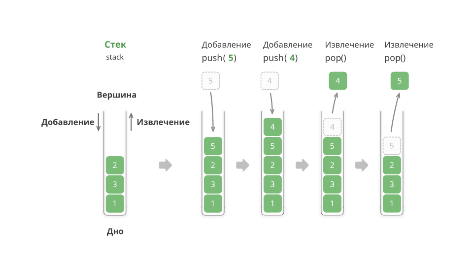
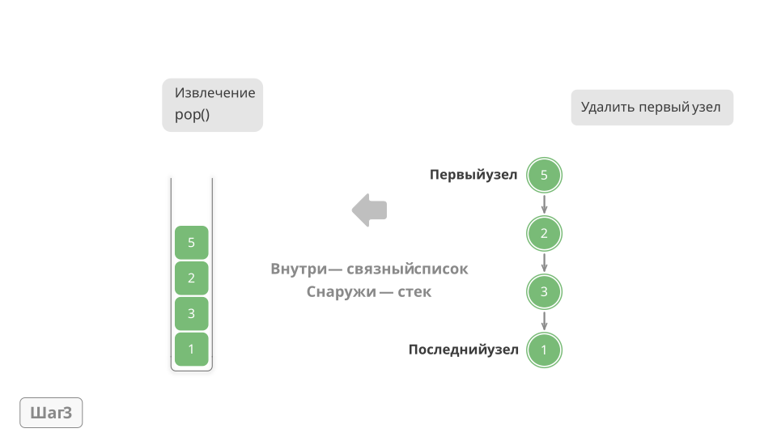
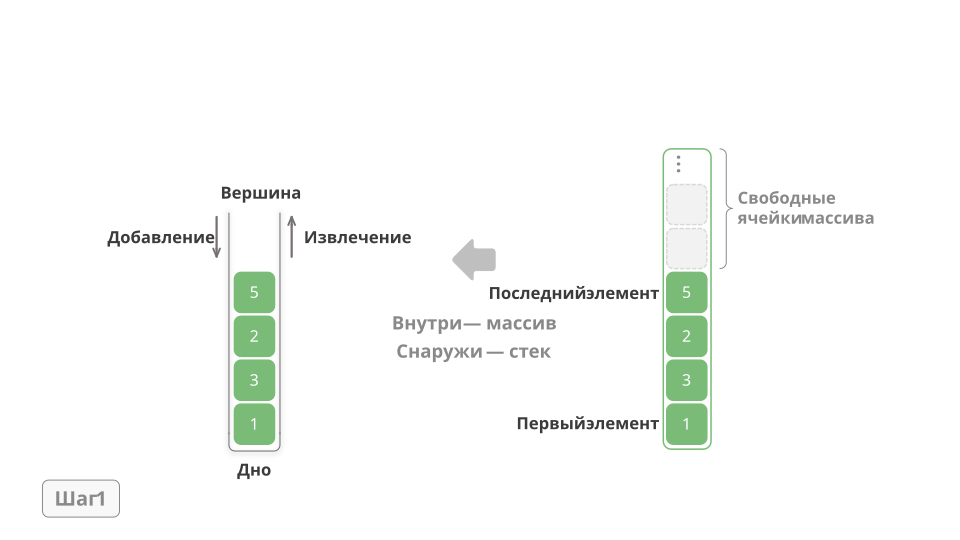
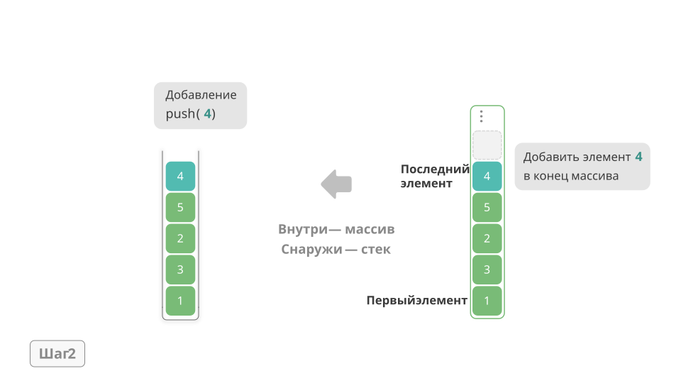
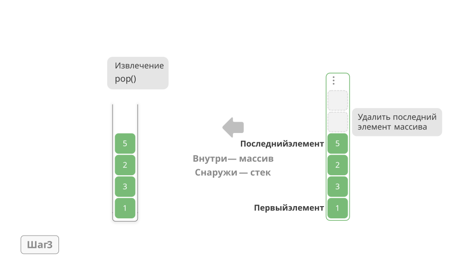

# Стек

<u>Стек (stack)</u> — линейная структура данных, в которой первым извлекают элемент, добавленный последним.

Представьте стопку тарелок на столе. Если за раз можно взять только одну тарелку, то, чтобы добраться до нижней, придётся сначала по очереди снять все тарелки над ней. Заменим тарелки элементами произвольного типа, например целыми числами, символами или объектами, и получим структуру данных «стек».

Как видно на рисунке ниже, верх стопки элементов называют вершиной стека, а низ — дном. Положить элемент на вершину — значит добавить его в стек, а снять с вершины — извлечь из стека.



## Основные операции со стеком

В таблице ниже приведены основные операции со стеком. Имена методов зависят от языка программирования. Для примера возьмём распространённые имена `push()`, `pop()` и `peek()`.

<p align="center">Таблица <id>&nbsp; Временная сложность операций со стеком</p>

| Метод     | Описание                   | Временная сложность |
| -------- | ---------------------- | ---------- |
| `push()` | Добавить элемент в стек (положить на вершину) | $O(1)$     |
| `pop()`  | Снять элемент с вершины стека           | $O(1)$     |
| `peek()` | Посмотреть элемент на вершине стека           | $O(1)$     |

Обычно можно воспользоваться встроенным классом стека. Если в языке нет отдельного класса для стека, в его роли может выступать массив или связный список. Достаточно не использовать в программе операции, которые не относятся к стеку.

```snippet
stack_operations
```

??? pythontutor "Визуализация выполнения"

    @tutor stack_operations_tutor

## Реализация стека

Чтобы разобраться в устройстве стека, попробуем самостоятельно реализовать его класс.

В стеке последний добавленный элемент извлекают первым, поэтому добавлять и удалять элементы можно только на вершине. В массиве и связном списке элементы можно добавлять и удалять в любой позиции. **Поэтому стек можно представить как массив или связный список с ограниченным набором операций**. Достаточно скрыть лишние операции, чтобы снаружи такая структура вела себя как стек.

### Реализация на основе связного списка

При реализации стека на основе связного списка за вершину можно принять первый узел, а за дно — последний.

Как видно на рисунке ниже, чтобы положить элемент в стек, достаточно вставить его в начало списка. Такой способ добавления узла называют вставкой в начало. Чтобы снять элемент с вершины, достаточно удалить первый узел списка.

=== "<1>"
    

=== "<2>"
    

=== "<3>"
    

Ниже приведён пример реализации стека на основе связного списка.

```src
[file]{linkedlist_stack}-[class]{linked_list_stack}-[func]{}
```

### Реализация на основе массива

При реализации стека на основе массива за вершину можно принять конец массива. Как видно на рисунке ниже, чтобы положить элемент в стек, его добавляют в конец массива, а чтобы извлечь — удаляют с конца. Обе операции занимают $O(1)$ времени.

=== "<1>"
    

=== "<2>"
    

=== "<3>"
    

Поскольку в стек могут поступать всё новые элементы, удобно использовать динамический массив. Тогда не придётся самостоятельно заботиться о его расширении. Ниже приведён пример.

```src
[file]{array_stack}-[class]{array_stack}-[func]{}
```

## Сравнение двух реализаций

**Доступные операции**

Обе реализации поддерживают все операции, предусмотренные определением стека. Массив также даёт произвольный доступ к элементам, но эта возможность выходит за рамки определения стека и обычно не используется.

**Время выполнения**

В стеке на основе массива добавление и извлечение происходят на заранее выделенном непрерывном участке памяти. Такая организация хорошо использует кеш процессора, поэтому операции выполняются быстро. Однако если при добавлении элемента ёмкости массива не хватит, массив придётся расширить. Тогда время именно этой операции добавления возрастёт до $O(n)$.

Связный список легко растёт по одному узлу, и замедления, связанного с расширением массива, у него нет. Однако при добавлении приходится инициализировать объект узла и менять указатели, поэтому операция выполняется сравнительно медленно. Если же добавляемый элемент сам является узлом, инициализацию можно пропустить и тем самым ускорить добавление.

Для элементов примитивных типов, таких как `int` или `double`, сравнение операций добавления и извлечения даёт следующие результаты.

- Стек на основе массива работает медленнее в моменты расширения, но расширение требуется редко, поэтому в среднем такая реализация быстрее.
- Стек на основе связного списка обеспечивает более стабильное время выполнения операций.

**Расход памяти**

При создании динамического массива система выделяет память под некоторое начальное число элементов. Такая начальная ёмкость может превышать потребности программы. При расширении массива его ёмкость обычно увеличивается в заданное число раз, например вдвое, и тоже может оказаться больше необходимой. Поэтому **в стеке на основе массива часть памяти может оставаться неиспользованной**.

В узлах связного списка приходится дополнительно хранить указатели, **поэтому каждый узел занимает сравнительно много памяти**.

Таким образом, чтобы определить, какая реализация экономнее расходует память, нужно рассматривать конкретную ситуацию.

## Примеры применения стека

- **Переходы назад и вперёд в браузере, отмена и повтор действий в программах**. Когда мы открываем новую страницу, браузер помещает предыдущую страницу в стек. Это позволяет вернуться на неё командой «Назад», которая по сути извлекает страницу из стека. Для поддержки переходов в обоих направлениях нужны два стека, работающие вместе.
- **Управление памятью программы**. При каждом вызове функции система добавляет на вершину стека кадр с данными о контексте этого вызова. При каждом следующем рекурсивном вызове в стек помещают очередной кадр, а при возврате из вызовов кадры по одному снимают со стека.
