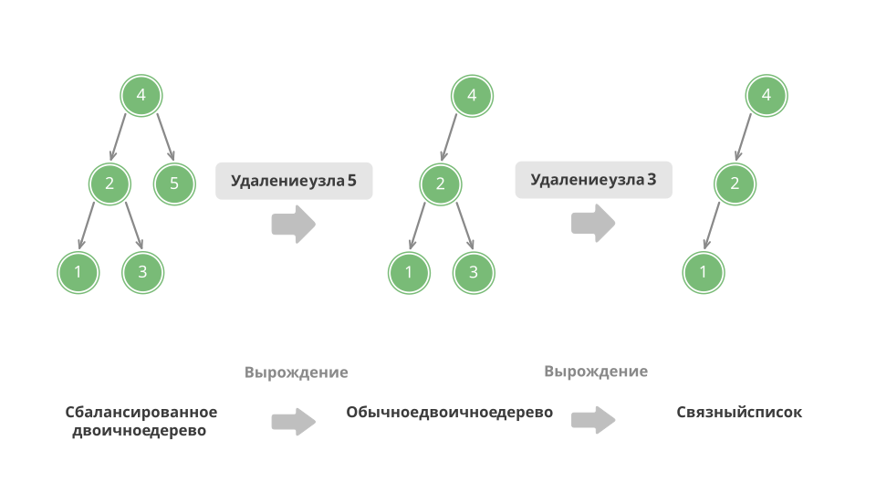
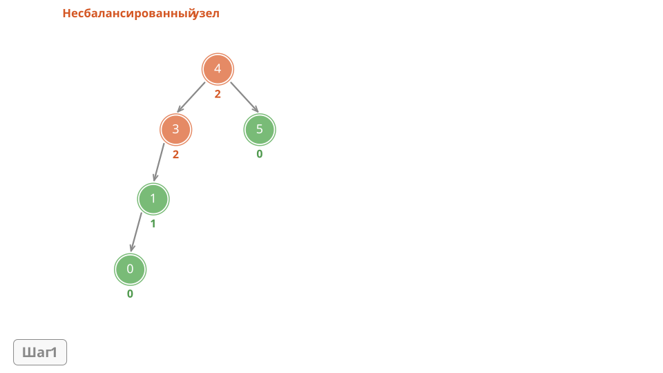
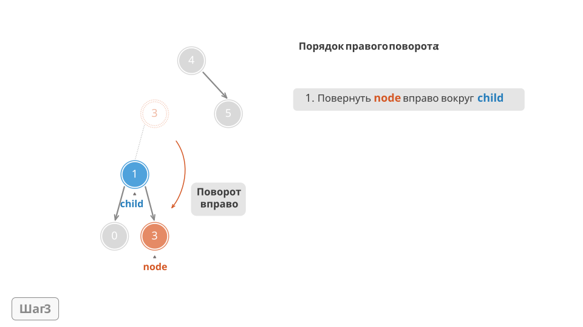
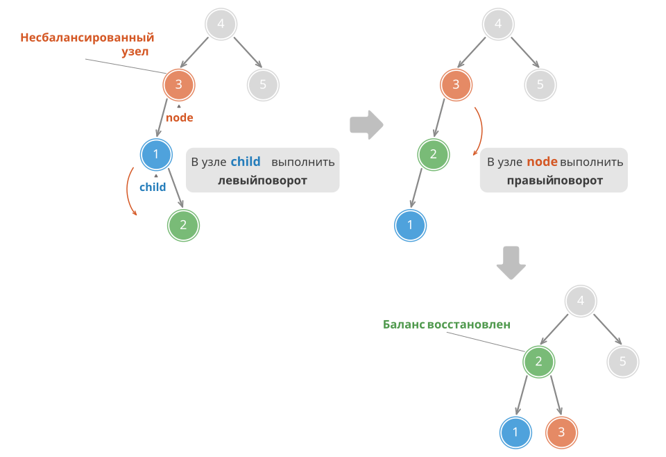
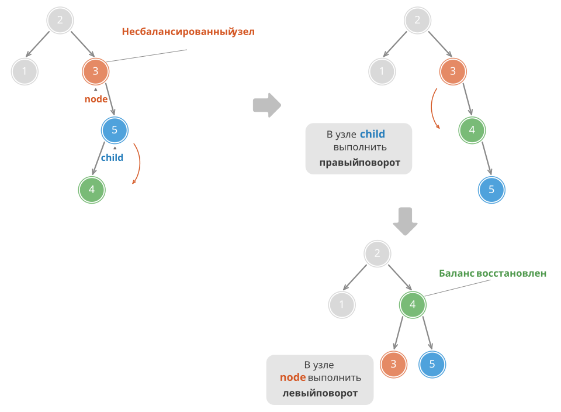
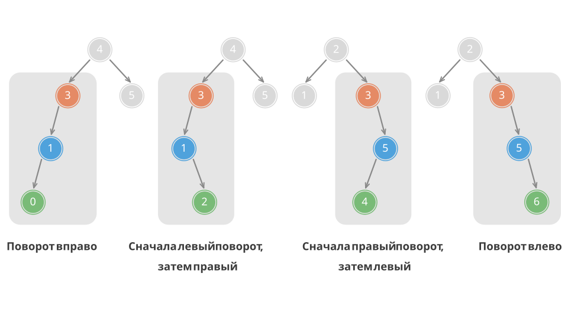

# АВЛ-дерево *

В разделе «Двоичное дерево поиска» мы видели, что после многократных вставок и удалений дерево поиска может выродиться в связный список. Тогда временная сложность всех операций ухудшается с $O(\log n)$ до $O(n)$.

Например, двоичное дерево поиска на рисунке ниже превращается в связный список всего после двух удалений.



Другой пример показан ниже. После вставки двух узлов в совершенное двоичное дерево возникает сильный перевес влево. Временная сложность поиска при этом ухудшается.


В 1962 году Г. М. Адельсон-Вельский и Е. М. Ландис предложили <u>АВЛ-дерево</u> в статье «Один алгоритм организации информации». Авторы подробно описали операции, которые не дают дереву выродиться даже при многократных вставках и удалениях. Благодаря этому временная сложность операций остаётся на уровне $O(\log n)$. Поэтому АВЛ-деревья хорошо подходят для задач, в которых приходится часто добавлять, удалять, искать и изменять данные.

## Основные понятия АВЛ-дерева

АВЛ-дерево одновременно является двоичным деревом поиска и сбалансированным двоичным деревом. Оно обладает всеми свойствами обоих типов деревьев и, таким образом, представляет собой <u>сбалансированное двоичное дерево поиска (balanced binary search tree)</u>.

### Высота узла

Для операций с АВЛ-деревом требуется знать высоту узла, поэтому добавим в класс узла переменную `height`:

```snippet
avl_tree_node
```

Высота узла — это расстояние от него до самого удалённого листа, измеренное числом рёбер. Обратите внимание: высота листа равна $0$, а высота пустого узла — $-1$. Напишем две вспомогательные функции для получения и обновления высоты:

```src
[file]{avl_tree}-[class]{avl_tree}-[func]{update_height}
```

### Коэффициент баланса узла

<u>Коэффициент баланса (balance factor)</u> узла — это высота его левого поддерева минус высота правого. Для пустого узла примем коэффициент баланса равным $0$. Чтобы далее было удобно получать коэффициент баланса, оформим вычисление отдельной функцией:

```src
[file]{avl_tree}-[class]{avl_tree}-[func]{balance_factor}
```

!!! tip

    Обозначим коэффициент баланса через $f$. Для каждого узла АВЛ-дерева выполняется условие $-1 \le f \le 1$.

## Повороты в АВЛ-дереве

Характерная операция АВЛ-дерева — поворот. Он восстанавливает баланс узла, сохраняя последовательность симметричного обхода. Другими словами, **поворот сохраняет свойства двоичного дерева поиска и возвращает дереву свойство сбалансированности**.

Узел, для которого модуль коэффициента баланса $> 1$, называют несбалансированным. В зависимости от вида дисбаланса применяют один из четырёх вариантов: правый поворот, левый поворот, правый с последующим левым или левый с последующим правым. Рассмотрим их подробнее.

### Поворот вправо

На рисунке под узлами указаны коэффициенты баланса. При движении снизу вверх первый несбалансированный узел — 3. Рассмотрим поддерево с корнем в этом узле. Обозначим его `node`, а его левого потомка — `child`. Выполним правый поворот. После него поддерево снова будет сбалансировано и сохранит свойства двоичного дерева поиска.

=== "<1>"
    

=== "<2>"
    

=== "<3>"
    

=== "<4>"
    

Если у `child` есть правый потомок (обозначим его `grand_child`), при правом повороте нужен ещё один шаг: сделать `grand_child` левым потомком `node`, как показано на рисунке.


«Поворот вправо» — наглядное описание операции. На практике она выполняется изменением указателей узлов, как в следующем коде:

```src
[file]{avl_tree}-[class]{avl_tree}-[func]{right_rotate}
```

### Поворот влево

В зеркальном случае для такого несбалансированного дерева нужен левый поворот, показанный на рисунке ниже.


Аналогично, если у `child` есть левый потомок (обозначим его `grand_child`), при левом повороте нужен ещё один шаг: сделать `grand_child` правым потомком `node`, как показано на рисунке.


Заметим, что **правый и левый повороты зеркально симметричны по своей логике, как и два вида дисбаланса, которые они устраняют**. Поэтому для реализации левого поворота достаточно в коде правого поворота заменить все `left` на `right`, а все `right` — на `left`:

```src
[file]{avl_tree}-[class]{avl_tree}-[func]{left_rotate}
```

### Сначала поворот влево, затем вправо

Для несбалансированного узла 3 на рисунке ниже ни один левый, ни один правый поворот сам по себе не восстановит баланс поддерева. Сначала нужно выполнить левый поворот в `child`, затем правый в `node`.



### Сначала поворот вправо, затем влево

В зеркальном случае, показанном ниже, сначала нужно выполнить правый поворот в `child`, а затем левый в `node`.



### Выбор поворота

Четыре случая дисбаланса на рисунке соответствуют разобранным примерам. Слева направо требуются следующие повороты: правый, левый с последующим правым, правый с последующим левым и левый.



Как видно из таблицы, определить случай дисбаланса можно по знакам двух коэффициентов баланса: самого несбалансированного узла и его потомка с более высокой стороны.

<p align="center"> Таблица <id> &nbsp; Условия выбора одного из четырёх поворотов </p>

| Коэффициент баланса несбалансированного узла | Коэффициент баланса потомка | Необходимый поворот |
| ------------------ | ---------------- | ---------------- |
| $> 1$ (перевес влево)   | $\geq 0$         | Поворот вправо             |
| $> 1$ (перевес влево)   | $<0$             | Сначала поворот влево, затем вправо     |
| $< -1$ (перевес вправо)  | $\leq 0$         | Поворот влево             |
| $< -1$ (перевес вправо)  | $>0$             | Сначала поворот вправо, затем влево     |

Для удобства объединим операции поворота в одну функцию. **С её помощью можно выбрать поворот для любого вида дисбаланса и восстановить баланс узла**. Приведём код:

```src
[file]{avl_tree}-[class]{avl_tree}-[func]{rotate}
```

## Основные операции с АВЛ-деревом

### Вставка узла

Вставка узла в АВЛ-дерево выполняется почти так же, как в обычное двоичное дерево поиска. Отличие в том, что после вставки на пути от нового узла к корню могут появиться несбалансированные узлы. Поэтому **после вставки нужно подниматься от этого узла к корню и выполнять повороты, восстанавливая баланс всех таких узлов**. Приведём код:

```src
[file]{avl_tree}-[class]{avl_tree}-[func]{insert_helper}
```

### Удаление узла

Аналогично дополним удаление узла из двоичного дерева поиска поворотами снизу вверх, чтобы восстановить баланс всех несбалансированных узлов. Приведём код:

```src
[file]{avl_tree}-[class]{avl_tree}-[func]{remove_helper}
```

### Поиск узла

Поиск узла в АВЛ-дереве выполняется так же, как в двоичном дереве поиска, поэтому повторять его описание не будем.

## Применение АВЛ-деревьев

- Организация и хранение больших объёмов данных, особенно при частом поиске и редких вставках и удалениях.
- Построение систем индексации в базах данных.
- Красно-чёрное дерево — ещё один распространённый вид сбалансированного двоичного дерева поиска. У него менее строгие условия баланса, чем у АВЛ-дерева, поэтому вставка и удаление требуют меньше поворотов и в среднем выполняются эффективнее.
