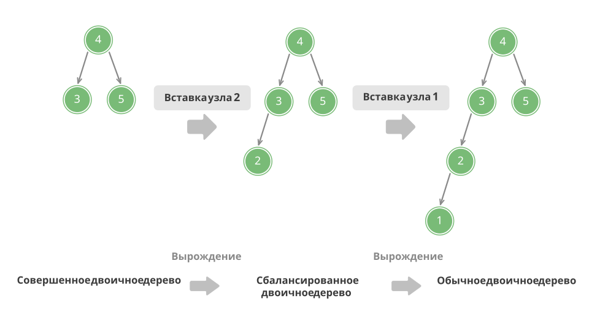
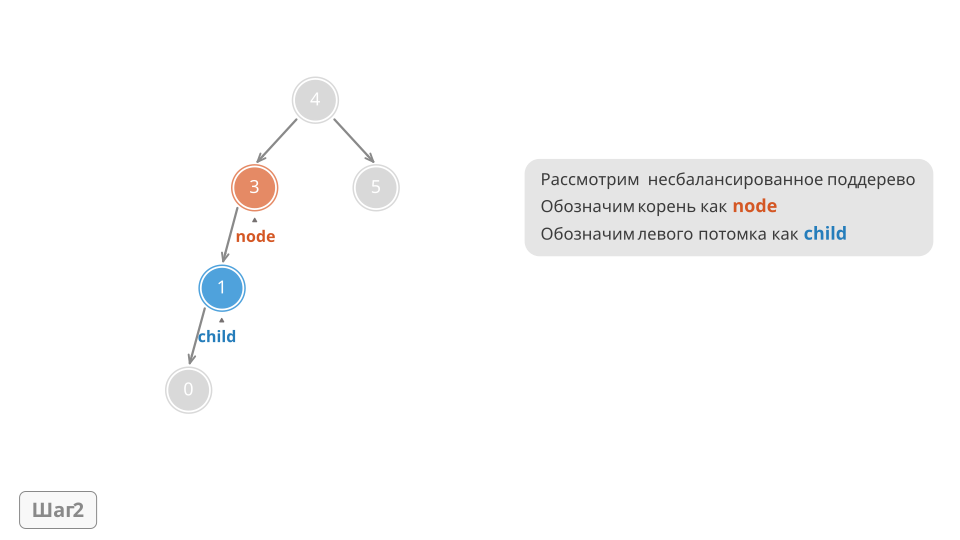
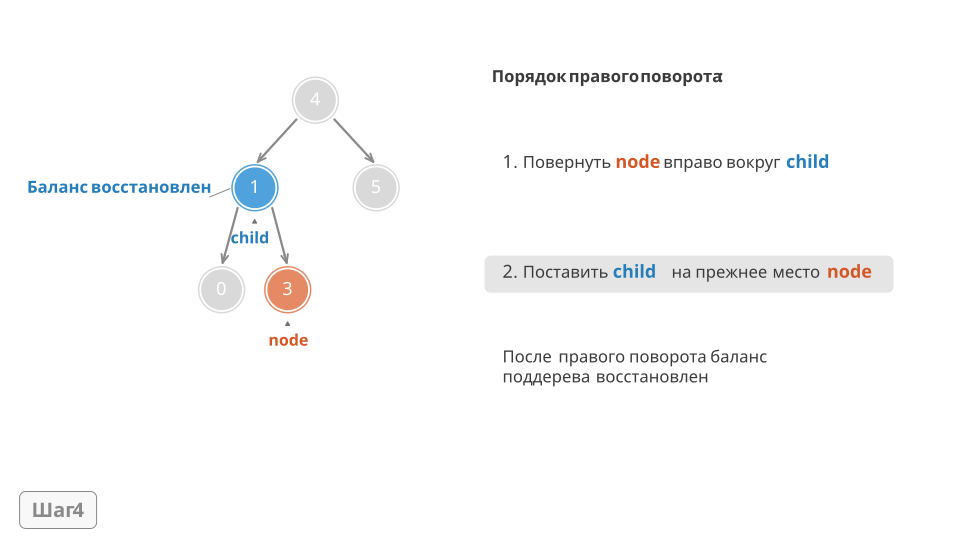
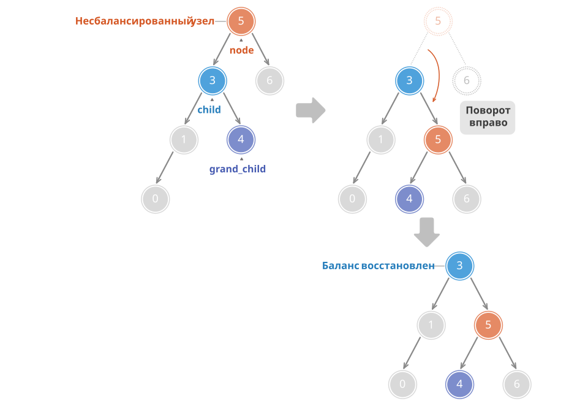
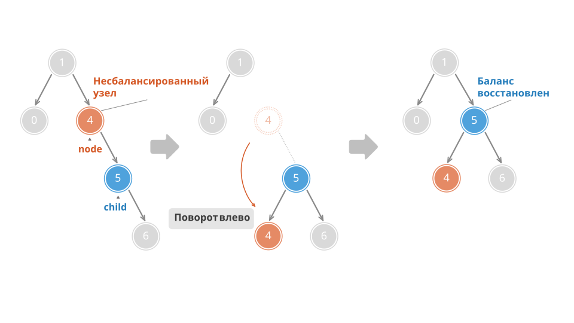
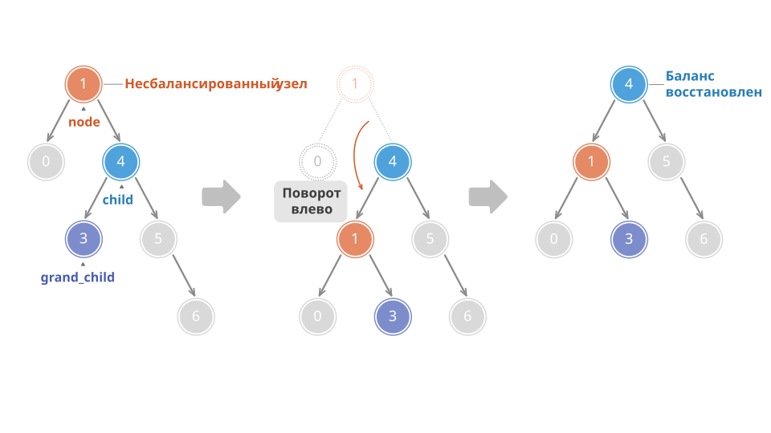

# 7.5 &nbsp; АВЛ-дерево *

В разделе «Двоичное дерево поиска» мы видели, что после многократных вставок и удалений дерево поиска может выродиться в связный список. Тогда временная сложность всех операций ухудшается с $O(\log n)$ до $O(n)$.

Например, двоичное дерево поиска на рисунке 7-24 превращается в связный список всего после двух удалений.

{ class="animation-figure" }

<p align="center"> Рисунок 7-24 &nbsp; Вырождение АВЛ-дерева после удаления узлов </p>

Другой пример показан ниже. После вставки двух узлов в совершенное двоичное дерево возникает сильный перевес влево. Временная сложность поиска при этом ухудшается.

{ class="animation-figure" }

<p align="center"> Рисунок 7-25 &nbsp; Вырождение АВЛ-дерева после вставки узлов </p>

В 1962 году Г. М. Адельсон-Вельский и Е. М. Ландис предложили <u>АВЛ-дерево</u> в статье «Один алгоритм организации информации». Авторы подробно описали операции, которые не дают дереву выродиться даже при многократных вставках и удалениях. Благодаря этому временная сложность операций остаётся на уровне $O(\log n)$. Поэтому АВЛ-деревья хорошо подходят для задач, в которых приходится часто добавлять, удалять, искать и изменять данные.

## 7.5.1 &nbsp; Основные понятия АВЛ-дерева

АВЛ-дерево одновременно является двоичным деревом поиска и сбалансированным двоичным деревом. Оно обладает всеми свойствами обоих типов деревьев и, таким образом, представляет собой <u>сбалансированное двоичное дерево поиска (balanced binary search tree)</u>.

### 1. &nbsp; Высота узла

Для операций с АВЛ-деревом требуется знать высоту узла, поэтому добавим в класс узла переменную `height`:

=== "Python"

    ```python title=""
    class TreeNode:
        """Класс узла АВЛ-дерева"""
        def __init__(self, val: int):
            self.val: int = val                 # Значение узла
            self.height: int = 0                # Высота узла
            self.left: TreeNode | None = None   # Ссылка на левого потомка
            self.right: TreeNode | None = None  # Ссылка на правого потомка
    ```

=== "C++"

    ```cpp title=""
    /* Класс узла АВЛ-дерева */
    struct TreeNode {
        int val{};          // Значение узла
        int height = 0;     // Высота узла
        TreeNode *left{};   // Левый потомок
        TreeNode *right{};  // Правый потомок
        TreeNode() = default;
        explicit TreeNode(int x) : val(x){}
    };
    ```

=== "Java"

    ```java title=""
    /* Класс узла АВЛ-дерева */
    class TreeNode {
        public int val;        // Значение узла
        public int height;     // Высота узла
        public TreeNode left;  // Левый потомок
        public TreeNode right; // Правый потомок
        public TreeNode(int x) { val = x; }
    }
    ```

=== "C#"

    ```csharp title=""
    /* Класс узла АВЛ-дерева */
    class TreeNode(int? x) {
        public int? val = x;    // Значение узла
        public int height;      // Высота узла
        public TreeNode? left;  // Ссылка на левого потомка
        public TreeNode? right; // Ссылка на правого потомка
    }
    ```

=== "Go"

    ```go title=""
    /* Структура узла АВЛ-дерева */
    type TreeNode struct {
        Val    int       // Значение узла
        Height int       // Высота узла
        Left   *TreeNode // Ссылка на левого потомка
        Right  *TreeNode // Ссылка на правого потомка
    }
    ```

=== "Swift"

    ```swift title=""
    /* Класс узла АВЛ-дерева */
    class TreeNode {
        var val: Int // Значение узла
        var height: Int // Высота узла
        var left: TreeNode? // Левый потомок
        var right: TreeNode? // Правый потомок

        init(x: Int) {
            val = x
            height = 0
        }
    }
    ```

=== "JS"

    ```javascript title=""
    /* Класс узла АВЛ-дерева */
    class TreeNode {
        val; // Значение узла
        height; //Высота узла
        left; // Указатель на левого потомка
        right; // Указатель на правого потомка
        constructor(val, left, right, height) {
            this.val = val === undefined ? 0 : val;
            this.height = height === undefined ? 0 : height;
            this.left = left === undefined ? null : left;
            this.right = right === undefined ? null : right;
        }
    }
    ```

=== "TS"

    ```typescript title=""
    /* Класс узла АВЛ-дерева */
    class TreeNode {
        val: number;            // Значение узла
        height: number;         // Высота узла
        left: TreeNode | null;  // Указатель на левого потомка
        right: TreeNode | null; // Указатель на правого потомка
        constructor(val?: number, height?: number, left?: TreeNode | null, right?: TreeNode | null) {
            this.val = val === undefined ? 0 : val;
            this.height = height === undefined ? 0 : height;
            this.left = left === undefined ? null : left;
            this.right = right === undefined ? null : right;
        }
    }
    ```

=== "Dart"

    ```dart title=""
    /* Класс узла АВЛ-дерева */
    class TreeNode {
      int val;         // Значение узла
      int height;      // Высота узла
      TreeNode? left;  // Левый потомок
      TreeNode? right; // Правый потомок
      TreeNode(this.val, [this.height = 0, this.left, this.right]);
    }
    ```

=== "Rust"

    ```rust title=""
    use std::rc::Rc;
    use std::cell::RefCell;

    /* Структура узла АВЛ-дерева */
    struct TreeNode {
        val: i32,                               // Значение узла
        height: i32,                            // Высота узла
        left: Option<Rc<RefCell<TreeNode>>>,    // Левый потомок
        right: Option<Rc<RefCell<TreeNode>>>,   // Правый потомок
    }

    impl TreeNode {
        /* Конструктор */
        fn new(val: i32) -> Rc<RefCell<Self>> {
            Rc::new(RefCell::new(Self {
                val,
                height: 0,
                left: None,
                right: None
            }))
        }
    }
    ```

=== "C"

    ```c title=""
    /* Структура узла АВЛ-дерева */
    typedef struct TreeNode {
        int val;
        int height;
        struct TreeNode *left;
        struct TreeNode *right;
    } TreeNode;

    /* Конструктор */
    TreeNode *newTreeNode(int val) {
        TreeNode *node;

        node = (TreeNode *)malloc(sizeof(TreeNode));
        node->val = val;
        node->height = 0;
        node->left = NULL;
        node->right = NULL;
        return node;
    }
    ```

=== "Kotlin"

    ```kotlin title=""
    /* Класс узла АВЛ-дерева */
    class TreeNode(val _val: Int) {  // Значение узла
        var height: Int = 0          // Высота узла
        var left: TreeNode? = null   // Левый потомок
        var right: TreeNode? = null  // Правый потомок
    }
    ```

=== "Ruby"

    ```ruby title=""
    ### Класс узла АВЛ-дерева ###
    class TreeNode
      attr_accessor :val    # Значение узла
      attr_accessor :height # Высота узла
      attr_accessor :left   # Ссылка на левого потомка
      attr_accessor :right  # Ссылка на правого потомка

      def initialize(val)
        @val = val
        @height = 0
      end
    end
    ```

Высота узла — это расстояние от него до самого удалённого листа, измеренное числом рёбер. Обратите внимание: высота листа равна $0$, а высота пустого узла — $-1$. Напишем две вспомогательные функции для получения и обновления высоты:

=== "Python"

    ```python title="avl_tree.py"
    def height(self, node: TreeNode | None) -> int:
        """Получить высоту узла"""
        # Высота пустого узла равна -1, высота листа равна 0
        if node is not None:
            return node.height
        return -1

    def update_height(self, node: TreeNode | None):
        """Обновить высоту узла"""
        # Высота узла на 1 больше высоты самого высокого поддерева
        node.height = max([self.height(node.left), self.height(node.right)]) + 1
    ```

=== "C++"

    ```cpp title="avl_tree.cpp"
    /* Получить высоту узла */
    int height(TreeNode *node) {
        // Высота пустого узла равна -1, высота листа равна 0
        return node == nullptr ? -1 : node->height;
    }

    /* Обновить высоту узла */
    void updateHeight(TreeNode *node) {
        // Высота узла на 1 больше высоты самого высокого поддерева
        node->height = max(height(node->left), height(node->right)) + 1;
    }
    ```

=== "Java"

    ```java title="avl_tree.java"
    /* Получить высоту узла */
    int height(TreeNode node) {
        // Высота пустого узла равна -1, высота листа равна 0
        return node == null ? -1 : node.height;
    }

    /* Обновить высоту узла */
    void updateHeight(TreeNode node) {
        // Высота узла на 1 больше высоты самого высокого поддерева
        node.height = Math.max(height(node.left), height(node.right)) + 1;
    }
    ```

=== "C#"

    ```csharp title="avl_tree.cs"
    /* Получить высоту узла */
    int Height(TreeNode? node) {
        // Высота пустого узла равна -1, высота листа равна 0
        return node == null ? -1 : node.height;
    }

    /* Обновить высоту узла */
    void UpdateHeight(TreeNode node) {
        // Высота узла на 1 больше высоты самого высокого поддерева
        node.height = Math.Max(Height(node.left), Height(node.right)) + 1;
    }
    ```

=== "Go"

    ```go title="avl_tree.go"
    /* Получить высоту узла */
    func (t *aVLTree) height(node *TreeNode) int {
        // Высота пустого узла равна -1, высота листа равна 0
        if node != nil {
            return node.Height
        }
        return -1
    }

    /* Обновить высоту узла */
    func (t *aVLTree) updateHeight(node *TreeNode) {
        lh := t.height(node.Left)
        rh := t.height(node.Right)
        // Высота узла на 1 больше высоты самого высокого поддерева
        if lh > rh {
            node.Height = lh + 1
        } else {
            node.Height = rh + 1
        }
    }
    ```

=== "Swift"

    ```swift title="avl_tree.swift"
    /* Получить высоту узла */
    func height(node: TreeNode?) -> Int {
        // Высота пустого узла равна -1, высота листа равна 0
        node?.height ?? -1
    }

    /* Обновить высоту узла */
    func updateHeight(node: TreeNode?) {
        // Высота узла на 1 больше высоты самого высокого поддерева
        node?.height = max(height(node: node?.left), height(node: node?.right)) + 1
    }
    ```

=== "JS"

    ```javascript title="avl_tree.js"
    /* Получить высоту узла */
    height(node) {
        // Высота пустого узла равна -1, высота листа равна 0
        return node === null ? -1 : node.height;
    }

    /* Обновить высоту узла */
    #updateHeight(node) {
        // Высота узла на 1 больше высоты самого высокого поддерева
        node.height =
            Math.max(this.height(node.left), this.height(node.right)) + 1;
    }
    ```

=== "TS"

    ```typescript title="avl_tree.ts"
    /* Получить высоту узла */
    height(node: TreeNode): number {
        // Высота пустого узла равна -1, высота листа равна 0
        return node === null ? -1 : node.height;
    }

    /* Обновить высоту узла */
    updateHeight(node: TreeNode): void {
        // Высота узла на 1 больше высоты самого высокого поддерева
        node.height =
            Math.max(this.height(node.left), this.height(node.right)) + 1;
    }
    ```

=== "Dart"

    ```dart title="avl_tree.dart"
    /* Получить высоту узла */
    int height(TreeNode? node) {
      // Высота пустого узла равна -1, высота листа равна 0
      return node == null ? -1 : node.height;
    }

    /* Обновить высоту узла */
    void updateHeight(TreeNode? node) {
      // Высота узла на 1 больше высоты самого высокого поддерева
      node!.height = max(height(node.left), height(node.right)) + 1;
    }
    ```

=== "Rust"

    ```rust title="avl_tree.rs"
    /* Получить высоту узла */
    fn height(node: OptionTreeNodeRc) -> i32 {
        // Высота пустого узла равна -1, высота листа равна 0
        match node {
            Some(node) => node.borrow().height,
            None => -1,
        }
    }

    /* Обновить высоту узла */
    fn update_height(node: OptionTreeNodeRc) {
        if let Some(node) = node {
            let left = node.borrow().left.clone();
            let right = node.borrow().right.clone();
            // Высота узла на 1 больше высоты самого высокого поддерева
            node.borrow_mut().height = std::cmp::max(Self::height(left), Self::height(right)) + 1;
        }
    }
    ```

=== "C"

    ```c title="avl_tree.c"
    /* Получить высоту узла */
    int height(TreeNode *node) {
        // Высота пустого узла равна -1, высота листа равна 0
        if (node != NULL) {
            return node->height;
        }
        return -1;
    }

    /* Обновить высоту узла */
    void updateHeight(TreeNode *node) {
        int lh = height(node->left);
        int rh = height(node->right);
        // Высота узла на 1 больше высоты самого высокого поддерева
        if (lh > rh) {
            node->height = lh + 1;
        } else {
            node->height = rh + 1;
        }
    }
    ```

=== "Kotlin"

    ```kotlin title="avl_tree.kt"
    /* Получить высоту узла */
    fun height(node: TreeNode?): Int {
        // Высота пустого узла равна -1, высота листа равна 0
        return node?.height ?: -1
    }

    /* Обновить высоту узла */
    fun updateHeight(node: TreeNode?) {
        // Высота узла на 1 больше высоты самого высокого поддерева
        node?.height = max(height(node?.left), height(node?.right)) + 1
    }
    ```

=== "Ruby"

    ```ruby title="avl_tree.rb"
    ### Получить высоту узла ###
    def height(node)
      # Высота пустого узла равна -1, высота листа равна 0
      return node.height unless node.nil?

      -1
    end

    ### Обновить высоту узла ###
    def update_height(node)
      # Высота узла на 1 больше высоты самого высокого поддерева
      node.height = [height(node.left), height(node.right)].max + 1
    end
    ```

### 2. &nbsp; Коэффициент баланса узла {#2-}

<u>Коэффициент баланса (balance factor)</u> узла — это высота его левого поддерева минус высота правого. Для пустого узла примем коэффициент баланса равным $0$. Чтобы далее было удобно получать коэффициент баланса, оформим вычисление отдельной функцией:

=== "Python"

    ```python title="avl_tree.py"
    def balance_factor(self, node: TreeNode | None) -> int:
        """Получить коэффициент баланса"""
        # Коэффициент баланса пустого узла равен 0
        if node is None:
            return 0
        # Коэффициент баланса узла равен высоте левого поддерева минус высота правого
        return self.height(node.left) - self.height(node.right)
    ```

=== "C++"

    ```cpp title="avl_tree.cpp"
    /* Получить коэффициент баланса */
    int balanceFactor(TreeNode *node) {
        // Коэффициент баланса пустого узла равен 0
        if (node == nullptr)
            return 0;
        // Коэффициент баланса узла равен высоте левого поддерева минус высота правого
        return height(node->left) - height(node->right);
    }
    ```

=== "Java"

    ```java title="avl_tree.java"
    /* Получить коэффициент баланса */
    int balanceFactor(TreeNode node) {
        // Коэффициент баланса пустого узла равен 0
        if (node == null)
            return 0;
        // Коэффициент баланса узла равен высоте левого поддерева минус высота правого
        return height(node.left) - height(node.right);
    }
    ```

=== "C#"

    ```csharp title="avl_tree.cs"
    /* Получить коэффициент баланса */
    int BalanceFactor(TreeNode? node) {
        // Коэффициент баланса пустого узла равен 0
        if (node == null) return 0;
        // Коэффициент баланса узла равен высоте левого поддерева минус высота правого
        return Height(node.left) - Height(node.right);
    }
    ```

=== "Go"

    ```go title="avl_tree.go"
    /* Получить коэффициент баланса */
    func (t *aVLTree) balanceFactor(node *TreeNode) int {
        // Коэффициент баланса пустого узла равен 0
        if node == nil {
            return 0
        }
        // Коэффициент баланса узла равен высоте левого поддерева минус высота правого
        return t.height(node.Left) - t.height(node.Right)
    }
    ```

=== "Swift"

    ```swift title="avl_tree.swift"
    /* Получить коэффициент баланса */
    func balanceFactor(node: TreeNode?) -> Int {
        // Коэффициент баланса пустого узла равен 0
        guard let node = node else { return 0 }
        // Коэффициент баланса узла равен высоте левого поддерева минус высота правого
        return height(node: node.left) - height(node: node.right)
    }
    ```

=== "JS"

    ```javascript title="avl_tree.js"
    /* Получить коэффициент баланса */
    balanceFactor(node) {
        // Коэффициент баланса пустого узла равен 0
        if (node === null) return 0;
        // Коэффициент баланса узла равен высоте левого поддерева минус высота правого
        return this.height(node.left) - this.height(node.right);
    }
    ```

=== "TS"

    ```typescript title="avl_tree.ts"
    /* Получить коэффициент баланса */
    balanceFactor(node: TreeNode): number {
        // Коэффициент баланса пустого узла равен 0
        if (node === null) return 0;
        // Коэффициент баланса узла равен высоте левого поддерева минус высота правого
        return this.height(node.left) - this.height(node.right);
    }
    ```

=== "Dart"

    ```dart title="avl_tree.dart"
    /* Получить коэффициент баланса */
    int balanceFactor(TreeNode? node) {
      // Коэффициент баланса пустого узла равен 0
      if (node == null) return 0;
      // Коэффициент баланса узла равен высоте левого поддерева минус высота правого
      return height(node.left) - height(node.right);
    }
    ```

=== "Rust"

    ```rust title="avl_tree.rs"
    /* Получить коэффициент баланса */
    fn balance_factor(node: OptionTreeNodeRc) -> i32 {
        match node {
            // Коэффициент баланса пустого узла равен 0
            None => 0,
            // Коэффициент баланса узла равен высоте левого поддерева минус высота правого
            Some(node) => {
                Self::height(node.borrow().left.clone()) - Self::height(node.borrow().right.clone())
            }
        }
    }
    ```

=== "C"

    ```c title="avl_tree.c"
    /* Получить коэффициент баланса */
    int balanceFactor(TreeNode *node) {
        // Коэффициент баланса пустого узла равен 0
        if (node == NULL) {
            return 0;
        }
        // Коэффициент баланса узла равен высоте левого поддерева минус высота правого
        return height(node->left) - height(node->right);
    }
    ```

=== "Kotlin"

    ```kotlin title="avl_tree.kt"
    /* Получить коэффициент баланса */
    fun balanceFactor(node: TreeNode?): Int {
        // Коэффициент баланса пустого узла равен 0
        if (node == null) return 0
        // Коэффициент баланса узла равен высоте левого поддерева минус высота правого
        return height(node.left) - height(node.right)
    }
    ```

=== "Ruby"

    ```ruby title="avl_tree.rb"
    ### Получить коэффициент баланса ###
    def balance_factor(node)
      # Коэффициент баланса пустого узла равен 0
      return 0 if node.nil?

      # Коэффициент баланса узла равен высоте левого поддерева минус высота правого
      height(node.left) - height(node.right)
    end
    ```

!!! tip

    Обозначим коэффициент баланса через $f$. Для каждого узла АВЛ-дерева выполняется условие $-1 \le f \le 1$.

## 7.5.2 &nbsp; Повороты в АВЛ-дереве

Характерная операция АВЛ-дерева — поворот. Он восстанавливает баланс узла, сохраняя последовательность симметричного обхода. Другими словами, **поворот сохраняет свойства двоичного дерева поиска и возвращает дереву свойство сбалансированности**.

Узел, для которого модуль коэффициента баланса $> 1$, называют несбалансированным. В зависимости от вида дисбаланса применяют один из четырёх вариантов: правый поворот, левый поворот, правый с последующим левым или левый с последующим правым. Рассмотрим их подробнее.

### 1. &nbsp; Поворот вправо

На рисунке под узлами указаны коэффициенты баланса. При движении снизу вверх первый несбалансированный узел — 3. Рассмотрим поддерево с корнем в этом узле. Обозначим его `node`, а его левого потомка — `child`. Выполним правый поворот. После него поддерево снова будет сбалансировано и сохранит свойства двоичного дерева поиска.

=== "<1>"
    { class="animation-figure" }

=== "<2>"
    { class="animation-figure" }

=== "<3>"
    { class="animation-figure" }

=== "<4>"
    { class="animation-figure" }

<p align="center"> Рисунок 7-26 &nbsp; Шаги правого поворота </p>

Если у `child` есть правый потомок (обозначим его `grand_child`), при правом повороте нужен ещё один шаг: сделать `grand_child` левым потомком `node`, как показано на рисунке.

{ class="animation-figure" }

<p align="center"> Рисунок 7-27 &nbsp; Правый поворот с переносом grand_child </p>

«Поворот вправо» — наглядное описание операции. На практике она выполняется изменением указателей узлов, как в следующем коде:

=== "Python"

    ```python title="avl_tree.py"
    def right_rotate(self, node: TreeNode | None) -> TreeNode | None:
        """Правый поворот"""
        child = node.left
        grand_child = child.right
        # Повернуть node вправо вокруг child
        child.right = node
        node.left = grand_child
        # Обновить высоту узла
        self.update_height(node)
        self.update_height(child)
        # Вернуть корень поддерева после поворота
        return child
    ```

=== "C++"

    ```cpp title="avl_tree.cpp"
    /* Правый поворот */
    TreeNode *rightRotate(TreeNode *node) {
        TreeNode *child = node->left;
        TreeNode *grandChild = child->right;
        // Повернуть node вправо вокруг child
        child->right = node;
        node->left = grandChild;
        // Обновить высоту узла
        updateHeight(node);
        updateHeight(child);
        // Вернуть корень поддерева после поворота
        return child;
    }
    ```

=== "Java"

    ```java title="avl_tree.java"
    /* Правый поворот */
    TreeNode rightRotate(TreeNode node) {
        TreeNode child = node.left;
        TreeNode grandChild = child.right;
        // Повернуть node вправо вокруг child
        child.right = node;
        node.left = grandChild;
        // Обновить высоту узла
        updateHeight(node);
        updateHeight(child);
        // Вернуть корень поддерева после поворота
        return child;
    }
    ```

=== "C#"

    ```csharp title="avl_tree.cs"
    /* Правый поворот */
    TreeNode? RightRotate(TreeNode? node) {
        TreeNode? child = node?.left;
        TreeNode? grandChild = child?.right;
        // Повернуть node вправо вокруг child
        child.right = node;
        node.left = grandChild;
        // Обновить высоту узла
        UpdateHeight(node);
        UpdateHeight(child);
        // Вернуть корень поддерева после поворота
        return child;
    }
    ```

=== "Go"

    ```go title="avl_tree.go"
    /* Правый поворот */
    func (t *aVLTree) rightRotate(node *TreeNode) *TreeNode {
        child := node.Left
        grandChild := child.Right
        // Повернуть node вправо вокруг child
        child.Right = node
        node.Left = grandChild
        // Обновить высоту узла
        t.updateHeight(node)
        t.updateHeight(child)
        // Вернуть корень поддерева после поворота
        return child
    }
    ```

=== "Swift"

    ```swift title="avl_tree.swift"
    /* Правый поворот */
    func rightRotate(node: TreeNode?) -> TreeNode? {
        let child = node?.left
        let grandChild = child?.right
        // Повернуть node вправо вокруг child
        child?.right = node
        node?.left = grandChild
        // Обновить высоту узла
        updateHeight(node: node)
        updateHeight(node: child)
        // Вернуть корень поддерева после поворота
        return child
    }
    ```

=== "JS"

    ```javascript title="avl_tree.js"
    /* Правый поворот */
    #rightRotate(node) {
        const child = node.left;
        const grandChild = child.right;
        // Повернуть node вправо вокруг child
        child.right = node;
        node.left = grandChild;
        // Обновить высоту узла
        this.#updateHeight(node);
        this.#updateHeight(child);
        // Вернуть корень поддерева после поворота
        return child;
    }
    ```

=== "TS"

    ```typescript title="avl_tree.ts"
    /* Правый поворот */
    rightRotate(node: TreeNode): TreeNode {
        const child = node.left;
        const grandChild = child.right;
        // Повернуть node вправо вокруг child
        child.right = node;
        node.left = grandChild;
        // Обновить высоту узла
        this.updateHeight(node);
        this.updateHeight(child);
        // Вернуть корень поддерева после поворота
        return child;
    }
    ```

=== "Dart"

    ```dart title="avl_tree.dart"
    /* Правый поворот */
    TreeNode? rightRotate(TreeNode? node) {
      TreeNode? child = node!.left;
      TreeNode? grandChild = child!.right;
      // Повернуть node вправо вокруг child
      child.right = node;
      node.left = grandChild;
      // Обновить высоту узла
      updateHeight(node);
      updateHeight(child);
      // Вернуть корень поддерева после поворота
      return child;
    }
    ```

=== "Rust"

    ```rust title="avl_tree.rs"
    /* Правый поворот */
    fn right_rotate(node: OptionTreeNodeRc) -> OptionTreeNodeRc {
        match node {
            Some(node) => {
                let child = node.borrow().left.clone().unwrap();
                let grand_child = child.borrow().right.clone();
                // Повернуть node вправо вокруг child
                child.borrow_mut().right = Some(node.clone());
                node.borrow_mut().left = grand_child;
                // Обновить высоту узла
                Self::update_height(Some(node));
                Self::update_height(Some(child.clone()));
                // Вернуть корень поддерева после поворота
                Some(child)
            }
            None => None,
        }
    }
    ```

=== "C"

    ```c title="avl_tree.c"
    /* Правый поворот */
    TreeNode *rightRotate(TreeNode *node) {
        TreeNode *child, *grandChild;
        child = node->left;
        grandChild = child->right;
        // Повернуть node вправо вокруг child
        child->right = node;
        node->left = grandChild;
        // Обновить высоту узла
        updateHeight(node);
        updateHeight(child);
        // Вернуть корень поддерева после поворота
        return child;
    }
    ```

=== "Kotlin"

    ```kotlin title="avl_tree.kt"
    /* Правый поворот */
    fun rightRotate(node: TreeNode?): TreeNode {
        val child = node!!.left
        val grandChild = child!!.right
        // Повернуть node вправо вокруг child
        child.right = node
        node.left = grandChild
        // Обновить высоту узла
        updateHeight(node)
        updateHeight(child)
        // Вернуть корень поддерева после поворота
        return child
    }
    ```

=== "Ruby"

    ```ruby title="avl_tree.rb"
    ### Правый поворот ###
    def right_rotate(node)
      child = node.left
      grand_child = child.right
      # Повернуть node вправо вокруг child
      child.right = node
      node.left = grand_child
      # Обновить высоту узла
      update_height(node)
      update_height(child)
      # Вернуть корень поддерева после поворота
      child
    end
    ```

### 2. &nbsp; Поворот влево {#2}

В зеркальном случае для такого несбалансированного дерева нужен левый поворот, показанный на рисунке 7-28.

{ class="animation-figure" }

<p align="center"> Рисунок 7-28 &nbsp; Левый поворот </p>

Аналогично, если у `child` есть левый потомок (обозначим его `grand_child`), при левом повороте нужен ещё один шаг: сделать `grand_child` правым потомком `node`, как показано на рисунке.

{ class="animation-figure" }

<p align="center"> Рисунок 7-29 &nbsp; Левый поворот с переносом grand_child </p>

Заметим, что **правый и левый повороты зеркально симметричны по своей логике, как и два вида дисбаланса, которые они устраняют**. Поэтому для реализации левого поворота достаточно в коде правого поворота заменить все `left` на `right`, а все `right` — на `left`:

=== "Python"

    ```python title="avl_tree.py"
    def left_rotate(self, node: TreeNode | None) -> TreeNode | None:
        """Левый поворот"""
        child = node.right
        grand_child = child.left
        # Повернуть node влево вокруг child
        child.left = node
        node.right = grand_child
        # Обновить высоту узла
        self.update_height(node)
        self.update_height(child)
        # Вернуть корень поддерева после поворота
        return child
    ```

=== "C++"

    ```cpp title="avl_tree.cpp"
    /* Левый поворот */
    TreeNode *leftRotate(TreeNode *node) {
        TreeNode *child = node->right;
        TreeNode *grandChild = child->left;
        // Повернуть node влево вокруг child
        child->left = node;
        node->right = grandChild;
        // Обновить высоту узла
        updateHeight(node);
        updateHeight(child);
        // Вернуть корень поддерева после поворота
        return child;
    }
    ```

=== "Java"

    ```java title="avl_tree.java"
    /* Левый поворот */
    TreeNode leftRotate(TreeNode node) {
        TreeNode child = node.right;
        TreeNode grandChild = child.left;
        // Повернуть node влево вокруг child
        child.left = node;
        node.right = grandChild;
        // Обновить высоту узла
        updateHeight(node);
        updateHeight(child);
        // Вернуть корень поддерева после поворота
        return child;
    }
    ```

=== "C#"

    ```csharp title="avl_tree.cs"
    /* Левый поворот */
    TreeNode? LeftRotate(TreeNode? node) {
        TreeNode? child = node?.right;
        TreeNode? grandChild = child?.left;
        // Повернуть node влево вокруг child
        child.left = node;
        node.right = grandChild;
        // Обновить высоту узла
        UpdateHeight(node);
        UpdateHeight(child);
        // Вернуть корень поддерева после поворота
        return child;
    }
    ```

=== "Go"

    ```go title="avl_tree.go"
    /* Левый поворот */
    func (t *aVLTree) leftRotate(node *TreeNode) *TreeNode {
        child := node.Right
        grandChild := child.Left
        // Повернуть node влево вокруг child
        child.Left = node
        node.Right = grandChild
        // Обновить высоту узла
        t.updateHeight(node)
        t.updateHeight(child)
        // Вернуть корень поддерева после поворота
        return child
    }
    ```

=== "Swift"

    ```swift title="avl_tree.swift"
    /* Левый поворот */
    func leftRotate(node: TreeNode?) -> TreeNode? {
        let child = node?.right
        let grandChild = child?.left
        // Повернуть node влево вокруг child
        child?.left = node
        node?.right = grandChild
        // Обновить высоту узла
        updateHeight(node: node)
        updateHeight(node: child)
        // Вернуть корень поддерева после поворота
        return child
    }
    ```

=== "JS"

    ```javascript title="avl_tree.js"
    /* Левый поворот */
    #leftRotate(node) {
        const child = node.right;
        const grandChild = child.left;
        // Повернуть node влево вокруг child
        child.left = node;
        node.right = grandChild;
        // Обновить высоту узла
        this.#updateHeight(node);
        this.#updateHeight(child);
        // Вернуть корень поддерева после поворота
        return child;
    }
    ```

=== "TS"

    ```typescript title="avl_tree.ts"
    /* Левый поворот */
    leftRotate(node: TreeNode): TreeNode {
        const child = node.right;
        const grandChild = child.left;
        // Повернуть node влево вокруг child
        child.left = node;
        node.right = grandChild;
        // Обновить высоту узла
        this.updateHeight(node);
        this.updateHeight(child);
        // Вернуть корень поддерева после поворота
        return child;
    }
    ```

=== "Dart"

    ```dart title="avl_tree.dart"
    /* Левый поворот */
    TreeNode? leftRotate(TreeNode? node) {
      TreeNode? child = node!.right;
      TreeNode? grandChild = child!.left;
      // Повернуть node влево вокруг child
      child.left = node;
      node.right = grandChild;
      // Обновить высоту узла
      updateHeight(node);
      updateHeight(child);
      // Вернуть корень поддерева после поворота
      return child;
    }
    ```

=== "Rust"

    ```rust title="avl_tree.rs"
    /* Левый поворот */
    fn left_rotate(node: OptionTreeNodeRc) -> OptionTreeNodeRc {
        match node {
            Some(node) => {
                let child = node.borrow().right.clone().unwrap();
                let grand_child = child.borrow().left.clone();
                // Повернуть node влево вокруг child
                child.borrow_mut().left = Some(node.clone());
                node.borrow_mut().right = grand_child;
                // Обновить высоту узла
                Self::update_height(Some(node));
                Self::update_height(Some(child.clone()));
                // Вернуть корень поддерева после поворота
                Some(child)
            }
            None => None,
        }
    }
    ```

=== "C"

    ```c title="avl_tree.c"
    /* Левый поворот */
    TreeNode *leftRotate(TreeNode *node) {
        TreeNode *child, *grandChild;
        child = node->right;
        grandChild = child->left;
        // Повернуть node влево вокруг child
        child->left = node;
        node->right = grandChild;
        // Обновить высоту узла
        updateHeight(node);
        updateHeight(child);
        // Вернуть корень поддерева после поворота
        return child;
    }
    ```

=== "Kotlin"

    ```kotlin title="avl_tree.kt"
    /* Левый поворот */
    fun leftRotate(node: TreeNode?): TreeNode {
        val child = node!!.right
        val grandChild = child!!.left
        // Повернуть node влево вокруг child
        child.left = node
        node.right = grandChild
        // Обновить высоту узла
        updateHeight(node)
        updateHeight(child)
        // Вернуть корень поддерева после поворота
        return child
    }
    ```

=== "Ruby"

    ```ruby title="avl_tree.rb"
    ### Левый поворот ###
    def left_rotate(node)
      child = node.right
      grand_child = child.left
      # Повернуть node влево вокруг child
      child.left = node
      node.right = grand_child
      # Обновить высоту узла
      update_height(node)
      update_height(child)
      # Вернуть корень поддерева после поворота
      child
    end
    ```

### 3. &nbsp; Сначала поворот влево, затем вправо

Для несбалансированного узла 3 на рисунке 7-30 ни один левый, ни один правый поворот сам по себе не восстановит баланс поддерева. Сначала нужно выполнить левый поворот в `child`, затем правый в `node`.

{ class="animation-figure" }

<p align="center"> Рисунок 7-30 &nbsp; Сначала левый поворот, затем правый </p>

### 4. &nbsp; Сначала поворот вправо, затем влево

В зеркальном случае, показанном ниже, сначала нужно выполнить правый поворот в `child`, а затем левый в `node`.

{ class="animation-figure" }

<p align="center"> Рисунок 7-31 &nbsp; Сначала правый поворот, затем левый </p>

### 5. &nbsp; Выбор поворота

Четыре случая дисбаланса на рисунке соответствуют разобранным примерам. Слева направо требуются следующие повороты: правый, левый с последующим правым, правый с последующим левым и левый.

{ class="animation-figure" }

<p align="center"> Рисунок 7-32 &nbsp; Четыре случая выбора поворота в АВЛ-дереве </p>

Как видно из таблицы, определить случай дисбаланса можно по знакам двух коэффициентов баланса: самого несбалансированного узла и его потомка с более высокой стороны.

<p align="center"> Таблица 7-3 &nbsp; Условия выбора одного из четырёх поворотов </p>

<div class="center-table" markdown>

| Коэффициент баланса несбалансированного узла | Коэффициент баланса потомка | Необходимый поворот |
| ------------------ | ---------------- | ---------------- |
| $> 1$ (перевес влево)   | $\geq 0$         | Поворот вправо             |
| $> 1$ (перевес влево)   | $<0$             | Сначала поворот влево, затем вправо     |
| $< -1$ (перевес вправо)  | $\leq 0$         | Поворот влево             |
| $< -1$ (перевес вправо)  | $>0$             | Сначала поворот вправо, затем влево     |

</div>

Для удобства объединим операции поворота в одну функцию. **С её помощью можно выбрать поворот для любого вида дисбаланса и восстановить баланс узла**. Приведём код:

=== "Python"

    ```python title="avl_tree.py"
    def rotate(self, node: TreeNode | None) -> TreeNode | None:
        """Выполнить поворот, чтобы восстановить баланс поддерева"""
        # Получить коэффициент баланса узла node
        balance_factor = self.balance_factor(node)
        # Перевес влево
        if balance_factor > 1:
            if self.balance_factor(node.left) >= 0:
                # Поворот вправо
                return self.right_rotate(node)
            else:
                # Сначала поворот влево, затем вправо
                node.left = self.left_rotate(node.left)
                return self.right_rotate(node)
        # Перевес вправо
        elif balance_factor < -1:
            if self.balance_factor(node.right) <= 0:
                # Поворот влево
                return self.left_rotate(node)
            else:
                # Сначала поворот вправо, затем влево
                node.right = self.right_rotate(node.right)
                return self.left_rotate(node)
        # Дерево сбалансировано: завершить вызов без поворота
        return node
    ```

=== "C++"

    ```cpp title="avl_tree.cpp"
    /* Выполнить поворот, чтобы восстановить баланс поддерева */
    TreeNode *rotate(TreeNode *node) {
        // Получить коэффициент баланса узла node
        int _balanceFactor = balanceFactor(node);
        // Перевес влево
        if (_balanceFactor > 1) {
            if (balanceFactor(node->left) >= 0) {
                // Поворот вправо
                return rightRotate(node);
            } else {
                // Сначала поворот влево, затем вправо
                node->left = leftRotate(node->left);
                return rightRotate(node);
            }
        }
        // Перевес вправо
        if (_balanceFactor < -1) {
            if (balanceFactor(node->right) <= 0) {
                // Поворот влево
                return leftRotate(node);
            } else {
                // Сначала поворот вправо, затем влево
                node->right = rightRotate(node->right);
                return leftRotate(node);
            }
        }
        // Дерево сбалансировано: завершить вызов без поворота
        return node;
    }
    ```

=== "Java"

    ```java title="avl_tree.java"
    /* Выполнить поворот, чтобы восстановить баланс поддерева */
    TreeNode rotate(TreeNode node) {
        // Получить коэффициент баланса узла node
        int balanceFactor = balanceFactor(node);
        // Перевес влево
        if (balanceFactor > 1) {
            if (balanceFactor(node.left) >= 0) {
                // Поворот вправо
                return rightRotate(node);
            } else {
                // Сначала поворот влево, затем вправо
                node.left = leftRotate(node.left);
                return rightRotate(node);
            }
        }
        // Перевес вправо
        if (balanceFactor < -1) {
            if (balanceFactor(node.right) <= 0) {
                // Поворот влево
                return leftRotate(node);
            } else {
                // Сначала поворот вправо, затем влево
                node.right = rightRotate(node.right);
                return leftRotate(node);
            }
        }
        // Дерево сбалансировано: завершить вызов без поворота
        return node;
    }
    ```

=== "C#"

    ```csharp title="avl_tree.cs"
    /* Выполнить поворот, чтобы восстановить баланс поддерева */
    TreeNode? Rotate(TreeNode? node) {
        // Получить коэффициент баланса узла node
        int balanceFactorInt = BalanceFactor(node);
        // Перевес влево
        if (balanceFactorInt > 1) {
            if (BalanceFactor(node?.left) >= 0) {
                // Поворот вправо
                return RightRotate(node);
            } else {
                // Сначала поворот влево, затем вправо
                node!.left = LeftRotate(node!.left);
                return RightRotate(node);
            }
        }
        // Перевес вправо
        if (balanceFactorInt < -1) {
            if (BalanceFactor(node?.right) <= 0) {
                // Поворот влево
                return LeftRotate(node);
            } else {
                // Сначала поворот вправо, затем влево
                node!.right = RightRotate(node!.right);
                return LeftRotate(node);
            }
        }
        // Дерево сбалансировано: завершить вызов без поворота
        return node;
    }
    ```

=== "Go"

    ```go title="avl_tree.go"
    /* Выполнить поворот, чтобы восстановить баланс поддерева */
    func (t *aVLTree) rotate(node *TreeNode) *TreeNode {
        // Получить коэффициент баланса узла node
        // В Go принято использовать короткие имена переменных: здесь bf обозначает t.balanceFactor
        bf := t.balanceFactor(node)
        // Перевес влево
        if bf > 1 {
            if t.balanceFactor(node.Left) >= 0 {
                // Поворот вправо
                return t.rightRotate(node)
            } else {
                // Сначала поворот влево, затем вправо
                node.Left = t.leftRotate(node.Left)
                return t.rightRotate(node)
            }
        }
        // Перевес вправо
        if bf < -1 {
            if t.balanceFactor(node.Right) <= 0 {
                // Поворот влево
                return t.leftRotate(node)
            } else {
                // Сначала поворот вправо, затем влево
                node.Right = t.rightRotate(node.Right)
                return t.leftRotate(node)
            }
        }
        // Дерево сбалансировано: завершить вызов без поворота
        return node
    }
    ```

=== "Swift"

    ```swift title="avl_tree.swift"
    /* Выполнить поворот, чтобы восстановить баланс поддерева */
    func rotate(node: TreeNode?) -> TreeNode? {
        // Получить коэффициент баланса узла node
        let balanceFactor = balanceFactor(node: node)
        // Перевес влево
        if balanceFactor > 1 {
            if self.balanceFactor(node: node?.left) >= 0 {
                // Поворот вправо
                return rightRotate(node: node)
            } else {
                // Сначала поворот влево, затем вправо
                node?.left = leftRotate(node: node?.left)
                return rightRotate(node: node)
            }
        }
        // Перевес вправо
        if balanceFactor < -1 {
            if self.balanceFactor(node: node?.right) <= 0 {
                // Поворот влево
                return leftRotate(node: node)
            } else {
                // Сначала поворот вправо, затем влево
                node?.right = rightRotate(node: node?.right)
                return leftRotate(node: node)
            }
        }
        // Дерево сбалансировано: завершить вызов без поворота
        return node
    }
    ```

=== "JS"

    ```javascript title="avl_tree.js"
    /* Выполнить поворот, чтобы восстановить баланс поддерева */
    #rotate(node) {
        // Получить коэффициент баланса узла node
        const balanceFactor = this.balanceFactor(node);
        // Перевес влево
        if (balanceFactor > 1) {
            if (this.balanceFactor(node.left) >= 0) {
                // Поворот вправо
                return this.#rightRotate(node);
            } else {
                // Сначала поворот влево, затем вправо
                node.left = this.#leftRotate(node.left);
                return this.#rightRotate(node);
            }
        }
        // Перевес вправо
        if (balanceFactor < -1) {
            if (this.balanceFactor(node.right) <= 0) {
                // Поворот влево
                return this.#leftRotate(node);
            } else {
                // Сначала поворот вправо, затем влево
                node.right = this.#rightRotate(node.right);
                return this.#leftRotate(node);
            }
        }
        // Дерево сбалансировано: завершить вызов без поворота
        return node;
    }
    ```

=== "TS"

    ```typescript title="avl_tree.ts"
    /* Выполнить поворот, чтобы восстановить баланс поддерева */
    rotate(node: TreeNode): TreeNode {
        // Получить коэффициент баланса узла node
        const balanceFactor = this.balanceFactor(node);
        // Перевес влево
        if (balanceFactor > 1) {
            if (this.balanceFactor(node.left) >= 0) {
                // Поворот вправо
                return this.rightRotate(node);
            } else {
                // Сначала поворот влево, затем вправо
                node.left = this.leftRotate(node.left);
                return this.rightRotate(node);
            }
        }
        // Перевес вправо
        if (balanceFactor < -1) {
            if (this.balanceFactor(node.right) <= 0) {
                // Поворот влево
                return this.leftRotate(node);
            } else {
                // Сначала поворот вправо, затем влево
                node.right = this.rightRotate(node.right);
                return this.leftRotate(node);
            }
        }
        // Дерево сбалансировано: завершить вызов без поворота
        return node;
    }
    ```

=== "Dart"

    ```dart title="avl_tree.dart"
    /* Выполнить поворот, чтобы восстановить баланс поддерева */
    TreeNode? rotate(TreeNode? node) {
      // Получить коэффициент баланса узла node
      int factor = balanceFactor(node);
      // Перевес влево
      if (factor > 1) {
        if (balanceFactor(node!.left) >= 0) {
          // Поворот вправо
          return rightRotate(node);
        } else {
          // Сначала поворот влево, затем вправо
          node.left = leftRotate(node.left);
          return rightRotate(node);
        }
      }
      // Перевес вправо
      if (factor < -1) {
        if (balanceFactor(node!.right) <= 0) {
          // Поворот влево
          return leftRotate(node);
        } else {
          // Сначала поворот вправо, затем влево
          node.right = rightRotate(node.right);
          return leftRotate(node);
        }
      }
      // Дерево сбалансировано: завершить вызов без поворота
      return node;
    }
    ```

=== "Rust"

    ```rust title="avl_tree.rs"
    /* Выполнить поворот, чтобы восстановить баланс поддерева */
    fn rotate(node: OptionTreeNodeRc) -> OptionTreeNodeRc {
        // Получить коэффициент баланса узла node
        let balance_factor = Self::balance_factor(node.clone());
        // Перевес влево
        if balance_factor > 1 {
            let node = node.unwrap();
            if Self::balance_factor(node.borrow().left.clone()) >= 0 {
                // Поворот вправо
                Self::right_rotate(Some(node))
            } else {
                // Сначала поворот влево, затем вправо
                let left = node.borrow().left.clone();
                node.borrow_mut().left = Self::left_rotate(left);
                Self::right_rotate(Some(node))
            }
        }
        // Перевес вправо
        else if balance_factor < -1 {
            let node = node.unwrap();
            if Self::balance_factor(node.borrow().right.clone()) <= 0 {
                // Поворот влево
                Self::left_rotate(Some(node))
            } else {
                // Сначала поворот вправо, затем влево
                let right = node.borrow().right.clone();
                node.borrow_mut().right = Self::right_rotate(right);
                Self::left_rotate(Some(node))
            }
        } else {
            // Дерево сбалансировано: завершить вызов без поворота
            node
        }
    }
    ```

=== "C"

    ```c title="avl_tree.c"
    /* Выполнить поворот, чтобы восстановить баланс поддерева */
    TreeNode *rotate(TreeNode *node) {
        // Получить коэффициент баланса узла node
        int bf = balanceFactor(node);
        // Перевес влево
        if (bf > 1) {
            if (balanceFactor(node->left) >= 0) {
                // Поворот вправо
                return rightRotate(node);
            } else {
                // Сначала поворот влево, затем вправо
                node->left = leftRotate(node->left);
                return rightRotate(node);
            }
        }
        // Перевес вправо
        if (bf < -1) {
            if (balanceFactor(node->right) <= 0) {
                // Поворот влево
                return leftRotate(node);
            } else {
                // Сначала поворот вправо, затем влево
                node->right = rightRotate(node->right);
                return leftRotate(node);
            }
        }
        // Дерево сбалансировано: завершить вызов без поворота
        return node;
    }
    ```

=== "Kotlin"

    ```kotlin title="avl_tree.kt"
    /* Выполнить поворот, чтобы восстановить баланс поддерева */
    fun rotate(node: TreeNode): TreeNode {
        // Получить коэффициент баланса узла node
        val balanceFactor = balanceFactor(node)
        // Перевес влево
        if (balanceFactor > 1) {
            if (balanceFactor(node.left) >= 0) {
                // Поворот вправо
                return rightRotate(node)
            } else {
                // Сначала поворот влево, затем вправо
                node.left = leftRotate(node.left)
                return rightRotate(node)
            }
        }
        // Перевес вправо
        if (balanceFactor < -1) {
            if (balanceFactor(node.right) <= 0) {
                // Поворот влево
                return leftRotate(node)
            } else {
                // Сначала поворот вправо, затем влево
                node.right = rightRotate(node.right)
                return leftRotate(node)
            }
        }
        // Дерево сбалансировано: завершить вызов без поворота
        return node
    }
    ```

=== "Ruby"

    ```ruby title="avl_tree.rb"
    ### Выполнить поворот, чтобы восстановить баланс поддерева ###
    def rotate(node)
      # Получить коэффициент баланса узла node
      balance_factor = balance_factor(node)
      # Перевес влево
      if balance_factor > 1
        if balance_factor(node.left) >= 0
          # Поворот вправо
          return right_rotate(node)
        else
          # Сначала поворот влево, затем вправо
          node.left = left_rotate(node.left)
          return right_rotate(node)
        end
      # Перевес вправо
      elsif balance_factor < -1
        if balance_factor(node.right) <= 0
          # Поворот влево
          return left_rotate(node)
        else
          # Сначала поворот вправо, затем влево
          node.right = right_rotate(node.right)
          return left_rotate(node)
        end
      end
      # Дерево сбалансировано: завершить вызов без поворота
      node
    end
    ```

## 7.5.3 &nbsp; Основные операции с АВЛ-деревом

### 1. &nbsp; Вставка узла

Вставка узла в АВЛ-дерево выполняется почти так же, как в обычное двоичное дерево поиска. Отличие в том, что после вставки на пути от нового узла к корню могут появиться несбалансированные узлы. Поэтому **после вставки нужно подниматься от этого узла к корню и выполнять повороты, восстанавливая баланс всех таких узлов**. Приведём код:

=== "Python"

    ```python title="avl_tree.py"
    def insert(self, val):
        """Вставка узла"""
        self._root = self.insert_helper(self._root, val)

    def insert_helper(self, node: TreeNode | None, val: int) -> TreeNode:
        """Рекурсивная вставка узла (вспомогательный метод)"""
        if node is None:
            return TreeNode(val)
        # 1. Найти место вставки и вставить узел
        if val < node.val:
            node.left = self.insert_helper(node.left, val)
        elif val > node.val:
            node.right = self.insert_helper(node.right, val)
        else:
            # Такой узел уже есть: завершить вызов без вставки
            return node
        # Обновить высоту узла
        self.update_height(node)
        # 2. Восстановить баланс поддерева с помощью поворота
        return self.rotate(node)
    ```

=== "C++"

    ```cpp title="avl_tree.cpp"
    /* Вставка узла */
    void insert(int val) {
        root = insertHelper(root, val);
    }

    /* Рекурсивная вставка узла (вспомогательный метод) */
    TreeNode *insertHelper(TreeNode *node, int val) {
        if (node == nullptr)
            return new TreeNode(val);
        /* 1. Найти место вставки и вставить узел */
        if (val < node->val)
            node->left = insertHelper(node->left, val);
        else if (val > node->val)
            node->right = insertHelper(node->right, val);
        else
            return node;    // Такой узел уже есть: завершить вызов без вставки
        updateHeight(node); // Обновить высоту узла
        /* 2. Восстановить баланс поддерева с помощью поворота */
        node = rotate(node);
        // Вернуть корень поддерева
        return node;
    }
    ```

=== "Java"

    ```java title="avl_tree.java"
    /* Вставка узла */
    void insert(int val) {
        root = insertHelper(root, val);
    }

    /* Рекурсивная вставка узла (вспомогательный метод) */
    TreeNode insertHelper(TreeNode node, int val) {
        if (node == null)
            return new TreeNode(val);
        /* 1. Найти место вставки и вставить узел */
        if (val < node.val)
            node.left = insertHelper(node.left, val);
        else if (val > node.val)
            node.right = insertHelper(node.right, val);
        else
            return node; // Такой узел уже есть: завершить вызов без вставки
        updateHeight(node); // Обновить высоту узла
        /* 2. Восстановить баланс поддерева с помощью поворота */
        node = rotate(node);
        // Вернуть корень поддерева
        return node;
    }
    ```

=== "C#"

    ```csharp title="avl_tree.cs"
    /* Вставка узла */
    void Insert(int val) {
        root = InsertHelper(root, val);
    }

    /* Рекурсивная вставка узла (вспомогательный метод) */
    TreeNode? InsertHelper(TreeNode? node, int val) {
        if (node == null) return new TreeNode(val);
        /* 1. Найти место вставки и вставить узел */
        if (val < node.val)
            node.left = InsertHelper(node.left, val);
        else if (val > node.val)
            node.right = InsertHelper(node.right, val);
        else
            return node;     // Такой узел уже есть: завершить вызов без вставки
        UpdateHeight(node);  // Обновить высоту узла
        /* 2. Восстановить баланс поддерева с помощью поворота */
        node = Rotate(node);
        // Вернуть корень поддерева
        return node;
    }
    ```

=== "Go"

    ```go title="avl_tree.go"
    /* Вставка узла */
    func (t *aVLTree) insert(val int) {
        t.root = t.insertHelper(t.root, val)
    }

    /* Рекурсивная вставка узла (вспомогательная функция) */
    func (t *aVLTree) insertHelper(node *TreeNode, val int) *TreeNode {
        if node == nil {
            return NewTreeNode(val)
        }
        /* 1. Найти место вставки и вставить узел */
        if val < node.Val.(int) {
            node.Left = t.insertHelper(node.Left, val)
        } else if val > node.Val.(int) {
            node.Right = t.insertHelper(node.Right, val)
        } else {
            // Такой узел уже есть: завершить вызов без вставки
            return node
        }
        // Обновить высоту узла
        t.updateHeight(node)
        /* 2. Восстановить баланс поддерева с помощью поворота */
        node = t.rotate(node)
        // Вернуть корень поддерева
        return node
    }
    ```

=== "Swift"

    ```swift title="avl_tree.swift"
    /* Вставка узла */
    func insert(val: Int) {
        root = insertHelper(node: root, val: val)
    }

    /* Рекурсивная вставка узла (вспомогательный метод) */
    func insertHelper(node: TreeNode?, val: Int) -> TreeNode? {
        var node = node
        if node == nil {
            return TreeNode(x: val)
        }
        /* 1. Найти место вставки и вставить узел */
        if val < node!.val {
            node?.left = insertHelper(node: node?.left, val: val)
        } else if val > node!.val {
            node?.right = insertHelper(node: node?.right, val: val)
        } else {
            return node // Такой узел уже есть: завершить вызов без вставки
        }
        updateHeight(node: node) // Обновить высоту узла
        /* 2. Восстановить баланс поддерева с помощью поворота */
        node = rotate(node: node)
        // Вернуть корень поддерева
        return node
    }
    ```

=== "JS"

    ```javascript title="avl_tree.js"
    /* Вставка узла */
    insert(val) {
        this.root = this.#insertHelper(this.root, val);
    }

    /* Рекурсивная вставка узла (вспомогательный метод) */
    #insertHelper(node, val) {
        if (node === null) return new TreeNode(val);
        /* 1. Найти место вставки и вставить узел */
        if (val < node.val) node.left = this.#insertHelper(node.left, val);
        else if (val > node.val)
            node.right = this.#insertHelper(node.right, val);
        else return node; // Такой узел уже есть: завершить вызов без вставки
        this.#updateHeight(node); // Обновить высоту узла
        /* 2. Восстановить баланс поддерева с помощью поворота */
        node = this.#rotate(node);
        // Вернуть корень поддерева
        return node;
    }
    ```

=== "TS"

    ```typescript title="avl_tree.ts"
    /* Вставка узла */
    insert(val: number): void {
        this.root = this.insertHelper(this.root, val);
    }

    /* Рекурсивная вставка узла (вспомогательный метод) */
    insertHelper(node: TreeNode, val: number): TreeNode {
        if (node === null) return new TreeNode(val);
        /* 1. Найти место вставки и вставить узел */
        if (val < node.val) {
            node.left = this.insertHelper(node.left, val);
        } else if (val > node.val) {
            node.right = this.insertHelper(node.right, val);
        } else {
            return node; // Такой узел уже есть: завершить вызов без вставки
        }
        this.updateHeight(node); // Обновить высоту узла
        /* 2. Восстановить баланс поддерева с помощью поворота */
        node = this.rotate(node);
        // Вернуть корень поддерева
        return node;
    }
    ```

=== "Dart"

    ```dart title="avl_tree.dart"
    /* Вставка узла */
    void insert(int val) {
      root = insertHelper(root, val);
    }

    /* Рекурсивная вставка узла (вспомогательный метод) */
    TreeNode? insertHelper(TreeNode? node, int val) {
      if (node == null) return TreeNode(val);
      /* 1. Найти место вставки и вставить узел */
      if (val < node.val)
        node.left = insertHelper(node.left, val);
      else if (val > node.val)
        node.right = insertHelper(node.right, val);
      else
        return node; // Такой узел уже есть: завершить вызов без вставки
      updateHeight(node); // Обновить высоту узла
      /* 2. Восстановить баланс поддерева с помощью поворота */
      node = rotate(node);
      // Вернуть корень поддерева
      return node;
    }
    ```

=== "Rust"

    ```rust title="avl_tree.rs"
    /* Вставка узла */
    fn insert(&mut self, val: i32) {
        self.root = Self::insert_helper(self.root.clone(), val);
    }

    /* Рекурсивная вставка узла (вспомогательный метод) */
    fn insert_helper(node: OptionTreeNodeRc, val: i32) -> OptionTreeNodeRc {
        match node {
            Some(mut node) => {
                /* 1. Найти место вставки и вставить узел */
                match {
                    let node_val = node.borrow().val;
                    node_val
                }
                .cmp(&val)
                {
                    Ordering::Greater => {
                        let left = node.borrow().left.clone();
                        node.borrow_mut().left = Self::insert_helper(left, val);
                    }
                    Ordering::Less => {
                        let right = node.borrow().right.clone();
                        node.borrow_mut().right = Self::insert_helper(right, val);
                    }
                    Ordering::Equal => {
                        return Some(node); // Такой узел уже есть: завершить вызов без вставки
                    }
                }
                Self::update_height(Some(node.clone())); // Обновить высоту узла

                /* 2. Восстановить баланс поддерева с помощью поворота */
                node = Self::rotate(Some(node)).unwrap();
                // Вернуть корень поддерева
                Some(node)
            }
            None => Some(TreeNode::new(val)),
        }
    }
    ```

=== "C"

    ```c title="avl_tree.c"
    /* Вставка узла */
    void insert(AVLTree *tree, int val) {
        tree->root = insertHelper(tree->root, val);
    }

    /* Рекурсивная вставка узла (вспомогательная функция) */
    TreeNode *insertHelper(TreeNode *node, int val) {
        if (node == NULL) {
            return newTreeNode(val);
        }
        /* 1. Найти место вставки и вставить узел */
        if (val < node->val) {
            node->left = insertHelper(node->left, val);
        } else if (val > node->val) {
            node->right = insertHelper(node->right, val);
        } else {
            // Такой узел уже есть: завершить вызов без вставки
            return node;
        }
        // Обновить высоту узла
        updateHeight(node);
        /* 2. Восстановить баланс поддерева с помощью поворота */
        node = rotate(node);
        // Вернуть корень поддерева
        return node;
    }
    ```

=== "Kotlin"

    ```kotlin title="avl_tree.kt"
    /* Вставка узла */
    fun insert(_val: Int) {
        root = insertHelper(root, _val)
    }

    /* Рекурсивная вставка узла (вспомогательный метод) */
    fun insertHelper(n: TreeNode?, _val: Int): TreeNode {
        if (n == null)
            return TreeNode(_val)
        var node = n
        /* 1. Найти место вставки и вставить узел */
        if (_val < node._val)
            node.left = insertHelper(node.left, _val)
        else if (_val > node._val)
            node.right = insertHelper(node.right, _val)
        else
            return node // Такой узел уже есть: завершить вызов без вставки
        updateHeight(node) // Обновить высоту узла
        /* 2. Восстановить баланс поддерева с помощью поворота */
        node = rotate(node)
        // Вернуть корень поддерева
        return node
    }
    ```

=== "Ruby"

    ```ruby title="avl_tree.rb"
    ### Вставка узла ###
    def insert(val)
      @root = insert_helper(@root, val)
    end

    ### Рекурсивная вставка узла (вспомогательный метод)###
    def insert_helper(node, val)
      return TreeNode.new(val) if node.nil?
      # 1. Найти место вставки и вставить узел
      if val < node.val
        node.left = insert_helper(node.left, val)
      elsif val > node.val
        node.right = insert_helper(node.right, val)
      else
        # Такой узел уже есть: завершить вызов без вставки
        return node
      end
      # Обновить высоту узла
      update_height(node)
      # 2. Восстановить баланс поддерева с помощью поворота
      rotate(node)
    end
    ```

### 2. &nbsp; Удаление узла {#2_1}

Аналогично дополним удаление узла из двоичного дерева поиска поворотами снизу вверх, чтобы восстановить баланс всех несбалансированных узлов. Приведём код:

=== "Python"

    ```python title="avl_tree.py"
    def remove(self, val: int):
        """Удаление узла"""
        self._root = self.remove_helper(self._root, val)

    def remove_helper(self, node: TreeNode | None, val: int) -> TreeNode | None:
        """Рекурсивное удаление узла (вспомогательный метод)"""
        if node is None:
            return None
        # 1. Найти и удалить узел
        if val < node.val:
            node.left = self.remove_helper(node.left, val)
        elif val > node.val:
            node.right = self.remove_helper(node.right, val)
        else:
            if node.left is None or node.right is None:
                child = node.left or node.right
                # Нет потомков: удалить node и завершить вызов
                if child is None:
                    return None
                # Один потомок: удалить node
                else:
                    node = child
            else:
                # Два потомка: удалить следующий узел симметричного обхода и заменить им текущий узел
                temp = node.right
                while temp.left is not None:
                    temp = temp.left
                node.right = self.remove_helper(node.right, temp.val)
                node.val = temp.val
        # Обновить высоту узла
        self.update_height(node)
        # 2. Восстановить баланс поддерева с помощью поворота
        return self.rotate(node)
    ```

=== "C++"

    ```cpp title="avl_tree.cpp"
    /* Удаление узла */
    void remove(int val) {
        root = removeHelper(root, val);
    }

    /* Рекурсивное удаление узла (вспомогательный метод) */
    TreeNode *removeHelper(TreeNode *node, int val) {
        if (node == nullptr)
            return nullptr;
        /* 1. Найти и удалить узел */
        if (val < node->val)
            node->left = removeHelper(node->left, val);
        else if (val > node->val)
            node->right = removeHelper(node->right, val);
        else {
            if (node->left == nullptr || node->right == nullptr) {
                TreeNode *child = node->left != nullptr ? node->left : node->right;
                // Нет потомков: удалить node и завершить вызов
                if (child == nullptr) {
                    delete node;
                    return nullptr;
                }
                // Один потомок: удалить node
                else {
                    delete node;
                    node = child;
                }
            } else {
                // Два потомка: удалить следующий узел симметричного обхода и заменить им текущий узел
                TreeNode *temp = node->right;
                while (temp->left != nullptr) {
                    temp = temp->left;
                }
                int tempVal = temp->val;
                node->right = removeHelper(node->right, temp->val);
                node->val = tempVal;
            }
        }
        updateHeight(node); // Обновить высоту узла
        /* 2. Восстановить баланс поддерева с помощью поворота */
        node = rotate(node);
        // Вернуть корень поддерева
        return node;
    }
    ```

=== "Java"

    ```java title="avl_tree.java"
    /* Удаление узла */
    void remove(int val) {
        root = removeHelper(root, val);
    }

    /* Рекурсивное удаление узла (вспомогательный метод) */
    TreeNode removeHelper(TreeNode node, int val) {
        if (node == null)
            return null;
        /* 1. Найти и удалить узел */
        if (val < node.val)
            node.left = removeHelper(node.left, val);
        else if (val > node.val)
            node.right = removeHelper(node.right, val);
        else {
            if (node.left == null || node.right == null) {
                TreeNode child = node.left != null ? node.left : node.right;
                // Нет потомков: удалить node и завершить вызов
                if (child == null)
                    return null;
                // Один потомок: удалить node
                else
                    node = child;
            } else {
                // Два потомка: удалить следующий узел симметричного обхода и заменить им текущий узел
                TreeNode temp = node.right;
                while (temp.left != null) {
                    temp = temp.left;
                }
                node.right = removeHelper(node.right, temp.val);
                node.val = temp.val;
            }
        }
        updateHeight(node); // Обновить высоту узла
        /* 2. Восстановить баланс поддерева с помощью поворота */
        node = rotate(node);
        // Вернуть корень поддерева
        return node;
    }
    ```

=== "C#"

    ```csharp title="avl_tree.cs"
    /* Удаление узла */
    void Remove(int val) {
        root = RemoveHelper(root, val);
    }

    /* Рекурсивное удаление узла (вспомогательный метод) */
    TreeNode? RemoveHelper(TreeNode? node, int val) {
        if (node == null) return null;
        /* 1. Найти и удалить узел */
        if (val < node.val)
            node.left = RemoveHelper(node.left, val);
        else if (val > node.val)
            node.right = RemoveHelper(node.right, val);
        else {
            if (node.left == null || node.right == null) {
                TreeNode? child = node.left ?? node.right;
                // Нет потомков: удалить node и завершить вызов
                if (child == null)
                    return null;
                // Один потомок: удалить node
                else
                    node = child;
            } else {
                // Два потомка: удалить следующий узел симметричного обхода и заменить им текущий узел
                TreeNode? temp = node.right;
                while (temp.left != null) {
                    temp = temp.left;
                }
                node.right = RemoveHelper(node.right, temp.val!.Value);
                node.val = temp.val;
            }
        }
        UpdateHeight(node);  // Обновить высоту узла
        /* 2. Восстановить баланс поддерева с помощью поворота */
        node = Rotate(node);
        // Вернуть корень поддерева
        return node;
    }
    ```

=== "Go"

    ```go title="avl_tree.go"
    /* Удаление узла */
    func (t *aVLTree) remove(val int) {
        t.root = t.removeHelper(t.root, val)
    }

    /* Рекурсивное удаление узла (вспомогательная функция) */
    func (t *aVLTree) removeHelper(node *TreeNode, val int) *TreeNode {
        if node == nil {
            return nil
        }
        /* 1. Найти и удалить узел */
        if val < node.Val.(int) {
            node.Left = t.removeHelper(node.Left, val)
        } else if val > node.Val.(int) {
            node.Right = t.removeHelper(node.Right, val)
        } else {
            if node.Left == nil || node.Right == nil {
                child := node.Left
                if node.Right != nil {
                    child = node.Right
                }
                if child == nil {
                    // Нет потомков: удалить node и завершить вызов
                    return nil
                } else {
                    // Один потомок: удалить node
                    node = child
                }
            } else {
                // Два потомка: удалить следующий узел симметричного обхода и заменить им текущий узел
                temp := node.Right
                for temp.Left != nil {
                    temp = temp.Left
                }
                node.Right = t.removeHelper(node.Right, temp.Val.(int))
                node.Val = temp.Val
            }
        }
        // Обновить высоту узла
        t.updateHeight(node)
        /* 2. Восстановить баланс поддерева с помощью поворота */
        node = t.rotate(node)
        // Вернуть корень поддерева
        return node
    }
    ```

=== "Swift"

    ```swift title="avl_tree.swift"
    /* Удаление узла */
    func remove(val: Int) {
        root = removeHelper(node: root, val: val)
    }

    /* Рекурсивное удаление узла (вспомогательный метод) */
    func removeHelper(node: TreeNode?, val: Int) -> TreeNode? {
        var node = node
        if node == nil {
            return nil
        }
        /* 1. Найти и удалить узел */
        if val < node!.val {
            node?.left = removeHelper(node: node?.left, val: val)
        } else if val > node!.val {
            node?.right = removeHelper(node: node?.right, val: val)
        } else {
            if node?.left == nil || node?.right == nil {
                let child = node?.left ?? node?.right
                // Нет потомков: удалить node и завершить вызов
                if child == nil {
                    return nil
                }
                // Один потомок: удалить node
                else {
                    node = child
                }
            } else {
                // Два потомка: удалить следующий узел симметричного обхода и заменить им текущий узел
                var temp = node?.right
                while temp?.left != nil {
                    temp = temp?.left
                }
                node?.right = removeHelper(node: node?.right, val: temp!.val)
                node?.val = temp!.val
            }
        }
        updateHeight(node: node) // Обновить высоту узла
        /* 2. Восстановить баланс поддерева с помощью поворота */
        node = rotate(node: node)
        // Вернуть корень поддерева
        return node
    }
    ```

=== "JS"

    ```javascript title="avl_tree.js"
    /* Удаление узла */
    remove(val) {
        this.root = this.#removeHelper(this.root, val);
    }

    /* Рекурсивное удаление узла (вспомогательный метод) */
    #removeHelper(node, val) {
        if (node === null) return null;
        /* 1. Найти и удалить узел */
        if (val < node.val) node.left = this.#removeHelper(node.left, val);
        else if (val > node.val)
            node.right = this.#removeHelper(node.right, val);
        else {
            if (node.left === null || node.right === null) {
                const child = node.left !== null ? node.left : node.right;
                // Нет потомков: удалить node и завершить вызов
                if (child === null) return null;
                // Один потомок: удалить node
                else node = child;
            } else {
                // Два потомка: удалить следующий узел симметричного обхода и заменить им текущий узел
                let temp = node.right;
                while (temp.left !== null) {
                    temp = temp.left;
                }
                node.right = this.#removeHelper(node.right, temp.val);
                node.val = temp.val;
            }
        }
        this.#updateHeight(node); // Обновить высоту узла
        /* 2. Восстановить баланс поддерева с помощью поворота */
        node = this.#rotate(node);
        // Вернуть корень поддерева
        return node;
    }
    ```

=== "TS"

    ```typescript title="avl_tree.ts"
    /* Удаление узла */
    remove(val: number): void {
        this.root = this.removeHelper(this.root, val);
    }

    /* Рекурсивное удаление узла (вспомогательный метод) */
    removeHelper(node: TreeNode, val: number): TreeNode {
        if (node === null) return null;
        /* 1. Найти и удалить узел */
        if (val < node.val) {
            node.left = this.removeHelper(node.left, val);
        } else if (val > node.val) {
            node.right = this.removeHelper(node.right, val);
        } else {
            if (node.left === null || node.right === null) {
                const child = node.left !== null ? node.left : node.right;
                // Нет потомков: удалить node и завершить вызов
                if (child === null) {
                    return null;
                } else {
                    // Один потомок: удалить node
                    node = child;
                }
            } else {
                // Два потомка: удалить следующий узел симметричного обхода и заменить им текущий узел
                let temp = node.right;
                while (temp.left !== null) {
                    temp = temp.left;
                }
                node.right = this.removeHelper(node.right, temp.val);
                node.val = temp.val;
            }
        }
        this.updateHeight(node); // Обновить высоту узла
        /* 2. Восстановить баланс поддерева с помощью поворота */
        node = this.rotate(node);
        // Вернуть корень поддерева
        return node;
    }
    ```

=== "Dart"

    ```dart title="avl_tree.dart"
    /* Удаление узла */
    void remove(int val) {
      root = removeHelper(root, val);
    }

    /* Рекурсивное удаление узла (вспомогательный метод) */
    TreeNode? removeHelper(TreeNode? node, int val) {
      if (node == null) return null;
      /* 1. Найти и удалить узел */
      if (val < node.val)
        node.left = removeHelper(node.left, val);
      else if (val > node.val)
        node.right = removeHelper(node.right, val);
      else {
        if (node.left == null || node.right == null) {
          TreeNode? child = node.left ?? node.right;
          // Нет потомков: удалить node и завершить вызов
          if (child == null)
            return null;
          // Один потомок: удалить node
          else
            node = child;
        } else {
          // Два потомка: удалить следующий узел симметричного обхода и заменить им текущий узел
          TreeNode? temp = node.right;
          while (temp!.left != null) {
            temp = temp.left;
          }
          node.right = removeHelper(node.right, temp.val);
          node.val = temp.val;
        }
      }
      updateHeight(node); // Обновить высоту узла
      /* 2. Восстановить баланс поддерева с помощью поворота */
      node = rotate(node);
      // Вернуть корень поддерева
      return node;
    }
    ```

=== "Rust"

    ```rust title="avl_tree.rs"
    /* Удаление узла */
    fn remove(&self, val: i32) {
        Self::remove_helper(self.root.clone(), val);
    }

    /* Рекурсивное удаление узла (вспомогательный метод) */
    fn remove_helper(node: OptionTreeNodeRc, val: i32) -> OptionTreeNodeRc {
        match node {
            Some(mut node) => {
                /* 1. Найти и удалить узел */
                if val < node.borrow().val {
                    let left = node.borrow().left.clone();
                    node.borrow_mut().left = Self::remove_helper(left, val);
                } else if val > node.borrow().val {
                    let right = node.borrow().right.clone();
                    node.borrow_mut().right = Self::remove_helper(right, val);
                } else if node.borrow().left.is_none() || node.borrow().right.is_none() {
                    let child = if node.borrow().left.is_some() {
                        node.borrow().left.clone()
                    } else {
                        node.borrow().right.clone()
                    };
                    match child {
                        // Нет потомков: удалить node и завершить вызов
                        None => {
                            return None;
                        }
                        // Один потомок: удалить node
                        Some(child) => node = child,
                    }
                } else {
                    // Два потомка: удалить следующий узел симметричного обхода и заменить им текущий узел
                    let mut temp = node.borrow().right.clone().unwrap();
                    loop {
                        let temp_left = temp.borrow().left.clone();
                        if temp_left.is_none() {
                            break;
                        }
                        temp = temp_left.unwrap();
                    }
                    let right = node.borrow().right.clone();
                    node.borrow_mut().right = Self::remove_helper(right, temp.borrow().val);
                    node.borrow_mut().val = temp.borrow().val;
                }
                Self::update_height(Some(node.clone())); // Обновить высоту узла

                /* 2. Восстановить баланс поддерева с помощью поворота */
                node = Self::rotate(Some(node)).unwrap();
                // Вернуть корень поддерева
                Some(node)
            }
            None => None,
        }
    }
    ```

=== "C"

    ```c title="avl_tree.c"
    /* Удаление узла */
    // Заголовок stdio.h уже объявляет remove, поэтому здесь это имя использовать нельзя
    void removeItem(AVLTree *tree, int val) {
        TreeNode *root = removeHelper(tree->root, val);
    }

    /* Рекурсивное удаление узла (вспомогательная функция) */
    TreeNode *removeHelper(TreeNode *node, int val) {
        TreeNode *child, *grandChild;
        if (node == NULL) {
            return NULL;
        }
        /* 1. Найти и удалить узел */
        if (val < node->val) {
            node->left = removeHelper(node->left, val);
        } else if (val > node->val) {
            node->right = removeHelper(node->right, val);
        } else {
            if (node->left == NULL || node->right == NULL) {
                child = node->left;
                if (node->right != NULL) {
                    child = node->right;
                }
                // Нет потомков: удалить node и завершить вызов
                if (child == NULL) {
                    return NULL;
                } else {
                    // Один потомок: удалить node
                    node = child;
                }
            } else {
                // Два потомка: удалить следующий узел симметричного обхода и заменить им текущий узел
                TreeNode *temp = node->right;
                while (temp->left != NULL) {
                    temp = temp->left;
                }
                int tempVal = temp->val;
                node->right = removeHelper(node->right, temp->val);
                node->val = tempVal;
            }
        }
        // Обновить высоту узла
        updateHeight(node);
        /* 2. Восстановить баланс поддерева с помощью поворота */
        node = rotate(node);
        // Вернуть корень поддерева
        return node;
    }
    ```

=== "Kotlin"

    ```kotlin title="avl_tree.kt"
    /* Удаление узла */
    fun remove(_val: Int) {
        root = removeHelper(root, _val)
    }

    /* Рекурсивное удаление узла (вспомогательный метод) */
    fun removeHelper(n: TreeNode?, _val: Int): TreeNode? {
        var node = n ?: return null
        /* 1. Найти и удалить узел */
        if (_val < node._val)
            node.left = removeHelper(node.left, _val)
        else if (_val > node._val)
            node.right = removeHelper(node.right, _val)
        else {
            if (node.left == null || node.right == null) {
                val child = if (node.left != null)
                    node.left
                else
                    node.right
                // Нет потомков: удалить node и завершить вызов
                if (child == null)
                    return null
                // Один потомок: удалить node
                else
                    node = child
            } else {
                // Два потомка: удалить следующий узел симметричного обхода и заменить им текущий узел
                var temp = node.right
                while (temp!!.left != null) {
                    temp = temp.left
                }
                node.right = removeHelper(node.right, temp._val)
                node._val = temp._val
            }
        }
        updateHeight(node) // Обновить высоту узла
        /* 2. Восстановить баланс поддерева с помощью поворота */
        node = rotate(node)
        // Вернуть корень поддерева
        return node
    }
    ```

=== "Ruby"

    ```ruby title="avl_tree.rb"
    ### Удаление узла ###
    def remove(val)
      @root = remove_helper(@root, val)
    end

    ### Рекурсивное удаление узла (вспомогательный метод)###
    def remove_helper(node, val)
      return if node.nil?
      # 1. Найти и удалить узел
      if val < node.val
        node.left = remove_helper(node.left, val)
      elsif val > node.val
        node.right = remove_helper(node.right, val)
      else
        if node.left.nil? || node.right.nil?
          child = node.left || node.right
          # Нет потомков: удалить node и завершить вызов
          return if child.nil?
          # Один потомок: удалить node
          node = child
        else
          # Два потомка: удалить следующий узел симметричного обхода и заменить им текущий узел
          temp = node.right
          while !temp.left.nil?
            temp = temp.left
          end
          node.right = remove_helper(node.right, temp.val)
          node.val = temp.val
        end
      end
      # Обновить высоту узла
      update_height(node)
      # 2. Восстановить баланс поддерева с помощью поворота
      rotate(node)
    end
    ```

### 3. &nbsp; Поиск узла

Поиск узла в АВЛ-дереве выполняется так же, как в двоичном дереве поиска, поэтому повторять его описание не будем.

## 7.5.4 &nbsp; Применение АВЛ-деревьев

- Организация и хранение больших объёмов данных, особенно при частом поиске и редких вставках и удалениях.
- Построение систем индексации в базах данных.
- Красно-чёрное дерево — ещё один распространённый вид сбалансированного двоичного дерева поиска. У него менее строгие условия баланса, чем у АВЛ-дерева, поэтому вставка и удаление требуют меньше поворотов и в среднем выполняются эффективнее.
