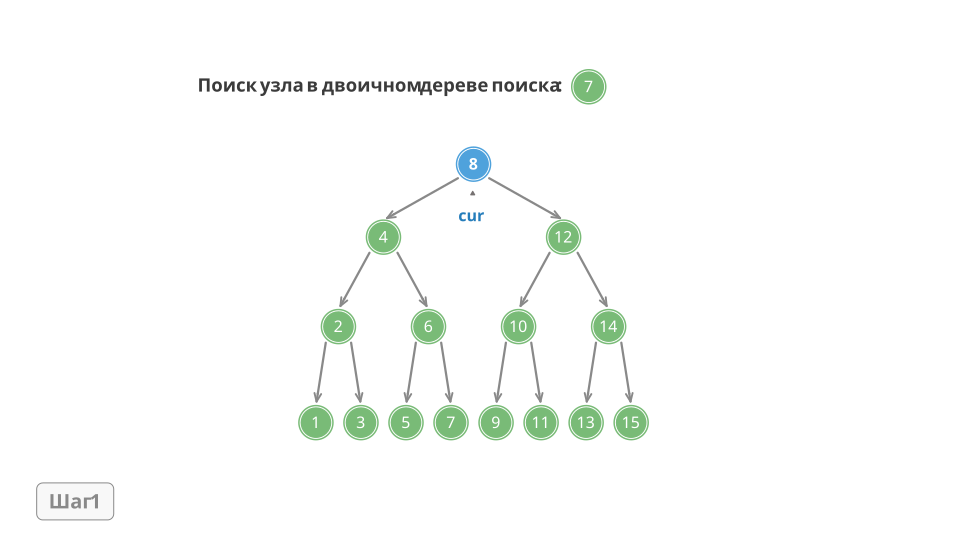
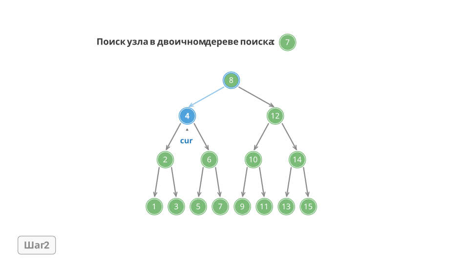
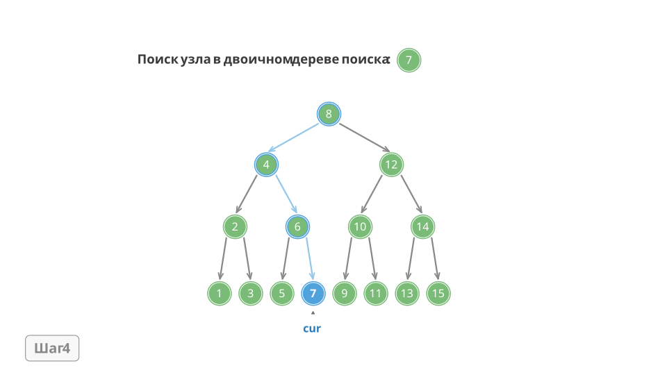
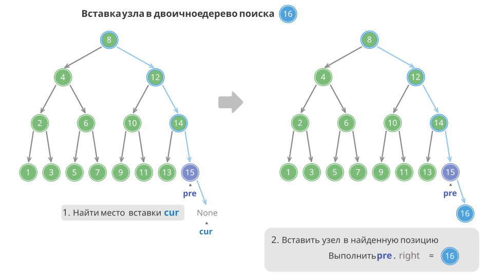
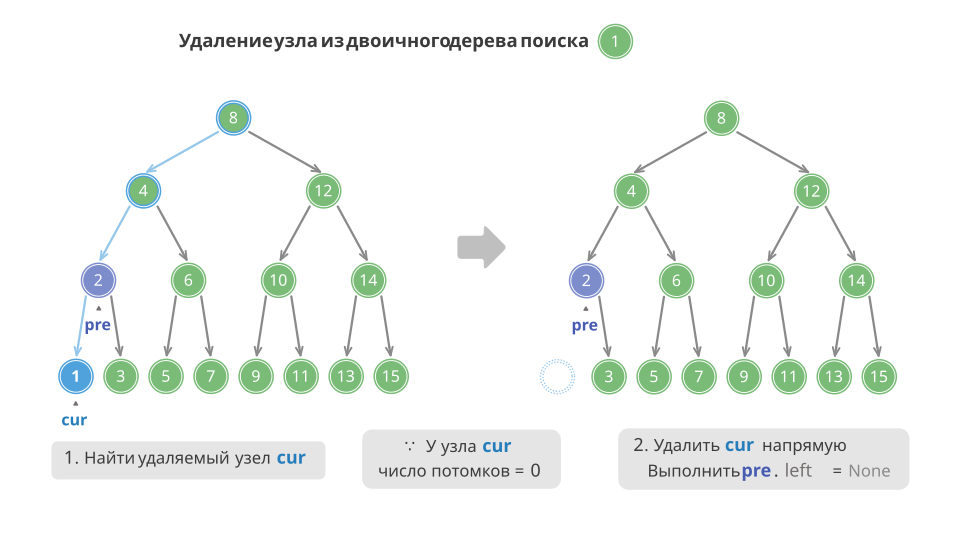
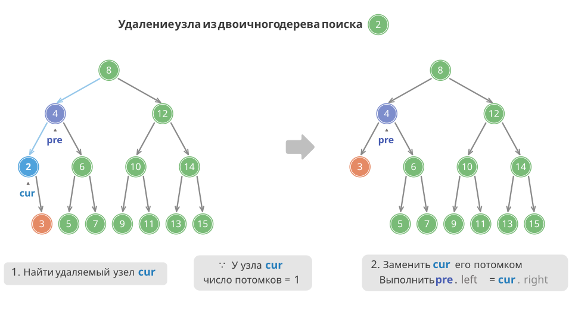
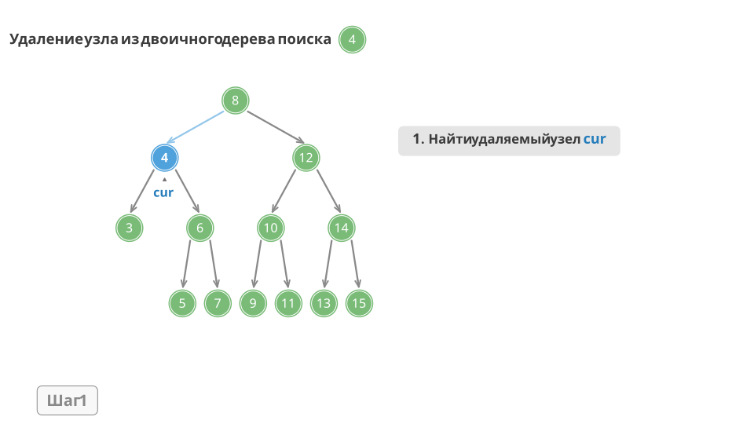
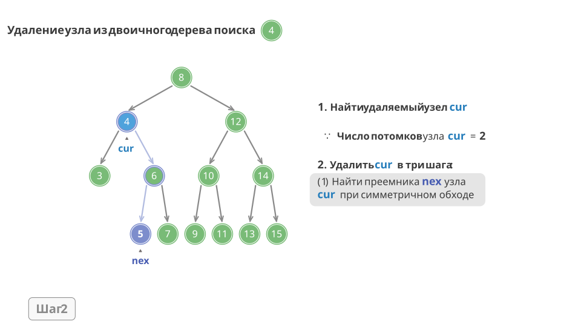
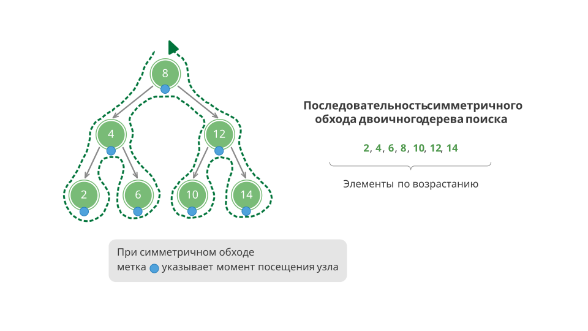

# 7.4 &nbsp; Двоичное дерево поиска

<u>Двоичное дерево поиска (binary search tree)</u>, показанное ниже, удовлетворяет следующим условиям.

1. Для корня выполняется соотношение: любое значение в левом поддереве $<$ значение корня $<$ любое значение в правом поддереве.
2. Левое и правое поддеревья любого узла также являются двоичными деревьями поиска, то есть для них тоже выполняется условие `1.`.

{ class="animation-figure" }

<p align="center"> Рисунок 7-16 &nbsp; Двоичное дерево поиска </p>

## 7.4.1 &nbsp; Операции с двоичным деревом поиска

Представим двоичное дерево поиска классом `BinarySearchTree` и объявим в нём поле `root`, которое указывает на корень.

### 1. &nbsp; Поиск узла

Пусть нужно найти узел со значением `num`. Воспользуемся свойствами двоичного дерева поиска. Как показано на рисунке, заведём переменную `cur`, начнём с корня `root` и на каждой итерации будем сравнивать значение текущего узла `cur.val` с `num`.

- Если `cur.val < num`, искомый узел следует искать в правом поддереве `cur`. Выполняем `cur = cur.right`.
- Если `cur.val > num`, искомый узел следует искать в левом поддереве `cur`. Выполняем `cur = cur.left`.
- Если `cur.val = num`, искомый узел найден. Выходим из цикла и возвращаем этот узел.

=== "<1>"
    { class="animation-figure" }

=== "<2>"
    { class="animation-figure" }

=== "<3>"
    { class="animation-figure" }

=== "<4>"
    { class="animation-figure" }

<p align="center"> Рисунок 7-17 &nbsp; Пример поиска узла в двоичном дереве поиска </p>

Поиск в двоичном дереве поиска основан на том же принципе, что и двоичный поиск: на каждом шаге исключается половина вариантов. Число итераций ограничено высотой дерева. Если оно сбалансировано, поиск занимает $O(\log n)$ времени. Пример кода:

=== "Python"

    ```python title="binary_search_tree.py"
    def search(self, num: int) -> TreeNode | None:
        """Поиск узла"""
        cur = self._root
        # Искать в цикле до выхода за пределы листа
        while cur is not None:
            # Искомый узел в правом поддереве cur
            if cur.val < num:
                cur = cur.right
            # Искомый узел в левом поддереве cur
            elif cur.val > num:
                cur = cur.left
            # Узел найден: выйти из цикла
            else:
                break
        return cur
    ```

=== "C++"

    ```cpp title="binary_search_tree.cpp"
    /* Поиск узла */
    TreeNode *search(int num) {
        TreeNode *cur = root;
        // Искать в цикле до выхода за пределы листа
        while (cur != nullptr) {
            // Искомый узел в правом поддереве cur
            if (cur->val < num)
                cur = cur->right;
            // Искомый узел в левом поддереве cur
            else if (cur->val > num)
                cur = cur->left;
            // Узел найден: выйти из цикла
            else
                break;
        }
        // Вернуть искомый узел
        return cur;
    }
    ```

=== "Java"

    ```java title="binary_search_tree.java"
    /* Поиск узла */
    TreeNode search(int num) {
        TreeNode cur = root;
        // Искать в цикле до выхода за пределы листа
        while (cur != null) {
            // Искомый узел в правом поддереве cur
            if (cur.val < num)
                cur = cur.right;
            // Искомый узел в левом поддереве cur
            else if (cur.val > num)
                cur = cur.left;
            // Узел найден: выйти из цикла
            else
                break;
        }
        // Вернуть искомый узел
        return cur;
    }
    ```

=== "C#"

    ```csharp title="binary_search_tree.cs"
    /* Поиск узла */
    TreeNode? Search(int num) {
        TreeNode? cur = root;
        // Искать в цикле до выхода за пределы листа
        while (cur != null) {
            // Искомый узел в правом поддереве cur
            if (cur.val < num) cur =
                cur.right;
            // Искомый узел в левом поддереве cur
            else if (cur.val > num)
                cur = cur.left;
            // Узел найден: выйти из цикла
            else
                break;
        }
        // Вернуть искомый узел
        return cur;
    }
    ```

=== "Go"

    ```go title="binary_search_tree.go"
    /* Поиск узла */
    func (bst *binarySearchTree) search(num int) *TreeNode {
        node := bst.root
        // Искать в цикле до выхода за пределы листа
        for node != nil {
            if node.Val.(int) < num {
                // Искомый узел в правом поддереве cur
                node = node.Right
            } else if node.Val.(int) > num {
                // Искомый узел в левом поддереве cur
                node = node.Left
            } else {
                // Узел найден: выйти из цикла
                break
            }
        }
        // Вернуть искомый узел
        return node
    }
    ```

=== "Swift"

    ```swift title="binary_search_tree.swift"
    /* Поиск узла */
    func search(num: Int) -> TreeNode? {
        var cur = root
        // Искать в цикле до выхода за пределы листа
        while cur != nil {
            // Искомый узел в правом поддереве cur
            if cur!.val < num {
                cur = cur?.right
            }
            // Искомый узел в левом поддереве cur
            else if cur!.val > num {
                cur = cur?.left
            }
            // Узел найден: выйти из цикла
            else {
                break
            }
        }
        // Вернуть искомый узел
        return cur
    }
    ```

=== "JS"

    ```javascript title="binary_search_tree.js"
    /* Поиск узла */
    search(num) {
        let cur = this.root;
        // Искать в цикле до выхода за пределы листа
        while (cur !== null) {
            // Искомый узел в правом поддереве cur
            if (cur.val < num) cur = cur.right;
            // Искомый узел в левом поддереве cur
            else if (cur.val > num) cur = cur.left;
            // Узел найден: выйти из цикла
            else break;
        }
        // Вернуть искомый узел
        return cur;
    }
    ```

=== "TS"

    ```typescript title="binary_search_tree.ts"
    /* Поиск узла */
    search(num: number): TreeNode | null {
        let cur = this.root;
        // Искать в цикле до выхода за пределы листа
        while (cur !== null) {
            // Искомый узел в правом поддереве cur
            if (cur.val < num) cur = cur.right;
            // Искомый узел в левом поддереве cur
            else if (cur.val > num) cur = cur.left;
            // Узел найден: выйти из цикла
            else break;
        }
        // Вернуть искомый узел
        return cur;
    }
    ```

=== "Dart"

    ```dart title="binary_search_tree.dart"
    /* Поиск узла */
    TreeNode? search(int _num) {
      TreeNode? cur = _root;
      // Искать в цикле до выхода за пределы листа
      while (cur != null) {
        // Искомый узел в правом поддереве cur
        if (cur.val < _num)
          cur = cur.right;
        // Искомый узел в левом поддереве cur
        else if (cur.val > _num)
          cur = cur.left;
        // Узел найден: выйти из цикла
        else
          break;
      }
      // Вернуть искомый узел
      return cur;
    }
    ```

=== "Rust"

    ```rust title="binary_search_tree.rs"
    /* Поиск узла */
    pub fn search(&self, num: i32) -> OptionTreeNodeRc {
        let mut cur = self.root.clone();
        // Искать в цикле до выхода за пределы листа
        while let Some(node) = cur.clone() {
            match num.cmp(&node.borrow().val) {
                // Искомый узел в правом поддереве cur
                Ordering::Greater => cur = node.borrow().right.clone(),
                // Искомый узел в левом поддереве cur
                Ordering::Less => cur = node.borrow().left.clone(),
                // Узел найден: выйти из цикла
                Ordering::Equal => break,
            }
        }

        // Вернуть искомый узел
        cur
    }
    ```

=== "C"

    ```c title="binary_search_tree.c"
    /* Поиск узла */
    TreeNode *search(BinarySearchTree *bst, int num) {
        TreeNode *cur = bst->root;
        // Искать в цикле до выхода за пределы листа
        while (cur != NULL) {
            if (cur->val < num) {
                // Искомый узел в правом поддереве cur
                cur = cur->right;
            } else if (cur->val > num) {
                // Искомый узел в левом поддереве cur
                cur = cur->left;
            } else {
                // Узел найден: выйти из цикла
                break;
            }
        }
        // Вернуть искомый узел
        return cur;
    }
    ```

=== "Kotlin"

    ```kotlin title="binary_search_tree.kt"
    /* Поиск узла */
    fun search(num: Int): TreeNode? {
        var cur = root
        // Искать в цикле до выхода за пределы листа
        while (cur != null) {
            // Искомый узел в правом поддереве cur
            cur = if (cur._val < num)
                cur.right
            // Искомый узел в левом поддереве cur
            else if (cur._val > num)
                cur.left
            // Узел найден: выйти из цикла
            else
                break
        }
        // Вернуть искомый узел
        return cur
    }
    ```

=== "Ruby"

    ```ruby title="binary_search_tree.rb"
    ### Поиск узла ###
    def search(num)
      cur = @root

      # Искать в цикле до выхода за пределы листа
      while !cur.nil?
        # Искомый узел в правом поддереве cur
        if cur.val < num
          cur = cur.right
        # Искомый узел в левом поддереве cur
        elsif cur.val > num
          cur = cur.left
        # Узел найден: выйти из цикла
        else
          break
        end
      end

      cur
    end
    ```

??? pythontutor "Визуализация выполнения"

    <div style="height: 549px; width: 100%;"><iframe class="pythontutor-iframe" title="Визуализация выполнения" src="https://pythontutor.com/iframe-embed.html#code=class%20TreeNode%3A%0A%20%20%22%22%22%D0%9A%D0%BB%D0%B0%D1%81%D1%81%20%D1%83%D0%B7%D0%BB%D0%B0%20%D0%B4%D0%B2%D0%BE%D0%B8%D1%87%D0%BD%D0%BE%D0%B3%D0%BE%20%D0%B4%D0%B5%D1%80%D0%B5%D0%B2%D0%B0%22%22%22%0A%20%20def%20__init__%28self,%20val%29%3A%0A%20%20%20%20self.val%20%3D%20val%0A%20%20%20%20self.left%20%3D%20None%0A%20%20%20%20self.right%20%3D%20None%0A%0A%0Aclass%20BinarySearchTree%3A%0A%20%20%22%22%22%D0%94%D0%B2%D0%BE%D0%B8%D1%87%D0%BD%D0%BE%D0%B5%20%D0%B4%D0%B5%D1%80%D0%B5%D0%B2%D0%BE%20%D0%BF%D0%BE%D0%B8%D1%81%D0%BA%D0%B0%22%22%22%0A%0A%20%20def%20__init__%28self%29%3A%0A%20%20%20%20%22%22%22%D0%9A%D0%BE%D0%BD%D1%81%D1%82%D1%80%D1%83%D0%BA%D1%82%D0%BE%D1%80%22%22%22%0A%20%20%20%20%23%20%D0%98%D0%BD%D0%B8%D1%86%D0%B8%D0%B0%D0%BB%D0%B8%D0%B7%D0%B0%D1%86%D0%B8%D1%8F%20%D0%BF%D1%83%D1%81%D1%82%D0%BE%D0%B3%D0%BE%20%D0%B4%D0%B5%D1%80%D0%B5%D0%B2%D0%B0%0A%20%20%20%20self._root%20%3D%20None%0A%0A%20%20def%20search%28self,%20num%3A%20int%29%20-%3E%20TreeNode%20%7C%20None%3A%0A%20%20%20%20%22%22%22%D0%9F%D0%BE%D0%B8%D1%81%D0%BA%20%D1%83%D0%B7%D0%BB%D0%B0%22%22%22%0A%20%20%20%20cur%20%3D%20self._root%0A%20%20%20%20%23%20%D0%98%D1%81%D0%BA%D0%B0%D1%82%D1%8C%20%D0%B2%20%D1%86%D0%B8%D0%BA%D0%BB%D0%B5%20%D0%B4%D0%BE%20%D0%B2%D1%8B%D1%85%D0%BE%D0%B4%D0%B0%20%D0%B7%D0%B0%20%D0%BF%D1%80%D0%B5%D0%B4%D0%B5%D0%BB%D1%8B%20%D0%BB%D0%B8%D1%81%D1%82%D0%B0%0A%20%20%20%20while%20cur%20is%20not%20None%3A%0A%20%20%20%20%20%20%23%20%D0%98%D1%81%D0%BA%D0%BE%D0%BC%D1%8B%D0%B9%20%D1%83%D0%B7%D0%B5%D0%BB%20%D0%B2%20%D0%BF%D1%80%D0%B0%D0%B2%D0%BE%D0%BC%20%D0%BF%D0%BE%D0%B4%D0%B4%D0%B5%D1%80%D0%B5%D0%B2%D0%B5%20cur%0A%20%20%20%20%20%20if%20cur.val%20%3C%20num%3A%0A%20%20%20%20%20%20%20%20cur%20%3D%20cur.right%0A%20%20%20%20%20%20%23%20%D0%98%D1%81%D0%BA%D0%BE%D0%BC%D1%8B%D0%B9%20%D1%83%D0%B7%D0%B5%D0%BB%20%D0%B2%20%D0%BB%D0%B5%D0%B2%D0%BE%D0%BC%20%D0%BF%D0%BE%D0%B4%D0%B4%D0%B5%D1%80%D0%B5%D0%B2%D0%B5%20cur%0A%20%20%20%20%20%20elif%20cur.val%20%3E%20num%3A%0A%20%20%20%20%20%20%20%20cur%20%3D%20cur.left%0A%20%20%20%20%20%20%23%20%D0%A3%D0%B7%D0%B5%D0%BB%20%D0%BD%D0%B0%D0%B9%D0%B4%D0%B5%D0%BD%3A%20%D0%B2%D1%8B%D0%B9%D1%82%D0%B8%20%D0%B8%D0%B7%20%D1%86%D0%B8%D0%BA%D0%BB%D0%B0%0A%20%20%20%20%20%20else%3A%0A%20%20%20%20%20%20%20%20break%0A%20%20%20%20return%20cur%0A%0A%20%20def%20insert%28self,%20num%3A%20int%29%3A%0A%20%20%20%20%22%22%22%D0%92%D1%81%D1%82%D0%B0%D0%B2%D0%BA%D0%B0%20%D1%83%D0%B7%D0%BB%D0%B0%22%22%22%0A%20%20%20%20%23%20%D0%95%D1%81%D0%BB%D0%B8%20%D0%B4%D0%B5%D1%80%D0%B5%D0%B2%D0%BE%20%D0%BF%D1%83%D1%81%D1%82%D0%BE,%20%D1%81%D0%BE%D0%B7%D0%B4%D0%B0%D1%82%D1%8C%20%D0%BA%D0%BE%D1%80%D0%B5%D0%BD%D1%8C%0A%20%20%20%20if%20self._root%20is%20None%3A%0A%20%20%20%20%20%20self._root%20%3D%20TreeNode%28num%29%0A%20%20%20%20%20%20return%0A%20%20%20%20%23%20%D0%98%D1%81%D0%BA%D0%B0%D1%82%D1%8C%20%D0%B2%20%D1%86%D0%B8%D0%BA%D0%BB%D0%B5%20%D0%B4%D0%BE%20%D0%B2%D1%8B%D1%85%D0%BE%D0%B4%D0%B0%20%D0%B7%D0%B0%20%D0%BF%D1%80%D0%B5%D0%B4%D0%B5%D0%BB%D1%8B%20%D0%BB%D0%B8%D1%81%D1%82%D0%B0%0A%20%20%20%20cur,%20pre%20%3D%20self._root,%20None%0A%20%20%20%20while%20cur%20is%20not%20None%3A%0A%20%20%20%20%20%20%23%20%D0%A2%D0%B0%D0%BA%D0%BE%D0%B9%20%D1%83%D0%B7%D0%B5%D0%BB%20%D1%83%D0%B6%D0%B5%20%D0%B5%D1%81%D1%82%D1%8C%3A%20%D0%B7%D0%B0%D0%B2%D0%B5%D1%80%D1%88%D0%B8%D1%82%D1%8C%20%D0%B2%D1%8B%D0%B7%D0%BE%D0%B2%0A%20%20%20%20%20%20if%20cur.val%20%3D%3D%20num%3A%0A%20%20%20%20%20%20%20%20return%0A%20%20%20%20%20%20pre%20%3D%20cur%0A%20%20%20%20%20%20%23%20%D0%9C%D0%B5%D1%81%D1%82%D0%BE%20%D0%B2%D1%81%D1%82%D0%B0%D0%B2%D0%BA%D0%B8%20%D0%B2%20%D0%BF%D1%80%D0%B0%D0%B2%D0%BE%D0%BC%20%D0%BF%D0%BE%D0%B4%D0%B4%D0%B5%D1%80%D0%B5%D0%B2%D0%B5%20cur%0A%20%20%20%20%20%20if%20cur.val%20%3C%20num%3A%0A%20%20%20%20%20%20%20%20cur%20%3D%20cur.right%0A%20%20%20%20%20%20%23%20%D0%9C%D0%B5%D1%81%D1%82%D0%BE%20%D0%B2%D1%81%D1%82%D0%B0%D0%B2%D0%BA%D0%B8%20%D0%B2%20%D0%BB%D0%B5%D0%B2%D0%BE%D0%BC%20%D0%BF%D0%BE%D0%B4%D0%B4%D0%B5%D1%80%D0%B5%D0%B2%D0%B5%20cur%0A%20%20%20%20%20%20else%3A%0A%20%20%20%20%20%20%20%20cur%20%3D%20cur.left%0A%20%20%20%20%23%20%D0%92%D1%81%D1%82%D0%B0%D0%B2%D0%BA%D0%B0%20%D1%83%D0%B7%D0%BB%D0%B0%0A%20%20%20%20node%20%3D%20TreeNode%28num%29%0A%20%20%20%20if%20pre.val%20%3C%20num%3A%0A%20%20%20%20%20%20pre.right%20%3D%20node%0A%20%20%20%20else%3A%0A%20%20%20%20%20%20pre.left%20%3D%20node%0A%0A%0A%22%22%22Driver%20Code%22%22%22%0Aif%20__name__%20%3D%3D%20%22__main__%22%3A%0A%20%20%23%20%D0%98%D0%BD%D0%B8%D1%86%D0%B8%D0%B0%D0%BB%D0%B8%D0%B7%D0%B0%D1%86%D0%B8%D1%8F%20%D0%B4%D0%B2%D0%BE%D0%B8%D1%87%D0%BD%D0%BE%D0%B3%D0%BE%20%D0%B4%D0%B5%D1%80%D0%B5%D0%B2%D0%B0%20%D0%BF%D0%BE%D0%B8%D1%81%D0%BA%D0%B0%0A%20%20bst%20%3D%20BinarySearchTree%28%29%0A%20%20nums%20%3D%20%5B4,%202,%206,%201,%203,%205,%207%5D%0A%20%20for%20num%20in%20nums%3A%0A%20%20%20%20bst.insert%28num%29%0A%0A%20%20%23%20%D0%9F%D0%BE%D0%B8%D1%81%D0%BA%20%D1%83%D0%B7%D0%BB%D0%B0%0A%20%20node%20%3D%20bst.search%287%29%0A%20%20print%28%22%5Cn%D0%9D%D0%B0%D0%B9%D0%B4%D0%B5%D0%BD%D0%BD%D1%8B%D0%B9%20%D1%83%D0%B7%D0%B5%D0%BB%3A%20%7B%7D,%20%D0%B7%D0%BD%D0%B0%D1%87%D0%B5%D0%BD%D0%B8%D0%B5%20%D1%83%D0%B7%D0%BB%D0%B0%20%3D%20%7B%7D%22.format%28node,%20node.val%29%29&codeDivHeight=472&codeDivWidth=350&cumulative=false&curInstr=162&heapPrimitives=nevernest&origin=opt-frontend.js&py=311&rawInputLstJSON=%5B%5D&textReferences=false"> </iframe></div>
    <div style="margin-top: 5px;"><a href="https://pythontutor.com/iframe-embed.html#code=class%20TreeNode%3A%0A%20%20%22%22%22%D0%9A%D0%BB%D0%B0%D1%81%D1%81%20%D1%83%D0%B7%D0%BB%D0%B0%20%D0%B4%D0%B2%D0%BE%D0%B8%D1%87%D0%BD%D0%BE%D0%B3%D0%BE%20%D0%B4%D0%B5%D1%80%D0%B5%D0%B2%D0%B0%22%22%22%0A%20%20def%20__init__%28self,%20val%29%3A%0A%20%20%20%20self.val%20%3D%20val%0A%20%20%20%20self.left%20%3D%20None%0A%20%20%20%20self.right%20%3D%20None%0A%0A%0Aclass%20BinarySearchTree%3A%0A%20%20%22%22%22%D0%94%D0%B2%D0%BE%D0%B8%D1%87%D0%BD%D0%BE%D0%B5%20%D0%B4%D0%B5%D1%80%D0%B5%D0%B2%D0%BE%20%D0%BF%D0%BE%D0%B8%D1%81%D0%BA%D0%B0%22%22%22%0A%0A%20%20def%20__init__%28self%29%3A%0A%20%20%20%20%22%22%22%D0%9A%D0%BE%D0%BD%D1%81%D1%82%D1%80%D1%83%D0%BA%D1%82%D0%BE%D1%80%22%22%22%0A%20%20%20%20%23%20%D0%98%D0%BD%D0%B8%D1%86%D0%B8%D0%B0%D0%BB%D0%B8%D0%B7%D0%B0%D1%86%D0%B8%D1%8F%20%D0%BF%D1%83%D1%81%D1%82%D0%BE%D0%B3%D0%BE%20%D0%B4%D0%B5%D1%80%D0%B5%D0%B2%D0%B0%0A%20%20%20%20self._root%20%3D%20None%0A%0A%20%20def%20search%28self,%20num%3A%20int%29%20-%3E%20TreeNode%20%7C%20None%3A%0A%20%20%20%20%22%22%22%D0%9F%D0%BE%D0%B8%D1%81%D0%BA%20%D1%83%D0%B7%D0%BB%D0%B0%22%22%22%0A%20%20%20%20cur%20%3D%20self._root%0A%20%20%20%20%23%20%D0%98%D1%81%D0%BA%D0%B0%D1%82%D1%8C%20%D0%B2%20%D1%86%D0%B8%D0%BA%D0%BB%D0%B5%20%D0%B4%D0%BE%20%D0%B2%D1%8B%D1%85%D0%BE%D0%B4%D0%B0%20%D0%B7%D0%B0%20%D0%BF%D1%80%D0%B5%D0%B4%D0%B5%D0%BB%D1%8B%20%D0%BB%D0%B8%D1%81%D1%82%D0%B0%0A%20%20%20%20while%20cur%20is%20not%20None%3A%0A%20%20%20%20%20%20%23%20%D0%98%D1%81%D0%BA%D0%BE%D0%BC%D1%8B%D0%B9%20%D1%83%D0%B7%D0%B5%D0%BB%20%D0%B2%20%D0%BF%D1%80%D0%B0%D0%B2%D0%BE%D0%BC%20%D0%BF%D0%BE%D0%B4%D0%B4%D0%B5%D1%80%D0%B5%D0%B2%D0%B5%20cur%0A%20%20%20%20%20%20if%20cur.val%20%3C%20num%3A%0A%20%20%20%20%20%20%20%20cur%20%3D%20cur.right%0A%20%20%20%20%20%20%23%20%D0%98%D1%81%D0%BA%D0%BE%D0%BC%D1%8B%D0%B9%20%D1%83%D0%B7%D0%B5%D0%BB%20%D0%B2%20%D0%BB%D0%B5%D0%B2%D0%BE%D0%BC%20%D0%BF%D0%BE%D0%B4%D0%B4%D0%B5%D1%80%D0%B5%D0%B2%D0%B5%20cur%0A%20%20%20%20%20%20elif%20cur.val%20%3E%20num%3A%0A%20%20%20%20%20%20%20%20cur%20%3D%20cur.left%0A%20%20%20%20%20%20%23%20%D0%A3%D0%B7%D0%B5%D0%BB%20%D0%BD%D0%B0%D0%B9%D0%B4%D0%B5%D0%BD%3A%20%D0%B2%D1%8B%D0%B9%D1%82%D0%B8%20%D0%B8%D0%B7%20%D1%86%D0%B8%D0%BA%D0%BB%D0%B0%0A%20%20%20%20%20%20else%3A%0A%20%20%20%20%20%20%20%20break%0A%20%20%20%20return%20cur%0A%0A%20%20def%20insert%28self,%20num%3A%20int%29%3A%0A%20%20%20%20%22%22%22%D0%92%D1%81%D1%82%D0%B0%D0%B2%D0%BA%D0%B0%20%D1%83%D0%B7%D0%BB%D0%B0%22%22%22%0A%20%20%20%20%23%20%D0%95%D1%81%D0%BB%D0%B8%20%D0%B4%D0%B5%D1%80%D0%B5%D0%B2%D0%BE%20%D0%BF%D1%83%D1%81%D1%82%D0%BE,%20%D1%81%D0%BE%D0%B7%D0%B4%D0%B0%D1%82%D1%8C%20%D0%BA%D0%BE%D1%80%D0%B5%D0%BD%D1%8C%0A%20%20%20%20if%20self._root%20is%20None%3A%0A%20%20%20%20%20%20self._root%20%3D%20TreeNode%28num%29%0A%20%20%20%20%20%20return%0A%20%20%20%20%23%20%D0%98%D1%81%D0%BA%D0%B0%D1%82%D1%8C%20%D0%B2%20%D1%86%D0%B8%D0%BA%D0%BB%D0%B5%20%D0%B4%D0%BE%20%D0%B2%D1%8B%D1%85%D0%BE%D0%B4%D0%B0%20%D0%B7%D0%B0%20%D0%BF%D1%80%D0%B5%D0%B4%D0%B5%D0%BB%D1%8B%20%D0%BB%D0%B8%D1%81%D1%82%D0%B0%0A%20%20%20%20cur,%20pre%20%3D%20self._root,%20None%0A%20%20%20%20while%20cur%20is%20not%20None%3A%0A%20%20%20%20%20%20%23%20%D0%A2%D0%B0%D0%BA%D0%BE%D0%B9%20%D1%83%D0%B7%D0%B5%D0%BB%20%D1%83%D0%B6%D0%B5%20%D0%B5%D1%81%D1%82%D1%8C%3A%20%D0%B7%D0%B0%D0%B2%D0%B5%D1%80%D1%88%D0%B8%D1%82%D1%8C%20%D0%B2%D1%8B%D0%B7%D0%BE%D0%B2%0A%20%20%20%20%20%20if%20cur.val%20%3D%3D%20num%3A%0A%20%20%20%20%20%20%20%20return%0A%20%20%20%20%20%20pre%20%3D%20cur%0A%20%20%20%20%20%20%23%20%D0%9C%D0%B5%D1%81%D1%82%D0%BE%20%D0%B2%D1%81%D1%82%D0%B0%D0%B2%D0%BA%D0%B8%20%D0%B2%20%D0%BF%D1%80%D0%B0%D0%B2%D0%BE%D0%BC%20%D0%BF%D0%BE%D0%B4%D0%B4%D0%B5%D1%80%D0%B5%D0%B2%D0%B5%20cur%0A%20%20%20%20%20%20if%20cur.val%20%3C%20num%3A%0A%20%20%20%20%20%20%20%20cur%20%3D%20cur.right%0A%20%20%20%20%20%20%23%20%D0%9C%D0%B5%D1%81%D1%82%D0%BE%20%D0%B2%D1%81%D1%82%D0%B0%D0%B2%D0%BA%D0%B8%20%D0%B2%20%D0%BB%D0%B5%D0%B2%D0%BE%D0%BC%20%D0%BF%D0%BE%D0%B4%D0%B4%D0%B5%D1%80%D0%B5%D0%B2%D0%B5%20cur%0A%20%20%20%20%20%20else%3A%0A%20%20%20%20%20%20%20%20cur%20%3D%20cur.left%0A%20%20%20%20%23%20%D0%92%D1%81%D1%82%D0%B0%D0%B2%D0%BA%D0%B0%20%D1%83%D0%B7%D0%BB%D0%B0%0A%20%20%20%20node%20%3D%20TreeNode%28num%29%0A%20%20%20%20if%20pre.val%20%3C%20num%3A%0A%20%20%20%20%20%20pre.right%20%3D%20node%0A%20%20%20%20else%3A%0A%20%20%20%20%20%20pre.left%20%3D%20node%0A%0A%0A%22%22%22Driver%20Code%22%22%22%0Aif%20__name__%20%3D%3D%20%22__main__%22%3A%0A%20%20%23%20%D0%98%D0%BD%D0%B8%D1%86%D0%B8%D0%B0%D0%BB%D0%B8%D0%B7%D0%B0%D1%86%D0%B8%D1%8F%20%D0%B4%D0%B2%D0%BE%D0%B8%D1%87%D0%BD%D0%BE%D0%B3%D0%BE%20%D0%B4%D0%B5%D1%80%D0%B5%D0%B2%D0%B0%20%D0%BF%D0%BE%D0%B8%D1%81%D0%BA%D0%B0%0A%20%20bst%20%3D%20BinarySearchTree%28%29%0A%20%20nums%20%3D%20%5B4,%202,%206,%201,%203,%205,%207%5D%0A%20%20for%20num%20in%20nums%3A%0A%20%20%20%20bst.insert%28num%29%0A%0A%20%20%23%20%D0%9F%D0%BE%D0%B8%D1%81%D0%BA%20%D1%83%D0%B7%D0%BB%D0%B0%0A%20%20node%20%3D%20bst.search%287%29%0A%20%20print%28%22%5Cn%D0%9D%D0%B0%D0%B9%D0%B4%D0%B5%D0%BD%D0%BD%D1%8B%D0%B9%20%D1%83%D0%B7%D0%B5%D0%BB%3A%20%7B%7D,%20%D0%B7%D0%BD%D0%B0%D1%87%D0%B5%D0%BD%D0%B8%D0%B5%20%D1%83%D0%B7%D0%BB%D0%B0%20%3D%20%7B%7D%22.format%28node,%20node.val%29%29&codeDivHeight=800&codeDivWidth=600&cumulative=false&curInstr=162&heapPrimitives=nevernest&origin=opt-frontend.js&py=311&rawInputLstJSON=%5B%5D&textReferences=false" target="_blank" rel="noopener noreferrer">Во весь экран ></a></div>

### 2. &nbsp; Вставка узла

Чтобы вставить элемент `num` и сохранить свойство дерева поиска «левое поддерево < корень < правое поддерево», выполним следующие шаги, показанные на рисунке.

1. **Найдём место вставки**. Как и при поиске, идём от корня вниз, сравнивая значение текущего узла с `num`. Когда выйдем за пределы листа и достигнем `None`, завершим цикл.
2. **Вставим узел в найденную позицию**. Создадим узел со значением `num` и поместим его туда, где было `None`.

{ class="animation-figure" }

<p align="center"> Рисунок 7-18 &nbsp; Вставка узла в двоичное дерево поиска </p>

При реализации стоит учесть два момента.

- По определению двоичного дерева поиска значения узлов не должны повторяться. Поэтому, если такое значение уже есть в дереве, завершаем операцию без вставки.
- Для вставки понадобится указатель `pre`, в котором мы сохраняем узел с предыдущей итерации. Когда дойдём до `None`, по этому указателю сможем обратиться к родителю и присоединить новый узел.

=== "Python"

    ```python title="binary_search_tree.py"
    def insert(self, num: int):
        """Вставка узла"""
        # Если дерево пусто, создать корень
        if self._root is None:
            self._root = TreeNode(num)
            return
        # Искать в цикле до выхода за пределы листа
        cur, pre = self._root, None
        while cur is not None:
            # Такой узел уже есть: завершить вызов
            if cur.val == num:
                return
            pre = cur
            # Место вставки в правом поддереве cur
            if cur.val < num:
                cur = cur.right
            # Место вставки в левом поддереве cur
            else:
                cur = cur.left
        # Вставка узла
        node = TreeNode(num)
        if pre.val < num:
            pre.right = node
        else:
            pre.left = node
    ```

=== "C++"

    ```cpp title="binary_search_tree.cpp"
    /* Вставка узла */
    void insert(int num) {
        // Если дерево пусто, создать корень
        if (root == nullptr) {
            root = new TreeNode(num);
            return;
        }
        TreeNode *cur = root, *pre = nullptr;
        // Искать в цикле до выхода за пределы листа
        while (cur != nullptr) {
            // Такой узел уже есть: завершить вызов
            if (cur->val == num)
                return;
            pre = cur;
            // Место вставки в правом поддереве cur
            if (cur->val < num)
                cur = cur->right;
            // Место вставки в левом поддереве cur
            else
                cur = cur->left;
        }
        // Вставка узла
        TreeNode *node = new TreeNode(num);
        if (pre->val < num)
            pre->right = node;
        else
            pre->left = node;
    }
    ```

=== "Java"

    ```java title="binary_search_tree.java"
    /* Вставка узла */
    void insert(int num) {
        // Если дерево пусто, создать корень
        if (root == null) {
            root = new TreeNode(num);
            return;
        }
        TreeNode cur = root, pre = null;
        // Искать в цикле до выхода за пределы листа
        while (cur != null) {
            // Такой узел уже есть: завершить вызов
            if (cur.val == num)
                return;
            pre = cur;
            // Место вставки в правом поддереве cur
            if (cur.val < num)
                cur = cur.right;
            // Место вставки в левом поддереве cur
            else
                cur = cur.left;
        }
        // Вставка узла
        TreeNode node = new TreeNode(num);
        if (pre.val < num)
            pre.right = node;
        else
            pre.left = node;
    }
    ```

=== "C#"

    ```csharp title="binary_search_tree.cs"
    /* Вставка узла */
    void Insert(int num) {
        // Если дерево пусто, создать корень
        if (root == null) {
            root = new TreeNode(num);
            return;
        }
        TreeNode? cur = root, pre = null;
        // Искать в цикле до выхода за пределы листа
        while (cur != null) {
            // Такой узел уже есть: завершить вызов
            if (cur.val == num)
                return;
            pre = cur;
            // Место вставки в правом поддереве cur
            if (cur.val < num)
                cur = cur.right;
            // Место вставки в левом поддереве cur
            else
                cur = cur.left;
        }

        // Вставка узла
        TreeNode node = new(num);
        if (pre != null) {
            if (pre.val < num)
                pre.right = node;
            else
                pre.left = node;
        }
    }
    ```

=== "Go"

    ```go title="binary_search_tree.go"
    /* Вставка узла */
    func (bst *binarySearchTree) insert(num int) {
        cur := bst.root
        // Если дерево пусто, создать корень
        if cur == nil {
            bst.root = NewTreeNode(num)
            return
        }
        // Позиция родителя вставляемого узла
        var pre *TreeNode = nil
        // Искать в цикле до выхода за пределы листа
        for cur != nil {
            if cur.Val == num {
                return
            }
            pre = cur
            if cur.Val.(int) < num {
                cur = cur.Right
            } else {
                cur = cur.Left
            }
        }
        // Вставка узла
        node := NewTreeNode(num)
        if pre.Val.(int) < num {
            pre.Right = node
        } else {
            pre.Left = node
        }
    }
    ```

=== "Swift"

    ```swift title="binary_search_tree.swift"
    /* Вставка узла */
    func insert(num: Int) {
        // Если дерево пусто, создать корень
        if root == nil {
            root = TreeNode(x: num)
            return
        }
        var cur = root
        var pre: TreeNode?
        // Искать в цикле до выхода за пределы листа
        while cur != nil {
            // Такой узел уже есть: завершить вызов
            if cur!.val == num {
                return
            }
            pre = cur
            // Место вставки в правом поддереве cur
            if cur!.val < num {
                cur = cur?.right
            }
            // Место вставки в левом поддереве cur
            else {
                cur = cur?.left
            }
        }
        // Вставка узла
        let node = TreeNode(x: num)
        if pre!.val < num {
            pre?.right = node
        } else {
            pre?.left = node
        }
    }
    ```

=== "JS"

    ```javascript title="binary_search_tree.js"
    /* Вставка узла */
    insert(num) {
        // Если дерево пусто, создать корень
        if (this.root === null) {
            this.root = new TreeNode(num);
            return;
        }
        let cur = this.root,
            pre = null;
        // Искать в цикле до выхода за пределы листа
        while (cur !== null) {
            // Такой узел уже есть: завершить вызов
            if (cur.val === num) return;
            pre = cur;
            // Место вставки в правом поддереве cur
            if (cur.val < num) cur = cur.right;
            // Место вставки в левом поддереве cur
            else cur = cur.left;
        }
        // Вставка узла
        const node = new TreeNode(num);
        if (pre.val < num) pre.right = node;
        else pre.left = node;
    }
    ```

=== "TS"

    ```typescript title="binary_search_tree.ts"
    /* Вставка узла */
    insert(num: number): void {
        // Если дерево пусто, создать корень
        if (this.root === null) {
            this.root = new TreeNode(num);
            return;
        }
        let cur: TreeNode | null = this.root,
            pre: TreeNode | null = null;
        // Искать в цикле до выхода за пределы листа
        while (cur !== null) {
            // Такой узел уже есть: завершить вызов
            if (cur.val === num) return;
            pre = cur;
            // Место вставки в правом поддереве cur
            if (cur.val < num) cur = cur.right;
            // Место вставки в левом поддереве cur
            else cur = cur.left;
        }
        // Вставка узла
        const node = new TreeNode(num);
        if (pre!.val < num) pre!.right = node;
        else pre!.left = node;
    }
    ```

=== "Dart"

    ```dart title="binary_search_tree.dart"
    /* Вставка узла */
    void insert(int _num) {
      // Если дерево пусто, создать корень
      if (_root == null) {
        _root = TreeNode(_num);
        return;
      }
      TreeNode? cur = _root;
      TreeNode? pre = null;
      // Искать в цикле до выхода за пределы листа
      while (cur != null) {
        // Такой узел уже есть: завершить вызов
        if (cur.val == _num) return;
        pre = cur;
        // Место вставки в правом поддереве cur
        if (cur.val < _num)
          cur = cur.right;
        // Место вставки в левом поддереве cur
        else
          cur = cur.left;
      }
      // Вставка узла
      TreeNode? node = TreeNode(_num);
      if (pre!.val < _num)
        pre.right = node;
      else
        pre.left = node;
    }
    ```

=== "Rust"

    ```rust title="binary_search_tree.rs"
    /* Вставка узла */
    pub fn insert(&mut self, num: i32) {
        // Если дерево пусто, создать корень
        if self.root.is_none() {
            self.root = Some(TreeNode::new(num));
            return;
        }
        let mut cur = self.root.clone();
        let mut pre = None;
        // Искать в цикле до выхода за пределы листа
        while let Some(node) = cur.clone() {
            match num.cmp(&node.borrow().val) {
                // Такой узел уже есть: завершить вызов
                Ordering::Equal => return,
                // Место вставки в правом поддереве cur
                Ordering::Greater => {
                    pre = cur.clone();
                    cur = node.borrow().right.clone();
                }
                // Место вставки в левом поддереве cur
                Ordering::Less => {
                    pre = cur.clone();
                    cur = node.borrow().left.clone();
                }
            }
        }
        // Вставка узла
        let pre = pre.unwrap();
        let node = Some(TreeNode::new(num));
        if num > pre.borrow().val {
            pre.borrow_mut().right = node;
        } else {
            pre.borrow_mut().left = node;
        }
    }
    ```

=== "C"

    ```c title="binary_search_tree.c"
    /* Вставка узла */
    void insert(BinarySearchTree *bst, int num) {
        // Если дерево пусто, создать корень
        if (bst->root == NULL) {
            bst->root = newTreeNode(num);
            return;
        }
        TreeNode *cur = bst->root, *pre = NULL;
        // Искать в цикле до выхода за пределы листа
        while (cur != NULL) {
            // Такой узел уже есть: завершить вызов
            if (cur->val == num) {
                return;
            }
            pre = cur;
            if (cur->val < num) {
                // Место вставки в правом поддереве cur
                cur = cur->right;
            } else {
                // Место вставки в левом поддереве cur
                cur = cur->left;
            }
        }
        // Вставка узла
        TreeNode *node = newTreeNode(num);
        if (pre->val < num) {
            pre->right = node;
        } else {
            pre->left = node;
        }
    }
    ```

=== "Kotlin"

    ```kotlin title="binary_search_tree.kt"
    /* Вставка узла */
    fun insert(num: Int) {
        // Если дерево пусто, создать корень
        if (root == null) {
            root = TreeNode(num)
            return
        }
        var cur = root
        var pre: TreeNode? = null
        // Искать в цикле до выхода за пределы листа
        while (cur != null) {
            // Такой узел уже есть: завершить вызов
            if (cur._val == num)
                return
            pre = cur
            // Место вставки в правом поддереве cur
            cur = if (cur._val < num)
                cur.right
            // Место вставки в левом поддереве cur
            else
                cur.left
        }
        // Вставка узла
        val node = TreeNode(num)
        if (pre?._val!! < num)
            pre.right = node
        else
            pre.left = node
    }
    ```

=== "Ruby"

    ```ruby title="binary_search_tree.rb"
    ### Вставка узла ###
    def insert(num)
      # Если дерево пусто, создать корень
      if @root.nil?
        @root = TreeNode.new(num)
        return
      end

      # Искать в цикле до выхода за пределы листа
      cur, pre = @root, nil
      while !cur.nil?
        # Такой узел уже есть: завершить вызов
        return if cur.val == num

        pre = cur
        # Место вставки в правом поддереве cur
        if cur.val < num
          cur = cur.right
        # Место вставки в левом поддереве cur
        else
          cur = cur.left
        end
      end

      # Вставка узла
      node = TreeNode.new(num)
      if pre.val < num
        pre.right = node
      else
        pre.left = node
      end
    end
    ```

??? pythontutor "Визуализация выполнения"

    <div style="height: 549px; width: 100%;"><iframe class="pythontutor-iframe" title="Визуализация выполнения" src="https://pythontutor.com/iframe-embed.html#code=class%20TreeNode%3A%0A%20%20%20%20%22%22%22%D0%9A%D0%BB%D0%B0%D1%81%D1%81%20%D1%83%D0%B7%D0%BB%D0%B0%20%D0%B4%D0%B2%D0%BE%D0%B8%D1%87%D0%BD%D0%BE%D0%B3%D0%BE%20%D0%B4%D0%B5%D1%80%D0%B5%D0%B2%D0%B0%22%22%22%0A%20%20%20%20def%20__init__%28self,%20val%29%3A%0A%20%20%20%20%20%20%20%20self.val%20%3D%20val%0A%20%20%20%20%20%20%20%20self.left%20%3D%20None%0A%20%20%20%20%20%20%20%20self.right%20%3D%20None%0A%0A%0Aclass%20BinarySearchTree%3A%0A%20%20%20%20%22%22%22%D0%94%D0%B2%D0%BE%D0%B8%D1%87%D0%BD%D0%BE%D0%B5%20%D0%B4%D0%B5%D1%80%D0%B5%D0%B2%D0%BE%20%D0%BF%D0%BE%D0%B8%D1%81%D0%BA%D0%B0%22%22%22%0A%0A%20%20%20%20def%20__init__%28self%29%3A%0A%20%20%20%20%20%20%20%20%22%22%22%D0%9A%D0%BE%D0%BD%D1%81%D1%82%D1%80%D1%83%D0%BA%D1%82%D0%BE%D1%80%22%22%22%0A%20%20%20%20%20%20%20%20%23%20%D0%98%D0%BD%D0%B8%D1%86%D0%B8%D0%B0%D0%BB%D0%B8%D0%B7%D0%B0%D1%86%D0%B8%D1%8F%20%D0%BF%D1%83%D1%81%D1%82%D0%BE%D0%B3%D0%BE%20%D0%B4%D0%B5%D1%80%D0%B5%D0%B2%D0%B0%0A%20%20%20%20%20%20%20%20self._root%20%3D%20None%0A%0A%20%20%20%20def%20insert%28self,%20num%3A%20int%29%3A%0A%20%20%20%20%20%20%20%20%22%22%22%D0%92%D1%81%D1%82%D0%B0%D0%B2%D0%BA%D0%B0%20%D1%83%D0%B7%D0%BB%D0%B0%22%22%22%0A%20%20%20%20%20%20%20%20%23%20%D0%95%D1%81%D0%BB%D0%B8%20%D0%B4%D0%B5%D1%80%D0%B5%D0%B2%D0%BE%20%D0%BF%D1%83%D1%81%D1%82%D0%BE,%20%D1%81%D0%BE%D0%B7%D0%B4%D0%B0%D1%82%D1%8C%20%D0%BA%D0%BE%D1%80%D0%B5%D0%BD%D1%8C%0A%20%20%20%20%20%20%20%20if%20self._root%20is%20None%3A%0A%20%20%20%20%20%20%20%20%20%20%20%20self._root%20%3D%20TreeNode%28num%29%0A%20%20%20%20%20%20%20%20%20%20%20%20return%0A%20%20%20%20%20%20%20%20%23%20%D0%98%D1%81%D0%BA%D0%B0%D1%82%D1%8C%20%D0%B2%20%D1%86%D0%B8%D0%BA%D0%BB%D0%B5%20%D0%B4%D0%BE%20%D0%B2%D1%8B%D1%85%D0%BE%D0%B4%D0%B0%20%D0%B7%D0%B0%20%D0%BF%D1%80%D0%B5%D0%B4%D0%B5%D0%BB%D1%8B%20%D0%BB%D0%B8%D1%81%D1%82%D0%B0%0A%20%20%20%20%20%20%20%20cur,%20pre%20%3D%20self._root,%20None%0A%20%20%20%20%20%20%20%20while%20cur%20is%20not%20None%3A%0A%20%20%20%20%20%20%20%20%20%20%20%20%23%20%D0%A2%D0%B0%D0%BA%D0%BE%D0%B9%20%D1%83%D0%B7%D0%B5%D0%BB%20%D1%83%D0%B6%D0%B5%20%D0%B5%D1%81%D1%82%D1%8C%3A%20%D0%B7%D0%B0%D0%B2%D0%B5%D1%80%D1%88%D0%B8%D1%82%D1%8C%20%D0%B2%D1%8B%D0%B7%D0%BE%D0%B2%0A%20%20%20%20%20%20%20%20%20%20%20%20if%20cur.val%20%3D%3D%20num%3A%0A%20%20%20%20%20%20%20%20%20%20%20%20%20%20%20%20return%0A%20%20%20%20%20%20%20%20%20%20%20%20pre%20%3D%20cur%0A%20%20%20%20%20%20%20%20%20%20%20%20%23%20%D0%9C%D0%B5%D1%81%D1%82%D0%BE%20%D0%B2%D1%81%D1%82%D0%B0%D0%B2%D0%BA%D0%B8%20%D0%B2%20%D0%BF%D1%80%D0%B0%D0%B2%D0%BE%D0%BC%20%D0%BF%D0%BE%D0%B4%D0%B4%D0%B5%D1%80%D0%B5%D0%B2%D0%B5%20cur%0A%20%20%20%20%20%20%20%20%20%20%20%20if%20cur.val%20%3C%20num%3A%0A%20%20%20%20%20%20%20%20%20%20%20%20%20%20%20%20cur%20%3D%20cur.right%0A%20%20%20%20%20%20%20%20%20%20%20%20%23%20%D0%9C%D0%B5%D1%81%D1%82%D0%BE%20%D0%B2%D1%81%D1%82%D0%B0%D0%B2%D0%BA%D0%B8%20%D0%B2%20%D0%BB%D0%B5%D0%B2%D0%BE%D0%BC%20%D0%BF%D0%BE%D0%B4%D0%B4%D0%B5%D1%80%D0%B5%D0%B2%D0%B5%20cur%0A%20%20%20%20%20%20%20%20%20%20%20%20else%3A%0A%20%20%20%20%20%20%20%20%20%20%20%20%20%20%20%20cur%20%3D%20cur.left%0A%20%20%20%20%20%20%20%20%23%20%D0%92%D1%81%D1%82%D0%B0%D0%B2%D0%BA%D0%B0%20%D1%83%D0%B7%D0%BB%D0%B0%0A%20%20%20%20%20%20%20%20node%20%3D%20TreeNode%28num%29%0A%20%20%20%20%20%20%20%20if%20pre.val%20%3C%20num%3A%0A%20%20%20%20%20%20%20%20%20%20%20%20pre.right%20%3D%20node%0A%20%20%20%20%20%20%20%20else%3A%0A%20%20%20%20%20%20%20%20%20%20%20%20pre.left%20%3D%20node%0A%0A%0A%22%22%22Driver%20Code%22%22%22%0Aif%20__name__%20%3D%3D%20%22__main__%22%3A%0A%20%20%20%20%23%20%D0%98%D0%BD%D0%B8%D1%86%D0%B8%D0%B0%D0%BB%D0%B8%D0%B7%D0%B0%D1%86%D0%B8%D1%8F%20%D0%B4%D0%B2%D0%BE%D0%B8%D1%87%D0%BD%D0%BE%D0%B3%D0%BE%20%D0%B4%D0%B5%D1%80%D0%B5%D0%B2%D0%B0%20%D0%BF%D0%BE%D0%B8%D1%81%D0%BA%D0%B0%0A%20%20%20%20bst%20%3D%20BinarySearchTree%28%29%0A%20%20%20%20nums%20%3D%20%5B4,%202,%206,%201,%203,%205,%207%5D%0A%20%20%20%20for%20num%20in%20nums%3A%0A%20%20%20%20%20%20%20%20bst.insert%28num%29%0A%0A%20%20%20%20%23%20%D0%92%D1%81%D1%82%D0%B0%D0%B2%D0%BA%D0%B0%20%D1%83%D0%B7%D0%BB%D0%B0%0A%20%20%20%20bst.insert%2816%29&codeDivHeight=472&codeDivWidth=350&cumulative=false&curInstr=162&heapPrimitives=nevernest&origin=opt-frontend.js&py=311&rawInputLstJSON=%5B%5D&textReferences=false"> </iframe></div>
    <div style="margin-top: 5px;"><a href="https://pythontutor.com/iframe-embed.html#code=class%20TreeNode%3A%0A%20%20%20%20%22%22%22%D0%9A%D0%BB%D0%B0%D1%81%D1%81%20%D1%83%D0%B7%D0%BB%D0%B0%20%D0%B4%D0%B2%D0%BE%D0%B8%D1%87%D0%BD%D0%BE%D0%B3%D0%BE%20%D0%B4%D0%B5%D1%80%D0%B5%D0%B2%D0%B0%22%22%22%0A%20%20%20%20def%20__init__%28self,%20val%29%3A%0A%20%20%20%20%20%20%20%20self.val%20%3D%20val%0A%20%20%20%20%20%20%20%20self.left%20%3D%20None%0A%20%20%20%20%20%20%20%20self.right%20%3D%20None%0A%0A%0Aclass%20BinarySearchTree%3A%0A%20%20%20%20%22%22%22%D0%94%D0%B2%D0%BE%D0%B8%D1%87%D0%BD%D0%BE%D0%B5%20%D0%B4%D0%B5%D1%80%D0%B5%D0%B2%D0%BE%20%D0%BF%D0%BE%D0%B8%D1%81%D0%BA%D0%B0%22%22%22%0A%0A%20%20%20%20def%20__init__%28self%29%3A%0A%20%20%20%20%20%20%20%20%22%22%22%D0%9A%D0%BE%D0%BD%D1%81%D1%82%D1%80%D1%83%D0%BA%D1%82%D0%BE%D1%80%22%22%22%0A%20%20%20%20%20%20%20%20%23%20%D0%98%D0%BD%D0%B8%D1%86%D0%B8%D0%B0%D0%BB%D0%B8%D0%B7%D0%B0%D1%86%D0%B8%D1%8F%20%D0%BF%D1%83%D1%81%D1%82%D0%BE%D0%B3%D0%BE%20%D0%B4%D0%B5%D1%80%D0%B5%D0%B2%D0%B0%0A%20%20%20%20%20%20%20%20self._root%20%3D%20None%0A%0A%20%20%20%20def%20insert%28self,%20num%3A%20int%29%3A%0A%20%20%20%20%20%20%20%20%22%22%22%D0%92%D1%81%D1%82%D0%B0%D0%B2%D0%BA%D0%B0%20%D1%83%D0%B7%D0%BB%D0%B0%22%22%22%0A%20%20%20%20%20%20%20%20%23%20%D0%95%D1%81%D0%BB%D0%B8%20%D0%B4%D0%B5%D1%80%D0%B5%D0%B2%D0%BE%20%D0%BF%D1%83%D1%81%D1%82%D0%BE,%20%D1%81%D0%BE%D0%B7%D0%B4%D0%B0%D1%82%D1%8C%20%D0%BA%D0%BE%D1%80%D0%B5%D0%BD%D1%8C%0A%20%20%20%20%20%20%20%20if%20self._root%20is%20None%3A%0A%20%20%20%20%20%20%20%20%20%20%20%20self._root%20%3D%20TreeNode%28num%29%0A%20%20%20%20%20%20%20%20%20%20%20%20return%0A%20%20%20%20%20%20%20%20%23%20%D0%98%D1%81%D0%BA%D0%B0%D1%82%D1%8C%20%D0%B2%20%D1%86%D0%B8%D0%BA%D0%BB%D0%B5%20%D0%B4%D0%BE%20%D0%B2%D1%8B%D1%85%D0%BE%D0%B4%D0%B0%20%D0%B7%D0%B0%20%D0%BF%D1%80%D0%B5%D0%B4%D0%B5%D0%BB%D1%8B%20%D0%BB%D0%B8%D1%81%D1%82%D0%B0%0A%20%20%20%20%20%20%20%20cur,%20pre%20%3D%20self._root,%20None%0A%20%20%20%20%20%20%20%20while%20cur%20is%20not%20None%3A%0A%20%20%20%20%20%20%20%20%20%20%20%20%23%20%D0%A2%D0%B0%D0%BA%D0%BE%D0%B9%20%D1%83%D0%B7%D0%B5%D0%BB%20%D1%83%D0%B6%D0%B5%20%D0%B5%D1%81%D1%82%D1%8C%3A%20%D0%B7%D0%B0%D0%B2%D0%B5%D1%80%D1%88%D0%B8%D1%82%D1%8C%20%D0%B2%D1%8B%D0%B7%D0%BE%D0%B2%0A%20%20%20%20%20%20%20%20%20%20%20%20if%20cur.val%20%3D%3D%20num%3A%0A%20%20%20%20%20%20%20%20%20%20%20%20%20%20%20%20return%0A%20%20%20%20%20%20%20%20%20%20%20%20pre%20%3D%20cur%0A%20%20%20%20%20%20%20%20%20%20%20%20%23%20%D0%9C%D0%B5%D1%81%D1%82%D0%BE%20%D0%B2%D1%81%D1%82%D0%B0%D0%B2%D0%BA%D0%B8%20%D0%B2%20%D0%BF%D1%80%D0%B0%D0%B2%D0%BE%D0%BC%20%D0%BF%D0%BE%D0%B4%D0%B4%D0%B5%D1%80%D0%B5%D0%B2%D0%B5%20cur%0A%20%20%20%20%20%20%20%20%20%20%20%20if%20cur.val%20%3C%20num%3A%0A%20%20%20%20%20%20%20%20%20%20%20%20%20%20%20%20cur%20%3D%20cur.right%0A%20%20%20%20%20%20%20%20%20%20%20%20%23%20%D0%9C%D0%B5%D1%81%D1%82%D0%BE%20%D0%B2%D1%81%D1%82%D0%B0%D0%B2%D0%BA%D0%B8%20%D0%B2%20%D0%BB%D0%B5%D0%B2%D0%BE%D0%BC%20%D0%BF%D0%BE%D0%B4%D0%B4%D0%B5%D1%80%D0%B5%D0%B2%D0%B5%20cur%0A%20%20%20%20%20%20%20%20%20%20%20%20else%3A%0A%20%20%20%20%20%20%20%20%20%20%20%20%20%20%20%20cur%20%3D%20cur.left%0A%20%20%20%20%20%20%20%20%23%20%D0%92%D1%81%D1%82%D0%B0%D0%B2%D0%BA%D0%B0%20%D1%83%D0%B7%D0%BB%D0%B0%0A%20%20%20%20%20%20%20%20node%20%3D%20TreeNode%28num%29%0A%20%20%20%20%20%20%20%20if%20pre.val%20%3C%20num%3A%0A%20%20%20%20%20%20%20%20%20%20%20%20pre.right%20%3D%20node%0A%20%20%20%20%20%20%20%20else%3A%0A%20%20%20%20%20%20%20%20%20%20%20%20pre.left%20%3D%20node%0A%0A%0A%22%22%22Driver%20Code%22%22%22%0Aif%20__name__%20%3D%3D%20%22__main__%22%3A%0A%20%20%20%20%23%20%D0%98%D0%BD%D0%B8%D1%86%D0%B8%D0%B0%D0%BB%D0%B8%D0%B7%D0%B0%D1%86%D0%B8%D1%8F%20%D0%B4%D0%B2%D0%BE%D0%B8%D1%87%D0%BD%D0%BE%D0%B3%D0%BE%20%D0%B4%D0%B5%D1%80%D0%B5%D0%B2%D0%B0%20%D0%BF%D0%BE%D0%B8%D1%81%D0%BA%D0%B0%0A%20%20%20%20bst%20%3D%20BinarySearchTree%28%29%0A%20%20%20%20nums%20%3D%20%5B4,%202,%206,%201,%203,%205,%207%5D%0A%20%20%20%20for%20num%20in%20nums%3A%0A%20%20%20%20%20%20%20%20bst.insert%28num%29%0A%0A%20%20%20%20%23%20%D0%92%D1%81%D1%82%D0%B0%D0%B2%D0%BA%D0%B0%20%D1%83%D0%B7%D0%BB%D0%B0%0A%20%20%20%20bst.insert%2816%29&codeDivHeight=800&codeDivWidth=600&cumulative=false&curInstr=162&heapPrimitives=nevernest&origin=opt-frontend.js&py=311&rawInputLstJSON=%5B%5D&textReferences=false" target="_blank" rel="noopener noreferrer">Во весь экран ></a></div>

Как и поиск, вставка узла занимает $O(\log n)$ времени.

### 3. &nbsp; Удаление узла

Сначала найдём нужный узел в дереве, затем удалим его. Как и при вставке, после удаления должно сохраниться свойство дерева поиска «левое поддерево < корень < правое поддерево». Способ удаления зависит от числа потомков целевого узла. Возможны три случая: 0, 1 или 2.

Когда степень удаляемого узла равна $0$, это лист. Его можно просто удалить, как показано на рисунке.

{ class="animation-figure" }

<p align="center"> Рисунок 7-19 &nbsp; Удаление узла степени 0 из двоичного дерева поиска </p>

Когда степень удаляемого узла равна $1$, достаточно заменить его единственным потомком, как показано на рисунке.

{ class="animation-figure" }

<p align="center"> Рисунок 7-20 &nbsp; Удаление узла степени 1 из двоичного дерева поиска </p>

Когда степень удаляемого узла равна $2$, просто удалить его нельзя: нужна замена. Чтобы сохранить свойство «левое поддерево $<$ корень $<$ правое поддерево», **можно взять узел с наименьшим значением в правом поддереве или с наибольшим значением в левом**.

Выберем наименьший узел правого поддерева, то есть следующий узел в порядке симметричного обхода. Ход удаления показан на рисунке.

1. Найдём узел, следующий за удаляемым при симметричном обходе, и обозначим его `tmp`.
2. Заменим значение удаляемого узла значением `tmp` и рекурсивно удалим из дерева узел `tmp`.

=== "<1>"
    { class="animation-figure" }

=== "<2>"
    { class="animation-figure" }

=== "<3>"
    { class="animation-figure" }

=== "<4>"
    { class="animation-figure" }

<p align="center"> Рисунок 7-21 &nbsp; Удаление узла степени 2 из двоичного дерева поиска </p>

Удаление также занимает $O(\log n)$ времени: поиск удаляемого узла требует $O(\log n)$ времени, а поиск его преемника в порядке симметричного обхода — $O(\log n)$. Пример кода:

=== "Python"

    ```python title="binary_search_tree.py"
    def remove(self, num: int):
        """Удаление узла"""
        # Если дерево пусто, сразу завершить вызов
        if self._root is None:
            return
        # Искать в цикле до выхода за пределы листа
        cur, pre = self._root, None
        while cur is not None:
            # Узел для удаления найден: выйти из цикла
            if cur.val == num:
                break
            pre = cur
            # Узел для удаления в правом поддереве cur
            if cur.val < num:
                cur = cur.right
            # Узел для удаления в левом поддереве cur
            else:
                cur = cur.left
        # Если узел для удаления не найден, завершить вызов
        if cur is None:
            return

        # Число потомков равно 0 или 1
        if cur.left is None or cur.right is None:
            # Если потомков нет, child = null, если потомок один, child указывает на него
            child = cur.left or cur.right
            # Удалить узел cur
            if cur != self._root:
                if pre.left == cur:
                    pre.left = child
                else:
                    pre.right = child
            else:
                # Если удаляется корень, назначить новый корень
                self._root = child
        # Число потомков равно 2
        else:
            # Найти следующий за cur узел в порядке симметричного обхода
            tmp: TreeNode = cur.right
            while tmp.left is not None:
                tmp = tmp.left
            # Рекурсивно удалить узел tmp
            self.remove(tmp.val)
            # Заменить значение cur значением tmp
            cur.val = tmp.val
    ```

=== "C++"

    ```cpp title="binary_search_tree.cpp"
    /* Удаление узла */
    void remove(int num) {
        // Если дерево пусто, сразу завершить вызов
        if (root == nullptr)
            return;
        TreeNode *cur = root, *pre = nullptr;
        // Искать в цикле до выхода за пределы листа
        while (cur != nullptr) {
            // Узел для удаления найден: выйти из цикла
            if (cur->val == num)
                break;
            pre = cur;
            // Узел для удаления в правом поддереве cur
            if (cur->val < num)
                cur = cur->right;
            // Узел для удаления в левом поддереве cur
            else
                cur = cur->left;
        }
        // Если узел для удаления не найден, завершить вызов
        if (cur == nullptr)
            return;
        // Число потомков равно 0 или 1
        if (cur->left == nullptr || cur->right == nullptr) {
            // Если потомков нет, child = nullptr, если потомок один, child указывает на него
            TreeNode *child = cur->left != nullptr ? cur->left : cur->right;
            // Удалить узел cur
            if (cur != root) {
                if (pre->left == cur)
                    pre->left = child;
                else
                    pre->right = child;
            } else {
                // Если удаляется корень, назначить новый корень
                root = child;
            }
            // Освободить память
            delete cur;
        }
        // Число потомков равно 2
        else {
            // Найти следующий за cur узел в порядке симметричного обхода
            TreeNode *tmp = cur->right;
            while (tmp->left != nullptr) {
                tmp = tmp->left;
            }
            int tmpVal = tmp->val;
            // Рекурсивно удалить узел tmp
            remove(tmp->val);
            // Заменить значение cur значением tmp
            cur->val = tmpVal;
        }
    }
    ```

=== "Java"

    ```java title="binary_search_tree.java"
    /* Удаление узла */
    void remove(int num) {
        // Если дерево пусто, сразу завершить вызов
        if (root == null)
            return;
        TreeNode cur = root, pre = null;
        // Искать в цикле до выхода за пределы листа
        while (cur != null) {
            // Узел для удаления найден: выйти из цикла
            if (cur.val == num)
                break;
            pre = cur;
            // Узел для удаления в правом поддереве cur
            if (cur.val < num)
                cur = cur.right;
            // Узел для удаления в левом поддереве cur
            else
                cur = cur.left;
        }
        // Если узел для удаления не найден, завершить вызов
        if (cur == null)
            return;
        // Число потомков равно 0 или 1
        if (cur.left == null || cur.right == null) {
            // Если потомков нет, child = null, если потомок один, child указывает на него
            TreeNode child = cur.left != null ? cur.left : cur.right;
            // Удалить узел cur
            if (cur != root) {
                if (pre.left == cur)
                    pre.left = child;
                else
                    pre.right = child;
            } else {
                // Если удаляется корень, назначить новый корень
                root = child;
            }
        }
        // Число потомков равно 2
        else {
            // Найти следующий за cur узел в порядке симметричного обхода
            TreeNode tmp = cur.right;
            while (tmp.left != null) {
                tmp = tmp.left;
            }
            // Рекурсивно удалить узел tmp
            remove(tmp.val);
            // Заменить значение cur значением tmp
            cur.val = tmp.val;
        }
    }
    ```

=== "C#"

    ```csharp title="binary_search_tree.cs"
    /* Удаление узла */
    void Remove(int num) {
        // Если дерево пусто, сразу завершить вызов
        if (root == null)
            return;
        TreeNode? cur = root, pre = null;
        // Искать в цикле до выхода за пределы листа
        while (cur != null) {
            // Узел для удаления найден: выйти из цикла
            if (cur.val == num)
                break;
            pre = cur;
            // Узел для удаления в правом поддереве cur
            if (cur.val < num)
                cur = cur.right;
            // Узел для удаления в левом поддереве cur
            else
                cur = cur.left;
        }
        // Если узел для удаления не найден, завершить вызов
        if (cur == null)
            return;
        // Число потомков равно 0 или 1
        if (cur.left == null || cur.right == null) {
            // Если потомков нет, child = null, если потомок один, child указывает на него
            TreeNode? child = cur.left ?? cur.right;
            // Удалить узел cur
            if (cur != root) {
                if (pre!.left == cur)
                    pre.left = child;
                else
                    pre.right = child;
            } else {
                // Если удаляется корень, назначить новый корень
                root = child;
            }
        }
        // Число потомков равно 2
        else {
            // Найти следующий за cur узел в порядке симметричного обхода
            TreeNode? tmp = cur.right;
            while (tmp.left != null) {
                tmp = tmp.left;
            }
            // Рекурсивно удалить узел tmp
            Remove(tmp.val!.Value);
            // Заменить значение cur значением tmp
            cur.val = tmp.val;
        }
    }
    ```

=== "Go"

    ```go title="binary_search_tree.go"
    /* Удаление узла */
    func (bst *binarySearchTree) remove(num int) {
        cur := bst.root
        // Если дерево пусто, сразу завершить вызов
        if cur == nil {
            return
        }
        // Позиция родителя удаляемого узла
        var pre *TreeNode = nil
        // Искать в цикле до выхода за пределы листа
        for cur != nil {
            if cur.Val == num {
                break
            }
            pre = cur
            if cur.Val.(int) < num {
                // Удаляемый узел в правом поддереве
                cur = cur.Right
            } else {
                // Удаляемый узел в левом поддереве
                cur = cur.Left
            }
        }
        // Если узел для удаления не найден, завершить вызов
        if cur == nil {
            return
        }
        // Число потомков равно 0 или 1
        if cur.Left == nil || cur.Right == nil {
            var child *TreeNode = nil
            // Получить потомка удаляемого узла
            if cur.Left != nil {
                child = cur.Left
            } else {
                child = cur.Right
            }
            // Удалить узел cur
            if cur != bst.root {
                if pre.Left == cur {
                    pre.Left = child
                } else {
                    pre.Right = child
                }
            } else {
                // Если удаляется корень, назначить новый корень
                bst.root = child
            }
            // Число потомков равно 2
        } else {
            // Найти узел, следующий за удаляемым узлом cur при симметричном обходе
            tmp := cur.Right
            for tmp.Left != nil {
                tmp = tmp.Left
            }
            // Рекурсивно удалить узел tmp
            bst.remove(tmp.Val.(int))
            // Заменить значение cur значением tmp
            cur.Val = tmp.Val
        }
    }
    ```

=== "Swift"

    ```swift title="binary_search_tree.swift"
    /* Удаление узла */
    func remove(num: Int) {
        // Если дерево пусто, сразу завершить вызов
        if root == nil {
            return
        }
        var cur = root
        var pre: TreeNode?
        // Искать в цикле до выхода за пределы листа
        while cur != nil {
            // Узел для удаления найден: выйти из цикла
            if cur!.val == num {
                break
            }
            pre = cur
            // Узел для удаления в правом поддереве cur
            if cur!.val < num {
                cur = cur?.right
            }
            // Узел для удаления в левом поддереве cur
            else {
                cur = cur?.left
            }
        }
        // Если узел для удаления не найден, завершить вызов
        if cur == nil {
            return
        }
        // Число потомков равно 0 или 1
        if cur?.left == nil || cur?.right == nil {
            // Если потомков нет, child = null, если потомок один, child указывает на него
            let child = cur?.left ?? cur?.right
            // Удалить узел cur
            if cur !== root {
                if pre?.left === cur {
                    pre?.left = child
                } else {
                    pre?.right = child
                }
            } else {
                // Если удаляется корень, назначить новый корень
                root = child
            }
        }
        // Число потомков равно 2
        else {
            // Найти следующий за cur узел в порядке симметричного обхода
            var tmp = cur?.right
            while tmp?.left != nil {
                tmp = tmp?.left
            }
            // Рекурсивно удалить узел tmp
            remove(num: tmp!.val)
            // Заменить значение cur значением tmp
            cur?.val = tmp!.val
        }
    }
    ```

=== "JS"

    ```javascript title="binary_search_tree.js"
    /* Удаление узла */
    remove(num) {
        // Если дерево пусто, сразу завершить вызов
        if (this.root === null) return;
        let cur = this.root,
            pre = null;
        // Искать в цикле до выхода за пределы листа
        while (cur !== null) {
            // Узел для удаления найден: выйти из цикла
            if (cur.val === num) break;
            pre = cur;
            // Узел для удаления в правом поддереве cur
            if (cur.val < num) cur = cur.right;
            // Узел для удаления в левом поддереве cur
            else cur = cur.left;
        }
        // Если узел для удаления не найден, завершить вызов
        if (cur === null) return;
        // Число потомков равно 0 или 1
        if (cur.left === null || cur.right === null) {
            // Если потомков нет, child = null, если потомок один, child указывает на него
            const child = cur.left !== null ? cur.left : cur.right;
            // Удалить узел cur
            if (cur !== this.root) {
                if (pre.left === cur) pre.left = child;
                else pre.right = child;
            } else {
                // Если удаляется корень, назначить новый корень
                this.root = child;
            }
        }
        // Число потомков равно 2
        else {
            // Найти следующий за cur узел в порядке симметричного обхода
            let tmp = cur.right;
            while (tmp.left !== null) {
                tmp = tmp.left;
            }
            // Рекурсивно удалить узел tmp
            this.remove(tmp.val);
            // Заменить значение cur значением tmp
            cur.val = tmp.val;
        }
    }
    ```

=== "TS"

    ```typescript title="binary_search_tree.ts"
    /* Удаление узла */
    remove(num: number): void {
        // Если дерево пусто, сразу завершить вызов
        if (this.root === null) return;
        let cur: TreeNode | null = this.root,
            pre: TreeNode | null = null;
        // Искать в цикле до выхода за пределы листа
        while (cur !== null) {
            // Узел для удаления найден: выйти из цикла
            if (cur.val === num) break;
            pre = cur;
            // Узел для удаления в правом поддереве cur
            if (cur.val < num) cur = cur.right;
            // Узел для удаления в левом поддереве cur
            else cur = cur.left;
        }
        // Если узел для удаления не найден, завершить вызов
        if (cur === null) return;
        // Число потомков равно 0 или 1
        if (cur.left === null || cur.right === null) {
            // Если потомков нет, child = null, если потомок один, child указывает на него
            const child: TreeNode | null =
                cur.left !== null ? cur.left : cur.right;
            // Удалить узел cur
            if (cur !== this.root) {
                if (pre!.left === cur) pre!.left = child;
                else pre!.right = child;
            } else {
                // Если удаляется корень, назначить новый корень
                this.root = child;
            }
        }
        // Число потомков равно 2
        else {
            // Найти следующий за cur узел в порядке симметричного обхода
            let tmp: TreeNode | null = cur.right;
            while (tmp!.left !== null) {
                tmp = tmp!.left;
            }
            // Рекурсивно удалить узел tmp
            this.remove(tmp!.val);
            // Заменить значение cur значением tmp
            cur.val = tmp!.val;
        }
    }
    ```

=== "Dart"

    ```dart title="binary_search_tree.dart"
    /* Удаление узла */
    void remove(int _num) {
      // Если дерево пусто, сразу завершить вызов
      if (_root == null) return;
      TreeNode? cur = _root;
      TreeNode? pre = null;
      // Искать в цикле до выхода за пределы листа
      while (cur != null) {
        // Узел для удаления найден: выйти из цикла
        if (cur.val == _num) break;
        pre = cur;
        // Узел для удаления в правом поддереве cur
        if (cur.val < _num)
          cur = cur.right;
        // Узел для удаления в левом поддереве cur
        else
          cur = cur.left;
      }
      // Если узел для удаления не найден, завершить вызов
      if (cur == null) return;
      // Число потомков равно 0 или 1
      if (cur.left == null || cur.right == null) {
        // Если потомков нет, child = null, если потомок один, child указывает на него
        TreeNode? child = cur.left ?? cur.right;
        // Удалить узел cur
        if (cur != _root) {
          if (pre!.left == cur)
            pre.left = child;
          else
            pre.right = child;
        } else {
          // Если удаляется корень, назначить новый корень
          _root = child;
        }
      } else {
        // Число потомков равно 2
        // Найти следующий за cur узел в порядке симметричного обхода
        TreeNode? tmp = cur.right;
        while (tmp!.left != null) {
          tmp = tmp.left;
        }
        // Рекурсивно удалить узел tmp
        remove(tmp.val);
        // Заменить значение cur значением tmp
        cur.val = tmp.val;
      }
    }
    ```

=== "Rust"

    ```rust title="binary_search_tree.rs"
    /* Удаление узла */
    pub fn remove(&mut self, num: i32) {
        // Если дерево пусто, сразу завершить вызов
        if self.root.is_none() {
            return;
        }
        let mut cur = self.root.clone();
        let mut pre = None;
        // Искать в цикле до выхода за пределы листа
        while let Some(node) = cur.clone() {
            match num.cmp(&node.borrow().val) {
                // Узел для удаления найден: выйти из цикла
                Ordering::Equal => break,
                // Узел для удаления в правом поддереве cur
                Ordering::Greater => {
                    pre = cur.clone();
                    cur = node.borrow().right.clone();
                }
                // Узел для удаления в левом поддереве cur
                Ordering::Less => {
                    pre = cur.clone();
                    cur = node.borrow().left.clone();
                }
            }
        }
        // Если узел для удаления не найден, завершить вызов
        if cur.is_none() {
            return;
        }
        let cur = cur.unwrap();
        let (left_child, right_child) = (cur.borrow().left.clone(), cur.borrow().right.clone());
        match (left_child.clone(), right_child.clone()) {
            // Число потомков равно 0 или 1
            (None, None) | (Some(_), None) | (None, Some(_)) => {
                // Если потомков нет, child = nullptr, если потомок один, child указывает на него
                let child = left_child.or(right_child);
                // Удалить узел cur
                if !Rc::ptr_eq(&cur, self.root.as_ref().unwrap()) {
                    let pre = pre.unwrap();
                    let left = pre.borrow().left.clone();
                    if left.is_some() && Rc::ptr_eq(left.as_ref().unwrap(), &cur) {
                        pre.borrow_mut().left = child;
                    } else {
                        pre.borrow_mut().right = child;
                    }
                } else {
                    // Если удаляется корень, назначить новый корень
                    self.root = child;
                }
            }
            // Число потомков равно 2
            (Some(_), Some(_)) => {
                // Найти следующий за cur узел в порядке симметричного обхода
                let mut tmp = cur.borrow().right.clone();
                while let Some(node) = tmp.clone() {
                    if node.borrow().left.is_some() {
                        tmp = node.borrow().left.clone();
                    } else {
                        break;
                    }
                }
                let tmp_val = tmp.unwrap().borrow().val;
                // Рекурсивно удалить узел tmp
                self.remove(tmp_val);
                // Заменить значение cur значением tmp
                cur.borrow_mut().val = tmp_val;
            }
        }
    }
    ```

=== "C"

    ```c title="binary_search_tree.c"
    /* Удаление узла */
    // Заголовок stdio.h уже объявляет remove, поэтому здесь это имя использовать нельзя
    void removeItem(BinarySearchTree *bst, int num) {
        // Если дерево пусто, сразу завершить вызов
        if (bst->root == NULL)
            return;
        TreeNode *cur = bst->root, *pre = NULL;
        // Искать в цикле до выхода за пределы листа
        while (cur != NULL) {
            // Узел для удаления найден: выйти из цикла
            if (cur->val == num)
                break;
            pre = cur;
            if (cur->val < num) {
                // Узел для удаления в правом поддереве root
                cur = cur->right;
            } else {
                // Узел для удаления в левом поддереве root
                cur = cur->left;
            }
        }
        // Если узел для удаления не найден, завершить вызов
        if (cur == NULL)
            return;
        // Проверить, есть ли у удаляемого узла потомки
        if (cur->left == NULL || cur->right == NULL) {
            /* Число потомков равно 0 или 1 */
            // Если потомков нет, child = nullptr, если потомок один, child указывает на него
            TreeNode *child = cur->left != NULL ? cur->left : cur->right;
            // Удалить узел cur
            if (pre == NULL) {
                bst->root = child;
            } else if (pre->left == cur) {
                pre->left = child;
            } else {
                pre->right = child;
            }
            // Освободить память
            free(cur);
        } else {
            /* Число потомков равно 2 */
            // Найти следующий за cur узел в порядке симметричного обхода
            TreeNode *tmp = cur->right;
            while (tmp->left != NULL) {
                tmp = tmp->left;
            }
            int tmpVal = tmp->val;
            // Рекурсивно удалить узел tmp
            removeItem(bst, tmp->val);
            // Заменить значение cur значением tmp
            cur->val = tmpVal;
        }
    }
    ```

=== "Kotlin"

    ```kotlin title="binary_search_tree.kt"
    /* Удаление узла */
    fun remove(num: Int) {
        // Если дерево пусто, сразу завершить вызов
        if (root == null)
            return
        var cur = root
        var pre: TreeNode? = null
        // Искать в цикле до выхода за пределы листа
        while (cur != null) {
            // Узел для удаления найден: выйти из цикла
            if (cur._val == num)
                break
            pre = cur
            // Узел для удаления в правом поддереве cur
            cur = if (cur._val < num)
                cur.right
            // Узел для удаления в левом поддереве cur
            else
                cur.left
        }
        // Если узел для удаления не найден, завершить вызов
        if (cur == null)
            return
        // Число потомков равно 0 или 1
        if (cur.left == null || cur.right == null) {
            // Если потомков нет, child = null, если потомок один, child указывает на него
            val child = if (cur.left != null)
                cur.left
            else
                cur.right
            // Удалить узел cur
            if (cur != root) {
                if (pre!!.left == cur)
                    pre.left = child
                else
                    pre.right = child
            } else {
                // Если удаляется корень, назначить новый корень
                root = child
            }
            // Число потомков равно 2
        } else {
            // Найти следующий за cur узел в порядке симметричного обхода
            var tmp = cur.right
            while (tmp!!.left != null) {
                tmp = tmp.left
            }
            // Рекурсивно удалить узел tmp
            remove(tmp._val)
            // Заменить значение cur значением tmp
            cur._val = tmp._val
        }
    }
    ```

=== "Ruby"

    ```ruby title="binary_search_tree.rb"
    ### Удаление узла ###
    def remove(num)
      # Если дерево пусто, сразу завершить вызов
      return if @root.nil?

      # Искать в цикле до выхода за пределы листа
      cur, pre = @root, nil
      while !cur.nil?
        # Узел для удаления найден: выйти из цикла
        break if cur.val == num

        pre = cur
        # Узел для удаления в правом поддереве cur
        if cur.val < num
          cur = cur.right
        # Узел для удаления в левом поддереве cur
        else
          cur = cur.left
        end
      end
      # Если узел для удаления не найден, завершить вызов
      return if cur.nil?

      # Число потомков равно 0 или 1
      if cur.left.nil? || cur.right.nil?
        # Если потомков нет, child = null, если потомок один, child указывает на него
        child = cur.left || cur.right
        # Удалить узел cur
        if cur != @root
          if pre.left == cur
            pre.left = child
          else
            pre.right = child
          end
        else
          # Если удаляется корень, назначить новый корень
          @root = child
        end
      # Число потомков равно 2
      else
        # Найти следующий за cur узел в порядке симметричного обхода
        tmp = cur.right
        while !tmp.left.nil?
          tmp = tmp.left
        end
        # Рекурсивно удалить узел tmp
        remove(tmp.val)
        # Заменить значение cur значением tmp
        cur.val = tmp.val
      end
    end
    ```

??? pythontutor "Визуализация выполнения"

    <div style="height: 549px; width: 100%;"><iframe class="pythontutor-iframe" title="Визуализация выполнения" src="https://pythontutor.com/iframe-embed.html#code=class%20TreeNode%3A%0A%20%22%22%22%D0%9A%D0%BB%D0%B0%D1%81%D1%81%20%D1%83%D0%B7%D0%BB%D0%B0%20%D0%B4%D0%B2%D0%BE%D0%B8%D1%87%D0%BD%D0%BE%D0%B3%D0%BE%20%D0%B4%D0%B5%D1%80%D0%B5%D0%B2%D0%B0%22%22%22%0A%20def%20__init__%28self,%20val%29%3A%0A%20%20self.val%20%3D%20val%0A%20%20self.left%20%3D%20None%0A%20%20self.right%20%3D%20None%0A%0Aclass%20BinarySearchTree%3A%0A%20%22%22%22%D0%94%D0%B2%D0%BE%D0%B8%D1%87%D0%BD%D0%BE%D0%B5%20%D0%B4%D0%B5%D1%80%D0%B5%D0%B2%D0%BE%20%D0%BF%D0%BE%D0%B8%D1%81%D0%BA%D0%B0%22%22%22%0A%0A%20def%20__init__%28self%29%3A%0A%20%20%22%22%22%D0%9A%D0%BE%D0%BD%D1%81%D1%82%D1%80%D1%83%D0%BA%D1%82%D0%BE%D1%80%22%22%22%0A%20%20self._root%20%3D%20None%0A%0A%20def%20insert%28self,%20num%3A%20int%29%3A%0A%20%20%22%22%22%D0%92%D1%81%D1%82%D0%B0%D0%B2%D0%BA%D0%B0%20%D1%83%D0%B7%D0%BB%D0%B0%22%22%22%0A%20%20if%20self._root%20is%20None%3A%0A%20%20%20self._root%20%3D%20TreeNode%28num%29%0A%20%20%20return%0A%20%20cur,%20pre%20%3D%20self._root,%20None%0A%20%20while%20cur%20is%20not%20None%3A%0A%20%20%20if%20cur.val%20%3D%3D%20num%3A%0A%20%20%20%20return%0A%20%20%20pre%20%3D%20cur%0A%20%20%20if%20cur.val%20%3C%20num%3A%0A%20%20%20%20cur%20%3D%20cur.right%0A%20%20%20else%3A%0A%20%20%20%20cur%20%3D%20cur.left%0A%20%20node%20%3D%20TreeNode%28num%29%0A%20%20if%20pre.val%20%3C%20num%3A%0A%20%20%20pre.right%20%3D%20node%0A%20%20else%3A%0A%20%20%20pre.left%20%3D%20node%0A%0A%20def%20remove%28self,%20num%3A%20int%29%3A%0A%20%20%22%22%22%D0%A3%D0%B4%D0%B0%D0%BB%D0%B5%D0%BD%D0%B8%D0%B5%20%D1%83%D0%B7%D0%BB%D0%B0%22%22%22%0A%20%20if%20self._root%20is%20None%3A%0A%20%20%20return%0A%20%20%23%20%D0%9F%D0%BE%D0%B8%D1%81%D0%BA%20%D1%83%D0%B7%D0%BB%D0%B0%0A%20%20cur,%20pre%20%3D%20self._root,%20None%0A%20%20while%20cur%20is%20not%20None%3A%0A%20%20%20if%20cur.val%20%3D%3D%20num%3A%0A%20%20%20%20break%0A%20%20%20pre%20%3D%20cur%0A%20%20%20if%20cur.val%20%3C%20num%3A%0A%20%20%20%20cur%20%3D%20cur.right%0A%20%20%20else%3A%0A%20%20%20%20cur%20%3D%20cur.left%0A%20%20if%20cur%20is%20None%3A%0A%20%20%20return%0A%0A%20%20%23%20%D0%A7%D0%B8%D1%81%D0%BB%D0%BE%20%D0%BF%D0%BE%D1%82%D0%BE%D0%BC%D0%BA%D0%BE%D0%B2%20%D1%80%D0%B0%D0%B2%D0%BD%D0%BE%200%20%D0%B8%D0%BB%D0%B8%201%0A%20%20if%20cur.left%20is%20None%20or%20cur.right%20is%20None%3A%0A%20%20%20%23%20%D0%95%D1%81%D0%BB%D0%B8%20%D0%BF%D0%BE%D1%82%D0%BE%D0%BC%D0%BA%D0%BE%D0%B2%20%D0%BD%D0%B5%D1%82,%20child%20%3D%20null,%20%D0%B5%D1%81%D0%BB%D0%B8%20%D0%BF%D0%BE%D1%82%D0%BE%D0%BC%D0%BE%D0%BA%20%D0%BE%D0%B4%D0%B8%D0%BD,%20child%20%D1%83%D0%BA%D0%B0%D0%B7%D1%8B%D0%B2%D0%B0%D0%B5%D1%82%20%D0%BD%D0%B0%20%D0%BD%D0%B5%D0%B3%D0%BE%0A%20%20%20child%20%3D%20cur.left%20or%20cur.right%0A%20%20%20%23%20%D0%A3%D0%B4%D0%B0%D0%BB%D0%B8%D1%82%D1%8C%20%D1%83%D0%B7%D0%B5%D0%BB%20cur%0A%20%20%20if%20cur%20%21%3D%20self._root%3A%0A%20%20%20%20if%20pre.left%20%3D%3D%20cur%3A%0A%20%20%20%20%20pre.left%20%3D%20child%0A%20%20%20%20else%3A%0A%20%20%20%20%20pre.right%20%3D%20child%0A%20%20%20else%3A%0A%20%20%20%20self._root%20%3D%20child%0A%20%20%23%20%D0%A7%D0%B8%D1%81%D0%BB%D0%BE%20%D0%BF%D0%BE%D1%82%D0%BE%D0%BC%D0%BA%D0%BE%D0%B2%20%D1%80%D0%B0%D0%B2%D0%BD%D0%BE%202%0A%20%20else%3A%0A%20%20%20%23%20%D0%9D%D0%B0%D0%B9%D1%82%D0%B8%20%D1%81%D0%BB%D0%B5%D0%B4%D1%83%D1%8E%D1%89%D0%B8%D0%B9%20%D0%B7%D0%B0%20cur%20%D1%83%D0%B7%D0%B5%D0%BB%20%D0%B2%20%D0%BF%D0%BE%D1%80%D1%8F%D0%B4%D0%BA%D0%B5%20%D1%81%D0%B8%D0%BC%D0%BC%D0%B5%D1%82%D1%80%D0%B8%D1%87%D0%BD%D0%BE%D0%B3%D0%BE%20%D0%BE%D0%B1%D1%85%D0%BE%D0%B4%D0%B0%0A%20%20%20tmp%3A%20TreeNode%20%3D%20cur.right%0A%20%20%20while%20tmp.left%20is%20not%20None%3A%0A%20%20%20%20tmp%20%3D%20tmp.left%0A%20%20%20%23%20%D0%A0%D0%B5%D0%BA%D1%83%D1%80%D1%81%D0%B8%D0%B2%D0%BD%D0%BE%20%D1%83%D0%B4%D0%B0%D0%BB%D0%B8%D1%82%D1%8C%20%D1%83%D0%B7%D0%B5%D0%BB%20tmp%0A%20%20%20self.remove%28tmp.val%29%0A%20%20%20%23%20%D0%97%D0%B0%D0%BC%D0%B5%D0%BD%D0%B8%D1%82%D1%8C%20%D0%B7%D0%BD%D0%B0%D1%87%D0%B5%D0%BD%D0%B8%D0%B5%20cur%20%D0%B7%D0%BD%D0%B0%D1%87%D0%B5%D0%BD%D0%B8%D0%B5%D0%BC%20tmp%0A%20%20%20cur.val%20%3D%20tmp.val%0A%0A%22%22%22Driver%20Code%22%22%22%0Aif%20__name__%20%3D%3D%20%22__main__%22%3A%0A%20%23%20%D0%98%D0%BD%D0%B8%D1%86%D0%B8%D0%B0%D0%BB%D0%B8%D0%B7%D0%B0%D1%86%D0%B8%D1%8F%20%D0%B4%D0%B2%D0%BE%D0%B8%D1%87%D0%BD%D0%BE%D0%B3%D0%BE%20%D0%B4%D0%B5%D1%80%D0%B5%D0%B2%D0%B0%20%D0%BF%D0%BE%D0%B8%D1%81%D0%BA%D0%B0%0A%20bst%20%3D%20BinarySearchTree%28%29%0A%20nums%20%3D%20%5B4,%202,%206,%201,%203,%205,%207%5D%0A%20for%20num%20in%20nums%3A%0A%20%20bst.insert%28num%29%0A%0A%20%23%20%D0%A3%D0%B4%D0%B0%D0%BB%D0%B5%D0%BD%D0%B8%D0%B5%20%D1%83%D0%B7%D0%BB%D0%B0%0A%20bst.remove%281%29%20%23%20%D0%9D%D0%B5%D1%82%20%D0%BF%D0%BE%D1%82%D0%BE%D0%BC%D0%BA%D0%BE%D0%B2%0A%20bst.remove%282%29%20%23%20%D0%9E%D0%B4%D0%B8%D0%BD%20%D0%BF%D0%BE%D1%82%D0%BE%D0%BC%D0%BE%D0%BA%0A%20bst.remove%284%29%20%23%20%D0%94%D0%B2%D0%B0%20%D0%BF%D0%BE%D1%82%D0%BE%D0%BC%D0%BA%D0%B0&codeDivHeight=472&codeDivWidth=350&cumulative=false&curInstr=162&heapPrimitives=nevernest&origin=opt-frontend.js&py=311&rawInputLstJSON=%5B%5D&textReferences=false"> </iframe></div>
    <div style="margin-top: 5px;"><a href="https://pythontutor.com/iframe-embed.html#code=class%20TreeNode%3A%0A%20%22%22%22%D0%9A%D0%BB%D0%B0%D1%81%D1%81%20%D1%83%D0%B7%D0%BB%D0%B0%20%D0%B4%D0%B2%D0%BE%D0%B8%D1%87%D0%BD%D0%BE%D0%B3%D0%BE%20%D0%B4%D0%B5%D1%80%D0%B5%D0%B2%D0%B0%22%22%22%0A%20def%20__init__%28self,%20val%29%3A%0A%20%20self.val%20%3D%20val%0A%20%20self.left%20%3D%20None%0A%20%20self.right%20%3D%20None%0A%0Aclass%20BinarySearchTree%3A%0A%20%22%22%22%D0%94%D0%B2%D0%BE%D0%B8%D1%87%D0%BD%D0%BE%D0%B5%20%D0%B4%D0%B5%D1%80%D0%B5%D0%B2%D0%BE%20%D0%BF%D0%BE%D0%B8%D1%81%D0%BA%D0%B0%22%22%22%0A%0A%20def%20__init__%28self%29%3A%0A%20%20%22%22%22%D0%9A%D0%BE%D0%BD%D1%81%D1%82%D1%80%D1%83%D0%BA%D1%82%D0%BE%D1%80%22%22%22%0A%20%20self._root%20%3D%20None%0A%0A%20def%20insert%28self,%20num%3A%20int%29%3A%0A%20%20%22%22%22%D0%92%D1%81%D1%82%D0%B0%D0%B2%D0%BA%D0%B0%20%D1%83%D0%B7%D0%BB%D0%B0%22%22%22%0A%20%20if%20self._root%20is%20None%3A%0A%20%20%20self._root%20%3D%20TreeNode%28num%29%0A%20%20%20return%0A%20%20cur,%20pre%20%3D%20self._root,%20None%0A%20%20while%20cur%20is%20not%20None%3A%0A%20%20%20if%20cur.val%20%3D%3D%20num%3A%0A%20%20%20%20return%0A%20%20%20pre%20%3D%20cur%0A%20%20%20if%20cur.val%20%3C%20num%3A%0A%20%20%20%20cur%20%3D%20cur.right%0A%20%20%20else%3A%0A%20%20%20%20cur%20%3D%20cur.left%0A%20%20node%20%3D%20TreeNode%28num%29%0A%20%20if%20pre.val%20%3C%20num%3A%0A%20%20%20pre.right%20%3D%20node%0A%20%20else%3A%0A%20%20%20pre.left%20%3D%20node%0A%0A%20def%20remove%28self,%20num%3A%20int%29%3A%0A%20%20%22%22%22%D0%A3%D0%B4%D0%B0%D0%BB%D0%B5%D0%BD%D0%B8%D0%B5%20%D1%83%D0%B7%D0%BB%D0%B0%22%22%22%0A%20%20if%20self._root%20is%20None%3A%0A%20%20%20return%0A%20%20%23%20%D0%9F%D0%BE%D0%B8%D1%81%D0%BA%20%D1%83%D0%B7%D0%BB%D0%B0%0A%20%20cur,%20pre%20%3D%20self._root,%20None%0A%20%20while%20cur%20is%20not%20None%3A%0A%20%20%20if%20cur.val%20%3D%3D%20num%3A%0A%20%20%20%20break%0A%20%20%20pre%20%3D%20cur%0A%20%20%20if%20cur.val%20%3C%20num%3A%0A%20%20%20%20cur%20%3D%20cur.right%0A%20%20%20else%3A%0A%20%20%20%20cur%20%3D%20cur.left%0A%20%20if%20cur%20is%20None%3A%0A%20%20%20return%0A%0A%20%20%23%20%D0%A7%D0%B8%D1%81%D0%BB%D0%BE%20%D0%BF%D0%BE%D1%82%D0%BE%D0%BC%D0%BA%D0%BE%D0%B2%20%D1%80%D0%B0%D0%B2%D0%BD%D0%BE%200%20%D0%B8%D0%BB%D0%B8%201%0A%20%20if%20cur.left%20is%20None%20or%20cur.right%20is%20None%3A%0A%20%20%20%23%20%D0%95%D1%81%D0%BB%D0%B8%20%D0%BF%D0%BE%D1%82%D0%BE%D0%BC%D0%BA%D0%BE%D0%B2%20%D0%BD%D0%B5%D1%82,%20child%20%3D%20null,%20%D0%B5%D1%81%D0%BB%D0%B8%20%D0%BF%D0%BE%D1%82%D0%BE%D0%BC%D0%BE%D0%BA%20%D0%BE%D0%B4%D0%B8%D0%BD,%20child%20%D1%83%D0%BA%D0%B0%D0%B7%D1%8B%D0%B2%D0%B0%D0%B5%D1%82%20%D0%BD%D0%B0%20%D0%BD%D0%B5%D0%B3%D0%BE%0A%20%20%20child%20%3D%20cur.left%20or%20cur.right%0A%20%20%20%23%20%D0%A3%D0%B4%D0%B0%D0%BB%D0%B8%D1%82%D1%8C%20%D1%83%D0%B7%D0%B5%D0%BB%20cur%0A%20%20%20if%20cur%20%21%3D%20self._root%3A%0A%20%20%20%20if%20pre.left%20%3D%3D%20cur%3A%0A%20%20%20%20%20pre.left%20%3D%20child%0A%20%20%20%20else%3A%0A%20%20%20%20%20pre.right%20%3D%20child%0A%20%20%20else%3A%0A%20%20%20%20self._root%20%3D%20child%0A%20%20%23%20%D0%A7%D0%B8%D1%81%D0%BB%D0%BE%20%D0%BF%D0%BE%D1%82%D0%BE%D0%BC%D0%BA%D0%BE%D0%B2%20%D1%80%D0%B0%D0%B2%D0%BD%D0%BE%202%0A%20%20else%3A%0A%20%20%20%23%20%D0%9D%D0%B0%D0%B9%D1%82%D0%B8%20%D1%81%D0%BB%D0%B5%D0%B4%D1%83%D1%8E%D1%89%D0%B8%D0%B9%20%D0%B7%D0%B0%20cur%20%D1%83%D0%B7%D0%B5%D0%BB%20%D0%B2%20%D0%BF%D0%BE%D1%80%D1%8F%D0%B4%D0%BA%D0%B5%20%D1%81%D0%B8%D0%BC%D0%BC%D0%B5%D1%82%D1%80%D0%B8%D1%87%D0%BD%D0%BE%D0%B3%D0%BE%20%D0%BE%D0%B1%D1%85%D0%BE%D0%B4%D0%B0%0A%20%20%20tmp%3A%20TreeNode%20%3D%20cur.right%0A%20%20%20while%20tmp.left%20is%20not%20None%3A%0A%20%20%20%20tmp%20%3D%20tmp.left%0A%20%20%20%23%20%D0%A0%D0%B5%D0%BA%D1%83%D1%80%D1%81%D0%B8%D0%B2%D0%BD%D0%BE%20%D1%83%D0%B4%D0%B0%D0%BB%D0%B8%D1%82%D1%8C%20%D1%83%D0%B7%D0%B5%D0%BB%20tmp%0A%20%20%20self.remove%28tmp.val%29%0A%20%20%20%23%20%D0%97%D0%B0%D0%BC%D0%B5%D0%BD%D0%B8%D1%82%D1%8C%20%D0%B7%D0%BD%D0%B0%D1%87%D0%B5%D0%BD%D0%B8%D0%B5%20cur%20%D0%B7%D0%BD%D0%B0%D1%87%D0%B5%D0%BD%D0%B8%D0%B5%D0%BC%20tmp%0A%20%20%20cur.val%20%3D%20tmp.val%0A%0A%22%22%22Driver%20Code%22%22%22%0Aif%20__name__%20%3D%3D%20%22__main__%22%3A%0A%20%23%20%D0%98%D0%BD%D0%B8%D1%86%D0%B8%D0%B0%D0%BB%D0%B8%D0%B7%D0%B0%D1%86%D0%B8%D1%8F%20%D0%B4%D0%B2%D0%BE%D0%B8%D1%87%D0%BD%D0%BE%D0%B3%D0%BE%20%D0%B4%D0%B5%D1%80%D0%B5%D0%B2%D0%B0%20%D0%BF%D0%BE%D0%B8%D1%81%D0%BA%D0%B0%0A%20bst%20%3D%20BinarySearchTree%28%29%0A%20nums%20%3D%20%5B4,%202,%206,%201,%203,%205,%207%5D%0A%20for%20num%20in%20nums%3A%0A%20%20bst.insert%28num%29%0A%0A%20%23%20%D0%A3%D0%B4%D0%B0%D0%BB%D0%B5%D0%BD%D0%B8%D0%B5%20%D1%83%D0%B7%D0%BB%D0%B0%0A%20bst.remove%281%29%20%23%20%D0%9D%D0%B5%D1%82%20%D0%BF%D0%BE%D1%82%D0%BE%D0%BC%D0%BA%D0%BE%D0%B2%0A%20bst.remove%282%29%20%23%20%D0%9E%D0%B4%D0%B8%D0%BD%20%D0%BF%D0%BE%D1%82%D0%BE%D0%BC%D0%BE%D0%BA%0A%20bst.remove%284%29%20%23%20%D0%94%D0%B2%D0%B0%20%D0%BF%D0%BE%D1%82%D0%BE%D0%BC%D0%BA%D0%B0&codeDivHeight=800&codeDivWidth=600&cumulative=false&curInstr=162&heapPrimitives=nevernest&origin=opt-frontend.js&py=311&rawInputLstJSON=%5B%5D&textReferences=false" target="_blank" rel="noopener noreferrer">Во весь экран ></a></div>

### 4. &nbsp; Симметричный обход даёт упорядоченную последовательность

Как показано на рисунке, симметричный обход двоичного дерева идёт в порядке «левое поддерево $\rightarrow$ корень $\rightarrow$ правое поддерево». При этом в двоичном дереве поиска выполняется соотношение «левый потомок $<$ корень $<$ правый потомок».

Поэтому при симметричном обходе двоичного дерева поиска очередным всегда посещается наименьший из оставшихся узлов. Отсюда важное свойство: **при симметричном обходе двоичного дерева поиска значения идут по возрастанию**.

Благодаря этому свойству упорядоченные данные из двоичного дерева поиска можно получить всего за $O(n)$ времени. Дополнительная сортировка не требуется.

{ class="animation-figure" }

<p align="center"> Рисунок 7-22 &nbsp; Последовательность симметричного обхода двоичного дерева поиска </p>

## 7.4.2 &nbsp; Эффективность двоичного дерева поиска

Предположим, что набор данных можно хранить в массиве или в двоичном дереве поиска. Как видно из таблицы, в дереве поиска все эти операции имеют логарифмическую временную сложность и выполняются стабильно быстро. Массив эффективнее дерева поиска лишь тогда, когда данные часто добавляют, а ищут и удаляют редко.

<p align="center"> Таблица 7-2 &nbsp; Сравнение эффективности массива и дерева поиска </p>

<div class="center-table" markdown>

|          | Неупорядоченный массив | Двоичное дерево поиска  |
| -------- | -------- | ----------- |
| Поиск элемента | $O(n)$   | $O(\log n)$ |
| Вставка элемента | $O(1)$   | $O(\log n)$ |
| Удаление элемента | $O(n)$   | $O(\log n)$ |

</div>

В идеальном случае двоичное дерево поиска сбалансировано. Тогда любой узел можно найти за $\log n$ итераций.

Однако многократные вставки и удаления могут превратить дерево поиска в связный список, как показано ниже. В этом случае временная сложность операций ухудшается до $O(n)$.

{ class="animation-figure" }

<p align="center"> Рисунок 7-23 &nbsp; Вырождение двоичного дерева поиска </p>

## 7.4.3 &nbsp; Применение двоичных деревьев поиска

- Многоуровневые индексы для эффективного поиска, вставки и удаления в информационных системах.
- Внутренняя структура данных для некоторых алгоритмов поиска.
- Хранение поступающих из потока данных в упорядоченном виде.
