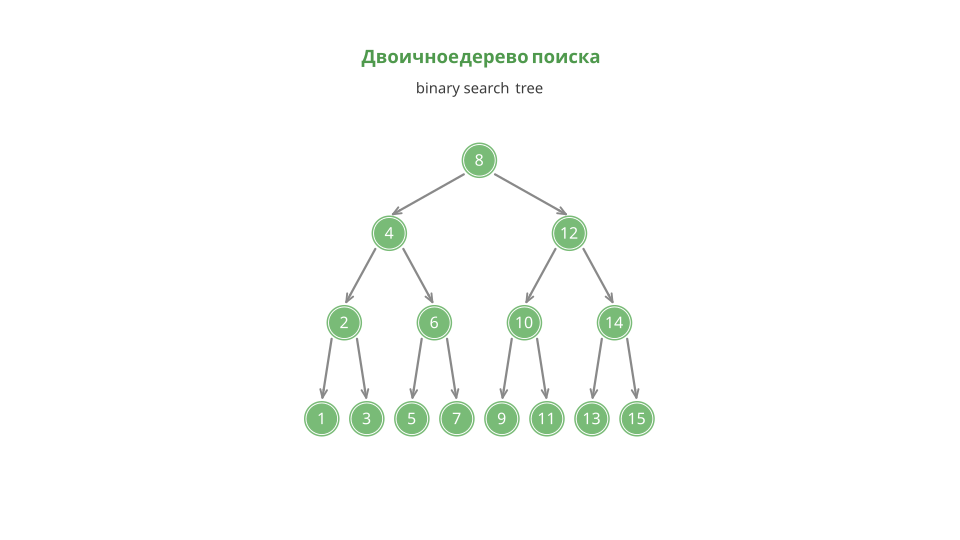
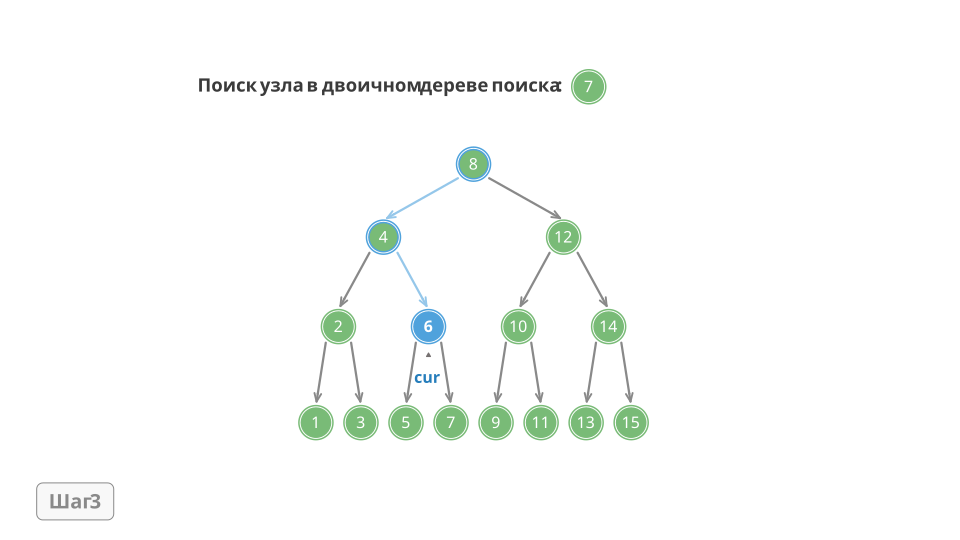
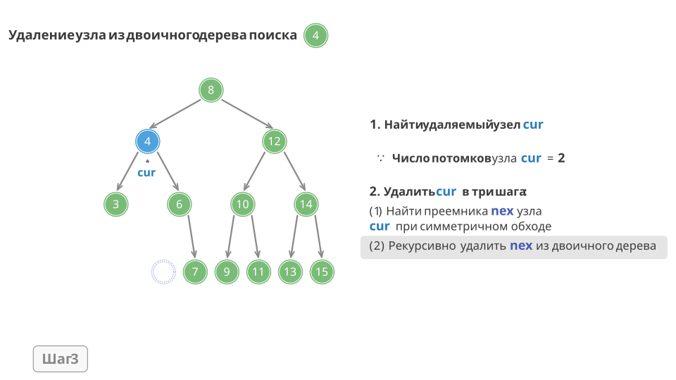
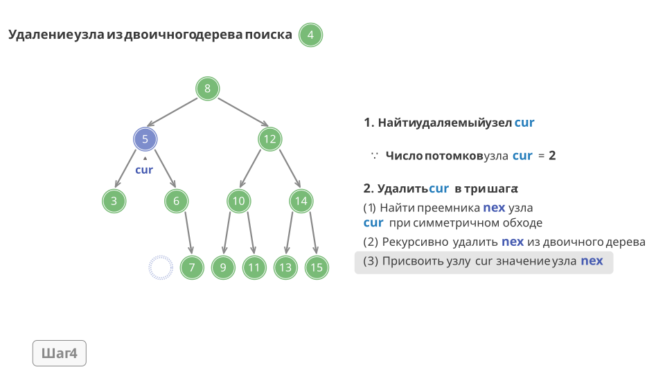
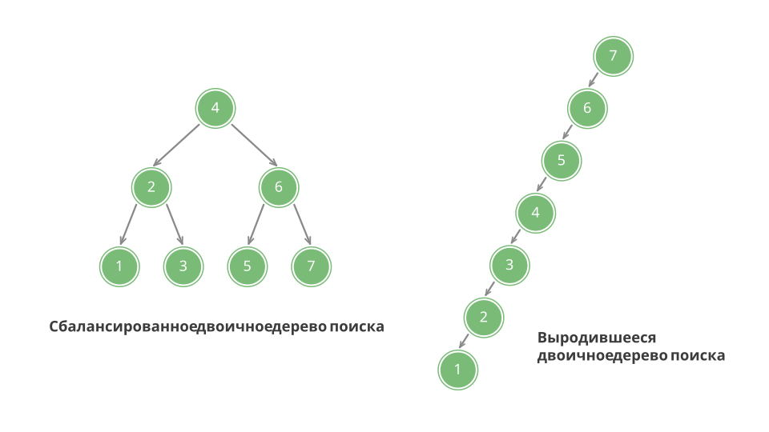

# Двоичное дерево поиска

<u>Двоичное дерево поиска (binary search tree)</u>, показанное ниже, удовлетворяет следующим условиям.

1. Для корня выполняется соотношение: любое значение в левом поддереве $<$ значение корня $<$ любое значение в правом поддереве.
2. Левое и правое поддеревья любого узла также являются двоичными деревьями поиска, то есть для них тоже выполняется условие `1.`.



## Операции с двоичным деревом поиска

Представим двоичное дерево поиска классом `BinarySearchTree` и объявим в нём поле `root`, которое указывает на корень.

### Поиск узла

Пусть нужно найти узел со значением `num`. Воспользуемся свойствами двоичного дерева поиска. Как показано на рисунке, заведём переменную `cur`, начнём с корня `root` и на каждой итерации будем сравнивать значение текущего узла `cur.val` с `num`.

- Если `cur.val < num`, искомый узел следует искать в правом поддереве `cur`. Выполняем `cur = cur.right`.
- Если `cur.val > num`, искомый узел следует искать в левом поддереве `cur`. Выполняем `cur = cur.left`.
- Если `cur.val = num`, искомый узел найден. Выходим из цикла и возвращаем этот узел.

=== "<1>"
    

=== "<2>"
    

=== "<3>"
    

=== "<4>"
    

Поиск в двоичном дереве поиска основан на том же принципе, что и двоичный поиск: на каждом шаге исключается половина вариантов. Число итераций ограничено высотой дерева. Если оно сбалансировано, поиск занимает $O(\log n)$ времени. Пример кода:

```src
[file]{binary_search_tree}-[class]{binary_search_tree}-[func]{search}
```

### Вставка узла

Чтобы вставить элемент `num` и сохранить свойство дерева поиска «левое поддерево < корень < правое поддерево», выполним следующие шаги, показанные на рисунке.

1. **Найдём место вставки**. Как и при поиске, идём от корня вниз, сравнивая значение текущего узла с `num`. Когда выйдем за пределы листа и достигнем `None`, завершим цикл.
2. **Вставим узел в найденную позицию**. Создадим узел со значением `num` и поместим его туда, где было `None`.


При реализации стоит учесть два момента.

- По определению двоичного дерева поиска значения узлов не должны повторяться. Поэтому, если такое значение уже есть в дереве, завершаем операцию без вставки.
- Для вставки понадобится указатель `pre`, в котором мы сохраняем узел с предыдущей итерации. Когда дойдём до `None`, по этому указателю сможем обратиться к родителю и присоединить новый узел.

```src
[file]{binary_search_tree}-[class]{binary_search_tree}-[func]{insert}
```

Как и поиск, вставка узла занимает $O(\log n)$ времени.

### Удаление узла

Сначала найдём нужный узел в дереве, затем удалим его. Как и при вставке, после удаления должно сохраниться свойство дерева поиска «левое поддерево < корень < правое поддерево». Способ удаления зависит от числа потомков целевого узла. Возможны три случая: 0, 1 или 2.

Когда степень удаляемого узла равна $0$, это лист. Его можно просто удалить, как показано на рисунке.


Когда степень удаляемого узла равна $1$, достаточно заменить его единственным потомком, как показано на рисунке.


Когда степень удаляемого узла равна $2$, просто удалить его нельзя: нужна замена. Чтобы сохранить свойство «левое поддерево $<$ корень $<$ правое поддерево», **можно взять узел с наименьшим значением в правом поддереве или с наибольшим значением в левом**.

Выберем наименьший узел правого поддерева, то есть следующий узел в порядке симметричного обхода. Ход удаления показан на рисунке.

1. Найдём узел, следующий за удаляемым при симметричном обходе, и обозначим его `tmp`.
2. Заменим значение удаляемого узла значением `tmp` и рекурсивно удалим из дерева узел `tmp`.

=== "<1>"
    

=== "<2>"
    

=== "<3>"
    

=== "<4>"
    

Удаление также занимает $O(\log n)$ времени: поиск удаляемого узла требует $O(\log n)$ времени, а поиск его преемника в порядке симметричного обхода — $O(\log n)$. Пример кода:

```src
[file]{binary_search_tree}-[class]{binary_search_tree}-[func]{remove}
```

### Симметричный обход даёт упорядоченную последовательность

Как показано на рисунке, симметричный обход двоичного дерева идёт в порядке «левое поддерево $\rightarrow$ корень $\rightarrow$ правое поддерево». При этом в двоичном дереве поиска выполняется соотношение «левый потомок $<$ корень $<$ правый потомок».

Поэтому при симметричном обходе двоичного дерева поиска очередным всегда посещается наименьший из оставшихся узлов. Отсюда важное свойство: **при симметричном обходе двоичного дерева поиска значения идут по возрастанию**.

Благодаря этому свойству упорядоченные данные из двоичного дерева поиска можно получить всего за $O(n)$ времени. Дополнительная сортировка не требуется.


## Эффективность двоичного дерева поиска

Предположим, что набор данных можно хранить в массиве или в двоичном дереве поиска. Как видно из таблицы, в дереве поиска все эти операции имеют логарифмическую временную сложность и выполняются стабильно быстро. Массив эффективнее дерева поиска лишь тогда, когда данные часто добавляют, а ищут и удаляют редко.

<p align="center"> Таблица <id> &nbsp; Сравнение эффективности массива и дерева поиска </p>

|          | Неупорядоченный массив | Двоичное дерево поиска  |
| -------- | -------- | ----------- |
| Поиск элемента | $O(n)$   | $O(\log n)$ |
| Вставка элемента | $O(1)$   | $O(\log n)$ |
| Удаление элемента | $O(n)$   | $O(\log n)$ |

В идеальном случае двоичное дерево поиска сбалансировано. Тогда любой узел можно найти за $\log n$ итераций.

Однако многократные вставки и удаления могут превратить дерево поиска в связный список, как показано ниже. В этом случае временная сложность операций ухудшается до $O(n)$.



## Применение двоичных деревьев поиска

- Многоуровневые индексы для эффективного поиска, вставки и удаления в информационных системах.
- Внутренняя структура данных для некоторых алгоритмов поиска.
- Хранение поступающих из потока данных в упорядоченном виде.
