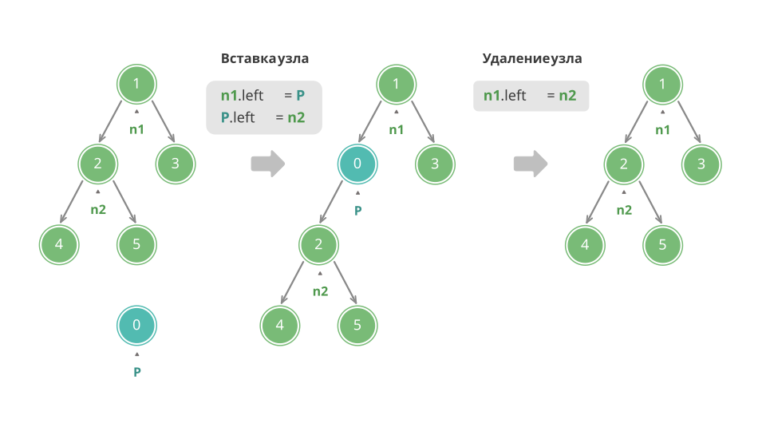
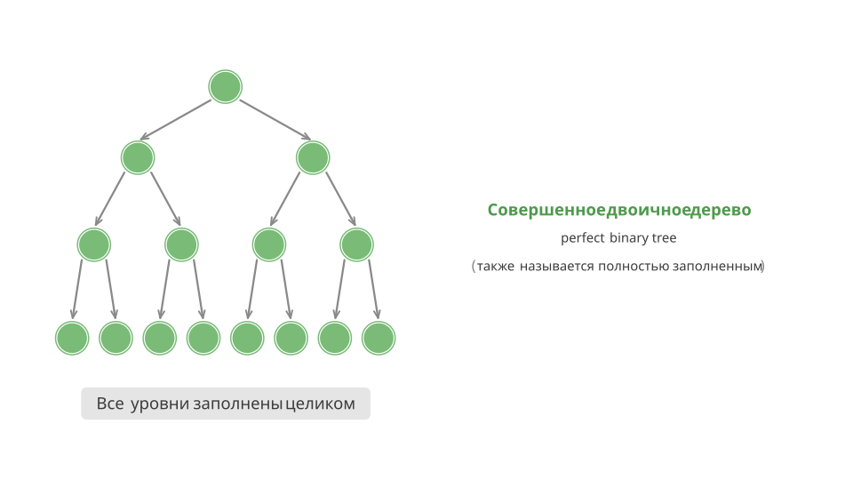
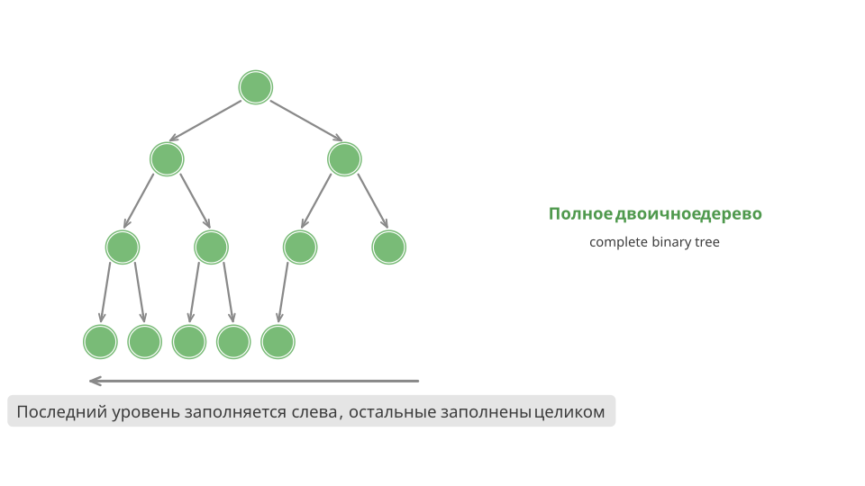
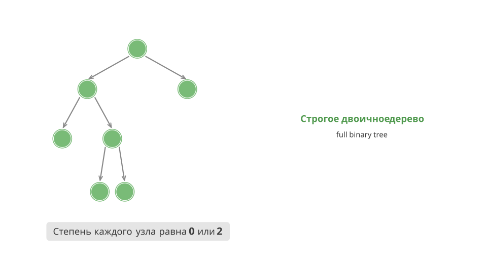

# Двоичное дерево

<u>Двоичное дерево (binary tree)</u> — нелинейная структура данных, которая описывает отношения между предками и потомками и воплощает идею разделения задачи на две части по принципу «разделяй и властвуй». Как и в связном списке, его основной элемент — узел. В узле хранятся значение и ссылки на левого и правого потомков.

```snippet
tree_node_class
```

В каждом узле есть две ссылки (указателя) — на <u>левого потомка (left-child node)</u> и на <u>правого потомка (right-child node)</u>. Сам узел называется их <u>родителем (parent node)</u>. Дерево, образованное левым потомком выбранного узла и всеми его потомками, называется <u>левым поддеревом (left subtree)</u> этого узла. Аналогично определяется <u>правое поддерево (right subtree)</u>.

**В двоичном дереве у каждого узла, кроме листьев, есть потомки и непустые поддеревья**. На рисунке ниже у узла 2 как родителя левый потомок — узел 4, а правый — узел 5. Левое поддерево образуют узел 4 и все узлы под ним, правое — узел 5 и все узлы под ним.


## Основные понятия двоичного дерева

На рисунке показаны основные понятия, связанные с двоичным деревом.

- <u>Корень (root node)</u> — узел на верхнем уровне двоичного дерева, у которого нет родителя.
- <u>Лист (leaf node)</u> — узел без потомков. Оба его указателя имеют значение `None`.
- <u>Ребро (edge)</u> — линия, соединяющая два узла. В структуре данных ей соответствует ссылка (указатель) на узел.
- <u>Уровень (level)</u> узла отсчитывается сверху вниз. Корень находится на уровне 1.
- <u>Степень (degree)</u> узла — число его непосредственных потомков. В двоичном дереве возможны значения 0, 1 и 2.
- <u>Высота (height)</u> двоичного дерева — число рёбер от корня до самого удалённого листа.
- <u>Глубина (depth)</u> узла — число рёбер на пути от корня до этого узла.
- <u>Высота (height)</u> узла — число рёбер между ним и самым удалённым листом его поддерева.


!!! tip

    Обычно высоту и глубину измеряют числом рёбер на пути. В некоторых задачах и учебниках вместо этого считают узлы пути. При таком определении значения высоты и глубины увеличиваются на 1.

## Основные операции с двоичным деревом

### Инициализация двоичного дерева

Как и в связном списке, сначала создаём узлы, затем связываем их ссылками (указателями).

```snippet
init_binary_tree
```

??? pythontutor "Визуализация выполнения"

    @tutor init_binary_tree_tutor

### Вставка и удаление узлов

Как и в связном списке, для вставки и удаления узлов двоичного дерева достаточно изменить указатели. Пример показан на рисунке.



```snippet
insert_remove_node
```

??? pythontutor "Визуализация выполнения"

    @tutor insert_remove_node_tutor

!!! tip

    Вставка может изменить исходную логическую структуру дерева, а при удалении узла обычно удаляются и все его поддеревья. Поэтому на практике вставка и удаление в двоичном дереве обычно представляют собой несколько согласованных действий, которые вместе дают нужный результат.

## Основные виды двоичных деревьев

### Совершенное двоичное дерево

В <u>совершенном двоичном дереве (perfect binary tree)</u> все уровни заполнены целиком, как на рисунке ниже. Степень листьев равна $0$, степень всех остальных узлов — $2$. При высоте $h$ общее число узлов равно $2^{h+1} - 1$. Такая экспоненциальная зависимость напоминает деление клеток в природе.

!!! tip

    В китайской литературе совершенное двоичное дерево часто называют <u>«полностью заполненным двоичным деревом»</u>.



### Полное двоичное дерево

В <u>полном двоичном дереве (complete binary tree)</u>, показанном ниже, только последний уровень может быть заполнен частично. Узлы этого уровня должны занимать последовательные позиции слева направо. Заметьте, что любое совершенное двоичное дерево также является полным.



### Строгое двоичное дерево

В <u>строгом двоичном дереве (full binary tree)</u> каждый узел, кроме листьев, имеет двух потомков, как показано на рисунке.



### Сбалансированное двоичное дерево

В <u>сбалансированном двоичном дереве (balanced binary tree)</u> для любого узла модуль разности высот левого и правого поддеревьев не превышает 1, как показано на рисунке.


## Вырождение двоичного дерева

На рисунке показаны идеальная и вырожденная формы двоичного дерева. Если каждый уровень заполнен целиком, дерево совершенно. Если все узлы отклонены в одну сторону, дерево вырождается в связный список.

- Совершенное двоичное дерево — идеальный случай, в котором полностью проявляются преимущества принципа «разделяй и властвуй».
- Связный список — другая крайность. Все операции становятся линейными, и их временная сложность возрастает до $O(n)$.


Как видно из таблицы, в лучшем и худшем случаях число листьев, общее число узлов, высота дерева и другие характеристики достигают максимальных или минимальных значений.

<p align="center"> Таблица <id> &nbsp; Лучшая и худшая формы двоичного дерева </p>

|                             | Совершенное двоичное дерево         | Связный список    |
| --------------------------- | ------------------ | ------- |
| Число узлов на уровне $i$         | $2^{i-1}$          | $1$     |
| Число листьев в дереве высоты $h$ | $2^h$              | $1$     |
| Общее число узлов в дереве высоты $h$   | $2^{h+1} - 1$      | $h + 1$ |
| Высота дерева из $n$ узлов   | $\log_2 (n+1) - 1$ | $n - 1$ |
